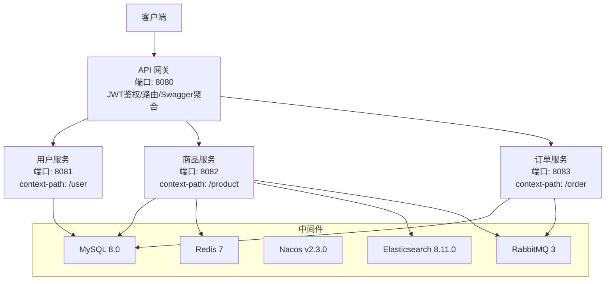
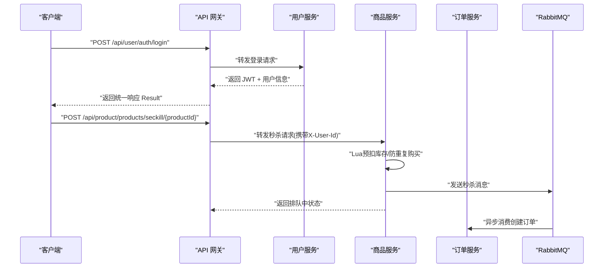
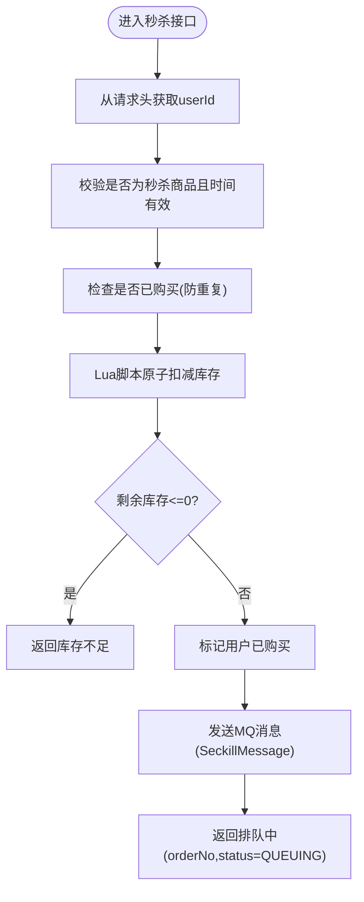
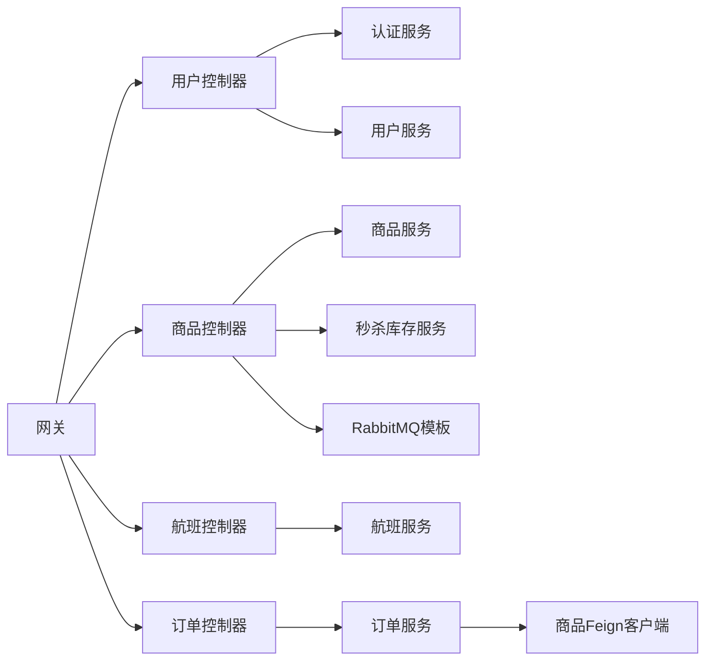

# API接口文档

<cite>
**本文引用的文件**   
- [README.md](file://README.md)
- [Result.java](file://backend/ecommerce-common/src/main/java/com/ecommerce/common/Result.java)
- [BusinessException.java](file://backend/ecommerce-common/src/main/java/com/ecommerce/common/BusinessException.java)
- [AuthController.java](file://backend/ecommerce-user/src/main/java/com/ecommerce/user/controller/AuthController.java)
- [CaptchaController.java](file://backend/ecommerce-user/src/main/java/com/ecommerce/user/controller/CaptchaController.java)
- [UserController.java](file://backend/ecommerce-user/src/main/java/com/ecommerce/user/controller/UserController.java)
- [LoginRequest.java](file://backend/ecommerce-user/src/main/java/com/ecommerce/user/dto/LoginRequest.java)
- [RegisterRequest.java](file://backend/ecommerce-user/src/main/java/com/ecommerce/user/dto/RegisterRequest.java)
- [CaptchaResponse.java](file://backend/ecommerce-user/src/main/java/com/ecommerce/user/dto/CaptchaResponse.java)
- [ProductController.java](file://backend/ecommerce-product/src/main/java/com/ecommerce/product/controller/ProductController.java)
- [SeckillController.java](file://backend/ecommerce-product/src/main/java/com/ecommerce/product/controller/SeckillController.java)
- [FlightController.java](file://backend/ecommerce-product/src/main/java/com/ecommerce/product/controller/FlightController.java)
- [Flight.java](file://backend/ecommerce-product/src/main/java/com/ecommerce/product/entity/Flight.java)
- [FlightService.java](file://backend/ecommerce-product/src/main/java/com/ecommerce/product/service/FlightService.java)
- [FlightServiceImpl.java](file://backend/ecommerce-product/src/main/java/com/ecommerce/product/service/impl/FlightServiceImpl.java)
- [FlightRepository.java](file://backend/ecommerce-product/src/main/java/com/ecommerce/product/repository/FlightRepository.java)
- [FlightMapper.java](file://backend/ecommerce-product/src/main/java/com/ecommerce/product/repository/mapper/FlightMapper.java)
- [FlightMapper.xml](file://backend/ecommerce-product/src/main/resources/mapper/FlightMapper.xml)
- [OrderController.java](file://backend/ecommerce-order/src/main/java/com/ecommerce/order/controller/OrderController.java)
- [Order.java](file://backend/ecommerce-order/src/main/java/com/ecommerce/order/entity/Order.java)
</cite>

## 更新摘要
**变更内容**   
- 新增航班管理API接口章节，包含完整的CRUD操作、搜索筛选和频率统计功能
- 添加航班实体模型定义和相关数据映射说明
- 更新商品服务架构，增加航班管理模块
- 补充航班相关的数据流程图和依赖关系图

## 目录
1. [引言](#引言)
2. [项目结构](#项目结构)
3. [核心组件](#核心组件)
4. [架构总览](#架构总览)
5. [详细接口说明](#详细接口说明)
6. [依赖关系分析](#依赖关系分析)
7. [性能与限流](#性能与限流)
8. [故障排查指南](#故障排查指南)
9. [结论](#结论)
10. [附录：数据模型定义](#附录数据模型定义)

## 引言
本文件为后端微服务电商系统的完整API参考，覆盖用户服务认证、用户管理、验证码；商品服务CRUD、搜索、秒杀；航班管理服务；订单服务管理与秒杀消费。文档包含HTTP方法、URL路径、请求参数、响应格式、错误码说明、调用流程图、数据模型定义、版本兼容性说明等。所有外部请求统一经API网关（端口8080）路由到下游微服务，网关负责JWT鉴权并将用户信息透传给下游服务。

## 项目结构
后端采用Spring Cloud微服务架构，拆分为公共模块、网关、用户服务、商品服务、订单服务；前端基于qiankun微前端。各微服务通过Nacos注册发现，网关按路径前缀分发请求。Swagger文档在各服务内集成，并通过网关聚合展示。

图表来源
- [README.md:16-47](file://README.md#L16-L47)

章节来源
- [README.md:16-47](file://README.md#L16-L47)

## 核心组件
- 统一响应体 Result：所有接口返回统一结构，code=200表示成功，message为提示信息，data为业务数据。
- 业务异常 BusinessException：业务校验失败抛出，由全局异常处理器转换为Result。
- 网关鉴权 AuthGlobalFilter：白名单放行、JWT校验、用户头透传。
- 各微服务控制器：AuthController、CaptchaController、UserController、ProductController、SeckillController、FlightController、OrderController。

章节来源
- [Result.java:1-64](file://backend/ecommerce-common/src/main/java/com/ecommerce/common/Result.java#L1-L64)
- [BusinessException.java:1-23](file://backend/ecommerce-common/src/main/java/com/ecommerce/common/BusinessException.java#L1-L23)
- [README.md:406-428](file://README.md#L406-L428)

## 架构总览
系统对外暴露统一入口为网关，内部微服务职责清晰：
- 用户服务：认证、用户管理、短信与图片验证码、主题偏好。
- 商品服务：商品CRUD、ES搜索、秒杀库存预扣与抢购、库存同步、航班管理。
- 订单服务：订单CRUD、秒杀订单异步消费、Feign调用商品服务扣减库存。

图表来源
- [AuthController.java:54-59](file://backend/ecommerce-user/src/main/java/com/ecommerce/user/controller/AuthController.java#L54-L59)
- [SeckillController.java:57-122](file://backend/ecommerce-product/src/main/java/com/ecommerce/product/controller/SeckillController.java#L57-L122)
- [OrderController.java:27-33](file://backend/ecommerce-order/src/main/java/com/ecommerce/order/controller/OrderController.java#L27-L33)

## 详细接口说明

### 通用约定
- 基础路径：所有外部请求以 /api 开头，由网关根据上下文路径路由到具体微服务。
- 统一响应体：
  - code：整数，200表示成功，其他为业务错误码。
  - message：字符串，提示信息。
  - data：任意类型，业务数据或null。
- 认证方式：
  - 匿名接口：无需Authorization头。
  - 需认证接口：Authorization: Bearer <JWT>。
  - 网关将X-User-Id、X-User-Name注入请求头供下游使用。
- 错误处理：
  - 业务异常统一包装为Result，HTTP状态恒为200，错误码在code字段。
  - JWT鉴权失败由网关直接返回HTTP 401。

章节来源
- [README.md:332-428](file://README.md#L332-L428)
- [Result.java:1-64](file://backend/ecommerce-common/src/main/java/com/ecommerce/common/Result.java#L1-L64)
- [BusinessException.java:1-23](file://backend/ecommerce-common/src/main/java/com/ecommerce/common/BusinessException.java#L1-L23)

### 用户服务认证接口（/api/user/auth/**）
- GET /api/user/auth/captcha
  - 说明：获取图片验证码（Base64 PNG + captchaKey）。
  - 鉴权：匿名。
  - 响应：Result<CaptchaResponse>，captchaKey用于后续提交，captchaImage为Data URL。
- POST /api/user/auth/send-sms-code
  - 说明：发送短信验证码（先校验图片验证码，同一手机号60秒频控）。
  - 请求体：SendSmsCodeRequest（含captchaKey、captchaValue、目标手机号或用户名）。
  - 鉴权：匿名。
  - 响应：Result<Void>。
- POST /api/user/auth/register
  - 说明：注册新用户（需图片验证码 + 短信验证码 + 手机号）。
  - 请求体：RegisterRequest（username、password、confirmPassword、name、email、phone、age、captchaKey、captchaValue、smsCode）。
  - 鉴权：匿名。
  - 响应：Result<User>。
- POST /api/user/auth/login
  - 说明：登录（需图片验证码 + 短信验证码，admin可跳过部分校验）。
  - 请求体：LoginRequest（username、password、captchaKey、captchaValue、smsCode）。
  - 鉴权：匿名。
  - 响应：Result<LoginResponse>（含JWT与用户信息）。
- GET /api/user/auth/me
  - 说明：获取当前登录用户信息。
  - 鉴权：JWT。
  - 响应：Result<User>。
- POST /api/user/auth/logout
  - 说明：退出登录（清除Redis会话Token）。
  - 鉴权：JWT。
  - 响应：Result<Void>。

示例
- 请求（登录）：
  - 方法：POST
  - 路径：/api/user/auth/login
  - 头部：Content-Type: application/json
  - 主体：{ username, password, captchaKey?, captchaValue?, smsCode? }
- 响应：
  - { code: 200, message: "success", data: { token, user } }

章节来源
- [AuthController.java:47-94](file://backend/ecommerce-user/src/main/java/com/ecommerce/user/controller/AuthController.java#L47-L94)
- [CaptchaController.java:28-33](file://backend/ecommerce-user/src/main/java/com/ecommerce/user/controller/CaptchaController.java#L28-L33)
- [LoginRequest.java:1-30](file://backend/ecommerce-user/src/main/java/com/ecommerce/user/dto/LoginRequest.java#L1-L30)
- [RegisterRequest.java:1-50](file://backend/ecommerce-user/src/main/java/com/ecommerce/user/dto/RegisterRequest.java#L1-L50)
- [CaptchaResponse.java:1-22](file://backend/ecommerce-user/src/main/java/com/ecommerce/user/dto/CaptchaResponse.java#L1-L22)

### 用户管理接口（/api/user/users/**）
- GET /api/user/users
  - 说明：查询用户列表。
  - 鉴权：JWT。
  - 响应：Result<List<User>>。
- GET /api/user/users/{id}
  - 说明：根据ID查询用户。
  - 鉴权：JWT。
  - 响应：Result<User>。
- POST /api/user/users
  - 说明：新增用户。
  - 鉴权：JWT。
  - 请求体：User实体（含审计字段）。
  - 响应：Result<User>。
- PUT /api/user/users/{id}
  - 说明：更新用户。
  - 鉴权：JWT。
  - 请求体：User实体。
  - 响应：Result<User>。
- DELETE /api/user/users/{id}
  - 说明：删除用户。
  - 鉴权：JWT。
  - 响应：Result<Void>。
- GET /api/user/sms/records
  - 说明：查询短信发送记录（时间倒序）。
  - 鉴权：JWT。
  - 响应：Result<List<SmsRecord>>。
- GET /api/user/users/theme
  - 说明：获取当前用户主题偏好（dark/light）。
  - 鉴权：JWT。
  - 响应：Result<Map<String,String>>（theme键）。
- PUT /api/user/users/theme
  - 说明：更新当前用户主题偏好。
  - 鉴权：JWT。
  - 请求体：Map（theme: dark|light）。
  - 响应：Result<Void>。

示例
- 请求（更新主题）：
  - 方法：PUT
  - 路径：/api/user/users/theme
  - 头部：Authorization: Bearer <token>, Content-Type: application/json
  - 主体：{ theme: "dark" }
- 响应：
  - { code: 200, message: "success", data: null }

章节来源
- [UserController.java:49-131](file://backend/ecommerce-user/src/main/java/com/ecommerce/user/controller/UserController.java#L49-L131)

### 商品服务CRUD接口（/api/product/products/**）
- GET /api/product/products
  - 说明：查询所有商品。
  - 鉴权：JWT。
  - 响应：Result<List<Product>>。
- GET /api/product/products/{id}
  - 说明：根据ID查询商品。
  - 鉴权：JWT。
  - 响应：Result<Product>。
- GET /api/product/products/category/{category}
  - 说明：按分类查询商品。
  - 鉴权：JWT。
  - 响应：Result<List<Product>>。
- GET /api/product/products/search
  - 说明：搜索商品（keyword、category、priceMin、priceMax）。
  - 鉴权：JWT。
  - 查询参数：keyword?、category?、priceMin?、priceMax?
  - 响应：Result<List<Product>>。
- POST /api/product/products
  - 说明：创建商品。
  - 鉴权：JWT。
  - 请求体：Product实体。
  - 响应：Result<Product>。
- PUT /api/product/products/{id}
  - 说明：更新商品。
  - 鉴权：JWT。
  - 请求体：Product实体。
  - 响应：Result<Product>。
- DELETE /api/product/products/{id}
  - 说明：删除商品。
  - 鉴权：JWT。
  - 响应：Result<Void>。
- POST /api/product/products/sync-es
  - 说明：全量同步商品到Elasticsearch。
  - 鉴权：JWT。
  - 响应：Result<Void>。
- POST /api/product/products/deduct-stock
  - 说明：扣减库存（供订单服务Feign内部调用）。
  - 鉴权：JWT。
  - 查询参数：productId、quantity
  - 响应：Result<Boolean>。

示例
- 请求（搜索）：
  - 方法：GET
  - 路径：/api/product/products/search?keyword=手机&category=数码&priceMin=1000&priceMax=5000
  - 头部：Authorization: Bearer <token>
- 响应：
  - { code: 200, message: "success", data: [Product, ...] }

章节来源
- [ProductController.java:26-95](file://backend/ecommerce-product/src/main/java/com/ecommerce/product/controller/ProductController.java#L26-L95)

### 商品服务秒杀接口（/api/product/products/seckill/**）
- POST /api/product/products/seckill/init/{productId}
  - 说明：初始化秒杀库存（Redis预加载）。
  - 鉴权：JWT。
  - 查询参数：stock（库存数量）。
  - 响应：Result<Void>。
- POST /api/product/products/seckill/{productId}
  - 说明：秒杀抢购（Lua预扣 + MQ异步下单）。
  - 鉴权：JWT。
  - 查询参数：quantity（默认1）。
  - 响应：Result<Map<String,Object>>（orderNo、status="QUEUING"、message）。
- GET /api/product/products/seckill/stock/{productId}
  - 说明：查询秒杀库存。
  - 鉴权：JWT。
  - 响应：Result<Integer>。

调用流程

图表来源
- [SeckillController.java:57-122](file://backend/ecommerce-product/src/main/java/com/ecommerce/product/controller/SeckillController.java#L57-L122)

章节来源
- [SeckillController.java:45-149](file://backend/ecommerce-product/src/main/java/com/ecommerce/product/controller/SeckillController.java#L45-L149)

### 航班管理接口（/api/product/flights/**）
**新增** 航班管理接口提供完整的航班CRUD操作、搜索筛选和频率统计功能。

- GET /api/product/flights
  - 说明：查询所有航班（含关联商品信息）。
  - 鉴权：JWT。
  - 响应：Result<List<Flight>>。
- GET /api/product/flights/{id}
  - 说明：根据ID查询航班详情。
  - 鉴权：JWT。
  - 响应：Result<Flight>。
- GET /api/product/flights/search
  - 说明：按出发城市和/或落地城市筛选航班。
  - 鉴权：JWT。
  - 查询参数：departureCity?、arrivalCity?
  - 响应：Result<List<Flight>>。
- GET /api/product/flights/frequency
  - 说明：获取城市间航班频率统计数据（供飞线图使用）。
  - 鉴权：JWT。
  - 响应：Result<Map<String, Object>>（包含flights和cityFrequency）。
- POST /api/product/flights
  - 说明：创建新航班，需关联已有商品ID。
  - 鉴权：JWT。
  - 请求体：Flight实体。
  - 响应：Result<Flight>。
- PUT /api/product/flights/{id}
  - 说明：根据航班ID更新航班信息。
  - 鉴权：JWT。
  - 请求体：Flight实体。
  - 响应：Result<Flight>。
- DELETE /api/product/flights/{id}
  - 说明：根据航班ID删除指定航班。
  - 鉴权：JWT。
  - 响应：Result<Void>。

示例
- 请求（筛选航班）：
  - 方法：GET
  - 路径：/api/product/flights/search?departureCity=北京&arrivalCity=上海
  - 头部：Authorization: Bearer <token>
- 响应：
  - { code: 200, message: "success", data: [Flight, ...] }

章节来源
- [FlightController.java:26-77](file://backend/ecommerce-product/src/main/java/com/ecommerce/product/controller/FlightController.java#L26-L77)

### 订单服务管理接口（/api/order/orders/**）
- POST /api/order/orders
  - 说明：创建订单。
  - 鉴权：JWT。
  - 请求体：Order实体（含userId由网关透传，实际由服务端从X-User-Id解析）。
  - 响应：Result<Order>。
- GET /api/order/orders/my
  - 说明：查询当前用户的订单列表。
  - 鉴权：JWT。
  - 响应：Result<List<Order>>。
- GET /api/order/orders/{orderNo}
  - 说明：根据订单号查询订单详情。
  - 鉴权：JWT。
  - 响应：Result<Order>。
- GET /api/order/orders
  - 说明：查询所有订单（管理用）。
  - 鉴权：JWT。
  - 响应：Result<List<Order>>。
- POST /api/order/orders/{orderId}/cancel
  - 说明：取消订单（仅待支付状态可取消）。
  - 鉴权：JWT。
  - 响应：Result<Void>。
- PUT /api/order/orders/{orderId}/status
  - 说明：更新订单状态（管理用）。
  - 鉴权：JWT。
  - 查询参数：status（0待支付 → 1已支付 → 2已发货 → 3已完成 → 4已取消）。
  - 响应：Result<Void>。

示例
- 请求（取消订单）：
  - 方法：POST
  - 路径：/api/order/orders/123/cancel
  - 头部：Authorization: Bearer <token>
- 响应：
  - { code: 200, message: "success", data: null }

章节来源
- [OrderController.java:27-72](file://backend/ecommerce-order/src/main/java/com/ecommerce/order/controller/OrderController.java#L27-L72)

### 秒杀消费接口（后台异步）
- 秒杀消费由订单服务的消费者监听RabbitMQ队列，接收SeckillMessage并创建订单。该过程不直接暴露REST接口，属于后台异步处理链路。

章节来源
- [README.md:366-380](file://README.md#L366-L380)

## 依赖关系分析
- 网关依赖JWT工具与白名单配置，对下游服务透传用户头。
- 用户服务依赖AuthService、RedisSessionService、UserService、CaptchaService。
- 商品服务依赖ProductService、SeckillStockService、FlightService、RabbitTemplate、ElasticsearchRepository。
- 订单服务依赖OrderService、ProductClient（OpenFeign）、RabbitMQ消费者。

图表来源
- [AuthController.java:38-45](file://backend/ecommerce-user/src/main/java/com/ecommerce/user/controller/AuthController.java#L38-L45)
- [ProductController.java:20-24](file://backend/ecommerce-product/src/main/java/com/ecommerce/product/controller/ProductController.java#L20-L24)
- [SeckillController.java:33-43](file://backend/ecommerce-product/src/main/java/com/ecommerce/product/controller/SeckillController.java#L33-L43)
- [FlightController.java:20-24](file://backend/ecommerce-product/src/main/java/com/ecommerce/product/controller/FlightController.java#L20-L24)
- [OrderController.java:21-25](file://backend/ecommerce-order/src/main/java/com/ecommerce/order/controller/OrderController.java#L21-L25)

章节来源
- [README.md:504-509](file://README.md#L504-L509)

## 性能与限流
- 图片验证码与短信验证码：进程内存实现，重启后失效；短信发送同一手机号60秒频控，超频返回code=429。
- 秒杀库存：Redis Lua脚本原子扣减，防止超卖；用户购买标识去重。
- 搜索引擎：Elasticsearch提供关键词、分类、价格区间等多条件搜索。
- 航班查询：MyBatis动态SQL支持多条件筛选，JOIN查询优化关联商品信息。
- 限流策略：
  - 验证码频控：图片验证码一次性使用；短信验证码60秒限制。
  - 秒杀防刷：用户维度购买标识；库存预扣与时间窗口校验。
  - 网关层：JWT鉴权失败直接返回401，减少无效请求。

章节来源
- [README.md:344-364](file://README.md#L344-L364)
- [README.md:366-380](file://README.md#L366-L380)

## 故障排查指南
- 常见错误码：
  - 400：业务校验失败（资源不存在/已存在/秒杀校验等）。
  - 401：未授权（JWT缺失/非法/过期）。
  - 403：权限不足。
  - 404：资源不存在。
  - 409：冲突（如重复注册）。
  - 429：频控（短信验证码超发）。
  - 500：内部错误（如秒杀库存未初始化）。
- 排查步骤：
  - 确认网关白名单与JWT配置正确。
  - 检查下游服务日志与数据库连接。
  - 验证Redis、RabbitMQ、Elasticsearch连通性。
  - 核对请求头Authorization与X-User-Id透传。

章节来源
- [README.md:415-428](file://README.md#L415-L428)
- [BusinessException.java:1-23](file://backend/ecommerce-common/src/main/java/com/ecommerce/common/BusinessException.java#L1-L23)

## 结论
本API文档覆盖了用户、商品、航班、订单四大核心域的全部REST接口，明确了认证方式、权限控制、限流策略与错误处理机制。通过网关统一鉴权与路由，结合Redis、RabbitMQ、Elasticsearch等中间件，实现了高并发场景下的安全与性能保障。新增的航班管理功能提供了完整的机票业务支撑，建议在生产环境完善分布式缓存与会话持久化，优化限流策略与监控告警。

## 附录：数据模型定义

### 用户相关模型
- LoginRequest
  - 字段：username、password、captchaKey、captchaValue、smsCode
- RegisterRequest
  - 字段：username、password、confirmPassword、name、email、phone、age、captchaKey、captchaValue、smsCode
- CaptchaResponse
  - 字段：captchaKey、captchaImage

章节来源
- [LoginRequest.java:1-30](file://backend/ecommerce-user/src/main/java/com/ecommerce/user/dto/LoginRequest.java#L1-L30)
- [RegisterRequest.java:1-50](file://backend/ecommerce-user/src/main/java/com/ecommerce/user/dto/RegisterRequest.java#L1-L50)
- [CaptchaResponse.java:1-22](file://backend/ecommerce-user/src/main/java/com/ecommerce/user/dto/CaptchaResponse.java#L1-L22)

### 商品模型
- Product
  - 字段：id、name、description、price、stock、category、imageUrl、status、isSeckill、seckillPrice、seckillStartTime、seckillEndTime、createdBy、createdDate、lastModifiedBy、lastModifiedDate

章节来源
- [Product.java:1-32](file://backend/ecommerce-product/src/main/java/com/ecommerce/product/entity/Product.java#L1-L32)

### 航班模型
- Flight
  - 字段：id、productId、departureCity、arrivalCity、departureLng、departureLat、arrivalLng、arrivalLat、flightNumber、duration、frequency、routeCoordinates、createdDate、lastModifiedDate
  - 关联字段：productName、productDescription、productPrice、productStock、productImageUrl、productStatus

章节来源
- [Flight.java:11-38](file://backend/ecommerce-product/src/main/java/com/ecommerce/product/entity/Flight.java#L11-L38)

### 订单模型
- Order
  - 字段：id、orderNo、userId、productId、productName、quantity、totalAmount、status、address、remark、createdDate、updatedDate
  - 状态枚举：0待支付、1已支付、2已发货、3已完成、4已取消

章节来源
- [Order.java:1-42](file://backend/ecommerce-order/src/main/java/com/ecommerce/order/entity/Order.java#L1-L42)