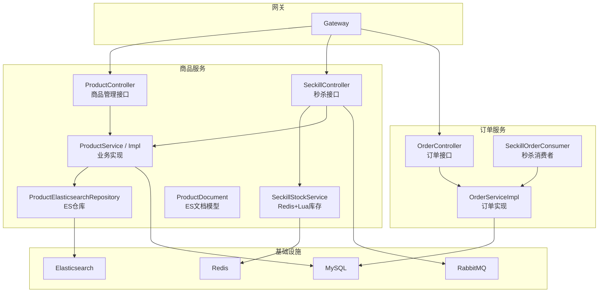
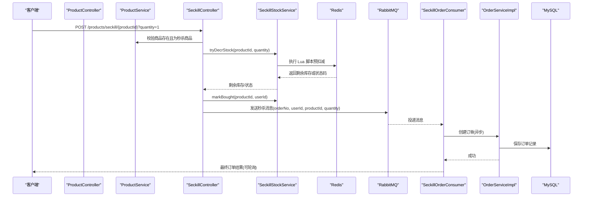
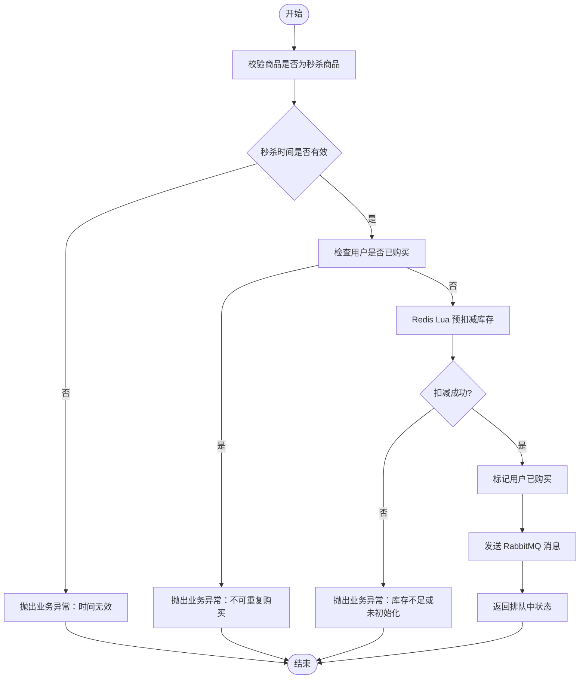
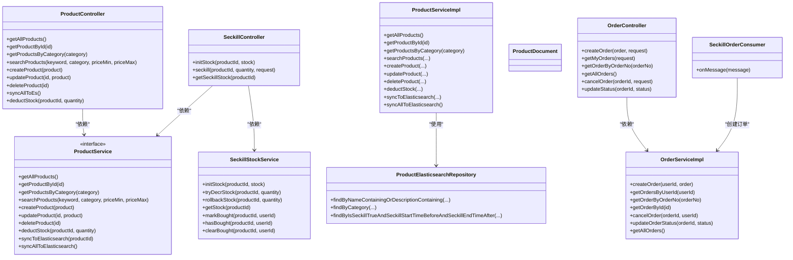

# 商品服务API

<cite>
**本文引用的文件**   
- [ProductController.java](file://backend/ecommerce-product/src/main/java/com/ecommerce/product/controller/ProductController.java)
- [FlightController.java](file://backend/ecommerce-product/src/main/java/com/ecommerce/product/controller/FlightController.java)
- [FlightService.java](file://backend/ecommerce-product/src/main/java/com/ecommerce/product/service/FlightService.java)
- [FlightServiceImpl.java](file://backend/ecommerce-product/src/main/java/com/ecommerce/product/service/impl/FlightServiceImpl.java)
- [Flight.java](file://backend/ecommerce-product/src/main/java/com/ecommerce/product/entity/Flight.java)
- [SeckillController.java](file://backend/ecommerce-product/src/main/java/com/ecommerce/product/controller/SeckillController.java)
- [ProductService.java](file://backend/ecommerce-product/src/main/java/com/ecommerce/product/service/ProductService.java)
- [ProductServiceImpl.java](file://backend/ecommerce-product/src/main/java/com/ecommerce/product/service/impl/ProductServiceImpl.java)
- [SeckillStockService.java](file://backend/ecommerce-product/src/main/java/com/ecommerce/product/service/SeckillStockService.java)
- [seckill_stock.lua](file://backend/ecommerce-product/src/main/resources/lua/seckill_stock.lua)
- [ProductDocument.java](file://backend/ecommerce-product/src/main/java/com/ecommerce/product/elasticsearch/ProductDocument.java)
- [ProductElasticsearchRepository.java](file://backend/ecommerce-product/src/main/java/com/ecommerce/product/elasticsearch/ProductElasticsearchRepository.java)
- [OrderController.java](file://backend/ecommerce-order/src/main/java/com/ecommerce/order/controller/OrderController.java)
- [OrderServiceImpl.java](file://backend/ecommerce-order/src/main/java/com/ecommerce/order/service/impl/OrderServiceImpl.java)
- [SeckillOrderConsumer.java](file://backend/ecommerce-order/src/main/java/com/ecommerce/order/consumer/SeckillOrderConsumer.java)
- [Result.java](file://backend/ecommerce-common/src/main/java/com/ecommerce/common/Result.java)
- [BusinessException.java](file://backend/ecommerce-common/src/main/java/com/ecommerce/common/BusinessException.java)
- [Product.java](file://backend/ecommerce-product/src/main/java/com/ecommerce/product/entity/Product.java)
</cite>

## 目录
1. [简介](#简介)
2. [项目结构](#项目结构)
3. [核心组件](#核心组件)
4. [架构总览](#架构总览)
5. [详细组件分析](#详细组件分析)
6. [依赖关系分析](#依赖关系分析)
7. [性能与高并发设计](#性能与高并发设计)
8. [故障排查指南](#故障排查指南)
9. [结论](#结论)
10. [附录：接口规范与调用示例](#附录接口规范与调用示例)

## 简介
本文件面向“商品服务”的 API 文档，覆盖以下能力：
- 商品管理接口（CRUD、分类查询、ES 同步）
- 商品搜索接口（基于 Elasticsearch 的多条件检索）
- 秒杀接口（Redis Lua 原子预扣减 + RabbitMQ 异步下单）
- 航班管理接口（机票商品 CRUD、城市筛选、航线频率统计）

目标读者包括后端开发者、前端集成人员以及运维人员。文档从系统架构到具体接口定义、错误码、调用示例进行分层说明，帮助快速理解并正确集成。

## 项目结构
本项目采用微服务拆分方式，与商品服务相关的代码主要位于 ecommerce-product 模块，订单相关逻辑在 ecommerce-order 模块，通用响应与异常封装在 ecommerce-common 模块。

图表来源
- [ProductController.java:15-96](file://backend/ecommerce-product/src/main/java/com/ecommerce/product/controller/ProductController.java#L15-L96)
- [SeckillController.java:26-148](file://backend/ecommerce-product/src/main/java/com/ecommerce/product/controller/SeckillController.java#L26-L148)
- [ProductServiceImpl.java:19-163](file://backend/ecommerce-product/src/main/java/com/ecommerce/product/service/impl/ProductServiceImpl.java#L19-L163)
- [SeckillStockService.java:15-91](file://backend/ecommerce-product/src/main/java/com/ecommerce/product/service/SeckillStockService.java#L15-L91)
- [ProductElasticsearchRepository.java:10-18](file://backend/ecommerce-product/src/main/java/com/ecommerce/product/elasticsearch/ProductElasticsearchRepository.java#L10-L18)
- [ProductDocument.java:17-55](file://backend/ecommerce-product/src/main/java/com/ecommerce/product/elasticsearch/ProductDocument.java#L17-L55)
- [OrderController.java:16-81](file://backend/ecommerce-order/src/main/java/com/ecommerce/order/controller/OrderController.java#L16-L81)
- [OrderServiceImpl.java:18-117](file://backend/ecommerce-order/src/main/java/com/ecommerce/order/service/impl/OrderServiceImpl.java#L18-L117)
- [SeckillOrderConsumer.java:21-69](file://backend/ecommerce-order/src/main/java/com/ecommerce/order/consumer/SeckillOrderConsumer.java#L21-L69)

章节来源
- [ProductController.java:15-96](file://backend/ecommerce-product/src/main/java/com/ecommerce/product/controller/ProductController.java#L15-L96)
- [SeckillController.java:26-148](file://backend/ecommerce-product/src/main/java/com/ecommerce/product/controller/SeckillController.java#L26-L148)
- [ProductServiceImpl.java:19-163](file://backend/ecommerce-product/src/main/java/com/ecommerce/product/service/impl/ProductServiceImpl.java#L19-L163)
- [SeckillStockService.java:15-91](file://backend/ecommerce-product/src/main/java/com/ecommerce/product/service/SeckillStockService.java#L15-L91)
- [ProductElasticsearchRepository.java:10-18](file://backend/ecommerce-product/src/main/java/com/ecommerce/product/elasticsearch/ProductElasticsearchRepository.java#L10-L18)
- [ProductDocument.java:17-55](file://backend/ecommerce-product/src/main/java/com/ecommerce/product/elasticsearch/ProductDocument.java#L17-L55)
- [OrderController.java:16-81](file://backend/ecommerce-order/src/main/java/com/ecommerce/order/controller/OrderController.java#L16-L81)
- [OrderServiceImpl.java:18-117](file://backend/ecommerce-order/src/main/java/com/ecommerce/order/service/impl/OrderServiceImpl.java#L18-L117)
- [SeckillOrderConsumer.java:21-69](file://backend/ecommerce-order/src/main/java/com/ecommerce/order/consumer/SeckillOrderConsumer.java#L21-L69)

## 核心组件
- ProductController：提供商品 CRUD、分类查询、ES 全量同步、普通库存扣减等接口。
- SeckillController：提供秒杀初始化、抢购、剩余库存查询等接口。
- ProductService/Impl：商品领域服务，负责数据库操作与 ES 数据同步。
- SeckillStockService：基于 Redis + Lua 的秒杀库存原子预扣减与防重购买标记。
- ProductDocument/ProductElasticsearchRepository：Elasticsearch 文档模型与仓库接口。
- OrderController/OrderServiceImpl：订单服务，创建订单、查询订单、取消订单等。
- SeckillOrderConsumer：监听 RabbitMQ 队列，异步创建秒杀订单。
- Result/BusinessException：统一响应体与业务异常封装。

章节来源
- [ProductController.java:15-96](file://backend/ecommerce-product/src/main/java/com/ecommerce/product/controller/ProductController.java#L15-L96)
- [SeckillController.java:26-148](file://backend/ecommerce-product/src/main/java/com/ecommerce/product/controller/SeckillController.java#L26-L148)
- [ProductService.java:8-38](file://backend/ecommerce-product/src/main/java/com/ecommerce/product/service/ProductService.java#L8-L38)
- [ProductServiceImpl.java:19-163](file://backend/ecommerce-product/src/main/java/com/ecommerce/product/service/impl/ProductServiceImpl.java#L19-L163)
- [SeckillStockService.java:15-91](file://backend/ecommerce-product/src/main/java/com/ecommerce/product/service/SeckillStockService.java#L15-L91)
- [ProductDocument.java:17-55](file://backend/ecommerce-product/src/main/java/com/ecommerce/product/elasticsearch/ProductDocument.java#L17-L55)
- [ProductElasticsearchRepository.java:10-18](file://backend/ecommerce-product/src/main/java/com/ecommerce/product/elasticsearch/ProductElasticsearchRepository.java#L10-L18)
- [OrderController.java:16-81](file://backend/ecommerce-order/src/main/java/com/ecommerce/order/controller/OrderController.java#L16-L81)
- [OrderServiceImpl.java:18-117](file://backend/ecommerce-order/src/main/java/com/ecommerce/order/service/impl/OrderServiceImpl.java#L18-L117)
- [SeckillOrderConsumer.java:21-69](file://backend/ecommerce-order/src/main/java/com/ecommerce/order/consumer/SeckillOrderConsumer.java#L21-L69)
- [Result.java:8-63](file://backend/ecommerce-common/src/main/java/com/ecommerce/common/Result.java#L8-L63)
- [BusinessException.java:6-22](file://backend/ecommerce-common/src/main/java/com/ecommerce/common/BusinessException.java#L6-L22)

## 架构总览
商品服务通过 REST 暴露接口；秒杀流程使用 Redis Lua 保证预扣减的原子性，并通过 RabbitMQ 将下单任务异步化，由订单服务消费消息落库。ES 用于商品搜索与筛选。

图表来源
- [SeckillController.java:61-122](file://backend/ecommerce-product/src/main/java/com/ecommerce/product/controller/SeckillController.java#L61-L122)
- [SeckillStockService.java:44-49](file://backend/ecommerce-product/src/main/java/com/ecommerce/product/service/SeckillStockService.java#L44-L49)
- [seckill_stock.lua:1-13](file://backend/ecommerce-product/src/main/resources/lua/seckill_stock.lua#L1-L13)
- [SeckillOrderConsumer.java:35-69](file://backend/ecommerce-order/src/main/java/com/ecommerce/order/consumer/SeckillOrderConsumer.java#L35-L69)
- [OrderServiceImpl.java:32-60](file://backend/ecommerce-order/src/main/java/com/ecommerce/order/service/impl/OrderServiceImpl.java#L32-L60)

## 详细组件分析

### 商品管理接口（CRUD、分类、ES 同步、普通扣库存）
- 获取所有商品
  - 方法：GET
  - 路径：/products
  - 请求参数：无
  - 响应：Result<List<Product>>
- 根据 ID 查询商品
  - 方法：GET
  - 路径：/products/{id}
  - 路径参数：id(Long)
  - 响应：Result<Product>
- 按分类查询商品
  - 方法：GET
  - 路径：/products/category/{category}
  - 路径参数：category(String)
  - 响应：Result<List<Product>>
- 搜索商品（关键词、分类、价格区间）
  - 方法：GET
  - 路径：/products/search
  - 查询参数：keyword(String)、category(String)、priceMin(BigDecimal)、priceMax(BigDecimal)
  - 响应：Result<List<Product>>
- 创建商品
  - 方法：POST
  - 路径：/products
  - 请求体：Product
  - 响应：Result<Product>
- 更新商品
  - 方法：PUT
  - 路径：/products/{id}
  - 路径参数：id(Long)
  - 请求体：Product
  - 响应：Result<Product>
- 删除商品
  - 方法：DELETE
  - 路径：/products/{id}
  - 路径参数：id(Long)
  - 响应：Result<Void>
- 全量同步商品到 ES
  - 方法：POST
  - 路径：/products/sync-es
  - 请求参数：无
  - 响应：Result<Void>
- 扣减库存（供订单服务 Feign 调用）
  - 方法：POST
  - 路径：/products/deduct-stock
  - 查询参数：productId(Long)、quantity(Integer)
  - 响应：Result<Boolean>

章节来源
- [ProductController.java:26-95](file://backend/ecommerce-product/src/main/java/com/ecommerce/product/controller/ProductController.java#L26-L95)
- [ProductService.java:8-38](file://backend/ecommerce-product/src/main/java/com/ecommerce/product/service/ProductService.java#L8-L38)
- [ProductServiceImpl.java:33-110](file://backend/ecommerce-product/src/main/java/com/ecommerce/product/service/impl/ProductServiceImpl.java#L33-L110)

### 商品搜索接口（Elasticsearch 集成）
- 搜索入口：/products/search
- 底层实现：ProductServiceImpl.searchProducts 调用 Repository 层查询；同时支持通过 ES 索引进行全文检索与范围过滤。
- ES 文档模型：ProductDocument 定义了字段类型、分词器、日期格式等映射。
- ES 仓库接口：ProductElasticsearchRepository 提供按名称/描述模糊匹配、按分类查询、按秒杀时间窗口查询等方法。
- 同步策略：创建/更新/删除商品时，ProductServiceImpl 会尝试将数据同步至 ES；提供全量同步接口 /products/sync-es。

章节来源
- [ProductServiceImpl.java:52-55](file://backend/ecommerce-product/src/main/java/com/ecommerce/product/service/impl/ProductServiceImpl.java#L52-L55)
- [ProductServiceImpl.java:112-145](file://backend/ecommerce-product/src/main/java/com/ecommerce/product/service/impl/ProductServiceImpl.java#L112-L145)
- [ProductDocument.java:17-55](file://backend/ecommerce-product/src/main/java/com/ecommerce/product/elasticsearch/ProductDocument.java#L17-L55)
- [ProductElasticsearchRepository.java:10-18](file://backend/ecommerce-product/src/main/java/com/ecommerce/product/elasticsearch/ProductElasticsearchRepository.java#L10-L18)

### 航班管理接口（机票商品）
航班接口位于 FlightController，统一前缀 `/flights`，返回均为 `Result<T>`；查询与统计会 JOIN products 表以补充商品展示字段。
- 查询全部航班
  - 方法：GET
  - 路径：/flights
  - 响应：Result<List<Flight>>
- 查询航班详情
  - 方法：GET
  - 路径：/flights/{id}
  - 路径参数：id(Long)；不存在时抛 BusinessException(code=404)
  - 响应：Result<Flight>
- 按城市筛选航班
  - 方法：GET
  - 路径：/flights/search
  - 查询参数：departureCity(String，可选)、arrivalCity(String，可选)；仅返回上架商品（p.status=1）的航线
  - 响应：Result<List<Flight>>
- 城市间航班频率统计
  - 方法：GET
  - 路径：/flights/frequency
  - 说明：返回 flights 原始列表与映射后的 cityFrequency（含 from/to/坐标/frequency/flightNumber/duration/routeCoordinates 及商品信息），供 Admin 飞线图使用
  - 响应：Result<Map<String,Object>>
- 创建航班
  - 方法：POST
  - 路径：/flights
  - 请求体：Flight（需关联 productId）；服务层写入 createdDate
  - 响应：Result<Flight>
- 更新航班
  - 方法：PUT
  - 路径：/flights/{id}
  - 路径参数：id(Long)；先校验存在（不存在抛 404），再用已存在主键覆盖后保存
  - 响应：Result<Flight>
- 删除航班
  - 方法：DELETE
  - 路径：/flights/{id}
  - 路径参数：id(Long)；删除前先校验存在
  - 响应：Result<Void>

章节来源
- [FlightController.java:15-78](file://backend/ecommerce-product/src/main/java/com/ecommerce/product/controller/FlightController.java#L15-L78)
- [FlightService.java:8-24](file://backend/ecommerce-product/src/main/java/com/ecommerce/product/service/FlightService.java#L8-L24)
- [FlightServiceImpl.java:26-96](file://backend/ecommerce-product/src/main/java/com/ecommerce/product/service/impl/FlightServiceImpl.java#L26-L96)
- [Flight.java:11-38](file://backend/ecommerce-product/src/main/java/com/ecommerce/product/entity/Flight.java#L11-L38)

### 秒杀接口（高并发库存处理）
- 初始化秒杀库存（管理接口）
  - 方法：POST
  - 路径：/products/seckill/init/{productId}
  - 路径参数：productId(Long)
  - 查询参数：stock(Integer)
  - 响应：Result<Void>
- 秒杀抢购
  - 方法：POST
  - 路径：/products/seckill/{productId}
  - 路径参数：productId(Long)
  - 查询参数：quantity(Integer，默认1)
  - 请求头：需包含用户标识（由网关注入）
  - 响应：Result<Map<String,Object>>，包含 orderNo、status、message
- 查询秒杀库存
  - 方法：GET
  - 路径：/products/seckill/stock/{productId}
  - 路径参数：productId(Long)
  - 响应：Result<Integer>

业务流程要点
- 前置校验：商品存在且为秒杀商品、秒杀时间窗口有效、用户未重复购买。
- 预扣减库存：通过 Redis Lua 脚本原子扣减，返回剩余库存或状态码。
- 防重购买：Redis 设置用户购买标记（带过期时间）。
- 异步下单：生成订单号后发送 RabbitMQ 消息，立即返回排队中状态。
- 消费者处理：订单服务监听队列，创建订单并持久化。

章节来源
- [SeckillController.java:45-148](file://backend/ecommerce-product/src/main/java/com/ecommerce/product/controller/SeckillController.java#L45-L148)
- [SeckillStockService.java:32-91](file://backend/ecommerce-product/src/main/java/com/ecommerce/product/service/SeckillStockService.java#L32-L91)
- [seckill_stock.lua:1-13](file://backend/ecommerce-product/src/main/resources/lua/seckill_stock.lua#L1-L13)
- [SeckillOrderConsumer.java:35-69](file://backend/ecommerce-order/src/main/java/com/ecommerce/order/consumer/SeckillOrderConsumer.java#L35-L69)

### 秒杀业务流程时序图

图表来源
- [SeckillController.java:61-122](file://backend/ecommerce-product/src/main/java/com/ecommerce/product/controller/SeckillController.java#L61-L122)
- [SeckillStockService.java:44-49](file://backend/ecommerce-product/src/main/java/com/ecommerce/product/service/SeckillStockService.java#L44-L49)
- [seckill_stock.lua:1-13](file://backend/ecommerce-product/src/main/resources/lua/seckill_stock.lua#L1-L13)

## 依赖关系分析
- Controller 层依赖 Service 层，Service 层依赖 Repository 与外部组件（Redis、ES、RabbitMQ）。
- 秒杀流程跨服务协作：商品服务负责预扣减与消息发送，订单服务负责消费消息并落库。
- 通用组件：Result 与 BusinessException 被多模块复用。

图表来源
- [ProductController.java:15-96](file://backend/ecommerce-product/src/main/java/com/ecommerce/product/controller/ProductController.java#L15-L96)
- [SeckillController.java:26-148](file://backend/ecommerce-product/src/main/java/com/ecommerce/product/controller/SeckillController.java#L26-L148)
- [ProductService.java:8-38](file://backend/ecommerce-product/src/main/java/com/ecommerce/product/service/ProductService.java#L8-L38)
- [ProductServiceImpl.java:19-163](file://backend/ecommerce-product/src/main/java/com/ecommerce/product/service/impl/ProductServiceImpl.java#L19-L163)
- [SeckillStockService.java:15-91](file://backend/ecommerce-product/src/main/java/com/ecommerce/product/service/SeckillStockService.java#L15-L91)
- [ProductDocument.java:17-55](file://backend/ecommerce-product/src/main/java/com/ecommerce/product/elasticsearch/ProductDocument.java#L17-L55)
- [ProductElasticsearchRepository.java:10-18](file://backend/ecommerce-product/src/main/java/com/ecommerce/product/elasticsearch/ProductElasticsearchRepository.java#L10-L18)
- [OrderController.java:16-81](file://backend/ecommerce-order/src/main/java/com/ecommerce/order/controller/OrderController.java#L16-L81)
- [OrderServiceImpl.java:18-117](file://backend/ecommerce-order/src/main/java/com/ecommerce/order/service/impl/OrderServiceImpl.java#L18-L117)
- [SeckillOrderConsumer.java:21-69](file://backend/ecommerce-order/src/main/java/com/ecommerce/order/consumer/SeckillOrderConsumer.java#L21-L69)

## 性能与高并发设计
- Redis Lua 原子性
  - 通过 seckill_stock.lua 在 Redis 单线程内完成读取、判断、扣减与返回值，避免并发超卖。
  - 关键逻辑：若库存未初始化返回 -1；若库存不足返回 0；否则 DECRBY 并返回剩余库存。
- 防重购买
  - 使用 Redis Key 存储用户购买标记，设置过期时间，防止同一用户在活动期内重复购买。
- 异步下单
  - 秒杀成功后立即返回排队状态，通过 RabbitMQ 将下单任务解耦，提升吞吐与用户体验。
- 限流建议
  - 可在网关层或商品服务层增加令牌桶/漏桶限流，限制单用户或全局 QPS，保护后端资源。
- 幂等与重试
  - 消费者侧应实现幂等处理（如基于 orderNo 去重），并结合死信队列进行失败重试与人工干预。

章节来源
- [seckill_stock.lua:1-13](file://backend/ecommerce-product/src/main/resources/lua/seckill_stock.lua#L1-L13)
- [SeckillStockService.java:44-91](file://backend/ecommerce-product/src/main/java/com/ecommerce/product/service/SeckillStockService.java#L44-L91)
- [SeckillController.java:61-122](file://backend/ecommerce-product/src/main/java/com/ecommerce/product/controller/SeckillController.java#L61-L122)
- [SeckillOrderConsumer.java:35-69](file://backend/ecommerce-order/src/main/java/com/ecommerce/order/consumer/SeckillOrderConsumer.java#L35-L69)

## 故障排查指南
- 常见业务异常
  - 未授权访问：缺少用户标识头，返回 401。
  - 非秒杀商品：商品未开启秒杀标志，返回 400。
  - 秒杀时间未配置或不在时间窗口：返回 400。
  - 重复购买：用户已参与过该秒杀，返回 400。
  - 库存未初始化：Redis 中无对应库存 Key，返回 500。
  - 库存不足：Lua 返回 0，提示已售罄，返回 400。
- 排查建议
  - 确认 Redis 连接与 Key 是否存在（seckill:stock:{productId}、seckill:bought:{productId}:{userId}）。
  - 检查 RabbitMQ 队列是否可用，消费者是否正常消费。
  - 核对 ES 索引与映射是否与 ProductDocument 一致。
  - 查看日志定位异常堆栈与关键步骤输出。

章节来源
- [BusinessException.java:6-22](file://backend/ecommerce-common/src/main/java/com/ecommerce/common/BusinessException.java#L6-L22)
- [SeckillController.java:61-122](file://backend/ecommerce-product/src/main/java/com/ecommerce/product/controller/SeckillController.java#L61-L122)
- [SeckillStockService.java:44-91](file://backend/ecommerce-product/src/main/java/com/ecommerce/product/service/SeckillStockService.java#L44-L91)

## 结论
商品服务通过清晰的接口分层与组件职责划分，实现了商品管理、搜索与秒杀三大核心能力。在高并发场景下，借助 Redis Lua 原子性与 RabbitMQ 异步化，有效提升了吞吐与稳定性。后续可结合网关限流、消费者幂等与补偿机制进一步完善系统健壮性。

## 附录：接口规范与调用示例

### 统一响应体
- 结构：Result<T>
  - code：状态码（200 成功，其他为失败）
  - message：提示信息
  - data：业务数据

章节来源
- [Result.java:8-63](file://backend/ecommerce-common/src/main/java/com/ecommerce/common/Result.java#L8-L63)

### 错误码约定
- 200：成功
- 400：业务参数错误或业务规则不满足（如非秒杀商品、时间无效、库存不足、重复购买）
- 401：未授权访问
- 404：资源不存在
- 500：服务端错误或库存未初始化

章节来源
- [BusinessException.java:6-22](file://backend/ecommerce-common/src/main/java/com/ecommerce/common/BusinessException.java#L6-L22)
- [SeckillController.java:61-122](file://backend/ecommerce-product/src/main/java/com/ecommerce/product/controller/SeckillController.java#L61-L122)

### 商品查询与搜索示例
- 查询所有商品
  - GET /products
  - 响应：{code:200, message:"success", data:[...]}
- 查询商品详情
  - GET /products/{id}
  - 响应：{code:200, message:"success", data:{...}}
- 按分类查询
  - GET /products/category/{category}
  - 响应：{code:200, message:"success", data:[...]}
- 搜索商品
  - GET /products/search?keyword=手机&category=数码&priceMin=1000&priceMax=5000
  - 响应：{code:200, message:"success", data:[...]}

章节来源
- [ProductController.java:26-56](file://backend/ecommerce-product/src/main/java/com/ecommerce/product/controller/ProductController.java#L26-L56)

### 秒杀抢购示例
- 初始化秒杀库存（管理接口）
  - POST /products/seckill/init/{productId}?stock=100
  - 响应：{code:200, message:"success", data:null}
- 秒杀抢购
  - POST /products/seckill/{productId}?quantity=1
  - 请求头：需包含用户标识（由网关注入）
  - 响应：{code:200, message:"success", data:{orderNo:"SK...", status:"QUEUING", message:"抢购成功，正在排队中..."}}
- 查询秒杀库存
  - GET /products/seckill/stock/{productId}
  - 响应：{code:200, message:"success", data:剩余库存数}

章节来源
- [SeckillController.java:45-148](file://backend/ecommerce-product/src/main/java/com/ecommerce/product/controller/SeckillController.java#L45-L148)

### 订单查询示例
- 查询我的订单
  - GET /orders/my
  - 请求头：需包含用户标识
  - 响应：{code:200, message:"success", data:[...]}
- 根据订单号查询
  - GET /orders/{orderNo}
  - 响应：{code:200, message:"success", data:{...}}

章节来源
- [OrderController.java:35-48](file://backend/ecommerce-order/src/main/java/com/ecommerce/order/controller/OrderController.java#L35-L48)