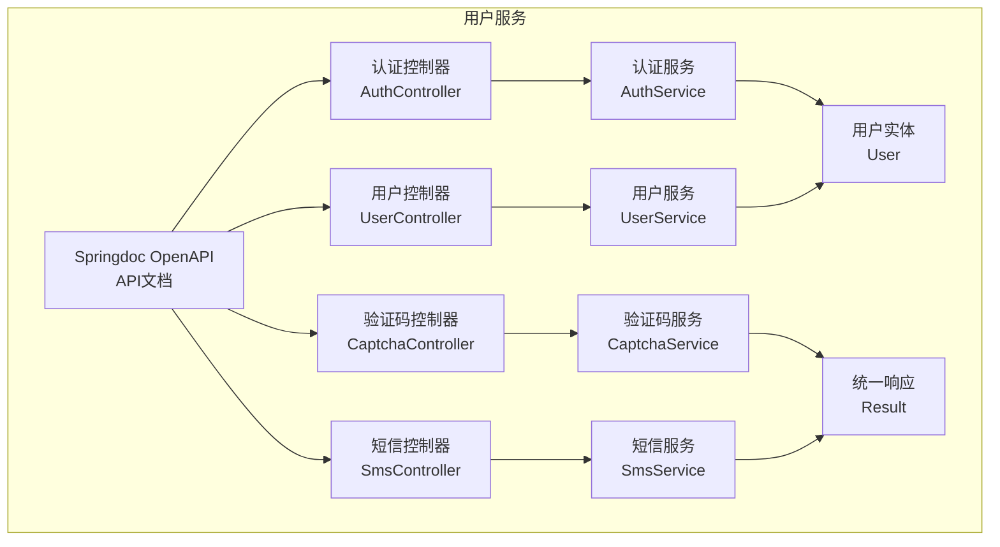
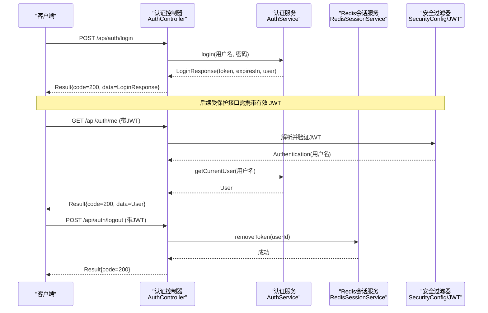
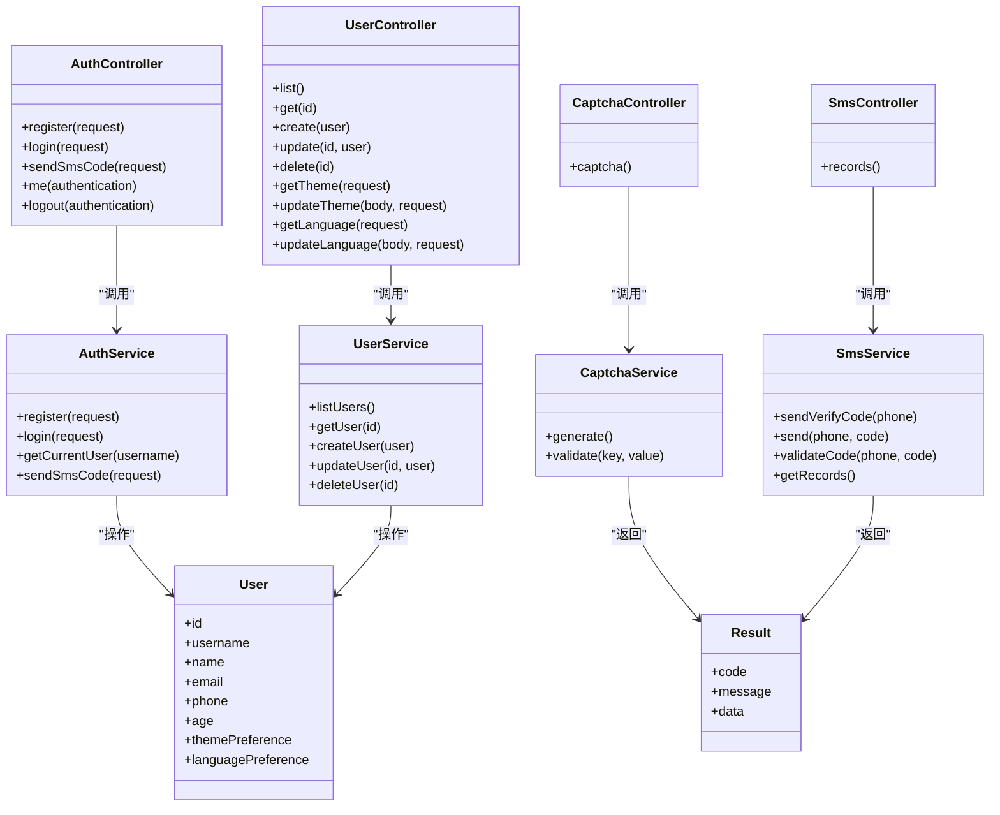
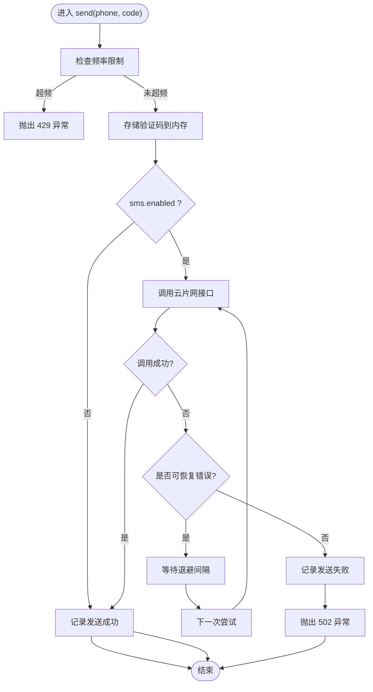

# 用户服务API

<cite>
**本文引用的文件**   
- [AuthController.java](file://backend/ecommerce-user/src/main/java/com/ecommerce/user/controller/AuthController.java)
- [UserController.java](file://backend/ecommerce-user/src/main/java/com/ecommerce/user/controller/UserController.java)
- [CaptchaController.java](file://backend/ecommerce-user/src/main/java/com/ecommerce/user/controller/CaptchaController.java)
- [SmsController.java](file://backend/ecommerce-user/src/main/java/com/ecommerce/user/controller/SmsController.java)
- [AuthService.java](file://backend/ecommerce-user/src/main/java/com/ecommerce/user/service/AuthService.java)
- [UserService.java](file://backend/ecommerce-user/src/main/java/com/ecommerce/user/service/UserService.java)
- [CaptchaService.java](file://backend/ecommerce-user/src/main/java/com/ecommerce/user/service/CaptchaService.java)
- [SmsService.java](file://backend/ecommerce-user/src/main/java/com/ecommerce/user/service/SmsService.java)
- [RegisterRequest.java](file://backend/ecommerce-user/src/main/java/com/ecommerce/user/dto/RegisterRequest.java)
- [LoginRequest.java](file://backend/ecommerce-user/src/main/java/com/ecommerce/user/dto/LoginRequest.java)
- [LoginResponse.java](file://backend/ecommerce-user/src/main/java/com/ecommerce/user/dto/LoginResponse.java)
- [CaptchaResponse.java](file://backend/ecommerce-user/src/main/java/com/ecommerce/user/dto/CaptchaResponse.java)
- [SendSmsCodeRequest.java](file://backend/ecommerce-user/src/main/java/com/ecommerce/user/dto/SendSmsCodeRequest.java)
- [SmsRecord.java](file://backend/ecommerce-user/src/main/java/com/ecommerce/user/dto/SmsRecord.java)
- [User.java](file://backend/ecommerce-user/src/main/java/com/ecommerce/user/entity/User.java)
- [Result.java](file://backend/ecommerce-common/src/main/java/com/ecommerce/common/Result.java)
- [application.yml](file://backend/ecommerce-user/src/main/resources/application.yml)
- [pom.xml](file://backend/ecommerce-user/pom.xml)
- [gateway-application.yml](file://backend/ecommerce-gateway/src/main/resources/application.yml)
- [start-order.bat](file://backend/start-order.bat)
</cite>

## 更新摘要
**变更内容**
- 新增 Springdoc OpenAPI 集成配置说明
- 新增 Windows 启动脚本使用指南
- 更新 API 文档访问方式说明
- 增强开发环境配置说明

## 目录
1. [简介](#简介)
2. [项目结构](#项目结构)
3. [核心组件](#核心组件)
4. [架构总览](#架构总览)
5. [接口详细文档](#接口详细文档)
6. [依赖关系分析](#依赖关系分析)
7. [性能与容量特性](#性能与容量特性)
8. [开发环境配置](#开发环境配置)
9. [故障排查指南](#故障排查指南)
10. [结论](#结论)

## 简介
本文件为用户服务的完整 API 文档，覆盖认证、用户管理、图片验证码与短信验证码相关能力。系统采用 Spring Boot + Spring Security + JWT 的认证方案，统一响应体为 Result<T>，所有接口路径以 /api 为上下文根（由 server.servlet.context-path 配置）。

**新增功能**：
- **Springdoc OpenAPI 集成**：支持 Swagger UI 在线文档和 API 规范导出
- **Windows 启动脚本**：提供便捷的 Windows 环境启动脚本
- **网关聚合文档**：通过 API 网关统一管理所有微服务的 API 文档

- 认证接口：注册、登录、登出、获取当前用户、发送短信验证码、获取图片验证码。
- 用户管理接口：用户列表查询、按 ID 查询、新增、更新、删除，以及主题与语言偏好设置。
- 验证码与安全：图片验证码生成与一次性校验；短信验证码发送频率限制、重试机制、进程内记录查询。

## 项目结构
用户服务位于 backend/ecommerce-user 模块，主要包含控制器、服务、DTO、实体与配置等层次。认证与权限通过 Spring Security 与自定义过滤器实现，JWT 用于无状态鉴权，Redis 用于会话 Token 存储与设备级失效控制。



**图表来源**
- [AuthController.java:31-95](file://backend/ecommerce-user/src/main/java/com/ecommerce/user/controller/AuthController.java#L31-L95)
- [UserController.java:29-140](file://backend/ecommerce-user/src/main/java/com/ecommerce/user/controller/UserController.java#L29-L140)
- [CaptchaController.java:17-33](file://backend/ecommerce-user/src/main/java/com/ecommerce/user/controller/CaptchaController.java#L17-L33)
- [SmsController.java:22-38](file://backend/ecommerce-user/src/main/java/com/ecommerce/user/controller/SmsController.java#L22-L38)
- [AuthService.java:9-28](file://backend/ecommerce-user/src/main/java/com/ecommerce/user/service/AuthService.java#L9-L28)
- [UserService.java:7-21](file://backend/ecommerce-user/src/main/java/com/ecommerce/user/service/UserService.java#L7-L21)
- [CaptchaService.java:22-54](file://backend/ecommerce-user/src/main/java/com/ecommerce/user/service/CaptchaService.java#L22-L54)
- [SmsService.java:26-74](file://backend/ecommerce-user/src/main/java/com/ecommerce/user/service/SmsService.java#L26-L74)
- [User.java:20-64](file://backend/ecommerce-user/src/main/java/com/ecommerce/user/entity/User.java#L20-L64)
- [Result.java:8-63](file://backend/ecommerce-common/src/main/java/com/ecommerce/common/Result.java#L8-L63)

**章节来源**
- [AuthController.java:31-95](file://backend/ecommerce-user/src/main/java/com/ecommerce/user/controller/AuthController.java#L31-L95)
- [UserController.java:29-140](file://backend/ecommerce-user/src/main/java/com/ecommerce/user/controller/UserController.java#L29-L140)
- [CaptchaController.java:17-33](file://backend/ecommerce-user/src/main/java/com/ecommerce/user/controller/CaptchaController.java#L17-L33)
- [SmsController.java:22-38](file://backend/ecommerce-user/src/main/java/com/ecommerce/user/controller/SmsController.java#L22-L38)

## 核心组件
- 认证控制器 AuthController：提供注册、登录、登出、获取当前用户、发送短信验证码等入口。
- 用户控制器 UserController：提供用户 CRUD 与主题/语言偏好设置。
- 验证码控制器 CaptchaController：提供图片验证码生成。
- 短信控制器 SmsController：提供短信发送记录查询。
- 认证服务 AuthService：封装注册、登录、当前用户查询、短信验证码发送流程。
- 用户服务 UserService：封装用户数据访问逻辑。
- 验证码服务 CaptchaService：内存中生成与校验图片验证码，支持一次性使用与过期清理。
- 短信服务 SmsService：封装短信发送、频率限制、重试、验证码存储与校验、发送记录管理。

**章节来源**
- [AuthController.java:31-95](file://backend/ecommerce-user/src/main/java/com/ecommerce/user/controller/AuthController.java#L31-L95)
- [UserService.java:7-21](file://backend/ecommerce-user/src/main/java/com/ecommerce/user/service/UserService.java#L7-L21)
- [CaptchaService.java:22-54](file://backend/ecommerce-user/src/main/java/com/ecommerce/user/service/CaptchaService.java#L22-L54)
- [SmsService.java:26-74](file://backend/ecommerce-user/src/main/java/com/ecommerce/user/service/SmsService.java#L26-L74)

## 架构总览
下图展示认证请求从客户端到控制层、服务层、安全过滤器的调用链，以及 JWT 签发与会话失效的流程。



**图表来源**
- [AuthController.java:54-94](file://backend/ecommerce-user/src/main/java/com/ecommerce/user/controller/AuthController.java#L54-L94)
- [AuthService.java:17-21](file://backend/ecommerce-user/src/main/java/com/ecommerce/user/service/AuthService.java#L17-L21)
- [LoginResponse.java:9-24](file://backend/ecommerce-user/src/main/java/com/ecommerce/user/dto/LoginResponse.java#L9-L24)

## 接口详细文档

### 认证接口

#### 注册
- 方法：POST
- URL：/api/auth/register
- 认证：匿名可访问
- 请求体字段（RegisterRequest）：
  - username：必填，长度 3-32
  - password：必填，长度 6-64
  - confirmPassword：必填，需与 password 一致（服务端校验）
  - name：必填
  - email：必填，邮箱格式
  - phone：必填，手机号格式
  - age：可选，非负整数
  - captchaKey：必填，图片验证码 key
  - captchaValue：必填，图片验证码值
  - smsCode：必填，短信验证码
- 成功响应：Result<User>
- 错误码：
  - 400：参数校验失败或验证码错误
  - 409：用户名已存在（业务异常）
  - 500：服务器内部错误

示例请求体
```json
{
  "username": "demo_user",
  "password": "DemoPass123",
  "confirmPassword": "DemoPass123",
  "name": "演示用户",
  "email": "demo@example.com",
  "phone": "13800000000",
  "age": 25,
  "captchaKey": "uuid-key",
  "captchaValue": "ABCD",
  "smsCode": "123456"
}
```

示例响应
```json
{
  "code": 200,
  "message": "success",
  "data": {
    "id": 1,
    "username": "demo_user",
    "name": "演示用户",
    "email": "demo@example.com",
    "phone": "13800000000",
    "age": 25,
    "createdDate": "2025-01-01T12:00:00",
    "lastModifiedDate": "2025-01-01T12:00:00",
    "themePreference": "dark",
    "languagePreference": "zh"
  }
}
```

**章节来源**
- [AuthController.java:47-52](file://backend/ecommerce-user/src/main/java/com/ecommerce/user/controller/AuthController.java#L47-L52)
- [RegisterRequest.java:13-49](file://backend/ecommerce-user/src/main/java/com/ecommerce/user/dto/RegisterRequest.java#L13-L49)
- [User.java:20-64](file://backend/ecommerce-user/src/main/java/com/ecommerce/user/entity/User.java#L20-L64)
- [Result.java:8-63](file://backend/ecommerce-common/src/main/java/com/ecommerce/common/Result.java#L8-L63)

#### 登录
- 方法：POST
- URL：/api/auth/login
- 认证：匿名可访问
- 请求体字段（LoginRequest）：
  - username：必填
  - password：必填
  - captchaKey：可选（admin 登录可为空）
  - captchaValue：可选（admin 登录可为空）
  - smsCode：可选（admin 登录可为空）
- 成功响应：Result<LoginResponse>
- 错误码：
  - 400：参数校验失败或验证码错误
  - 401：用户名或密码错误
  - 500：服务器内部错误

示例请求体
```json
{
  "username": "demo_user",
  "password": "DemoPass123",
  "captchaKey": "uuid-key",
  "captchaValue": "ABCD",
  "smsCode": "123456"
}
```

示例响应
```json
{
  "code": 200,
  "message": "success",
  "data": {
    "token": "eyJhbGciOiJIUzI1NiIs...",
    "expiresIn": 3600,
    "user": {
      "id": 1,
      "username": "demo_user",
      "name": "演示用户",
      "email": "demo@example.com",
      "phone": "13800000000",
      "age": 25,
      "themePreference": "dark",
      "languagePreference": "zh"
    }
  }
}
```

**章节来源**
- [AuthController.java:54-59](file://backend/ecommerce-user/src/main/java/com/ecommerce/user/controller/AuthController.java#L54-L59)
- [LoginRequest.java:12-29](file://backend/ecommerce-user/src/main/java/com/ecommerce/user/dto/LoginRequest.java#L12-L29)
- [LoginResponse.java:9-24](file://backend/ecommerce-user/src/main/java/com/ecommerce/user/dto/LoginResponse.java#L9-L24)

#### 获取当前用户
- 方法：GET
- URL：/api/auth/me
- 认证：需要有效 JWT
- 成功响应：Result<User>
- 错误码：
  - 401：未认证或 JWT 无效
  - 404：用户不存在
  - 500：服务器内部错误

示例响应
```json
{
  "code": 200,
  "message": "success",
  "data": {
    "id": 1,
    "username": "demo_user",
    "name": "演示用户",
    "email": "demo@example.com",
    "phone": "13800000000",
    "age": 25,
    "themePreference": "dark",
    "languagePreference": "zh"
  }
}
```

**章节来源**
- [AuthController.java:73-78](file://backend/ecommerce-user/src/main/java/com/ecommerce/user/controller/AuthController.java#L73-L78)
- [AuthService.java:20-21](file://backend/ecommerce-user/src/main/java/com/ecommerce/user/service/AuthService.java#L20-L21)

#### 登出
- 方法：POST
- URL：/api/auth/logout
- 认证：需要有效 JWT
- 行为：清除 Redis 中的会话 Token，使当前设备立即失效；前端应同步清除本地 Token 与用户信息
- 成功响应：Result<Void>
- 错误码：
  - 401：未认证或 JWT 无效
  - 500：服务器内部错误

示例响应
```json
{
  "code": 200,
  "message": "success",
  "data": null
}
```

**章节来源**
- [AuthController.java:80-94](file://backend/ecommerce-user/src/main/java/com/ecommerce/user/controller/AuthController.java#L80-L94)

#### 发送短信验证码
- 方法：POST
- URL：/api/auth/send-sms-code
- 认证：匿名可访问
- 请求体字段（SendSmsCodeRequest）：
  - captchaKey：必填，图片验证码 key
  - captchaValue：必填，图片验证码值
  - phone：可选，注册场景直接传入手机号
  - username：可选，登录场景传入已注册用户标识，后端查询其手机号
  - 约束：phone 与 username 至少填写其一（具体校验在服务层完成）
- 成功响应：Result<Void>
- 错误码：
  - 400：图片验证码错误或为空
  - 429：短信发送过于频繁（同一手机号在 rateLimitSeconds 秒内重复发送）
  - 502：短信发送失败（云片网接口异常或不可恢复错误）
  - 500：服务器内部错误

示例请求体
```json
{
  "captchaKey": "uuid-key",
  "captchaValue": "ABCD",
  "phone": "13800000000"
}
```

示例响应
```json
{
  "code": 200,
  "message": "success",
  "data": null
}
```

**章节来源**
- [AuthController.java:61-71](file://backend/ecommerce-user/src/main/java/com/ecommerce/user/controller/AuthController.java#L61-L71)
- [SendSmsCodeRequest.java:15-29](file://backend/ecommerce-user/src/main/java/com/ecommerce/user/dto/SendSmsCodeRequest.java#L15-L29)
- [SmsService.java:87-138](file://backend/ecommerce-user/src/main/java/com/ecommerce/user/service/SmsService.java#L87-L138)

#### 获取图片验证码
- 方法：GET
- URL：/api/auth/captcha
- 认证：匿名可访问
- 成功响应：Result<CaptchaResponse>
- 错误码：
  - 500：图片生成失败

示例响应
```json
{
  "code": 200,
  "message": "success",
  "data": {
    "captchaKey": "uuid-key",
    "captchaImage": "data:image/png;base64,iVBORw0KGgoAAAANSUhEUgAA..."
  }
}
```

**章节来源**
- [CaptchaController.java:28-33](file://backend/ecommerce-user/src/main/java/com/ecommerce/user/controller/CaptchaController.java#L28-L33)
- [CaptchaResponse.java:10-21](file://backend/ecommerce-user/src/main/java/com/ecommerce/user/dto/CaptchaResponse.java#L10-L21)
- [CaptchaService.java:46-54](file://backend/ecommerce-user/src/main/java/com/ecommerce/user/service/CaptchaService.java#L46-L54)

### 用户管理接口

#### 查询用户列表
- 方法：GET
- URL：/api/users
- 认证：需要有效 JWT（默认 authenticated()）
- 成功响应：Result<List<User>>
- 错误码：
  - 401：未认证或 JWT 无效
  - 500：服务器内部错误

示例响应
```json
{
  "code": 200,
  "message": "success",
  "data": [
    {
      "id": 1,
      "username": "demo_user",
      "name": "演示用户",
      "email": "demo@example.com",
      "phone": "13800000000",
      "age": 25,
      "themePreference": "dark",
      "languagePreference": "zh"
    }
  ]
}
```

**章节来源**
- [UserController.java:49-54](file://backend/ecommerce-user/src/main/java/com/ecommerce/user/controller/UserController.java#L49-L54)
- [UserService.java:12](file://backend/ecommerce-user/src/main/java/com/ecommerce/user/service/UserService.java#L12)

#### 根据 ID 查询用户
- 方法：GET
- URL：/api/users/{id}
- 认证：需要有效 JWT
- 路径参数：
  - id：用户 ID
- 成功响应：Result<User>
- 错误码：
  - 401：未认证或 JWT 无效
  - 404：用户不存在
  - 500：服务器内部错误

示例响应
```json
{
  "code": 200,
  "message": "success",
  "data": {
    "id": 1,
    "username": "demo_user",
    "name": "演示用户",
    "email": "demo@example.com",
    "phone": "13800000000",
    "age": 25,
    "themePreference": "dark",
    "languagePreference": "zh"
  }
}
```

**章节来源**
- [UserController.java:56-61](file://backend/ecommerce-user/src/main/java/com/ecommerce/user/controller/UserController.java#L56-L61)
- [UserService.java:14](file://backend/ecommerce-user/src/main/java/com/ecommerce/user/service/UserService.java#L14)

#### 新增用户
- 方法：POST
- URL：/api/users
- 认证：需要有效 JWT
- 请求体：User（含 username/name/email/phone 等）
- 成功响应：Result<User>
- 错误码：
  - 400：参数校验失败
  - 401：未认证或 JWT 无效
  - 500：服务器内部错误

示例请求体
```json
{
  "username": "new_user",
  "name": "新用户",
  "email": "new@example.com",
  "phone": "13800000001",
  "age": 30
}
```

示例响应
```json
{
  "code": 200,
  "message": "success",
  "data": {
    "id": 2,
    "username": "new_user",
    "name": "新用户",
    "email": "new@example.com",
    "phone": "13800000001",
    "age": 30,
    "themePreference": "dark",
    "languagePreference": "zh"
  }
}
```

**章节来源**
- [UserController.java:63-68](file://backend/ecommerce-user/src/main/java/com/ecommerce/user/controller/UserController.java#L63-L68)
- [UserService.java:16](file://backend/ecommerce-user/src/main/java/com/ecommerce/user/service/UserService.java#L16)
- [User.java:20-64](file://backend/ecommerce-user/src/main/java/com/ecommerce/user/entity/User.java#L20-L64)

#### 更新用户
- 方法：PUT
- URL：/api/users/{id}
- 认证：需要有效 JWT
- 路径参数：
  - id：用户 ID
- 请求体：User（包含要更新的字段）
- 成功响应：Result<User>
- 错误码：
  - 400：参数校验失败
  - 401：未认证或 JWT 无效
  - 404：用户不存在
  - 500：服务器内部错误

示例请求体
```json
{
  "name": "更新后的名称",
  "email": "updated@example.com",
  "phone": "13800000002",
  "age": 31
}
```

示例响应
```json
{
  "code": 200,
  "message": "success",
  "data": {
    "id": 1,
    "username": "demo_user",
    "name": "更新后的名称",
    "email": "updated@example.com",
    "phone": "13800000002",
    "age": 31,
    "themePreference": "dark",
    "languagePreference": "zh"
  }
}
```

**章节来源**
- [UserController.java:70-75](file://backend/ecommerce-user/src/main/java/com/ecommerce/user/controller/UserController.java#L70-L75)
- [UserService.java:18](file://backend/ecommerce-user/src/main/java/com/ecommerce/user/service/UserService.java#L18)

#### 删除用户
- 方法：DELETE
- URL：/api/users/{id}
- 认证：需要有效 JWT
- 路径参数：
  - id：用户 ID
- 成功响应：Result<Void>
- 错误码：
  - 401：未认证或 JWT 无效
  - 404：用户不存在
  - 500：服务器内部错误

示例响应
```json
{
  "code": 200,
  "message": "success",
  "data": null
}
```

**章节来源**
- [UserController.java:77-83](file://backend/ecommerce-user/src/main/java/com/ecommerce/user/controller/UserController.java#L77-L83)
- [UserService.java:20](file://backend/ecommerce-user/src/main/java/com/ecommerce/user/service/UserService.java#L20)

#### 获取主题偏好
- 方法：GET
- URL：/api/users/theme
- 认证：需要有效 JWT（通过 TrustedAuthenticationFilter 注入用户 ID）
- 成功响应：Result<Map<String, String>>，返回 theme 键值
- 错误码：
  - 401：未授权访问（缺少用户 ID 头）
  - 404：用户不存在
  - 500：服务器内部错误

示例响应
```json
{
  "code": 200,
  "message": "success",
  "data": {
    "theme": "dark"
  }
}
```

**章节来源**
- [UserController.java:85-94](file://backend/ecommerce-user/src/main/java/com/ecommerce/user/controller/UserController.java#L85-L94)

#### 更新主题偏好
- 方法：PUT
- URL：/api/users/theme
- 认证：需要有效 JWT
- 请求体：Map<String, String>，包含 theme 键，值为 dark 或 light
- 成功响应：Result<Void>
- 错误码：
  - 400：主题值无效（仅支持 dark 或 light）
  - 401：未授权访问
  - 500：服务器内部错误

示例请求体
```json
{
  "theme": "light"
}
```

示例响应
```json
{
  "code": 200,
  "message": "success",
  "data": null
}
```

**章节来源**
- [UserController.java:96-107](file://backend/ecommerce-user/src/main/java/com/ecommerce/user/controller/UserController.java#L96-L107)

#### 获取语言偏好
- 方法：GET
- URL：/api/users/language
- 认证：需要有效 JWT
- 成功响应：Result<Map<String, String>>，返回 language 键值
- 错误码：
  - 401：未授权访问
  - 404：用户不存在
  - 500：服务器内部错误

示例响应
```json
{
  "code": 200,
  "message": "success",
  "data": {
    "language": "zh"
  }
}
```

**章节来源**
- [UserController.java:109-118](file://backend/ecommerce-user/src/main/java/com/ecommerce/user/controller/UserController.java#L109-L118)

#### 更新语言偏好
- 方法：PUT
- URL：/api/users/language
- 认证：需要有效 JWT
- 请求体：Map<String, String>，包含 language 键，值为 zh 或 en
- 成功响应：Result<Void>
- 错误码：
  - 400：语言值无效（仅支持 zh 或 en）
  - 401：未授权访问
  - 500：服务器内部错误

示例请求体
```json
{
  "language": "en"
}
```

示例响应
```json
{
  "code": 200,
  "message": "success",
  "data": null
}
```

**章节来源**
- [UserController.java:120-131](file://backend/ecommerce-user/src/main/java/com/ecommerce/user/controller/UserController.java#L120-L131)

### 短信发送记录查询
- 方法：GET
- URL：/api/sms/records
- 认证：需要有效 JWT
- 成功响应：Result<List<SmsRecord>>，按发送时间倒序（最新在前）
- 错误码：
  - 401：未认证或 JWT 无效
  - 500：服务器内部错误

示例响应
```json
{
  "code": 200,
  "message": "success",
  "data": [
    {
      "phone": "13800000000",
      "code": "123456",
      "sentAt": "2025-01-01T12:00:00",
      "status": "SUCCESS"
    }
  ]
}
```

**章节来源**
- [SmsController.java:33-38](file://backend/ecommerce-user/src/main/java/com/ecommerce/user/controller/SmsController.java#L33-L38)
- [SmsRecord.java:11-32](file://backend/ecommerce-user/src/main/java/com/ecommerce/user/dto/SmsRecord.java#L11-L32)

## 依赖关系分析
- 控制器依赖服务：AuthController -> AuthService；UserController -> UserService；CaptchaController -> CaptchaService；SmsController -> SmsService。
- 服务依赖实体与外部资源：AuthService 与 UserService 操作 User 实体；SmsService 调用云片网短信接口（RestTemplate），并使用进程内内存存储验证码与发送记录。
- 安全与认证：Spring Security 与自定义过滤器（TrustedAuthenticationFilter）负责 JWT 解析与用户 ID 注入；RedisSessionService 用于登出时移除设备会话 Token。



**图表来源**
- [AuthController.java:31-95](file://backend/ecommerce-user/src/main/java/com/ecommerce/user/controller/AuthController.java#L31-L95)
- [UserController.java:29-140](file://backend/ecommerce-user/src/main/java/com/ecommerce/user/controller/UserController.java#L29-L140)
- [CaptchaController.java:17-33](file://backend/ecommerce-user/src/main/java/com/ecommerce/user/controller/CaptchaController.java#L17-L33)
- [SmsController.java:22-38](file://backend/ecommerce-user/src/main/java/com/ecommerce/user/controller/SmsController.java#L22-L38)
- [AuthService.java:9-28](file://backend/ecommerce-user/src/main/java/com/ecommerce/user/service/AuthService.java#L9-L28)
- [UserService.java:7-21](file://backend/ecommerce-user/src/main/java/com/ecommerce/user/service/UserService.java#L7-L21)
- [CaptchaService.java:22-54](file://backend/ecommerce-user/src/main/java/com/ecommerce/user/service/CaptchaService.java#L22-L54)
- [SmsService.java:26-74](file://backend/ecommerce-user/src/main/java/com/ecommerce/user/service/SmsService.java#L26-L74)
- [User.java:20-64](file://backend/ecommerce-user/src/main/java/com/ecommerce/user/entity/User.java#L20-L64)
- [Result.java:8-63](file://backend/ecommerce-common/src/main/java/com/ecommerce/common/Result.java#L8-L63)

**章节来源**
- [AuthController.java:31-95](file://backend/ecommerce-user/src/main/java/com/ecommerce/user/controller/AuthController.java#L31-L95)
- [UserController.java:29-140](file://backend/ecommerce-user/src/main/java/com/ecommerce/user/controller/UserController.java#L29-L140)
- [CaptchaController.java:17-33](file://backend/ecommerce-user/src/main/java/com/ecommerce/user/controller/CaptchaController.java#L17-L33)
- [SmsController.java:22-38](file://backend/ecommerce-user/src/main/java/com/ecommerce/user/controller/SmsController.java#L22-L38)

## 性能与容量特性
- 图片验证码：
  - 内存存储：ConcurrentHashMap 保存验证码条目，避免落库开销。
  - 过期清理：每次生成新验证码前清理过期条目，防止内存无限增长。
  - 一次性使用：无论校验成功或失败均移除 key，提升安全性。
- 短信验证码：
  - 频率限制：同一手机号在 rateLimitSeconds 秒内不允许重复发送，超频返回 429。
  - 重试机制：对网络异常、超时、5xx 进行最多 maxRetry 次重试，支持线性或指数退避。
  - 记录上限：进程内发送记录最大保留 MAX_RECORDS 条，超出淘汰最旧记录。
  - 开关模式：sms.enabled=false 时不调用真实短信接口，便于本地联调。



**图表来源**
- [SmsService.java:87-138](file://backend/ecommerce-user/src/main/java/com/ecommerce/user/service/SmsService.java#L87-L138)
- [SmsService.java:189-198](file://backend/ecommerce-user/src/main/java/com/ecommerce/user/service/SmsService.java#L189-L198)
- [SmsService.java:200-210](file://backend/ecommerce-user/src/main/java/com/ecommerce/user/service/SmsService.java#L200-L210)

**章节来源**
- [CaptchaService.java:46-71](file://backend/ecommerce-user/src/main/java/com/ecommerce/user/service/CaptchaService.java#L46-L71)
- [SmsService.java:87-138](file://backend/ecommerce-user/src/main/java/com/ecommerce/user/service/SmsService.java#L87-L138)
- [SmsService.java:189-198](file://backend/ecommerce-user/src/main/java/com/ecommerce/user/service/SmsService.java#L189-L198)

## 开发环境配置

### Springdoc OpenAPI 集成

**新增功能**：用户服务现已集成 Springdoc OpenAPI，提供完整的 API 文档和交互式测试界面。

#### 依赖配置
用户服务已添加 Springdoc OpenAPI 依赖：
```xml
<!-- Springdoc OpenAPI (Swagger UI) -->
<dependency>
    <groupId>org.springdoc</groupId>
    <artifactId>springdoc-openapi-starter-webmvc-ui</artifactId>
    <version>${springdoc.version}</version>
</dependency>
```

#### 配置说明
用户服务 application.yml 中的 Springdoc 配置：
```yaml
springdoc:
  api-docs:
    title: 用户服务 API
    description: 用户注册、登录、用户管理、验证码、短信等接口
  swagger-ui:
    path: /swagger-ui.html
    tags-sorter: alpha
    operations-sorter: alpha
```

#### API 文档访问方式

**独立服务访问**：
- Swagger UI：http://localhost:8081/swagger-ui.html
- API 规范：http://localhost:8081/v3/api-docs

**通过网关访问**：
- 用户服务 Swagger UI：http://localhost:8080/api/user/swagger-ui.html
- 用户服务 API 规范：http://localhost:8080/api/user/v3/api-docs

**网关聚合文档**：
- 统一 Swagger UI：http://localhost:8080/swagger-ui.html
- 支持下拉选择不同微服务的 API 文档

### Windows 启动脚本

**新增功能**：提供了 Windows 环境下的便捷启动脚本。

#### 订单服务启动脚本
项目根目录下提供了 `start-order.bat` 脚本：
```batch
@echo off
cd /d backend
call mvnw.cmd spring-boot:run "-Dspring-boot.run.fork=true" -pl ecommerce-order
```

使用方法：
1. 双击运行 `backend/start-order.bat`
2. 脚本会自动切换到 backend 目录
3. 使用 Maven Wrapper 启动订单服务

#### 其他服务启动
对于其他服务，可以使用类似的命令：
```bash
# 启动用户服务
mvnw.cmd spring-boot:run -pl ecommerce-user

# 启动商品服务  
mvnw.cmd spring-boot:run -pl ecommerce-product

# 启动网关服务
mvnw.cmd spring-boot:run -pl ecommerce-gateway
```

### 开发环境要求

#### 前置条件
- Java 8+ 环境
- Maven 3.6+（或使用 Maven Wrapper）
- MySQL 数据库
- Redis 缓存服务
- Nacos 服务注册中心

#### 快速开始
1. 初始化数据库：执行 `init-sql/01-init-database.sql`
2. 启动基础设施：MySQL、Redis、Nacos
3. 启动后端服务：按顺序启动网关、用户、商品、订单服务
4. 启动前端应用：按 README 指引启动前端应用

**章节来源**
- [application.yml:88-96](file://backend/ecommerce-user/src/main/resources/application.yml#L88-L96)
- [pom.xml:103-108](file://backend/ecommerce-user/pom.xml#L103-L108)
- [gateway-application.yml:116-130](file://backend/ecommerce-gateway/src/main/resources/application.yml#L116-L130)
- [start-order.bat:1-4](file://backend/start-order.bat#L1-L4)

## 故障排查指南
- 参数校验失败：
  - 现象：返回 400，message 提示字段校验不通过。
  - 排查：检查 RegisterRequest、LoginRequest、SendSmsCodeRequest 字段是否符合约束（如邮箱格式、手机号正则、长度范围）。
- 验证码错误：
  - 现象：返回 400，提示"验证码错误或已过期"。
  - 排查：确认图片验证码 key/value 是否正确且未被复用；确认短信验证码是否在有效期内且未被消费。
- 短信发送频繁：
  - 现象：返回 429，提示"验证码发送过于频繁"。
  - 排查：检查 rateLimitSeconds 配置，确保同一手机号在冷却期内不再次发送。
- 短信发送失败：
  - 现象：返回 502，提示"短信发送失败，请稍后重试"。
  - 排查：检查云片网接口配置（apiKey、templateId、apiUrl）、网络连通性与限流策略；查看重试次数与退避策略。
- 未授权访问：
  - 现象：返回 401，提示"未授权访问"或 JWT 无效。
  - 排查：确认请求是否携带有效 JWT；确认登出后是否清除了 Redis 会话 Token；确认前端是否正确传递 Authorization 头。
- API 文档无法访问：
  - 现象：Swagger UI 无法打开或 API 规范无法获取。
  - 排查：确认 Springdoc 依赖是否正确引入；检查端口配置和网络连通性；确认网关路由配置是否正确。

**章节来源**
- [RegisterRequest.java:13-49](file://backend/ecommerce-user/src/main/java/com/ecommerce/user/dto/RegisterRequest.java#L13-L49)
- [LoginRequest.java:12-29](file://backend/ecommerce-user/src/main/java/com/ecommerce/user/dto/LoginRequest.java#L12-L29)
- [SendSmsCodeRequest.java:15-29](file://backend/ecommerce-user/src/main/java/com/ecommerce/user/dto/SendSmsCodeRequest.java#L15-L29)
- [CaptchaService.java:60-71](file://backend/ecommerce-user/src/main/java/com/ecommerce/user/service/CaptchaService.java#L60-L71)
- [SmsService.java:145-153](file://backend/ecommerce-user/src/main/java/com/ecommerce/user/service/SmsService.java#L145-L153)
- [SmsService.java:189-198](file://backend/ecommerce-user/src/main/java/com/ecommerce/user/service/SmsService.java#L189-L198)
- [UserController.java:133-139](file://backend/ecommerce-user/src/main/java/com/ecommerce/user/controller/UserController.java#L133-L139)

## 结论
用户服务提供了完整的认证、用户管理与验证码能力，结合 JWT 与 Redis 会话管理实现了安全的无状态鉴权与设备级失效控制。图片验证码与短信验证码分别通过一次性使用、过期清理与频率限制等机制保障安全性。

**新增特性**：
- **Springdoc OpenAPI 集成**：提供完整的 API 文档和交互式测试界面，支持独立的 Swagger UI 和网关聚合文档
- **Windows 启动脚本**：简化了 Windows 环境下的服务启动流程
- **完善的开发体验**：通过网关统一管理所有微服务的 API 文档，提升开发效率

建议在生产环境中开启短信开关、合理配置验证码有效期与频率限制，并结合网关层的统一鉴权与限流策略进一步提升整体安全性与稳定性。同时利用 Springdoc OpenAPI 提供的文档功能，确保 API 的一致性和可维护性。