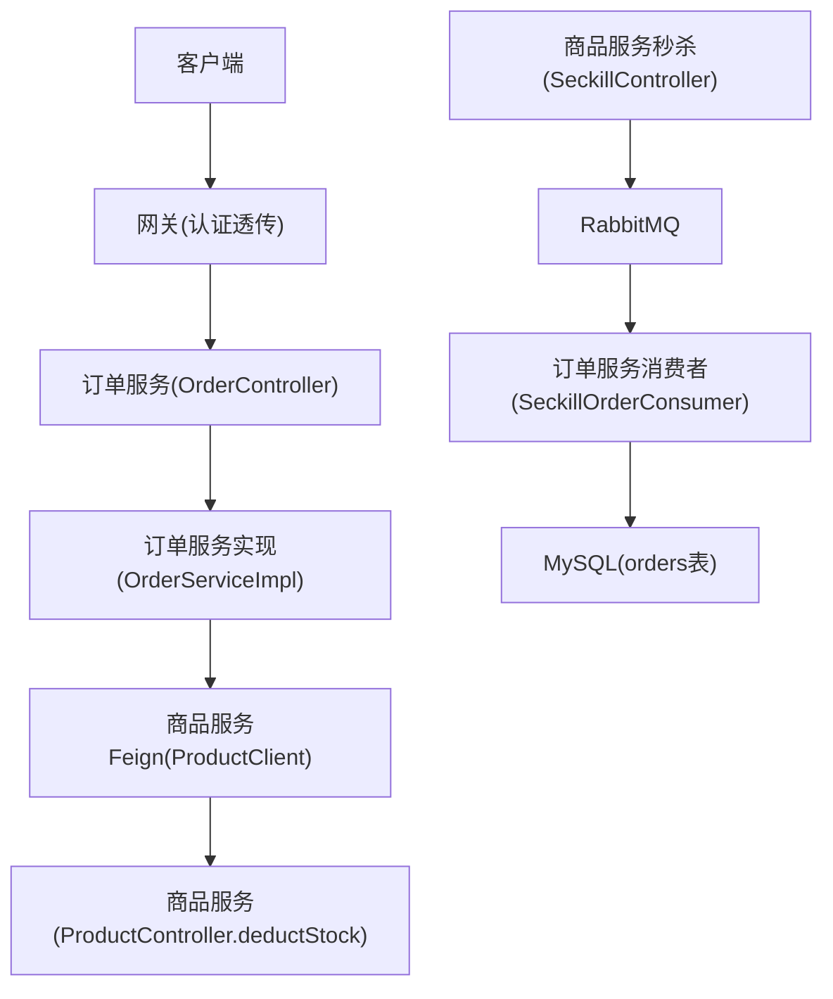
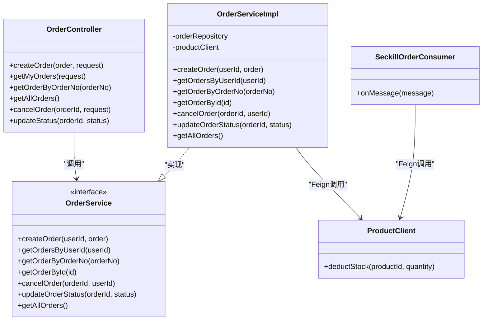
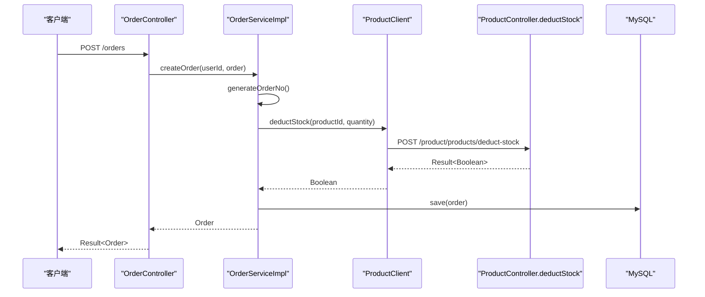
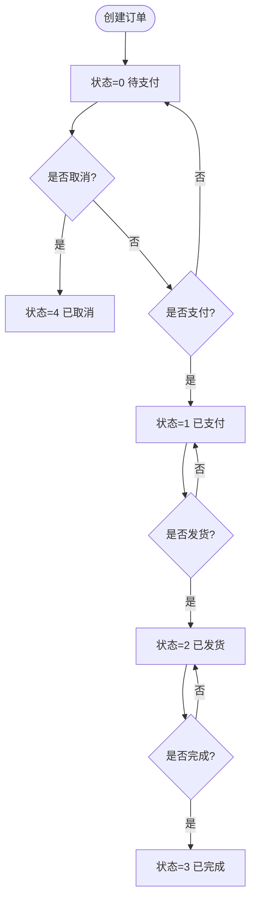
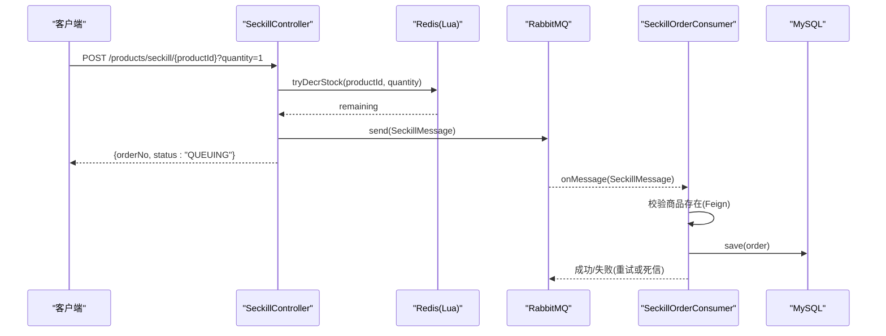
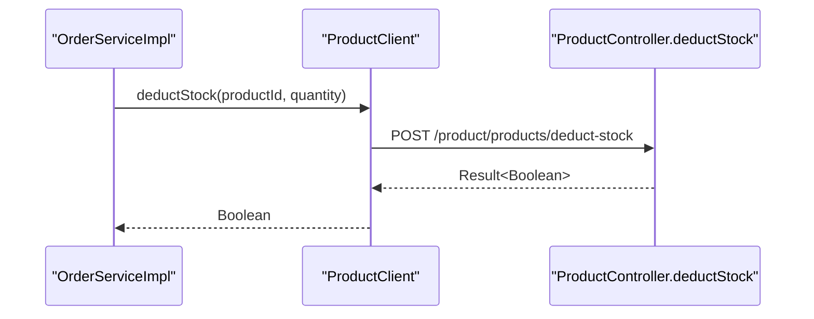
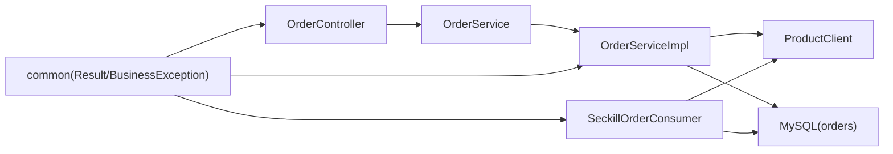

# 订单服务API

<cite>
**本文引用的文件**   
- [OrderController.java](file://backend/ecommerce-order/src/main/java/com/ecommerce/order/controller/OrderController.java)
- [OrderService.java](file://backend/ecommerce-order/src/main/java/com/ecommerce/order/service/OrderService.java)
- [OrderServiceImpl.java](file://backend/ecommerce-order/src/main/java/com/ecommerce/order/service/impl/OrderServiceImpl.java)
- [ProductClient.java](file://backend/ecommerce-order/src/main/java/com/ecommerce/order/client/ProductClient.java)
- [SeckillOrderConsumer.java](file://backend/ecommerce-order/src/main/java/com/ecommerce/order/consumer/SeckillOrderConsumer.java)
- [Order.java](file://backend/ecommerce-order/src/main/java/com/ecommerce/order/entity/Order.java)
- [schema.sql](file://backend/ecommerce-order/src/main/resources/db/schema.sql)
- [Result.java](file://backend/ecommerce-common/src/main/java/com/ecommerce/common/Result.java)
- [BusinessException.java](file://backend/ecommerce-common/src/main/java/com/ecommerce/common/BusinessException.java)
- [SeckillMessage.java](file://backend/ecommerce-common/src/main/java/com/ecommerce/common/SeckillMessage.java)
- [ProductController.java](file://backend/ecommerce-product/src/main/java/com/ecommerce/product/controller/ProductController.java)
- [SeckillController.java](file://backend/ecommerce-product/src/main/java/com/ecommerce/product/controller/SeckillController.java)
</cite>

## 目录
1. [简介](#简介)
2. [项目结构](#项目结构)
3. [核心组件](#核心组件)
4. [架构总览](#架构总览)
5. [接口规范](#接口规范)
6. [详细组件分析](#详细组件分析)
7. [依赖关系分析](#依赖关系分析)
8. [性能与扩展性](#性能与扩展性)
9. [故障排查指南](#故障排查指南)
10. [结论](#结论)

## 简介
本文件面向订单服务的 API 文档，覆盖以下能力：
- 订单管理接口：创建、查询（按用户、按单号、全部）、取消、状态更新。
- 秒杀订单消费接口：基于 RabbitMQ 的异步消息处理，完成秒杀下单。
- 与商品服务的 OpenFeign 集成：库存扣减、商品信息校验。
- 订单状态流转、秒杀异步处理流程、分布式事务处理的技术说明。

## 项目结构
订单服务位于 backend/ecommerce-order，对外暴露 REST 接口；通过 OpenFeign 调用商品服务 ecommerce-product；通过 RabbitMQ 接收秒杀消息并落库。

图表来源
- [OrderController.java:16-72](file://backend/ecommerce-order/src/main/java/com/ecommerce/order/controller/OrderController.java#L16-L72)
- [OrderServiceImpl.java:32-116](file://backend/ecommerce-order/src/main/java/com/ecommerce/order/service/impl/OrderServiceImpl.java#L32-L116)
- [ProductClient.java:11-19](file://backend/ecommerce-order/src/main/java/com/ecommerce/order/client/ProductClient.java#L11-L19)
- [ProductController.java:88-95](file://backend/ecommerce-product/src/main/java/com/ecommerce/product/controller/ProductController.java#L88-L95)
- [SeckillController.java:57-122](file://backend/ecommerce-product/src/main/java/com/ecommerce/product/controller/SeckillController.java#L57-L122)
- [SeckillOrderConsumer.java:35-67](file://backend/ecommerce-order/src/main/java/com/ecommerce/order/consumer/SeckillOrderConsumer.java#L35-L67)

章节来源
- [OrderController.java:16-72](file://backend/ecommerce-order/src/main/java/com/ecommerce/order/controller/OrderController.java#L16-L72)
- [OrderServiceImpl.java:32-116](file://backend/ecommerce-order/src/main/java/com/ecommerce/order/service/impl/OrderServiceImpl.java#L32-L116)
- [ProductClient.java:11-19](file://backend/ecommerce-order/src/main/java/com/ecommerce/order/client/ProductClient.java#L11-L19)
- [ProductController.java:88-95](file://backend/ecommerce-product/src/main/java/com/ecommerce/product/controller/ProductController.java#L88-L95)
- [SeckillController.java:57-122](file://backend/ecommerce-product/src/main/java/com/ecommerce/product/controller/SeckillController.java#L57-L122)
- [SeckillOrderConsumer.java:35-67](file://backend/ecommerce-order/src/main/java/com/ecommerce/order/consumer/SeckillOrderConsumer.java#L35-L67)

## 核心组件
- 控制器层：OrderController 提供订单相关 HTTP 接口。
- 服务层：OrderService 定义业务契约；OrderServiceImpl 实现订单创建、查询、取消、状态更新等逻辑。
- 外部依赖：
  - OpenFeign 客户端 ProductClient 调用商品服务扣减库存。
  - RabbitMQ 消费者 SeckillOrderConsumer 处理秒杀订单消息。
- 数据模型：Order 实体对应 orders 表；统一响应 Result；业务异常 BusinessException；秒杀消息 SeckillMessage。

章节来源
- [OrderController.java:16-72](file://backend/ecommerce-order/src/main/java/com/ecommerce/order/controller/OrderController.java#L16-L72)
- [OrderService.java:7-28](file://backend/ecommerce-order/src/main/java/com/ecommerce/order/service/OrderService.java#L7-L28)
- [OrderServiceImpl.java:18-116](file://backend/ecommerce-order/src/main/java/com/ecommerce/order/service/impl/OrderServiceImpl.java#L18-L116)
- [ProductClient.java:11-19](file://backend/ecommerce-order/src/main/java/com/ecommerce/order/client/ProductClient.java#L11-L19)
- [SeckillOrderConsumer.java:21-67](file://backend/ecommerce-order/src/main/java/com/ecommerce/order/consumer/SeckillOrderConsumer.java#L21-L67)
- [Order.java:10-41](file://backend/ecommerce-order/src/main/java/com/ecommerce/order/entity/Order.java#L10-L41)
- [Result.java:8-63](file://backend/ecommerce-common/src/main/java/com/ecommerce/common/Result.java#L8-L63)
- [BusinessException.java:6-22](file://backend/ecommerce-common/src/main/java/com/ecommerce/common/BusinessException.java#L6-L22)
- [SeckillMessage.java:10-25](file://backend/ecommerce-common/src/main/java/com/ecommerce/common/SeckillMessage.java#L10-L25)

## 架构总览
订单服务采用分层架构：
- 控制层负责参数校验、鉴权信息提取、统一响应封装。
- 服务层编排业务逻辑，包含与商品服务的 Feign 调用和数据库操作。
- 异步侧通过 RabbitMQ 解耦秒杀下单与订单落库。

图表来源
- [OrderController.java:16-72](file://backend/ecommerce-order/src/main/java/com/ecommerce/order/controller/OrderController.java#L16-L72)
- [OrderService.java:7-28](file://backend/ecommerce-order/src/main/java/com/ecommerce/order/service/OrderService.java#L7-L28)
- [OrderServiceImpl.java:18-116](file://backend/ecommerce-order/src/main/java/com/ecommerce/order/service/impl/OrderServiceImpl.java#L18-L116)
- [ProductClient.java:11-19](file://backend/ecommerce-order/src/main/java/com/ecommerce/order/client/ProductClient.java#L11-L19)
- [SeckillOrderConsumer.java:21-67](file://backend/ecommerce-order/src/main/java/com/ecommerce/order/consumer/SeckillOrderConsumer.java#L21-L67)

## 接口规范
通用约定
- 基础路径：/orders
- 统一响应体：Result<T>，包含 code、message、data。成功时 code=200。
- 鉴权：请求头携带用户ID（由网关注入），未携带将返回未授权错误。
- 业务异常：抛出 BusinessException，由全局异常处理器转换为 Result(code, message)。

### 订单管理接口

#### 创建订单
- 方法：POST
- URL：/orders
- 请求头：需包含用户ID（由网关注入）
- 请求体字段（JSON）：
  - productId: Long，必填
  - quantity: Integer，必填
  - address: String，可选
  - remark: String，可选
  - productName: String，可选（冗余字段）
  - totalAmount: BigDecimal，可选（服务端可计算或忽略）
- 成功响应：code=200，data=Order
- 失败场景：
  - 未授权：code=401
  - 库存不足或商品不存在：code=400
  - 库存扣减异常：code=500

调用示例
- 请求
  - POST /orders
  - Header: X-User-Id: 1001
  - Body: {"productId": 1, "quantity": 2, "address": "上海市浦东新区..."}
- 成功响应
  - { "code": 200, "message": "success", "data": { "id": 1, "orderNo": "ORD2025...", "userId": 1001, "productId": 1, "productName": "...", "quantity": 2, "totalAmount": 0, "status": 0, "address": "...", "remark": null, "createdDate": "...", "updatedDate": "..." } }

章节来源
- [OrderController.java:27-33](file://backend/ecommerce-order/src/main/java/com/ecommerce/order/controller/OrderController.java#L27-L33)
- [OrderServiceImpl.java:32-60](file://backend/ecommerce-order/src/main/java/com/ecommerce/order/service/impl/OrderServiceImpl.java#L32-L60)
- [ProductClient.java:11-19](file://backend/ecommerce-order/src/main/java/com/ecommerce/order/client/ProductClient.java#L11-L19)
- [Result.java:8-63](file://backend/ecommerce-common/src/main/java/com/ecommerce/common/Result.java#L8-L63)
- [BusinessException.java:6-22](file://backend/ecommerce-common/src/main/java/com/ecommerce/common/BusinessException.java#L6-L22)

#### 查询我的订单
- 方法：GET
- URL：/orders/my
- 请求头：需包含用户ID
- 成功响应：code=200，data=List<Order>

调用示例
- 请求
  - GET /orders/my
  - Header: X-User-Id: 1001
- 成功响应
  - { "code": 200, "message": "success", "data": [ {...}, {...} ] }

章节来源
- [OrderController.java:35-41](file://backend/ecommerce-order/src/main/java/com/ecommerce/order/controller/OrderController.java#L35-L41)
- [OrderServiceImpl.java:62-65](file://backend/ecommerce-order/src/main/java/com/ecommerce/order/service/impl/OrderServiceImpl.java#L62-L65)

#### 查询订单详情（按订单号）
- 方法：GET
- URL：/orders/{orderNo}
- 路径参数：orderNo（String）
- 成功响应：code=200，data=Order
- 失败场景：订单不存在，code=404

调用示例
- 请求
  - GET /orders/ORD20250101120000ABCD
- 成功响应
  - { "code": 200, "message": "success", "data": { ... } }

章节来源
- [OrderController.java:43-48](file://backend/ecommerce-order/src/main/java/com/ecommerce/order/controller/OrderController.java#L43-L48)
- [OrderServiceImpl.java:67-74](file://backend/ecommerce-order/src/main/java/com/ecommerce/order/service/impl/OrderServiceImpl.java#L67-L74)

#### 查询所有订单（管理用）
- 方法：GET
- URL：/orders
- 成功响应：code=200，data=List<Order>

调用示例
- 请求
  - GET /orders
- 成功响应
  - { "code": 200, "message": "success", "data": [ {...}, {...} ] }

章节来源
- [OrderController.java:50-55](file://backend/ecommerce-order/src/main/java/com/ecommerce/order/controller/OrderController.java#L50-L55)
- [OrderServiceImpl.java:107-110](file://backend/ecommerce-order/src/main/java/com/ecommerce/order/service/impl/OrderServiceImpl.java#L107-L110)

#### 取消订单
- 方法：POST
- URL：/orders/{orderId}/cancel
- 路径参数：orderId（Long）
- 请求头：需包含用户ID
- 成功响应：code=200，data=null
- 失败场景：
  - 无权操作：code=403
  - 当前状态不可取消：code=400

调用示例
- 请求
  - POST /orders/1/cancel
  - Header: X-User-Id: 1001
- 成功响应
  - { "code": 200, "message": "success", "data": null }

章节来源
- [OrderController.java:57-64](file://backend/ecommerce-order/src/main/java/com/ecommerce/order/controller/OrderController.java#L57-L64)
- [OrderServiceImpl.java:85-98](file://backend/ecommerce-order/src/main/java/com/ecommerce/order/service/impl/OrderServiceImpl.java#L85-L98)

#### 更新订单状态
- 方法：PUT
- URL：/orders/{orderId}/status
- 路径参数：orderId（Long）
- 查询参数：status（Integer）
- 成功响应：code=200，data=null

调用示例
- 请求
  - PUT /orders/1/status?status=1
- 成功响应
  - { "code": 200, "message": "success", "data": null }

章节来源
- [OrderController.java:66-72](file://backend/ecommerce-order/src/main/java/com/ecommerce/order/controller/OrderController.java#L66-L72)
- [OrderServiceImpl.java:100-105](file://backend/ecommerce-order/src/main/java/com/ecommerce/order/service/impl/OrderServiceImpl.java#L100-L105)

### 秒杀订单消费接口（RabbitMQ）
- 类型：RabbitMQ 消费者监听
- 队列：SECKILL_QUEUE（由配置常量定义）
- 消息体：SeckillMessage（包含 userId、productId、quantity、orderNo、createTime）
- 处理逻辑：
  - 通过 Feign 校验商品存在（不实际扣库存）。
  - 创建订单记录，状态标记为已支付（秒杀直接支付）。
  - 保存至 MySQL。
- 失败处理：抛出异常触发重试；进入死信队列后可人工处理或定时重试。

章节来源
- [SeckillOrderConsumer.java:21-67](file://backend/ecommerce-order/src/main/java/com/ecommerce/order/consumer/SeckillOrderConsumer.java#L21-L67)
- [SeckillMessage.java:10-25](file://backend/ecommerce-common/src/main/java/com/ecommerce/common/SeckillMessage.java#L10-L25)

## 详细组件分析

### 订单创建流程
- 控制器从请求头解析用户ID。
- 生成订单号，设置默认状态为待支付。
- 通过 Feign 调用商品服务扣减库存。
- 扣减成功后持久化订单。

图表来源
- [OrderController.java:27-33](file://backend/ecommerce-order/src/main/java/com/ecommerce/order/controller/OrderController.java#L27-L33)
- [OrderServiceImpl.java:32-60](file://backend/ecommerce-order/src/main/java/com/ecommerce/order/service/impl/OrderServiceImpl.java#L32-L60)
- [ProductClient.java:11-19](file://backend/ecommerce-order/src/main/java/com/ecommerce/order/client/ProductClient.java#L11-L19)
- [ProductController.java:88-95](file://backend/ecommerce-product/src/main/java/com/ecommerce/product/controller/ProductController.java#L88-L95)

章节来源
- [OrderController.java:27-33](file://backend/ecommerce-order/src/main/java/com/ecommerce/order/controller/OrderController.java#L27-L33)
- [OrderServiceImpl.java:32-60](file://backend/ecommerce-order/src/main/java/com/ecommerce/order/service/impl/OrderServiceImpl.java#L32-L60)
- [ProductClient.java:11-19](file://backend/ecommerce-order/src/main/java/com/ecommerce/order/client/ProductClient.java#L11-L19)
- [ProductController.java:88-95](file://backend/ecommerce-product/src/main/java/com/ecommerce/product/controller/ProductController.java#L88-L95)

### 订单状态流转
- 状态枚举：
  - 0：待支付
  - 1：已支付
  - 2：已发货
  - 3：已完成
  - 4：已取消
- 初始状态：创建时为待支付。
- 取消：仅待支付可取消，更新为已取消。
- 更新：管理接口支持任意状态更新（用于后续流程如发货、完成）。

图表来源
- [Order.java:26-34](file://backend/ecommerce-order/src/main/java/com/ecommerce/order/entity/Order.java#L26-L34)
- [OrderServiceImpl.java:32-60](file://backend/ecommerce-order/src/main/java/com/ecommerce/order/service/impl/OrderServiceImpl.java#L32-L60)
- [OrderServiceImpl.java:85-105](file://backend/ecommerce-order/src/main/java/com/ecommerce/order/service/impl/OrderServiceImpl.java#L85-L105)

章节来源
- [Order.java:26-34](file://backend/ecommerce-order/src/main/java/com/ecommerce/order/entity/Order.java#L26-L34)
- [OrderServiceImpl.java:32-60](file://backend/ecommerce-order/src/main/java/com/ecommerce/order/service/impl/OrderServiceImpl.java#L32-L60)
- [OrderServiceImpl.java:85-105](file://backend/ecommerce-order/src/main/java/com/ecommerce/order/service/impl/OrderServiceImpl.java#L85-L105)

### 秒杀订单异步处理流程
- 商品服务秒杀接口进行预扣减（Redis Lua），防重与时间校验。
- 发送 SeckillMessage 到 RabbitMQ。
- 订单服务消费者接收消息，校验商品存在，创建订单并落库。

图表来源
- [SeckillController.java:57-122](file://backend/ecommerce-product/src/main/java/com/ecommerce/product/controller/SeckillController.java#L57-L122)
- [SeckillOrderConsumer.java:35-67](file://backend/ecommerce-order/src/main/java/com/ecommerce/order/consumer/SeckillOrderConsumer.java#L35-L67)
- [SeckillMessage.java:10-25](file://backend/ecommerce-common/src/main/java/com/ecommerce/common/SeckillMessage.java#L10-L25)

章节来源
- [SeckillController.java:57-122](file://backend/ecommerce-product/src/main/java/com/ecommerce/product/controller/SeckillController.java#L57-L122)
- [SeckillOrderConsumer.java:35-67](file://backend/ecommerce-order/src/main/java/com/ecommerce/order/consumer/SeckillOrderConsumer.java#L35-L67)
- [SeckillMessage.java:10-25](file://backend/ecommerce-common/src/main/java/com/ecommerce/common/SeckillMessage.java#L10-L25)

### 与商品服务的OpenFeign集成
- 订单服务通过 ProductClient 调用商品服务 /product/products/deduct-stock。
- 商品服务暴露该接口供订单服务在普通下单时扣减库存。

图表来源
- [OrderServiceImpl.java:42-55](file://backend/ecommerce-order/src/main/java/com/ecommerce/order/service/impl/OrderServiceImpl.java#L42-L55)
- [ProductClient.java:11-19](file://backend/ecommerce-order/src/main/java/com/ecommerce/order/client/ProductClient.java#L11-L19)
- [ProductController.java:88-95](file://backend/ecommerce-product/src/main/java/com/ecommerce/product/controller/ProductController.java#L88-L95)

章节来源
- [OrderServiceImpl.java:42-55](file://backend/ecommerce-order/src/main/java/com/ecommerce/order/service/impl/OrderServiceImpl.java#L42-L55)
- [ProductClient.java:11-19](file://backend/ecommerce-order/src/main/java/com/ecommerce/order/client/ProductClient.java#L11-L19)
- [ProductController.java:88-95](file://backend/ecommerce-product/src/main/java/com/ecommerce/product/controller/ProductController.java#L88-L95)

## 依赖关系分析
- 控制器依赖服务层，服务层依赖仓储与外部客户端。
- 消费者依赖仓储与外部客户端。
- 统一响应与异常在 common 模块中共享。

图表来源
- [OrderController.java:16-72](file://backend/ecommerce-order/src/main/java/com/ecommerce/order/controller/OrderController.java#L16-L72)
- [OrderService.java:7-28](file://backend/ecommerce-order/src/main/java/com/ecommerce/order/service/OrderService.java#L7-L28)
- [OrderServiceImpl.java:18-116](file://backend/ecommerce-order/src/main/java/com/ecommerce/order/service/impl/OrderServiceImpl.java#L18-L116)
- [ProductClient.java:11-19](file://backend/ecommerce-order/src/main/java/com/ecommerce/order/client/ProductClient.java#L11-L19)
- [SeckillOrderConsumer.java:21-67](file://backend/ecommerce-order/src/main/java/com/ecommerce/order/consumer/SeckillOrderConsumer.java#L21-L67)
- [Result.java:8-63](file://backend/ecommerce-common/src/main/java/com/ecommerce/common/Result.java#L8-L63)
- [BusinessException.java:6-22](file://backend/ecommerce-common/src/main/java/com/ecommerce/common/BusinessException.java#L6-L22)

章节来源
- [OrderController.java:16-72](file://backend/ecommerce-order/src/main/java/com/ecommerce/order/controller/OrderController.java#L16-L72)
- [OrderService.java:7-28](file://backend/ecommerce-order/src/main/java/com/ecommerce/order/service/OrderService.java#L7-L28)
- [OrderServiceImpl.java:18-116](file://backend/ecommerce-order/src/main/java/com/ecommerce/order/service/impl/OrderServiceImpl.java#L18-L116)
- [ProductClient.java:11-19](file://backend/ecommerce-order/src/main/java/com/ecommerce/order/client/ProductClient.java#L11-L19)
- [SeckillOrderConsumer.java:21-67](file://backend/ecommerce-order/src/main/java/com/ecommerce/order/consumer/SeckillOrderConsumer.java#L21-L67)
- [Result.java:8-63](file://backend/ecommerce-common/src/main/java/com/ecommerce/common/Result.java#L8-L63)
- [BusinessException.java:6-22](file://backend/ecommerce-common/src/main/java/com/ecommerce/common/BusinessException.java#L6-L22)

## 性能与扩展性
- 秒杀场景通过 Redis Lua 预扣减库存，避免热点行竞争，提升吞吐。
- 订单落库异步化，削峰填谷，降低主链路延迟。
- 建议：
  - 对高频查询增加缓存（如最近订单列表）。
  - 消费者端增加幂等与去重机制（基于 orderNo）。
  - 引入重试与死信队列，保障消息可靠性。
  - 分库分表策略预留（按 user_id 或 product_id 索引优化）。

[本节为通用指导，不涉及具体文件分析]

## 故障排查指南
- 未授权访问：检查网关是否正确注入用户ID请求头。
- 库存不足：确认商品服务库存扣减接口返回 false 的原因（库存不足或商品不存在）。
- 订单不存在：核对 orderNo 或 orderId 是否正确。
- 秒杀排队中：等待消费者处理完成，再查询订单获取最终结果。
- 消费者失败：查看日志定位异常；检查 RabbitMQ 死信队列；必要时人工补偿。

章节来源
- [OrderController.java:74-80](file://backend/ecommerce-order/src/main/java/com/ecommerce/order/controller/OrderController.java#L74-L80)
- [OrderServiceImpl.java:42-55](file://backend/ecommerce-order/src/main/java/com/ecommerce/order/service/impl/OrderServiceImpl.java#L42-L55)
- [OrderServiceImpl.java:67-74](file://backend/ecommerce-order/src/main/java/com/ecommerce/order/service/impl/OrderServiceImpl.java#L67-L74)
- [SeckillOrderConsumer.java:62-67](file://backend/ecommerce-order/src/main/java/com/ecommerce/order/consumer/SeckillOrderConsumer.java#L62-L67)

## 结论
订单服务提供了完整的订单管理能力，并通过 OpenFeign 与商品服务协作完成库存扣减；同时借助 RabbitMQ 实现了高并发秒杀下单的异步化处理。建议在现有基础上完善幂等、重试与补偿机制，进一步提升系统的健壮性与可观测性。

[本节为总结性内容，不涉及具体文件分析]

## 附录

### 数据模型与表结构
- 订单实体 Order 字段与 orders 表字段映射一致，包含唯一索引 order_no 及常用查询索引。

章节来源
- [Order.java:10-41](file://backend/ecommerce-order/src/main/java/com/ecommerce/order/entity/Order.java#L10-L41)
- [schema.sql:6-23](file://backend/ecommerce-order/src/main/resources/db/schema.sql#L6-L23)