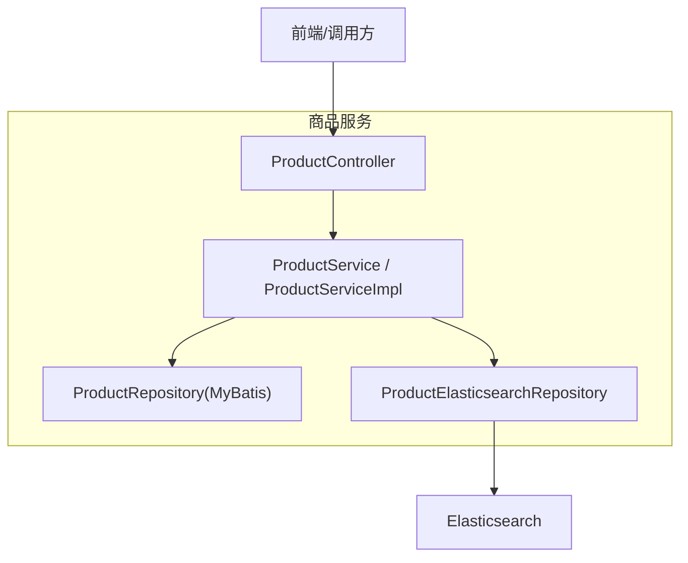
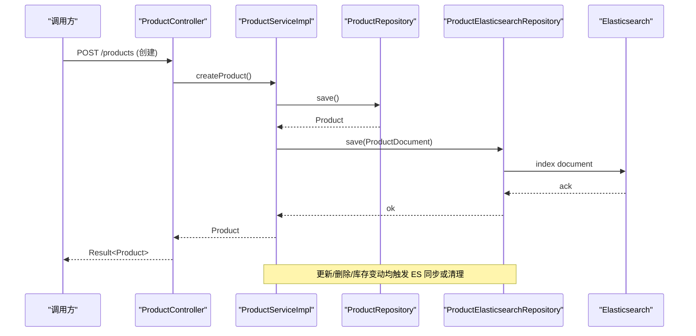
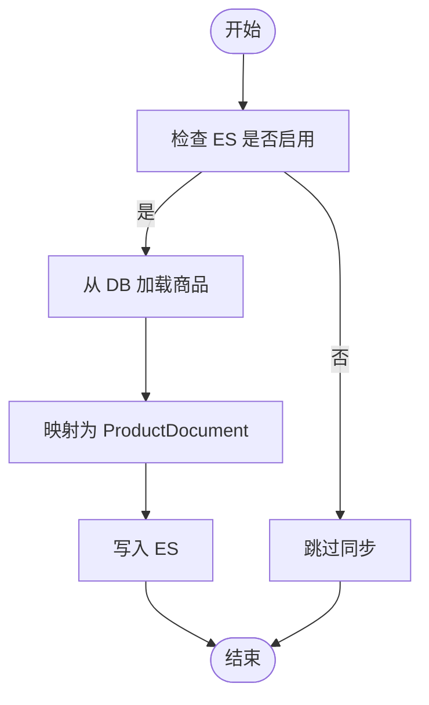
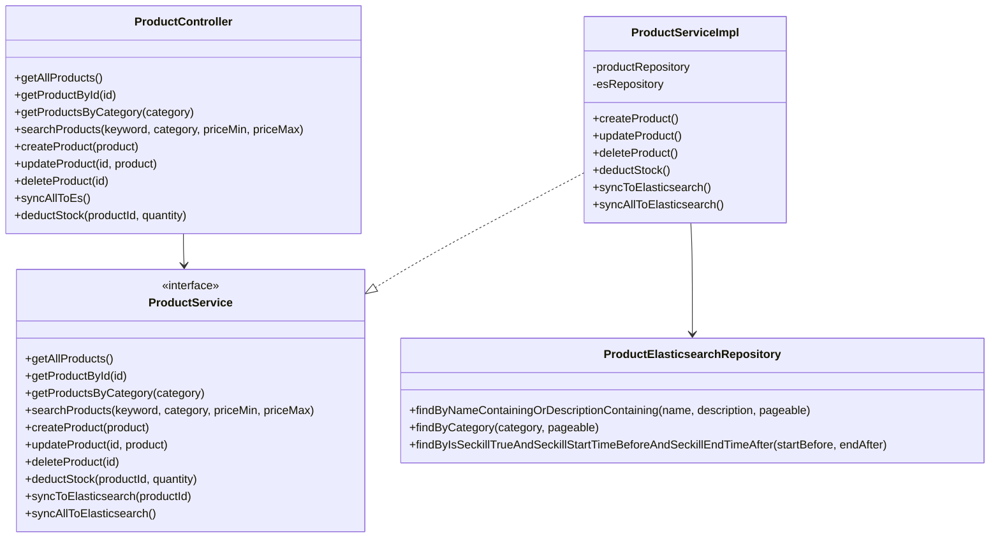

# Elasticsearch集成

<cite>
**本文引用的文件**   
- [ElasticsearchConfig.java](file://backend/ecommerce-product/src/main/java/com/ecommerce/product/config/ElasticsearchConfig.java)
- [application.yml](file://backend/ecommerce-product/src/main/resources/application.yml)
- [ProductDocument.java](file://backend/ecommerce-product/src/main/java/com/ecommerce/product/elasticsearch/ProductDocument.java)
- [ProductElasticsearchRepository.java](file://backend/ecommerce-product/src/main/java/com/ecommerce/product/elasticsearch/ProductElasticsearchRepository.java)
- [ProductService.java](file://backend/ecommerce-product/src/main/java/com/ecommerce/product/service/ProductService.java)
- [ProductServiceImpl.java](file://backend/ecommerce-product/src/main/java/com/ecommerce/product/service/impl/ProductServiceImpl.java)
- [ProductController.java](file://backend/ecommerce-product/src/main/java/com/ecommerce/product/controller/ProductController.java)
</cite>

## 目录
1. [简介](#简介)
2. [项目结构](#项目结构)
3. [核心组件](#核心组件)
4. [架构总览](#架构总览)
5. [详细组件分析](#详细组件分析)
6. [依赖关系分析](#依赖关系分析)
7. [性能与优化](#性能与优化)
8. [故障排查指南](#故障排查指南)
9. [结论](#结论)
10. [附录：查询示例与最佳实践](#附录查询示例与最佳实践)

## 简介
本技术文档聚焦于商品搜索功能的 Elasticsearch 集成方案，覆盖索引设计、文档映射、客户端配置、Repository 接口使用、复杂查询语法、分词器配置、搜索性能优化、聚合查询、索引管理、数据同步以及全文检索最佳实践。同时提供可操作的查询示例、性能监控建议与集群扩展方案，帮助读者在生产环境中稳定高效地使用 Elasticsearch。

## 项目结构
本项目在商品服务模块中集成了 Elasticsearch，采用 Spring Data Elasticsearch 的 Repository 模式进行数据访问，并通过 Service 层完成业务编排与 ES 数据同步。关键路径如下：
- 配置层：ElasticsearchConfig 通过条件注解控制 ES 能力开关；application.yml 提供连接参数与仓库启用开关。
- 数据模型层：ProductDocument 定义 ES 文档结构与字段类型、分词策略。
- 数据访问层：ProductElasticsearchRepository 暴露基于方法名派生的查询与分页能力。
- 业务层：ProductService/ProductServiceImpl 负责 DB 与 ES 的数据一致性、增量/全量同步。
- 接口层：ProductController 对外暴露商品 CRUD、搜索与同步接口。

图表来源
- [ProductController.java:15-96](file://backend/ecommerce-product/src/main/java/com/ecommerce/product/controller/ProductController.java#L15-L96)
- [ProductService.java:8-38](file://backend/ecommerce-product/src/main/java/com/ecommerce/product/service/ProductService.java#L8-L38)
- [ProductServiceImpl.java:19-163](file://backend/ecommerce-product/src/main/java/com/ecommerce/product/service/impl/ProductServiceImpl.java#L19-L163)
- [ProductElasticsearchRepository.java:10-18](file://backend/ecommerce-product/src/main/java/com/ecommerce/product/elasticsearch/ProductElasticsearchRepository.java#L10-L18)

章节来源
- [ElasticsearchConfig.java:1-14](file://backend/ecommerce-product/src/main/java/com/ecommerce/product/config/ElasticsearchConfig.java#L1-L14)
- [application.yml:25-33](file://backend/ecommerce-product/src/main/resources/application.yml#L25-L33)

## 核心组件
- 配置开关与连接参数
  - 通过 spring.elasticsearch.enabled 控制是否启用 ES 相关能力。
  - 通过 spring.data.elasticsearch.repositories.enabled 开启 Spring Data ES 仓库自动装配。
  - 通过 spring.elasticsearch.uris 指定 ES 节点地址。
- 文档模型
  - ProductDocument 定义 products 索引的文档结构，包含文本、数值、布尔、日期等字段，并设置分词器与格式化规则。
- 仓库接口
  - ProductElasticsearchRepository 继承 ElasticsearchRepository，提供按名称/描述模糊匹配、分类过滤、秒杀时间范围查询等方法。
- 服务实现
  - ProductServiceImpl 封装了 DB 与 ES 的一致性逻辑，包括单条/全量同步、删除时清理 ES 文档、库存变动后触发同步等。
- 控制器
  - ProductController 暴露商品查询、搜索、创建、更新、删除、同步 ES 与扣减库存等 REST 接口。

章节来源
- [application.yml:25-33](file://backend/ecommerce-product/src/main/resources/application.yml#L25-L33)
- [ProductDocument.java:13-55](file://backend/ecommerce-product/src/main/java/com/ecommerce/product/elasticsearch/ProductDocument.java#L13-L55)
- [ProductElasticsearchRepository.java:10-18](file://backend/ecommerce-product/src/main/java/com/ecommerce/product/elasticsearch/ProductElasticsearchRepository.java#L10-L18)
- [ProductServiceImpl.java:57-163](file://backend/ecommerce-product/src/main/java/com/ecommerce/product/service/impl/ProductServiceImpl.java#L57-L163)
- [ProductController.java:15-96](file://backend/ecommerce-product/src/main/java/com/ecommerce/product/controller/ProductController.java#L15-L96)

## 架构总览
下图展示了从请求到 ES 的完整链路，以及数据同步的关键分支。

图表来源
- [ProductController.java:58-70](file://backend/ecommerce-product/src/main/java/com/ecommerce/product/controller/ProductController.java#L58-L70)
- [ProductServiceImpl.java:57-83](file://backend/ecommerce-product/src/main/java/com/ecommerce/product/service/impl/ProductServiceImpl.java#L57-L83)
- [ProductElasticsearchRepository.java:10-18](file://backend/ecommerce-product/src/main/java/com/ecommerce/product/elasticsearch/ProductElasticsearchRepository.java#L10-L18)

## 详细组件分析

### 配置与开关
- 条件启用
  - ElasticsearchConfig 使用 @ConditionalOnProperty 仅在 spring.elasticsearch.enabled=true 时生效，便于灰度与降级。
- 连接与仓库
  - application.yml 中 spring.data.elasticsearch.repositories.enabled=true 启用仓库自动装配。
  - spring.elasticsearch.uris 指向 ES 节点；用户名密码留空表示无认证（生产环境建议启用安全）。
- 日志级别
  - 针对商品服务包开启 DEBUG，便于观察 ES 同步过程。

章节来源
- [ElasticsearchConfig.java:6-13](file://backend/ecommerce-product/src/main/java/com/ecommerce/product/config/ElasticsearchConfig.java#L6-L13)
- [application.yml:25-33](file://backend/ecommerce-product/src/main/resources/application.yml#L25-L33)
- [application.yml:60-62](file://backend/ecommerce-product/src/main/resources/application.yml#L60-L62)

### 文档映射与索引设计
- 索引名
  - 默认索引名为 products。
- 字段类型与分词
  - name/description 为 Text 类型，使用 standard 分词器进行分词与检索。
  - category/imageUrl 为 Keyword 类型，其中 imageUrl 不建立倒排索引以节省空间。
  - price/seckillPrice 为 Double，stock/status/isSeckill 为 Integer/Boolean。
  - seckillStartTime/seckillEndTime 为 Date 类型，格式精确到毫秒。
- 设计要点
  - 对需要全文检索的字段使用 Text + analyzer。
  - 对需要精确匹配/聚合的字段使用 Keyword。
  - 对仅需存储不参与检索的字段关闭索引（index=false）以减少开销。

章节来源
- [ProductDocument.java:17-54](file://backend/ecommerce-product/src/main/java/com/ecommerce/product/elasticsearch/ProductDocument.java#L17-L54)

### 仓库接口与查询能力
- 方法命名派生查询
  - findByNameContainingOrDescriptionContaining：支持关键词在名称或描述中的模糊匹配，返回分页结果。
  - findByCategory：按分类精确过滤，返回分页结果。
  - findByIsSeckillTrueAndSeckillStartTimeBeforeAndSeckillEndTimeAfter：筛选当前处于秒杀时间段的商品。
- 分页与排序
  - 所有分页查询均接受 Pageable 参数，可在上层组合排序与页码。

章节来源
- [ProductElasticsearchRepository.java:10-18](file://backend/ecommerce-product/src/main/java/com/ecommerce/product/elasticsearch/ProductElasticsearchRepository.java#L10-L18)

### 服务层与数据同步
- 事务与一致性
  - 创建/更新/删除/库存扣减均在事务内执行，并在成功后触发 ES 同步或清理。
- 同步策略
  - 单条同步：根据 ID 读取 DB 实体并转换为 Document 写入 ES。
  - 全量同步：遍历全部商品并批量写入 ES，记录失败条目日志。
  - 删除清理：删除 DB 记录后尝试删除 ES 对应文档，异常仅告警不影响主流程。
- 容错与降级
  - 当 ES 未启用或不可用时，同步逻辑会跳过或记录错误日志，保证主业务流程可用。

图表来源
- [ProductServiceImpl.java:112-145](file://backend/ecommerce-product/src/main/java/com/ecommerce/product/service/impl/ProductServiceImpl.java#L112-L145)

章节来源
- [ProductServiceImpl.java:57-163](file://backend/ecommerce-product/src/main/java/com/ecommerce/product/service/impl/ProductServiceImpl.java#L57-L163)

### 控制器与外部接口
- 商品查询与搜索
  - GET /products：获取全部商品。
  - GET /products/{id}：按 ID 查询。
  - GET /products/category/{category}：按分类查询。
  - GET /products/search：关键词、分类、价格区间多条件搜索（由 Service 委托至 DB 查询，ES 用于搜索场景可扩展）。
- 商品维护
  - POST /products：创建商品（自动同步 ES）。
  - PUT /products/{id}：更新商品（自动同步 ES）。
  - DELETE /products/{id}：删除商品（清理 ES）。
- 运维与协同
  - POST /products/sync-es：全量同步商品到 ES。
  - POST /products/deduct-stock：扣减库存（供订单服务调用），成功后触发 ES 同步。

章节来源
- [ProductController.java:15-96](file://backend/ecommerce-product/src/main/java/com/ecommerce/product/controller/ProductController.java#L15-L96)

## 依赖关系分析
- 组件耦合
  - Controller 仅依赖 ProductService，保持接口清晰。
  - Service 同时依赖 DB 与 ES 仓库，承担数据一致性与同步职责。
  - ES 仓库依赖 Spring Data Elasticsearch 自动装配与底层 Java API。
- 外部依赖
  - MySQL（持久化）、Redis（缓存）、RabbitMQ（消息）、Nacos（注册发现）、Elasticsearch（搜索）。

图表来源
- [ProductController.java:15-96](file://backend/ecommerce-product/src/main/java/com/ecommerce/product/controller/ProductController.java#L15-L96)
- [ProductService.java:8-38](file://backend/ecommerce-product/src/main/java/com/ecommerce/product/service/ProductService.java#L8-L38)
- [ProductServiceImpl.java:19-163](file://backend/ecommerce-product/src/main/java/com/ecommerce/product/service/impl/ProductServiceImpl.java#L19-L163)
- [ProductElasticsearchRepository.java:10-18](file://backend/ecommerce-product/src/main/java/com/ecommerce/product/elasticsearch/ProductElasticsearchRepository.java#L10-L18)

## 性能与优化
- 分词器与字段类型
  - 对需全文检索的字段使用 Text + analyzer；对需精确匹配/聚合的字段使用 Keyword。
  - 避免对大体积图片 URL 建立倒排索引（已设置 index=false）。
- 查询优化
  - 优先使用 Repository 方法命名派生查询，减少手写 DSL 复杂度。
  - 分页查询务必传入合理的 Pageable，避免一次性拉取大量数据。
  - 对高频过滤字段（如 category、status）使用 Keyword 提升过滤性能。
- 索引优化
  - 合理设置副本数与分片数，结合数据规模与 QPS 评估。
  - 定期合并段（force merge）以降低段数量，但需在低峰期执行。
- 写入优化
  - 全量同步建议使用 bulk 批量写入（可在 Service 层扩展批量保存逻辑）。
  - 调整 refresh_interval 降低频繁刷新带来的开销。
- 监控与观测
  - 关注 ES 节点的 CPU、内存、JVM GC、线程池队列、拒绝率、慢查询日志。
  - 使用 Kibana Dev Tools 与 _cat 接口观察索引健康与分片分布。
- 集群扩展
  - 水平扩展数据节点与协调节点，分离读写负载。
  - 使用路由键（routing）将热点商品定向到固定分片，提升局部查询性能。
  - 冷热分层：热数据使用高性能磁盘，冷数据下沉至低成本存储。

[本节为通用指导，无需特定文件引用]

## 故障排查指南
- ES 未启用或连接失败
  - 现象：同步日志提示“ES 未启用”或连接异常。
  - 处理：确认 spring.elasticsearch.enabled=true 且 uris 可达；检查网络与认证配置。
- 同步失败但不影响主流程
  - 现象：删除/同步出现异常但业务正常。
  - 处理：查看警告日志，定位具体错误；必要时重试或补偿任务。
- 搜索结果不准确
  - 现象：关键词无法命中或分词不符合预期。
  - 处理：检查字段 analyzer/searchAnalyzer 配置；必要时自定义分词器并重建索引。
- 性能抖动
  - 现象：QPS 升高时延迟上升。
  - 处理：检查线程池拒绝、GC 停顿、段合并；适当扩容或调优 JVM 与索引参数。

章节来源
- [ProductServiceImpl.java:90-98](file://backend/ecommerce-product/src/main/java/com/ecommerce/product/service/impl/ProductServiceImpl.java#L90-L98)
- [ProductServiceImpl.java:112-145](file://backend/ecommerce-product/src/main/java/com/ecommerce/product/service/impl/ProductServiceImpl.java#L112-L145)

## 结论
本项目通过 Spring Data Elasticsearch 的 Repository 模式实现了商品数据的全文检索与多维过滤，配合 Service 层完成了 DB 与 ES 的数据一致性保障与同步机制。通过合理的字段类型与分词器配置、分页与过滤优化、以及完善的监控与扩缩容策略，能够在生产环境中提供稳定高效的搜索体验。后续建议在 Service 层引入批量写入、异步同步与更丰富的 DSL 查询，以进一步提升吞吐与灵活性。

## 附录：查询示例与最佳实践

### 常用查询示例（基于 Repository 方法）
- 关键词搜索（名称或描述包含关键词）
  - 方法：findByNameContainingOrDescriptionContaining(keyword, keyword, Pageable)
  - 适用：前台搜索框输入关键词的场景。
- 分类过滤
  - 方法：findByCategory(category, Pageable)
  - 适用：类目筛选、频道页展示。
- 秒杀商品筛选
  - 方法：findByIsSeckillTrueAndSeckillStartTimeBeforeAndSeckillEndTimeAfter(startBefore, endAfter)
  - 适用：当前时段内的秒杀商品列表。

章节来源
- [ProductElasticsearchRepository.java:12-17](file://backend/ecommerce-product/src/main/java/com/ecommerce/product/elasticsearch/ProductElasticsearchRepository.java#L12-L17)

### 索引管理与数据同步
- 索引生命周期
  - 新建/重建：根据 ProductDocument 的 @Document(indexName="products") 创建索引映射。
  - 别名与滚动升级：通过别名切换版本索引，实现零停机升级。
- 数据同步
  - 增量同步：在创建/更新/删除/库存变动时触发单条同步。
  - 全量同步：提供 /products/sync-es 接口一键全量重建。
  - 幂等性：以商品 ID 作为文档 ID，重复写入不会导致重复数据。

章节来源
- [ProductDocument.java:17-17](file://backend/ecommerce-product/src/main/java/com/ecommerce/product/elasticsearch/ProductDocument.java#L17-L17)
- [ProductController.java:80-86](file://backend/ecommerce-product/src/main/java/com/ecommerce/product/controller/ProductController.java#L80-L86)
- [ProductServiceImpl.java:112-145](file://backend/ecommerce-product/src/main/java/com/ecommerce/product/service/impl/ProductServiceImpl.java#L112-L145)

### 全文检索最佳实践
- 分词器选择
  - 中文场景建议使用 ik_max_word/ik_smart 等中文分词器；英文/数字可使用 standard。
- 字段设计
  - 对需要高亮显示的字段保留原始内容；对聚合字段使用 Keyword。
- 查询构建
  - 优先使用方法命名派生查询；复杂场景再引入 QueryBuilders 构造 DSL。
- 性能调优
  - 合理使用 filter 上下文替代 query 上下文以提升缓存命中率。
  - 限制返回字段（_source filtering）减少网络传输。

[本节为通用指导，无需特定文件引用]