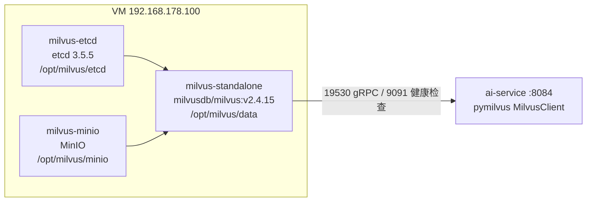
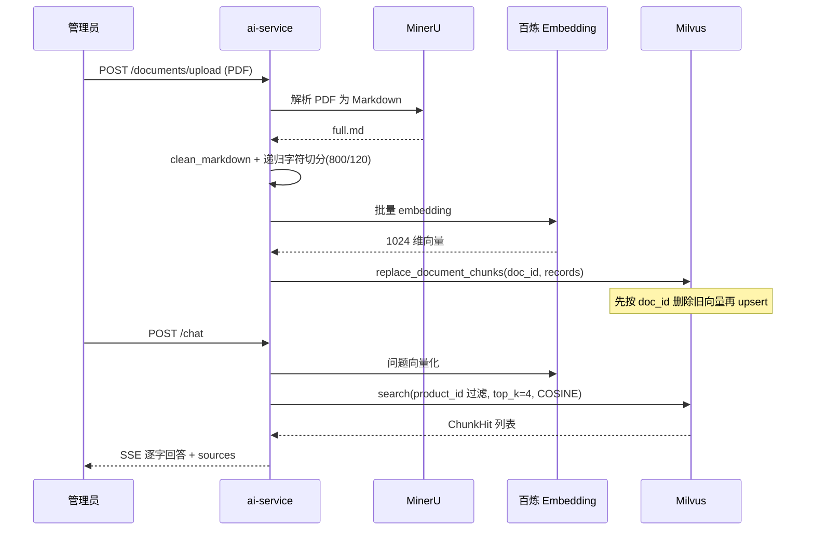

# Milvus 向量数据库

<cite>
**本文引用的文件**
- [docker-compose.milvus.yml](file://docker-compose.milvus.yml)
- [deploy-milvus.ps1](file://scripts/deploy-milvus.ps1)
- [smoke-milvus.py](file://scripts/smoke-milvus.py)
- [inspect-milvus.py](file://scripts/inspect-milvus.py)
- [milvus-console.py](file://scripts/milvus-console.py)
- [vector_store.py](file://ai-service/app/rag/vector_store.py)
- [config.py](file://ai-service/app/config.py)
- [.env.example](file://.env.example)
</cite>

## 目录
1. [定位与职责](#定位与职责)
2. [部署拓扑](#部署拓扑)
3. [集合结构](#集合结构)
4. [读写路径](#读写路径)
5. [运维脚本](#运维脚本)
6. [配置与排错](#配置与排错)

## 定位与职责

Milvus 在本项目中只承担一个职责：为「保险咨询机器人」保存保险条款 PDF 的切分片段向量，并按 `product_id` 过滤做相似度检索。商品搜索仍然走 Elasticsearch，两者互不替代。

- 向量来源：阿里云百炼 `text-embedding-v4`（OpenAI 兼容模式，维度 `EMBEDDING_DIM=1024`）。
- 访问方：只有 Python `ai-service` 访问 Milvus，Java 微服务与前端都不直连。
- 部署方式：独立 Compose 文件部署在 VM，未纳入根 `docker-compose.yml`。

## 部署拓扑

**图表来源**
- [docker-compose.milvus.yml](file://docker-compose.milvus.yml)

部署要点：

| 项目 | 说明 |
| --- | --- |
| 组成 | `etcd`（元数据）+ `minio`（对象存储）+ `milvus-standalone`（计算节点） |
| 镜像 | `bitnamilegacy/etcd:3.5.5`、`bitnamilegacy/minio:latest`、`milvusdb/milvus:v2.4.15`（前两者因本机镜像源拉不到官方镜像而替换，协议一致） |
| 端口 | `19530`（gRPC，仅局域网暴露）、`9091`（健康检查） |
| 数据目录 | 宿主机 `/opt/milvus/{etcd,minio,data}`，删除容器不丢向量 |
| 启动 | `docker compose -f docker-compose.milvus.yml up -d` |

远程部署可由仓库根执行 `scripts/deploy-milvus.ps1`：脚本读取 `$env:VM_PASS`，借助 `vm-ssh.js` 上传 compose 文件到 VM 后执行 `docker compose ... up -d`，并探测 19530 端口；无 SSH 口令时会打印手工步骤。

**章节来源**
- [deploy-milvus.ps1](file://scripts/deploy-milvus.ps1)
- [docker-compose.milvus.yml](file://docker-compose.milvus.yml)

## 集合结构

集合名由 `MILVUS_COLLECTION` 控制，默认 `insurance_chunks`，首次启动时由 `ensure_collection()` 创建（已存在则仅 `load_collection`）。

| 字段 | 类型 | 说明 |
| --- | --- | --- |
| `chunk_id` | VARCHAR(96) 主键 | 片段唯一标识（`auto_id=False`） |
| `product_id` | INT64 | 保险商品 ID，检索时作为过滤条件 |
| `doc_id` | VARCHAR(32) | 知识库文档 ID，重建/删除按此清理 |
| `chunk_index` | INT64 | 片段在文档内的序号，回传给前端做来源标注 |
| `source` | VARCHAR(255) | 原始 PDF 文件名 |
| `text` | VARCHAR(8192) | 片段正文 |
| `vector` | FLOAT_VECTOR(1024) | 百炼 Embedding 向量 |

索引：`vector` 使用 `AUTOINDEX` + `COSINE` 度量；`product_id` 额外建 `AUTOINDEX` 以加速按商品过滤。

## 读写路径

**图表来源**
- [vector_store.py](file://ai-service/app/rag/vector_store.py)

关键行为：

- **覆盖写**：`replace_document_chunks()` 先 `delete_by_doc()` 再 `upsert()`，保证重新解析不会残留旧片段。
- **删除**：删除文档时按 `doc_id` 删除向量，同时删除 MySQL 记录与本地文件。
- **检索门控**：返回的 `distance` 作为相似度写入 `ChunkHit.score`，LangGraph 的 `retrieve` 节点用 `RAG_MIN_SCORE`（默认 0.35）判断是否直接拒答。
- **引用裁剪**：`ChunkHit.to_source()` 只向前端返回 `documentId / filename / chunkIndex / score / snippet(前 280 字)`，不暴露向量与全文。

## 运维脚本

| 脚本 | 用途 |
| --- | --- |
| `scripts/smoke-milvus.py` | 连通性与集合自检（连接、collection 是否存在、片段计数） |
| `scripts/inspect-milvus.py` | 查看集合 schema、分区与按 `product_id` 的分布 |
| `scripts/milvus-console.py` | 交互式向量查询控制台，直接输入问题查看命中片段与分数 |
| `scripts/deploy-milvus.ps1` | 远程上传 compose 并拉起 Milvus（需 `VM_PASS`） |

这些脚本都以 `MILVUS_URI` / `MILVUS_TOKEN` / `MILVUS_COLLECTION` 为输入，通常直接复用根目录 `.env`。

**章节来源**
- [smoke-milvus.py](file://scripts/smoke-milvus.py)
- [inspect-milvus.py](file://scripts/inspect-milvus.py)
- [milvus-console.py](file://scripts/milvus-console.py)

## 配置与排错

| 变量 | 默认值 | 说明 |
| --- | --- | --- |
| `MILVUS_URI` | `http://192.168.178.100:19530` | gRPC 地址，Windows 侧 ai-service 直连 |
| `MILVUS_TOKEN` | 空 | 单机无鉴权时留空 |
| `MILVUS_COLLECTION` | `insurance_chunks` | 集合名，改动后需重建向量 |
| `EMBEDDING_DIM` | `1024` | 必须与集合 `vector` 维度一致，否则写入报错 |

常见问题：

- **ai-service 启动后检索一直拒答**：确认文档状态为 `ready`、`MILVUS_URI` 可达、`RAG_MIN_SCORE` 是否过高（可临时降到 0.25）。
- **集合维度不匹配**：修改 `EMBEDDING_MODEL` / `EMBEDDING_DIM` 后旧集合不可复用，需删除集合（或改 `MILVUS_COLLECTION`）重新入库。
- **Milvus 不可达**：ai-service 只记录告警并继续启动，页面可打开但问答会失败；先 `Test-NetConnection <host> -Port 19530` 排查网络与容器状态。
- **数据未持久化**：确认 `/opt/milvus` 目录存在且容器以 root 运行，compose 中三个服务都挂载了该目录下的子路径。