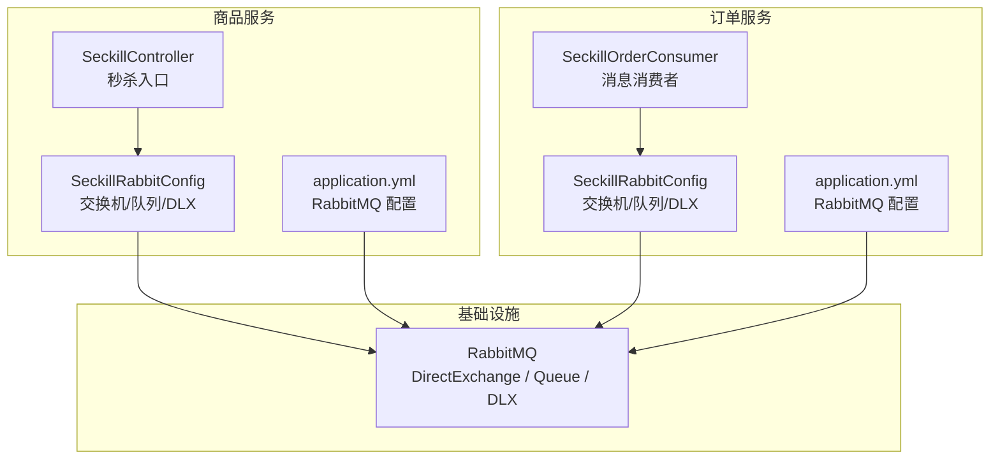
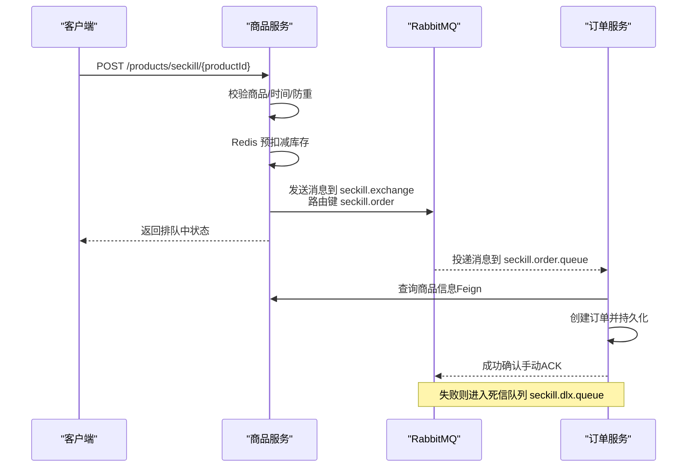
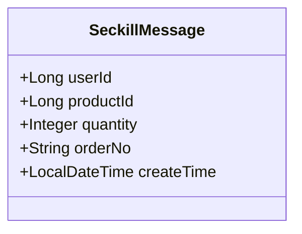
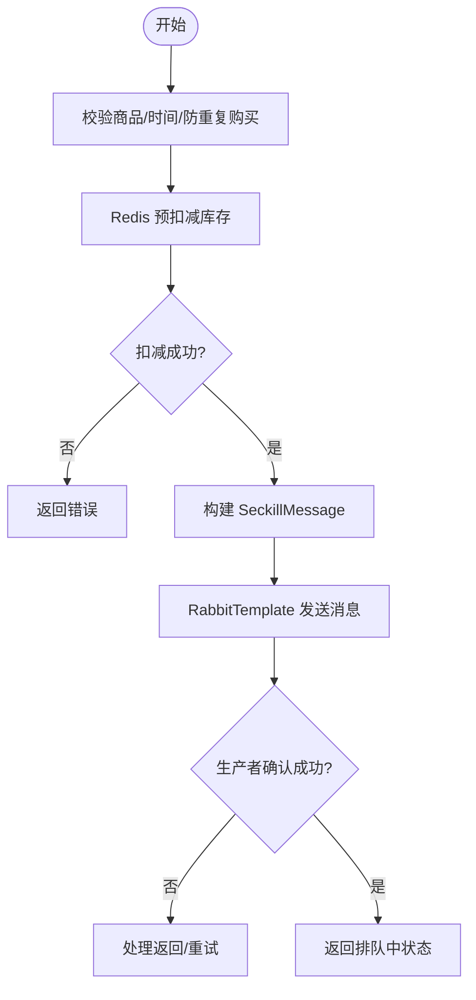
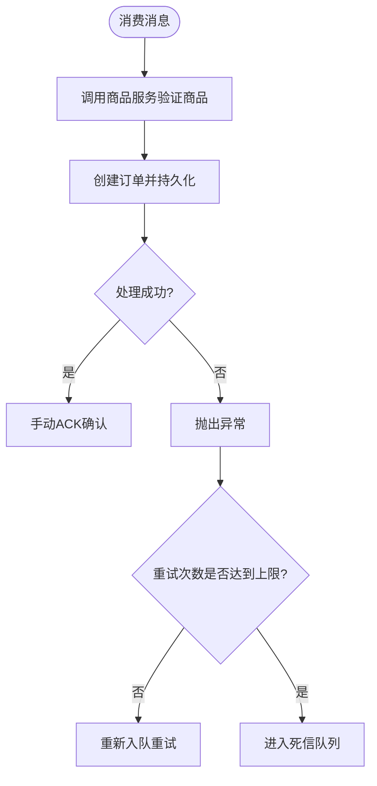
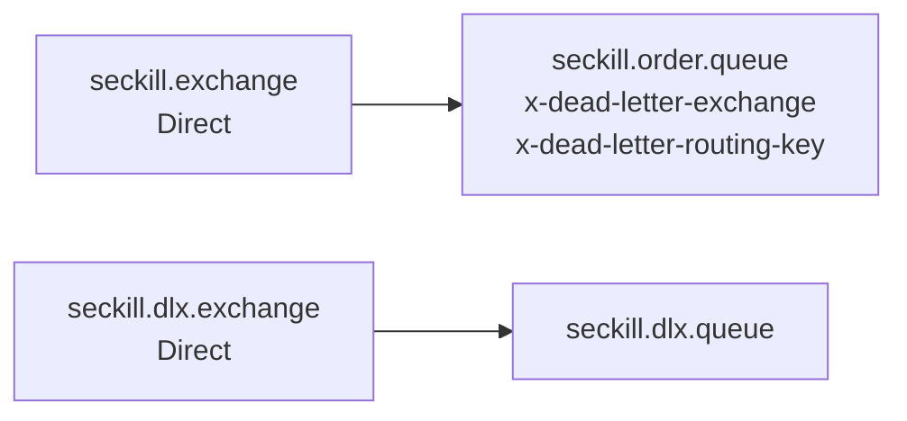
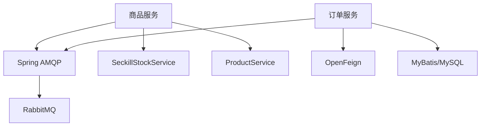

# RabbitMQ集成

<cite>
**本文引用的文件**   
- [SeckillMessage.java](file://backend/ecommerce-common/src/main/java/com/ecommerce/common/SeckillMessage.java)
- [SeckillRabbitConfig.java（商品服务）](file://backend/ecommerce-product/src/main/java/com/ecommerce/product/config/SeckillRabbitConfig.java)
- [SeckillRabbitConfig.java（订单服务）](file://backend/ecommerce-order/src/main/java/com/ecommerce/order/config/SeckillRabbitConfig.java)
- [SeckillOrderConsumer.java](file://backend/ecommerce-order/src/main/java/com/ecommerce/order/consumer/SeckillOrderConsumer.java)
- [SeckillController.java](file://backend/ecommerce-product/src/main/java/com/ecommerce/product/controller/SeckillController.java)
- [application.yml（商品服务）](file://backend/ecommerce-product/src/main/resources/application.yml)
- [application.yml（订单服务）](file://backend/ecommerce-order/src/main/resources/application.yml)
- [docker-compose-infra.yml](file://docker-compose-infra.yml)
</cite>

## 目录
1. [简介](#简介)
2. [项目结构](#项目结构)
3. [核心组件](#核心组件)
4. [架构总览](#架构总览)
5. [详细组件分析](#详细组件分析)
6. [依赖关系分析](#依赖关系分析)
7. [性能与可靠性调优](#性能与可靠性调优)
8. [监控与可观测性](#监控与可观测性)
9. [故障排查指南](#故障排查指南)
10. [扩容策略](#扩容策略)
11. [结论](#结论)

## 简介
本技术文档围绕秒杀场景下的异步消息处理，系统梳理了基于 RabbitMQ 的消息生产、消费、序列化、交换机与队列配置、死信队列、消息确认与重试、异常处理、性能调优、监控与故障排查以及扩容方案。该实现采用“库存预扣减 + 异步落库”的架构：商品服务在 Redis 中通过 Lua 原子扣减库存并标记用户购买状态，随后将秒杀请求以消息形式投递到 RabbitMQ；订单服务作为消费者，从队列拉取消息并持久化订单记录，失败时进入死信队列以便后续人工或定时重试。

## 项目结构
本项目后端包含多个微服务模块，其中与 RabbitMQ 相关的关键代码位于商品服务与订单服务：
- 公共消息模型：ecommerce-common 提供 SeckillMessage DTO，用于跨服务传递秒杀请求信息。
- 商品服务：负责接收秒杀请求、校验业务规则、Redis 预扣减库存，并通过 RabbitTemplate 发送消息。
- 订单服务：定义监听器消费消息，调用商品服务接口进行一致性校验，并在本地数据库创建订单。
- 两个服务的 SeckillRabbitConfig 分别声明交换机、队列、绑定关系与死信队列。
- application.yml 中配置 RabbitMQ 连接参数、生产者确认与消费者重试策略。
- docker-compose-infra.yml 提供 RabbitMQ 容器化部署与数据卷持久化。

**图表来源**
- [SeckillController.java:61-121](file://backend/ecommerce-product/src/main/java/com/ecommerce/product/controller/SeckillController.java#L61-L121)
- [SeckillRabbitConfig.java（商品服务）:13-57](file://backend/ecommerce-product/src/main/java/com/ecommerce/product/config/SeckillRabbitConfig.java#L13-L57)
- [SeckillRabbitConfig.java（订单服务）:13-51](file://backend/ecommerce-order/src/main/java/com/ecommerce/order/config/SeckillRabbitConfig.java#L13-L51)
- [SeckillOrderConsumer.java:35-67](file://backend/ecommerce-order/src/main/java/com/ecommerce/order/consumer/SeckillOrderConsumer.java#L35-L67)
- [application.yml（商品服务）:35-42](file://backend/ecommerce-product/src/main/resources/application.yml#L35-L42)
- [application.yml（订单服务）:26-39](file://backend/ecommerce-order/src/main/resources/application.yml#L26-L39)
- [docker-compose-infra.yml:74-92](file://docker-compose-infra.yml#L74-L92)

**章节来源**
- [SeckillMessage.java:1-26](file://backend/ecommerce-common/src/main/java/com/ecommerce/common/SeckillMessage.java#L1-L26)
- [SeckillRabbitConfig.java（商品服务）:1-59](file://backend/ecommerce-product/src/main/java/com/ecommerce/product/config/SeckillRabbitConfig.java#L1-L59)
- [SeckillRabbitConfig.java（订单服务）:1-53](file://backend/ecommerce-order/src/main/java/com/ecommerce/order/config/SeckillRabbitConfig.java#L1-L53)
- [SeckillOrderConsumer.java:1-70](file://backend/ecommerce-order/src/main/java/com/ecommerce/order/consumer/SeckillOrderConsumer.java#L1-L70)
- [SeckillController.java:1-149](file://backend/ecommerce-product/src/main/java/com/ecommerce/product/controller/SeckillController.java#L1-L149)
- [application.yml（商品服务）:1-74](file://backend/ecommerce-product/src/main/resources/application.yml#L1-L74)
- [application.yml（订单服务）:1-79](file://backend/ecommerce-order/src/main/resources/application.yml#L1-L79)
- [docker-compose-infra.yml:74-92](file://docker-compose-infra.yml#L74-L92)

## 核心组件
- 消息模型 SeckillMessage：定义用户ID、商品ID、数量、订单号、创建时间等字段，实现 Serializable 以支持 RabbitMQ 序列化传输。
- 商品服务生产者：
  - SeckillController 负责秒杀入口逻辑，包括鉴权、商品校验、时间窗口校验、防重复购买、Redis 预扣减库存、生成订单号、构造 SeckillMessage 并通过 RabbitTemplate 发送到 DirectExchange。
  - SeckillRabbitConfig 声明 seckill.exchange（Direct）、seckill.order.queue（带死信参数）、绑定路由键 seckill.order，以及死信交换机与队列。
- 订单服务消费者：
  - SeckillOrderConsumer 使用 @RabbitListener 监听 seckill.order.queue，收到消息后调用商品服务接口验证商品存在，然后创建订单并持久化；异常抛出触发重试或进入死信队列。
  - SeckillRabbitConfig 同样声明交换机、队列、绑定与死信队列，保证两端拓扑一致。
- 配置与部署：
  - 商品服务 application.yml 启用 publisher-confirm-type=correlated 与 publisher-returns=true，确保消息可靠投递。
  - 订单服务 application.yml 设置 listener.simple.acknowledge-mode=manual、prefetch=1，并开启重试策略（max-attempts=3，initial-interval=3000）。
  - docker-compose-infra.yml 提供 RabbitMQ 容器镜像、端口映射、默认账号密码与数据卷持久化。

**章节来源**
- [SeckillMessage.java:1-26](file://backend/ecommerce-common/src/main/java/com/ecommerce/common/SeckillMessage.java#L1-L26)
- [SeckillController.java:61-121](file://backend/ecommerce-product/src/main/java/com/ecommerce/product/controller/SeckillController.java#L61-L121)
- [SeckillRabbitConfig.java（商品服务）:13-57](file://backend/ecommerce-product/src/main/java/com/ecommerce/product/config/SeckillRabbitConfig.java#L13-L57)
- [SeckillOrderConsumer.java:35-67](file://backend/ecommerce-order/src/main/java/com/ecommerce/order/consumer/SeckillOrderConsumer.java#L35-L67)
- [SeckillRabbitConfig.java（订单服务）:13-51](file://backend/ecommerce-order/src/main/java/com/ecommerce/order/config/SeckillRabbitConfig.java#L13-L51)
- [application.yml（商品服务）:35-42](file://backend/ecommerce-product/src/main/resources/application.yml#L35-L42)
- [application.yml（订单服务）:26-39](file://backend/ecommerce-order/src/main/resources/application.yml#L26-L39)
- [docker-compose-infra.yml:74-92](file://docker-compose-infra.yml#L74-L92)

## 架构总览
秒杀流程采用“快速响应 + 异步落库”的模式：
- 客户端发起秒杀请求至商品服务。
- 商品服务完成业务校验与 Redis 预扣减库存，生成订单号并发送消息到 RabbitMQ。
- 订单服务消费消息，调用商品服务接口进行一致性校验，再写入本地数据库。
- 若消费失败，消息进入死信队列，便于后续人工干预或定时重试。

**图表来源**
- [SeckillController.java:61-121](file://backend/ecommerce-product/src/main/java/com/ecommerce/product/controller/SeckillController.java#L61-L121)
- [SeckillOrderConsumer.java:35-67](file://backend/ecommerce-order/src/main/java/com/ecommerce/order/consumer/SeckillOrderConsumer.java#L35-L67)
- [SeckillRabbitConfig.java（商品服务）:13-57](file://backend/ecommerce-product/src/main/java/com/ecommerce/product/config/SeckillRabbitConfig.java#L13-L57)
- [SeckillRabbitConfig.java（订单服务）:13-51](file://backend/ecommerce-order/src/main/java/com/ecommerce/order/config/SeckillRabbitConfig.java#L13-L51)

## 详细组件分析

### 消息模型与序列化
- SeckillMessage 定义了秒杀消息的核心字段，包括 userId、productId、quantity、orderNo、createTime，并实现 Serializable 以适配 RabbitMQ 的 Java 序列化机制。
- 序列化建议：
  - 保持字段稳定，避免破坏向后兼容。
  - 在生产环境考虑使用更高效的序列化格式（如 JSON），以避免 Java 序列化带来的版本兼容问题。

**图表来源**
- [SeckillMessage.java:1-26](file://backend/ecommerce-common/src/main/java/com/ecommerce/common/SeckillMessage.java#L1-L26)

**章节来源**
- [SeckillMessage.java:1-26](file://backend/ecommerce-common/src/main/java/com/ecommerce/common/SeckillMessage.java#L1-L26)

### 生产者配置与消息发送
- 交换机与队列：
  - 直连交换机 seckill.exchange，持久化。
  - 队列 seckill.order.queue，持久化，并配置死信交换机与路由键。
  - 绑定：队列通过路由键 seckill.order 绑定到交换机。
- 消息发送：
  - SeckillController 在成功预扣减库存后，构造 SeckillMessage 并通过 RabbitTemplate.convertAndSend 发送到 seckill.exchange，路由键为 seckill.order。
- 可靠性保障：
  - application.yml 启用 publisher-confirm-type=correlated 与 publisher-returns=true，确保消息投递结果可追踪。

**图表来源**
- [SeckillController.java:61-121](file://backend/ecommerce-product/src/main/java/com/ecommerce/product/controller/SeckillController.java#L61-L121)
- [application.yml（商品服务）:35-42](file://backend/ecommerce-product/src/main/resources/application.yml#L35-L42)

**章节来源**
- [SeckillController.java:61-121](file://backend/ecommerce-product/src/main/java/com/ecommerce/product/controller/SeckillController.java#L61-L121)
- [SeckillRabbitConfig.java（商品服务）:13-57](file://backend/ecommerce-product/src/main/java/com/ecommerce/product/config/SeckillRabbitConfig.java#L13-L57)
- [application.yml（商品服务）:35-42](file://backend/ecommerce-product/src/main/resources/application.yml#L35-L42)

### 消费者实现与消息处理
- 监听器：
  - SeckillOrderConsumer 使用 @RabbitListener(queues = SECKILL_QUEUE) 监听 seckill.order.queue。
  - 收到消息后，先调用商品服务接口验证商品存在，然后创建订单并持久化。
- 异常处理：
  - 捕获异常并记录日志，抛出异常以触发重试；若超过重试次数，消息进入死信队列。
- 手动确认：
  - application.yml 设置 acknowledge-mode=manual，需在实际实现中显式调用 ack/nack/reject。当前实现未显式 ACK，需注意潜在的消息重复消费风险。

**图表来源**
- [SeckillOrderConsumer.java:35-67](file://backend/ecommerce-order/src/main/java/com/ecommerce/order/consumer/SeckillOrderConsumer.java#L35-L67)
- [application.yml（订单服务）:26-39](file://backend/ecommerce-order/src/main/resources/application.yml#L26-L39)

**章节来源**
- [SeckillOrderConsumer.java:35-67](file://backend/ecommerce-order/src/main/java/com/ecommerce/order/consumer/SeckillOrderConsumer.java#L35-L67)
- [application.yml（订单服务）:26-39](file://backend/ecommerce-order/src/main/resources/application.yml#L26-L39)

### 交换机、队列与死信队列配置
- 直连交换机：
  - seckill.exchange（Direct），持久化。
- 主队列：
  - seckill.order.queue（QueueBuilder.durable），持久化。
  - 配置 x-dead-letter-exchange 与 x-dead-letter-routing-key，指向死信交换机与路由键。
- 死信交换机与队列：
  - seckill.dlx.exchange（Direct），持久化。
  - seckill.dlx.queue（QueueBuilder.durable），持久化。
- 绑定关系：
  - 主队列通过路由键 seckill.order 绑定到 seckill.exchange。
  - 死信队列通过路由键 seckill.dlx 绑定到 seckill.dlx.exchange。

**图表来源**
- [SeckillRabbitConfig.java（商品服务）:13-57](file://backend/ecommerce-product/src/main/java/com/ecommerce/product/config/SeckillRabbitConfig.java#L13-L57)
- [SeckillRabbitConfig.java（订单服务）:13-51](file://backend/ecommerce-order/src/main/java/com/ecommerce/order/config/SeckillRabbitConfig.java#L13-L51)

**章节来源**
- [SeckillRabbitConfig.java（商品服务）:13-57](file://backend/ecommerce-product/src/main/java/com/ecommerce/product/config/SeckillRabbitConfig.java#L13-L57)
- [SeckillRabbitConfig.java（订单服务）:13-51](file://backend/ecommerce-order/src/main/java/com/ecommerce/order/config/SeckillRabbitConfig.java#L13-L51)

## 依赖关系分析
- 商品服务依赖：
  - Spring AMQP（spring-boot-starter-amqp）用于 RabbitMQ 集成。
  - RabbitTemplate 用于发送消息。
  - SeckillStockService 与 ProductService 用于库存与商品信息处理。
- 订单服务依赖：
  - Spring AMQP 用于监听消息。
  - Feign（OpenFeign）用于调用商品服务接口。
  - MyBatis 用于订单持久化。
- 基础设施依赖：
  - RabbitMQ 容器镜像 rabbitmq:3-management-alpine，暴露 5672 与 15672 端口。
  - 数据卷 rabbitmq-data 用于持久化消息。

**图表来源**
- [pom.xml（商品服务）:55-59](file://backend/ecommerce-product/pom.xml#L55-L59)
- [application.yml（订单服务）:57-64](file://backend/ecommerce-order/src/main/resources/application.yml#L57-L64)
- [docker-compose-infra.yml:74-92](file://docker-compose-infra.yml#L74-L92)

**章节来源**
- [pom.xml（商品服务）:55-59](file://backend/ecommerce-product/pom.xml#L55-L59)
- [application.yml（订单服务）:57-64](file://backend/ecommerce-order/src/main/resources/application.yml#L57-L64)
- [docker-compose-infra.yml:74-92](file://docker-compose-infra.yml#L74-L92)

## 性能与可靠性调优
- 生产者侧：
  - 启用 publisher-confirm-type=correlated 与 publisher-returns=true，提升投递可靠性。
  - 在高并发场景下，可考虑批量发送与异步回调优化吞吐。
- 消费者侧：
  - prefetch=1 控制单消费者每次只拉取一条消息，避免背压。
  - retry.max-attempts=3 与 initial-interval=3000ms 提供基础重试能力。
  - 建议结合幂等设计，防止重复消费导致的数据不一致。
- 队列与交换器：
  - 所有队列与交换器均持久化，确保服务重启后消息不丢失。
  - 死信队列用于处理失败消息，便于后续人工或定时任务处理。
- 连接池与资源：
  - Redis 连接池 max-active/max-idle/min-idle 已配置，可根据负载调整。
  - RabbitMQ 容器内存与 JVM 参数可按实际负载调整。

[本节为通用指导，不直接分析具体文件]

## 监控与可观测性
- RabbitMQ 管理界面：
  - 通过 15672 端口访问管理界面，查看交换机、队列、消息堆积、消费者数量等指标。
- 应用日志：
  - 商品服务与订单服务均输出关键步骤日志，便于追踪消息生命周期。
- 健康检查：
  - docker-compose-infra.yml 中对 RabbitMQ 执行 healthcheck，确保服务可用性。

**章节来源**
- [docker-compose-infra.yml:74-92](file://docker-compose-infra.yml#L74-L92)
- [SeckillController.java:104-121](file://backend/ecommerce-product/src/main/java/com/ecommerce/product/controller/SeckillController.java#L104-L121)
- [SeckillOrderConsumer.java:35-67](file://backend/ecommerce-order/src/main/java/com/ecommerce/order/consumer/SeckillOrderConsumer.java#L35-L67)

## 故障排查指南
- 消息未到达队列：
  - 检查生产者是否正确发送消息到 seckill.exchange，路由键是否为 seckill.order。
  - 确认交换机与队列是否存在且绑定正确。
- 消费者未消费：
  - 检查消费者是否启动并监听 seckill.order.queue。
  - 确认 acknowledge-mode=manual 的实现是否调用 ack，避免消息重复消费。
- 消息进入死信队列：
  - 检查消费者处理逻辑是否抛出异常，以及重试次数是否达到上限。
  - 查看死信队列中的消息内容，定位失败原因。
- 连接问题：
  - 检查 application.yml 中 RabbitMQ 主机、端口、用户名、密码是否正确。
  - 确认 docker-compose-infra.yml 中 RabbitMQ 容器是否运行正常。

**章节来源**
- [application.yml（商品服务）:35-42](file://backend/ecommerce-product/src/main/resources/application.yml#L35-L42)
- [application.yml（订单服务）:26-39](file://backend/ecommerce-order/src/main/resources/application.yml#L26-L39)
- [SeckillOrderConsumer.java:62-67](file://backend/ecommerce-order/src/main/java/com/ecommerce/order/consumer/SeckillOrderConsumer.java#L62-L67)
- [docker-compose-infra.yml:74-92](file://docker-compose-infra.yml#L74-L92)

## 扩容策略
- 水平扩容消费者：
  - 增加订单服务实例，每个实例监听同一队列，RabbitMQ 会自动分配消息给不同消费者。
  - 注意消费者幂等性，避免重复处理。
- 垂直扩容 RabbitMQ：
  - 调整 RabbitMQ 容器资源（CPU、内存），或迁移到独立服务器集群。
- 分片与多队列：
  - 按商品 ID 或用户 ID 对消息进行分片，使用多个队列与交换机，降低单点压力。
- 监控与告警：
  - 基于 RabbitMQ 管理界面与应用日志建立监控看板，设置消息堆积、消费者离线等告警阈值。

[本节为通用指导，不直接分析具体文件]

## 结论
本项目通过 RabbitMQ 实现了秒杀场景下的异步消息处理，采用“Redis 预扣减 + 异步落库”的架构模式，有效缓解了高并发下的数据库压力。通过直连交换机、死信队列、生产者确认与消费者重试机制，提升了系统的可靠性与容错能力。未来可进一步优化消息序列化格式、增强消费者幂等性与监控告警体系，并结合分片与集群部署策略，持续提升系统吞吐与稳定性。