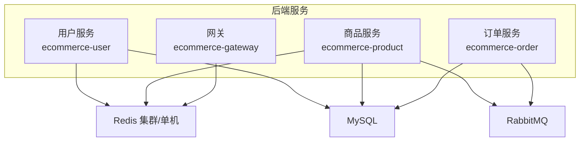
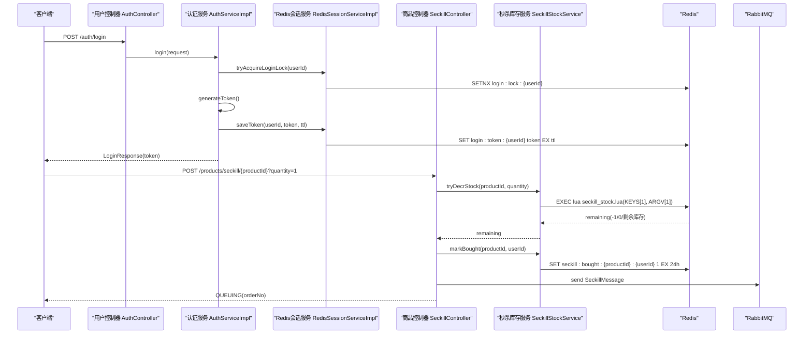
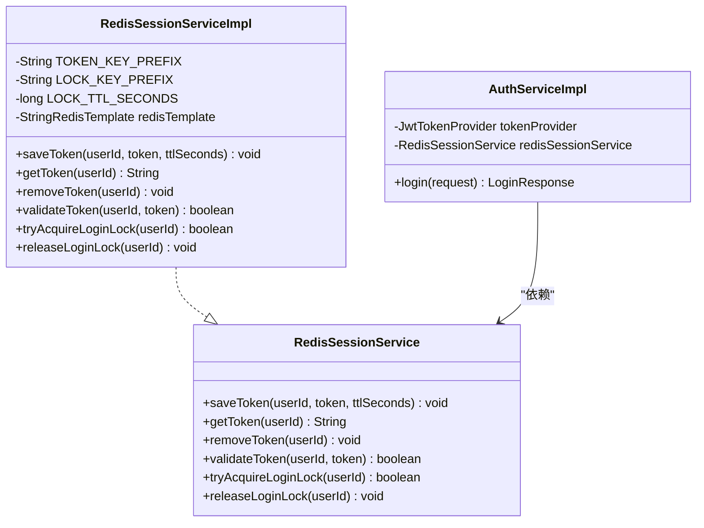
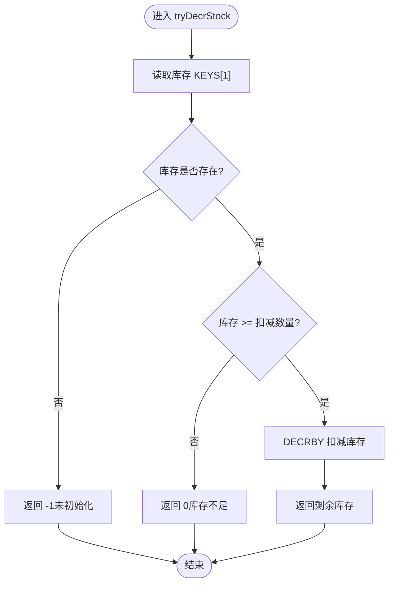
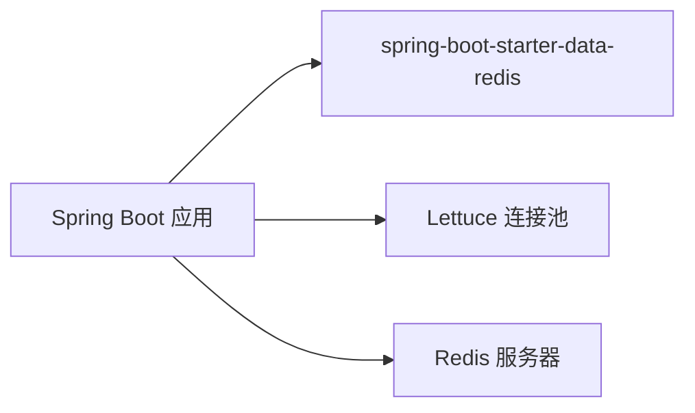
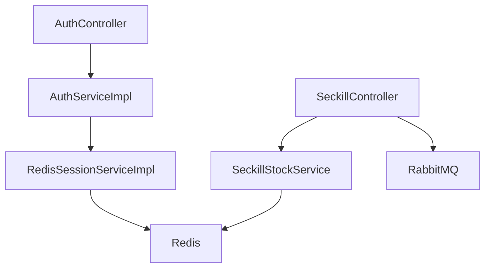

# Redis集成

<cite>
**本文引用的文件**   
- [ecommerce-user/application.yml](file://backend/ecommerce-user/src/main/resources/application.yml)
- [ecommerce-user/pom.xml](file://backend/ecommerce-user/pom.xml)
- [RedisSessionService.java](file://backend/ecommerce-user/src/main/java/com/ecommerce/user/service/RedisSessionService.java)
- [RedisSessionServiceImpl.java](file://backend/ecommerce-user/src/main/java/com/ecommerce/user/service/impl/RedisSessionServiceImpl.java)
- [AuthController.java](file://backend/ecommerce-user/src/main/java/com/ecommerce/user/controller/AuthController.java)
- [AuthServiceImpl.java](file://backend/ecommerce-user/src/main/java/com/ecommerce/user/service/impl/AuthServiceImpl.java)
- [SeckillStockService.java](file://backend/ecommerce-product/src/main/java/com/ecommerce/product/service/SeckillStockService.java)
- [seckill_stock.lua](file://backend/ecommerce-product/src/main/resources/lua/seckill_stock.lua)
- [SeckillController.java](file://backend/ecommerce-product/src/main/java/com/ecommerce/product/controller/SeckillController.java)
- [README.md](file://README.md)
- [docker-compose-infra.yml](file://docker-compose-infra.yml)
</cite>

## 目录
1. [引言](#引言)
2. [项目结构](#项目结构)
3. [核心组件](#核心组件)
4. [架构总览](#架构总览)
5. [详细组件分析](#详细组件分析)
6. [依赖关系分析](#依赖关系分析)
7. [性能与优化](#性能与优化)
8. [故障恢复与容错](#故障恢复与容错)
9. [监控、调试与可观测性](#监控调试与可观测性)
10. [扩容与高可用方案](#扩容与高可用方案)
11. [结论](#结论)

## 引言
本技术文档聚焦于项目中 Redis 的集成与实践，覆盖以下关键主题：
- 会话管理：用户 Token 存储、单设备登录（互踢）、分布式锁防止并发登录。
- 秒杀库存：Lua 脚本原子预扣减、库存预扣机制、防重复购买、高并发处理策略。
- 连接配置：Lettuce 连接池、超时、密码等。
- Key 命名规范与数据结构设计。
- 性能优化、缓存策略、故障恢复、监控指标、调试方法与扩容方案。

## 项目结构
本项目为前后端分离的微服务示例，后端包含网关、用户、商品、订单等服务；Redis 在用户服务与会话管理、商品服务的秒杀库存中扮演核心角色。

**图表来源**
- [ecommerce-user/application.yml:17-29](file://backend/ecommerce-user/src/main/resources/application.yml#L17-L29)
- [SeckillController.java:26-43](file://backend/ecommerce-product/src/main/java/com/ecommerce/product/controller/SeckillController.java#L26-L43)
- [README.md:366-379](file://README.md#L366-L379)

**章节来源**
- [ecommerce-user/application.yml:1-42](file://backend/ecommerce-user/src/main/resources/application.yml#L1-L42)
- [README.md:366-379](file://README.md#L366-L379)

## 核心组件
- 用户服务中的 Redis 会话管理：
  - 接口定义：[RedisSessionService.java](file://backend/ecommerce-user/src/main/java/com/ecommerce/user/service/RedisSessionService.java)
  - 实现类：[RedisSessionServiceImpl.java](file://backend/ecommerce-user/src/main/java/com/ecommerce/user/service/impl/RedisSessionServiceImpl.java)
  - 认证流程集成：[AuthController.java](file://backend/ecommerce-user/src/main/java/com/ecommerce/user/controller/AuthController.java)、[AuthServiceImpl.java](file://backend/ecommerce-user/src/main/java/com/ecommerce/user/service/impl/AuthServiceImpl.java)
- 商品服务中的秒杀库存：
  - 服务层：[SeckillStockService.java](file://backend/ecommerce-product/src/main/java/com/ecommerce/product/service/SeckillStockService.java)
  - Lua 脚本：[seckill_stock.lua](file://backend/ecommerce-product/src/main/resources/lua/seckill_stock.lua)
  - 控制器：[SeckillController.java](file://backend/ecommerce-product/src/main/java/com/ecommerce/product/controller/SeckillController.java)

**章节来源**
- [RedisSessionService.java:1-36](file://backend/ecommerce-user/src/main/java/com/ecommerce/user/service/RedisSessionService.java#L1-L36)
- [RedisSessionServiceImpl.java:1-107](file://backend/ecommerce-user/src/main/java/com/ecommerce/user/service/impl/RedisSessionServiceImpl.java#L1-L107)
- [AuthController.java:28-60](file://backend/ecommerce-user/src/main/java/com/ecommerce/user/controller/AuthController.java#L28-L60)
- [AuthServiceImpl.java:87-124](file://backend/ecommerce-user/src/main/java/com/ecommerce/user/service/impl/AuthServiceImpl.java#L87-L124)
- [SeckillStockService.java:1-72](file://backend/ecommerce-product/src/main/java/com/ecommerce/product/service/SeckillStockService.java#L1-L72)
- [seckill_stock.lua:1-13](file://backend/ecommerce-product/src/main/resources/lua/seckill_stock.lua#L1-L13)
- [SeckillController.java:45-122](file://backend/ecommerce-product/src/main/java/com/ecommerce/product/controller/SeckillController.java#L45-L122)

## 架构总览
下图展示用户登录与会话校验、以及秒杀抢购的关键调用链与 Redis 交互点。

**图表来源**
- [AuthController.java:54-59](file://backend/ecommerce-user/src/main/java/com/ecommerce/user/controller/AuthController.java#L54-L59)
- [AuthServiceImpl.java:106-123](file://backend/ecommerce-user/src/main/java/com/ecommerce/user/service/impl/AuthServiceImpl.java#L106-L123)
- [RedisSessionServiceImpl.java:85-106](file://backend/ecommerce-user/src/main/java/com/ecommerce/user/service/impl/RedisSessionServiceImpl.java#L85-L106)
- [SeckillController.java:61-122](file://backend/ecommerce-product/src/main/java/com/ecommerce/product/controller/SeckillController.java#L61-L122)
- [SeckillStockService.java:44-72](file://backend/ecommerce-product/src/main/java/com/ecommerce/product/service/SeckillStockService.java#L44-L72)
- [seckill_stock.lua:1-13](file://backend/ecommerce-product/src/main/resources/lua/seckill_stock.lua#L1-L13)

## 详细组件分析

### 用户会话管理与分布式锁
- 目标
  - 使用 Redis 存储用户最新有效 JWT Token，实现单设备登录（新登录使旧设备失效）。
  - 通过分布式锁防止同一账号并发登录导致会话状态错乱。
- Key 设计与 TTL
  - `login:token:{userId}`：存储最新 Token，TTL 与 JWT 有效期一致。
  - `login:lock:{userId}`：登录并发锁，TTL 固定为 10 秒，避免异常导致死锁。
- 核心方法
  - `saveToken`：原子设置 Token 与过期时间（SET + EX），覆盖旧 Token。
  - `validateToken`：比对请求 Token 与 Redis 中最新 Token。
  - `tryAcquireLoginLock` / `releaseLoginLock`：基于 SETNX 的简单分布式锁。
- 与认证流程集成
  - 登录时先尝试获取分布式锁，成功后生成 Token 并写入 Redis，最后释放锁。
  - 登出时删除 Redis 中的 Token，确保立即失效。

**图表来源**
- [RedisSessionService.java:21-36](file://backend/ecommerce-user/src/main/java/com/ecommerce/user/service/RedisSessionService.java#L21-L36)
- [RedisSessionServiceImpl.java:27-107](file://backend/ecommerce-user/src/main/java/com/ecommerce/user/service/impl/RedisSessionServiceImpl.java#L27-L107)
- [AuthServiceImpl.java:87-124](file://backend/ecommerce-user/src/main/java/com/ecommerce/user/service/impl/AuthServiceImpl.java#L87-L124)

**章节来源**
- [RedisSessionService.java:1-36](file://backend/ecommerce-user/src/main/java/com/ecommerce/user/service/RedisSessionService.java#L1-L36)
- [RedisSessionServiceImpl.java:1-107](file://backend/ecommerce-user/src/main/java/com/ecommerce/user/service/impl/RedisSessionServiceImpl.java#L1-L107)
- [AuthServiceImpl.java:87-124](file://backend/ecommerce-user/src/main/java/com/ecommerce/user/service/impl/AuthServiceImpl.java#L87-L124)

### 秒杀库存与 Lua 原子操作
- 目标
  - 使用 Redis + Lua 脚本原子预扣减库存，防止超卖。
  - 记录用户已购买标识，防止重复购买。
  - 异步下单：扣减成功后发送消息到 RabbitMQ，由订单服务消费创建订单。
- Key 设计
  - `seckill:stock:{productId}`：库存数量（字符串或数字）。
  - `seckill:bought:{productId}:{userId}`：用户已购买标记，TTL 24 小时。
- Lua 脚本逻辑
  - 读取库存值，若未初始化返回 -1。
  - 判断库存是否足够，不足返回 0。
  - 扣减库存并返回剩余库存。
- 服务层封装
  - `initStock`：初始化库存。
  - `tryDecrStock`：执行 Lua 脚本预扣减。
  - `rollbackStock`：消费失败回滚库存。
  - `markBought` / `hasBought`：用户购买标记与查询。

**图表来源**
- [seckill_stock.lua:1-13](file://backend/ecommerce-product/src/main/resources/lua/seckill_stock.lua#L1-L13)
- [SeckillStockService.java:44-57](file://backend/ecommerce-product/src/main/java/com/ecommerce/product/service/SeckillStockService.java#L44-L57)

**章节来源**
- [SeckillStockService.java:1-72](file://backend/ecommerce-product/src/main/java/com/ecommerce/product/service/SeckillStockService.java#L1-L72)
- [seckill_stock.lua:1-13](file://backend/ecommerce-product/src/main/resources/lua/seckill_stock.lua#L1-L13)
- [SeckillController.java:61-122](file://backend/ecommerce-product/src/main/java/com/ecommerce/product/controller/SeckillController.java#L61-L122)
- [README.md:366-379](file://README.md#L366-L379)

### 连接配置与依赖
- 用户服务 Redis 配置（Lettuce 连接池、超时、无密码）
  - host/port/password/timeout
  - lettuce.pool.max-active/max-idle/min-idle
- 依赖引入
  - spring-boot-starter-data-redis
- 网关侧使用 Reactive Redis（用于鉴权时查 Redis 判断挤下线）
  - spring-boot-starter-data-redis-reactive

**图表来源**
- [ecommerce-user/application.yml:17-29](file://backend/ecommerce-user/src/main/resources/application.yml#L17-L29)
- [ecommerce-user/pom.xml:73-77](file://backend/ecommerce-user/pom.xml#L73-L77)

**章节来源**
- [ecommerce-user/application.yml:17-29](file://backend/ecommerce-user/src/main/resources/application.yml#L17-L29)
- [ecommerce-user/pom.xml:73-77](file://backend/ecommerce-user/pom.xml#L73-L77)

## 依赖关系分析
- 用户服务
  - 认证流程依赖 RedisSessionService，后者通过 StringRedisTemplate 访问 Redis。
  - 登录流程中，AuthServiceImpl 调用 RedisSessionService 进行分布式锁与 Token 存取。
- 商品服务
  - SeckillController 调用 SeckillStockService，后者通过 StringRedisTemplate 执行 Lua 脚本。
  - 扣减成功后发送 RabbitMQ 消息，订单服务异步消费。

**图表来源**
- [AuthController.java:38-45](file://backend/ecommerce-user/src/main/java/com/ecommerce/user/controller/AuthController.java#L38-L45)
- [AuthServiceImpl.java:41-59](file://backend/ecommerce-user/src/main/java/com/ecommerce/user/service/impl/AuthServiceImpl.java#L41-L59)
- [RedisSessionServiceImpl.java:41-45](file://backend/ecommerce-user/src/main/java/com/ecommerce/user/service/impl/RedisSessionServiceImpl.java#L41-L45)
- [SeckillController.java:33-43](file://backend/ecommerce-product/src/main/java/com/ecommerce/product/controller/SeckillController.java#L33-L43)
- [SeckillStockService.java:21-30](file://backend/ecommerce-product/src/main/java/com/ecommerce/product/service/SeckillStockService.java#L21-L30)

**章节来源**
- [AuthController.java:28-60](file://backend/ecommerce-user/src/main/java/com/ecommerce/user/controller/AuthController.java#L28-L60)
- [AuthServiceImpl.java:41-124](file://backend/ecommerce-user/src/main/java/com/ecommerce/user/service/impl/AuthServiceImpl.java#L41-L124)
- [RedisSessionServiceImpl.java:41-107](file://backend/ecommerce-user/src/main/java/com/ecommerce/user/service/impl/RedisSessionServiceImpl.java#L41-L107)
- [SeckillController.java:33-122](file://backend/ecommerce-product/src/main/java/com/ecommerce/product/controller/SeckillController.java#L33-L122)
- [SeckillStockService.java:21-72](file://backend/ecommerce-product/src/main/java/com/ecommerce/product/service/SeckillStockService.java#L21-L72)

## 性能与优化
- 连接池与网络参数
  - 调整 Lettuce 连接池大小（max-active/max-idle）以匹配 QPS。
  - 合理设置 timeout，避免长尾延迟放大。
- 原子性与批量操作
  - 使用 Lua 脚本保证秒杀库存预扣减的原子性，减少网络往返与竞争条件。
  - 对高频读路径考虑本地缓存（如 Caffeine）+ 二级缓存（Redis）策略，降低热点 Key 压力。
- Key 设计与数据模型
  - 使用短小、稳定的 Key 前缀，避免动态拼接过长 Key。
  - 使用数值类型存储库存，利用 DECRBY 原子操作。
  - 使用 Set/Bitmap 优化“已购买”标记查询（当前实现使用 String + TTL，可扩展为 Bitmap）。
- 限流与降级
  - 在网关或服务层增加限流（如令牌桶/漏桶），保护 Redis 与下游数据库。
  - 当 Redis 不可用时，快速失败或走降级策略（如直接拒绝秒杀请求）。

[本节为通用指导，不直接分析具体文件]

## 故障恢复与容错
- 分布式锁异常
  - 登录锁 TTL 固定为 10 秒，即使业务异常也能自动释放，避免死锁。
  - 建议在 finally 块中释放锁（当前实现已在 finally 中释放）。
- 库存不一致
  - Lua 脚本返回 -1（未初始化）和 0（库存不足），上层需明确处理。
  - 提供 rollbackStock 方法，在消费失败时恢复库存。
- Redis 不可用
  - 建议增加熔断与重试（如 Resilience4j），对写操作进行幂等保障。
  - 对于读路径，允许短暂降级（返回默认值或提示稍后重试）。

**章节来源**
- [RedisSessionServiceImpl.java:85-106](file://backend/ecommerce-user/src/main/java/com/ecommerce/user/service/impl/RedisSessionServiceImpl.java#L85-L106)
- [AuthServiceImpl.java:106-123](file://backend/ecommerce-user/src/main/java/com/ecommerce/user/service/impl/AuthServiceImpl.java#L106-L123)
- [SeckillStockService.java:44-57](file://backend/ecommerce-product/src/main/java/com/ecommerce/product/service/SeckillStockService.java#L44-L57)

## 监控、调试与可观测性
- 基础健康检查
  - Docker Compose 中 Redis 健康检查使用 redis-cli ping。
- 日志与审计
  - 用户服务与商品服务均输出关键操作日志（登录、锁获取、库存扣减、消息发送）。
- 指标采集
  - 建议接入 Micrometer + Prometheus，暴露 Redis 连接池、命令耗时、错误率等指标。
- 调试建议
  - 使用 redis-cli 查看 Key 是否存在、TTL 是否正确。
  - 针对热点 Key（如库存 Key）观察命中率与延迟。

**章节来源**
- [docker-compose-infra.yml:44-50](file://docker-compose-infra.yml#L44-L50)
- [AuthServiceImpl.java:118-119](file://backend/ecommerce-user/src/main/java/com/ecommerce/user/service/impl/AuthServiceImpl.java#L118-L119)
- [SeckillController.java:113-114](file://backend/ecommerce-product/src/main/java/com/ecommerce/product/controller/SeckillController.java#L113-L114)

## 扩容与高可用方案
- Redis 集群化
  - 将单机 Redis 升级为 Cluster，按 Key 分片提升吞吐与容量。
  - 注意 Lua 脚本在集群模式下的限制（所有 Key 必须属于同一槽位）。
- 读写分离
  - 主节点写、从节点读，缓解读压力。
- 多副本与持久化
  - 启用 AOF/RDB 持久化，结合哨兵或集群自动故障转移。
- 应用侧弹性
  - 水平扩展服务实例，配合网关限流与熔断，保护 Redis。
- 数据迁移与预热
  - 大促前预热库存与热点数据，避免冷启动冲击。

[本节为通用指导，不直接分析具体文件]

## 结论
本项目在用户服务中使用 Redis 实现了会话 Token 存储与单设备登录，并通过分布式锁控制并发登录；在商品服务中使用 Redis + Lua 脚本实现了秒杀库存的原子预扣减与防重复购买，结合 RabbitMQ 完成异步下单。整体方案具备清晰的 Key 命名规范、合理的 TTL 设计与良好的可观测性。在生产环境中，建议进一步引入连接池调优、限流熔断、集群化与监控指标采集，以提升系统稳定性与可扩展性。