# 中间件集成

<cite>
**本文引用的文件**   
- [README.md](file://README.md)
- [docker-compose.yml](file://docker-compose.yml)
- [docker-compose-infra.yml](file://docker-compose-infra.yml)
- [RedisSessionService.java](file://backend/ecommerce-user/src/main/java/com/ecommerce/user/service/RedisSessionService.java)
- [RedisSessionServiceImpl.java](file://backend/ecommerce-user/src/main/java/com/ecommerce/user/service/impl/RedisSessionServiceImpl.java)
- [AuthServiceImpl.java](file://backend/ecommerce-user/src/main/java/com/ecommerce/user/service/impl/AuthServiceImpl.java)
- [pom.xml（用户服务）](file://backend/ecommerce-user/pom.xml)
- [seckill_stock.lua](file://backend/ecommerce-product/src/main/resources/lua/seckill_stock.lua)
- [SeckillRabbitConfig.java（商品服务）](file://backend/ecommerce-product/src/main/java/com/ecommerce/product/config/SeckillRabbitConfig.java)
- [SeckillRabbitConfig.java（订单服务）](file://backend/ecommerce-order/src/main/java/com/ecommerce/order/config/SeckillRabbitConfig.java)
- [SeckillOrderConsumer.java](file://backend/ecommerce-order/src/main/java/com/ecommerce/order/consumer/SeckillOrderConsumer.java)
- [SeckillController.java](file://backend/ecommerce-product/src/main/java/com/ecommerce/product/controller/SeckillController.java)
- [ProductDocument.java](file://backend/ecommerce-product/src/main/java/com/ecommerce/product/elasticsearch/ProductDocument.java)
- [ElasticsearchConfig.java](file://backend/ecommerce-product/src/main/java/com/ecommerce/product/config/ElasticsearchConfig.java)
- [ProductElasticsearchRepository.java](file://backend/ecommerce-product/src/main/java/com/ecommerce/product/elasticsearch/ProductElasticsearchRepository.java)
- [ProductServiceImpl.java](file://backend/ecommerce-product/src/main/java/com/ecommerce/product/service/impl/ProductServiceImpl.java)
- [docker-compose.milvus.yml](file://docker-compose.milvus.yml)
- [config.py（ai-service）](file://ai-service/app/config.py)
- [ingest.py](file://ai-service/app/rag/ingest.py)
- [vector_store.py](file://ai-service/app/rag/vector_store.py)
- [embeddings.py](file://ai-service/app/rag/embeddings.py)
- [graph.py](file://ai-service/app/rag/graph.py)
</cite>

## 目录
1. [引言](#引言)
2. [项目结构与中间件总览](#项目结构与中间件总览)
3. [核心中间件与职责划分](#核心中间件与职责划分)
4. [架构总览图](#架构总览图)
5. [Redis 集成：会话管理、缓存策略与秒杀库存](#redis-集成会话管理缓存策略与秒杀库存)
6. [RabbitMQ 集成：交换机、队列、路由键与可靠性](#rabbitmq-集成交换机队列路由键与可靠性)
7. [Elasticsearch 集成：索引设计、搜索查询与性能调优](#elasticsearch-集成索引设计搜索查询与性能调优)
8. [Milvus 集成：RAG 向量检索与保险知识库](#milvus-集成rag-向量检索与保险知识库)
9. [依赖关系分析](#依赖关系分析)
10. [性能优化建议](#性能优化建议)
11. [监控指标与故障排查](#监控指标与故障排查)
12. [扩容与高可用策略](#扩容与高可用策略)
13. [最佳实践清单](#最佳实践清单)
14. [结论](#结论)

## 引言
本技术文档聚焦后端微服务中四大中间件的集成方案与实践：Redis 用于会话管理、热点缓存与秒杀库存预扣；RabbitMQ 用于秒杀下单异步解耦、死信队列与消息可靠性保障；Elasticsearch 用于商品检索与搜索体验；Milvus 作为向量库支撑保险咨询的 RAG 检索。文档从连接配置、数据结构设计、处理流程、错误处理、性能优化、监控与扩容等维度展开，并配套架构图、流程图和代码级引用路径，帮助读者快速理解并在生产环境中落地。

## 项目结构与中间件总览
该项目采用 Spring Cloud 微服务架构，包含网关、用户服务、商品服务、订单服务四个后端模块，并通过 Docker Compose 统一编排 MySQL、Redis、Nacos、RabbitMQ、Elasticsearch 等基础设施。

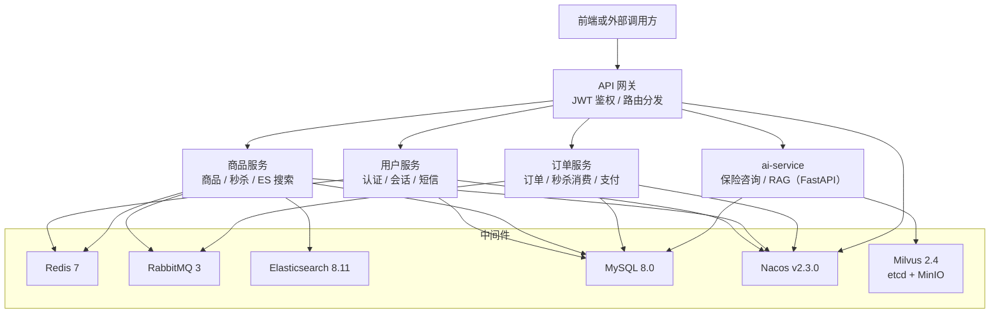

**图表来源**
- [README.md:16-47](file://README.md#L16-L47)
- [docker-compose.yml:4-67](file://docker-compose.yml#L4-L67)

**章节来源**
- [README.md:1-149](file://README.md#L1-L149)
- [docker-compose.yml:1-185](file://docker-compose.yml#L1-L185)
- [docker-compose-infra.yml:1-125](file://docker-compose-infra.yml#L1-L125)

## 核心中间件与职责划分
- Redis
  - 用户服务：存储 JWT Token 实现单设备登录、登录并发分布式锁。
  - 商品服务：Lua 脚本原子预扣减秒杀库存，防超卖。
- RabbitMQ
  - 商品服务：发送秒杀下单消息。
  - 订单服务：监听秒杀队列，异步创建订单；失败进入死信队列。
- Elasticsearch
  - 商品服务：商品文档索引、关键词与分类搜索、按时间窗口筛选秒杀商品。
- Milvus
  - ai-service：存储保险条款切片向量 `insurance_chunks`，为对话提供相似度召回。

**章节来源**
- [README.md:366-379](file://README.md#L366-L379)
- [README.md:504-514](file://README.md#L504-L514)

## 架构总览图
下图展示一次“秒杀抢购”的端到端流程，体现 Redis、RabbitMQ、ES 在其中的作用。

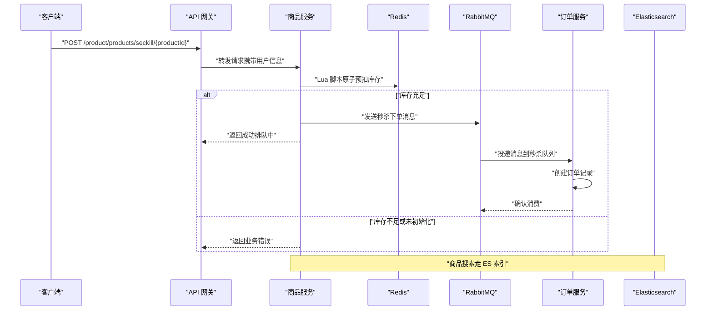

**图表来源**
- [SeckillController.java:57-115](file://backend/ecommerce-product/src/main/java/com/ecommerce/product/controller/SeckillController.java#L57-L115)
- [seckill_stock.lua:1-13](file://backend/ecommerce-product/src/main/resources/lua/seckill_stock.lua#L1-L13)
- [SeckillRabbitConfig.java（商品服务）:13-57](file://backend/ecommerce-product/src/main/java/com/ecommerce/product/config/SeckillRabbitConfig.java#L13-L57)
- [SeckillRabbitConfig.java（订单服务）:13-51](file://backend/ecommerce-order/src/main/java/com/ecommerce/order/config/SeckillRabbitConfig.java#L13-L51)
- [SeckillOrderConsumer.java:35-67](file://backend/ecommerce-order/src/main/java/com/ecommerce/order/consumer/SeckillOrderConsumer.java#L35-L67)

## Redis 集成：会话管理、缓存策略与秒杀库存

### 会话管理与单设备登录
- Key 设计
  - `login:token:{userId}`：存储用户最新有效 Token，TTL 与 JWT 有效期一致。
  - `login:lock:{userId}`：登录并发分布式锁，TTL 固定为 10 秒，防止异常导致锁不释放。
- 关键行为
  - 登录时覆盖旧 Token，实现“新设备挤下线”。
  - 鉴权时比对请求 Token 与 Redis 中最新 Token。
  - 登出删除 Token。
  - 使用 SETNX 实现登录互斥，避免同一账号并发登录状态错乱。

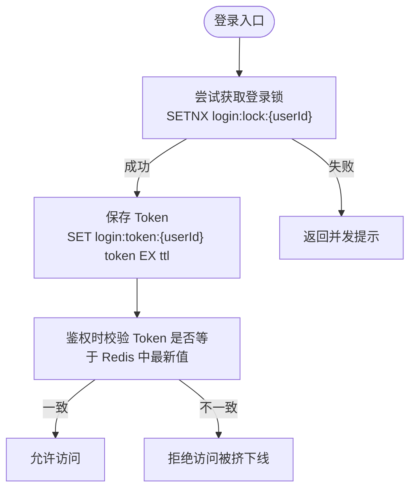

**图表来源**
- [RedisSessionService.java:15-19](file://backend/ecommerce-user/src/main/java/com/ecommerce/user/service/RedisSessionService.java#L15-L19)
- [RedisSessionServiceImpl.java:47-99](file://backend/ecommerce-user/src/main/java/com/ecommerce/user/service/impl/RedisSessionServiceImpl.java#L47-L99)

**章节来源**
- [RedisSessionService.java:1-36](file://backend/ecommerce-user/src/main/java/com/ecommerce/user/service/RedisSessionService.java#L1-L36)
- [RedisSessionServiceImpl.java:1-108](file://backend/ecommerce-user/src/main/java/com/ecommerce/user/service/impl/RedisSessionServiceImpl.java#L1-L108)
- [AuthServiceImpl.java:26-50](file://backend/ecommerce-user/src/main/java/com/ecommerce/user/service/impl/AuthServiceImpl.java#L26-L50)
- [pom.xml（用户服务）:73-77](file://backend/ecommerce-user/pom.xml#L73-L77)

### 秒杀库存预扣与 Lua 脚本
- 目标：在高并发下保证库存扣减原子性，防止超卖。
- 脚本逻辑
  - 读取库存 key。
  - 若未初始化返回特定值。
  - 若库存不足返回特定值。
  - 否则 DECRBY 扣减并返回剩余库存。

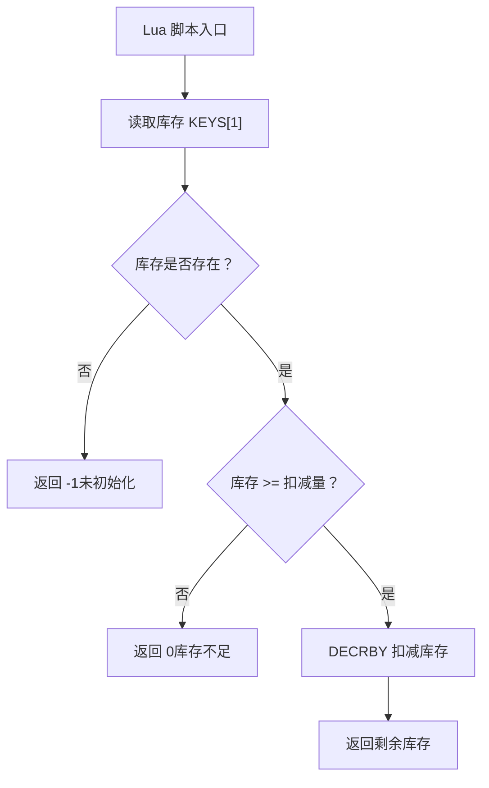

**图表来源**
- [seckill_stock.lua:1-13](file://backend/ecommerce-product/src/main/resources/lua/seckill_stock.lua#L1-L13)

**章节来源**
- [seckill_stock.lua:1-13](file://backend/ecommerce-product/src/main/resources/lua/seckill_stock.lua#L1-L13)
- [SeckillController.java:92-102](file://backend/ecommerce-product/src/main/java/com/ecommerce/product/controller/SeckillController.java#L92-L102)

### Redis 连接配置与部署
- Docker Compose 暴露 Redis 端口 6379，持久化数据卷挂载。
- 各微服务通过环境变量注入 Redis 主机地址。

**章节来源**
- [docker-compose.yml:28-35](file://docker-compose.yml#L28-L35)
- [docker-compose.yml:87-107](file://docker-compose.yml#L87-L107)
- [docker-compose.yml:109-133](file://docker-compose.yml#L109-L133)
- [docker-compose.yml:135-158](file://docker-compose.yml#L135-L158)

## RabbitMQ 集成：交换机、队列、路由键与可靠性

### 交换机、队列与绑定关系
- 交换机
  - `seckill.exchange`：Direct 类型，用于秒杀下单消息路由。
  - `seckill.dlx.exchange`：Direct 类型，作为死信交换机。
- 队列
  - `seckill.order.queue`：主队列，持久化，绑定到 `seckill.exchange`，路由键 `seckill.order`。
  - `seckill.dlx.queue`：死信队列，持久化，绑定到 `seckill.dlx.exchange`，路由键 `seckill.dlx`。
- 死信配置
  - 主队列设置 `x-dead-letter-exchange` 与 `x-dead-letter-routing-key`，消费失败或重试耗尽后进入死信队列。

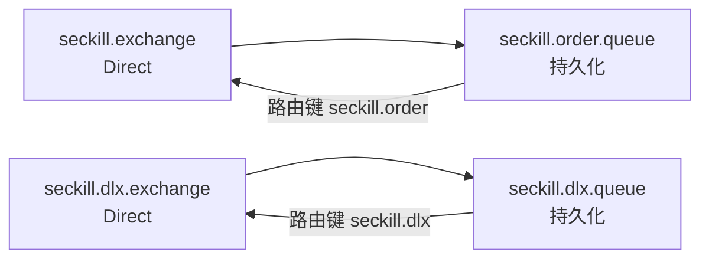

**图表来源**
- [SeckillRabbitConfig.java（商品服务）:13-57](file://backend/ecommerce-product/src/main/java/com/ecommerce/product/config/SeckillRabbitConfig.java#L13-L57)
- [SeckillRabbitConfig.java（订单服务）:13-51](file://backend/ecommerce-order/src/main/java/com/ecommerce/order/config/SeckillRabbitConfig.java#L13-L51)

**章节来源**
- [SeckillRabbitConfig.java（商品服务）:1-59](file://backend/ecommerce-product/src/main/java/com/ecommerce/product/config/SeckillRabbitConfig.java#L1-L59)
- [SeckillRabbitConfig.java（订单服务）:1-53](file://backend/ecommerce-order/src/main/java/com/ecommerce/order/config/SeckillRabbitConfig.java#L1-L53)

### 消息发送与消费者处理
- 生产者（商品服务）
  - 秒杀接口完成 Redis 预扣后，构造 `SeckillMessage` 并发送到 `seckill.exchange`，路由键 `seckill.order`。
- 消费者（订单服务）
  - 监听 `seckill.order.queue`，创建订单记录。
  - 消费异常抛出，触发重试机制；最终进入死信队列。

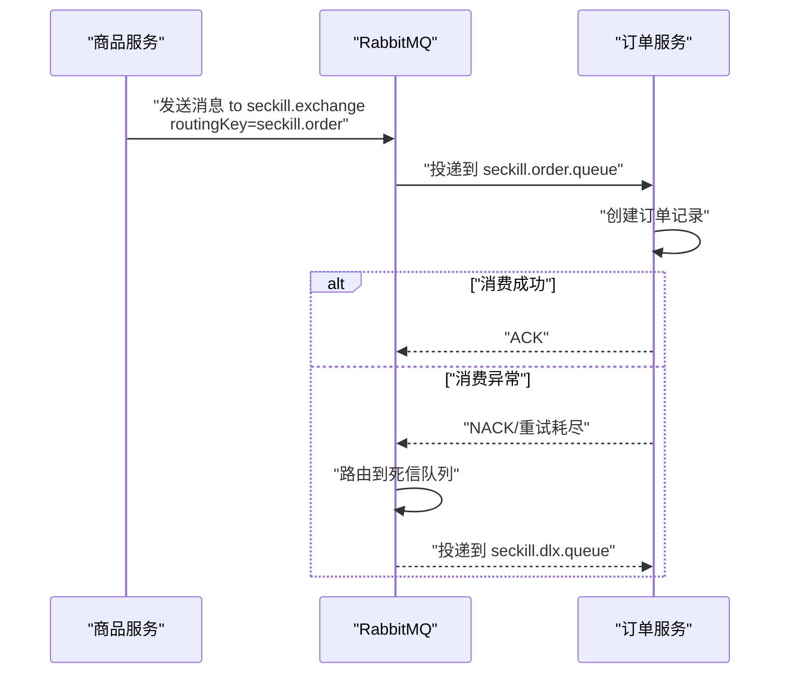

**图表来源**
- [SeckillController.java:104-115](file://backend/ecommerce-product/src/main/java/com/ecommerce/product/controller/SeckillController.java#L104-L115)
- [SeckillOrderConsumer.java:35-67](file://backend/ecommerce-order/src/main/java/com/ecommerce/order/consumer/SeckillOrderConsumer.java#L35-L67)

**章节来源**
- [SeckillController.java:57-115](file://backend/ecommerce-product/src/main/java/com/ecommerce/product/controller/SeckillController.java#L57-L115)
- [SeckillOrderConsumer.java:1-70](file://backend/ecommerce-order/src/main/java/com/ecommerce/order/consumer/SeckillOrderConsumer.java#L1-L70)

### 消息可靠性与幂等性建议
- 可靠性
  - 队列与交换机均持久化。
  - 消费者抛异常触发重试，最终进入死信队列，便于人工介入或定时补偿。
- 幂等性
  - 建议在订单服务侧基于 `orderNo` 做唯一约束或去重表，避免重复消费导致重复下单。
  - 可结合 Redis 记录已处理的消息 ID，配合延迟队列进行二次校验。

**章节来源**
- [SeckillRabbitConfig.java（订单服务）:25-31](file://backend/ecommerce-order/src/main/java/com/ecommerce/order/config/SeckillRabbitConfig.java#L25-L31)
- [SeckillOrderConsumer.java:62-67](file://backend/ecommerce-order/src/main/java/com/ecommerce/order/consumer/SeckillOrderConsumer.java#L62-L67)

## Elasticsearch 集成：索引设计、搜索查询与性能调优

### 索引与文档模型
- 索引名：`products`
- 字段设计
  - `id`：主键。
  - `name`、`description`：Text 类型，标准分词器。
  - `price`：Double。
  - `stock`：Integer。
  - `category`：Keyword。
  - `imageUrl`：Keyword，不参与索引。
  - `status`：Integer。
  - `isSeckill`：Boolean。
  - `seckillPrice`：Double。
  - `seckillStartTime`、`seckillEndTime`：Date 类型，精确到毫秒。

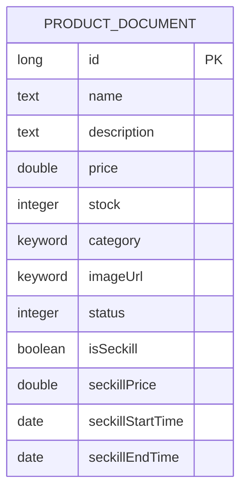

**图表来源**
- [ProductDocument.java:17-54](file://backend/ecommerce-product/src/main/java/com/ecommerce/product/elasticsearch/ProductDocument.java#L17-L54)

**章节来源**
- [ProductDocument.java:1-56](file://backend/ecommerce-product/src/main/java/com/ecommerce/product/elasticsearch/ProductDocument.java#L1-L56)

### 搜索能力与 Repository 方法
- 关键词搜索：支持名称或描述中包含关键词的分页查询。
- 分类搜索：按分类分页查询。
- 秒杀商品筛选：根据布尔字段与时间范围筛选当前在售秒杀商品。

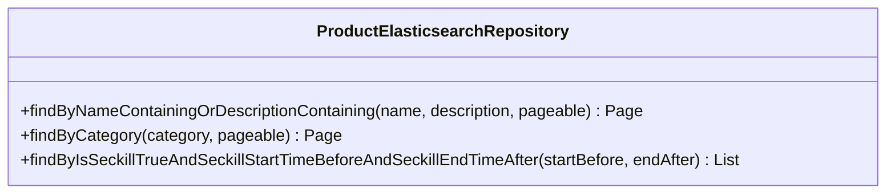

**图表来源**
- [ProductElasticsearchRepository.java:10-17](file://backend/ecommerce-product/src/main/java/com/ecommerce/product/elasticsearch/ProductElasticsearchRepository.java#L10-L17)

**章节来源**
- [ProductElasticsearchRepository.java:1-18](file://backend/ecommerce-product/src/main/java/com/ecommerce/product/elasticsearch/ProductElasticsearchRepository.java#L1-L18)

### 同步策略与开关控制
- 同步方式
  - 单条同步：根据商品 ID 同步到 ES。
  - 全量同步：遍历数据库商品并批量写入 ES。
- 开关控制
  - 通过 `spring.elasticsearch.enabled=true` 启用 ES 相关 Bean。
  - 当 ES 未启用时，同步方法直接跳过并记录日志。

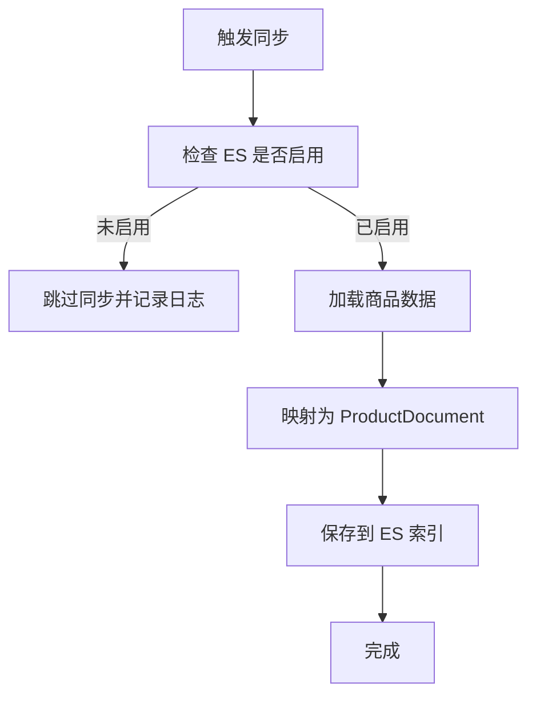

**图表来源**
- [ProductServiceImpl.java:112-145](file://backend/ecommerce-product/src/main/java/com/ecommerce/product/service/impl/ProductServiceImpl.java#L112-L145)
- [ElasticsearchConfig.java:11-13](file://backend/ecommerce-product/src/main/java/com/ecommerce/product/config/ElasticsearchConfig.java#L11-L13)

**章节来源**
- [ProductServiceImpl.java:1-147](file://backend/ecommerce-product/src/main/java/com/ecommerce/product/service/impl/ProductServiceImpl.java#L1-L147)
- [ElasticsearchConfig.java:1-14](file://backend/ecommerce-product/src/main/java/com/ecommerce/product/config/ElasticsearchConfig.java#L1-L14)

## Milvus 集成：RAG 向量检索与保险知识库
Milvus 不服务于 Java 微服务，而是给 Python 的 `ai-service` 提供向量存储。它把保险条款切成片段、向量化后入库，问答时按相似度召回少数片段拼入提示词，以降低模型幻觉。

### 部署形态（单机版）
- 编排文件：[docker-compose.milvus.yml](file://docker-compose.milvus.yml) 拉起三个容器：`milvus-etcd`（元数据）、`milvus-minio`（段文件对象存储）、`milvus-standalone`（`milvusdb/milvus:v2.4.15`）。
- 端口：`19530`（gRPC，供 ai-service 连接）、`9091`（健康检查/指标）；数据挂载在 `/opt/milvus`，删容器不丢向量。
- 当前部署在局域网 VM（`http://192.168.178.100:19530`），通过 `scripts/deploy-milvus.ps1` 执行；Windows 侧 ai-service 直连。
- 选型注意：因镜像源限制，etcd 与 MinIO 改用 `bitnamilegacy` 镜像（协议与配置字段一致），非官方镜像但兼容。

### 关键配置（ai-service）
[config.py](file://ai-service/app/config.py) 中与 Milvus 相关的项：

| 配置项 | 默认值 | 说明 |
| --- | --- | --- |
| `MILVUS_URI` | `http://192.168.178.100:19530` | gRPC 连接地址 |
| `MILVUS_TOKEN` | 空 | 单机无鉴权时为空 |
| `MILVUS_COLLECTION` | `insurance_chunks` | 向量集合名 |
| `EMBEDDING_MODEL` | `text-embedding-v4` | 阿里云百炼嵌入模型 |
| `EMBEDDING_DIM` | `1024` | 必须与集合维度一致 |
| `CHUNK_SIZE` / `CHUNK_OVERLAP` | `800` / `120` | 切片长度与重叠 |
| `RAG_TOP_K` / `RAG_MIN_SCORE` | `4` / `0.35` | 召回条数与最低相似度 |

### 写入链路（文档入库）
1. 上传 PDF → [mineru.py](file://ai-service/app/rag/mineru.py) 调用 MinerU 解析（失败且 `MINERU_FALLBACK_PYPDF=true` 时回落 pypdf）。
2. [ingest.py](file://ai-service/app/rag/ingest.py) 按 800/120 切片，过滤空段与页眉页脚噪声。
3. [embeddings.py](file://ai-service/app/rag/embeddings.py) 调用百炼 Embedding 批量向量化（1024 维）。
4. [vector_store.py](file://ai-service/app/rag/vector_store.py) 建集合（若不存在）并 upsert 片段，元数据带文档 ID 与页号便于回溯。

### 检索链路（问答）
1. 用户问题经同一 Embedding 模型向量化。
2. Milvus 按余弦/IP 相似度召回 top-k（默认 4）。
3. 低于 `RAG_MIN_SCORE`（0.35）的片段被丢弃；若全部丢弃，直接返回 `REFUSAL_MESSAGE`，不调用大模型。
4. [graph.py](file://ai-service/app/rag/graph.py) 将保留片段与历史对话拼成提示词，调用智谱 GLM（OpenAI 兼容协议）流式生成。

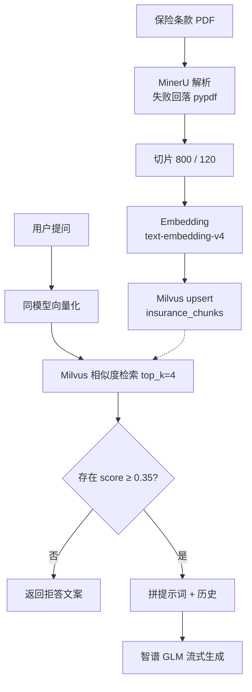

**图表来源**
- [config.py（ai-service）:46-67](file://ai-service/app/config.py#L46-L67)
- [ingest.py](file://ai-service/app/rag/ingest.py)
- [vector_store.py](file://ai-service/app/rag/vector_store.py)
- [graph.py](file://ai-service/app/rag/graph.py)

### 运维要点
- 维度一致：换了 embedding 模型必须同步改 `EMBEDDING_DIM` 并重建集合，否则 upsert 直接报维度不匹配。
- 依赖顺序：Milvus 依赖 etcd 与 MinIO 先就绪，重启后用 `9091` 健康端点确认再启 ai-service。
- 数据备份：向量数据在 `/opt/milvus/{etcd,minio,data}`，迁移时三者需一起拷走。
- 降级：Milvus 不可用时问答接口应返回明确错误而非空回答，前端提示"知识库暂不可用"。

**章节来源**
- [docker-compose.milvus.yml:1-70](file://docker-compose.milvus.yml#L1-L70)
- [config.py（ai-service）:52-67](file://ai-service/app/config.py#L52-L67)

## 依赖关系分析
- 用户服务
  - 依赖 Redis 实现会话与分布式锁。
  - 依赖 MySQL 存储用户数据。
  - 依赖 Nacos 注册与配置。
- 商品服务
  - 依赖 Redis 执行 Lua 秒杀预扣。
  - 依赖 RabbitMQ 发送秒杀消息。
  - 依赖 Elasticsearch 提供搜索能力。
  - 依赖 MySQL 存储商品数据。
- 订单服务
  - 依赖 RabbitMQ 消费秒杀消息。
  - 依赖 MySQL 存储订单数据。
  - 依赖 OpenFeign 调用商品服务。
- ai-service
  - 依赖 Milvus 存储/检索条款向量。
  - 依赖 MySQL 保存会话、消息与文档元数据。
  - 不注册 Nacos，经网关 `/api/ai/**` 转发。

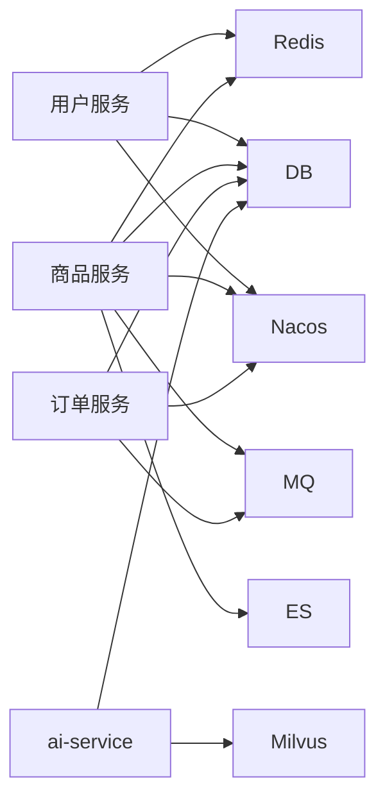

**图表来源**
- [docker-compose.yml:87-158](file://docker-compose.yml#L87-L158)
- [README.md:504-514](file://README.md#L504-L514)

**章节来源**
- [docker-compose.yml:87-158](file://docker-compose.yml#L87-L158)
- [README.md:504-514](file://README.md#L504-L514)

## 性能优化建议
- Redis
  - 使用 Lua 脚本减少网络往返与竞争条件。
  - 合理设置 TTL，避免热点 Key 长期占用内存。
  - 对高频读场景考虑本地缓存（如 Caffeine）+ Redis 二级缓存。
- RabbitMQ
  - 调整消费者线程池与 prefetch 数量，平衡吞吐与内存。
  - 对慢消费者使用独立队列与隔离实例，避免阻塞主队列。
  - 开启消息持久化与交换机持久化，提升可靠性。
- Elasticsearch
  - 针对 Text 字段选择合适的分词器与 analyzer。
  - 对过滤型字段使用 Keyword 类型，提高过滤性能。
  - 批量写入时使用 bulk API，降低索引压力。
  - 合理设置 shard 与 replica，兼顾查询与写入性能。
- Milvus
  - 批量 upsert 并复用同一 embedding 批次，减少往返。
  - `top_k` 与 `min_score` 双阀控制召回质量与延迟，避免把噪声塞给模型。
  - 集合建 `IVF_FLAT`/`HNSW` 索引，规模上去后再调 `nlist`/`M`。

[本节为通用性能指导，不直接分析具体文件]

## 监控指标与故障排查

### Redis
- 关键指标
  - 连接数、内存使用率、命中率、过期 Key 数量、Lua 脚本执行耗时。
- 常见问题
  - 会话无法续期：检查 Token TTL 与刷新逻辑。
  - 登录锁未释放：检查异常分支是否正确释放锁。
  - 秒杀库存未初始化：检查 Lua 返回值与业务错误码。

**章节来源**
- [RedisSessionServiceImpl.java:47-99](file://backend/ecommerce-user/src/main/java/com/ecommerce/user/service/impl/RedisSessionServiceImpl.java#L47-L99)
- [seckill_stock.lua:1-13](file://backend/ecommerce-product/src/main/resources/lua/seckill_stock.lua#L1-L13)

### RabbitMQ
- 关键指标
  - 队列长度、消息速率、消费者数量、重试次数、死信队列积压。
- 常见问题
  - 消息堆积：检查消费者处理能力与线程配置。
  - 死信队列增长：定位消费者异常原因（如 Feign 调用失败、DB 写入异常）。
  - 重复消费：确保订单幂等（orderNo 唯一约束或去重表）。

**章节来源**
- [SeckillRabbitConfig.java（订单服务）:25-31](file://backend/ecommerce-order/src/main/java/com/ecommerce/order/config/SeckillRabbitConfig.java#L25-L31)
- [SeckillOrderConsumer.java:62-67](file://backend/ecommerce-order/src/main/java/com/ecommerce/order/consumer/SeckillOrderConsumer.java#L62-L67)

### Elasticsearch
- 关键指标
  - 集群健康状态、索引大小、查询延迟、写入吞吐、GC 停顿。
- 常见问题
  - 搜索无结果：检查索引是否同步、字段类型与分词器匹配。
  - 写入缓慢：检查 bulk 批量大小、shard 数量与副本设置。
  - 内存溢出：调整 JVM 堆大小与 ES_JAVA_OPTS。

**章节来源**
- [ProductServiceImpl.java:112-145](file://backend/ecommerce-product/src/main/java/com/ecommerce/product/service/impl/ProductServiceImpl.java#L112-L145)
- [docker-compose.yml:47-57](file://docker-compose.yml#L47-L57)

### Milvus
- 关键指标
  - 集合行数、索引构建状态、查询 P99、gRPC 连接数与 etcd/MinIO 存储占用。
- 常见问题
  - 连接超时：检查 `MILVUS_URI` 是否可达、19530 是否被防火墙拦截。
  - 维度不匹配：`EMBEDDING_DIM` 与集合 schema 不一致，需重建集合。
  - 召回为空：`RAG_MIN_SCORE` 过高或知识库未入库（先确认集合行数）。
  - 启动失败：etcd / MinIO 未就绪，或 `/opt/milvus` 挂载权限不足。

## 扩容与高可用策略
- Redis
  - 单机转哨兵或 Cluster，读写分离与分片扩容。
  - 热点 Key 拆分或使用本地缓存缓解压力。
- RabbitMQ
  - 多节点集群与镜像队列，提升可用性。
  - 按业务拆分交换机与队列，隔离流量。
- Elasticsearch
  - 多节点集群，合理分配 master/data 角色。
  - 冷热数据分层，历史索引归档。
- Milvus
  - 单机向集群迁移（`milvus-standalone` → `milvus-cluster` + Pulsar/Kafka）。
  - etcd 与 MinIO 单独扩容与备份，避免成为短板。
- 应用层
  - 微服务水平扩容，网关负载均衡。
  - 消费者多实例并行消费，注意幂等与顺序性。

[本节为通用策略指导，不直接分析具体文件]

## 最佳实践清单
- Redis
  - 使用原子命令（SET EX、DECRBY）与 Lua 脚本保证一致性。
  - Key 命名规范：`login:token:{userId}`、`login:lock:{userId}`、`seckill:stock:{productId}`。
  - 合理设置 TTL，避免内存泄漏。
- RabbitMQ
  - 交换机与队列持久化，消费者异常重试与死信队列兜底。
  - 消费者幂等设计，避免重复下单。
  - 监控队列积压与死信队列增长，及时告警。
- Elasticsearch
  - 明确字段类型与分词器，避免全文误用。
  - 批量写入与分页查询，控制单次请求大小。
  - 定期重建索引与快照备份。
- Milvus
  - 向量集合按业务隔离（如 `insurance_chunks`），不要混用不同维度的模型。
  - 入库与检索必须使用同一 embedding 模型与维度。
  - 定期快照 `/opt/milvus`，变更模型时重建集合而非就地覆盖。

[本节为通用最佳实践，不直接分析具体文件]

## 结论
本项目通过 Redis 实现高并发下的会话管理与秒杀库存预扣，借助 RabbitMQ 将秒杀下单异步化并引入死信队列保障可靠性，使用 Elasticsearch 提供高性能商品搜索，并以 Milvus 支撑保险条款的向量检索。在生产环境中，应重点关注连接配置、Key 设计与索引结构，完善监控与告警，制定合理的扩容与容灾策略，并结合幂等与重试机制提升系统稳定性与用户体验。