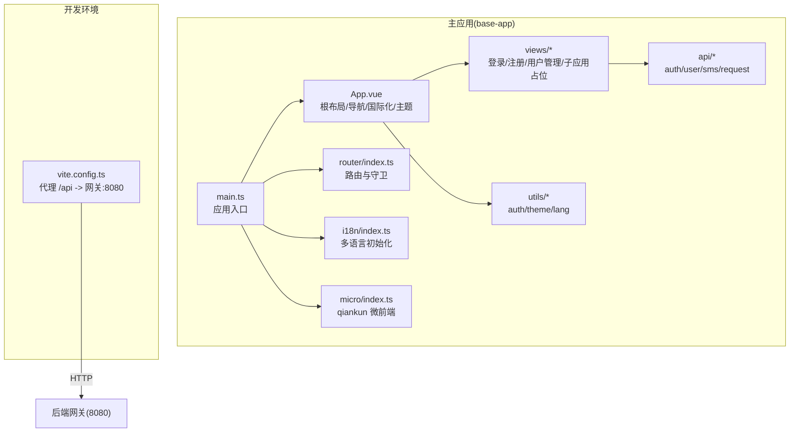
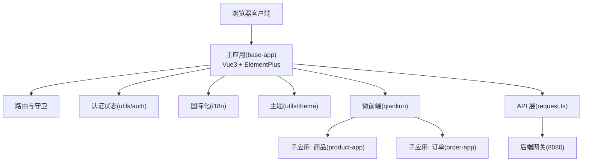
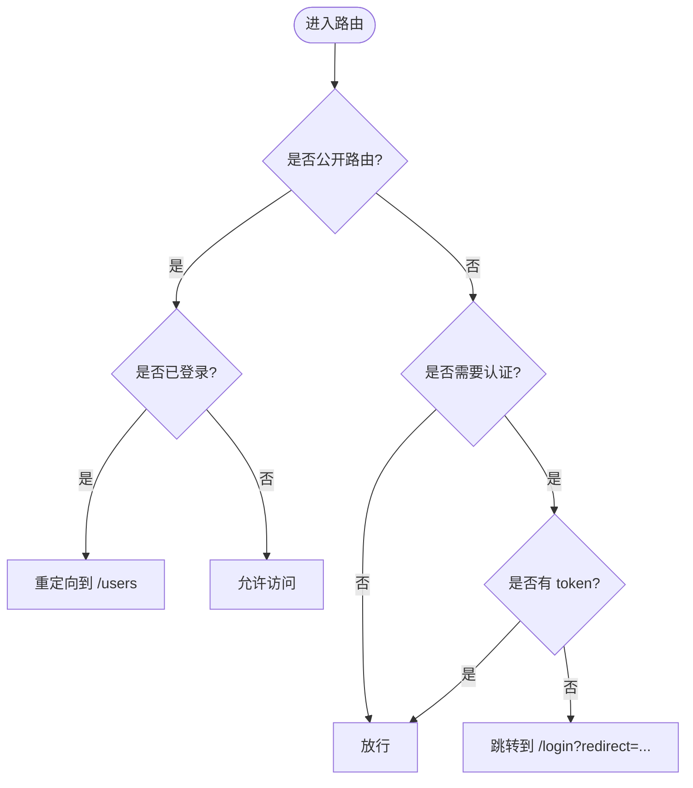
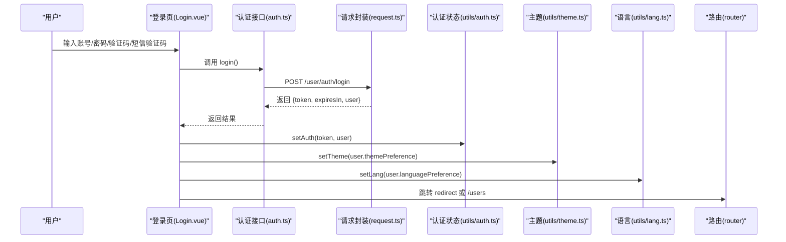
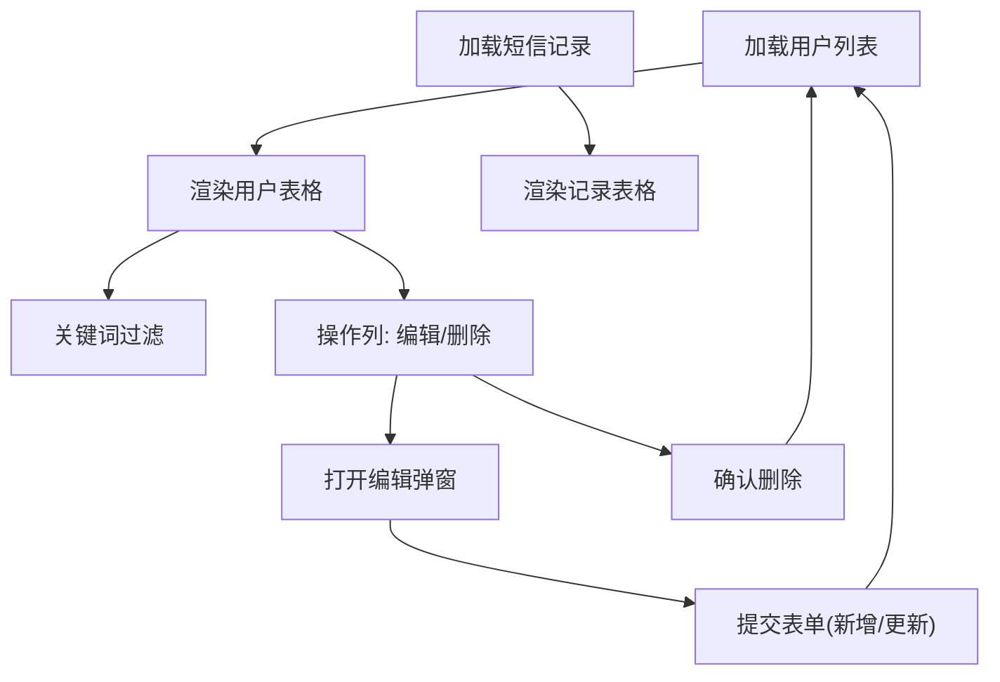
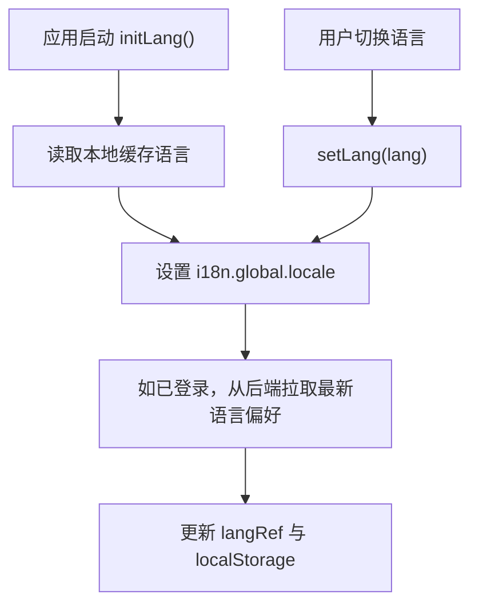
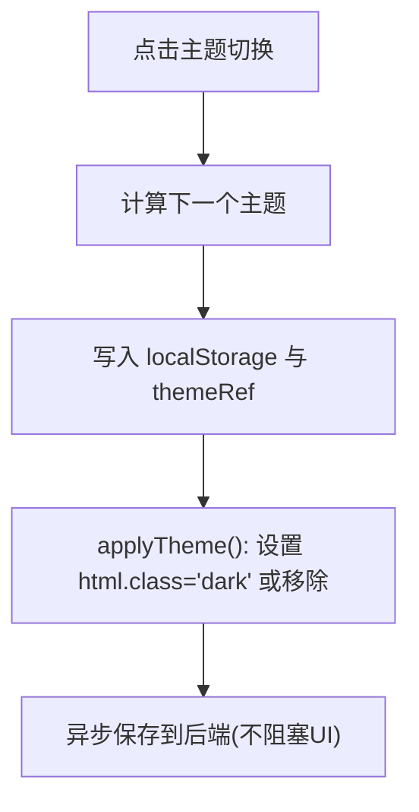
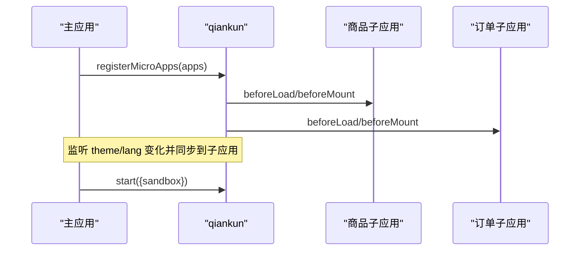
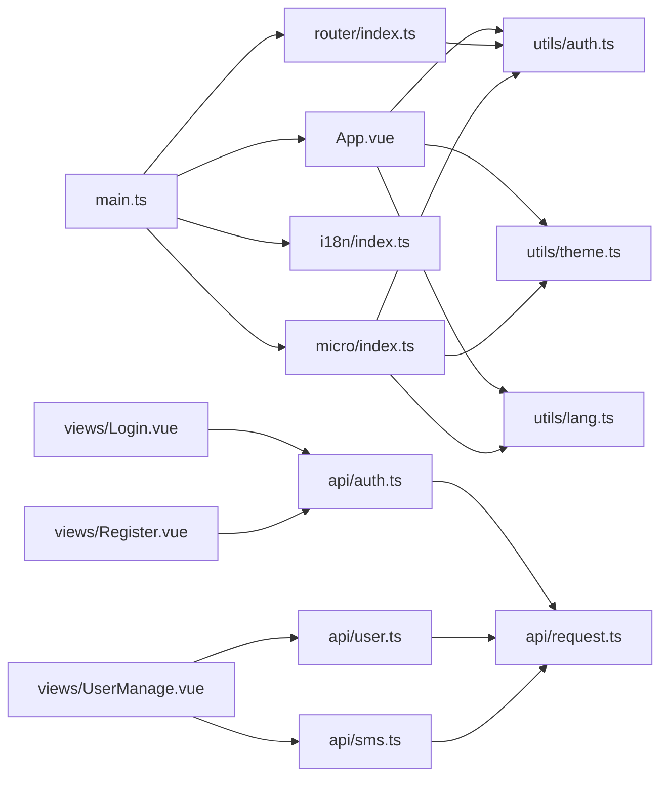

# 主应用(base-app)

<cite>
**本文引用的文件**   
- [main.ts](file://frontend/base-app/src/main.ts)
- [App.vue](file://frontend/base-app/src/App.vue)
- [index.ts（路由）](file://frontend/base-app/src/router/index.ts)
- [auth.ts（认证接口）](file://frontend/base-app/src/api/auth.ts)
- [request.ts（请求封装）](file://frontend/base-app/src/api/request.ts)
- [user.ts（用户接口）](file://frontend/base-app/src/api/user.ts)
- [sms.ts（短信记录接口）](file://frontend/base-app/src/api/sms.ts)
- [Login.vue](file://frontend/base-app/src/views/Login.vue)
- [Register.vue](file://frontend/base-app/src/views/Register.vue)
- [UserManage.vue](file://frontend/base-app/src/views/UserManage.vue)
- [i18n/index.ts](file://frontend/base-app/src/i18n/index.ts)
- [utils/auth.ts](file://frontend/base-app/src/utils/auth.ts)
- [utils/theme.ts](file://frontend/base-app/src/utils/theme.ts)
- [utils/lang.ts](file://frontend/base-app/src/utils/lang.ts)
- [micro/index.ts](file://frontend/base-app/src/micro/index.ts)
- [vite.config.ts](file://frontend/base-app/vite.config.ts)
</cite>

## 目录
1. [简介](#简介)
2. [项目结构](#项目结构)
3. [核心组件](#核心组件)
4. [架构总览](#架构总览)
5. [详细组件分析](#详细组件分析)
6. [依赖关系分析](#依赖关系分析)
7. [性能与构建部署](#性能与构建部署)
8. [故障排查指南](#故障排查指南)
9. [结论](#结论)

## 简介
本文件面向基于 Vue 3 + Element Plus 的主应用 base-app，系统性说明其架构设计、路由与布局、页面与组件组织、用户认证流程、权限控制、用户管理界面与交互、国际化与主题切换、响应式适配，以及构建配置、部署策略和性能优化方案。该主应用作为微前端基座，通过 qiankun 加载 React 商品子应用与 Angular 订单子应用，统一提供导航、鉴权、语言与主题能力。

## 项目结构
base-app 采用按功能域组织的目录结构：
- src/api：后端接口定义与请求封装
- src/views：页面级视图组件
- src/router：路由与守卫
- src/i18n：多语言资源与初始化
- src/utils：认证状态、主题、语言等工具模块
- src/micro：qiankun 微前端集成
- src/styles：全局样式
- vite.config.ts：Vite 开发服务器与代理配置

图表来源
- [main.ts:1-48](file://frontend/base-app/src/main.ts#L1-L48)
- [App.vue:1-215](file://frontend/base-app/src/App.vue#L1-L215)
- [index.ts（路由）:1-61](file://frontend/base-app/src/router/index.ts#L1-L61)
- [i18n/index.ts:1-25](file://frontend/base-app/src/i18n/index.ts#L1-L25)
- [micro/index.ts:1-89](file://frontend/base-app/src/micro/index.ts#L1-L89)
- [vite.config.ts:1-26](file://frontend/base-app/vite.config.ts#L1-L26)

章节来源
- [main.ts:1-48](file://frontend/base-app/src/main.ts#L1-L48)
- [vite.config.ts:1-26](file://frontend/base-app/vite.config.ts#L1-L26)

## 核心组件
- 应用入口 main.ts：创建 Vue 应用，挂载 Element Plus、图标库、路由、国际化；启动主题与语言初始化；启动 qiankun。
- 根组件 App.vue：使用 el-config-provider 包裹，提供顶部导航、语言切换、主题切换、用户信息展示与退出；根据路由判断渲染基座视图或子应用容器。
- 路由 index.ts：定义公开与受保护路由，包含登录、注册、用户管理、商品与订单子应用路由；beforeEach 实现基于 token 的访问控制。
- 请求封装 request.ts：Axios 实例，统一拦截器处理 Authorization、业务码校验、401/403 与“被挤下线”逻辑、错误提示。
- 认证接口 auth.ts：登录、注册、验证码、短信验证码、当前用户、登出等 API 类型与调用。
- 用户接口 user.ts：用户 CRUD 接口类型与调用。
- 短信记录接口 sms.ts：查询短信发送记录。
- 工具模块：
  - utils/auth.ts：token 与用户信息的响应式状态与持久化。
  - utils/theme.ts：主题模式 dark/light 的读取、切换、应用到 <html>、与后端同步。
  - utils/lang.ts：语言 zh/en 的读取、切换、与 vue-i18n 同步、与后端同步。
- 微前端 micro/index.ts：qiankun 注册 product-app 与 order-app，透传 getToken/getTheme/getLang/globalActions，并监听主题/语言变化同步到子应用。

章节来源
- [main.ts:1-48](file://frontend/base-app/src/main.ts#L1-L48)
- [App.vue:1-215](file://frontend/base-app/src/App.vue#L1-L215)
- [index.ts（路由）:1-61](file://frontend/base-app/src/router/index.ts#L1-L61)
- [request.ts:1-110](file://frontend/base-app/src/api/request.ts#L1-L110)
- [auth.ts:1-87](file://frontend/base-app/src/api/auth.ts#L1-L87)
- [user.ts:1-43](file://frontend/base-app/src/api/user.ts#L1-L43)
- [sms.ts:1-25](file://frontend/base-app/src/api/sms.ts#L1-L25)
- [utils/auth.ts:1-60](file://frontend/base-app/src/utils/auth.ts#L1-L60)
- [utils/theme.ts:1-88](file://frontend/base-app/src/utils/theme.ts#L1-L88)
- [utils/lang.ts:1-68](file://frontend/base-app/src/utils/lang.ts#L1-L68)
- [micro/index.ts:1-89](file://frontend/base-app/src/micro/index.ts#L1-L89)

## 架构总览
主应用作为微前端基座，承担以下职责：
- 统一 UI 框架与基础组件（Element Plus）
- 统一鉴权与路由守卫
- 统一国际化与主题
- 承载自有页面（登录、注册、用户管理）
- 通过 qiankun 动态加载子应用（商品、订单）

图表来源
- [main.ts:1-48](file://frontend/base-app/src/main.ts#L1-L48)
- [App.vue:1-215](file://frontend/base-app/src/App.vue#L1-L215)
- [index.ts（路由）:1-61](file://frontend/base-app/src/router/index.ts#L1-L61)
- [micro/index.ts:1-89](file://frontend/base-app/src/micro/index.ts#L1-L89)
- [request.ts:1-110](file://frontend/base-app/src/api/request.ts#L1-L110)

## 详细组件分析

### 路由与权限控制
- 路由定义：
  - 公开路由：/login、/register（meta.public=true）
  - 受保护路由：/users（requiresAuth=true）、/product/*、/order/*（isSubApp=true）
  - 默认重定向至 /users
- 路由守卫 beforeEach：
  - 若目标为公开路由且已登录，则重定向到 /users
  - 若目标需要认证但未携带 token，则跳转 /login 并附带 redirect 参数
- 子应用路由：
  - /product/:pathMatch(.*)* 与 /order/:pathMatch(.*)* 由 qiankun 接管渲染

图表来源
- [index.ts（路由）:1-61](file://frontend/base-app/src/router/index.ts#L1-L61)

章节来源
- [index.ts（路由）:1-61](file://frontend/base-app/src/router/index.ts#L1-L61)

### 用户认证流程（登录/注册/权限）
- 登录流程：
  - 非 admin 用户需图片验证码与短信验证码；admin 跳过验证码
  - 提交后保存 JWT 与用户信息到 localStorage，并应用用户偏好（主题/语言）
  - 成功后跳转 redirect 或 /users
- 注册流程：
  - 表单校验（用户名、密码、确认密码、姓名、邮箱、手机号、年龄、验证码、短信验证码）
  - 发送短信验证码前校验手机号格式与图片验证码
  - 成功后跳转登录页
- 权限验证：
  - 路由守卫基于 token 控制
  - Axios 响应拦截器对 401/403 进行统一处理，区分“被挤下线”与“普通未授权”，必要时强制跳转登录

图表来源
- [Login.vue:1-320](file://frontend/base-app/src/views/Login.vue#L1-L320)
- [auth.ts:1-87](file://frontend/base-app/src/api/auth.ts#L1-L87)
- [request.ts:1-110](file://frontend/base-app/src/api/request.ts#L1-L110)
- [utils/auth.ts:1-60](file://frontend/base-app/src/utils/auth.ts#L1-L60)
- [utils/theme.ts:1-88](file://frontend/base-app/src/utils/theme.ts#L1-L88)
- [utils/lang.ts:1-68](file://frontend/base-app/src/utils/lang.ts#L1-L68)

章节来源
- [Login.vue:1-320](file://frontend/base-app/src/views/Login.vue#L1-L320)
- [Register.vue:1-305](file://frontend/base-app/src/views/Register.vue#L1-L305)
- [auth.ts:1-87](file://frontend/base-app/src/api/auth.ts#L1-L87)
- [request.ts:1-110](file://frontend/base-app/src/api/request.ts#L1-L110)
- [utils/auth.ts:1-60](file://frontend/base-app/src/utils/auth.ts#L1-L60)

### 用户管理界面与交互
- 列表展示：表格展示用户基本信息，支持关键词过滤（名称/邮箱）
- 新增/编辑：弹窗表单，含必填校验、手机号正则校验、年龄范围限制
- 删除：二次确认后删除
- 短信记录：独立卡片区域，展示最近短信发送记录（手机号、验证码、状态、时间），支持刷新
- 数据源：
  - 用户列表/CRUD：user.ts
  - 短信记录：sms.ts

图表来源
- [UserManage.vue:1-255](file://frontend/base-app/src/views/UserManage.vue#L1-L255)
- [user.ts:1-43](file://frontend/base-app/src/api/user.ts#L1-L43)
- [sms.ts:1-25](file://frontend/base-app/src/api/sms.ts#L1-L25)

章节来源
- [UserManage.vue:1-255](file://frontend/base-app/src/views/UserManage.vue#L1-L255)
- [user.ts:1-43](file://frontend/base-app/src/api/user.ts#L1-L43)
- [sms.ts:1-25](file://frontend/base-app/src/api/sms.ts#L1-L25)

### 国际化配置与语言切换
- i18n 初始化：
  - 本地缓存键 LANG_KEY，默认 zh，fallbackLocale 为 zh
- 语言切换：
  - utils/lang.ts 维护响应式 langRef，切换时更新 localStorage 与 i18n.global.locale
  - 已登录时异步将语言偏好保存到后端
- 应用内联动：
  - App.vue 中根据语言设置页面标题与 Element Plus 组件语言
  - Login/Register 表单提示与按钮文案均通过 t() 获取

图表来源
- [i18n/index.ts:1-25](file://frontend/base-app/src/i18n/index.ts#L1-L25)
- [utils/lang.ts:1-68](file://frontend/base-app/src/utils/lang.ts#L1-L68)
- [App.vue:1-215](file://frontend/base-app/src/App.vue#L1-L215)

章节来源
- [i18n/index.ts:1-25](file://frontend/base-app/src/i18n/index.ts#L1-L25)
- [utils/lang.ts:1-68](file://frontend/base-app/src/utils/lang.ts#L1-L68)
- [App.vue:1-215](file://frontend/base-app/src/App.vue#L1-L215)

### 主题切换与响应式设计
- 主题模式：dark/light，默认 dark
- 主题切换：
  - utils/theme.ts 维护 themeRef，切换时写入 localStorage 并给 <html> 添加/移除 class="dark"
  - 已登录时异步将主题偏好保存到后端
- 应用内联动：
  - App.vue 头部显示当前主题状态并提供切换按钮
  - 登录成功后应用用户主题偏好
- 响应式：
  - 使用 Flex 布局与 CSS 变量，适配不同屏幕尺寸
  - Element Plus 暗黑模式通过 html.dark 生效

图表来源
- [utils/theme.ts:1-88](file://frontend/base-app/src/utils/theme.ts#L1-L88)
- [App.vue:1-215](file://frontend/base-app/src/App.vue#L1-L215)

章节来源
- [utils/theme.ts:1-88](file://frontend/base-app/src/utils/theme.ts#L1-L88)
- [App.vue:1-215](file://frontend/base-app/src/App.vue#L1-L215)

### 微前端集成（qiankun）
- 子应用注册：
  - product-app（React）：entry 指向 localhost:7100，activeRule=/product
  - order-app（Angular）：entry 指向 localhost:7200，activeRule=/order
- 全局状态：
  - 初始 state 包含 token、user、theme、lang
  - 监听 themeRef/langRef 变化，同步到子应用
- 生命周期钩子：
  - beforeLoad/beforeMount/afterUnmount 打印日志
  - 针对 React 子应用注入 Vite React Refresh 兼容标志
- 样式隔离：
  - sandbox.experimentalStyleIsolation=true

图表来源
- [micro/index.ts:1-89](file://frontend/base-app/src/micro/index.ts#L1-L89)

章节来源
- [micro/index.ts:1-89](file://frontend/base-app/src/micro/index.ts#L1-L89)

## 依赖关系分析
- 模块耦合：
  - main.ts 聚合 Element Plus、i18n、router、micro 与样式
  - App.vue 依赖 router、auth、theme、lang、i18n
  - 路由守卫依赖 utils/auth.getToken
  - 所有 API 调用经 request.ts 统一封装
  - 微前端模块依赖 auth/theme/lang 的状态读取函数
- 外部依赖：
  - axios：HTTP 客户端
  - element-plus：UI 组件库与图标
  - vue-router：路由与守卫
  - vue-i18n：国际化
  - qiankun：微前端运行时

图表来源
- [main.ts:1-48](file://frontend/base-app/src/main.ts#L1-L48)
- [App.vue:1-215](file://frontend/base-app/src/App.vue#L1-L215)
- [index.ts（路由）:1-61](file://frontend/base-app/src/router/index.ts#L1-L61)
- [Login.vue:1-320](file://frontend/base-app/src/views/Login.vue#L1-L320)
- [Register.vue:1-305](file://frontend/base-app/src/views/Register.vue#L1-L305)
- [UserManage.vue:1-255](file://frontend/base-app/src/views/UserManage.vue#L1-L255)
- [auth.ts:1-87](file://frontend/base-app/src/api/auth.ts#L1-L87)
- [user.ts:1-43](file://frontend/base-app/src/api/user.ts#L1-L43)
- [sms.ts:1-25](file://frontend/base-app/src/api/sms.ts#L1-L25)
- [request.ts:1-110](file://frontend/base-app/src/api/request.ts#L1-L110)
- [micro/index.ts:1-89](file://frontend/base-app/src/micro/index.ts#L1-L89)

## 性能与构建部署
- 构建与开发
  - Vite 插件 @vitejs/plugin-vue
  - 路径别名 @ -> src
  - 开发服务器 host 0.0.0.0，端口 5173
  - 开发代理：/api -> http://localhost:8080（网关）
- 部署建议
  - 生产环境建议使用反向代理（如 Nginx）将 /api 转发至网关，避免跨域问题
  - 静态资源开启 CDN 与缓存策略（Cache-Control、ETag）
  - 启用 Gzip/Brotli 压缩
- 性能优化
  - Element Plus 按需引入：在演示项目中采用完整引入以简化，生产可改为按需引入减少体积
  - 路由懒加载：已对页面组件使用动态 import
  - 微前端子应用按需加载：仅在匹配 activeRule 时加载
  - 图片与静态资源优化：使用现代图片格式与懒加载
  - 首屏优化：关键 CSS 内联、预加载关键字体与资源
- 安全与健壮性
  - Token 存储于 localStorage，适合演示；生产建议结合短期 Token + 刷新机制
  - 统一错误处理与用户提示，避免白屏
  - 防重复提交与倒计时控制（短信验证码）

章节来源
- [vite.config.ts:1-26](file://frontend/base-app/vite.config.ts#L1-L26)
- [index.ts（路由）:1-61](file://frontend/base-app/src/router/index.ts#L1-L61)
- [micro/index.ts:1-89](file://frontend/base-app/src/micro/index.ts#L1-L89)

## 故障排查指南
- 无法访问受保护路由
  - 检查路由守卫是否正确判断 requiresAuth 与 token
  - 确认 localStorage 中存在 demo_token
- 登录后仍被跳转回登录页
  - 检查 Axios 响应拦截器对 401/403 的处理逻辑
  - 确认后端返回的业务码是否为 40101（被挤下线）
- 主题/语言切换无效
  - 检查 utils/theme.ts 与 utils/lang.ts 是否正确写入 localStorage 与响应式状态
  - 确认 App.vue 中是否正确使用 computed 与 watch 联动
- 微前端子应用无法加载
  - 检查 micro/index.ts 中 entry 地址与 activeRule 配置
  - 确认子应用服务已启动并可访问
- 短信验证码相关
  - 检查图片验证码 key/value 是否正确传递
  - 确认短信频控与倒计时逻辑正常

章节来源
- [request.ts:1-110](file://frontend/base-app/src/api/request.ts#L1-L110)
- [index.ts（路由）:1-61](file://frontend/base-app/src/router/index.ts#L1-L61)
- [utils/theme.ts:1-88](file://frontend/base-app/src/utils/theme.ts#L1-L88)
- [utils/lang.ts:1-68](file://frontend/base-app/src/utils/lang.ts#L1-L68)
- [micro/index.ts:1-89](file://frontend/base-app/src/micro/index.ts#L1-L89)

## 结论
base-app 作为微前端基座，围绕 Vue 3 + Element Plus 构建了清晰的路由与权限体系、统一的认证与状态管理、完善的国际化与主题能力，并通过 qiankun 实现了多技术栈子应用的无缝集成。配合 Vite 的开发体验与可扩展的构建配置，既满足演示场景的快速迭代，也具备向生产环境演进的基础能力。建议在后续版本中逐步推进 Element Plus 按需引入、Token 刷新机制与更细粒度的权限控制，进一步提升性能与安全。