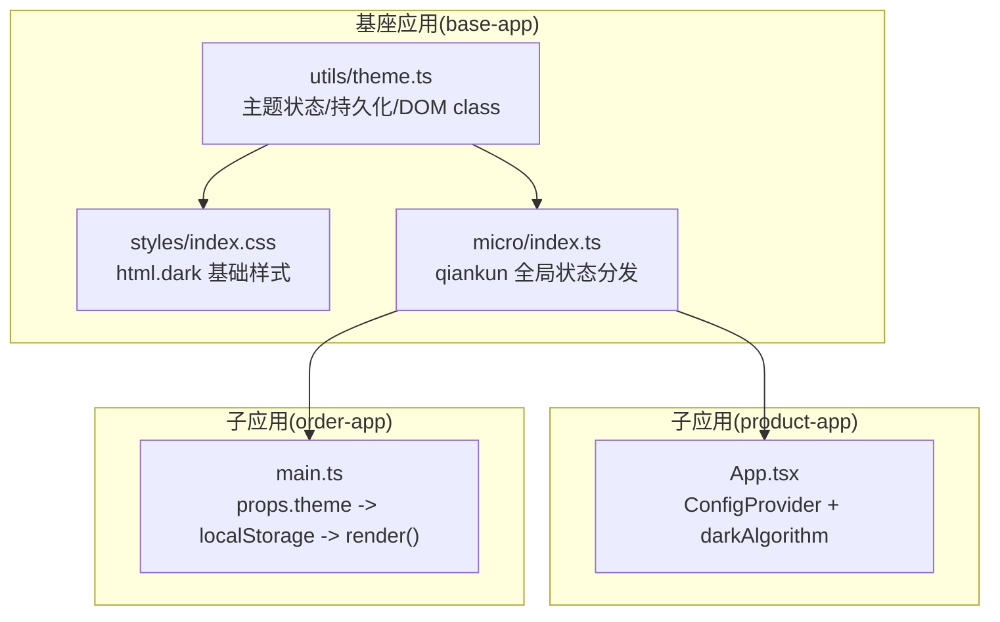
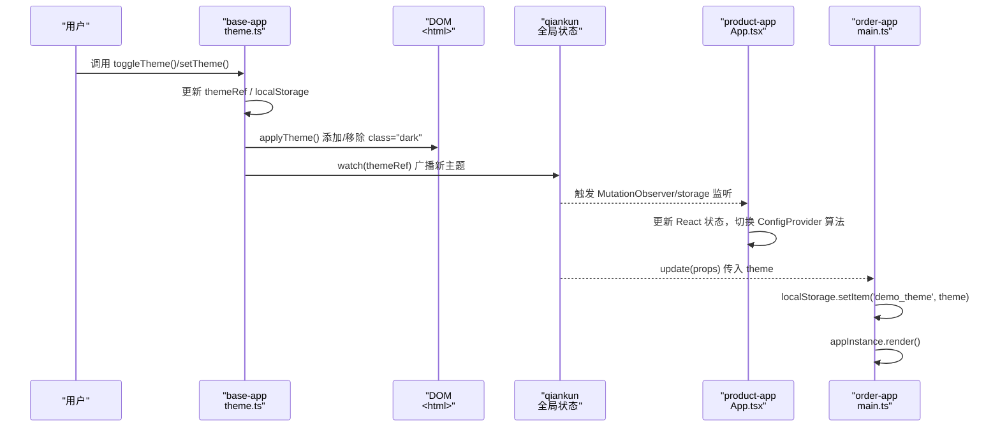
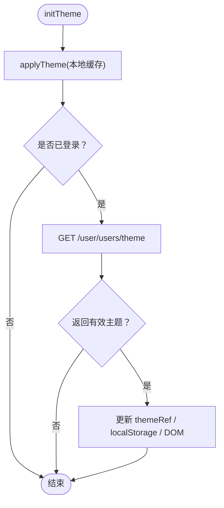
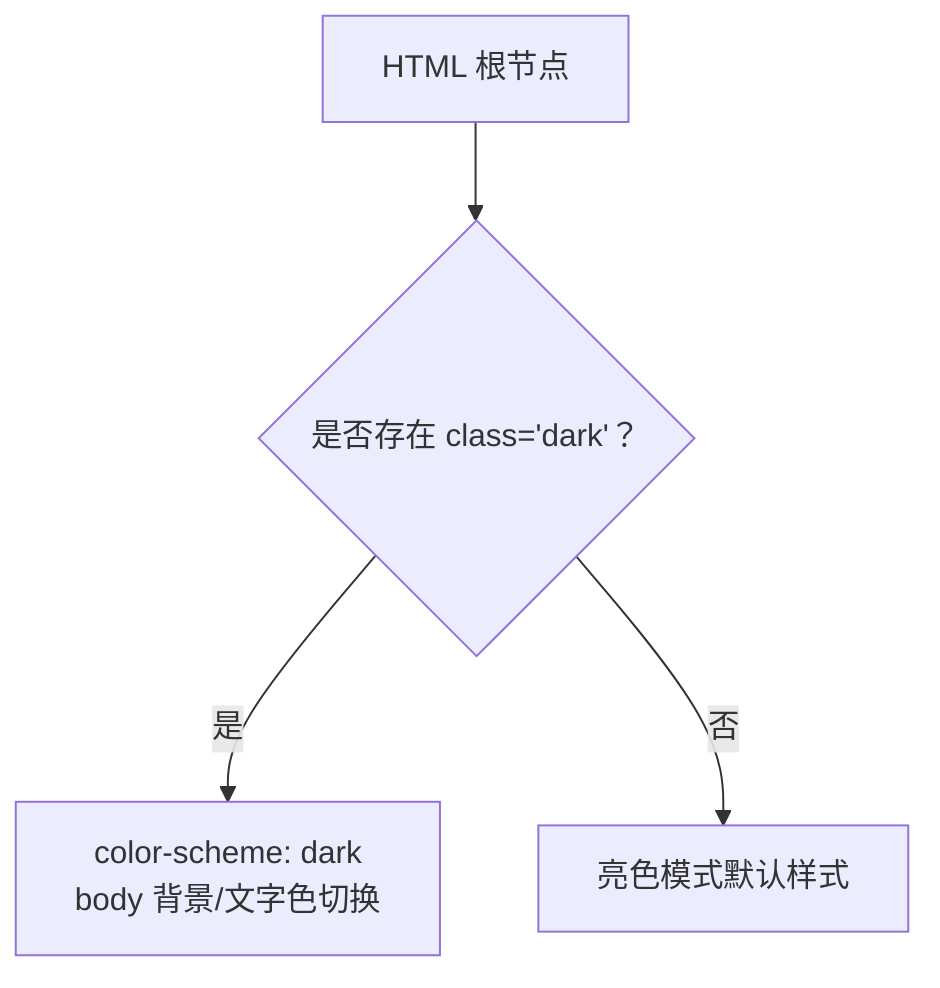
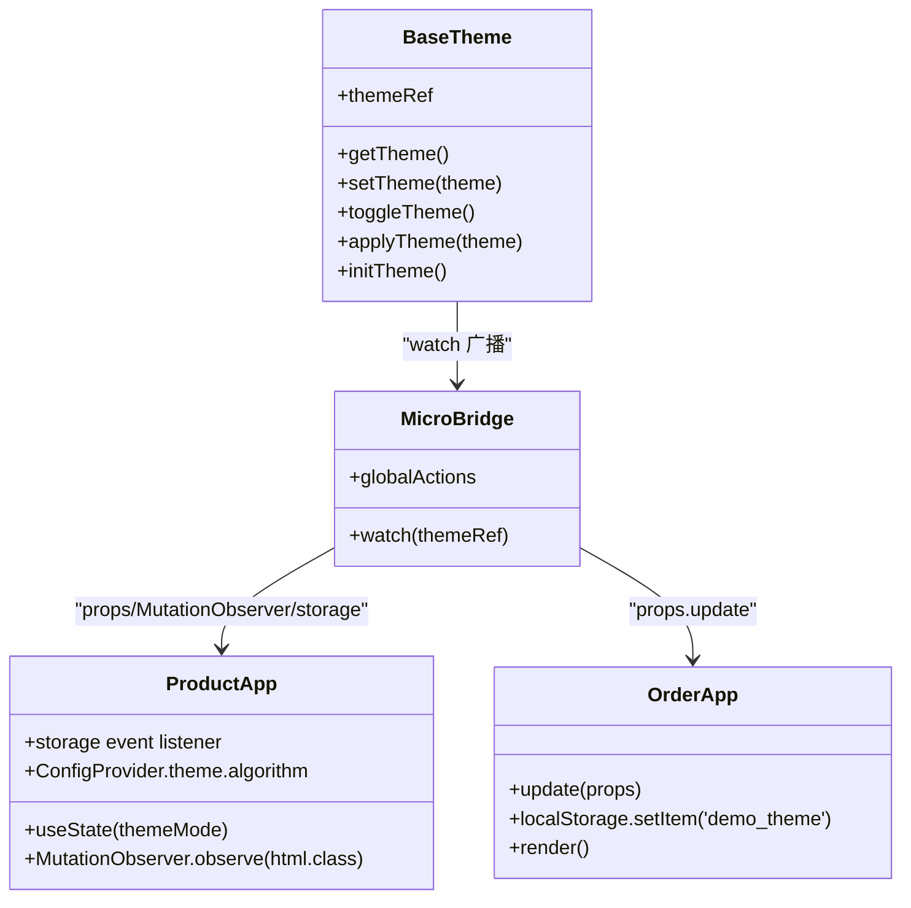
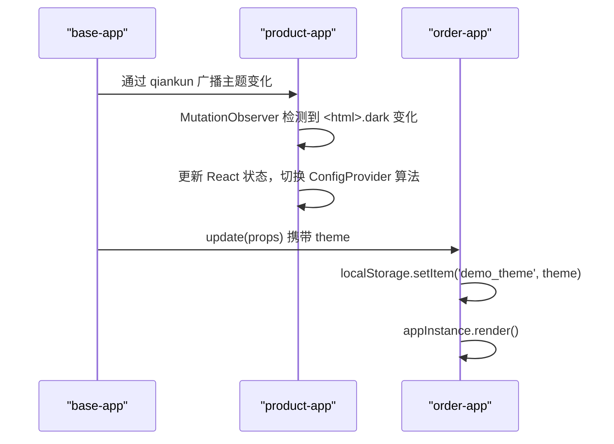
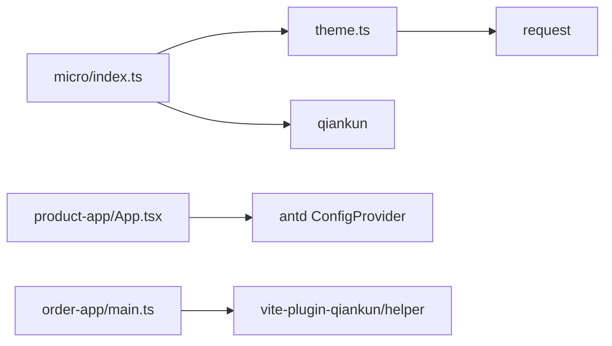

# 主题系统

<cite>
**本文引用的文件 **
- [frontend/base-app/src/utils/theme.ts](file://frontend/base-app/src/utils/theme.ts)
- [frontend/base-app/src/styles/index.css](file://frontend/base-app/src/styles/index.css)
- [frontend/base-app/src/micro/index.ts](file://frontend/base-app/src/micro/index.ts)
- [frontend/product-app/src/App.tsx](file://frontend/product-app/src/App.tsx)
- [frontend/order-app/src/main.ts](file://frontend/order-app/src/main.ts)
- [README.md](file://README.md)
</cite>

## 目录
1. [引言](#引言)
2. [项目结构](#项目结构)
3. [核心组件](#核心组件)
4. [架构总览](#架构总览)
5. [详细组件分析](#详细组件分析)
6. [依赖关系分析](#依赖关系分析)
7. [性能与兼容性](#性能与兼容性)
8. [故障排查指南](#故障排查指南)
9. [结论](#结论)
10. [附录：主题开发指南](#附录主题开发指南)

## 引言
本主题系统为微前端架构下的全局主题方案，覆盖以下目标：
- 全局主题切换：基于 CSS 变量与 DOM class 的动态样式注入。
- 暗黑模式适配：Element Plus、Ant Design 与原生 CSS 变量的统一适配。
- 跨应用同步：通过 qiankun 全局状态、MutationObserver 与 storage 事件实现实时更新。
- 持久化存储：localStorage 与后端数据库双写，保证刷新与登录后的偏好一致性。
- 可扩展接口：提供主题类型、读写 API、初始化流程与切换工具函数。

## 项目结构
主题相关代码主要分布在基座应用 base-app 与两个子应用 product-app、order-app 中：
- base-app：主题状态管理、DOM class 控制、qiankun 全局状态分发、Element Plus 暗黑模式支持。
- product-app：React + Ant Design 5，使用 ConfigProvider 的算法切换主题。
- order-app：原生 TypeScript，通过 qiankun props 接收主题并写入 localStorage 触发渲染。

**图表来源**
- [frontend/base-app/src/utils/theme.ts:1-88](file://frontend/base-app/src/utils/theme.ts#L1-L88)
- [frontend/base-app/src/styles/index.css:1-24](file://frontend/base-app/src/styles/index.css#L1-L24)
- [frontend/base-app/src/micro/index.ts:1-79](file://frontend/base-app/src/micro/index.ts#L1-L79)
- [frontend/product-app/src/App.tsx:1-74](file://frontend/product-app/src/App.tsx#L1-L74)
- [frontend/order-app/src/main.ts:1-56](file://frontend/order-app/src/main.ts#L1-L56)

**章节来源**
- [frontend/base-app/src/utils/theme.ts:1-88](file://frontend/base-app/src/utils/theme.ts#L1-L88)
- [frontend/base-app/src/styles/index.css:1-24](file://frontend/base-app/src/styles/index.css#L1-L24)
- [frontend/base-app/src/micro/index.ts:1-79](file://frontend/base-app/src/micro/index.ts#L1-L79)
- [frontend/product-app/src/App.tsx:1-74](file://frontend/product-app/src/App.tsx#L1-L74)
- [frontend/order-app/src/main.ts:1-56](file://frontend/order-app/src/main.ts#L1-L56)

## 核心组件
- 主题状态与工具（base-app）
  - 主题类型 ThemeMode：'dark' | 'light'。
  - 响应式状态 themeRef：供 Vue 组件实时读取。
  - getTheme/setTheme/toggleTheme：获取、设置、切换主题。
  - applyTheme：在 <html> 上添加或移除 'dark' class。
  - initTheme：启动时优先应用本地缓存，已登录则从后端拉取最新偏好并同步。
- 全局样式（base-app）
  - html.dark 下设置 color-scheme 与 body 背景/文字颜色，配合 Element Plus 暗黑变量。
- 跨应用同步（base-app + 子应用）
  - base-app 通过 qiankun 的 initGlobalState 维护全局状态，watch(themeRef) 将变化广播给子应用。
  - product-app 监听 MutationObserver 与 storage 事件，更新 React 状态并使用 ConfigProvider 切换算法。
  - order-app 在 update(props) 中接收主题，写入 localStorage 并重新渲染。

**章节来源**
- [frontend/base-app/src/utils/theme.ts:1-88](file://frontend/base-app/src/utils/theme.ts#L1-L88)
- [frontend/base-app/src/styles/index.css:1-24](file://frontend/base-app/src/styles/index.css#L1-L24)
- [frontend/base-app/src/micro/index.ts:1-79](file://frontend/base-app/src/micro/index.ts#L1-L79)
- [frontend/product-app/src/App.tsx:1-74](file://frontend/product-app/src/App.tsx#L1-L74)
- [frontend/order-app/src/main.ts:1-56](file://frontend/order-app/src/main.ts#L1-L56)

## 架构总览
主题系统的整体数据流如下：
- 用户操作触发 setTheme，立即更新响应式状态与 localStorage，并调用 applyTheme 修改 <html> class。
- 异步保存至后端；失败不影响 UI。
- base-app 通过 qiankun 的全局状态将主题变更广播给子应用。
- product-app 通过 MutationObserver 与 storage 事件感知变化，更新 React 状态并切换 Ant Design 算法。
- order-app 通过 props.theme 写入 localStorage 并触发重渲染。

**图表来源**
- [frontend/base-app/src/utils/theme.ts:32-63](file://frontend/base-app/src/utils/theme.ts#L32-L63)
- [frontend/base-app/src/micro/index.ts:22-30](file://frontend/base-app/src/micro/index.ts#L22-L30)
- [frontend/product-app/src/App.tsx:20-41](file://frontend/product-app/src/App.tsx#L20-L41)
- [frontend/order-app/src/main.ts:31-49](file://frontend/order-app/src/main.ts#L31-L49)

## 详细组件分析

### 主题核心模块（base-app）
职责：
- 定义主题类型与默认值。
- 提供响应式主题状态与工具函数。
- 将主题应用到 <html> 元素以驱动 Element Plus 暗黑模式。
- 启动时从后端加载用户偏好并同步到本地。

关键点：
- readTheme：从 localStorage 读取，非法值回退到 'dark'。
- setTheme：同步更新响应式状态、localStorage、DOM class，并异步保存后端。
- applyTheme：根据主题在 <html> 上添加或移除 'dark' class。
- initTheme：先应用本地缓存，若已登录则从后端拉取最新偏好并覆盖本地。

**图表来源**
- [frontend/base-app/src/utils/theme.ts:69-87](file://frontend/base-app/src/utils/theme.ts#L69-L87)

**章节来源**
- [frontend/base-app/src/utils/theme.ts:1-88](file://frontend/base-app/src/utils/theme.ts#L1-L88)

### 全局样式与暗黑模式（base-app）
- 在 html.dark 下设置 color-scheme 与 body 的背景/文字颜色，确保浏览器原生控件与滚动条等遵循暗黑配色。
- 与 Element Plus 的暗黑模式协同：Element Plus 通过检测 <html>.dark 自动应用其内部 CSS 变量。

**图表来源**
- [frontend/base-app/src/styles/index.css:15-23](file://frontend/base-app/src/styles/index.css#L15-L23)

**章节来源**
- [frontend/base-app/src/styles/index.css:1-24](file://frontend/base-app/src/styles/index.css#L1-L24)

### 跨应用同步机制（qiankun）
- base-app 使用 initGlobalState 创建全局状态，初始包含 token、user、theme、lang。
- watch(themeRef) 将主题变化写入全局状态，子应用可通过 props 或全局状态订阅。
- product-app 同时监听 MutationObserver（观察 <html> class 变化）与 storage 事件，确保在不同场景下都能及时更新。
- order-app 在 update(props) 中接收主题，写入 localStorage 并触发重新渲染。

**图表来源**
- [frontend/base-app/src/utils/theme.ts:1-88](file://frontend/base-app/src/utils/theme.ts#L1-L88)
- [frontend/base-app/src/micro/index.ts:1-79](file://frontend/base-app/src/micro/index.ts#L1-L79)
- [frontend/product-app/src/App.tsx:1-74](file://frontend/product-app/src/App.tsx#L1-L74)
- [frontend/order-app/src/main.ts:1-56](file://frontend/order-app/src/main.ts#L1-L56)

**章节来源**
- [frontend/base-app/src/micro/index.ts:1-79](file://frontend/base-app/src/micro/index.ts#L1-L79)
- [frontend/product-app/src/App.tsx:1-74](file://frontend/product-app/src/App.tsx#L1-L74)
- [frontend/order-app/src/main.ts:1-56](file://frontend/order-app/src/main.ts#L1-L56)

### 子应用主题适配方案
- product-app（React + Ant Design 5）
  - 使用 ConfigProvider 的 theme.algorithm 在 darkAlgorithm 与 defaultAlgorithm 之间切换。
  - 通过 MutationObserver 监听 <html> class 变化，并通过 storage 事件监听 localStorage 更新。
- order-app（原生 TypeScript）
  - 在 qiankun 的 update(props) 中接收主题，写入 localStorage 并触发应用实例重新渲染。

**图表来源**
- [frontend/product-app/src/App.tsx:20-41](file://frontend/product-app/src/App.tsx#L20-L41)
- [frontend/product-app/src/App.tsx:55-60](file://frontend/product-app/src/App.tsx#L55-L60)
- [frontend/order-app/src/main.ts:31-49](file://frontend/order-app/src/main.ts#L31-L49)

**章节来源**
- [frontend/product-app/src/App.tsx:1-74](file://frontend/product-app/src/App.tsx#L1-L74)
- [frontend/order-app/src/main.ts:1-56](file://frontend/order-app/src/main.ts#L1-L56)

## 依赖关系分析
- base-app 主题模块依赖：
  - Vue ref 用于响应式状态。
  - request 封装用于与后端交互。
- micro/index.ts 依赖：
  - qiankun 的 registerMicroApps、start、initGlobalState。
  - 主题与语言工具函数，以及 Vue watch。
- product-app 依赖：
  - React 状态与生命周期。
  - Ant Design 的 ConfigProvider 与 theme 算法。
  - i18n 国际化库。
- order-app 依赖：
  - vite-plugin-qiankun 的 helper 方法。
  - 自定义 OrderApp 类进行渲染与销毁。

**图表来源**
- [frontend/base-app/src/utils/theme.ts:1-3](file://frontend/base-app/src/utils/theme.ts#L1-L3)
- [frontend/base-app/src/micro/index.ts:1-5](file://frontend/base-app/src/micro/index.ts#L1-L5)
- [frontend/product-app/src/App.tsx:1-6](file://frontend/product-app/src/App.tsx#L1-L6)
- [frontend/order-app/src/main.ts:1-2](file://frontend/order-app/src/main.ts#L1-L2)

**章节来源**
- [frontend/base-app/src/utils/theme.ts:1-88](file://frontend/base-app/src/utils/theme.ts#L1-L88)
- [frontend/base-app/src/micro/index.ts:1-79](file://frontend/base-app/src/micro/index.ts#L1-L79)
- [frontend/product-app/src/App.tsx:1-74](file://frontend/product-app/src/App.tsx#L1-L74)
- [frontend/order-app/src/main.ts:1-56](file://frontend/order-app/src/main.ts#L1-L56)

## 性能与兼容性
- 性能优化建议
  - 避免频繁 DOM 操作：applyTheme 仅在主题切换时执行一次。
  - 异步持久化：setTheme 对后端的写入采用 try/catch 静默失败，不阻塞 UI。
  - 最小化重渲染：product-app 通过 MutationObserver 精准监听 class 变化，避免全量刷新。
- 兼容性处理
  - 使用 html.dark 与 color-scheme: dark 提升浏览器原生控件与滚动条的暗黑体验。
  - Element Plus 暗黑模式通过 <html>.dark 自动生效。
  - Ant Design 5 通过 ConfigProvider 的 algorithm 切换主题算法，兼容亮/暗两套变量体系。
  - 多端一致：localStorage 键名统一为 demo_theme，便于跨应用共享。

[本节为通用指导，不直接分析具体文件]

## 故障排查指南
常见问题与定位思路：
- 主题未生效
  - 检查 <html> 是否包含 class="dark"。
  - 确认 base-app 的 applyTheme 是否被调用。
  - 验证 Element Plus 与 Ant Design 的主题算法是否正确配置。
- 子应用不同步
  - 检查 qiankun 的 globalActions 是否广播了主题变化。
  - 确认 product-app 的 MutationObserver 与 storage 监听是否注册。
  - 确认 order-app 的 update(props) 是否接收到 theme 并写入 localStorage。
- 持久化不一致
  - 检查 localStorage 中的 demo_theme 是否与后端返回一致。
  - 查看 initTheme 是否成功从后端拉取并覆盖本地缓存。

**章节来源**
- [frontend/base-app/src/utils/theme.ts:32-87](file://frontend/base-app/src/utils/theme.ts#L32-L87)
- [frontend/base-app/src/micro/index.ts:22-30](file://frontend/base-app/src/micro/index.ts#L22-L30)
- [frontend/product-app/src/App.tsx:20-41](file://frontend/product-app/src/App.tsx#L20-L41)
- [frontend/order-app/src/main.ts:31-49](file://frontend/order-app/src/main.ts#L31-L49)

## 结论
该主题系统以 base-app 为核心，结合 qiankun 的微前端能力，实现了跨应用的全局主题同步。通过 CSS class 与框架内置算法（Element Plus、Ant Design）完成暗黑模式适配，并以 localStorage 与后端数据库双重持久化保障用户体验的一致性。整体方案具备清晰的职责边界、良好的扩展性与可维护性。

[本节为总结性内容，不直接分析具体文件]

## 附录：主题开发指南
- 新增主题类型
  - 在 theme.ts 中扩展 ThemeMode 类型，并在 readTheme 中增加合法值判断。
- 自定义主题变量
  - 在 styles/index.css 中为 html.dark 补充更多 CSS 变量或覆盖默认样式。
  - 对于 Ant Design，可在 product-app 的 ConfigProvider 中扩展 theme.token 或覆盖算法。
- 主题持久化
  - 保持 setTheme 的异步后端写入逻辑，确保 UI 流畅。
  - 在 initTheme 中完善后端字段映射与错误处理。
- 调试工具
  - 在控制台打印 qiankun 全局状态变化日志，辅助定位同步问题。
  - 使用浏览器开发者工具检查 <html> class 与 localStorage 的值。
- 最佳实践
  - 统一 localStorage 键名（如 demo_theme）。
  - 避免在高频事件中重复写入 localStorage。
  - 对第三方组件库的主题适配优先使用官方提供的 API（如 Element Plus 的 <html>.dark、Ant Design 的 ConfigProvider）。

[本节为通用指导，不直接分析具体文件]