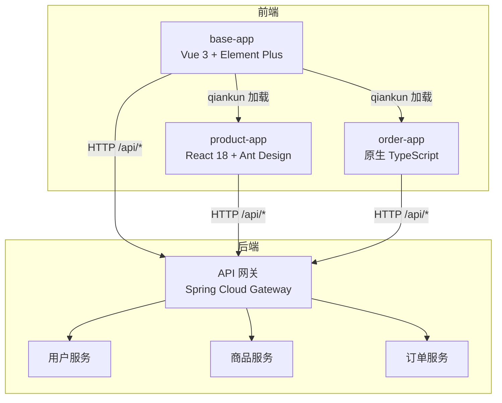
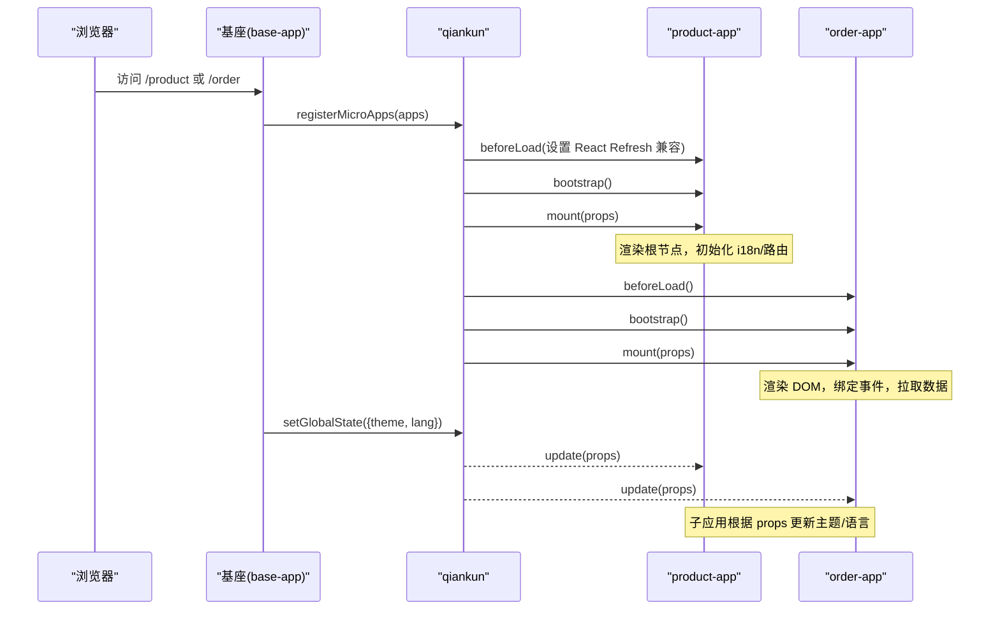
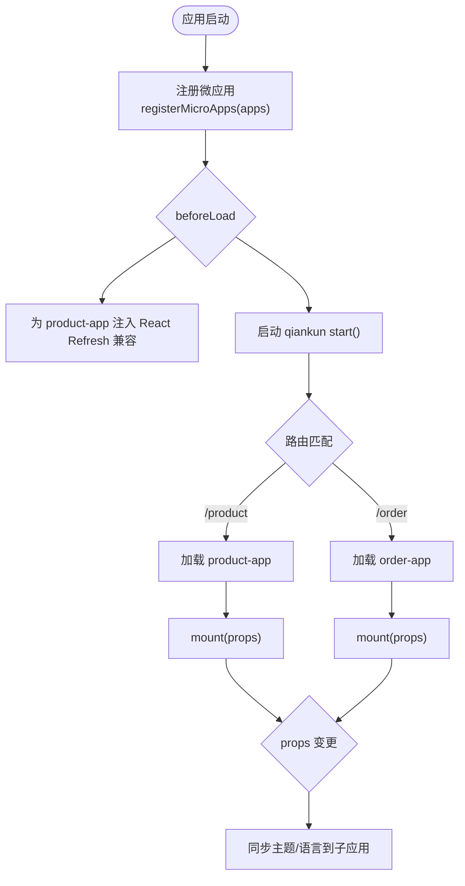
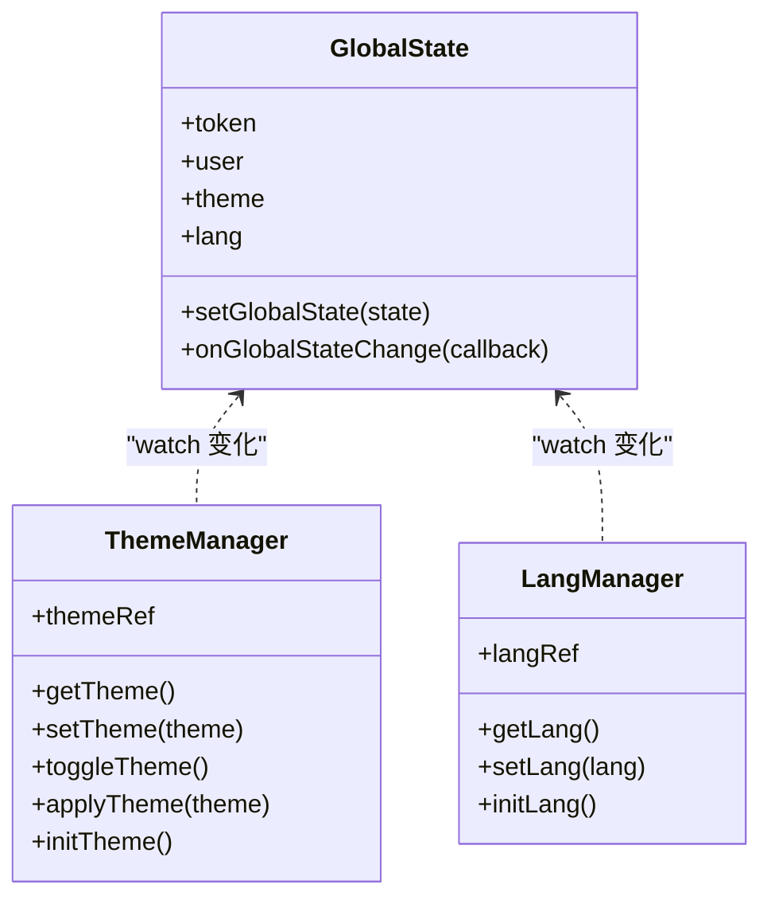
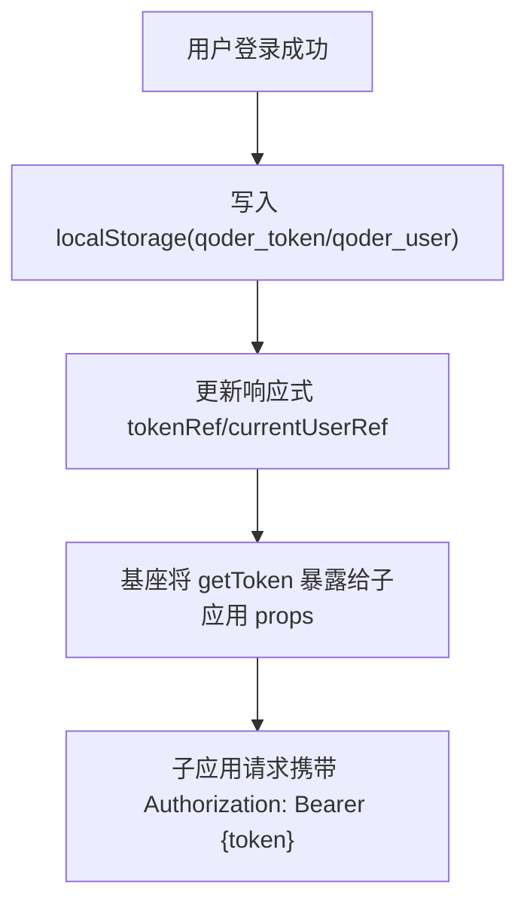
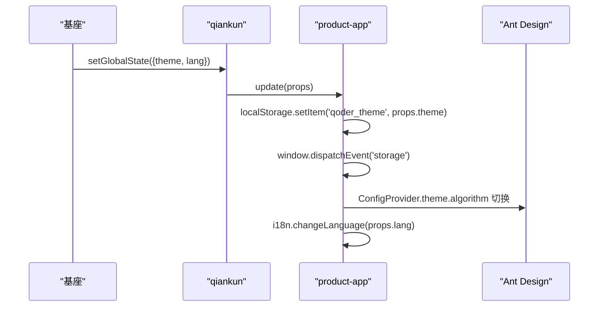
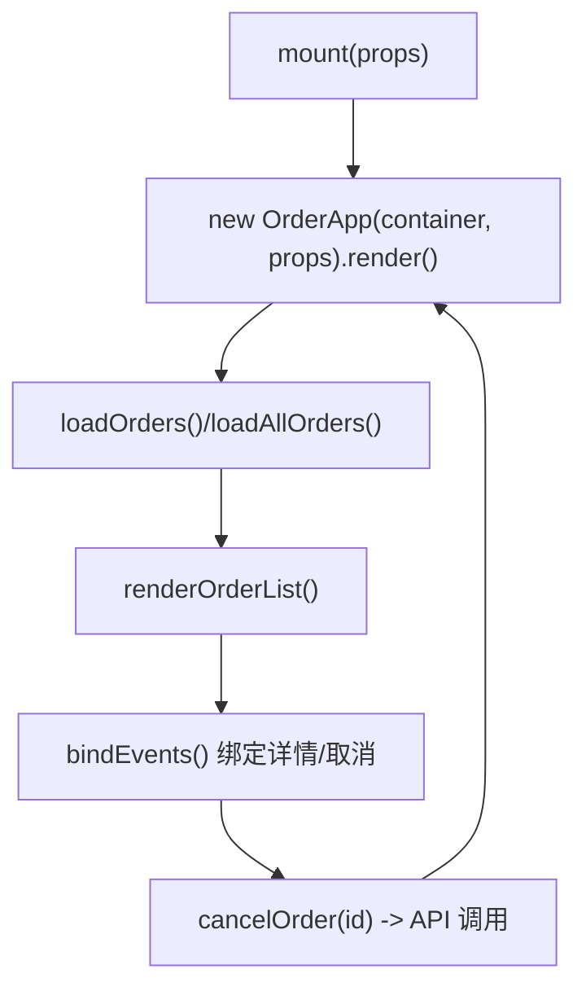
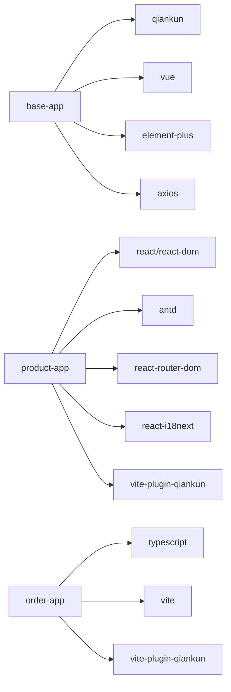
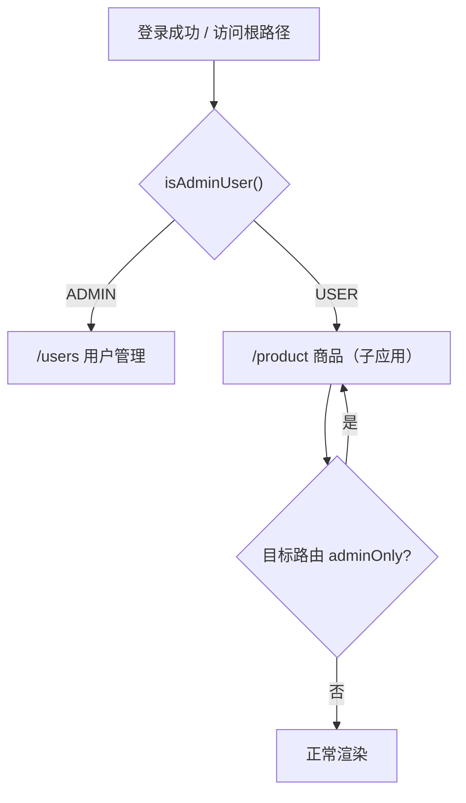
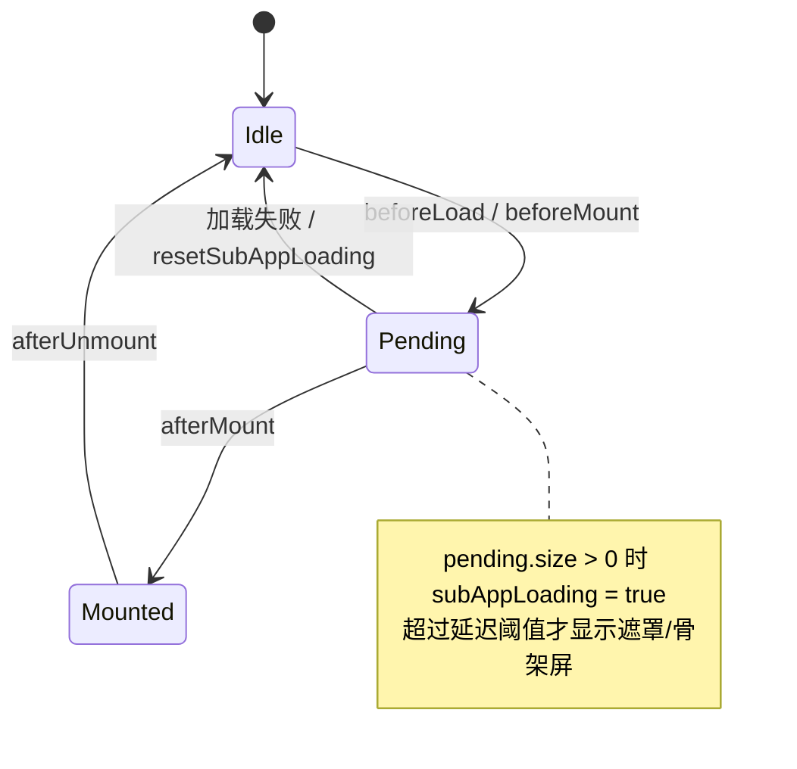

# 前端架构设计

<cite>
**本文引用的文件**   
- [frontend/base-app/src/micro/index.ts](file://frontend/base-app/src/micro/index.ts)
- [frontend/base-app/src/utils/theme.ts](file://frontend/base-app/src/utils/theme.ts)
- [frontend/base-app/src/utils/lang.ts](file://frontend/base-app/src/utils/lang.ts)
- [frontend/base-app/src/utils/auth.ts](file://frontend/base-app/src/utils/auth.ts)
- [frontend/base-app/vite.config.ts](file://frontend/base-app/vite.config.ts)
- [frontend/order-app/src/main.ts](file://frontend/order-app/src/main.ts)
- [frontend/order-app/src/app.ts](file://frontend/order-app/src/app.ts)
- [frontend/order-app/vite.config.ts](file://frontend/order-app/vite.config.ts)
- [frontend/product-app/src/main.tsx](file://frontend/product-app/src/main.tsx)
- [frontend/product-app/src/App.tsx](file://frontend/product-app/src/App.tsx)
- [frontend/product-app/vite.config.ts](file://frontend/product-app/vite.config.ts)
- [frontend/base-app/src/api/request.ts](file://frontend/base-app/src/api/request.ts)
- [frontend/base-app/src/router/index.ts](file://frontend/base-app/src/router/index.ts)
- [frontend/base-app/src/App.vue](file://frontend/base-app/src/App.vue)
- [frontend/base-app/src/views/ProductImageManage.vue](file://frontend/base-app/src/views/ProductImageManage.vue)
- [frontend/base-app/src/components/ImageUploader.vue](file://frontend/base-app/src/components/ImageUploader.vue)
- [frontend/base-app/src/composables/useDelayedLoading.ts](file://frontend/base-app/src/composables/useDelayedLoading.ts)
- [frontend/order-app/src/payment.ts](file://frontend/order-app/src/payment.ts)
- [frontend/product-app/src/api/insuranceAgent.ts](file://frontend/product-app/src/api/insuranceAgent.ts)
- [frontend/product-app/src/components/insurance/InsuranceChatDrawer.tsx](file://frontend/product-app/src/components/insurance/InsuranceChatDrawer.tsx)
- [README.md](file://README.md)
</cite>

## 目录
1. [简介](#简介)
2. [项目结构](#项目结构)
3. [核心组件](#核心组件)
4. [架构总览](#架构总览)
5. [详细组件分析](#详细组件分析)
6. [依赖关系分析](#依赖关系分析)
7. [性能与可维护性](#性能与可维护性)
8. [角色分流、会话保活与加载体验](#角色分流会话保活与加载体验)
9. [故障排查指南](#故障排查指南)
10. [结论](#结论)
11. [附录：子应用开发规范、构建与部署](#附录子应用开发规范构建与部署)

## 简介
本项目采用基于 qiankun 的微前端架构，主应用使用 Vue 3 + Element Plus，两个子应用分别使用 React 18 + Ant Design 与原生 TypeScript。主应用负责微应用注册、生命周期管理、全局状态（主题、语言、用户信息）同步；子应用通过 props 接收基座能力并实现独立渲染与卸载。文档将系统阐述主从应用协作机制、跨应用主题同步方案、国际化策略以及三种技术栈的集成适配方式。

## 项目结构
前端仓库包含三个独立的前端工程：
- base-app：Vue 3 主应用，承载路由、登录/注册、用户管理、商品图片管理（管理员）、微应用容器与全局主题/语言切换。
- product-app：React 18 商品子应用，提供商品列表与详情页面，内置保险咨询机器人抽屉，支持暗黑模式与多语言。
- order-app：原生 TypeScript 订单子应用，提供订单列表、详情、取消与支付宝支付/支付结果页，支持暗黑模式。

图表来源
- [frontend/base-app/src/micro/index.ts:32-58](file://frontend/base-app/src/micro/index.ts#L32-L58)
- [frontend/base-app/vite.config.ts:14-24](file://frontend/base-app/vite.config.ts#L14-L24)
- [frontend/product-app/vite.config.ts:37-47](file://frontend/product-app/vite.config.ts#L37-L47)
- [frontend/order-app/vite.config.ts:14-24](file://frontend/order-app/vite.config.ts#L14-L24)

章节来源
- [README.md:1-14](file://README.md#L1-L14)

## 核心组件
- 微应用注册与生命周期：在基座中集中注册 product-app 与 order-app，配置 activeRule、container、props，并通过 beforeLoad/beforeMount/afterUnmount 钩子完成环境兼容与日志记录。
- 全局状态共享：通过 qiankun 的 initGlobalState 创建全局状态，监听主题与语言变化，向子应用广播。
- 主题与语言：基座维护响应式 themeRef/langRef，持久化到 localStorage，并在已登录时与后端同步；子应用通过 props 或 storage 事件同步更新。
- 认证信息：token 与用户信息以响应式变量与 localStorage 双写，供基座与子应用读取。

章节来源
- [frontend/base-app/src/micro/index.ts:1-89](file://frontend/base-app/src/micro/index.ts#L1-L89)
- [frontend/base-app/src/utils/theme.ts:1-88](file://frontend/base-app/src/utils/theme.ts#L1-L88)
- [frontend/base-app/src/utils/lang.ts:1-68](file://frontend/base-app/src/utils/lang.ts#L1-L68)
- [frontend/base-app/src/utils/auth.ts:1-60](file://frontend/base-app/src/utils/auth.ts#L1-L60)

## 架构总览
下图展示主应用与子应用的加载流程、生命周期钩子与状态同步路径。

图表来源
- [frontend/base-app/src/micro/index.ts:60-89](file://frontend/base-app/src/micro/index.ts#L60-L89)
- [frontend/product-app/src/main.tsx:21-54](file://frontend/product-app/src/main.tsx#L21-L54)
- [frontend/order-app/src/main.ts:16-49](file://frontend/order-app/src/main.ts#L16-L49)

## 详细组件分析

### 基座微前端入口与生命周期
- 注册微应用：定义 product-app 与 order-app 的 name、entry、container、activeRule 与 props（getToken、globalActions、getTheme、getLang）。
- 生命周期钩子：beforeLoad 为 React 子应用注入 React Refresh 兼容标志与桩函数；beforeMount/afterUnmount 用于日志与清理。
- 启动 qiankun：start 开启 sandbox，启用 experimentalStyleIsolation 样式隔离。

图表来源
- [frontend/base-app/src/micro/index.ts:32-89](file://frontend/base-app/src/micro/index.ts#L32-L89)

章节来源
- [frontend/base-app/src/micro/index.ts:1-89](file://frontend/base-app/src/micro/index.ts#L1-L89)

### 全局状态与主题/语言同步
- 全局状态：initGlobalState 初始化 token、user、theme、lang，并提供 onGlobalStateChange 监听。
- 主题同步：watch(themeRef) 触发 setGlobalState({theme})，子应用在 update(props) 中写入 localStorage 并重新渲染。
- 语言同步：watch(langRef) 触发 setGlobalState({lang})，子应用根据 props.lang 更新本地缓存与 i18n。

图表来源
- [frontend/base-app/src/micro/index.ts:7-30](file://frontend/base-app/src/micro/index.ts#L7-L30)
- [frontend/base-app/src/utils/theme.ts:1-88](file://frontend/base-app/src/utils/theme.ts#L1-L88)
- [frontend/base-app/src/utils/lang.ts:1-68](file://frontend/base-app/src/utils/lang.ts#L1-L68)

章节来源
- [frontend/base-app/src/micro/index.ts:7-30](file://frontend/base-app/src/micro/index.ts#L7-L30)
- [frontend/base-app/src/utils/theme.ts:1-88](file://frontend/base-app/src/utils/theme.ts#L1-L88)
- [frontend/base-app/src/utils/lang.ts:1-68](file://frontend/base-app/src/utils/lang.ts#L1-L68)

### 认证与鉴权
- 基座维护 tokenRef 与 currentUserRef，读写 localStorage，提供 getToken/clearAuth 等能力。
- 子应用优先从 props.getToken 获取令牌，否则回退到 localStorage。

图表来源
- [frontend/base-app/src/utils/auth.ts:1-60](file://frontend/base-app/src/utils/auth.ts#L1-L60)
- [frontend/order-app/src/app.ts:297-304](file://frontend/order-app/src/app.ts#L297-L304)

章节来源
- [frontend/base-app/src/utils/auth.ts:1-60](file://frontend/base-app/src/utils/auth.ts#L1-L60)
- [frontend/order-app/src/app.ts:297-304](file://frontend/order-app/src/app.ts#L297-L304)

### 子应用：React 18 + Ant Design（product-app）
- 入口：renderWithQiankun 实现 bootstrap/mount/unmount/update，update 中处理主题与语言同步。
- 主题：App 组件通过 ConfigProvider 的 theme.algorithm 动态切换 dark/defaultAlgorithm，同时监听 storage 事件与 documentElement class 变化。
- 国际化：react-i18next 与 antd locale 联动，语言变化时更新 i18n.language 与 antd 语言包。
- 路由：BrowserRouter basename="/product"，提供 list/detail 路由。

图表来源
- [frontend/product-app/src/main.tsx:21-54](file://frontend/product-app/src/main.tsx#L21-L54)
- [frontend/product-app/src/App.tsx:13-88](file://frontend/product-app/src/App.tsx#L13-L88)

章节来源
- [frontend/product-app/src/main.tsx:1-59](file://frontend/product-app/src/main.tsx#L1-L59)
- [frontend/product-app/src/App.tsx:1-88](file://frontend/product-app/src/App.tsx#L1-L88)

### 子应用：原生 TypeScript（order-app）
- 入口：renderWithQiankun 实现 bootstrap/mount/unmount/update，update 中同步主题与语言并重绘。
- 渲染：OrderApp 类直接操作 DOM，按主题计算颜色变量，渲染订单列表、详情与支付结果页。
- 交互：按钮事件绑定、订单查询/取消、发起支付宝支付（整页跳转收银台）与结果页轮询。

图表来源
- [frontend/order-app/src/main.ts:16-50](file://frontend/order-app/src/main.ts#L16-L50)
- [frontend/order-app/src/app.ts:18-608](file://frontend/order-app/src/app.ts#L18-L608)

章节来源
- [frontend/order-app/src/main.ts:1-56](file://frontend/order-app/src/main.ts#L1-L56)
- [frontend/order-app/src/app.ts:1-608](file://frontend/order-app/src/app.ts#L1-L608)
- [frontend/order-app/src/payment.ts:1-144](file://frontend/order-app/src/payment.ts#L1-L144)

### 构建与运行配置
- 基座（base-app）：Vite 插件 vue，端口 5173，代理 /api 到 http://localhost:8080。
- 商品子应用（product-app）：Vite 插件 react + vite-plugin-qiankun，端口 7100，移除 React Refresh preamble 以兼容 qiankun 的 eval 执行环境。
- 订单子应用（order-app）：Vite 插件 vite-plugin-qiankun，端口 7200，CORS 与代理配置。

章节来源
- [frontend/base-app/vite.config.ts:1-26](file://frontend/base-app/vite.config.ts#L1-L26)
- [frontend/product-app/vite.config.ts:1-49](file://frontend/product-app/vite.config.ts#L1-L49)
- [frontend/order-app/vite.config.ts:1-25](file://frontend/order-app/vite.config.ts#L1-L25)

## 依赖关系分析
- 基座依赖 qiankun、vue、element-plus、axios、vue-router、vue-i18n。
- 商品子应用依赖 react、react-dom、antd、react-router-dom、react-i18next、vite-plugin-qiankun。
- 订单子应用依赖 axios、typescript、vite、vite-plugin-qiankun。

图表来源
- [frontend/base-app/package.json:11-18](file://frontend/base-app/package.json#L11-L18)
- [frontend/product-app/package.json:11-27](file://frontend/product-app/package.json#L11-L27)
- [frontend/order-app/package.json:11-18](file://frontend/order-app/package.json#L11-L18)

章节来源
- [frontend/base-app/package.json:1-28](file://frontend/base-app/package.json#L1-L28)
- [frontend/product-app/package.json:1-29](file://frontend/product-app/package.json#L1-L29)
- [frontend/order-app/package.json:1-20](file://frontend/order-app/package.json#L1-L20)

## 性能与可维护性
- 样式隔离：启用 experimentalStyleIsolation，避免子应用样式污染基座与其他子应用。
- 按需加载：通过 activeRule 控制子应用激活规则，减少不必要的资源加载。
- 热更新兼容：移除 product-app 的 React Refresh preamble，避免 qiankun 沙箱中 eval 执行 ES module 的问题；代价是 qiankun 模式下 HMR 不可用。
- 状态最小化：仅在全局状态中同步必要字段（theme、lang），降低跨应用通信开销。
- 加载体验：子应用切换时区分"首次加载"与"已挂载后的路由切换"，并用延迟阈值避免快速切换时的骨架屏闪烁（见下节）。
- 轮询式交互：支付结果页采用固定间隔 + 最大次数轮询（2 秒 × 10 次），到上限后降级为手动刷新，避免高频请求与内存泄漏。
- 流式渲染：AI 回答按 SSE 分帧增量渲染，用户无需等待全文生成即可阅读。

[本节为通用建议，不直接分析具体文件]

## 角色分流、会话保活与加载体验
除微前端集成外，基座还承担三类"全局体验"职责：登录后的落地页选择、会话失效的及时感知、以及子应用切换时的加载反馈。

### 登录后的角色分流
- 身份判定：[auth.ts（前端令牌管理）](file://frontend/base-app/src/utils/auth.ts) 的 `isAdminUser()` 以 `role === 'ADMIN'` 或 `username === 'admin'` 为准，兼容旧数据中没有 `role` 字段的账号。
- 落地页：[router/index.ts](file://frontend/base-app/src/router/index.ts) 根路径 `redirect` 为函数 `resolveHomePath()`：管理员进 `/users`（用户管理），普通用户直接进 `/product`。
- 路由守卫：标记 `meta.adminOnly` 的路由（`/users`、`/admin/product-images`、`/admin/flights` 等）在 `beforeEach` 中二次校验，非管理员一律改道 `/product`，避免手动输入 URL 绕过菜单隐藏。
- 登录页同理，登录成功后不再硬编码跳首页，而是统一走 `resolveHomePath()`。

**图表来源**
- [auth.ts（前端令牌管理）:47-77](file://frontend/base-app/src/utils/auth.ts#L47-L77)
- [router/index.ts（主应用路由）:20-78](file://frontend/base-app/src/router/index.ts#L20-L78)

### 会话保活与被挤下线（40101）
- 后端在网关层比对 Redis 会话（详见《认证与安全机制》），一旦账号在其他设备登录，旧 Token 会收到 HTTP 401 且响应体 `code = 40101`。
- 统一出口：[request.ts](file://frontend/base-app/src/api/request.ts) 识别 `40101` 后执行 `handleKickOut()`：清空本地登录态 → 提示"账号已在其他设备登录" → `router.replace('/login')`。此处**不携带 redirect 参数**，避免重新登录后又跳回原页面。
- 与 403 的差异：403 只提示"无权限"，不清登录态。
- 主动探活：[App.vue](file://frontend/base-app/src/App.vue) 在 Token 存在时每 30 秒（`SESSION_HEARTBEAT_MS`）请求一次 `getCurrentUser()`；页面不可见时（`visibilityState === 'hidden'`）跳过，回到前台由 `visibilitychange` 立即补查，既及时发现失效又不浪费后台请求。

### 子应用切换的加载态
- 注册态：[micro/index.ts](file://frontend/base-app/src/micro/index.ts) 使用 `subAppState.pending = new Set()`，在 `beforeLoad`/`beforeMount` 添加、`afterMount`/`afterUnmount` 移除，对外暴露 `subAppLoading` 计算属性。
- 兜底：加载失败或生命周期缺失时 `resetSubAppLoading()` 强制清空，防止遮罩永久停留。
- 防闪烁：`useDelayedLoading`（主应用 `composables/`，还导出 `useDelayedBusy`）与子应用 `hooks/useDelayedLoading` 只在忙碌超过阈值后才显示骨架屏，快速切换不闪屏。
- 进度条：路由切换期间由 `LoadingBar` 呈现顶部进度，与子应用遮罩互不干扰。
- history 保护：`protectHistoryState()` 在 `start()` 前包装 `history.replaceState/pushState`，把 vue-router 传入的 `{current, back, forward, position}` 字段合并保留，避免 qiankun 与路由各自写入导致前进/后退异常。

**图表来源**
- [micro/index.ts:60-158](file://frontend/base-app/src/micro/index.ts#L60-L158)
- [request.ts:55-115](file://frontend/base-app/src/api/request.ts#L55-L115)
- [App.vue:28-100](file://frontend/base-app/src/App.vue#L28-L100)

### 商品图片管理（管理员）
- 页面：[ProductImageManage.vue](file://frontend/base-app/src/views/ProductImageManage.vue) 以"选择商品 → 上传 → 回写"的闭环替代手工改库，列表展示当前主图并支持替换/清除。
- 上传组件：[ImageUploader.vue](file://frontend/base-app/src/components/ImageUploader.vue) 封装选文件、前端校验（`maxSizeMb` 默认 5，仅 jpeg/png/webp/gif）、进度与预览，成功后 `emit('uploaded', { url, objectKey })`。
- 写库策略：先上传拿到 `objectKey`，再调用 `PUT /products/{id}/image` 仅更新 `image_url`，不整对象覆盖商品，避免并发编辑丢字段。

### 保险咨询入口（商品子应用）
- 抽屉：[InsuranceChatDrawer.tsx](file://frontend/product-app/src/components/insurance/InsuranceChatDrawer.tsx) 宽 720px、`destroyOnClose=false`（关闭保留会话），标签顺序为"对话 → 回溯 → 知识库"，其中知识库仅 ADMIN 可见。
- 流式协议：[insuranceAgent.ts](file://frontend/product-app/src/api/insuranceAgent.ts) 基于 `fetch` + `ReadableStream` 实现 `createSseParser`，按空行分帧并兼容 `\r\n` 与多行 `data`。
- 资源释放：切换会话、新建、删除、回溯与关闭抽屉都会先 `abortRef.abort()`，避免旧请求的 token 继续写进新会话。

## 故障排查指南
- React Refresh 报错或模块无法加载：确认基座 beforeLoad 中已注入 __vite_plugin_react_preamble_installed__ 与 $RefreshReg/$RefreshSig 桩函数；检查 product-app 是否移除了 React Refresh preamble。
- 主题不同步：检查基座 watch(themeRef) 是否正确触发 setGlobalState；确认子应用 update(props) 中是否写入 localStorage 并触发 storage 事件或重新渲染。
- 语言不同步：检查基座 watch(langRef) 与子应用 update(props) 中对 i18n.changeLanguage 的调用。
- 接口 401/403：确认子应用是否通过 props.getToken 获取 token 并正确设置 Authorization 头。
- 被挤下线提示反复弹出：确认 `request.ts` 的 `handleKickOut()` 已清理登录态且不带 redirect，否则重新登录后可能再次触发。
- 子应用遮罩不消失：检查对应生命周期是否触发 `afterMount/afterUnmount`，必要时排查 `pending` 集合是否残留，可调用 `resetSubAppLoading()` 强制复位。
- 前进/后退异常：确认 `startQiankun()` 内已执行 `protectHistoryState()`，否则 qiankun 与 vue-router 会互相覆盖 history.state。
- 图片上传 413/400：检查 nginx `client_max_body_size`、multipart 限制与后端魔数校验是否一致（5MB、4 种类型）。
- 保险对话无输出：确认网关 `/api/ai/**` 可访问；若浏览器侧立即结束，检查是否因切会话触发了 `abort`。
- 端口冲突或代理失败：核对各子应用 vite.config.ts 中的 server.port 与 proxy.target 配置是否与后端网关一致。

章节来源
- [frontend/base-app/src/micro/index.ts:60-158](file://frontend/base-app/src/micro/index.ts#L60-L158)
- [frontend/product-app/vite.config.ts:6-24](file://frontend/product-app/vite.config.ts#L6-L24)
- [frontend/order-app/src/app.ts:1-608](file://frontend/order-app/src/app.ts#L1-L608)

## 结论
本方案通过 qiankun 实现了主应用对多个异构子应用的统一接入与生命周期管理，结合全局状态与 props 传递完成了主题与语言的跨应用同步。基座负责认证与用户偏好管理，子应用专注业务渲染与交互。在集成之上，基座又补齐了角色分流、会话保活（40101）、统一加载态与 history 保护等全局约束，使多团队并行开发时的体验与边界保持一致。

[本节为总结性内容，不直接分析具体文件]

## 附录：子应用开发规范、构建与部署
- 子应用开发规范
  - 必须通过 renderWithQiankun 暴露 bootstrap/mount/unmount/update 生命周期。
  - 在 update(props) 中处理来自基座的主题与语言变更，确保 UI 即时刷新。
  - 认证信息优先从 props.getToken 获取，避免重复实现鉴权逻辑。
  - 路由需考虑基座前缀（如 /product），避免与基座路由冲突。
- 构建配置
  - 使用 vite-plugin-qiankun 插件，开发模式 useDevMode: true。
  - 移除 React Refresh preamble（针对 React 子应用），避免 qiankun 沙箱兼容问题。
  - 配置 server.cors 与 proxy，保证开发期跨域与接口转发。
- 部署策略
  - 各子应用独立构建与部署，通过独立域名或路径暴露 entry。
  - 基座统一分发静态资源，子应用通过 CDN 加速。
  - 网关层统一鉴权与路由，前端通过 /api 前缀访问后端服务。

章节来源
- [frontend/product-app/vite.config.ts:6-24](file://frontend/product-app/vite.config.ts#L6-L24)
- [frontend/order-app/vite.config.ts:14-24](file://frontend/order-app/vite.config.ts#L14-L24)
- [frontend/base-app/vite.config.ts:14-24](file://frontend/base-app/vite.config.ts#L14-L24)