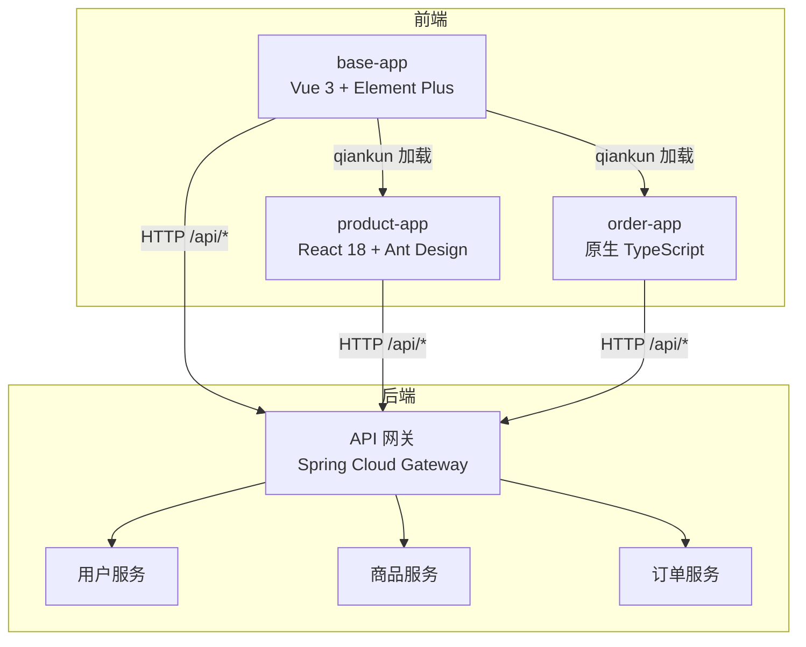
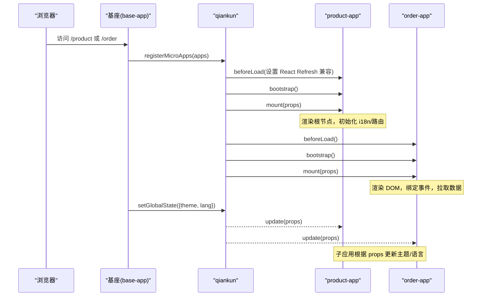
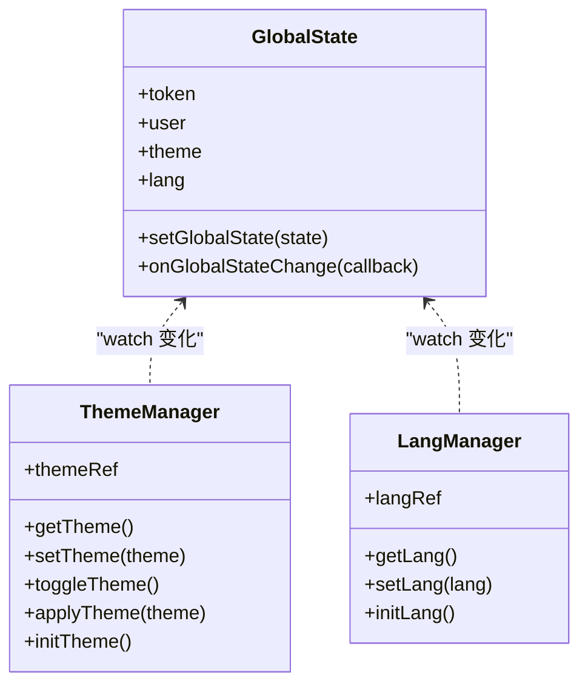
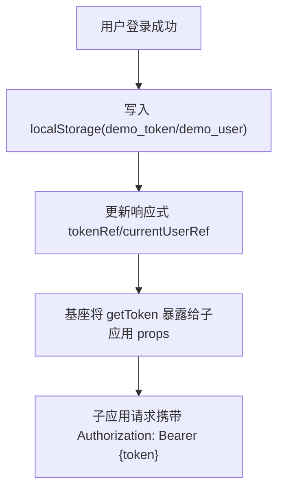
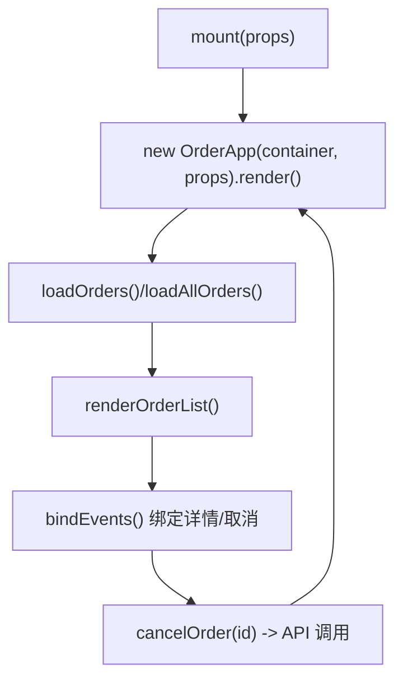
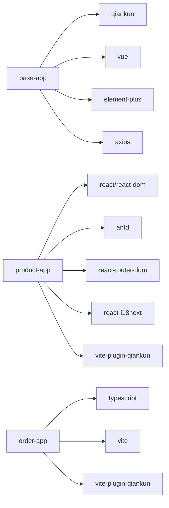

# 前端架构设计

<cite>
**本文引用的文件**   
- [frontend/base-app/src/micro/index.ts](file://frontend/base-app/src/micro/index.ts)
- [frontend/base-app/src/utils/theme.ts](file://frontend/base-app/src/utils/theme.ts)
- [frontend/base-app/src/utils/lang.ts](file://frontend/base-app/src/utils/lang.ts)
- [frontend/base-app/src/utils/auth.ts](file://frontend/base-app/src/utils/auth.ts)
- [frontend/base-app/vite.config.ts](file://frontend/base-app/vite.config.ts)
- [frontend/order-app/src/main.ts](file://frontend/order-app/src/main.ts)
- [frontend/order-app/src/app.ts](file://frontend/order-app/src/app.ts)
- [frontend/order-app/vite.config.ts](file://frontend/order-app/vite.config.ts)
- [frontend/product-app/src/main.tsx](file://frontend/product-app/src/main.tsx)
- [frontend/product-app/src/App.tsx](file://frontend/product-app/src/App.tsx)
- [frontend/product-app/vite.config.ts](file://frontend/product-app/vite.config.ts)
- [README.md](file://README.md)
</cite>

## 目录
1. [简介](#简介)
2. [项目结构](#项目结构)
3. [核心组件](#核心组件)
4. [架构总览](#架构总览)
5. [详细组件分析](#详细组件分析)
6. [依赖关系分析](#依赖关系分析)
7. [性能与可维护性](#性能与可维护性)
8. [故障排查指南](#故障排查指南)
9. [结论](#结论)
10. [附录：子应用开发规范、构建与部署](#附录子应用开发规范构建与部署)

## 简介
本项目采用基于 qiankun 的微前端架构，主应用使用 Vue 3 + Element Plus，两个子应用分别使用 React 18 + Ant Design 与原生 TypeScript。主应用负责微应用注册、生命周期管理、全局状态（主题、语言、用户信息）同步；子应用通过 props 接收基座能力并实现独立渲染与卸载。文档将系统阐述主从应用协作机制、跨应用主题同步方案、国际化策略以及三种技术栈的集成适配方式。

## 项目结构
前端仓库包含三个独立的前端工程与一个 E2E 测试工程：
- base-app：Vue 3 主应用，承载路由、登录/注册、用户管理、微应用容器与全局主题/语言切换。包含 Vitest 单元测试。
- product-app：React 18 商品子应用，提供商品列表与详情页面，支持暗黑模式与多语言。内置 tracker.ts 埋点工具，包含 Vitest 单元测试。
- order-app：原生 TypeScript 订单子应用，提供订单列表、详情与取消操作，支持暗黑模式。包含 Vitest 单元测试。
- e2e：基于 Playwright 的端到端测试工程，覆盖登录、商品搜索、订单流程、微前端加载、主题同步等核心场景。

图表来源
- [frontend/base-app/src/micro/index.ts:32-58](file://frontend/base-app/src/micro/index.ts#L32-L58)
- [frontend/base-app/vite.config.ts:14-24](file://frontend/base-app/vite.config.ts#L14-L24)
- [frontend/product-app/vite.config.ts:37-47](file://frontend/product-app/vite.config.ts#L37-L47)
- [frontend/order-app/vite.config.ts:14-24](file://frontend/order-app/vite.config.ts#L14-L24)

章节来源
- [README.md:1-14](file://README.md#L1-L14)

## 核心组件
- 微应用注册与生命周期：在基座中集中注册 product-app 与 order-app，配置 activeRule、container、props，并通过 beforeLoad/beforeMount/afterUnmount 钩子完成环境兼容与日志记录。
- 全局状态共享：通过 qiankun 的 initGlobalState 创建全局状态，监听主题与语言变化，向子应用广播。
- 主题与语言：基座维护响应式 themeRef/langRef，持久化到 localStorage，并在已登录时与后端同步；子应用通过 props 或 storage 事件同步更新。
- 认证信息：token 与用户信息以响应式变量与 localStorage 双写，供基座与子应用读取。

章节来源
- [frontend/base-app/src/micro/index.ts:1-89](file://frontend/base-app/src/micro/index.ts#L1-L89)
- [frontend/base-app/src/utils/theme.ts:1-88](file://frontend/base-app/src/utils/theme.ts#L1-L88)
- [frontend/base-app/src/utils/lang.ts:1-68](file://frontend/base-app/src/utils/lang.ts#L1-L68)
- [frontend/base-app/src/utils/auth.ts:1-60](file://frontend/base-app/src/utils/auth.ts#L1-L60)

## 架构总览
下图展示主应用与子应用的加载流程、生命周期钩子与状态同步路径。

图表来源
- [frontend/base-app/src/micro/index.ts:60-89](file://frontend/base-app/src/micro/index.ts#L60-L89)
- [frontend/product-app/src/main.tsx:21-54](file://frontend/product-app/src/main.tsx#L21-L54)
- [frontend/order-app/src/main.ts:16-49](file://frontend/order-app/src/main.ts#L16-L49)

## 详细组件分析

### 基座微前端入口与生命周期
- 注册微应用：定义 product-app 与 order-app 的 name、entry、container、activeRule 与 props（getToken、globalActions、getTheme、getLang）。
- 生命周期钩子：beforeLoad 为 React 子应用注入 React Refresh 兼容标志与桩函数；beforeMount/afterUnmount 用于日志与清理。
- 启动 qiankun：start 开启 sandbox，启用 experimentalStyleIsolation 样式隔离。

图表来源
- [frontend/base-app/src/micro/index.ts:32-89](file://frontend/base-app/src/micro/index.ts#L32-L89)

章节来源
- [frontend/base-app/src/micro/index.ts:1-89](file://frontend/base-app/src/micro/index.ts#L1-L89)

### 全局状态与主题/语言同步
- 全局状态：initGlobalState 初始化 token、user、theme、lang，并提供 onGlobalStateChange 监听。
- 主题同步：watch(themeRef) 触发 setGlobalState({theme})，子应用在 update(props) 中写入 localStorage 并重新渲染。
- 语言同步：watch(langRef) 触发 setGlobalState({lang})，子应用根据 props.lang 更新本地缓存与 i18n。

图表来源
- [frontend/base-app/src/micro/index.ts:7-30](file://frontend/base-app/src/micro/index.ts#L7-L30)
- [frontend/base-app/src/utils/theme.ts:1-88](file://frontend/base-app/src/utils/theme.ts#L1-L88)
- [frontend/base-app/src/utils/lang.ts:1-68](file://frontend/base-app/src/utils/lang.ts#L1-L68)

章节来源
- [frontend/base-app/src/micro/index.ts:7-30](file://frontend/base-app/src/micro/index.ts#L7-L30)
- [frontend/base-app/src/utils/theme.ts:1-88](file://frontend/base-app/src/utils/theme.ts#L1-L88)
- [frontend/base-app/src/utils/lang.ts:1-68](file://frontend/base-app/src/utils/lang.ts#L1-L68)

### 认证与鉴权
- 基座维护 tokenRef 与 currentUserRef，读写 localStorage，提供 getToken/clearAuth 等能力。
- 子应用优先从 props.getToken 获取令牌，否则回退到 localStorage。

图表来源
- [frontend/base-app/src/utils/auth.ts:1-60](file://frontend/base-app/src/utils/auth.ts#L1-L60)
- [frontend/order-app/src/app.ts:297-304](file://frontend/order-app/src/app.ts#L297-L304)

章节来源
- [frontend/base-app/src/utils/auth.ts:1-60](file://frontend/base-app/src/utils/auth.ts#L1-L60)
- [frontend/order-app/src/app.ts:297-304](file://frontend/order-app/src/app.ts#L297-L304)

### 子应用：React 18 + Ant Design（product-app）
- 入口：renderWithQiankun 实现 bootstrap/mount/unmount/update，update 中处理主题与语言同步。
- 主题：App 组件通过 ConfigProvider 的 theme.algorithm 动态切换 dark/defaultAlgorithm，同时监听 storage 事件与 documentElement class 变化。
- 国际化：react-i18next 与 antd locale 联动，语言变化时更新 i18n.language 与 antd 语言包。
- 路由：BrowserRouter basename="/product"，提供 list/detail 路由。
- 埋点：内置 `src/utils/tracker.ts` 埋点工具，商品列表页通过 IntersectionObserver 实现商品曝光埋点，并支持 PageView / Click 埋点。

图表来源
- [frontend/product-app/src/main.tsx:21-54](file://frontend/product-app/src/main.tsx#L21-L54)
- [frontend/product-app/src/App.tsx:13-70](file://frontend/product-app/src/App.tsx#L13-L70)

章节来源
- [frontend/product-app/src/main.tsx:1-61](file://frontend/product-app/src/main.tsx#L1-L61)
- [frontend/product-app/src/App.tsx:1-74](file://frontend/product-app/src/App.tsx#L1-L74)

### 子应用：原生 TypeScript（order-app）
- 入口：renderWithQiankun 实现 bootstrap/mount/unmount/update，update 中同步主题与语言并重绘。
- 渲染：OrderApp 类直接操作 DOM，按主题计算颜色变量，渲染订单列表与详情。
- 交互：按钮事件绑定、订单查询/取消、错误提示。

图表来源
- [frontend/order-app/src/main.ts:16-49](file://frontend/order-app/src/main.ts#L16-L49)
- [frontend/order-app/src/app.ts:18-310](file://frontend/order-app/src/app.ts#L18-L310)

章节来源
- [frontend/order-app/src/main.ts:1-56](file://frontend/order-app/src/main.ts#L1-L56)
- [frontend/order-app/src/app.ts:1-310](file://frontend/order-app/src/app.ts#L1-L310)

### 构建与运行配置
- 基座（base-app）：Vite 插件 vue，端口 5173，代理 /api 到 http://localhost:8080。配置 vitest.config.ts 用于单元测试。
- 商品子应用（product-app）：Vite 插件 react + vite-plugin-qiankun，端口 7100，移除 React Refresh preamble 以兼容 qiankun 的 eval 执行环境。配置 vitest.config.ts 用于单元测试。
- 订单子应用（order-app）：Vite 插件 vite-plugin-qiankun，端口 7200，CORS 与代理配置。配置 vitest.config.ts 用于单元测试。
- E2E 测试（e2e）：Playwright 配置自动启动三个子应用 dev server，默认使用 Chromium，失败时保留截图与视频。

章节来源
- [frontend/base-app/vite.config.ts:1-26](file://frontend/base-app/vite.config.ts#L1-L26)
- [frontend/product-app/vite.config.ts:1-49](file://frontend/product-app/vite.config.ts#L1-L49)
- [frontend/order-app/vite.config.ts:1-25](file://frontend/order-app/vite.config.ts#L1-L25)

## 依赖关系分析
- 基座依赖 qiankun、vue、element-plus、axios、vue-router、vue-i18n。
- 商品子应用依赖 react、react-dom、antd、react-router-dom、react-i18next、vite-plugin-qiankun。
- 订单子应用依赖 axios、typescript、vite、vite-plugin-qiankun。

图表来源
- [frontend/base-app/package.json:11-18](file://frontend/base-app/package.json#L11-L18)
- [frontend/product-app/package.json:11-27](file://frontend/product-app/package.json#L11-L27)
- [frontend/order-app/package.json:11-18](file://frontend/order-app/package.json#L11-L18)

章节来源
- [frontend/base-app/package.json:1-28](file://frontend/base-app/package.json#L1-L28)
- [frontend/product-app/package.json:1-29](file://frontend/product-app/package.json#L1-L29)
- [frontend/order-app/package.json:1-20](file://frontend/order-app/package.json#L1-L20)

## 性能与可维护性
- 样式隔离：启用 experimentalStyleIsolation，避免子应用样式污染基座与其他子应用。
- 按需加载：通过 activeRule 控制子应用激活规则，减少不必要的资源加载。
- 热更新兼容：移除 product-app 的 React Refresh preamble，避免 qiankun 沙箱中 eval 执行 ES module 的问题；代价是 qiankun 模式下 HMR 不可用。
- 状态最小化：仅在全局状态中同步必要字段（theme、lang），降低跨应用通信开销。

[本节为通用建议，不直接分析具体文件]

## 故障排查指南
- React Refresh 报错或模块无法加载：确认基座 beforeLoad 中已注入 __vite_plugin_react_preamble_installed__ 与 $RefreshReg/$RefreshSig 桩函数；检查 product-app 是否移除了 React Refresh preamble。
- 主题不同步：检查基座 watch(themeRef) 是否正确触发 setGlobalState；确认子应用 update(props) 中是否写入 localStorage 并触发 storage 事件或重新渲染。
- 语言不同步：检查基座 watch(langRef) 与子应用 update(props) 中对 i18n.changeLanguage 的调用。
- 接口 401/403：确认子应用是否通过 props.getToken 获取 token 并正确设置 Authorization 头。
- 端口冲突或代理失败：核对各子应用 vite.config.ts 中的 server.port 与 proxy.target 配置是否与后端网关一致。

章节来源
- [frontend/base-app/src/micro/index.ts:60-89](file://frontend/base-app/src/micro/index.ts#L60-L89)
- [frontend/product-app/vite.config.ts:6-24](file://frontend/product-app/vite.config.ts#L6-L24)
- [frontend/order-app/src/app.ts:297-304](file://frontend/order-app/src/app.ts#L297-L304)

## 结论
本方案通过 qiankun 实现了主应用对多个异构子应用的统一接入与生命周期管理，结合全局状态与 props 传递完成了主题与语言的跨应用同步。基座负责认证与用户偏好管理，子应用专注业务渲染与交互。该架构具备良好的扩展性与可维护性，便于团队并行开发与独立部署。项目已建立完整的前端测试体系：三个子应用均配置 Vitest 单元测试，E2E 测试采用 Playwright 覆盖核心业务流程；product-app 还内置了埋点工具支持用户行为分析。

[本节为总结性内容，不直接分析具体文件]

## 附录：子应用开发规范、构建与部署
- 子应用开发规范
  - 必须通过 renderWithQiankun 暴露 bootstrap/mount/unmount/update 生命周期。
  - 在 update(props) 中处理来自基座的主题与语言变更，确保 UI 即时刷新。
  - 认证信息优先从 props.getToken 获取，避免重复实现鉴权逻辑。
  - 路由需考虑基座前缀（如 /product），避免与基座路由冲突。
- 构建配置
  - 使用 vite-plugin-qiankun 插件，开发模式 useDevMode: true。
  - 移除 React Refresh preamble（针对 React 子应用），避免 qiankun 沙箱兼容问题。
  - 配置 server.cors 与 proxy，保证开发期跨域与接口转发。
- 部署策略
  - 各子应用独立构建与部署，通过独立域名或路径暴露 entry。
  - 基座统一分发静态资源，子应用通过 CDN 加速。
  - 网关层统一鉴权与路由，前端通过 /api 前缀访问后端服务。

章节来源
- [frontend/product-app/vite.config.ts:6-24](file://frontend/product-app/vite.config.ts#L6-L24)
- [frontend/order-app/vite.config.ts:14-24](file://frontend/order-app/vite.config.ts#L14-L24)
- [frontend/base-app/vite.config.ts:14-24](file://frontend/base-app/vite.config.ts#L14-L24)