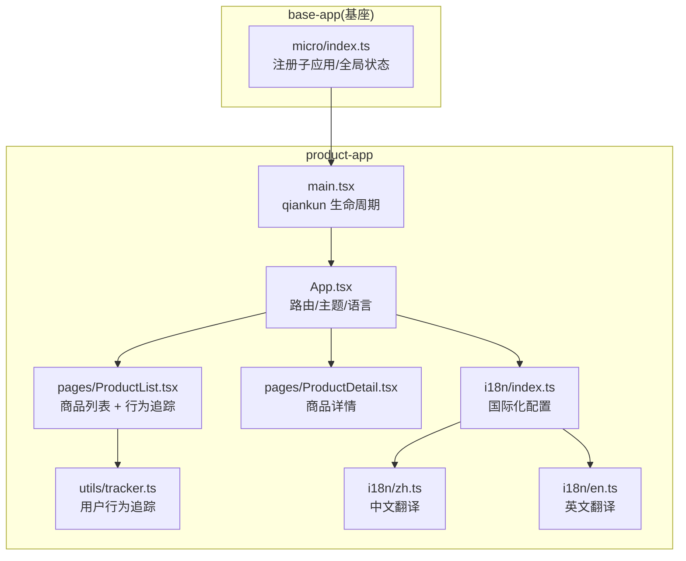
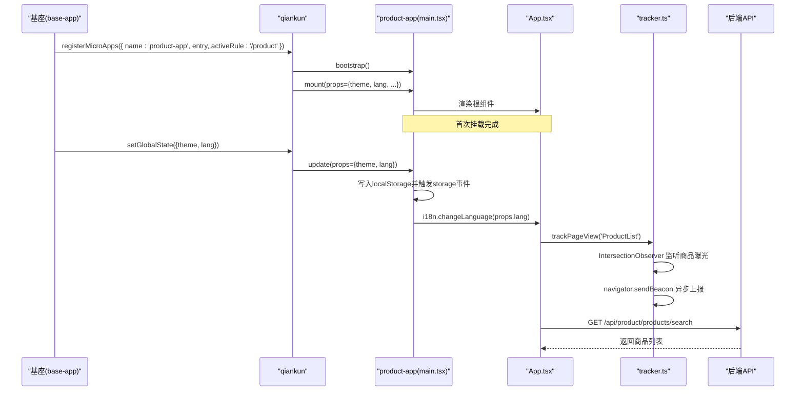
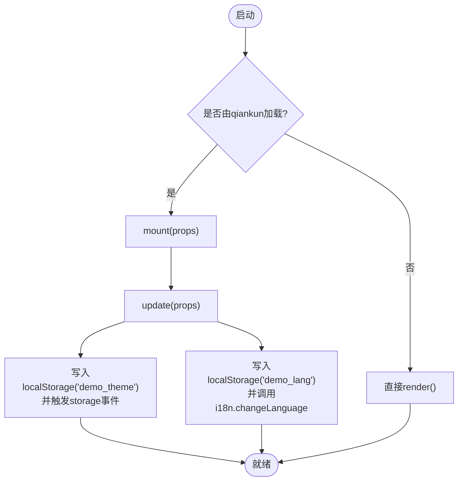
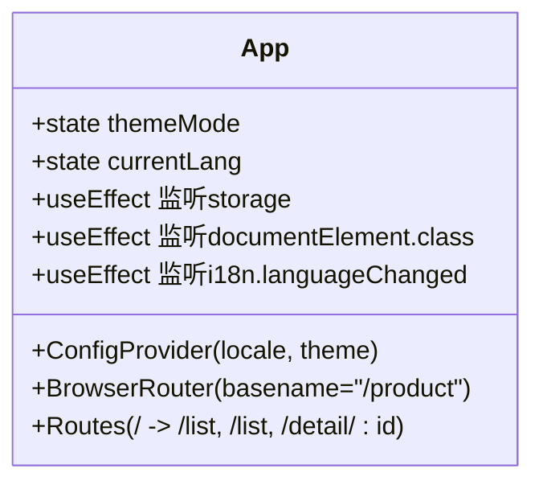
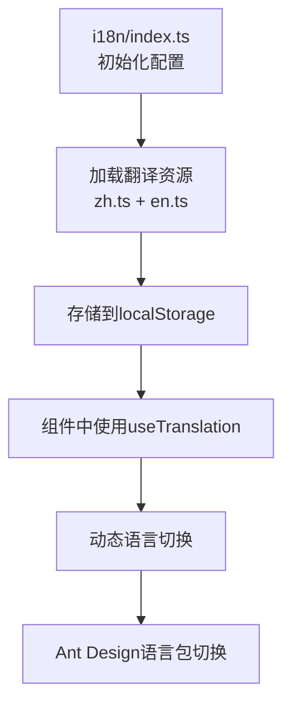
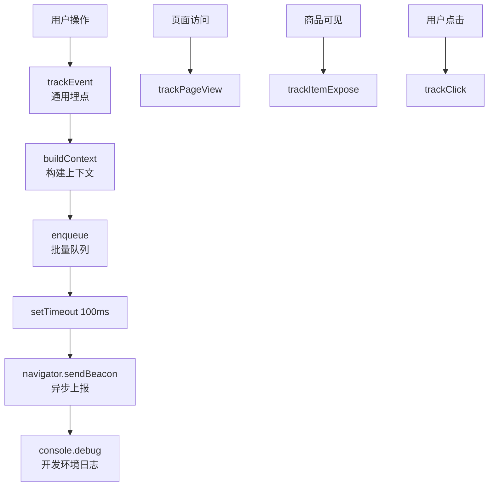
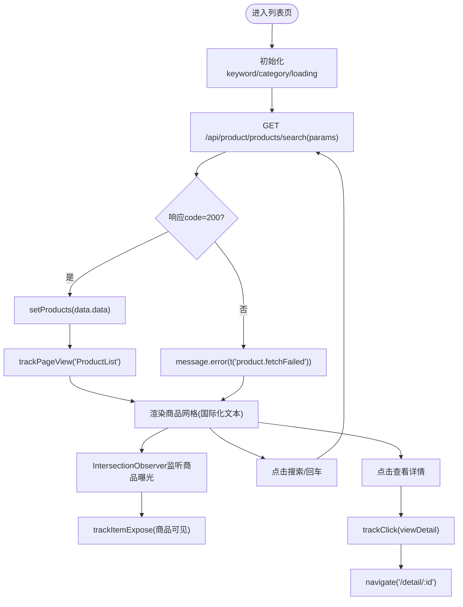
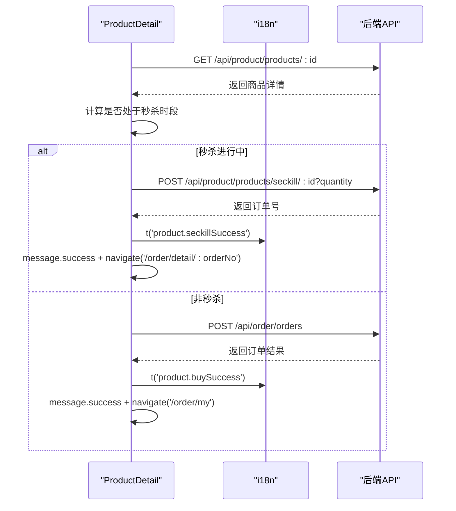
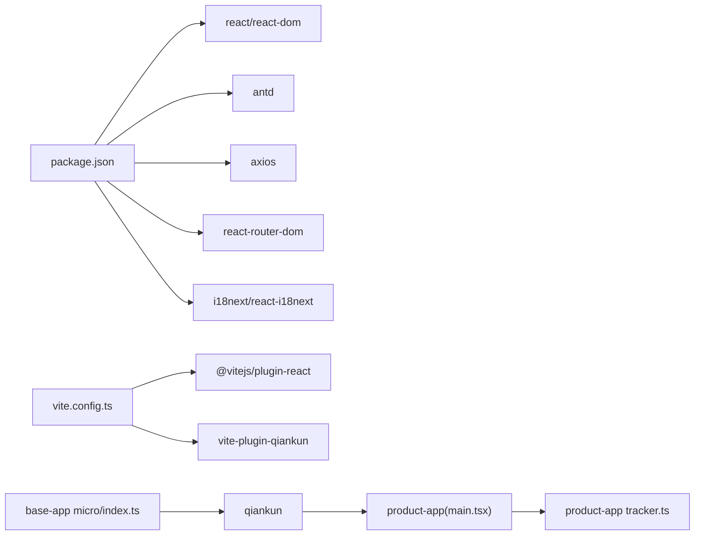

# 商品子应用(product-app)

<cite>
**本文引用的文件**   
- [App.tsx](file://frontend/product-app/src/App.tsx)
- [main.tsx](file://frontend/product-app/src/main.tsx)
- [vite.config.ts](file://frontend/product-app/vite.config.ts)
- [package.json](file://frontend/product-app/package.json)
- [ProductList.tsx](file://frontend/product-app/src/pages/ProductList.tsx)
- [ProductDetail.tsx](file://frontend/product-app/src/pages/ProductDetail.tsx)
- [FlightDetail.tsx](file://frontend/product-app/src/pages/FlightDetail.tsx)
- [FlightMap2D.tsx](file://frontend/product-app/src/components/FlightMap2D.tsx)
- [FlightMap3D.tsx](file://frontend/product-app/src/components/FlightMap3D.tsx)
- [tracker.ts](file://frontend/product-app/src/utils/tracker.ts)
- [tracker.spec.ts](file://frontend/product-app/src/__tests__/unit/utils/tracker.spec.ts)
- [i18n/index.ts](file://frontend/product-app/src/i18n/index.ts)
- [i18n/zh.ts](file://frontend/product-app/src/i18n/zh.ts)
- [i18n/en.ts](file://frontend/product-app/src/i18n/en.ts)
- [micro/index.ts](file://frontend/base-app/src/micro/index.ts)
</cite>

## 更新摘要
**变更内容**   
- 增强了商品子应用的国际化功能，集成了完整的 react-i18next 解决方案
- **新增** 实现了 sophisticated 用户行为追踪系统，包含页面访问、商品曝光和用户点击埋点
- 实现了 Ant Design 组件库的语言包动态切换支持
- 添加了完整的中英文翻译资源文件
- 完善了微前端环境下的语言状态同步机制
- **新增** 机票商品详情页 FlightDetail，支持 2D（ECharts）/3D（Cesium）地图切换、飞机视角飞行动画与实时飞行信息面板（含 FlightMap2D/3D、FlightInfoPanel、FlightAnimationController 组件）
- 更新了所有页面组件以使用新的国际化系统

## 目录
1. [简介](#简介)
2. [项目结构](#项目结构)
3. [核心组件](#核心组件)
4. [架构总览](#架构总览)
5. [详细组件分析](#详细组件分析)
6. [依赖关系分析](#依赖关系分析)
7. [性能与优化](#性能与优化)
8. [故障排查](#故障排查)
9. [结论](#结论)

## 简介
本文件面向"商品子应用 product-app"，基于 React 18 + Ant Design，采用 vite-plugin-qiankun 接入 qiankun 微前端基座。文档覆盖：
- 应用初始化、路由配置、国际化与主题适配
- 商品列表页的数据获取、筛选展示逻辑
- 商品详情页的信息展示、图片占位、购买与秒杀流程
- **新增** 用户行为追踪系统，包括页面访问、商品曝光和用户点击埋点
- 与主应用的通信机制、状态同步（主题/语言）
- 在微前端环境下的特殊配置与优化策略

**更新** 本次更新重点增强了国际化功能，实现了完整的 react-i18next 集成和 Ant Design 语言包动态切换，同时新增了 sophisticated 的用户行为追踪系统。

## 项目结构
product-app 是一个独立的 Vite + React 工程，作为 qiankun 子应用运行。关键目录与职责如下：
- src/main.tsx：qiankun 生命周期入口，负责渲染 App 与处理 update 时的主题/语言同步
- src/App.tsx：React 根组件，提供 Ant Design 主题与语言上下文，定义 /list 与 /detail/:id 路由
- src/pages/ProductList.tsx：商品列表页，支持关键词与分类筛选，调用后端搜索接口，集成用户行为追踪
- src/pages/ProductDetail.tsx：商品详情页，展示详情、价格、库存，支持普通购买与秒杀下单
- **src/utils/tracker.ts：用户行为追踪工具，提供页面访问、商品曝光、用户点击埋点功能**
- src/i18n/index.ts：i18next 初始化与语言持久化
- src/i18n/zh.ts：中文翻译资源文件
- src/i18n/en.ts：英文翻译资源文件
- vite.config.ts：qiankun 插件、开发代理、别名等构建配置
- package.json：依赖声明，包含 react、antd、axios、react-router-dom、i18next 等

**图表来源**
- [main.tsx:21-54](file://frontend/product-app/src/main.tsx#L21-L54)
- [App.tsx:55-69](file://frontend/product-app/src/App.tsx#L55-L69)
- [tracker.ts:1-135](file://frontend/product-app/src/utils/tracker.ts#L1-L135)
- [micro/index.ts:32-45](file://frontend/base-app/src/micro/index.ts#L32-L45)

**章节来源**
- [main.tsx:1-61](file://frontend/product-app/src/main.tsx#L1-L61)
- [App.tsx:1-74](file://frontend/product-app/src/App.tsx#L1-L74)
- [vite.config.ts:1-49](file://frontend/product-app/vite.config.ts#L1-L49)
- [package.json:1-29](file://frontend/product-app/package.json#L1-L29)

## 核心组件
- 应用初始化与微前端生命周期
  - main.tsx 使用 renderWithQiankun 暴露 bootstrap/mount/unmount/update 钩子；独立运行时直接渲染 App
  - update 钩子接收基座传来的 theme/lang，写入 localStorage 并触发 i18n 切换
- 路由与布局
  - App.tsx 使用 BrowserRouter basename="/product"，定义默认跳转至 /list，以及 /list 与 /detail/:id 两个页面路由
  - 通过 ConfigProvider 注入 antd 的 locale 与主题算法（亮/暗）
- 国际化
  - i18n/index.ts 初始化 i18next，从 localStorage 读取语言，fallback 为中文
  - App.tsx 监听 i18n 语言变化，动态设置 antd 的 locale（zh_CN/en_US）
  - 所有页面组件使用 useTranslation hook 访问翻译文本
- **用户行为追踪**
  - tracker.ts 提供统一的埋点接口，支持页面访问、商品曝光、用户点击等事件
  - 使用 IntersectionObserver 实现商品曝光检测
  - 支持 navigator.sendBeacon 进行异步非阻塞上报
  - 内置批量发送机制，100ms 内的事件合并上报

**更新** 新增了完整的国际化支持和 sophisticated 的用户行为追踪系统，包括中英文翻译资源和 Ant Design 语言包动态切换。

**章节来源**
- [main.tsx:21-54](file://frontend/product-app/src/main.tsx#L21-L54)
- [App.tsx:13-70](file://frontend/product-app/src/App.tsx#L13-L70)
- [tracker.ts:1-135](file://frontend/product-app/src/utils/tracker.ts#L1-L135)
- [i18n/index.ts:1-30](file://frontend/product-app/src/i18n/index.ts#L1-L30)

## 架构总览
product-app 在 qiankun 沙箱中运行，基座 base-app 负责注册子应用、传递 props（如 getToken/globalActions/getTheme/getLang），并在主题/语言变化时通过 globalActions 下发给子应用。子应用在 update 钩子中更新本地状态并与 UI 层同步。

**图表来源**
- [micro/index.ts:32-45](file://frontend/base-app/src/micro/index.ts#L32-L45)
- [micro/index.ts:22-30](file://frontend/base-app/src/micro/index.ts#L22-L30)
- [main.tsx:21-54](file://frontend/product-app/src/main.tsx#L21-L54)
- [App.tsx:55-69](file://frontend/product-app/src/App.tsx#L55-L69)
- [tracker.ts:55-74](file://frontend/product-app/src/utils/tracker.ts#L55-L74)

## 详细组件分析

### 应用初始化与微前端集成
- 渲染入口
  - main.tsx 定义 render(props)，根据是否在 qiankun 环境中选择容器节点，并使用 ReactDOM.createRoot 渲染 <App />
  - 通过 renderWithQiankun 注册生命周期：bootstrap、mount、unmount、update
- 主题与语言同步
  - update 钩子中，若 props.theme 存在，则写入 localStorage('demo_theme') 并 dispatch storage 事件，使 App 组件重新读取主题
  - 若 props.lang 存在且与当前 i18n.language 不同，则调用 i18n.changeLanguage 切换语言
- 独立运行模式
  - 当不在 qiankun 环境时，直接执行 render() 以支持独立预览

**图表来源**
- [main.tsx:8-19](file://frontend/product-app/src/main.tsx#L8-L19)
- [main.tsx:21-54](file://frontend/product-app/src/main.tsx#L21-L54)

**章节来源**
- [main.tsx:1-61](file://frontend/product-app/src/main.tsx#L1-L61)

### 路由与主题/语言配置
- 路由
  - App.tsx 使用 BrowserRouter basename="/product"，将子应用路由限定在 /product 前缀下
  - 默认重定向到 /list，同时提供 /detail/:id 路由
- 主题
  - 通过 ConfigProvider 的 theme.algorithm 切换 darkAlgorithm/defaultAlgorithm
  - 初始主题来自 localStorage('demo_theme')，默认 dark
  - 监听 window.storage 事件与 document.documentElement class 变更，实现跨组件的主题同步
- 语言
  - 通过 i18n.on('languageChanged') 监听语言变化，动态设置 antd 的 locale（zh_CN/en_US）
  - 使用 currentLang 状态管理当前语言，根据语言选择对应的 Ant Design 语言包

**更新** 新增了完整的语言切换机制，支持 Ant Design 组件库的动态语言切换。

**图表来源**
- [App.tsx:13-70](file://frontend/product-app/src/App.tsx#L13-L70)

**章节来源**
- [App.tsx:1-74](file://frontend/product-app/src/App.tsx#L1-L74)

### 国际化(i18n)系统
- 初始化配置
  - i18n/index.ts 使用 initReactI18next，注册 zh/en 资源，默认语言从 localStorage 读取，fallback 为 zh
  - 定义了 LANG_KEY 常量用于 localStorage 键名管理
  - 配置了 interpolation 选项以禁用 HTML 转义
- 翻译资源管理
  - zh.ts 包含完整的中文翻译键值对，涵盖商品中心的所有界面文本
  - en.ts 包含对应的英文翻译，保持键名一致性
  - 所有翻译键都遵循 product.xxx 命名空间规范
- 组件集成
  - 所有页面组件通过 useTranslation hook 访问翻译函数 t
  - 支持动态语言切换，无需刷新页面
  - 错误消息和成功提示也使用国际化

**新增** 完整的国际化系统，包括翻译资源管理和组件集成。

**图表来源**
- [i18n/index.ts:16-26](file://frontend/product-app/src/i18n/index.ts#L16-L26)
- [i18n/zh.ts:2-30](file://frontend/product-app/src/i18n/zh.ts#L2-L30)
- [i18n/en.ts:2-30](file://frontend/product-app/src/i18n/en.ts#L2-L30)
- [App.tsx:43-53](file://frontend/product-app/src/App.tsx#L43-L53)

**章节来源**
- [i18n/index.ts:1-30](file://frontend/product-app/src/i18n/index.ts#L1-L30)
- [i18n/zh.ts:1-33](file://frontend/product-app/src/i18n/zh.ts#L1-L33)
- [i18n/en.ts:1-33](file://frontend/product-app/src/i18n/en.ts#L1-L33)
- [main.tsx:47-53](file://frontend/product-app/src/main.tsx#L47-L53)
- [App.tsx:43-53](file://frontend/product-app/src/App.tsx#L43-L53)

### 用户行为追踪系统(tracker)
- 核心功能
  - trackEvent：通用埋点函数，支持自定义事件名称和业务属性
  - trackPageView：页面访问埋点，记录页面名称和额外属性
  - trackItemExpose：商品曝光埋点，使用 IntersectionObserver 检测商品可见性
  - trackClick：用户交互点击埋点，记录商品ID和操作类型
- 技术实现
  - 上下文采集：自动获取userId（从localStorage）、时间戳、页面名称、平台标识
  - 批量上报：100ms内的多个事件合并为一次发送，减少网络请求
  - 异步非阻塞：使用 setTimeout 和 navigator.sendBeacon 确保不影响业务逻辑
  - 异常静默捕获：所有埋点操作都有try-catch保护，确保不影响用户体验
- 集成方式
  - ProductList.tsx 已集成完整的埋点功能，包括页面访问、商品曝光和用户点击
  - 使用 data-* 属性标记商品元素，便于 IntersectionObserver 检测
  - 支持扩展更多埋点场景和业务属性

**新增** sophisticated 的用户行为追踪系统，提供完整的埋点解决方案。

**图表来源**
- [tracker.ts:26-42](file://frontend/product-app/src/utils/tracker.ts#L26-L42)
- [tracker.ts:55-74](file://frontend/product-app/src/utils/tracker.ts#L55-L74)
- [tracker.ts:85-134](file://frontend/product-app/src/utils/tracker.ts#L85-L134)

**章节来源**
- [tracker.ts:1-135](file://frontend/product-app/src/utils/tracker.ts#L1-L135)
- [tracker.spec.ts:1-196](file://frontend/product-app/src/__tests__/unit/utils/tracker.spec.ts#L1-L196)

### 商品列表页(ProductList)
- 数据获取
  - 组件挂载后调用 fetchProducts，请求 /api/product/products/search，携带 keyword/category 参数
  - 从 localStorage 读取 demo_token 并附加 Authorization 头
  - 成功时设置 products 列表，失败时使用国际化错误消息提示
- 筛选与展示
  - 提供关键词输入框与分类下拉框，点击搜索按钮或回车触发查询
  - 使用 Ant Design List 网格布局展示商品卡片，显示名称、描述摘要、价格（含秒杀价）、库存
  - 点击"查看详情"跳转到 /detail/:id
  - 所有界面文本使用 t() 函数进行国际化
- 分页处理
  - 当前实现为全量拉取并前端展示，未实现服务端分页；如需分页，可在 params 中增加 page/size 字段，并在后端配合分页接口
- **用户行为追踪集成**
  - 页面加载完成后调用 trackPageView 记录页面访问
  - 使用 IntersectionObserver 监听商品卡片可见性，触发 trackItemExpose
  - 用户点击"查看详情"时调用 trackClick 记录交互行为
  - 所有埋点操作都有异常保护，不影响正常业务流程

**更新** 所有用户可见文本已替换为国际化键值，支持中英文切换，并集成了完整的用户行为追踪功能。

**图表来源**
- [ProductList.tsx:35-56](file://frontend/product-app/src/pages/ProductList.tsx#L35-L56)
- [ProductList.tsx:58-86](file://frontend/product-app/src/pages/ProductList.tsx#L58-L86)
- [ProductList.tsx:100-111](file://frontend/product-app/src/pages/ProductList.tsx#L100-L111)
- [ProductList.tsx:117-124](file://frontend/product-app/src/pages/ProductList.tsx#L117-L124)

**章节来源**
- [ProductList.tsx:1-220](file://frontend/product-app/src/pages/ProductList.tsx#L1-L220)

### 商品详情页(ProductDetail)
- 数据获取与展示
  - 根据路由参数 id 调用 GET /api/product/products/:id 获取详情
  - 展示商品名、描述、价格（区分秒杀价与普通价）、库存、分类
  - 图片区域使用占位图标与 CSS 变量背景色，避免外部图片不可用导致的布局抖动
  - 所有界面文本使用 t() 函数进行国际化
- 购买与秒杀
  - 普通购买：POST /api/order/orders，提交 productId、productName、quantity、totalAmount，成功后跳转到订单页
  - 秒杀购买：POST /api/product/products/seckill/:id?quantity=...，成功后跳转到订单详情
  - 两种操作均携带 Authorization 头，统一错误提示与 loading 状态
  - 成功和失败消息都使用国际化
- 相关商品推荐
  - 当前实现未包含"相关商品推荐"模块；可基于 category 字段在后端扩展推荐接口，并在详情页底部展示

**更新** 所有用户交互文本和消息提示都已集成国际化支持。

**图表来源**
- [ProductDetail.tsx:34-50](file://frontend/product-app/src/pages/ProductDetail.tsx#L34-L50)
- [ProductDetail.tsx:52-102](file://frontend/product-app/src/pages/ProductDetail.tsx#L52-L102)
- [ProductDetail.tsx:114-120](file://frontend/product-app/src/pages/ProductDetail.tsx#L114-L120)

**章节来源**
- [ProductDetail.tsx:1-213](file://frontend/product-app/src/pages/ProductDetail.tsx#L1-L213)

### 机票详情页(FlightDetail)
机票商品（category='flight'）不再进入普通 ProductDetail，而是路由 `/flight/:id` 进入 FlightDetail。

- 数据获取
  - 根据路由参数 id 调用 GET /api/product/flights/:id 获取航班详情（含关联商品信息）
  - 解析 routeCoordinates JSON 得到途经城市列表（JSON.parse 失败时安全回退为空数组）
- 2D/3D 地图切换
  - Segmented 控件在 2D（FlightMap2D，ECharts 单航线飞线）与 3D（FlightMap3D，Cesium 地球 + 弧线航线 + GLB 飞机模型）间切换
  - 3D 模式下额外提供“全局俯瞰 / 飞机视角”切换，并展示 FlightAnimationController（播放/暂停 + 进度拖动）与 FlightInfoPanel（已飞时间/剩余/高度/接近城市）
- 入口联动
  - ProductList 中机票商品卡片使用 RocketOutlined 图标，点击“查看详情”时根据 category 判断跳转 `/flight/:id`
- 依赖
  - echarts（2D 飞线）、cesium + vite-plugin-cesium（3D 地球与模型）

**章节来源**
- [FlightDetail.tsx](file://frontend/product-app/src/pages/FlightDetail.tsx)
- [App.tsx:70-79](file://frontend/product-app/src/App.tsx#L70-L79)
- [ProductList.tsx:117-188](file://frontend/product-app/src/pages/ProductList.tsx#L117-L188)

## 依赖关系分析
- 运行时依赖
  - react/react-dom：React 18 渲染
  - antd：UI 组件库与主题系统
  - axios：HTTP 客户端
  - react-router-dom：前端路由
  - i18next/react-i18next：国际化
- 构建与微前端
  - vite：构建工具
  - @vitejs/plugin-react：React 支持
  - vite-plugin-qiankun：qiankun 子应用适配
- 基座侧
  - qiankun：微前端框架，负责子应用注册、生命周期管理、全局状态分发

**更新** 新增了 i18next 和 react-i18next 作为核心依赖。

**图表来源**
- [package.json:11-27](file://frontend/product-app/package.json#L11-L27)
- [vite.config.ts:1-31](file://frontend/product-app/vite.config.ts#L1-L31)
- [micro/index.ts:1-5](file://frontend/base-app/src/micro/index.ts#L1-L5)

**章节来源**
- [package.json:1-29](file://frontend/product-app/package.json#L1-L29)
- [vite.config.ts:1-49](file://frontend/product-app/vite.config.ts#L1-L49)
- [micro/index.ts:1-89](file://frontend/base-app/src/micro/index.ts#L1-L89)

## 性能与优化
- 构建与热更新
  - vite.config.ts 移除了 React Refresh preamble，以避免 qiankun 的 eval 执行 ES module import 的问题；代价是在 qiankun 模式下 HMR 不可用
  - 建议在基座 beforeLoad 钩子中设置 React Refresh 兼容标志与桩函数，已在 base-app 中实现
- 网络请求
  - 列表页一次性拉取全部数据，适合小规模数据；数据量大时应改为服务端分页（page/size）
  - 建议封装 axios 实例，统一拦截器处理 token、错误码与消息提示
- 样式隔离
  - 基座开启 experimentalStyleIsolation，减少子应用样式污染
- 主题与语言切换
  - 通过 localStorage + storage 事件与 i18n 事件解耦主题/语言与 UI 渲染，避免重复渲染
- 国际化优化
  - 翻译资源按需加载，避免不必要的 bundle 体积增长
  - 使用 useMemo 缓存翻译结果，提升渲染性能
- **用户行为追踪优化**
  - 批量上报机制：100ms内的事件合并发送，减少网络请求次数
  - 异步非阻塞：使用 setTimeout 和 navigator.sendBeacon 确保不影响业务逻辑
  - IntersectionObserver 高效监听：只监听可见的商品元素，避免全量监听的性能开销
  - 异常静默捕获：所有埋点操作都有try-catch保护，确保不影响用户体验

**更新** 新增了国际化相关的性能优化建议和用户行为追踪的性能优化策略。

[本节为通用指导，不直接分析具体文件]

## 故障排查
- 无法加载子应用
  - 检查 base-app 中注册的 entry 地址与 activeRule 是否正确
  - 确认 vite dev server 端口与代理配置正确
- 主题/语言不同步
  - 确认基座 watch(themeRef/langRef) 会调用 setGlobalState
  - 确认 product-app 的 update 钩子写入了 localStorage 并触发了 storage 事件
  - 确认 App.tsx 监听 storage 与 i18n.languageChanged
- 页面白屏或报错
  - 检查是否在 qiankun 环境下缺少 React Refresh 桩函数（已在 base-app beforeLoad 中设置）
  - 检查路由 basename 是否为 "/product"，确保与基座 activeRule 一致
- 国际化相关问题
  - 确认 i18n/index.ts 正确初始化并导入翻译资源
  - 检查组件中是否正确使用了 useTranslation hook
  - 验证翻译键是否存在于 zh.ts 和 en.ts 文件中
  - 确认 Ant Design 语言包是否正确切换
- **用户行为追踪问题**
  - 检查 tracker.ts 是否正确导入和使用
  - 确认 IntersectionObserver 是否正确绑定到商品元素
  - 验证 data-product-id、data-product-name 等属性是否正确设置
  - 检查浏览器控制台是否有 [tracker] 开头的调试日志
  - 确认 navigator.sendBeacon 是否被浏览器支持

**更新** 新增了国际化相关的故障排查指南和用户行为追踪问题的排查方法。

**章节来源**
- [micro/index.ts:62-71](file://frontend/base-app/src/micro/index.ts#L62-L71)
- [main.tsx:21-54](file://frontend/product-app/src/main.tsx#L21-L54)
- [App.tsx:20-50](file://frontend/product-app/src/App.tsx#L20-L50)
- [vite.config.ts:6-24](file://frontend/product-app/vite.config.ts#L6-L24)
- [tracker.ts:65-71](file://frontend/product-app/src/utils/tracker.ts#L65-L71)

## 结论
product-app 以 React 18 + Ant Design 为基础，借助 vite-plugin-qiankun 与基座 base-app 协作，实现了微前端环境下的商品列表与详情功能。其特点包括：
- 清晰的初始化与生命周期管理
- 基于 basename 的路由隔离
- 通过 localStorage 与 i18n 事件实现主题/语言的跨应用同步
- 简洁的商品数据获取与展示逻辑
- **新增** 完整的国际化支持，包括中英文翻译资源和 Ant Design 语言包动态切换
- **新增** sophisticated 的用户行为追踪系统，支持页面访问、商品曝光和用户点击埋点

**更新** 本次更新显著增强了应用的国际化能力和用户行为追踪能力，提供了更好的多语言用户体验和数据收集能力。

后续可扩展点：
- 列表页引入服务端分页与缓存
- 详情页增加"相关商品推荐"模块
- 统一 HTTP 客户端封装与错误处理策略
- 在 qiankun 模式下恢复 HMR 体验（需评估兼容性）
- 扩展更多语言支持（如日语、韩语等）
- 实现翻译资源的动态加载和懒加载优化
- **为 ProductDetail.tsx 添加用户行为追踪功能**
- **扩展更多埋点场景和业务属性**
- **实现埋点数据的可视化分析和报表展示**