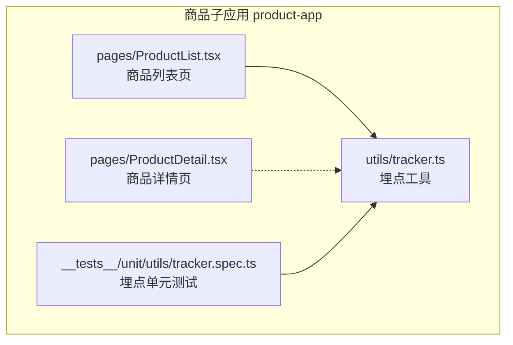
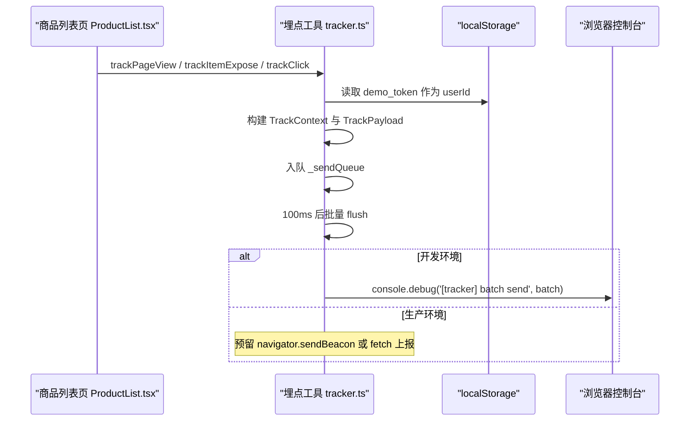
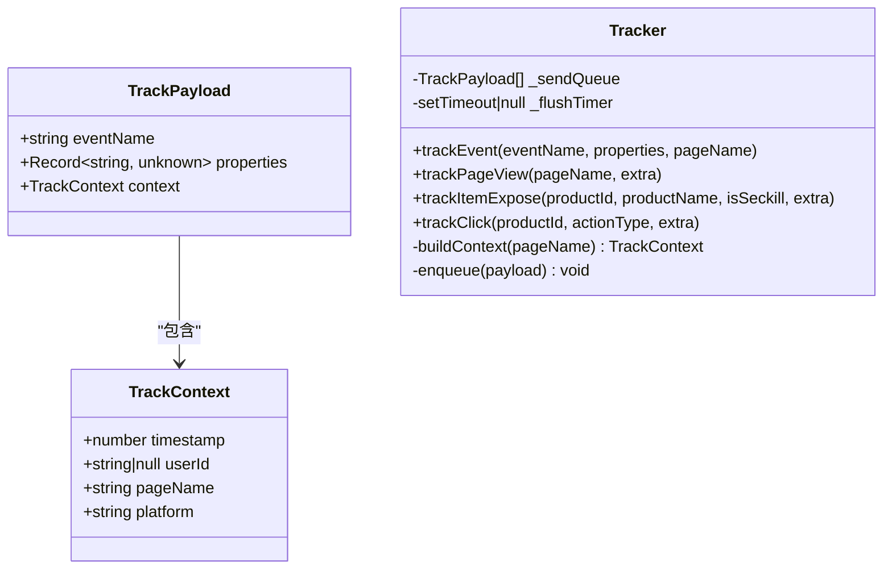
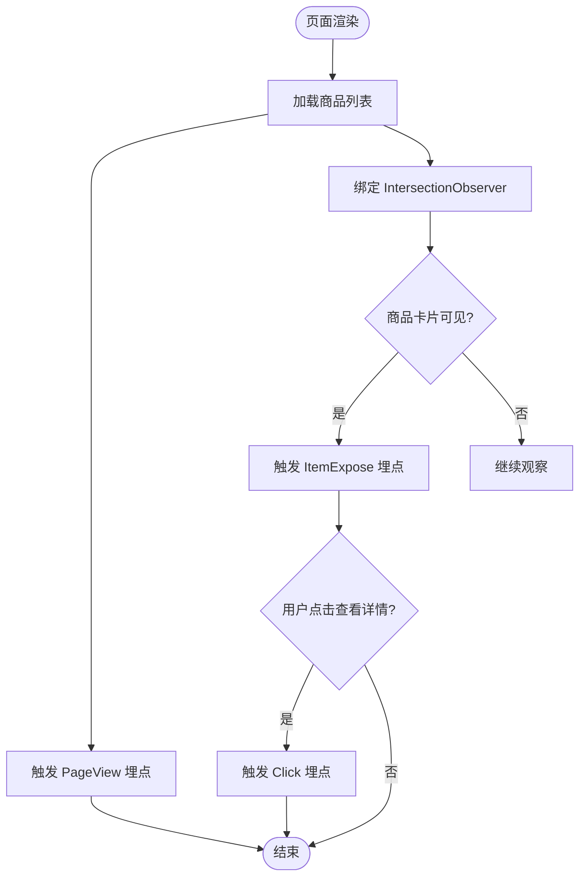
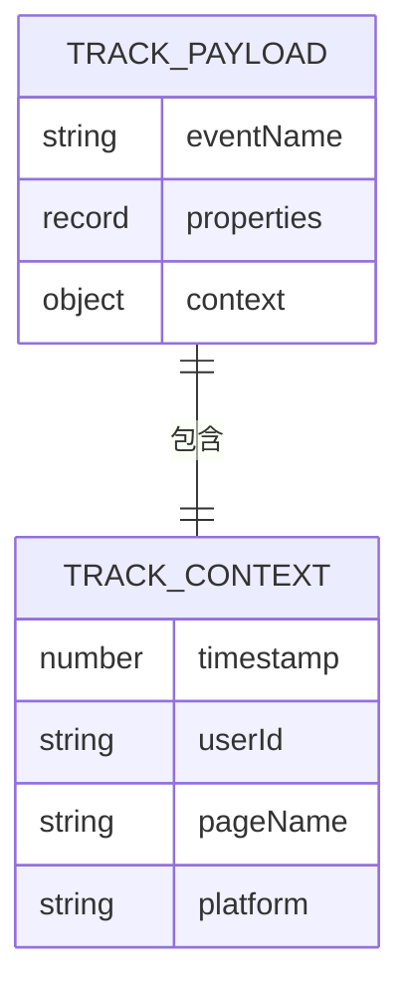
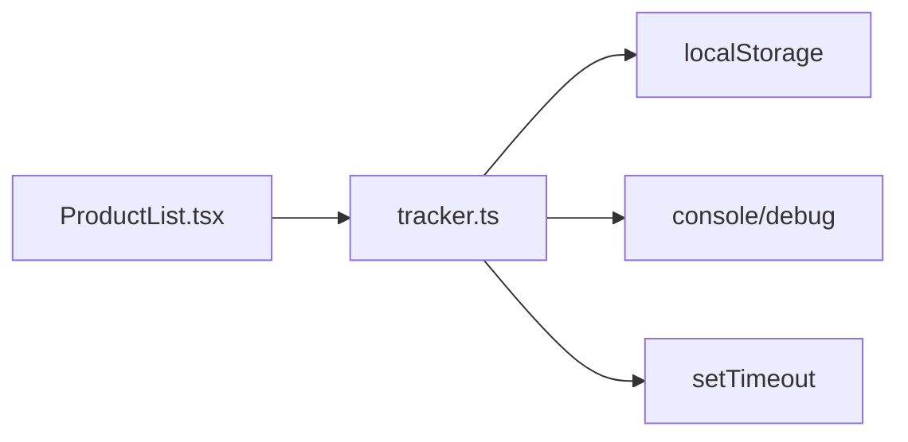

# 用户行为追踪系统

<cite>
**本文引用的文件**   
- [README.md](file://README.md)
- [tracker.ts](file://frontend/product-app/src/utils/tracker.ts)
- [ProductList.tsx](file://frontend/product-app/src/pages/ProductList.tsx)
- [ProductDetail.tsx](file://frontend/product-app/src/pages/ProductDetail.tsx)
- [tracker.spec.ts](file://frontend/product-app/src/__tests__/unit/utils/tracker.spec.ts)
</cite>

## 目录
1. [引言](#引言)
2. [项目结构中的行为追踪定位](#项目结构中的行为追踪定位)
3. [核心组件与职责](#核心组件与职责)
4. [架构总览](#架构总览)
5. [详细组件分析](#详细组件分析)
6. [数据模型与事件规范](#数据模型与事件规范)
7. [依赖关系分析](#依赖关系分析)
8. [性能与可靠性设计](#性能与可靠性设计)
9. [测试策略与验证点](#测试策略与验证点)
10. [常见问题排查](#常见问题排查)
11. [结论与扩展建议](#结论与扩展建议)

## 引言
本仓库是一个前后端分离的微服务电商示例，前端采用 qiankun 微前端架构，后端基于 Spring Cloud 微服务。用户行为追踪能力当前主要实现于商品子应用 product-app 中，用于采集页面访问、商品曝光和交互点击等前端行为，并以异步批处理方式上报。后端暂未提供专门的用户行为日志或埋点接收接口，当前 tracker 的上报通道以开发环境控制台输出为主，生产环境可替换为真实上报通道。

## 项目结构中的行为追踪定位
- 行为追踪代码集中在商品子应用：
  - 工具层：`frontend/product-app/src/utils/tracker.ts`
  - 使用层：`frontend/product-app/src/pages/ProductList.tsx`
  - 单元测试：`frontend/product-app/src/__tests__/unit/utils/tracker.spec.ts`
- 商品详情页 `ProductDetail.tsx` 目前未直接调用埋点方法，但可作为后续埋点扩展入口（例如购买、秒杀、分享等行为）。

**图表来源**
- [tracker.ts:1-135](file://frontend/product-app/src/utils/tracker.ts#L1-L135)
- [ProductList.tsx:1-220](file://frontend/product-app/src/pages/ProductList.tsx#L1-L220)
- [ProductDetail.tsx:1-213](file://frontend/product-app/src/pages/ProductDetail.tsx#L1-L213)
- [tracker.spec.ts:1-49](file://frontend/product-app/src/__tests__/unit/utils/tracker.spec.ts#L1-L49)

**章节来源**
- [README.md:12-15](file://README.md#L12-L15)
- [README.md:138-149](file://README.md#L138-L149)

## 核心组件与职责
- 埋点工具 tracker.ts
  - 定义埋点上下文与载荷类型。
  - 从本地存储读取登录标识作为 userId。
  - 维护发送队列与定时器，实现 100ms 内批量合并上报。
  - 暴露统一事件触发函数与便捷方法：页面访问、商品曝光、交互点击。
- 商品列表页 ProductList.tsx
  - 页面加载完成后触发页面访问埋点。
  - 使用 IntersectionObserver 监听商品卡片进入可视区域，触发商品曝光埋点。
  - 在“查看详情”点击时触发交互点击埋点。
- 商品详情页 ProductDetail.tsx
  - 当前未直接埋点，但具备购买与秒杀入口，适合后续扩展购买、秒杀、分享等埋点。
- 埋点单元测试 tracker.spec.ts
  - 验证 payload 结构、userId 采集、批量发送逻辑、异常静默捕获。

**章节来源**
- [tracker.ts:1-135](file://frontend/product-app/src/utils/tracker.ts#L1-L135)
- [ProductList.tsx:1-220](file://frontend/product-app/src/pages/ProductList.tsx#L1-L220)
- [ProductDetail.tsx:1-213](file://frontend/product-app/src/pages/ProductDetail.tsx#L1-L213)
- [tracker.spec.ts:1-49](file://frontend/product-app/src/__tests__/unit/utils/tracker.spec.ts#L1-L49)

## 架构总览
前端埋点流程如下：业务页面调用 tracker 的便捷方法 → tracker 构建上下文与载荷 → 入队并延迟批量发送 → 开发环境打印调试信息，生产环境预留 Beacon/Fetch 上报位置。

**图表来源**
- [ProductList.tsx:58-124](file://frontend/product-app/src/pages/ProductList.tsx#L58-L124)
- [tracker.ts:24-74](file://frontend/product-app/src/utils/tracker.ts#L24-L74)
- [tracker.ts:85-134](file://frontend/product-app/src/utils/tracker.ts#L85-L134)

## 详细组件分析

### 埋点工具 tracker.ts
- 类型设计
  - TrackContext：包含时间戳、用户标识、页面名称、平台标识。
  - TrackPayload：包含事件名、业务属性、公共上下文。
- 上下文采集
  - 优先从 localStorage 获取 demo_token 作为 userId；若不可用则置空。
  - 固定 platform 为 product-app，便于多子应用区分。
- 上报通道
  - 内部维护发送队列与定时器，100ms 内多次埋点合并一次发送。
  - 开发环境通过 console.debug 输出批次数据；生产环境预留 Beacon/Fetch 上报位置。
  - 所有上报均包裹 try/catch，确保异常不影响业务。
- 对外 API
  - trackEvent：通用事件触发入口。
  - trackPageView：页面访问事件。
  - trackItemExpose：商品曝光事件，携带商品 ID、名称、是否秒杀等属性。
  - trackClick：交互点击事件，携带商品 ID、动作类型等属性。

**图表来源**
- [tracker.ts:9-22](file://frontend/product-app/src/utils/tracker.ts#L9-L22)
- [tracker.ts:24-74](file://frontend/product-app/src/utils/tracker.ts#L24-L74)
- [tracker.ts:85-134](file://frontend/product-app/src/utils/tracker.ts#L85-L134)

**章节来源**
- [tracker.ts:1-135](file://frontend/product-app/src/utils/tracker.ts#L1-L135)

### 商品列表页 ProductList.tsx
- 页面访问埋点
  - 首次加载完成时调用 trackPageView，附带商品数量等上下文。
- 商品曝光埋点
  - 使用 IntersectionObserver 监听商品卡片进入可视区域，阈值 0.5。
  - 使用 Set 去重，避免重复曝光。
  - 曝光时调用 trackItemExpose，携带商品 ID、名称、是否秒杀。
- 交互点击埋点
  - 点击“查看详情”时调用 trackClick，记录动作类型为 viewDetail。

**图表来源**
- [ProductList.tsx:58-124](file://frontend/product-app/src/pages/ProductList.tsx#L58-L124)

**章节来源**
- [ProductList.tsx:1-220](file://frontend/product-app/src/pages/ProductList.tsx#L1-L220)

### 商品详情页 ProductDetail.tsx
- 当前未直接调用埋点方法。
- 适合作为后续埋点扩展入口，例如：
  - 购买成功埋点：trackClick(productId, 'buy')
  - 秒杀成功埋点：trackClick(productId, 'seckill')
  - 页面访问埋点：trackPageView('ProductDetail', { productId })

**章节来源**
- [ProductDetail.tsx:1-213](file://frontend/product-app/src/pages/ProductDetail.tsx#L1-L213)

## 数据模型与事件规范
- 公共上下文 TrackContext
  - timestamp：事件发生时间戳。
  - userId：从 localStorage 读取的登录标识，可能为空。
  - pageName：页面名称，如 ProductList、ProductDetail。
  - platform：固定为 product-app。
- 完整载荷 TrackPayload
  - eventName：事件名称，如 PageView、ItemExpose、Click。
  - properties：业务属性，随事件不同而变化。
  - context：公共上下文对象。
- 事件约定
  - PageView：页面访问，properties 可包含页面维度统计字段。
  - ItemExpose：商品曝光，properties 包含 productId、productName、isSeckill。
  - Click：交互点击，properties 包含 productId、actionType。

**图表来源**
- [tracker.ts:9-22](file://frontend/product-app/src/utils/tracker.ts#L9-L22)
- [tracker.ts:24-42](file://frontend/product-app/src/utils/tracker.ts#L24-L42)

**章节来源**
- [tracker.ts:1-135](file://frontend/product-app/src/utils/tracker.ts#L1-L135)

## 依赖关系分析
- 模块内依赖
  - ProductList.tsx 依赖 tracker.ts 提供的埋点方法。
  - tracker.ts 依赖浏览器 localStorage、console、setTimeout。
- 外部依赖
  - 当前无后端埋点接口依赖；生产环境可扩展为 Beacon/Fetch 上报。
- 耦合度与内聚性
  - tracker.ts 高内聚，封装了上下文采集、队列管理、上报通道。
  - ProductList.tsx 低耦合，仅调用公开方法，不感知上报细节。

**图表来源**
- [ProductList.tsx:7-124](file://frontend/product-app/src/pages/ProductList.tsx#L7-L124)
- [tracker.ts:24-74](file://frontend/product-app/src/utils/tracker.ts#L24-L74)

**章节来源**
- [ProductList.tsx:1-220](file://frontend/product-app/src/pages/ProductList.tsx#L1-L220)
- [tracker.ts:1-135](file://frontend/product-app/src/utils/tracker.ts#L1-L135)

## 性能与可靠性设计
- 异步非阻塞
  - 所有埋点调用均为异步，不会阻塞主线程与业务逻辑。
- 批量合并
  - 100ms 内多次埋点合并为一批发送，降低网络开销与处理压力。
- 异常静默
  - 埋点相关异常被 try/catch 捕获，不影响业务功能。
- 可扩展上报
  - 预留 navigator.sendBeacon 或 fetch 上报位置，便于生产环境接入后端。

[本节为通用性能讨论，无需具体文件分析]

## 测试策略与验证点
- 单元测试覆盖
  - payload 结构验证：eventName、properties、context 字段齐全。
  - userId 采集验证：从 localStorage 读取 demo_token。
  - 批量发送验证：100ms 定时器触发批量发送。
  - 异常静默验证：埋点异常不会抛出。
- 关键断言
  - 控制台 debug 输出包含批次数据。
  - 事件名称与属性符合预期。
  - 上下文包含 pageName、platform 等字段。

**章节来源**
- [tracker.spec.ts:1-49](file://frontend/product-app/src/__tests__/unit/utils/tracker.spec.ts#L1-L49)

## 常见问题排查
- 埋点未触发
  - 检查页面是否正确调用 trackPageView。
  - 检查 IntersectionObserver 是否正确绑定与断开。
  - 检查商品卡片 data-* 属性是否设置正确。
- 埋点数据缺失
  - 检查 localStorage 中是否存在 demo_token。
  - 检查 properties 是否传入必要字段。
- 上报失败
  - 开发环境查看控制台 debug 输出。
  - 生产环境检查预留上报通道是否启用与网络可达。

**章节来源**
- [ProductList.tsx:58-124](file://frontend/product-app/src/pages/ProductList.tsx#L58-L124)
- [tracker.ts:24-74](file://frontend/product-app/src/utils/tracker.ts#L24-L74)

## 结论与扩展建议
- 当前用户行为追踪在前端已具备基础能力，覆盖页面访问、商品曝光与交互点击三类事件，并通过异步批处理保证性能与可靠性。
- 建议后续扩展：
  - 在商品详情页增加购买、秒杀、分享等埋点。
  - 将 tracker 上报通道替换为真实后端接口，支持持久化与聚合分析。
  - 增加事件去重、采样率控制、敏感字段脱敏等机制。
  - 在多子应用中统一埋点 SDK，实现跨应用行为归因。

[本节为总结与建议，无需具体文件分析]