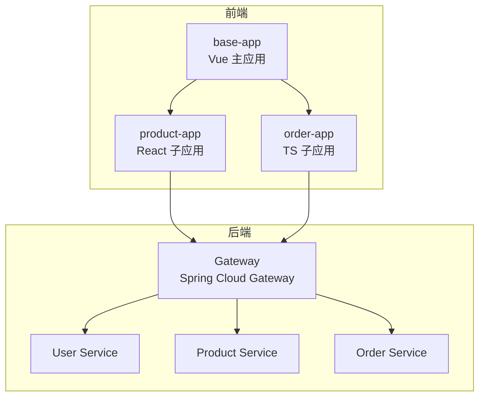
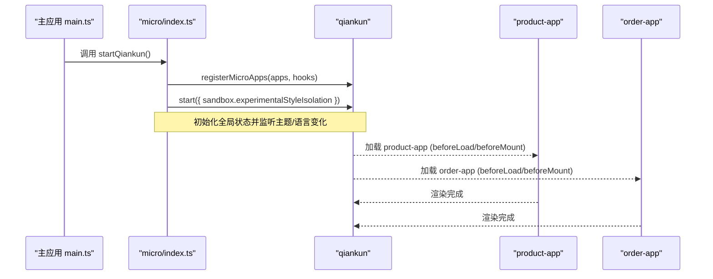
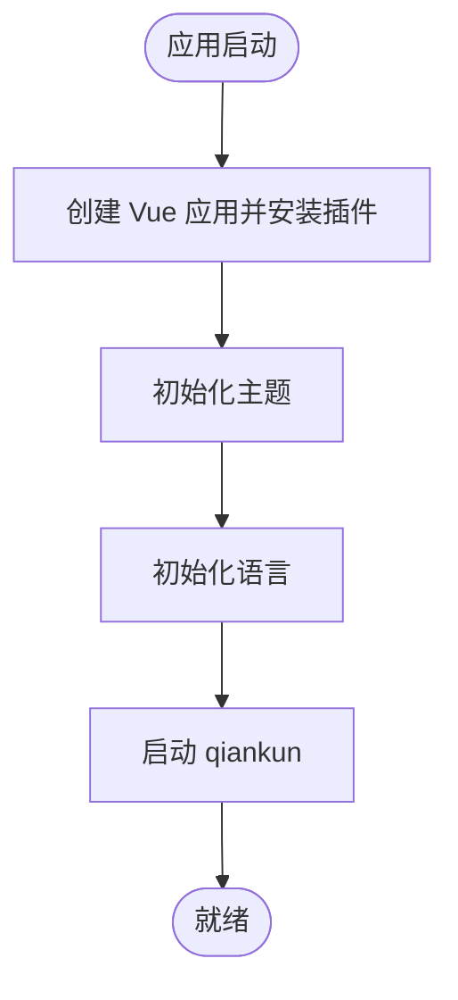
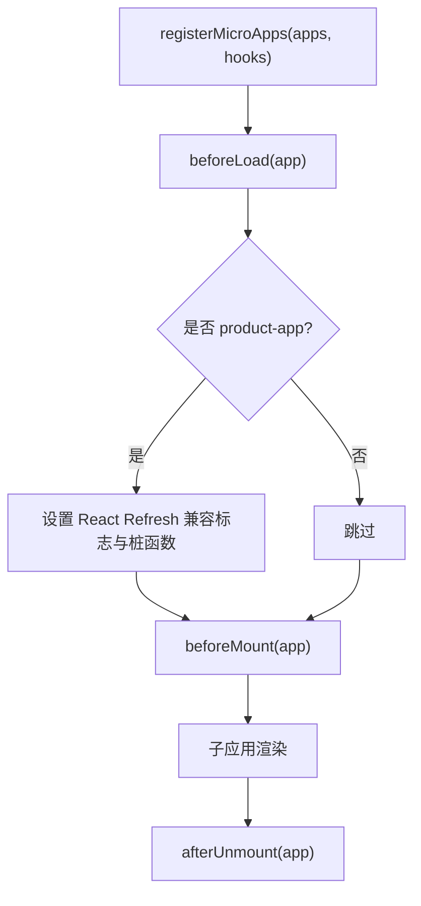
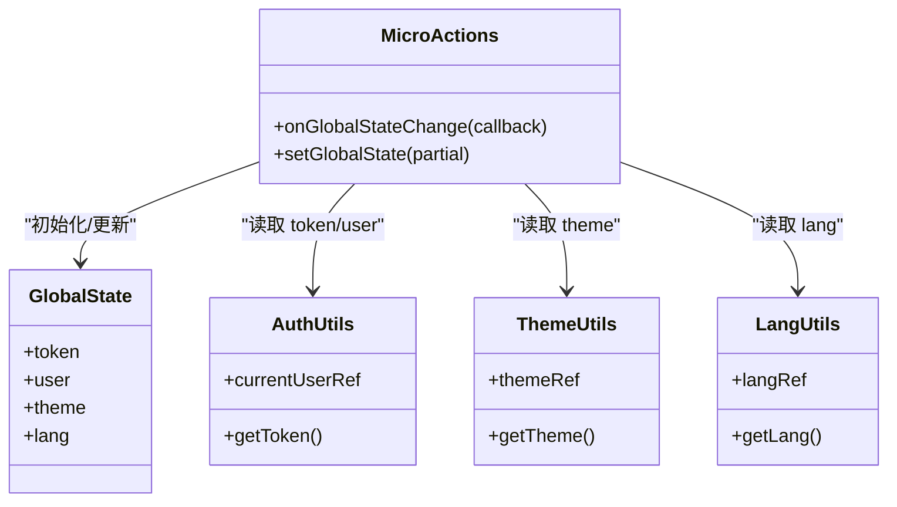
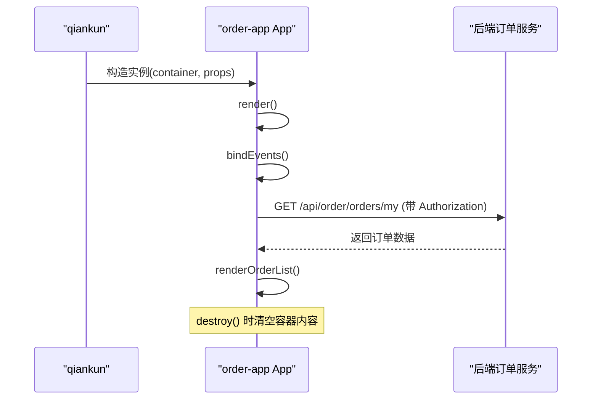
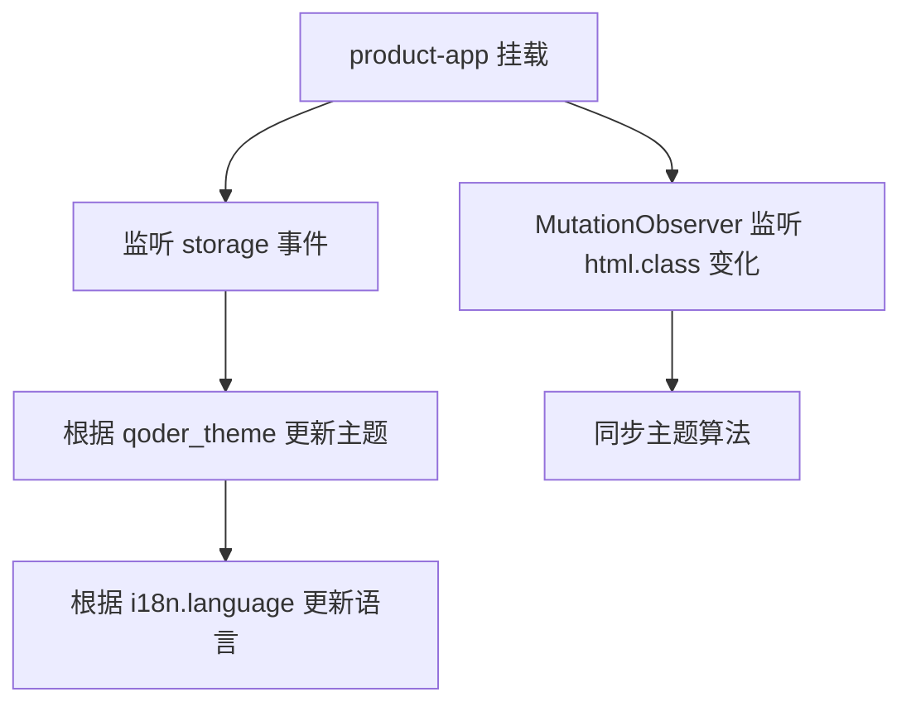
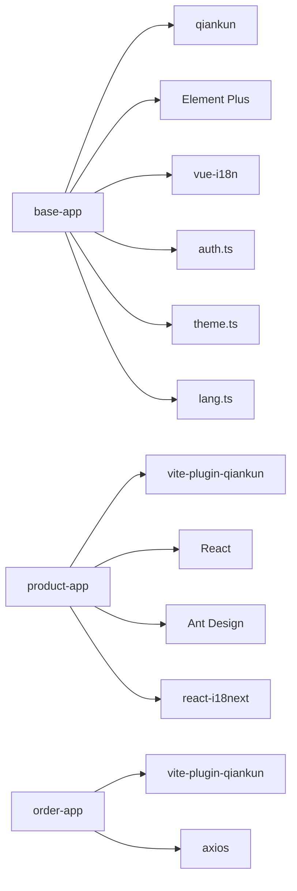

# 微前端框架集成

<cite>
**本文引用的文件**   
- [frontend/base-app/src/micro/index.ts](file://frontend/base-app/src/micro/index.ts)
- [frontend/base-app/src/main.ts](file://frontend/base-app/src/main.ts)
- [frontend/base-app/src/utils/auth.ts](file://frontend/base-app/src/utils/auth.ts)
- [frontend/base-app/src/utils/theme.ts](file://frontend/base-app/src/utils/theme.ts)
- [frontend/base-app/src/utils/lang.ts](file://frontend/base-app/src/utils/lang.ts)
- [frontend/product-app/vite.config.ts](file://frontend/product-app/vite.config.ts)
- [frontend/order-app/vite.config.ts](file://frontend/order-app/vite.config.ts)
- [frontend/order-app/src/app.ts](file://frontend/order-app/src/app.ts)
- [frontend/product-app/src/App.tsx](file://frontend/product-app/src/App.tsx)
- [README.md](file://README.md)
</cite>

## 目录
1. [引言](#引言)
2. [项目结构](#项目结构)
3. [核心组件](#核心组件)
4. [架构总览](#架构总览)
5. [详细组件分析](#详细组件分析)
6. [依赖关系分析](#依赖关系分析)
7. [性能与隔离策略](#性能与隔离策略)
8. [子应用接入规范](#子应用接入规范)
9. [通信协议与状态共享](#通信协议与状态共享)
10. [错误处理机制](#错误处理机制)
11. [故障排查指南](#故障排查指南)
12. [结论](#结论)

## 引言
本文件面向基于 qiankun 的微前端集成方案，围绕主应用初始化、子应用注册、生命周期钩子、全局状态管理、沙箱与样式隔离、子应用接入规范、跨应用通信与错误处理进行系统化说明。该仓库的前端部分由一个 Vue 主应用 base-app 和两个子应用 product-app（React）、order-app（原生 TypeScript）组成，后端为 Spring Cloud 微服务集群，通过网关统一鉴权与路由。

## 项目结构
前端采用“主应用 + 多子应用”的 qiankun 架构：
- base-app：Vue 3 + Element Plus，负责登录/用户管理、主题与语言切换、qiankun 初始化与子应用容器挂载。
- product-app：React + Ant Design，商品列表与详情，支持暗黑模式与国际化。
- order-app：原生 TypeScript + Axios，订单列表与详情，支持暗黑模式与国际化。

图表来源
- [README.md:1-14](file://README.md#L1-L14)
- [frontend/base-app/src/main.ts:1-48](file://frontend/base-app/src/main.ts#L1-L48)
- [frontend/product-app/vite.config.ts:1-49](file://frontend/product-app/vite.config.ts#L1-L49)
- [frontend/order-app/vite.config.ts:1-25](file://frontend/order-app/vite.config.ts#L1-L25)

章节来源
- [README.md:1-14](file://README.md#L1-L14)
- [frontend/base-app/src/main.ts:1-48](file://frontend/base-app/src/main.ts#L1-L48)

## 核心组件
- 主应用入口与微前端启动：main.ts 负责创建 Vue 应用、安装插件、初始化主题与语言，并调用 startQiankun() 启动 qiankun。
- 微前端配置与全局状态：micro/index.ts 使用 initGlobalState 创建全局状态，注册子应用 product-app 与 order-app，配置 beforeLoad/beforeMount/afterUnmount 钩子，并通过 props 向子应用注入 getToken、globalActions、getTheme、getLang。
- 认证与用户信息：utils/auth.ts 提供 tokenRef、currentUserRef、getToken、setAuth、clearAuth，持久化到 localStorage。
- 主题管理：utils/theme.ts 提供 themeRef、getTheme、setTheme、toggleTheme、applyTheme、initTheme，将主题同步到 <html> class 并与后端偏好同步。
- 语言管理：utils/lang.ts 提供 langRef、getLang、setLang、initLang，与 vue-i18n 联动并持久化到后端。

章节来源
- [frontend/base-app/src/main.ts:1-48](file://frontend/base-app/src/main.ts#L1-L48)
- [frontend/base-app/src/micro/index.ts:1-89](file://frontend/base-app/src/micro/index.ts#L1-L89)
- [frontend/base-app/src/utils/auth.ts:1-60](file://frontend/base-app/src/utils/auth.ts#L1-L60)
- [frontend/base-app/src/utils/theme.ts:1-88](file://frontend/base-app/src/utils/theme.ts#L1-L88)
- [frontend/base-app/src/utils/lang.ts:1-68](file://frontend/base-app/src/utils/lang.ts#L1-L68)

## 架构总览
qiankun 在主应用中完成以下关键步骤：
- 初始化全局状态（token、user、theme、lang）。
- 监听主题与语言变化，更新全局状态以通知子应用。
- 注册子应用，定义 activeRule 路由规则，并通过 props 传递能力函数。
- 在 beforeLoad 中为 React 子应用设置兼容标志，避免 HMR 桩函数缺失导致运行期异常。
- 启动 qiankun，开启 experimentalStyleIsolation 实现样式隔离。

图表来源
- [frontend/base-app/src/main.ts:40-48](file://frontend/base-app/src/main.ts#L40-L48)
- [frontend/base-app/src/micro/index.ts:60-89](file://frontend/base-app/src/micro/index.ts#L60-L89)

## 详细组件分析

### 主应用初始化流程
- 创建 Vue 应用并安装 Element Plus、图标库、i18n、router。
- 初始化主题与语言（从本地缓存或后端偏好）。
- 启动 qiankun 微前端。

图表来源
- [frontend/base-app/src/main.ts:23-48](file://frontend/base-app/src/main.ts#L23-L48)

章节来源
- [frontend/base-app/src/main.ts:1-48](file://frontend/base-app/src/main.ts#L1-L48)

### 子应用注册与生命周期钩子
- apps 数组定义了两个子应用的 name、entry、container、activeRule 与 props。
- registerMicroApps 配置了 beforeLoad、beforeMount、afterUnmount 钩子。
- beforeLoad 针对 product-app 设置 React Refresh 兼容标志与桩函数，解决 eval 执行环境差异导致的 HMR 桩缺失问题。
- afterUnmount 用于清理资源（当前仅日志输出，可扩展为事件解绑、定时器清理等）。

图表来源
- [frontend/base-app/src/micro/index.ts:32-79](file://frontend/base-app/src/micro/index.ts#L32-L79)
- [frontend/product-app/vite.config.ts:6-24](file://frontend/product-app/vite.config.ts#L6-L24)

章节来源
- [frontend/base-app/src/micro/index.ts:32-79](file://frontend/base-app/src/micro/index.ts#L32-L79)
- [frontend/product-app/vite.config.ts:1-49](file://frontend/product-app/vite.config.ts#L1-L49)

### 全局状态管理器设计
- 初始状态包含 token、user、theme、lang，来源于 auth、theme、lang 工具模块。
- 通过 initGlobalState 暴露 globalActions，子应用可通过 props.globalActions 读取与更新全局状态。
- 监听 themeRef 与 langRef 的变化，自动将新值写入全局状态，使子应用可感知主题与语言变更。

图表来源
- [frontend/base-app/src/micro/index.ts:7-30](file://frontend/base-app/src/micro/index.ts#L7-L30)
- [frontend/base-app/src/utils/auth.ts:1-60](file://frontend/base-app/src/utils/auth.ts#L1-L60)
- [frontend/base-app/src/utils/theme.ts:1-88](file://frontend/base-app/src/utils/theme.ts#L1-L88)
- [frontend/base-app/src/utils/lang.ts:1-68](file://frontend/base-app/src/utils/lang.ts#L1-L68)

章节来源
- [frontend/base-app/src/micro/index.ts:7-30](file://frontend/base-app/src/micro/index.ts#L7-L30)
- [frontend/base-app/src/utils/auth.ts:1-60](file://frontend/base-app/src/utils/auth.ts#L1-L60)
- [frontend/base-app/src/utils/theme.ts:1-88](file://frontend/base-app/src/utils/theme.ts#L1-L88)
- [frontend/base-app/src/utils/lang.ts:1-68](file://frontend/base-app/src/utils/lang.ts#L1-L68)

### 子应用接入示例

#### 订单子应用（order-app）
- 通过 props.getToken 获取令牌，优先使用 qiankun 传入的能力函数，否则回退到 localStorage。
- 使用 axios 调用后端接口，携带 Authorization 头。
- 提供 render、destroy 方法，便于 qiankun 生命周期管理。

图表来源
- [frontend/order-app/src/app.ts:18-309](file://frontend/order-app/src/app.ts#L18-L309)

章节来源
- [frontend/order-app/src/app.ts:18-309](file://frontend/order-app/src/app.ts#L18-L309)

#### 商品子应用（product-app）
- 通过 i18n 与 Ant Design ConfigProvider 响应主题与语言变化。
- 监听 storage 事件与 DOM MutationObserver，以适配主应用对主题与语言的变更。
- 使用 BrowserRouter basename="/product" 配合主应用 activeRule "/product"。

图表来源
- [frontend/product-app/src/App.tsx:13-74](file://frontend/product-app/src/App.tsx#L13-L74)

章节来源
- [frontend/product-app/src/App.tsx:1-74](file://frontend/product-app/src/App.tsx#L1-L74)

## 依赖关系分析
- base-app 依赖 qiankun、Element Plus、vue-i18n、auth/theme/lang 工具模块。
- product-app 依赖 vite-plugin-qiankun、react、antd、react-i18next。
- order-app 依赖 vite-plugin-qiankun、axios。
- 子应用通过 props 与主应用共享能力函数，避免直接耦合。

图表来源
- [frontend/base-app/src/main.ts:1-48](file://frontend/base-app/src/main.ts#L1-L48)
- [frontend/product-app/vite.config.ts:1-49](file://frontend/product-app/vite.config.ts#L1-L49)
- [frontend/order-app/vite.config.ts:1-25](file://frontend/order-app/vite.config.ts#L1-L25)

章节来源
- [frontend/base-app/src/main.ts:1-48](file://frontend/base-app/src/main.ts#L1-L48)
- [frontend/product-app/vite.config.ts:1-49](file://frontend/product-app/vite.config.ts#L1-L49)
- [frontend/order-app/vite.config.ts:1-25](file://frontend/order-app/vite.config.ts#L1-L25)

## 性能与隔离策略
- 沙箱模式：通过 start({ sandbox: { experimentalStyleIsolation: true } }) 启用样式隔离，减少子应用间样式冲突。
- 运行时兼容性：在 beforeLoad 中为 product-app 设置 React Refresh 兼容标志与桩函数，避免 eval 执行环境与 import() 模块作用域不一致导致的异常。
- 资源加载：子应用独立构建与部署，按需加载，降低主应用体积。

章节来源
- [frontend/base-app/src/micro/index.ts:82-89](file://frontend/base-app/src/micro/index.ts#L82-L89)
- [frontend/base-app/src/micro/index.ts:62-72](file://frontend/base-app/src/micro/index.ts#L62-L72)
- [frontend/product-app/vite.config.ts:6-24](file://frontend/product-app/vite.config.ts#L6-L24)

## 子应用接入规范
- 注册配置：
  - name：唯一标识，如 product-app、order-app。
  - entry：子应用入口地址，开发阶段指向本地端口。
  - container：挂载容器选择器，如 #subapp-container。
  - activeRule：路由前缀，如 /product、/order。
  - props：向子应用注入 getToken、globalActions、getTheme、getLang。
- 生命周期钩子：
  - beforeLoad：预加载逻辑，如兼容性设置、权限校验、埋点初始化。
  - beforeMount：挂载前准备，如数据预取、UI 初始化。
  - afterUnmount：卸载后清理，如事件解绑、定时器销毁、第三方 SDK 释放。
- 构建与部署：
  - 子应用需使用 vite-plugin-qiankun 插件，并在 dev server 中配置 CORS 与代理。
  - 生产环境建议通过 CDN 或独立域名部署，避免跨域问题。

章节来源
- [frontend/base-app/src/micro/index.ts:32-79](file://frontend/base-app/src/micro/index.ts#L32-L79)
- [frontend/product-app/vite.config.ts:26-49](file://frontend/product-app/vite.config.ts#L26-L49)
- [frontend/order-app/vite.config.ts:5-25](file://frontend/order-app/vite.config.ts#L5-L25)

## 通信协议与状态共享
- 令牌与用户信息：
  - 主应用通过 utils/auth.ts 提供 getToken 与 currentUserRef，子应用通过 props.getToken 获取令牌，用于请求鉴权。
- 主题与语言：
  - 主应用通过 utils/theme.ts 与 utils/lang.ts 维护 themeRef 与 langRef，并在 micro/index.ts 中监听变化，更新全局状态。
  - 子应用可通过 props.getTheme、props.getLang 读取当前主题与语言，或通过全局状态订阅变更。
- 扩展点：
  - 可在 globalActions.setGlobalState 中扩展更多跨应用共享字段，如导航菜单、权限集合、业务开关等。

章节来源
- [frontend/base-app/src/utils/auth.ts:1-60](file://frontend/base-app/src/utils/auth.ts#L1-L60)
- [frontend/base-app/src/utils/theme.ts:1-88](file://frontend/base-app/src/utils/theme.ts#L1-L88)
- [frontend/base-app/src/utils/lang.ts:1-68](file://frontend/base-app/src/utils/lang.ts#L1-L68)
- [frontend/base-app/src/micro/index.ts:7-30](file://frontend/base-app/src/micro/index.ts#L7-L30)

## 错误处理机制
- 子应用网络请求：
  - order-app 在 loadOrders/loadAllOrders/cancelOrder 中使用 try/catch 捕获异常，展示失败提示或错误视图。
- 主应用生命周期：
  - beforeLoad/beforeMount/afterUnmount 目前仅输出日志，可扩展为统一错误上报与降级策略。
- 主题与语言持久化：
  - theme.ts 与 lang.ts 在异步保存后端失败时静默记录警告，保证本地缓存可用。

章节来源
- [frontend/order-app/src/app.ts:101-135](file://frontend/order-app/src/app.ts#L101-L135)
- [frontend/order-app/src/app.ts:272-287](file://frontend/order-app/src/app.ts#L272-L287)
- [frontend/base-app/src/utils/theme.ts:32-44](file://frontend/base-app/src/utils/theme.ts#L32-L44)
- [frontend/base-app/src/utils/lang.ts:30-43](file://frontend/base-app/src/utils/lang.ts#L30-L43)

## 故障排查指南
- React 子应用 HMR 桩缺失：
  - 现象：product-app 在 qiankun 环境下出现 $RefreshReg$/$RefreshSig$ 未定义。
  - 原因：eval 执行环境与 import() 模块作用域不同，React Refresh preamble 被移除。
  - 解决：在 beforeLoad 中设置 __vite_plugin_react_preamble_installed__ 与桩函数；或在构建时移除 React Refresh preamble。
- 样式冲突：
  - 现象：子应用样式影响主应用或其他子应用。
  - 解决：启用 experimentalStyleIsolation，并为子应用样式添加命名空间或 CSS Modules。
- 跨域与代理：
  - 现象：子应用请求后端失败。
  - 解决：确保 vite dev server 配置 CORS 与 /api 代理到后端网关。
- 主题/语言不同步：
  - 现象：子应用未响应主应用的主题或语言切换。
  - 解决：确认 micro/index.ts 中 watch(themeRef/langRef) 已更新全局状态；子应用正确订阅或监听 storage/DOM 变化。

章节来源
- [frontend/base-app/src/micro/index.ts:62-72](file://frontend/base-app/src/micro/index.ts#L62-L72)
- [frontend/product-app/vite.config.ts:6-24](file://frontend/product-app/vite.config.ts#L6-L24)
- [frontend/product-app/vite.config.ts:37-49](file://frontend/product-app/vite.config.ts#L37-L49)
- [frontend/order-app/vite.config.ts:14-25](file://frontend/order-app/vite.config.ts#L14-L25)
- [frontend/product-app/src/App.tsx:20-50](file://frontend/product-app/src/App.tsx#L20-L50)

## 结论
本项目通过 qiankun 实现了主应用与多个子应用的解耦与协作：主应用负责全局状态、主题与语言管理、子应用注册与生命周期控制；子应用专注于各自业务领域，通过 props 与全局状态与主应用协同。结合样式隔离、生命周期钩子与完善的错误处理，整体架构具备良好的可扩展性与可维护性。后续可进一步扩展跨应用通信协议、统一错误上报与监控、以及更细粒度的权限与菜单共享机制。