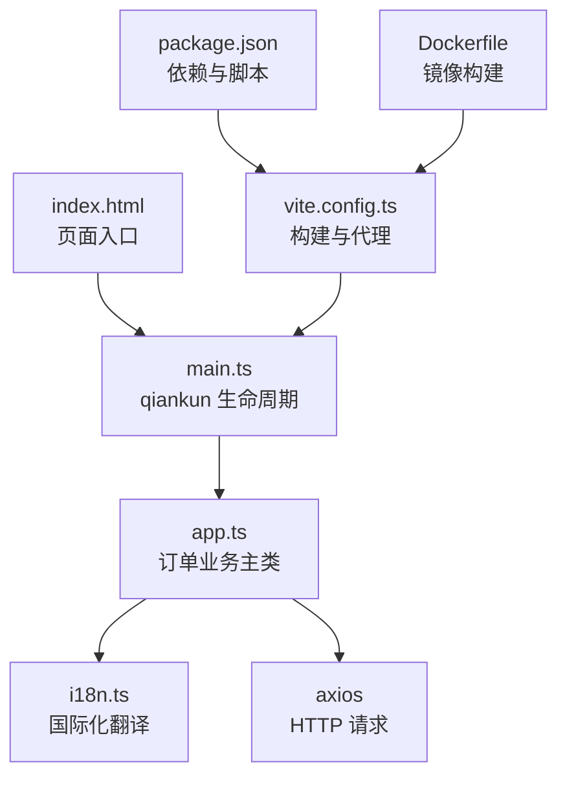
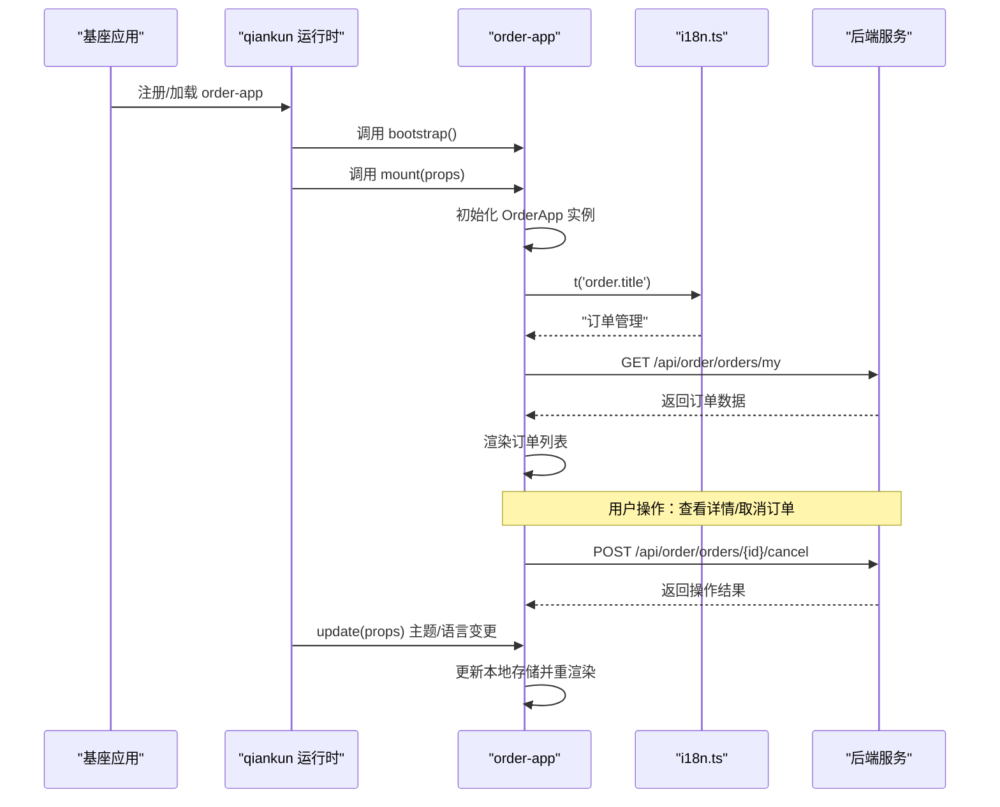
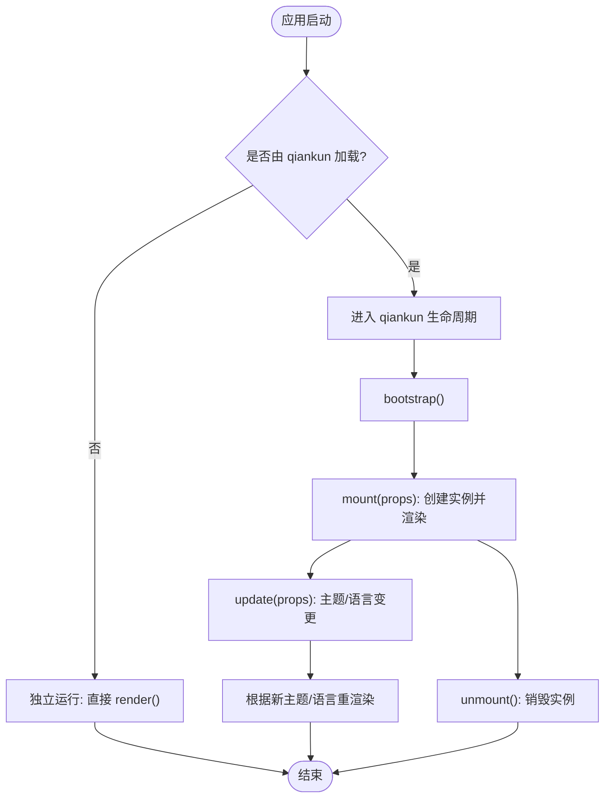
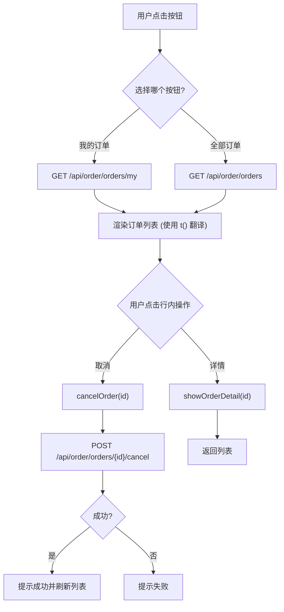
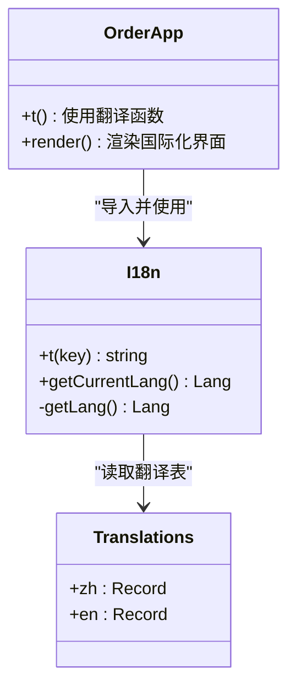
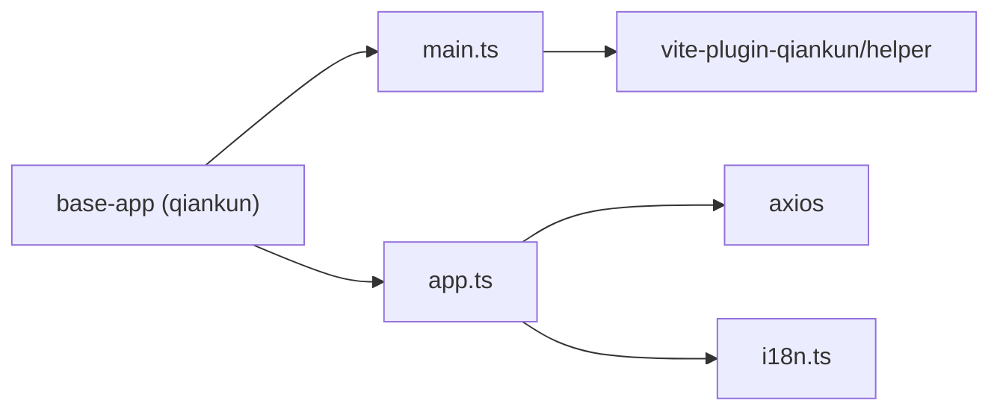
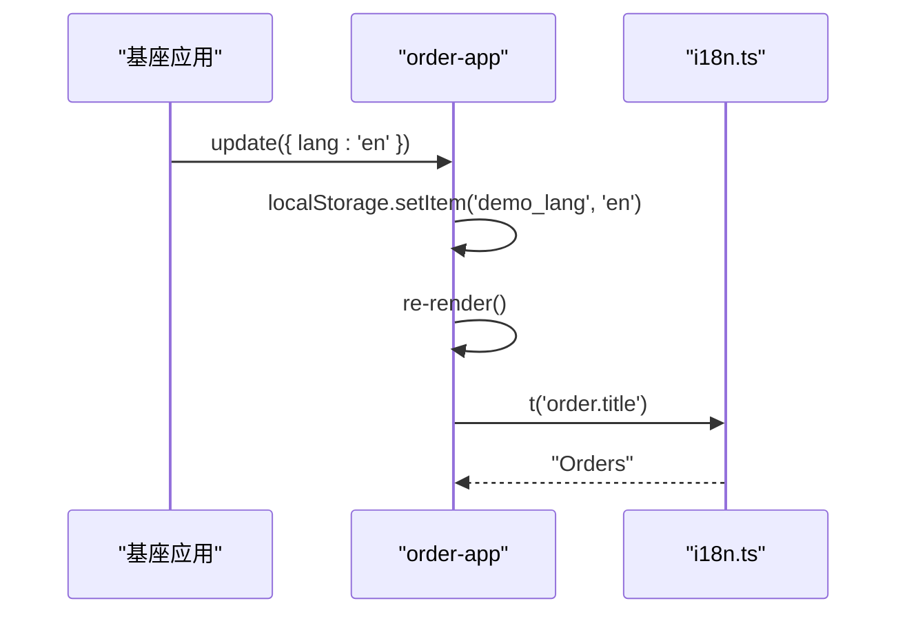
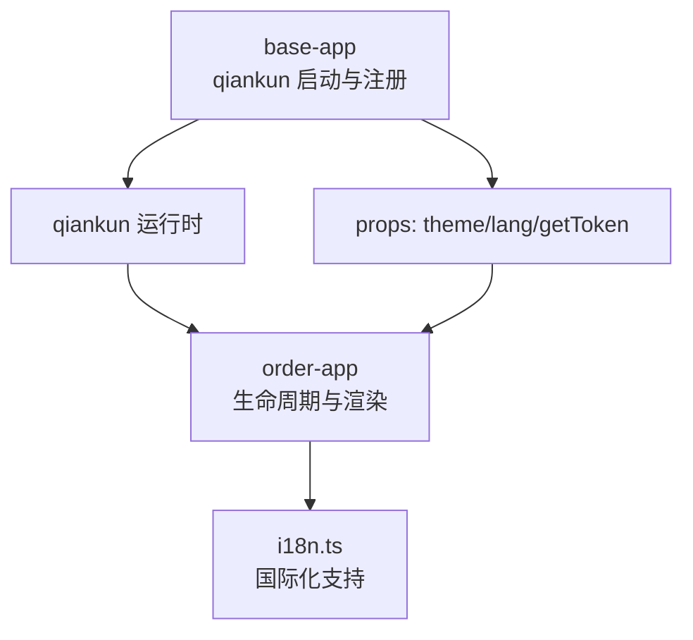

基于我对代码的分析，我现在可以更新文档。订单子应用的国际化实现已经得到了增强，采用了轻量级的 i18n 实现来替换硬编码的中文文本字符串。让我更新文档：

# 订单子应用(order-app)

<cite>
**本文引用的文件**   
- [frontend/order-app/package.json](file://frontend/order-app/package.json)
- [frontend/order-app/vite.config.ts](file://frontend/order-app/vite.config.ts)
- [frontend/order-app/index.html](file://frontend/order-app/index.html)
- [frontend/order-app/Dockerfile](file://frontend/order-app/Dockerfile)
- [frontend/order-app/src/main.ts](file://frontend/order-app/src/main.ts)
- [frontend/order-app/src/app.ts](file://frontend/order-app/src/app.ts)
- [frontend/order-app/src/i18n.ts](file://frontend/order-app/src/i18n.ts)
- [frontend/base-app/src/micro/index.ts](file://frontend/base-app/src/micro/index.ts)
</cite>

## 更新摘要
**变更内容**   
- 增强了订单子应用的国际化支持，采用轻量级 i18n 实现替换硬编码的中文文本字符串
- 新增了完整的英文翻译支持，涵盖所有用户界面元素
- 优化了语言切换机制，支持动态主题和语言的实时更新
- 改进了国际化键值管理，提供更清晰的命名空间组织

## 目录
1. [简介](#简介)
2. [项目结构](#项目结构)
3. [核心组件](#核心组件)
4. [架构总览](#架构总览)
5. [详细组件分析](#详细组件分析)
6. [依赖关系分析](#依赖关系分析)
7. [性能与代码分割](#性能与代码分割)
8. [国际化实现](#国际化实现)
9. [微前端适配方案](#微前端适配方案)
10. [复杂业务场景最佳实践](#复杂业务场景最佳实践)
11. [故障排查指南](#故障排查指南)
12. [结论](#结论)

## 简介
本文件面向"订单子应用"这一基于原生 TypeScript 的轻量级前端子应用，系统性说明其应用启动流程、模块化组织方式、依赖管理策略，以及订单管理功能的界面设计与业务流程。同时阐述该子应用的增强型国际化支持、与微前端框架（qiankun）的适配方案、性能优化与代码分割策略，并总结在复杂业务场景下的最佳实践。

## 项目结构
订单子应用采用 Vite + TypeScript 构建，使用 vite-plugin-qiankun 暴露 qiankun 子应用生命周期，并通过 axios 调用后端接口。整体结构简洁：

- 入口 HTML：提供根容器与模块脚本入口
- 应用入口 main.ts：注册 qiankun 生命周期，处理独立运行模式
- 业务主类 app.ts：封装订单列表、详情、取消等交互逻辑
- 国际化 i18n.ts：轻量多语言键值映射与切换
- 构建配置 vite.config.ts：插件、别名、开发服务器代理
- 包管理与脚本 package.json
- 容器化 Dockerfile

**图表来源**
- [frontend/order-app/index.html:1-17](file://frontend/order-app/index.html#L1-L17)
- [frontend/order-app/src/main.ts:1-56](file://frontend/order-app/src/main.ts#L1-L56)
- [frontend/order-app/src/app.ts:1-310](file://frontend/order-app/src/app.ts#L1-L310)
- [frontend/order-app/src/i18n.ts:1-129](file://frontend/order-app/src/i18n.ts#L1-L129)
- [frontend/order-app/vite.config.ts:1-26](file://frontend/order-app/vite.config.ts#L1-L26)
- [frontend/order-app/package.json:1-20](file://frontend/order-app/package.json#L1-L20)
- [frontend/order-app/Dockerfile:1-12](file://frontend/order-app/Dockerfile#L1-L12)

**章节来源**
- [frontend/order-app/index.html:1-17](file://frontend/order-app/index.html#L1-L17)
- [frontend/order-app/package.json:1-20](file://frontend/order-app/package.json#L1-L20)
- [frontend/order-app/vite.config.ts:1-26](file://frontend/order-app/vite.config.ts#L1-L26)

## 核心组件
- 应用入口 main.ts
  - 通过 renderWithQiankun 注册 bootstrap/mount/unmount/update 生命周期
  - 支持独立运行与 qiankun 沙箱两种模式
  - 接收基座应用传递的主题与语言状态，更新本地存储并触发重新渲染
- 业务主类 app.ts
  - 封装订单列表加载、详情展示、取消订单等交互
  - 动态渲染 DOM，绑定事件，维护当前视图状态
  - 从 props 或 localStorage 获取鉴权令牌
  - 全面集成国际化翻译函数 t()
- 国际化 i18n.ts
  - 提供 t(key) 翻译函数与 getCurrentLang()
  - 默认中文，完整支持英文；语言选择持久化到 localStorage
  - 包含订单管理和短信记录相关的所有文案
- 构建与运行
  - Vite 开发服务器端口 7200，启用 CORS，代理 /api 到后端
  - 打包产物由 Nginx 静态托管

**章节来源**
- [frontend/order-app/src/main.ts:1-56](file://frontend/order-app/src/main.ts#L1-L56)
- [frontend/order-app/src/app.ts:1-310](file://frontend/order-app/src/app.ts#L1-L310)
- [frontend/order-app/src/i18n.ts:1-129](file://frontend/order-app/src/i18n.ts#L1-L129)
- [frontend/order-app/vite.config.ts:1-26](file://frontend/order-app/vite.config.ts#L1-L26)

## 架构总览
订单子应用作为 qiankun 子应用，遵循以下职责边界：
- 不负责全局路由与布局，仅负责自身容器内的 UI 与交互
- 通过 props 与基座应用共享主题、语言、鉴权令牌等上下文
- 通过 axios 访问后端 API，统一走 /api 前缀，由 Vite 代理或网关转发
- 使用轻量级 i18n 模块提供多语言支持

**图表来源**
- [frontend/order-app/src/main.ts:16-49](file://frontend/order-app/src/main.ts#L16-L49)
- [frontend/order-app/src/app.ts:101-135](file://frontend/order-app/src/app.ts#L101-L135)
- [frontend/order-app/src/app.ts:272-287](file://frontend/order-app/src/app.ts#L272-L287)
- [frontend/order-app/src/i18n.ts:119-123](file://frontend/order-app/src/i18n.ts#L119-L123)

## 详细组件分析

### 应用启动与生命周期
- 独立运行：当不在 qiankun 沙箱中时，直接执行 render()
- qiankun 模式：
  - bootstrap：初始化阶段
  - mount：创建 OrderApp 实例并渲染
  - unmount：销毁实例，清空容器内容
  - update：接收 theme/lang 变更，写入 localStorage 并触发重渲染

**图表来源**
- [frontend/order-app/src/main.ts:16-55](file://frontend/order-app/src/main.ts#L16-L55)

**章节来源**
- [frontend/order-app/src/main.ts:1-56](file://frontend/order-app/src/main.ts#L1-L56)

### 订单管理界面与业务流程
- 界面组成
  - 顶部标题与两个按钮："我的订单"、"全部订单"
  - 主体区域为订单表格，包含列：订单号、商品、数量、金额、状态、操作
  - 操作列包含"详情"和"取消"（仅在待支付状态显示）
- 业务流程
  - 点击"我的订单"：调用 /api/order/orders/my
  - 点击"全部订单"：调用 /api/order/orders
  - 点击"详情"：展示订单详细信息（订单号、商品、数量、金额、状态、地址、备注、创建时间）
  - 点击"取消"：二次确认后调用 /api/order/orders/{id}/cancel，成功后刷新列表
- 国际化集成
  - 所有用户可见文本均通过 t() 函数获取
  - 支持中英文动态切换
  - 状态文本、按钮文案、提示信息均已国际化

**图表来源**
- [frontend/order-app/src/app.ts:101-135](file://frontend/order-app/src/app.ts#L101-L135)
- [frontend/order-app/src/app.ts:137-218](file://frontend/order-app/src/app.ts#L137-L218)
- [frontend/order-app/src/app.ts:220-270](file://frontend/order-app/src/app.ts#L220-L270)
- [frontend/order-app/src/app.ts:272-287](file://frontend/order-app/src/app.ts#L272-L287)

**章节来源**
- [frontend/order-app/src/app.ts:33-69](file://frontend/order-app/src/app.ts#L33-L69)
- [frontend/order-app/src/app.ts:101-135](file://frontend/order-app/src/app.ts#L101-L135)
- [frontend/order-app/src/app.ts:137-218](file://frontend/order-app/src/app.ts#L137-L218)
- [frontend/order-app/src/app.ts:220-270](file://frontend/order-app/src/app.ts#L220-L270)
- [frontend/order-app/src/app.ts:272-287](file://frontend/order-app/src/app.ts#L272-L287)

### 国际化实现
**已增强** 订单子应用现在采用轻量级国际化实现，完全替换了硬编码的中文文本字符串。

- 语言键空间
  - 以 "order.*" 为主，涵盖页面标题、按钮、表格列、状态、消息等
  - 同时包含 "sms.*" 键，便于扩展短信记录相关文案
  - 所有键值都经过精心设计，具有良好的语义性和可维护性
- 语言切换
  - 通过 localStorage 的 demo_lang 键保存当前语言
  - 基座应用可通过 props.lang 下发语言，子应用监听 update 后写入本地存储并重渲染
  - 支持 'zh' 和 'en' 两种语言，默认为中文
- 翻译函数
  - t(key) 优先返回当前语言对应文本，回退到中文，再回退到 key 本身
  - getCurrentLang() 提供当前语言状态的读取
- 翻译内容覆盖
  - 页面标题与按钮：订单管理、我的订单、全部订单等
  - 表格列标题：订单号、商品、数量、金额、状态、操作
  - 状态文本：待支付、已支付、已发货、已完成、已取消
  - 操作按钮：详情、取消、返回列表
  - 详情字段：订单号、商品名称、购买数量、订单金额等
  - 消息提示：加载、空数据、错误信息、确认对话框等

**图表来源**
- [frontend/order-app/src/i18n.ts:9-129](file://frontend/order-app/src/i18n.ts#L9-L129)
- [frontend/order-app/src/app.ts:1-310](file://frontend/order-app/src/app.ts#L1-L310)

**章节来源**
- [frontend/order-app/src/i18n.ts:1-129](file://frontend/order-app/src/i18n.ts#L1-L129)
- [frontend/order-app/src/main.ts:31-49](file://frontend/order-app/src/main.ts#L31-L49)
- [frontend/order-app/src/app.ts:1-310](file://frontend/order-app/src/app.ts#L1-L310)

### 依赖管理与构建
- 依赖
  - axios：发起 HTTP 请求
  - vite-plugin-qiankun：qiankun 子应用适配
  - typescript、vite：开发与构建工具链
- 脚本
  - dev：Vite 开发服务器
  - build：TypeScript 编译 + Vite 构建
  - preview：预览构建产物
- 构建产物
  - 由 Nginx 静态托管，对外暴露端口 7200

**章节来源**
- [frontend/order-app/package.json:1-20](file://frontend/order-app/package.json#L1-L20)
- [frontend/order-app/Dockerfile:1-12](file://frontend/order-app/Dockerfile#L1-L12)

## 依赖关系分析
- 内部依赖
  - main.ts 依赖 vite-plugin-qiankun 提供的 helper 方法
  - app.ts 依赖 axios 与 i18n.ts
  - i18n.ts 无外部依赖
- 外部依赖
  - axios：网络请求
  - vite-plugin-qiankun：qiankun 子应用生命周期包装
- 与基座应用的关系
  - 通过 props 接收 theme/lang/getToken 等上下文
  - 通过 localStorage 同步主题与语言状态

**图表来源**
- [frontend/order-app/src/main.ts:1-56](file://frontend/order-app/src/main.ts#L1-L56)
- [frontend/order-app/src/app.ts:1-310](file://frontend/order-app/src/app.ts#L1-L310)
- [frontend/order-app/src/i18n.ts:1-129](file://frontend/order-app/src/i18n.ts#L1-L129)
- [frontend/base-app/src/micro/index.ts:1-89](file://frontend/base-app/src/micro/index.ts#L1-L89)

**章节来源**
- [frontend/order-app/src/main.ts:1-56](file://frontend/order-app/src/main.ts#L1-L56)
- [frontend/order-app/src/app.ts:1-310](file://frontend/order-app/src/app.ts#L1-L310)
- [frontend/order-app/src/i18n.ts:1-129](file://frontend/order-app/src/i18n.ts#L1-L129)
- [frontend/base-app/src/micro/index.ts:1-89](file://frontend/base-app/src/micro/index.ts#L1-L89)

## 性能与代码分割
- 现状
  - 当前订单子应用体积较小，未进行显式代码分割
  - 所有逻辑集中在 app.ts，DOM 渲染采用字符串拼接
  - 国际化模块采用轻量级实现，无额外依赖开销
- 建议
  - 将订单列表、详情、取消等逻辑拆分为独立模块，按需懒加载
  - 对大体积第三方库（如富文本、图表）进行异步引入
  - 利用 Vite 的动态 import() 实现路由级或功能级代码分割
  - 对频繁更新的 DOM 区域进行最小化更新，避免整块 innerHTML 替换
  - 合理使用浏览器缓存与 CDN 分发静态资源

[本节为通用性能建议，不直接分析具体文件]

## 国际化实现
**已增强** 订单子应用现在提供了完整的国际化支持，采用轻量级实现替代硬编码文本。

- 多语言文件组织
  - 当前采用单一 i18n.ts 文件，按语言分块定义翻译对象
  - 键命名采用 "order.*" 与 "sms.*" 前缀，语义清晰
  - 支持中文和英文两种语言，默认中文
- 动态语言切换
  - 基座应用通过 props.lang 下发语言，子应用在 update 钩子中写入 localStorage 并触发重渲染
  - 子应用内部通过 t(key) 获取当前语言对应的文案
  - 语言状态持久化到 localStorage，确保页面刷新后保持选择
- 翻译覆盖范围
  - 页面标题、按钮文本、表格列头
  - 订单状态、操作按钮、详情字段标签
  - 系统消息、错误提示、确认对话框
  - 短信记录相关的界面元素

**图表来源**
- [frontend/order-app/src/main.ts:31-49](file://frontend/order-app/src/main.ts#L31-L49)
- [frontend/order-app/src/i18n.ts:112-129](file://frontend/order-app/src/i18n.ts#L112-L129)

**章节来源**
- [frontend/order-app/src/i18n.ts:1-129](file://frontend/order-app/src/i18n.ts#L1-L129)
- [frontend/order-app/src/main.ts:31-49](file://frontend/order-app/src/main.ts#L31-L49)
- [frontend/order-app/src/app.ts:1-310](file://frontend/order-app/src/app.ts#L1-L310)

## 微前端适配方案
- 子应用侧
  - 使用 vite-plugin-qiankun 插件，注册 qiankun 子应用名称与开发模式
  - 通过 renderWithQiankun 暴露生命周期，处理独立运行与沙箱模式
  - 通过 props 接收基座应用下发的主题、语言、鉴权令牌等上下文
  - 在 update 钩子中处理语言和主题的动态变更
- 基座应用侧
  - 使用 qiankun 注册微应用，并在 beforeLoad/beforeMount/afterUnmount 等钩子中进行日志与状态管理
  - 通过 globalState 或 props 向子应用传递主题与语言
  - 监听全局状态变化，自动同步到子应用

**图表来源**
- [frontend/order-app/vite.config.ts:1-26](file://frontend/order-app/vite.config.ts#L1-L26)
- [frontend/order-app/src/main.ts:1-56](file://frontend/order-app/src/main.ts#L1-L56)
- [frontend/base-app/src/micro/index.ts:1-89](file://frontend/base-app/src/micro/index.ts#L1-L89)

**章节来源**
- [frontend/order-app/vite.config.ts:1-26](file://frontend/order-app/vite.config.ts#L1-L26)
- [frontend/order-app/src/main.ts:1-56](file://frontend/order-app/src/main.ts#L1-L56)
- [frontend/base-app/src/micro/index.ts:1-89](file://frontend/base-app/src/micro/index.ts#L1-L89)

## 复杂业务场景最佳实践
- 状态隔离与清理
  - 在 unmount 中彻底销毁实例并清空容器，避免内存泄漏与事件重复绑定
- 鉴权与上下文共享
  - 优先从 props.getToken 获取令牌，否则回退到 localStorage
  - 主题与语言通过 props 下发并持久化，保证跨应用一致性
- 错误处理与用户体验
  - 网络请求失败时渲染统一的错误提示
  - 关键操作（如取消订单）增加确认提示与成功/失败反馈
  - 所有用户可见文本均通过国际化函数获取，提升用户体验
- 可测试性
  - 将网络请求与渲染逻辑解耦，便于单元测试与 Mock
  - 国际化模块易于测试，可模拟不同语言环境
- 可扩展性
  - 将订单列表、详情、取消等逻辑拆分至独立模块，便于后续扩展与复用
  - 国际化键值管理良好，便于添加新的语言或文案

**章节来源**
- [frontend/order-app/src/main.ts:24-49](file://frontend/order-app/src/main.ts#L24-L49)
- [frontend/order-app/src/app.ts:297-308](file://frontend/order-app/src/app.ts#L297-L308)
- [frontend/order-app/src/app.ts:112-116](file://frontend/order-app/src/app.ts#L112-L116)
- [frontend/order-app/src/app.ts:272-287](file://frontend/order-app/src/app.ts#L272-L287)

## 故障排查指南
- 无法加载子应用
  - 检查 vite-plugin-qiankun 插件是否正确注册
  - 确认 base-app 已正确注册 order-app 并传入必要 props
- 主题/语言不生效
  - 检查基座应用是否在 update 钩子中下发 theme/lang
  - 检查子应用是否正确写入 localStorage 并触发重渲染
  - 验证 i18n.ts 中的语言键是否存在对应翻译
- 接口请求失败
  - 检查 Vite 代理配置是否指向正确的后端地址
  - 检查 Authorization 头是否正确携带
- 国际化相关问题
  - 检查翻译键是否正确拼写
  - 确认目标语言文件中存在对应的翻译值
  - 验证 localStorage 中的语言设置是否正确
- 构建与部署问题
  - 确认 Dockerfile 构建步骤完整，Nginx 暴露端口一致
  - 检查 dist 目录是否正确复制到 Nginx 静态目录

**章节来源**
- [frontend/order-app/vite.config.ts:14-24](file://frontend/order-app/vite.config.ts#L14-L24)
- [frontend/order-app/src/main.ts:31-49](file://frontend/order-app/src/main.ts#L31-L49)
- [frontend/order-app/src/app.ts:297-308](file://frontend/order-app/src/app.ts#L297-L308)
- [frontend/order-app/Dockerfile:1-12](file://frontend/order-app/Dockerfile#L1-L12)

## 结论
订单子应用以原生 TypeScript 为核心，结合 Vite 与 vite-plugin-qiankun，实现了轻量、清晰的微前端子应用架构。通过增强的国际化实现，订单管理功能现已完全支持中英文切换，涵盖列表、详情与取消等核心流程。轻量级的 i18n 模块不仅避免了额外依赖，还提供了良好的可维护性和扩展性。在与基座应用的协作中，通过 props 与 localStorage 实现主题与语言的同步，确保用户体验的一致性。未来可在代码分割、状态管理与可测试性方面进一步优化，以支撑更复杂的业务场景。