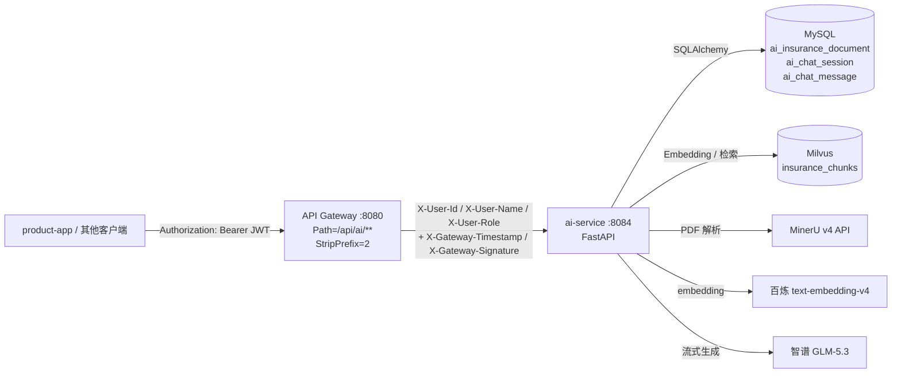
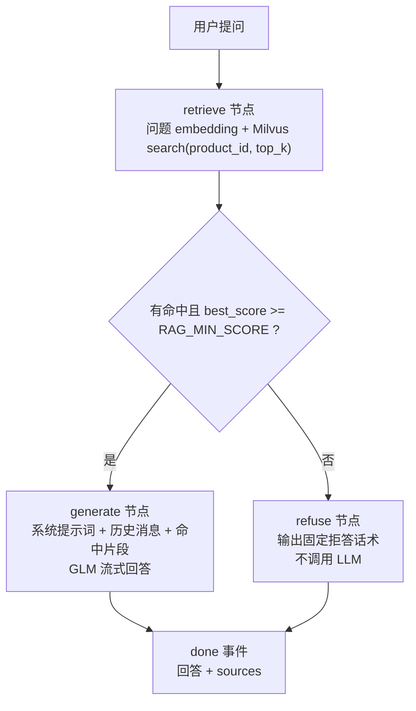

# AI 问答微服务（ai-service）

<cite>
**本文引用的文件**
- [ai-service/README.md](file://ai-service/README.md)
- [main.py](file://ai-service/app/main.py)
- [config.py](file://ai-service/app/config.py)
- [deps.py](file://ai-service/app/deps.py)
- [models.py](file://ai-service/app/models.py)
- [api/chat.py](file://ai-service/app/api/chat.py)
- [api/sessions.py](file://ai-service/app/api/sessions.py)
- [api/documents.py](file://ai-service/app/api/documents.py)
- [rag/graph.py](file://ai-service/app/rag/graph.py)
- [rag/ingest.py](file://ai-service/app/rag/ingest.py)
- [rag/mineru.py](file://ai-service/app/rag/mineru.py)
- [rag/vector_store.py](file://ai-service/app/rag/vector_store.py)
- [rag/prompts.py](file://ai-service/app/rag/prompts.py)
- [requirements.txt](file://ai-service/requirements.txt)
- [pytest.ini](file://ai-service/pytest.ini)
- [init-sql/03-insurance-agent.sql](file://init-sql/03-insurance-agent.sql)
</cite>

## 目录
1. [服务定位](#服务定位)
2. [技术栈与目录结构](#技术栈与目录结构)
3. [启动与集成方式](#启动与集成方式)
4. [接口与 SSE 协议](#接口与-sse-协议)
5. [RAG 与拒答策略](#rag-与拒答策略)
6. [数据模型](#数据模型)
7. [配置项](#配置项)
8. [测试与运维](#测试与运维)

## 服务定位

`ai-service` 是本仓库唯一的非 Java 服务：Python + FastAPI，默认端口 `8084`，为「保险商品」提供**严格限定在已上传条款 PDF 范围内**的问答能力，并附带会话管理与检查点回溯。

三条边界决定了它的设计：

1. **不直接面向前端**：浏览器只访问网关 `/api/ai/**`，由网关完成 JWT 校验并注入 `X-User-Id / X-User-Name / X-User-Role`（可选 HMAC 签名），ai-service 不解析 JWT。
2. **不编造**：检索无命中或相似度低于阈值时不调用大模型，直接返回固定拒答话术。
3. **知识按商品隔离**：向量库按 `product_id` 过滤检索，会话按 `user_id` 隔离，上传/重建/删除仅管理员。

## 技术栈与目录结构

| 能力 | 选型 |
| --- | --- |
| Web 框架 | FastAPI + Uvicorn（`StreamingResponse` 输出 SSE） |
| 编排 | LangChain + LangGraph（`StateGraph` + `InMemorySaver` 检查点） |
| 大模型 | 智谱 GLM（OpenAI 兼容协议），默认 `glm-5.3`，`temperature=0.2` |
| PDF 解析 | MinerU v4 精准解析，失败可降级 `pypdf` |
| Embedding | 阿里云百炼 `text-embedding-v4`（OpenAI 兼容模式，1024 维） |
| 向量库 | Milvus（pymilvus `MilvusClient`） |
| 业务库 | MySQL（SQLAlchemy，`ai_*` 三张表） |
| 观测 | LangSmith（有 Key 且 `LANGSMITH_TRACING=true` 才开启） |

```text
ai-service/
  app/
    main.py          # FastAPI 入口：lifespan 建表 + ensure_collection + 挂载路由 + CORS
    config.py        # pydantic-settings：进程环境 > ai-service/.env > 仓库根 .env
    deps.py          # 身份依赖：解析 X-User-*，可选 HMAC-SHA256 验签，require_admin
    db.py / models.py# SQLAlchemy SessionLocal 与三张表模型
    api/chat.py      # POST /chat（SSE）
    api/sessions.py  # 会话 CRUD + 检查点列表/回溯
    api/documents.py # PDF 上传（后台任务解析入库）/ 列表 / 重建 / 删除
    rag/mineru.py    # MinerU v4 批量解析 + pypdf 降级
    rag/ingest.py    # clean_markdown → 递归切分 → embedding → Milvus 写入
    rag/embeddings.py# 百炼 Embedding 封装
    rag/vector_store.py # 集合 ensure / upsert / delete / search
    rag/graph.py     # retrieve → generate | refuse
    rag/prompts.py   # 严格系统提示词 + 拒答话术
  scripts/make_sample_pdfs.py
  samples/           # 示例条款 PDF
  tests/             # pytest
  requirements.txt / pytest.ini / run.ps1 / README.md
```

**图表来源**
- [ai-service/README.md](file://ai-service/README.md)

## 启动与集成方式



**图表来源**
- [main.py](file://ai-service/app/main.py)
- [deps.py](file://ai-service/app/deps.py)
- [backend/ecommerce-gateway/src/main/resources/application.yml](file://backend/ecommerce-gateway/src/main/resources/application.yml)

启动（`run.ps1` 等价于 uvicorn 命令）：

```powershell
cd ai-service
python -m venv .venv
.\.venv\Scripts\python.exe -m pip install -r requirements.txt
.\run.ps1
```

`lifespan` 做三件事：注入 LangSmith 环境变量 → `init_db()` 建表 → `ensure_collection()` 初始化 Milvus 集合（失败只告警，服务仍启动，便于先联调前端）。健康检查 `GET /health` 返回 `status / service / model / milvus / collection`。

网关侧路由为 `Path=/api/ai/**`、`StripPrefix=2`，即 `/api/ai/chat` → `/chat`；网关 `spring.codec.max-in-memory-size: 16MB` 用于容纳 PDF multipart 与 SSE 响应。

## 接口与 SSE 协议

| 方法 | 路径（网关前缀 `/api/ai`） | 权限 | 说明 |
| --- | --- | --- | --- |
| POST | `/chat` | 登录 | SSE 流式问答，body `{sessionId, productId, message}` |
| POST | `/sessions` | 登录 | 新建会话（`productId`） |
| GET | `/sessions?productId=` | 登录 | 当前用户在该商品下的会话列表 |
| GET | `/sessions/{id}/messages` | 会话属主 | 历史消息（含 `sources`） |
| DELETE | `/sessions/{id}` | 会话属主 | 删除会话与消息 |
| GET | `/sessions/{id}/checkpoints` | 会话属主 | 检查点列表（回溯入口） |
| POST | `/sessions/{id}/restore` | 会话属主 | 回溯到指定 `checkpointId` |
| POST | `/documents/upload` | ADMIN | multipart：`productId` + `file`（PDF ≤ 20MB） |
| GET | `/documents?productId=` | 登录 | 文档列表与解析状态 |
| POST | `/documents/{id}/reindex` | ADMIN | 重新解析入库（PDF 丢失返回 409） |
| DELETE | `/documents/{id}` | ADMIN | 删除文档、向量与文件 |

SSE 帧格式 `event: <name>\ndata: <json>\n\n`，事件序列：

```text
meta   → {"sessionId": "..."}                  # 首帧回传会话 ID
token  → {"text": "增量文本"}                   # 可多次；拒答分支一次性下发整句
done   → {"sessionId","refused","sources"}     # 正常结束（sources 为引用片段数组）
error  → {"message": "生成回答失败: ..."}       # 异常结束，仅落库用户提问
```

实现要点：

- `graph.astream(inputs, config, stream_mode=["messages", "updates"])`：`messages` 只取 `langgraph_node == "generate"` 的增量文本，`updates` 用于收集 `sources` / `refused`。
- 回答为空时兜底输出拒答话术并置 `refused=true`。
- 正常结束时 `_persist_turn()` 落库用户提问与助手回答（含 `sources` JSON）；异常时只落库提问，避免产生半截回答。
- 会话与商品不匹配返回 400，非属主访问统一 404（不泄露会话是否存在）。

## RAG 与拒答策略



**图表来源**
- [rag/graph.py](file://ai-service/app/rag/graph.py)
- [rag/prompts.py](file://ai-service/app/rag/prompts.py)

- **入库**：`MinerU v4`（`/file-urls/batch` 取预签名 PUT → 轮询 `/extract-results/batch` → 下载 `full_zip_url` 取 `full.md`）→ `clean_markdown` → `RecursiveCharacterTextSplitter(chunk_size=800, chunk_overlap=120, separators 含中文标点)` → 百炼 Embedding → `replace_document_chunks()`（先按 `doc_id` 删旧向量再 `upsert` + `flush`）。
- **门控**：`rag_min_score` 默认 0.35；检索异常也按拒答处理（`best_score=0.0`），保证失败可复现、不胡编。
- **生成**：系统提示词约束「只用文档片段、标注来源、片段不足必须原样输出拒答话术、禁止使用自身知识或推测」；若模型输出恰等于拒答话术，则清空 `sources` 并置 `refused=true`。
- **多轮与回溯**：`InMemorySaver` 检查点，`thread_id = u{userId}:p{productId}:s{sessionId}`；服务重启后检查点丢失，`POST /sessions/{id}/restore` 返回 409，已落库消息仍可查看；回溯后下一轮会在落库时清空 `last_checkpoint_id`，避免持续从旧状态分叉。

## 数据模型

`init-sql/03-insurance-agent.sql` 提供幂等 DDL（ai-service 启动时也会 `create_all`）：

| 表 | 关键字段 | 说明 |
| --- | --- | --- |
| `ai_insurance_document` | `id`(UUID hex)、`product_id`、`filename`、`file_path`、`file_size`、`status`(processing/ready/failed)、`mineru_batch_id`、`chunk_count`、`error_message`、`created_by` | 知识库文档与解析状态 |
| `ai_chat_session` | `id`、`user_id`、`product_id`、`title`、`last_checkpoint_id` | 会话（按 user + product 建索引） |
| `ai_chat_message` | `id`、`session_id`、`role`(user/assistant)、`content`、`sources`(JSON) | 消息与引用片段 |

**章节来源**
- [models.py](file://ai-service/app/models.py)
- [init-sql/03-insurance-agent.sql](file://init-sql/03-insurance-agent.sql)

## 配置项

配置加载顺序：**进程环境变量 > `ai-service/.env` > 仓库根 `.env`**；仓库只保留 `.env.example`（无真实密钥）。

| 分组 | 变量 | 说明 |
| --- | --- | --- |
| 模型 | `ZHIPU_API_KEY` / `ZHIPU_BASE_URL` / `ZHIPU_MODEL` / `ZHIPU_TEMPERATURE` / `ZHIPU_MAX_TOKENS` | 智谱 GLM，默认 `glm-5.3` |
| 解析 | `MINERU_API_TOKEN` / `MINERU_BASE_URL` / `MINERU_MODEL_VERSION` / `MINERU_FALLBACK_PYPDF` / `MINERU_TIMEOUT_SECONDS` / `MINERU_POLL_INTERVAL_SECONDS` | MinerU v4，失败可降级 pypdf |
| 向量 | `DASHSCOPE_API_KEY` / `DASHSCOPE_BASE_URL` / `EMBEDDING_MODEL` / `EMBEDDING_DIM` | 百炼 `text-embedding-v4`、1024 维 |
| Milvus | `MILVUS_URI` / `MILVUS_TOKEN` / `MILVUS_COLLECTION` | 默认 `insurance_chunks` |
| 业务库 | `AI_MYSQL_URL` | 默认同电商库 `qoder_fullstack`（使用 `ai_*` 表） |
| RAG | `CHUNK_SIZE` / `CHUNK_OVERLAP` / `RAG_TOP_K` / `RAG_MIN_SCORE` / `REFUSAL_MESSAGE` | 切分与检索门控 |
| 上传与安全 | `DATA_DIR` / `MAX_PDF_MB` / `GATEWAY_JWT_SECRET` / `VERIFY_GATEWAY_SIGNATURE` / `GATEWAY_MAX_SKEW_SECONDS` | `verify_gateway_signature=true` 时校验 `userId|username|role|timestamp` 的 HMAC 与时间偏移 |
| 观测 | `LANGSMITH_TRACING` / `LANGCHAIN_ENDPOINT` / `LANGCHAIN_API_KEY` / `LANGCHAIN_PROJECT` | 填 Key 且开启开关才埋点 |

## 测试与运维

```powershell
cd ai-service
.\.venv\Scripts\python.exe -m pytest tests -q
```

`pytest.ini` 配置 asyncio 模式；测试使用 sqlite 与假的向量库/LLM 实现，覆盖：

- 切分参数（800/120）与中文分隔符；
- 检索无命中 / 低分 → 走 `refuse` 且 LLM 未被调用；
- 上传非 PDF、超限、非管理员被拒；
- 会话跨用户 404、会话与商品不匹配 400；
- SSE 帧格式（`meta`/`token`/`done`）与消息落库；
- 检查点回溯成功与「重启后 409」分支。

常见运维问题（详见 `ai-service/README.md`）：

| 现象 | 处理 |
| --- | --- |
| 上传后状态 `failed` | 展开失败行看 `error_message`：多为 MinerU Token/额度、网络、PDF 为扫描件 |
| 检索一直拒答 | 确认文档 `ready`、Milvus 可达、`RAG_MIN_SCORE` 是否过高（可降到 0.25） |
| 模型未开通 | 调整 `ZHIPU_MODEL`（如 `glm-5.3-flash`）后重启 |
| 回溯返回 409 | `InMemorySaver` 重启即失效，属预期行为 |
| 网关 413 / 内存不足 | 确认网关 `spring.codec.max-in-memory-size: 16MB` 且已重启 |

**章节来源**
- [pytest.ini](file://ai-service/pytest.ini)
- [ai-service/README.md](file://ai-service/README.md)