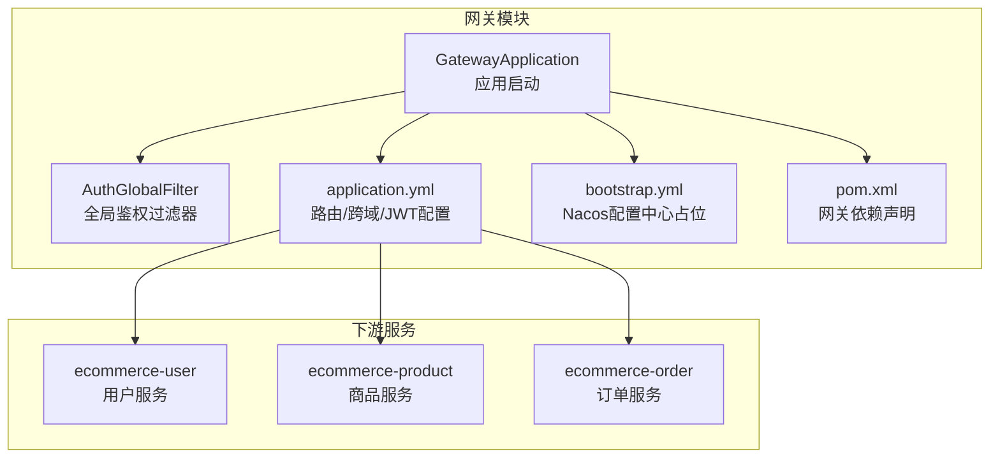
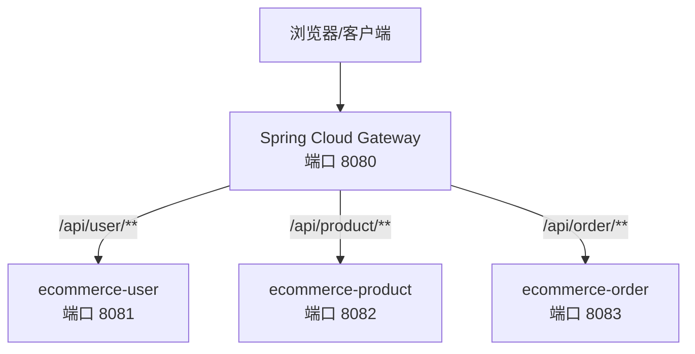
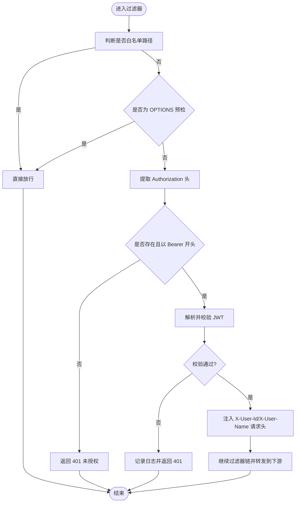
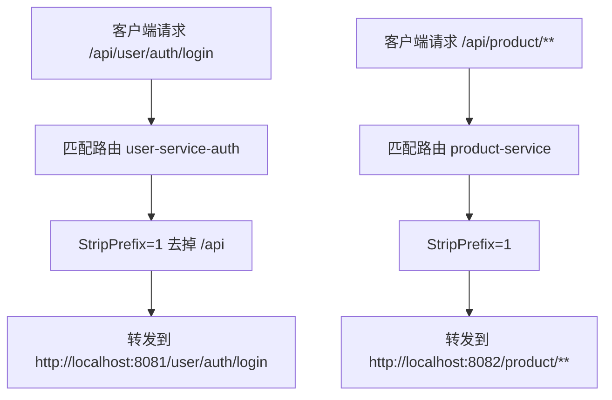
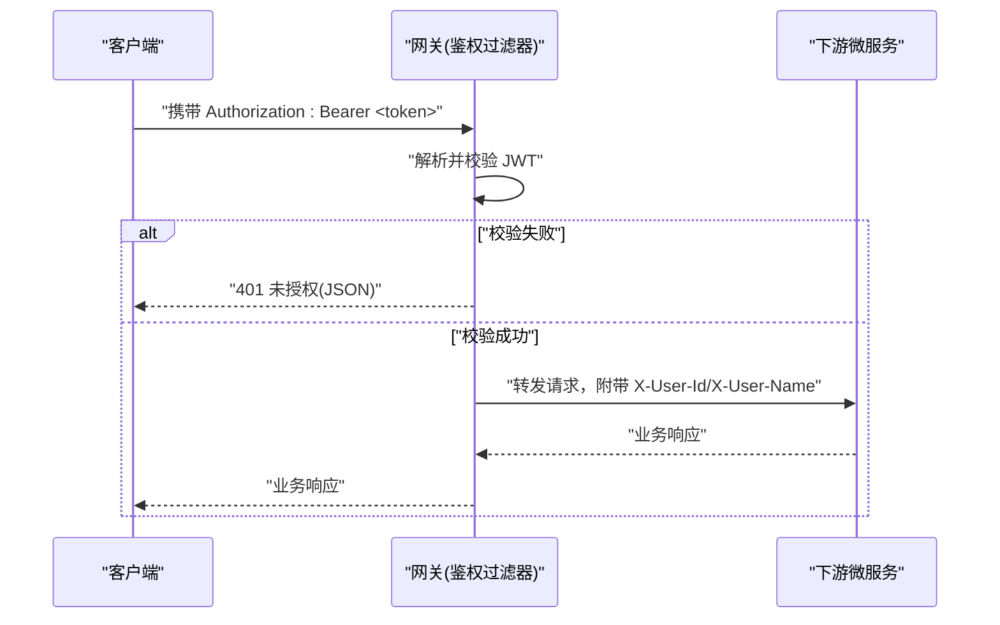
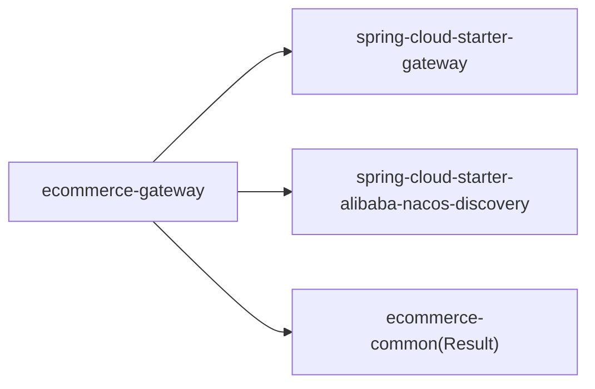

# API 网关

<cite>
**本文引用的文件**   
- [GatewayApplication.java](file://backend/ecommerce-gateway/src/main/java/com/ecommerce/gateway/GatewayApplication.java)
- [AuthGlobalFilter.java](file://backend/ecommerce-gateway/src/main/java/com/ecommerce/gateway/filter/AuthGlobalFilter.java)
- [application.yml](file://backend/ecommerce-gateway/src/main/resources/application.yml)
- [bootstrap.yml](file://backend/ecommerce-gateway/src/main/resources/bootstrap.yml)
- [pom.xml（网关模块）](file://backend/ecommerce-gateway/pom.xml)
- [JwtTokenProvider.java](file://backend/ecommerce-user/src/main/java/com/ecommerce/user/security/JwtTokenProvider.java)
- [README.md](file://README.md)
</cite>

## 目录
1. [简介](#简介)
2. [项目结构](#项目结构)
3. [核心组件](#核心组件)
4. [架构总览](#架构总览)
5. [详细组件分析](#详细组件分析)
6. [依赖关系分析](#依赖关系分析)
7. [性能与优化](#性能与优化)
8. [故障排查指南](#故障排查指南)
9. [结论](#结论)

## 简介
本章节面向 API 网关的读者，说明该网关在电商微服务中的职责：统一入口、路由转发、跨域处理、JWT 鉴权、以及为下游服务透传用户身份。文档将围绕启动类、全局过滤器、路由配置、安全机制、限流策略、监控日志、集成方式与性能优化展开，并给出架构图、过滤器链流程图和路由示例。

## 项目结构
API 网关位于后端模块 ecommerce-gateway，采用 Spring Cloud Gateway + WebFlux 的非阻塞模型；通过 application.yml 定义端口、Nacos 注册发现、全局跨域、路由规则与 Swagger 聚合；通过 bootstrap.yml 预留 Nacos 配置中心接入点；通过 pom.xml 引入网关、Nacos 与公共 Result 类型。

图表来源
- [GatewayApplication.java:1-16](file://backend/ecommerce-gateway/src/main/java/com/ecommerce/gateway/GatewayApplication.java#L1-L16)
- [AuthGlobalFilter.java:1-170](file://backend/ecommerce-gateway/src/main/java/com/ecommerce/gateway/filter/AuthGlobalFilter.java#L1-L170)
- [application.yml:1-131](file://backend/ecommerce-gateway/src/main/resources/application.yml#L1-L131)
- [bootstrap.yml:1-10](file://backend/ecommerce-gateway/src/main/resources/bootstrap.yml#L1-L10)
- [pom.xml（网关模块）:1-35](file://backend/ecommerce-gateway/pom.xml#L1-L35)

章节来源
- [GatewayApplication.java:1-16](file://backend/ecommerce-gateway/src/main/java/com/ecommerce/gateway/GatewayApplication.java#L1-L16)
- [application.yml:1-131](file://backend/ecommerce-gateway/src/main/resources/application.yml#L1-L131)
- [bootstrap.yml:1-10](file://backend/ecommerce-gateway/src/main/resources/bootstrap.yml#L1-L10)
- [pom.xml（网关模块）:1-35](file://backend/ecommerce-gateway/pom.xml#L1-L35)

## 核心组件
- 启动类 GatewayApplication：使用 @SpringBootApplication 启动 Spring Boot 应用，加载网关相关自动配置。
- 全局过滤器 AuthGlobalFilter：实现 GlobalFilter 与 Ordered，负责白名单放行、OPTIONS 预检放行、Authorization Bearer Token 解析与校验、失败时返回统一 JSON 错误、成功时将 userId 与 username 注入请求头传递给下游。
- 路由与跨域配置 application.yml：定义全局 CORS、按服务前缀的路由规则、StripPrefix 过滤、Swagger UI 与 OpenAPI 文档聚合。
- JWT 密钥配置：jwt.secret 与用户服务保持一致，用于网关侧校验 Token。

章节来源
- [GatewayApplication.java:1-16](file://backend/ecommerce-gateway/src/main/java/com/ecommerce/gateway/GatewayApplication.java#L1-L16)
- [AuthGlobalFilter.java:1-170](file://backend/ecommerce-gateway/src/main/java/com/ecommerce/gateway/filter/AuthGlobalFilter.java#L1-L170)
- [application.yml:1-131](file://backend/ecommerce-gateway/src/main/resources/application.yml#L1-L131)

## 架构总览
网关作为统一入口，对外暴露 /api/user/**、/api/product/**、/api/order/** 等路径，内部根据路由规则转发到对应微服务。所有请求在进入业务路由前，先经过全局鉴权过滤器进行 JWT 校验。

图表来源
- [application.yml:22-110](file://backend/ecommerce-gateway/src/main/resources/application.yml#L22-L110)
- [README.md:16-47](file://README.md#L16-L47)

## 详细组件分析

### 启动类 GatewayApplication
- 作用：作为 Spring Boot 应用的入口，启用自动装配，加载网关依赖与配置。
- 关键点：无额外自定义逻辑，依赖外部配置文件完成路由、跨域、鉴权等能力。

章节来源
- [GatewayApplication.java:1-16](file://backend/ecommerce-gateway/src/main/java/com/ecommerce/gateway/GatewayApplication.java#L1-L16)

### 全局鉴权过滤器 AuthGlobalFilter
- 职责
  - 白名单路径直接放行（登录、注册、验证码、短信发送、健康检查）。
  - OPTIONS 预检请求放行，配合全局跨域配置。
  - 从 Authorization: Bearer token 提取 JWT。
  - 使用 HS256 与 jwt.secret 校验签名与有效期。
  - 校验通过后，将 X-User-Id、X-User-Name 写入请求头，透传给下游服务。
  - 校验失败返回 401 的统一 JSON 响应。
- 执行顺序
  - 实现 Ordered，order = -100，保证在多数默认过滤器之前执行。
- 关键数据结构
  - 白名单列表：精确匹配路径。
  - 白名单前缀列表：匹配 Swagger UI 与 OpenAPI 文档路径。
  - 常量：Bearer 前缀、用户 ID/名称请求头名。
- 异常处理
  - 过期：记录警告日志，返回“Token 已过期”。
  - 无效：记录警告日志，返回“Token 无效”。
  - 其他异常：记录错误日志，返回“认证失败”。

图表来源
- [AuthGlobalFilter.java:80-146](file://backend/ecommerce-gateway/src/main/java/com/ecommerce/gateway/filter/AuthGlobalFilter.java#L80-L146)

章节来源
- [AuthGlobalFilter.java:1-170](file://backend/ecommerce-gateway/src/main/java/com/ecommerce/gateway/filter/AuthGlobalFilter.java#L1-L170)

### 路由规则与跨域处理
- 全局跨域
  - 允许任意来源、方法、头部，支持凭据，缓存预检结果。
- 路由分发
  - 用户服务：/api/user/auth/**、/api/user/users/**、/api/user/sms/**、/api/user/health
  - 商品服务：/api/product/**
  - 订单服务：/api/order/**
  - 各路由均使用 StripPrefix=1，去除 /api 前缀后转发至下游服务。
- Swagger 聚合
  - 网关自身提供 /swagger-ui.html，聚合用户、商品、订单服务的 OpenAPI 文档。
  - 同时为各服务提供 /swagger-ui/** 与 /v3/api-docs/** 的路由转发。

图表来源
- [application.yml:22-110](file://backend/ecommerce-gateway/src/main/resources/application.yml#L22-L110)

章节来源
- [application.yml:1-131](file://backend/ecommerce-gateway/src/main/resources/application.yml#L1-L131)

### 负载均衡策略
- 当前路由配置使用固定 URI（http://localhost:808x），未启用基于服务名的动态负载均衡。
- 若需多实例负载均衡，可将 uri 改为 lb://service-name 形式，并结合 Nacos 服务发现与 Spring Cloud LoadBalancer。
- 注意：当前 pom 中网关模块未显式引入 loadbalancer 依赖，如需启用请按需添加。

章节来源
- [application.yml:22-110](file://backend/ecommerce-gateway/src/main/resources/application.yml#L22-L110)
- [pom.xml（网关模块）:1-35](file://backend/ecommerce-gateway/pom.xml#L1-L35)

### 安全机制与令牌流转
- 令牌生成
  - 用户服务 JwtTokenProvider 使用 HS256 算法，subject 存放用户名，附加 uid claim，设置过期时间。
- 令牌校验
  - 网关 AuthGlobalFilter 使用相同 jwt.secret 解析并校验签名与有效期。
- 身份透传
  - 校验成功后，网关将 userId 与 username 写入请求头 X-User-Id、X-User-Name，下游服务可从请求头获取当前用户信息。

图表来源
- [AuthGlobalFilter.java:95-126](file://backend/ecommerce-gateway/src/main/java/com/ecommerce/gateway/filter/AuthGlobalFilter.java#L95-L126)
- [JwtTokenProvider.java:34-57](file://backend/ecommerce-user/src/main/java/com/ecommerce/user/security/JwtTokenProvider.java#L34-L57)

章节来源
- [AuthGlobalFilter.java:1-170](file://backend/ecommerce-gateway/src/main/java/com/ecommerce/gateway/filter/AuthGlobalFilter.java#L1-L170)
- [JwtTokenProvider.java:1-76](file://backend/ecommerce-user/src/main/java/com/ecommerce/user/security/JwtTokenProvider.java#L1-L76)

### 限流策略
- 当前仓库未在网关中实现限流逻辑。
- 建议方案
  - 基于 Redis + Lua 的令牌桶或漏桶算法，结合全局过滤器实现。
  - 或使用 Spring Cloud Gateway 内置的 RequestRateLimiter（需引入相应依赖并配置 Redis）。
- 实施要点
  - 在 AuthGlobalFilter 之后增加限流过滤器，按 IP、用户 ID 或接口维度限制。
  - 对高频接口（如短信验证码、登录）单独设置更严格的阈值。

[本节为通用建议，不直接分析具体文件]

### 监控与日志
- 鉴权过滤器内使用 SLF4J 记录警告与错误日志，便于定位 Token 过期、无效及异常。
- 建议在网关层统一输出访问日志（请求路径、耗时、状态码、上游服务、用户标识），便于链路追踪。
- 可结合 Micrometer、Prometheus、ELK 等工具采集指标与日志。

章节来源
- [AuthGlobalFilter.java:128-140](file://backend/ecommerce-gateway/src/main/java/com/ecommerce/gateway/filter/AuthGlobalFilter.java#L128-L140)

## 依赖关系分析
- 网关模块依赖
  - spring-cloud-starter-gateway：网关核心能力。
  - spring-cloud-starter-alibaba-nacos-discovery：Nacos 服务注册与发现。
  - ecommerce-common：统一 Result 返回体。
- 运行时依赖
  - application.yml 中启用了 Nacos 发现（server-addr 指向 192.168.178.100:8848）。
  - bootstrap.yml 预留了 Nacos 配置中心开关（当前禁用）。

图表来源
- [pom.xml（网关模块）:17-35](file://backend/ecommerce-gateway/pom.xml#L17-L35)
- [application.yml:7-11](file://backend/ecommerce-gateway/src/main/resources/application.yml#L7-L11)

章节来源
- [pom.xml（网关模块）:1-35](file://backend/ecommerce-gateway/pom.xml#L1-L35)
- [application.yml:1-131](file://backend/ecommerce-gateway/src/main/resources/application.yml#L1-L131)

## 性能与优化
- 非阻塞 I/O
  - 网关基于 WebFlux，适合高并发场景。
- 过滤器链优化
  - 将鉴权过滤器置于靠前位置（order=-100），尽早拦截非法请求，减少下游压力。
- 跨域预检缓存
  - 配置 maxAge 缓存预检结果，减少重复 OPTIONS 请求。
- 路由优化
  - 使用精确的 Path 前缀匹配，避免不必要的正则匹配开销。
- 连接池与超时
  - 合理配置 Netty 线程池、连接池大小与下游服务超时时间。
- 缓存与降级
  - 对热点只读接口考虑在网关层加缓存（如 Redis），并对不可用下游做快速失败与降级响应。

[本节为通用建议，不直接分析具体文件]

## 故障排查指南
- 401 未授权
  - 检查 Authorization 头是否正确携带 Bearer token。
  - 核对 jwt.secret 是否与用户服务一致。
  - 查看过滤器日志中“Token 已过期”“Token 无效”提示。
- 路由不生效
  - 确认请求路径与 application.yml 中 predicates 匹配。
  - 检查 StripPrefix 配置是否符合下游服务期望路径。
- 跨域问题
  - 确认前端请求包含凭据时 allowCredentials=true。
  - 检查 allowedOriginPatterns 是否包含前端域名。
- 下游服务不可达
  - 检查 application.yml 中 uri 地址与端口是否正确。
  - 若启用 Nacos 动态路由，检查服务注册与健康状态。

章节来源
- [AuthGlobalFilter.java:95-140](file://backend/ecommerce-gateway/src/main/java/com/ecommerce/gateway/filter/AuthGlobalFilter.java#L95-L140)
- [application.yml:12-21](file://backend/ecommerce-gateway/src/main/resources/application.yml#L12-L21)
- [application.yml:22-110](file://backend/ecommerce-gateway/src/main/resources/application.yml#L22-L110)

## 结论
该 API 网关通过 Spring Cloud Gateway 提供了统一入口、路由转发、跨域处理与 JWT 鉴权能力。AuthGlobalFilter 实现了严格的令牌校验与用户身份透传，application.yml 定义了清晰的服务路由与 Swagger 聚合。当前版本未实现限流与动态负载均衡，可按需扩展。建议在生产环境完善限流、监控与链路追踪，以提升系统的安全性与可观测性。