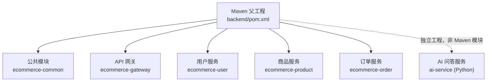
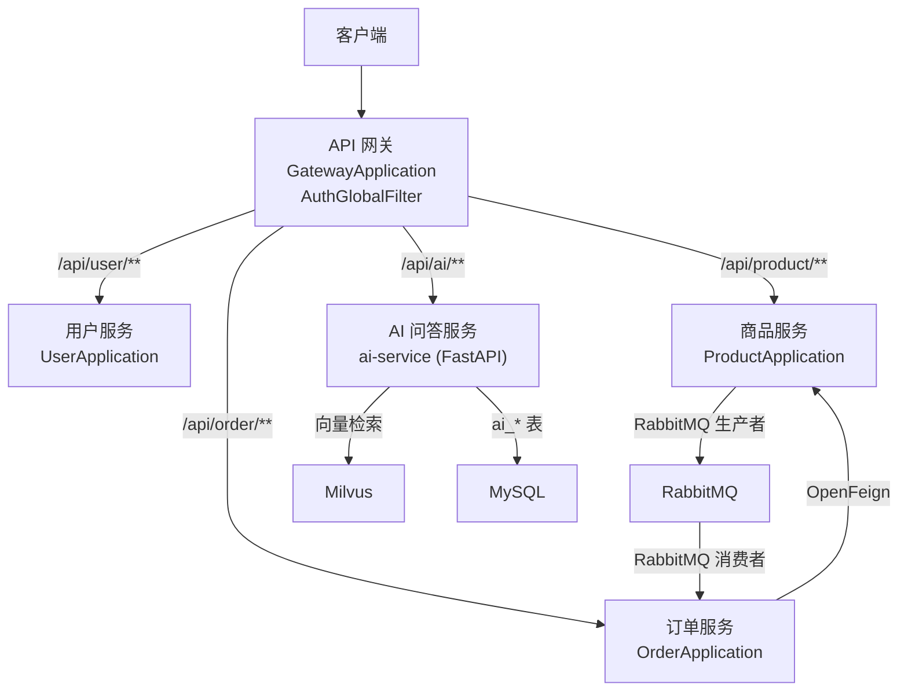
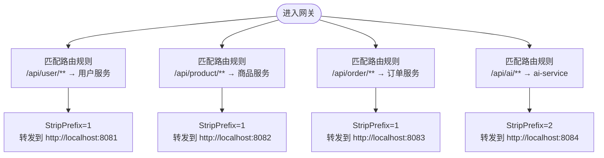
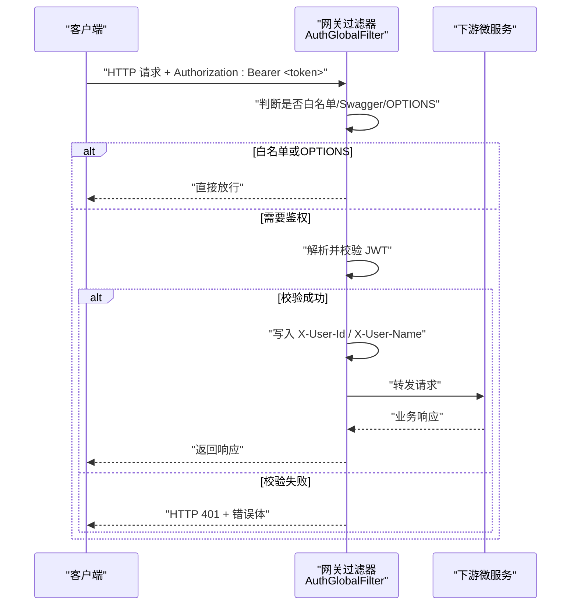
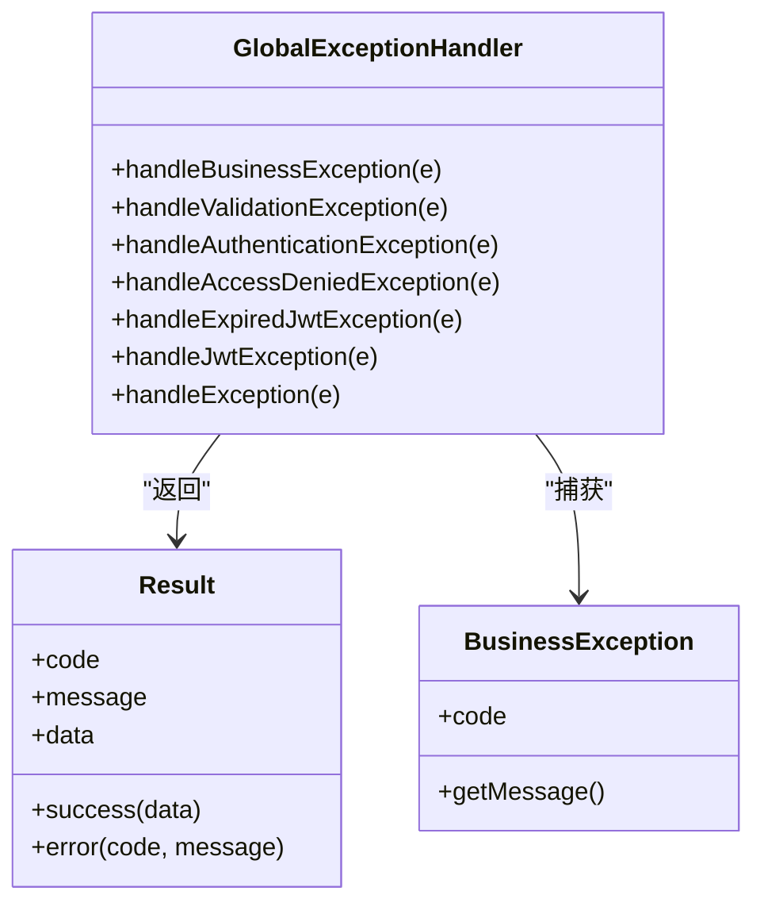
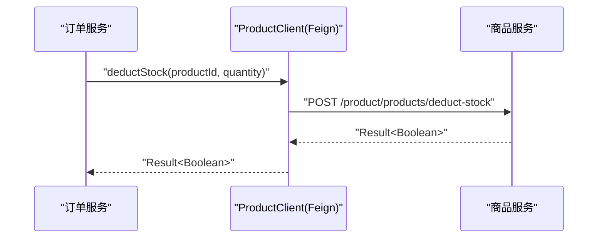
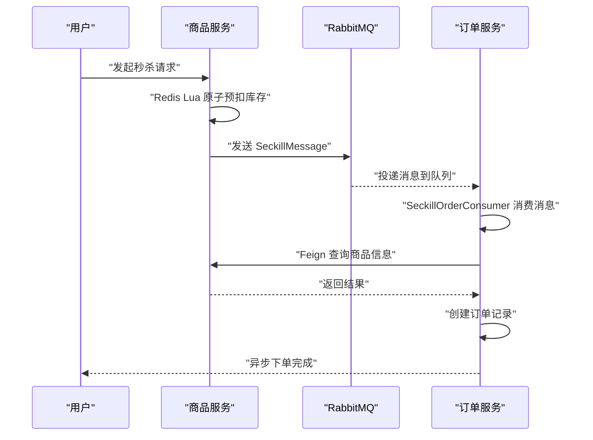
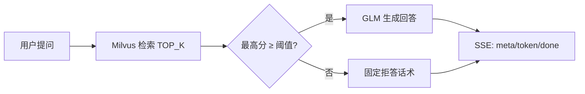
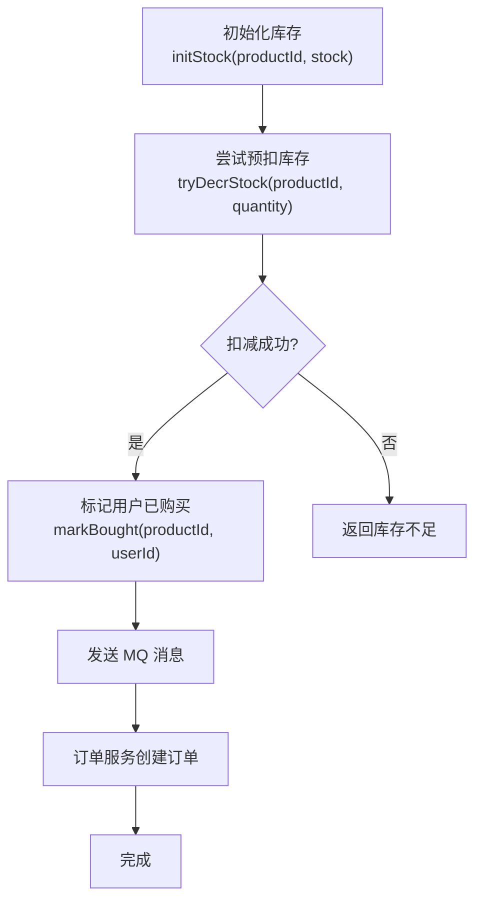
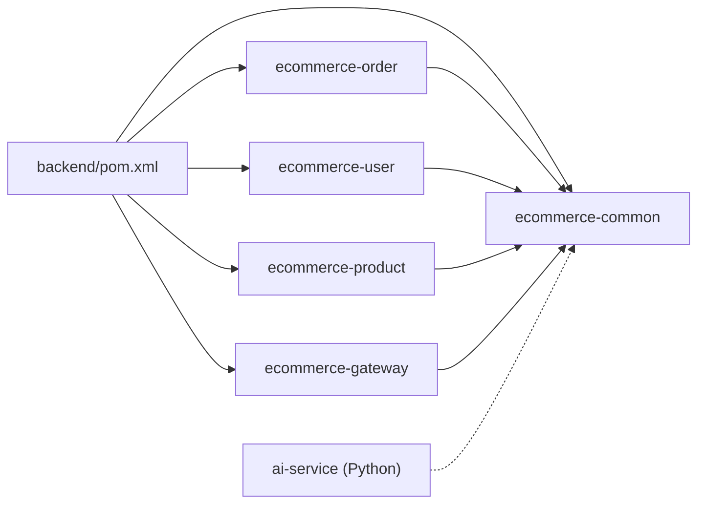

# 后端架构设计

<cite>
**本文引用的文件**   
- [README.md](file://README.md)
- [backend/pom.xml](file://backend/pom.xml)
- [ecommerce-gateway/GatewayApplication.java](file://backend/ecommerce-gateway/src/main/java/com/ecommerce/gateway/GatewayApplication.java)
- [ecommerce-gateway/application.yml](file://backend/ecommerce-gateway/src/main/resources/application.yml)
- [ecommerce-gateway/AuthGlobalFilter.java](file://backend/ecommerce-gateway/src/main/java/com/ecommerce/gateway/filter/AuthGlobalFilter.java)
- [ecommerce-common/Result.java](file://backend/ecommerce-common/src/main/java/com/ecommerce/common/Result.java)
- [ecommerce-common/BusinessException.java](file://backend/ecommerce-common/src/main/java/com/ecommerce/common/BusinessException.java)
- [ecommerce-common/GlobalExceptionHandler.java](file://backend/ecommerce-common/src/main/java/com/ecommerce/common/GlobalExceptionHandler.java)
- [ecommerce-user/UserApplication.java](file://backend/ecommerce-user/src/main/java/com/ecommerce/user/UserApplication.java)
- [ecommerce-product/ProductApplication.java](file://backend/ecommerce-product/src/main/java/com/ecommerce/product/ProductApplication.java)
- [ecommerce-order/OrderApplication.java](file://backend/ecommerce-order/src/main/java/com/ecommerce/order/OrderApplication.java)
- [ecommerce-order/ProductClient.java](file://backend/ecommerce-order/src/main/java/com/ecommerce/order/client/ProductClient.java)
- [ecommerce-order/SeckillOrderConsumer.java](file://backend/ecommerce-order/src/main/java/com/ecommerce/order/consumer/SeckillOrderConsumer.java)
- [ecommerce-product/SeckillStockService.java](file://backend/ecommerce-product/src/main/java/com/ecommerce/product/service/SeckillStockService.java)
- [ai-service/main.py](file://ai-service/app/main.py)
- [ai-service/rag/graph.py](file://ai-service/app/rag/graph.py)
- [docker-compose.milvus.yml](file://docker-compose.milvus.yml)
</cite>

## 目录
1. [引言](#引言)
2. [项目结构](#项目结构)
3. [核心组件](#核心组件)
4. [架构总览](#架构总览)
5. [详细组件分析](#详细组件分析)
6. [依赖关系分析](#依赖关系分析)
7. [性能与扩展性](#性能与扩展性)
8. [新增微服务规范](#新增微服务规范)
9. [故障排查指南](#故障排查指南)
10. [结论](#结论)

## 引言
本仓库是一个前后端分离的电商示例系统，后端采用 Spring Cloud 微服务架构，包含 API 网关、用户服务、商品服务、订单服务以及公共模块。系统通过 Nacos 进行服务发现与配置管理，使用 OpenFeign 实现同步服务调用，使用 RabbitMQ 实现秒杀场景下的异步解耦；统一异常处理、JWT 鉴权、Swagger 文档聚合等横切能力由公共模块和网关提供。

除 Java 微服务外，仓库还包含独立的 Python 服务 ai-service（FastAPI + LangChain/LangGraph）。它由网关以 `/api/ai/**` 前缀转发，向量库存放保险条款切片（Milvus），业务数据写入 MySQL 的 `ai_*` 表，通过 SSE 为前端保险咨询机器人提供流式回答。商品服务还提供图片上传（OSS/本地兜底），订单服务提供支付宝沙箱支付。前端基于 qiankun 微前端框架，但本文聚焦后端架构设计与实现细节。

## 项目结构
后端采用 Maven 多模块工程，父 POM 统一管理 Spring Boot、Spring Cloud、Spring Cloud Alibaba、JWT、OpenAPI 等版本，并声明子模块：公共模块、网关、用户、商品、订单。各微服务独立启动，对外暴露 REST 接口，内部通过 Feign 与 MQ 协作。ai-service 是仓库内的 Python 工程（`ai-service/`，requirements.txt + pytest），不参与 Maven 构建，通过 HTTP/SSE 经网关对外提供服务。

**图示来源**
- [backend/pom.xml:21-27](file://backend/pom.xml#L21-L27)

**章节来源**
- [backend/pom.xml:1-65](file://backend/pom.xml#L1-L65)
- [README.md:3-14](file://README.md#L3-L14)

## 核心组件
- 公共模块 ecommerce-common：统一响应 Result、业务异常 BusinessException、全局异常处理器 GlobalExceptionHandler、秒杀消息体 SeckillMessage。
- API 网关 ecommerce-gateway：Spring Cloud Gateway，负责跨域、路由转发、JWT 全局鉴权、Swagger 文档聚合。
- 用户服务 ecommerce-user：认证、用户管理、短信验证码、图片验证码、主题偏好。
- 商品服务 ecommerce-product：商品 CRUD、Elasticsearch 搜索、秒杀库存预扣（Redis + Lua）、RabbitMQ 生产者；图片上传支持 OSS 与本地兜底两种存储。
- 订单服务 ecommerce-order：订单 CRUD、OpenFeign 调用商品服务、RabbitMQ 消费者创建秒杀订单；支付宝沙箱支付（创建支付 / 异步通知 / 主动查询，幂等靠条件更新）。
- AI 问答微服务 ai-service：Python + FastAPI + LangChain/LangGraph，PDF 知识库构建、Milvus 向量检索、SSE 流式问答、会话与检查点；业务数据与商品/订单共享 MySQL 实例但使用独立的 `ai_*` 表。

**章节来源**
- [ecommerce-common/Result.java:1-64](file://backend/ecommerce-common/src/main/java/com/ecommerce/common/Result.java#L1-L64)
- [ecommerce-common/BusinessException.java:1-23](file://backend/ecommerce-common/src/main/java/com/ecommerce/common/BusinessException.java#L1-L23)
- [ecommerce-common/GlobalExceptionHandler.java:1-74](file://backend/ecommerce-common/src/main/java/com/ecommerce/common/GlobalExceptionHandler.java#L1-L74)
- [ecommerce-gateway/GatewayApplication.java:1-16](file://backend/ecommerce-gateway/src/main/java/com/ecommerce/gateway/GatewayApplication.java#L1-L16)
- [ecommerce-user/UserApplication.java:1-21](file://backend/ecommerce-user/src/main/java/com/ecommerce/user/UserApplication.java#L1-L21)
- [ecommerce-product/ProductApplication.java:1-18](file://backend/ecommerce-product/src/main/java/com/ecommerce/product/ProductApplication.java#L1-L18)
- [ecommerce-order/OrderApplication.java:1-20](file://backend/ecommerce-order/src/main/java/com/ecommerce/order/OrderApplication.java#L1-L20)

## 架构总览
整体请求链路：前端或外部客户端访问网关 8080，网关按路径前缀路由到下游微服务；网关在过滤器中校验 JWT，通过后注入用户信息头；下游服务读取该头完成信任鉴权；商品与订单之间通过 OpenFeign 同步调用，秒杀下单通过 RabbitMQ 异步解耦。网关同时维护 Redis 会话校验（`login:token:{userId}`），失效时返回业务码 40101 驱动前端退出；对 `/api/ai/**` 采用 StripPrefix=2 转发到 Python 服务，并附 HMAC 签名头供下游验签。

**图示来源**
- [ecommerce-gateway/GatewayApplication.java:1-16](file://backend/ecommerce-gateway/src/main/java/com/ecommerce/gateway/GatewayApplication.java#L1-L16)
- [ecommerce-gateway/AuthGlobalFilter.java:31-42](file://backend/ecommerce-gateway/src/main/java/com/ecommerce/gateway/filter/AuthGlobalFilter.java#L31-L42)
- [ecommerce-order/OrderApplication.java:10-13](file://backend/ecommerce-order/src/main/java/com/ecommerce/order/OrderApplication.java#L10-L13)
- [ecommerce-order/ProductClient.java:11-19](file://backend/ecommerce-order/src/main/java/com/ecommerce/order/client/ProductClient.java#L11-L19)
- [ecommerce-order/SeckillOrderConsumer.java:18-22](file://backend/ecommerce-order/src/main/java/com/ecommerce/order/consumer/SeckillOrderConsumer.java#L18-L22)

## 详细组件分析

### API 网关与路由规则
- 网关启动类为 GatewayApplication，端口 8080，启用 Spring Cloud Gateway。
- application.yml 中定义全局 CORS 策略与各服务的路由规则，使用 StripPrefix=1 去除 /api 前缀后转发至下游服务。
- `/api/ai/**` 是例外：指向 ai-service 的 8084 端口，使用 StripPrefix=2 同时去掉 `/api/ai` 两段；网关 `spring.codec.max-in-memory-size` 调到 16MB，避免知识库上传/长文本响应触发缓冲上限。
- 白名单除登录、注册、验证码、Swagger 外，还包含支付宝异步通知 `/api/order/payments/alipay/notify` 与本地图片静态资源 `/api/product/files/local`。
- 内部接口（扣减库存、秒杀回滚）通过 INTERNAL_ONLY 规则限制：只接受来自服务间的调用，外部请求一律拒绝。
- Swagger UI 与 v3/api-docs 均单独配置路由，便于聚合文档展示。

**图示来源**
- [ecommerce-gateway/application.yml:22-67](file://backend/ecommerce-gateway/src/main/resources/application.yml#L22-L67)

**章节来源**
- [ecommerce-gateway/GatewayApplication.java:1-16](file://backend/ecommerce-gateway/src/main/java/com/ecommerce/gateway/GatewayApplication.java#L1-L16)
- [ecommerce-gateway/application.yml:1-131](file://backend/ecommerce-gateway/src/main/resources/application.yml#L1-L131)

### 全局过滤器与 JWT 鉴权
- AuthGlobalFilter 实现 GlobalFilter 与 Ordered，优先级 -100，先于其他过滤器执行。
- 白名单放行：登录、注册、验证码、短信发送、健康检查，以及 Swagger 相关路径。
- OPTIONS 预检请求放行。
- 从 Authorization 头提取 Bearer Token，使用配置的 jwt.secret 校验签名与有效期。
- 校验成功后先剥离客户端伪造的 X-User-* 头，再写入 X-User-Id、X-User-Name、X-User-Role 透传给下游。
- 会话校验（`gateway.session-check.enabled`）：以 Redis `login:token:{userId}` 与当前 Token 比对，被其它端登录挤下线时返回业务码 40101，前端据此清理本地状态并跳转登录页。
- 对 `/api/ai/**` 额外生成 HMAC 签名头（`userId|username|role|timestamp`），ai-service 侧用 `GATEWAY_JWT_SECRET` 验签，避免绕过网关直连 Python 服务伪造身份。
- 失败直接返回 HTTP 401 与统一错误体。

**图示来源**
- [ecommerce-gateway/AuthGlobalFilter.java:41-42](file://backend/ecommerce-gateway/src/main/java/com/ecommerce/gateway/filter/AuthGlobalFilter.java#L41-L42)
- [ecommerce-gateway/AuthGlobalFilter.java:50-69](file://backend/ecommerce-gateway/src/main/java/com/ecommerce/gateway/filter/AuthGlobalFilter.java#L50-L69)
- [ecommerce-gateway/AuthGlobalFilter.java:80-140](file://backend/ecommerce-gateway/src/main/java/com/ecommerce/gateway/filter/AuthGlobalFilter.java#L80-L140)

**章节来源**
- [ecommerce-gateway/AuthGlobalFilter.java:1-170](file://backend/ecommerce-gateway/src/main/java/com/ecommerce/gateway/filter/AuthGlobalFilter.java#L1-L170)
- [ecommerce-gateway/application.yml:112-115](file://backend/ecommerce-gateway/src/main/resources/application.yml#L112-L115)

### 统一异常处理
- GlobalExceptionHandler 使用 @RestControllerAdvice，集中捕获业务异常、参数校验异常、认证/授权异常、JWT 异常及兜底异常。
- 所有异常统一包装为 Result 结构返回，HTTP 状态码恒为 200（除网关直接返回的 401）。
- 各微服务通过 @Import(GlobalExceptionHandler.class) 引入，避免重复实现。

**图示来源**
- [ecommerce-common/GlobalExceptionHandler.java:17-73](file://backend/ecommerce-common/src/main/java/com/ecommerce/common/GlobalExceptionHandler.java#L17-L73)
- [ecommerce-common/Result.java:8-63](file://backend/ecommerce-common/src/main/java/com/ecommerce/common/Result.java#L8-L63)
- [ecommerce-common/BusinessException.java:6-22](file://backend/ecommerce-common/src/main/java/com/ecommerce/common/BusinessException.java#L6-L22)

**章节来源**
- [ecommerce-common/GlobalExceptionHandler.java:1-74](file://backend/ecommerce-common/src/main/java/com/ecommerce/common/GlobalExceptionHandler.java#L1-L74)
- [ecommerce-user/UserApplication.java:12-14](file://backend/ecommerce-user/src/main/java/com/ecommerce/user/UserApplication.java#L12-L14)
- [ecommerce-product/ProductApplication.java:9-11](file://backend/ecommerce-product/src/main/java/com/ecommerce/product/ProductApplication.java#L9-L11)
- [ecommerce-order/OrderApplication.java:10-13](file://backend/ecommerce-order/src/main/java/com/ecommerce/order/OrderApplication.java#L10-L13)

### 微服务间通信：OpenFeign 同步调用
- 订单服务通过 ProductClient 接口以 OpenFeign 调用商品服务的库存扣减接口。
- ProductClient 指定 name = ecommerce-product，path = /product/products，方法映射 POST /deduct-stock。
- 该方法用于在订单侧验证商品存在性与一致性，实际库存已在商品服务 Redis 预扣。

**图示来源**
- [ecommerce-order/OrderApplication.java:12](file://backend/ecommerce-order/src/main/java/com/ecommerce/order/OrderApplication.java#L12)
- [ecommerce-order/ProductClient.java:11-19](file://backend/ecommerce-order/src/main/java/com/ecommerce/order/client/ProductClient.java#L11-L19)

**章节来源**
- [ecommerce-order/ProductClient.java:1-21](file://backend/ecommerce-order/src/main/java/com/ecommerce/order/client/ProductClient.java#L1-L21)

### 微服务间通信：RabbitMQ 异步消息
- 商品服务在秒杀流程中将购买事件封装为 SeckillMessage 发送到 RabbitMQ。
- 订单服务通过 SeckillOrderConsumer 监听队列，消费消息并创建订单记录。
- 消费者内部再次通过 ProductClient 查询商品信息，确保数据一致性。

**图示来源**
- [ecommerce-product/SeckillStockService.java:12-30](file://backend/ecommerce-product/src/main/java/com/ecommerce/product/service/SeckillStockService.java#L12-L30)
- [ecommerce-order/SeckillOrderConsumer.java:18-33](file://backend/ecommerce-order/src/main/java/com/ecommerce/order/consumer/SeckillOrderConsumer.java#L18-L33)
- [ecommerce-order/SeckillOrderConsumer.java:35-67](file://backend/ecommerce-order/src/main/java/com/ecommerce/order/consumer/SeckillOrderConsumer.java#L35-L67)

**章节来源**
- [ecommerce-order/SeckillOrderConsumer.java:1-70](file://backend/ecommerce-order/src/main/java/com/ecommerce/order/consumer/SeckillOrderConsumer.java#L1-L70)

### 支付与图片上传能力

- **支付（订单服务）**：`PaymentController` 暴露创建支付、状态查询、异步通知三个端点；异步通知走网关白名单并由支付宝验签，状态流转在独立的 `PaymentStateManager` 中以 `WHERE status = PENDING_PAYMENT` 条件更新实现幂等，重复通知不会二次变更；未配置 `ALIPAY_*` 时创建支付返回业务码 503，不影响其它链路。
- **图片上传（商品服务）**：`FileController` 提供管理员专用的上传/删除接口，`FileStorageServiceRouter` 根据 `oss.isConfigured()` 在阿里云 OSS 与本地磁盘之间切换；上传只返回 `url` + `objectKey`，回写由 `PUT /products/{id}/image` 单独完成，避免整实体覆盖。本地兜底通过 `/files/local/**` 静态映射与网关白名单对外提供。

详细链路见「支付宝沙箱支付」与「商品图片上传与 OSS 存储」两个专题页面。

### Python AI 微服务（ai-service）

- 由 `app/main.py` 的 lifespan 完成三件事：注入 LangSmith 环境变量（可选）、初始化 MySQL 表、确保 Milvus 集合存在（Milvus 不可用时仅告警，不阻断启动）。
- RAG 图由 LangGraph 编排：`retrieve → generate | refuse`，检索分数低于 `RAG_MIN_SCORE` 时走拒答分支，不调用大模型；`thread_id` 形如 `u{uid}:p{pid}:s{sid}`，用于会话内多轮与检查点回溯。
- SSE 帧序固定为 `meta → token* → done/error`，与前端手写解析器约定一致；文档入库与聊天记录分别写入 `ai_insurance_document`、`ai_chat_session`、`ai_chat_message`。

**图示来源**
- [ai-service/rag/graph.py](file://ai-service/app/rag/graph.py)
- [ai-service/main.py](file://ai-service/app/main.py)

**章节来源**
- [ai-service/main.py](file://ai-service/app/main.py)
- [ai-service/rag/graph.py](file://ai-service/app/rag/graph.py)
- [docker-compose.milvus.yml](file://docker-compose.milvus.yml)

### 秒杀库存预扣与防重机制
- SeckillStockService 基于 StringRedisTemplate 与 Lua 脚本实现原子性库存预扣。
- 提供初始化库存、尝试扣减、回滚库存、查询库存、标记已购买、检查是否已购买、清除购买标记等方法。
- 防止超卖与重复购买，保证高并发下的一致性。

**图示来源**
- [ecommerce-product/SeckillStockService.java:32-90](file://backend/ecommerce-product/src/main/java/com/ecommerce/product/service/SeckillStockService.java#L32-L90)

**章节来源**
- [ecommerce-product/SeckillStockService.java:1-92](file://backend/ecommerce-product/src/main/java/com/ecommerce/product/service/SeckillStockService.java#L1-L92)

## 依赖关系分析
- 父 POM 通过 dependencyManagement 统一管理 Spring Cloud、Spring Cloud Alibaba、JWT、springdoc 等依赖版本，并声明公共模块依赖。
- 各微服务启动类导入 GlobalExceptionHandler，复用统一异常处理。
- 订单服务启用 Feign 客户端扫描包 com.ecommerce.order.client。

**图示来源**
- [backend/pom.xml:38-62](file://backend/pom.xml#L38-L62)
- [ecommerce-order/OrderApplication.java:10-13](file://backend/ecommerce-order/src/main/java/com/ecommerce/order/OrderApplication.java#L10-L13)
- [ecommerce-user/UserApplication.java:12-14](file://backend/ecommerce-user/src/main/java/com/ecommerce/user/UserApplication.java#L12-L14)
- [ecommerce-product/ProductApplication.java:9-11](file://backend/ecommerce-product/src/main/java/com/ecommerce/product/ProductApplication.java#L9-L11)

**章节来源**
- [backend/pom.xml:1-65](file://backend/pom.xml#L1-L65)

## 性能与扩展性
- 网关层：
  - 使用 WebFlux 非阻塞模型，适合高并发请求转发。
  - 全局 CORS 与路由规则集中配置，便于扩展新服务。
- 鉴权：
  - JWT 在网关层校验，避免下游重复计算，降低延迟。
  - 用户信息通过请求头透传，下游无需二次解析 Token。
- 秒杀：
  - Redis + Lua 原子操作保障高并发下库存一致性。
  - RabbitMQ 异步解耦下单流程，削峰填谷，提升吞吐。
- 扩展性：
  - 新增微服务只需在网关添加路由规则，并在 Nacos 注册即可被网关发现。
  - 公共模块统一异常与响应结构，降低接入成本。
  - 非 JVM 服务（如 ai-service）也可接入：只要在对齐网关的鉴权头与 HMAC 验签规则后，通过路径前缀路由即可，无需纳入 Maven 或 Nacos。

[本节为通用指导，不直接分析具体文件]

## 新增微服务规范
- 模块组织：
  - 新建子模块，继承父 POM，纳入 modules 列表。
  - 引入 ecommerce-common 依赖，复用 Result、BusinessException、GlobalExceptionHandler。
- 启动类：
  - 使用 @SpringBootApplication，按需开启 MapperScan、EnableFeignClients。
  - 通过 @Import(GlobalExceptionHandler.class) 引入统一异常处理。
- 配置：
  - 在 application.yml 中设置 server.port、context-path、数据库连接、Redis/RabbitMQ/Nacos 地址。
  - 如需网关路由，需在 ecommerce-gateway/application.yml 中添加路由规则与 StripPrefix。
- 安全：
  - 若需信任网关注入的用户头，实现 TrustedAuthenticationFilter 读取 X-User-Id/X-User-Name/X-User-Role。
- 非 JVM 服务：
  - 如 ai-service 这类 Python 服务不纳入 Maven/Nacos，只需在网关增加路径前缀路由，并对齐 X-User-* 头与 HMAC 验签规则，即可复用统一鉴权。
- 文档：
  - 集成 springdoc-openapi，网关可聚合文档。
- 测试：
  - 编写单元测试覆盖控制器与服务层逻辑，确保异常路径正确返回 Result。

[本节为通用指导，不直接分析具体文件]

## 故障排查指南
- 网关 401：
  - 检查 Authorization 头是否正确携带 Bearer Token。
  - 确认 jwt.secret 与用户服务一致。
  - 查看 AuthGlobalFilter 日志，确认 Token 是否过期或无效。
- 路由失败：
  - 核对 application.yml 中的路由规则与 StripPrefix 配置。
  - 确认下游服务端口与 context-path 正确。
- 秒杀异常：
  - 检查 Redis Lua 脚本与库存初始化是否成功。
  - 查看 RabbitMQ 队列与消费者日志，确认消息是否投递与消费。
  - 若消费失败，注意是否需要回滚 Redis 库存与购买标记。
- 统一异常：
  - 确认各微服务已导入 GlobalExceptionHandler。
  - 检查业务异常抛出与 Result.code 对应关系。
- 40101 / 被挤下线：
  - 确认 Redis 中 `login:token:{userId}` 是否存在且与请求 Token 一致；网关会话校验开关是否开启。
- AI 问答失败：
  - 先确认 ai-service 8084 可直连，再查网关 `/api/ai/**` 路由、HMAC 密钥是否与 `GATEWAY_JWT_SECRET` 一致；向量检索为空时检查 Milvus 集合与嵌入维度。
- 支付/图片上传：
  - 支付回调看验签日志与订单状态是否仍为待支付；图片上传先区分 503（凭证缺失）、413（体积上限）、400（魔数校验）。

**章节来源**
- [ecommerce-gateway/AuthGlobalFilter.java:128-140](file://backend/ecommerce-gateway/src/main/java/com/ecommerce/gateway/filter/AuthGlobalFilter.java#L128-L140)
- [ecommerce-order/SeckillOrderConsumer.java:62-67](file://backend/ecommerce-order/src/main/java/com/ecommerce/order/consumer/SeckillOrderConsumer.java#L62-L67)
- [ecommerce-common/GlobalExceptionHandler.java:22-73](file://backend/ecommerce-common/src/main/java/com/ecommerce/common/GlobalExceptionHandler.java#L22-L73)

## 结论
该后端架构以 Spring Cloud 为核心，通过网关统一入口与鉴权、Nacos 服务发现、OpenFeign 同步调用与 RabbitMQ 异步解耦，构建了可扩展、高性能的电商微服务体系。公共模块提供的统一响应、异常处理与消息体进一步降低了服务间耦合度与接入成本。秒杀场景通过 Redis + Lua 与 MQ 的组合，兼顾了高并发一致性与吞吐能力。新增微服务遵循既定规范即可快速接入体系，配合网关路由与文档聚合，形成完整的开发与运维闭环。