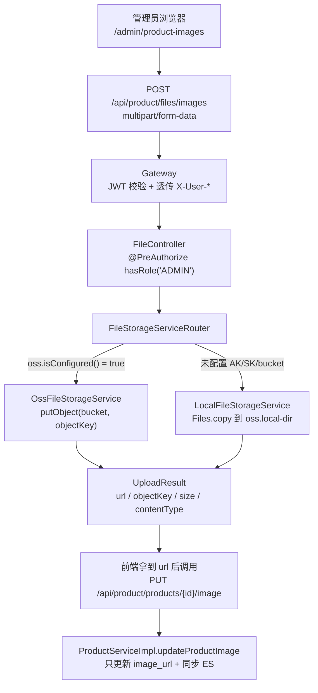
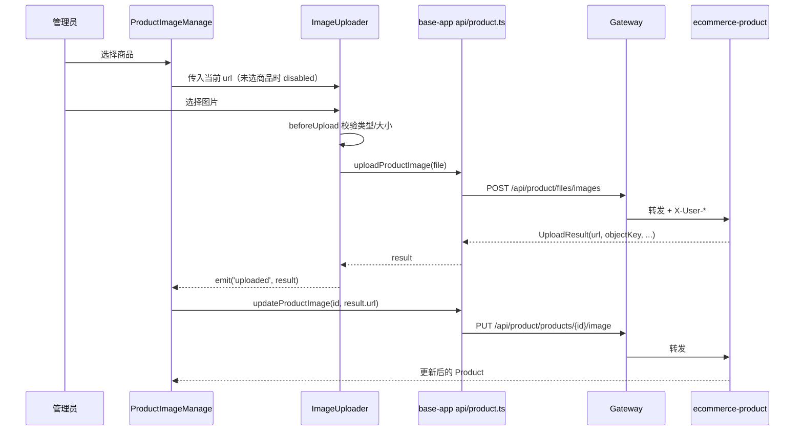

# 商品图片上传与 OSS 存储

<cite>
**本文引用的文件**
- [FileController.java](file://backend/ecommerce-product/src/main/java/com/ecommerce/product/controller/FileController.java)
- [ProductController.java](file://backend/ecommerce-product/src/main/java/com/ecommerce/product/controller/ProductController.java)
- [FileStorageService.java](file://backend/ecommerce-product/src/main/java/com/ecommerce/product/service/FileStorageService.java)
- [FileStorageServiceRouter.java](file://backend/ecommerce-product/src/main/java/com/ecommerce/product/service/impl/FileStorageServiceRouter.java)
- [OssFileStorageService.java](file://backend/ecommerce-product/src/main/java/com/ecommerce/product/service/impl/OssFileStorageService.java)
- [LocalFileStorageService.java](file://backend/ecommerce-product/src/main/java/com/ecommerce/product/service/impl/LocalFileStorageService.java)
- [ImageUploadSupport.java](file://backend/ecommerce-product/src/main/java/com/ecommerce/product/service/support/ImageUploadSupport.java)
- [OssProperties.java](file://backend/ecommerce-product/src/main/java/com/ecommerce/product/config/properties/OssProperties.java)
- [OssClientProvider.java](file://backend/ecommerce-product/src/main/java/com/ecommerce/product/config/OssClientProvider.java)
- [LocalFileStorageConfig.java](file://backend/ecommerce-product/src/main/java/com/ecommerce/product/config/LocalFileStorageConfig.java)
- [ProductServiceImpl.java](file://backend/ecommerce-product/src/main/java/com/ecommerce/product/service/impl/ProductServiceImpl.java)
- [application.yml（商品服务）](file://backend/ecommerce-product/src/main/resources/application.yml)
- [AuthGlobalFilter.java](file://backend/ecommerce-gateway/src/main/java/com/ecommerce/gateway/filter/AuthGlobalFilter.java)
- [product.ts](file://frontend/base-app/src/api/product.ts)
- [ImageUploader.vue](file://frontend/base-app/src/components/ImageUploader.vue)
- [ProductImageManage.vue](file://frontend/base-app/src/views/ProductImageManage.vue)
- [router/index.ts（base-app）](file://frontend/base-app/src/router/index.ts)
- [nginx.conf（base-app）](file://frontend/base-app/nginx.conf)
- [.env.example](file://.env.example)
</cite>

## 目录
1. [功能概览](#功能概览)
2. [存储路由与整体链路](#存储路由与整体链路)
3. [三重校验与对象 Key 规则](#三重校验与对象-key-规则)
4. [接口说明](#接口说明)
5. [管理端页面](#管理端页面)
6. [本地兜底与静态资源访问](#本地兜底与静态资源访问)
7. [配置项与部署约束](#配置项与部署约束)
8. [排错与验收](#排错与验收)

## 功能概览

商品图片不走数据库二进制字段，而是「对象存储 + 商品表只存 URL」：管理员在 base-app 的图片管理页选图上传，后端把文件写入阿里云 OSS 并返回可公开访问的 URL，前端再调用独立接口把 URL 回写到 `product.image_url`。三个设计点决定了实现方式：

1. **上传与回写解耦**：上传接口只负责落盘/上云并返回 `url` + `objectKey`；回写接口 `PUT /products/{id}/image` 只更新 `image_url`，避免管理端整实体提交把名称、价格等字段意外覆盖为空。
2. **凭证缺失自动降级**：配置了 AK/SK 与 bucket 走 OSS，未配置时（本地开发、测试、CI）自动改落本地磁盘，上传功能开箱可用而不强依赖云资源。
3. **不信任客户端**：原始文件名与客户端声明的 `Content-Type` 都不参与决策，只按文件魔数识别真实类型，并按类型生成扩展名与随机对象 Key。

## 存储路由与整体链路

`FileController` 依赖的是 `FileStorageService` 接口，实际注入的是 `FileStorageServiceRouter`——它在构造时同时持有 `OssFileStorageService` 与 `LocalFileStorageService`，每次调用按 `properties.isConfigured()` 决定委派给谁。切换需要重启服务，因为 `oss.*` 在启动时绑定。



**图表来源**
- [FileController.java](file://backend/ecommerce-product/src/main/java/com/ecommerce/product/controller/FileController.java)
- [FileStorageServiceRouter.java](file://backend/ecommerce-product/src/main/java/com/ecommerce/product/service/impl/FileStorageServiceRouter.java)
- [OssFileStorageService.java](file://backend/ecommerce-product/src/main/java/com/ecommerce/product/service/impl/OssFileStorageService.java)
- [LocalFileStorageService.java](file://backend/ecommerce-product/src/main/java/com/ecommerce/product/service/impl/LocalFileStorageService.java)
- [ProductServiceImpl.java](file://backend/ecommerce-product/src/main/java/com/ecommerce/product/service/impl/ProductServiceImpl.java)

OSS 客户端采用懒加载：`OssClientProvider` 不在启动阶段建连，只有在真正上传/删除时校验配置并初始化 `OSSClientBuilder`。这样 AK/SK 缺失时应用上下文照常启动，缺失配置只会在调用上传时得到 `503 OSS 未配置，请联系管理员`。

**章节来源**
- [OssClientProvider.java](file://backend/ecommerce-product/src/main/java/com/ecommerce/product/config/OssClientProvider.java)
- [FileStorageServiceRouter.java](file://backend/ecommerce-product/src/main/java/com/ecommerce/product/service/impl/FileStorageServiceRouter.java)

## 三重校验与对象 Key 规则

`ImageUploadSupport` 是 OSS 与本地两种实现共用的校验与命名工具，校验顺序固定：

| 层级 | 校验内容 | 失败返回 |
| --- | --- | --- |
| 1 | 文件非空 | 400「上传文件不能为空」 |
| 2 | 大小不超过 `oss.max-size-mb`（默认 5MB） | 400「图片大小不能超过 NMB」 |
| 3 | 读取前 12 字节魔数识别真实类型，且命中 `oss.allowed-types` | 400「仅支持 JPG / PNG / WEBP / GIF 格式的图片」 |

魔数判定规则（`MAGIC_LENGTH = 12`）：

| 类型 | 判定依据 | 生成扩展名 |
| --- | --- | --- |
| JPEG | `FF D8 FF` | `jpg` |
| PNG | `89 50 4E 47` | `png` |
| GIF | `47 49 46`（`GIF`） | `gif` |
| WEBP | `RIFF` + 第 8-11 字节 `WEBP` | `webp` |

对象 Key 统一为 `{oss.dir}/yyyy/MM/dd/{uuid}.{ext}`，例如 `product/2026/11/18/9f3c...c1.png`。UUID 去横线后使用，既避免重名覆盖，也让客户端无法通过构造路径做穿越。删除时的 `validateObjectKey` 额外要求 Key 以 `{dir}/` 开头且不含 `..`；本地实现还会 `normalize()` 后校验目标仍位于 `oss.local-dir` 之内。

OSS 写入时附带 `Cache-Control: public, max-age=31536000, immutable` 与 `Content-Disposition: inline`，配合随机 Key 实现长缓存；返回 URL 优先使用 `oss.public-url-prefix`（CDN/自定义域名），为空时按 `https://{bucket}.{endpoint}/{objectKey}` 拼接。

**章节来源**
- [ImageUploadSupport.java](file://backend/ecommerce-product/src/main/java/com/ecommerce/product/service/support/ImageUploadSupport.java)
- [OssFileStorageService.java](file://backend/ecommerce-product/src/main/java/com/ecommerce/product/service/impl/OssFileStorageService.java)

## 接口说明

| 方法 | 路径 | 鉴权 | 说明 |
| --- | --- | --- | --- |
| POST | `/api/product/files/images` | JWT + `hasRole('ADMIN')` | multipart 字段名固定为 `file`，返回 `UploadResult` |
| DELETE | `/api/product/files/images?objectKey=...` | JWT + `hasRole('ADMIN')` | 运维用途；删除前校验对象位于商品图片目录内 |
| PUT | `/api/product/products/{id}/image` | JWT + `hasRole('ADMIN')` | 请求体 `{ "imageUrl": "..." }`，只更新图片字段；空字符串表示清除图片（不删除 OSS 对象） |

`UploadResult` 字段：`url`、`objectKey`、`originalName`、`size`、`contentType`。前端只需要 `url` 做展示、`objectKey` 做后续删除。

回写接口不整实体更新：`ProductServiceImpl.updateProductImage(id, imageUrl)` 先做一次图片字段更新，随后调用 `syncToElasticsearch(id)`，保证商品搜索侧拿到的图片地址与管理端一致。

**章节来源**
- [FileController.java](file://backend/ecommerce-product/src/main/java/com/ecommerce/product/controller/FileController.java)
- [ProductController.java](file://backend/ecommerce-product/src/main/java/com/ecommerce/product/controller/ProductController.java)
- [ProductServiceImpl.java](file://backend/ecommerce-product/src/main/java/com/ecommerce/product/service/impl/ProductServiceImpl.java)

## 管理端页面

路由 `/admin/product-images`（`name: productImages`，`meta: { requiresAuth: true, adminOnly: true }`）由 base-app 的 `ProductImageManage.vue` 承载，职责边界很清晰：

- **ProductImageManage**：加载商品列表、选择商品、保存/清除图片。它不直接处理文件，只监听 `ImageUploader` 抛出的 `uploaded` 事件，然后调用 `updateProductImage(id, url)` 回写并就地更新本地列表。
- **ImageUploader**：负责选图、客户端预校验（类型与大小，默认 5MB，与后端 `oss.max-size-mb` 对齐）、调用 `uploadProductImage`，成功后仅 `emit('uploaded', result)`；URL 回写业务留给父组件。
- **api/product.ts**：`uploadProductImage(file)` 组 `FormData` POST 到 `/product/files/images`；`updateProductImage(id, imageUrl)` PUT `/product/products/{id}/image`；`deleteProductImage(objectKey)` 供运维删除。



**图表来源**
- [ProductImageManage.vue](file://frontend/base-app/src/views/ProductImageManage.vue)
- [ImageUploader.vue](file://frontend/base-app/src/components/ImageUploader.vue)
- [product.ts](file://frontend/base-app/src/api/product.ts)

注意：页面上的「清除图片」只是把 `imageUrl` 置空，不会调用 OSS 删除接口——避免误删仍被其它商品或缓存引用的对象；对象清理交给运维或生命周期规则。

**章节来源**
- [ProductImageManage.vue](file://frontend/base-app/src/views/ProductImageManage.vue)
- [router/index.ts（base-app）](file://frontend/base-app/src/router/index.ts)

## 本地兜底与静态资源访问

未配置 OSS 时，文件落在 `oss.local-dir`（默认 `uploads`，相对服务进程工作目录），磁盘结构与对象 Key 一致：`uploads/product/yyyy/MM/dd/uuid.ext`。`LocalFileStorageConfig` 把这个目录挂到 `/files/local/**`，缓存 3600 秒；返回给前端的 URL 是**相对路径**：

```text
{oss.local-url-prefix}/{objectKey}
默认：/api/product/files/local/product/2026/11/18/xxx.png
```

相对路径的设计让浏览器直接经网关同源读取，无需在代码里硬编码主机与端口。网关把 `/api/product/files/local` 放进白名单（图片由 `` 直接加载，不会携带 JWT），转发到商品服务后命中静态资源映射。

生产使用 OSS 时返回的是 `https://...` 绝对地址，浏览器直连 OSS/CDN，不经过网关，也不占用服务带宽。

**章节来源**
- [LocalFileStorageConfig.java](file://backend/ecommerce-product/src/main/java/com/ecommerce/product/config/LocalFileStorageConfig.java)
- [LocalFileStorageService.java](file://backend/ecommerce-product/src/main/java/com/ecommerce/product/service/impl/LocalFileStorageService.java)
- [AuthGlobalFilter.java](file://backend/ecommerce-gateway/src/main/java/com/ecommerce/gateway/filter/AuthGlobalFilter.java)

## 配置项与部署约束

| 配置 | 默认值 | 说明 |
| --- | --- | --- |
| `oss.enabled` | `true` | 关闭后 `isConfigured()` 恒为 false，强制走本地 |
| `oss.endpoint` | `oss-cn-hangzhou.aliyuncs.com` | OSS 访问域名 |
| `oss.bucket` | 空 | Bucket 名称 |
| `oss.access-key-id` / `oss.access-key-secret` | 空 | 只允许环境变量注入，禁止入库入仓 |
| `oss.dir` | `product` | 对象 Key 前缀 |
| `oss.public-url-prefix` | 空 | CDN 或自定义域名，留空按 bucket + endpoint 拼接 |
| `oss.local-dir` | `uploads` | 本地兜底根目录 |
| `oss.local-url-prefix` | `/api/product/files/local` | 本地图片对外前缀 |
| `oss.max-size-mb` | `5` | 单文件上限，需与 multipart 上限对齐 |
| `oss.allowed-types` | jpeg/png/webp/gif | 允许的 MIME |

体积限制是三层叠加的，任一层没对齐都会出现上传失败：

1. 前端 `ImageUploader` 的 `maxSizeMb`（默认 5MB）；
2. 商品服务 `spring.servlet.multipart.max-file-size: 5MB` / `max-request-size: 6MB`（请求体略大于文件本身，给表单开销留余量）；
3. base-app 的 nginx `client_max_body_size 6m`——默认 1MB 会直接返回 413。

环境变量：`OSS_ENDPOINT`、`OSS_BUCKET`、`OSS_ACCESS_KEY_ID`、`OSS_ACCESS_KEY_SECRET`、`OSS_DIR`、`OSS_PUBLIC_URL_PREFIX`、`OSS_LOCAL_DIR`、`OSS_MAX_SIZE_MB` 等（见 `.env.example`）。AK/SK 只通过环境变量注入。

**章节来源**
- [OssProperties.java](file://backend/ecommerce-product/src/main/java/com/ecommerce/product/config/properties/OssProperties.java)
- [application.yml（商品服务）](file://backend/ecommerce-product/src/main/resources/application.yml)
- [nginx.conf（base-app）](file://frontend/base-app/nginx.conf)
- [.env.example](file://.env.example)

## 排错与验收

| 现象 | 可能原因 | 处理 |
| --- | --- | --- |
| 上传返回 `503 OSS 未配置` | AK/SK 或 bucket 为空，但请求进入了 OSS 分支 | 补全环境变量并重启；或清空凭证走本地兜底 |
| 返回 413 | nginx `client_max_body_size` 太小 | 调整为 `6m` 并重载 nginx |
| 返回 400「仅支持 JPG / PNG / WEBP / GIF」 | 文件不是真实图片，或扩展名伪造 | 用真实图片验证；魔数校验不通过属预期 |
| 本地图片 404 | `oss.local-dir` 与服务进程工作目录不一致，或网关白名单缺失 | 用绝对路径配置 `oss.local-dir`；确认 `/api/product/files/local` 在白名单 |
| 图片地址更新后列表仍是旧图 | 只调了上传未调回写接口 | 确认 `uploaded` 事件后执行了 `PUT /products/{id}/image` |
| 商品搜索侧图片不更新 | ES 同步失败 | 检查商品服务日志中 `syncToElasticsearch` 相关异常，必要时重建索引 |

验收步骤：

1. 未配置 OSS 启动商品服务，管理员登录 → `/admin/product-images` → 选商品 → 上传 JPG，页面出现预览且文件落在 `uploads/product/<日期>/`；
2. 复制返回的 `url` 用浏览器直接访问（经网关 `/api/product/files/local/...`）应返回图片；
3. 上传伪装成 `.png` 的文本文件，应返回 400；
4. 上传超过 5MB 的图片，前端即拦截；绕过前端直传应被服务端拦截；
5. 配置 OSS 凭证重启，重复步骤 1，返回地址变为 `https://{bucket}.{endpoint}/...` 或自定义域名；
6. 在商品详情页确认新图片生效，且商品搜索接口返回的 `imageUrl` 同步更新。

**章节来源**
- [ImageUploadSupport.java](file://backend/ecommerce-product/src/main/java/com/ecommerce/product/service/support/ImageUploadSupport.java)
- [LocalFileStorageConfig.java](file://backend/ecommerce-product/src/main/java/com/ecommerce/product/config/LocalFileStorageConfig.java)
- [ProductServiceImpl.java](file://backend/ecommerce-product/src/main/java/com/ecommerce/product/service/impl/ProductServiceImpl.java)