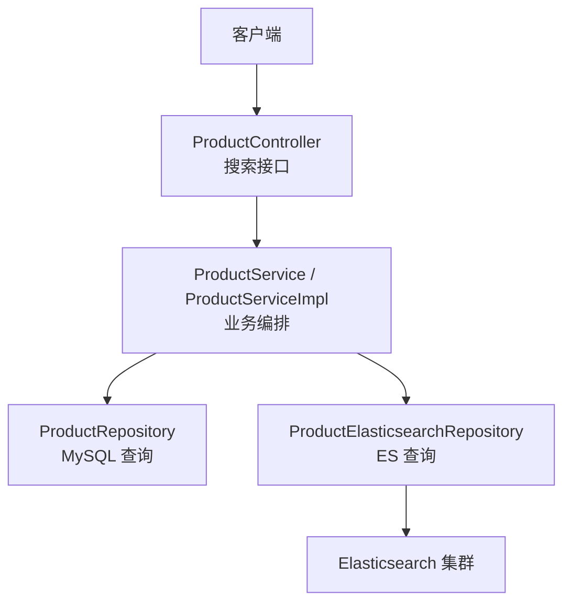
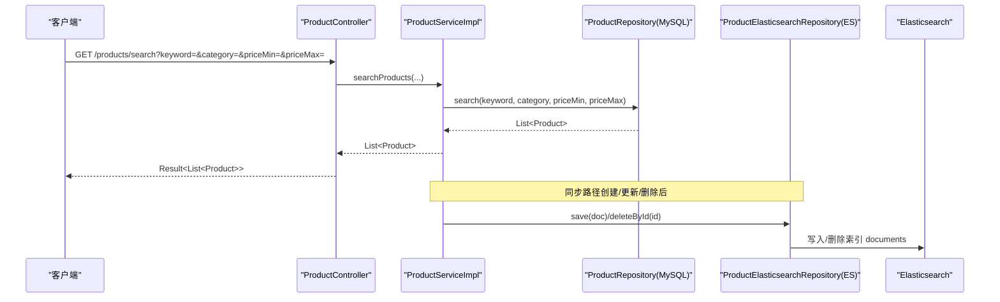
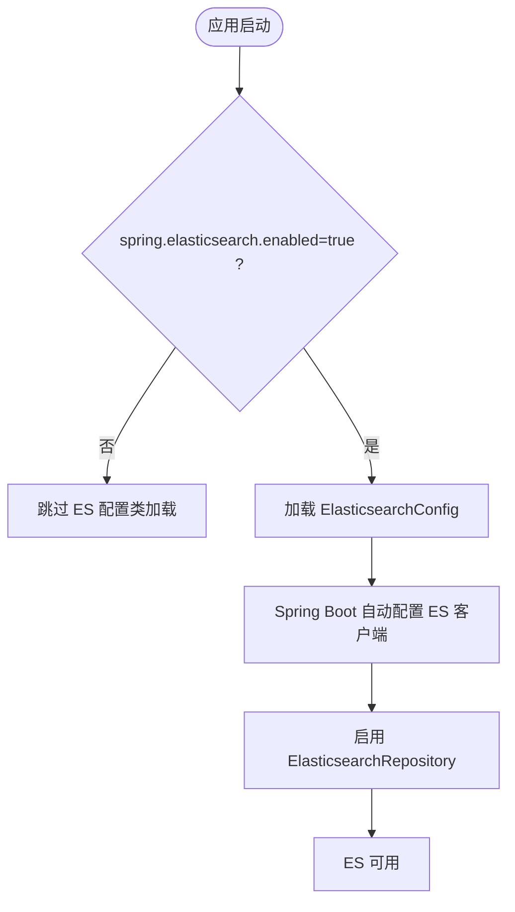
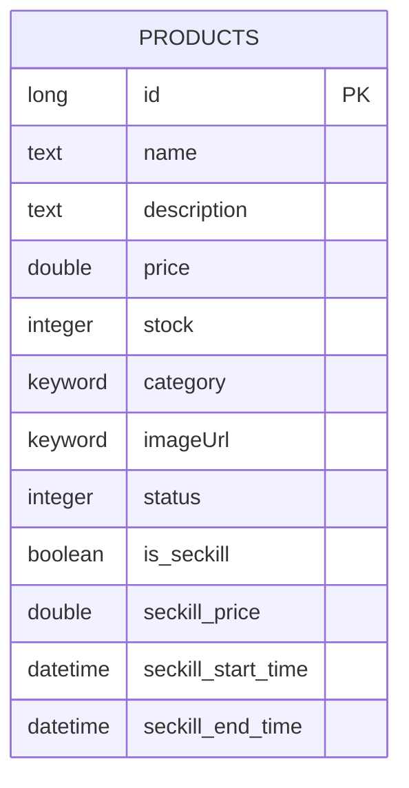
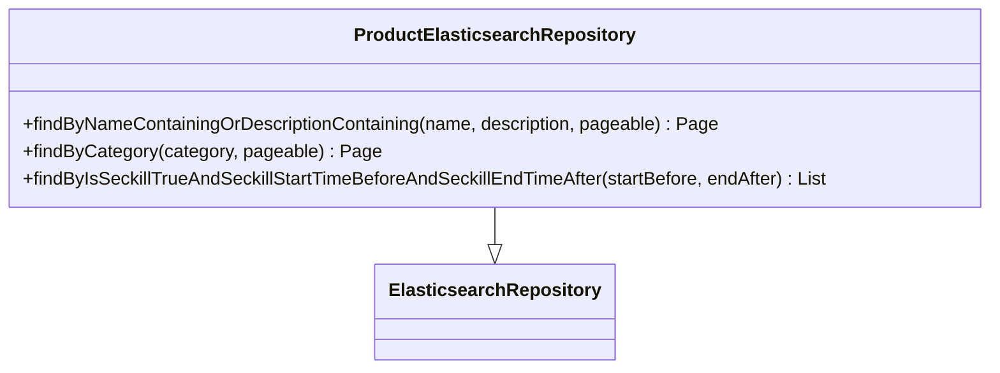
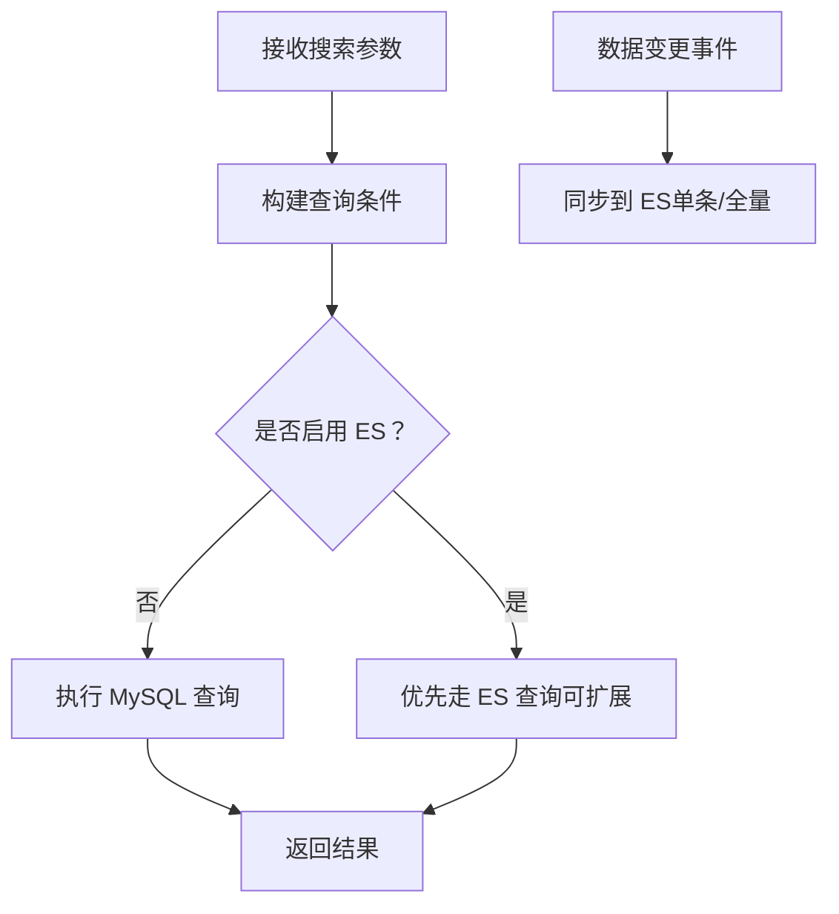
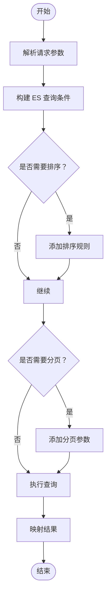
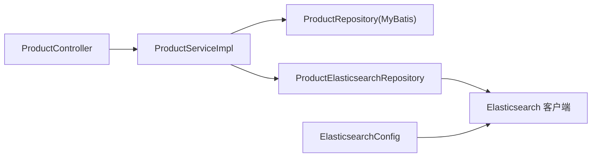

# 商品搜索功能

<cite>
**本文引用的文件**   
- [ElasticsearchConfig.java](file://backend/ecommerce-product/src/main/java/com/ecommerce/product/config/ElasticsearchConfig.java)
- [application.yml](file://backend/ecommerce-product/src/main/resources/application.yml)
- [pom.xml](file://backend/ecommerce-product/pom.xml)
- [ProductDocument.java](file://backend/ecommerce-product/src/main/java/com/ecommerce/product/elasticsearch/ProductDocument.java)
- [ProductElasticsearchRepository.java](file://backend/ecommerce-product/src/main/java/com/ecommerce/product/elasticsearch/ProductElasticsearchRepository.java)
- [ProductController.java](file://backend/ecommerce-product/src/main/java/com/ecommerce/product/controller/ProductController.java)
- [ProductService.java](file://backend/ecommerce-product/src/main/java/com/ecommerce/product/service/ProductService.java)
- [ProductServiceImpl.java](file://backend/ecommerce-product/src/main/java/com/ecommerce/product/service/impl/ProductServiceImpl.java)
- [ProductRepository.java](file://backend/ecommerce-product/src/main/java/com/ecommerce/product/repository/ProductRepository.java)
- [ProductMapper.java](file://backend/ecommerce-product/src/main/java/com/ecommerce/product/repository/mapper/ProductMapper.java)
</cite>

## 目录
1. [简介](#简介)
2. [项目结构](#项目结构)
3. [核心组件](#核心组件)
4. [架构总览](#架构总览)
5. [详细组件分析](#详细组件分析)
6. [依赖关系分析](#依赖关系分析)
7. [性能与优化](#性能与优化)
8. [故障排查指南](#故障排查指南)
9. [结论](#结论)

## 简介
本文围绕“商品搜索功能”展开，系统性说明 Elasticsearch 搜索引擎的集成配置、文档模型设计、仓库层实现、搜索接口逻辑，以及索引结构与搜索流程。目标是帮助读者快速理解并扩展该模块，同时提供可操作的优化与排错建议。

## 项目结构
本功能位于 ecommerce-product 服务中，主要涉及以下层次：
- 配置层：Elasticsearch 启用开关与连接信息
- 数据映射层：Elasticsearch 文档模型 ProductDocument
- 仓库层：Elasticsearch 查询接口 ProductElasticsearchRepository
- 业务层：ProductService/ProductServiceImpl 负责 ES 同步与查询编排
- 控制层：ProductController 暴露搜索接口

图表来源
- [ProductController.java:47-56](file://backend/ecommerce-product/src/main/java/com/ecommerce/product/controller/ProductController.java#L47-L56)
- [ProductServiceImpl.java:52-55](file://backend/ecommerce-product/src/main/java/com/ecommerce/product/service/impl/ProductServiceImpl.java#L52-L55)
- [ProductRepository.java:31-33](file://backend/ecommerce-product/src/main/java/com/ecommerce/product/repository/ProductRepository.java#L31-L33)
- [ProductElasticsearchRepository.java:10-17](file://backend/ecommerce-product/src/main/java/com/ecommerce/product/elasticsearch/ProductElasticsearchRepository.java#L10-L17)

章节来源
- [ProductController.java:1-97](file://backend/ecommerce-product/src/main/java/com/ecommerce/product/controller/ProductController.java#L1-L97)
- [ProductServiceImpl.java:1-164](file://backend/ecommerce-product/src/main/java/com/ecommerce/product/service/impl/ProductServiceImpl.java#L1-L164)

## 核心组件
- Elasticsearch 配置与启用开关
  - 通过 @ConditionalOnProperty 控制是否加载 ES 相关 Bean
  - 连接地址、用户名密码在 application.yml 中配置
- 文档模型 ProductDocument
  - 定义 ES 索引字段类型、分词器、日期格式等
- 仓库层 ProductElasticsearchRepository
  - 基于 Spring Data Elasticsearch 的方法命名查询
  - 支持关键词模糊匹配、分类过滤、秒杀时间范围筛选
- 搜索接口与业务编排
  - 控制层接收关键词、分类、价格区间参数
  - 业务层调用 MyBatis 进行 MySQL 条件查询（当前实现）
  - 提供 ES 全量/增量同步能力

章节来源
- [ElasticsearchConfig.java:1-15](file://backend/ecommerce-product/src/main/java/com/ecommerce/product/config/ElasticsearchConfig.java#L1-L15)
- [application.yml:25-33](file://backend/ecommerce-product/src/main/resources/application.yml#L25-L33)
- [ProductDocument.java:13-55](file://backend/ecommerce-product/src/main/java/com/ecommerce/product/elasticsearch/ProductDocument.java#L13-L55)
- [ProductElasticsearchRepository.java:10-17](file://backend/ecommerce-product/src/main/java/com/ecommerce/product/elasticsearch/ProductElasticsearchRepository.java#L10-L17)
- [ProductController.java:47-56](file://backend/ecommerce-product/src/main/java/com/ecommerce/product/controller/ProductController.java#L47-L56)
- [ProductServiceImpl.java:52-55](file://backend/ecommerce-product/src/main/java/com/ecommerce/product/service/impl/ProductServiceImpl.java#L52-L55)

## 架构总览
下图展示从请求到 ES 的端到端流程，包括 ES 启用条件、索引名称、文档字段映射与查询方法。

图表来源
- [ProductController.java:47-56](file://backend/ecommerce-product/src/main/java/com/ecommerce/product/controller/ProductController.java#L47-L56)
- [ProductServiceImpl.java:52-55](file://backend/ecommerce-product/src/main/java/com/ecommerce/product/service/impl/ProductServiceImpl.java#L52-L55)
- [ProductRepository.java:31-33](file://backend/ecommerce-product/src/main/java/com/ecommerce/product/repository/ProductRepository.java#L31-L33)
- [ProductElasticsearchRepository.java:10-17](file://backend/ecommerce-product/src/main/java/com/ecommerce/product/elasticsearch/ProductElasticsearchRepository.java#L10-L17)

## 详细组件分析

### Elasticsearch 集成配置
- 启用开关
  - 使用 @ConditionalOnProperty(name = "spring.elasticsearch.enabled", havingValue = "true") 控制配置类生效
  - 默认不启用，需显式开启
- 连接配置
  - spring.data.elasticsearch.repositories.enabled=true 启用仓库自动装配
  - spring.elasticsearch.uris 指定 ES 地址
  - spring.elasticsearch.username/password 用于认证（示例为空）
- 依赖引入
  - 通过 spring-boot-starter-data-elasticsearch 引入 ES 客户端与自动配置

图表来源
- [ElasticsearchConfig.java:11-13](file://backend/ecommerce-product/src/main/java/com/ecommerce/product/config/ElasticsearchConfig.java#L11-L13)
- [application.yml:25-33](file://backend/ecommerce-product/src/main/resources/application.yml#L25-L33)
- [pom.xml:50-54](file://backend/ecommerce-product/pom.xml#L50-L54)

章节来源
- [ElasticsearchConfig.java:1-15](file://backend/ecommerce-product/src/main/java/com/ecommerce/product/config/ElasticsearchConfig.java#L1-L15)
- [application.yml:25-33](file://backend/ecommerce-product/src/main/resources/application.yml#L25-L33)
- [pom.xml:50-54](file://backend/ecommerce-product/pom.xml#L50-L54)

### 文档模型 ProductDocument
- 索引名：products
- 字段映射要点
  - name/description：Text 类型，standard 分词器，适合全文检索
  - price：Double，数值范围查询
  - stock/status/isSeckill/seckillPrice：基础数值/布尔字段
  - category/imageUrl：Keyword 类型；imageUrl 关闭索引以节省空间
  - seckillStartTime/seckillEndTime：Date 类型，精确到毫秒
- 分词器
  - 使用 standard 分词器；如需中文分词，可在 ES 侧自定义 analyzer 并在 Field 中指定
- 搜索字段
  - 名称/描述用于关键词匹配
  - 分类用于精确过滤
  - 价格用于区间筛选
  - 秒杀时间用于活动期筛选

图表来源
- [ProductDocument.java:17-54](file://backend/ecommerce-product/src/main/java/com/ecommerce/product/elasticsearch/ProductDocument.java#L17-L54)

章节来源
- [ProductDocument.java:13-55](file://backend/ecommerce-product/src/main/java/com/ecommerce/product/elasticsearch/ProductDocument.java#L13-L55)

### 仓库层 ProductElasticsearchRepository
- 继承 ElasticsearchRepository，获得基础 CRUD 与分页能力
- 自定义查询方法
  - findByNameContainingOrDescriptionContaining：关键词模糊匹配
  - findByCategory：按分类精确过滤
  - findByIsSeckillTrueAndSeckillStartTimeBeforeAndSeckillEndTimeAfter：秒杀活动期筛选
- 分页
  - 前两个方法返回 Page<T>，支持 Pageable 分页参数

图表来源
- [ProductElasticsearchRepository.java:10-17](file://backend/ecommerce-product/src/main/java/com/ecommerce/product/elasticsearch/ProductElasticsearchRepository.java#L10-L17)

章节来源
- [ProductElasticsearchRepository.java:1-19](file://backend/ecommerce-product/src/main/java/com/ecommerce/product/elasticsearch/ProductElasticsearchRepository.java#L1-L19)

### 搜索接口与业务编排
- 控制层
  - GET /products/search 接收 keyword、category、priceMin、priceMax
- 业务层
  - 当前实现委托给 ProductRepository.search(...)，即走 MySQL 查询
  - 提供 syncToElasticsearch/syncAllToElasticsearch 将 MySQL 数据同步至 ES
- 同步策略
  - 新增/更新/库存扣减后触发单条同步
  - 提供全量同步接口供运维或初始化使用
  - 删除时尝试从 ES 移除，异常仅记录日志不影响主流程

图表来源
- [ProductController.java:47-56](file://backend/ecommerce-product/src/main/java/com/ecommerce/product/controller/ProductController.java#L47-L56)
- [ProductServiceImpl.java:52-55](file://backend/ecommerce-product/src/main/java/com/ecommerce/product/service/impl/ProductServiceImpl.java#L52-L55)
- [ProductServiceImpl.java:112-145](file://backend/ecommerce-product/src/main/java/com/ecommerce/product/service/impl/ProductServiceImpl.java#L112-L145)

章节来源
- [ProductController.java:47-56](file://backend/ecommerce-product/src/main/java/com/ecommerce/product/controller/ProductController.java#L47-L56)
- [ProductService.java:16-37](file://backend/ecommerce-product/src/main/java/com/ecommerce/product/service/ProductService.java#L16-L37)
- [ProductServiceImpl.java:52-55](file://backend/ecommerce-product/src/main/java/com/ecommerce/product/service/impl/ProductServiceImpl.java#L52-L55)
- [ProductServiceImpl.java:112-145](file://backend/ecommerce-product/src/main/java/com/ecommerce/product/service/impl/ProductServiceImpl.java#L112-L145)

### 搜索流程图（含排序与分页）
当前实现未直接体现 ES 排序与分页，但仓库层已具备分页能力。可按如下流程扩展：
- 解析参数：keyword、category、priceMin、priceMax、sortField、page、size
- 构建 ES Query：bool 组合 must/should/filter
- 排序：根据 sortField 设置 sort
- 分页：PageRequest.of(page, size)
- 返回：封装为统一响应

[此图为概念性流程，不直接对应具体源码]

## 依赖关系分析
- 控制层依赖业务层
- 业务层依赖 MySQL 仓库与 ES 仓库
- ES 仓库依赖 Spring Data Elasticsearch 自动配置
- 配置类受属性开关控制

图表来源
- [ProductController.java:1-97](file://backend/ecommerce-product/src/main/java/com/ecommerce/product/controller/ProductController.java#L1-L97)
- [ProductServiceImpl.java:1-164](file://backend/ecommerce-product/src/main/java/com/ecommerce/product/service/impl/ProductServiceImpl.java#L1-L164)
- [ProductRepository.java:1-51](file://backend/ecommerce-product/src/main/java/com/ecommerce/product/repository/ProductRepository.java#L1-L51)
- [ProductElasticsearchRepository.java:1-19](file://backend/ecommerce-product/src/main/java/com/ecommerce/product/elasticsearch/ProductElasticsearchRepository.java#L1-L19)
- [ElasticsearchConfig.java:1-15](file://backend/ecommerce-product/src/main/java/com/ecommerce/product/config/ElasticsearchConfig.java#L1-L15)

章节来源
- [ProductController.java:1-97](file://backend/ecommerce-product/src/main/java/com/ecommerce/product/controller/ProductController.java#L1-L97)
- [ProductServiceImpl.java:1-164](file://backend/ecommerce-product/src/main/java/com/ecommerce/product/service/impl/ProductServiceImpl.java#L1-L164)
- [ProductRepository.java:1-51](file://backend/ecommerce-product/src/main/java/com/ecommerce/product/repository/ProductRepository.java#L1-L51)
- [ProductElasticsearchRepository.java:1-19](file://backend/ecommerce-product/src/main/java/com/ecommerce/product/elasticsearch/ProductElasticsearchRepository.java#L1-L19)
- [ElasticsearchConfig.java:1-15](file://backend/ecommerce-product/src/main/java/com/ecommerce/product/config/ElasticsearchConfig.java#L1-L15)

## 性能与优化
- 连接与连接池
  - 当前未显式配置 ES 连接池；可通过 ES Java Client 的高级配置项调整连接数、超时、重试等
  - 建议在生产环境显式配置连接池大小、读写超时、重试策略
- 索引与分词
  - 若中文搜索效果不佳，建议自定义 analyzer（如 IK），并在 Field 上指定 analyzer/searchAnalyzer
  - 对高基数 Keyword 字段（如 category）确保精确匹配性能
- 查询优化
  - 优先使用 filter 上下文（非评分）提升缓存命中率
  - 避免在大规模数据集上使用过于复杂的 should 子句
  - 合理设置 refresh_interval，批量写入时降低刷新频率
- 同步策略
  - 增量同步优先，全量同步仅在初始化或修复时使用
  - 批量写入建议使用 bulk API（可结合 ES Repository 的批量保存）
- 分页与排序
  - 深分页避免使用 from/size 过大的偏移，必要时采用 search_after
  - 明确排序字段，避免对文本字段做复杂排序

[本节为通用指导，不直接分析具体文件]

## 故障排查指南
- ES 无法连接
  - 检查 spring.elasticsearch.enabled 是否为 true
  - 核对 uris、username、password 是否正确
  - 确认网络连通性与防火墙策略
- 索引不存在或字段映射错误
  - 首次运行建议执行全量同步，确保 products 索引存在
  - 检查 ProductDocument 字段类型是否与 ES 实际映射一致
- 搜索无结果
  - 确认数据已从 MySQL 同步到 ES
  - 检查关键词分词是否符合预期（standard vs 自定义 analyzer）
  - 校验 category 等 Keyword 字段值是否完全匹配
- 同步失败
  - 查看日志中的异常堆栈，定位网络或权限问题
  - 删除操作失败仅记录警告，不影响数据库事务

章节来源
- [application.yml:25-33](file://backend/ecommerce-product/src/main/resources/application.yml#L25-L33)
- [ProductServiceImpl.java:112-145](file://backend/ecommerce-product/src/main/java/com/ecommerce/product/service/impl/ProductServiceImpl.java#L112-L145)
- [ProductServiceImpl.java:85-98](file://backend/ecommerce-product/src/main/java/com/ecommerce/product/service/impl/ProductServiceImpl.java#L85-L98)

## 结论
本项目已具备完整的 ES 集成骨架：配置开关、文档模型、仓库方法与同步机制齐全。当前搜索接口默认走 MySQL，ES 作为可选增强能力。建议下一步：
- 将搜索接口切换至 ES，充分利用其全文检索与聚合能力
- 完善中文分词与排序策略
- 补充连接池与批量写入优化
- 增加监控与告警，保障 ES 可用性

[本节为总结性内容，不直接分析具体文件]