# 商品服务

<cite>
**本文引用的文件**   
- [ProductApplication.java](file://backend/ecommerce-product/src/main/java/com/ecommerce/product/ProductApplication.java)
- [ProductController.java](file://backend/ecommerce-product/src/main/java/com/ecommerce/product/controller/ProductController.java)
- [FlightController.java](file://backend/ecommerce-product/src/main/java/com/ecommerce/product/controller/FlightController.java)
- [SeckillController.java](file://backend/ecommerce-product/src/main/java/com/ecommerce/product/controller/SeckillController.java)
- [ProductService.java](file://backend/ecommerce-product/src/main/java/com/ecommerce/product/service/ProductService.java)
- [FlightService.java](file://backend/ecommerce-product/src/main/java/com/ecommerce/product/service/FlightService.java)
- [ProductServiceImpl.java](file://backend/ecommerce-product/src/main/java/com/ecommerce/product/service/impl/ProductServiceImpl.java)
- [FlightServiceImpl.java](file://backend/ecommerce-product/src/main/java/com/ecommerce/product/service/impl/FlightServiceImpl.java)
- [SeckillStockService.java](file://backend/ecommerce-product/src/main/java/com/ecommerce/product/service/SeckillStockService.java)
- [Product.java](file://backend/ecommerce-product/src/main/java/com/ecommerce/product/entity/Product.java)
- [Flight.java](file://backend/ecommerce-product/src/main/java/com/ecommerce/product/entity/Flight.java)
- [ProductDocument.java](file://backend/ecommerce-product/src/main/java/com/ecommerce/product/elasticsearch/ProductDocument.java)
- [seckill_stock.lua](file://backend/ecommerce-product/src/main/resources/lua/seckill_stock.lua)
- [application.yml](file://backend/ecommerce-product/src/main/resources/application.yml)
- [schema.sql](file://backend/ecommerce-product/src/main/resources/db/schema.sql)
- [ElasticsearchConfig.java](file://backend/ecommerce-product/src/main/java/com/ecommerce/product/config/ElasticsearchConfig.java)
- [SeckillOrderConsumer.java](file://backend/ecommerce-order/src/main/java/com/ecommerce/order/consumer/SeckillOrderConsumer.java)
- [FileController.java](file://backend/ecommerce-product/src/main/java/com/ecommerce/product/controller/FileController.java)
- [FileStorageService.java](file://backend/ecommerce-product/src/main/java/com/ecommerce/product/service/FileStorageService.java)
- [FileStorageServiceRouter.java](file://backend/ecommerce-product/src/main/java/com/ecommerce/product/service/impl/FileStorageServiceRouter.java)
- [LocalFileStorageService.java](file://backend/ecommerce-product/src/main/java/com/ecommerce/product/service/impl/LocalFileStorageService.java)
- [OssFileStorageService.java](file://backend/ecommerce-product/src/main/java/com/ecommerce/product/service/impl/OssFileStorageService.java)
- [ImageUploadSupport.java](file://backend/ecommerce-product/src/main/java/com/ecommerce/product/service/support/ImageUploadSupport.java)
- [OssProperties.java](file://backend/ecommerce-product/src/main/java/com/ecommerce/product/config/properties/OssProperties.java)
- [OssClientProvider.java](file://backend/ecommerce-product/src/main/java/com/ecommerce/product/config/OssClientProvider.java)
</cite>

## 更新摘要
**变更内容**   
- 新增完整的航班产品功能模块，包括Flight实体、服务层、控制器和RESTful API
- 扩展数据库架构，新增flights表与products表的多对一关联关系
- 添加航班频率统计和可视化功能，支持城市间航线数据分析
- 集成前端FlightMap组件，提供交互式航班地图展示
- 增强商品系统，支持机票类商品的特殊业务逻辑
- **新增商品图片上传：FileController + 存储路由（OSS / 本地磁盘兜底），支持上传、删除与仅回写 image_url**

## 目录
1. [简介](#简介)
2. [项目结构](#项目结构)
3. [核心组件](#核心组件)
4. [架构总览](#架构总览)
5. [详细组件分析](#详细组件分析)
6. [依赖关系分析](#依赖关系分析)
7. [性能与高并发优化](#性能与高并发优化)
8. [故障恢复与可观测性](#故障恢复与可观测性)
9. [结论](#结论)
10. [附录：API 参考](#附录api-参考)

## 简介
本文件面向"商品服务"模块，系统性梳理其启动入口、控制器接口、服务层实现、秒杀库存方案、搜索引擎集成以及消息队列在秒杀场景中的应用。文档同时涵盖新增的航班产品功能，包括航班管理、频率统计和可视化展示，帮助读者快速理解系统设计与关键路径。

## 项目结构
商品服务位于后端微服务 ecommerce-product 中，主要包含以下层次：
- 启动类与配置：ProductApplication、application.yml、ElasticsearchConfig、OssProperties/OssClientProvider
- 控制器层：ProductController（商品 CRUD、搜索、ES 同步、图片回写）、FlightController（航班管理）、SeckillController（秒杀初始化、抢购）、FileController（图片上传/删除）
- 服务层：ProductService/ProductServiceImpl（业务编排、ES 同步）、FlightService/FlightServiceImpl（航班业务逻辑）、SeckillStockService（Redis + Lua 原子扣减）、FileStorageService 及其双实现
- 实体与索引：Product（数据库实体）、Flight（航班实体）、ProductDocument（Elasticsearch 文档）
- 脚本与资源：lua/seckill_stock.lua（Lua 脚本）、schema.sql（数据库架构）

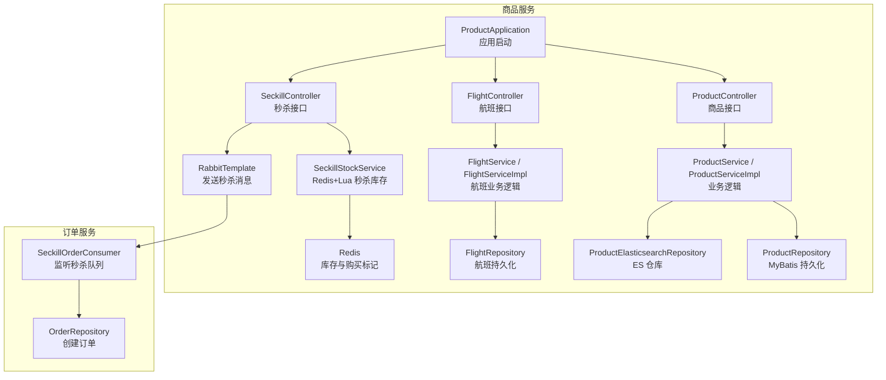

**图表来源**
- [ProductApplication.java:9-16](file://backend/ecommerce-product/src/main/java/com/ecommerce/product/ProductApplication.java#L9-L16)
- [ProductController.java:15-96](file://backend/ecommerce-product/src/main/java/com/ecommerce/product/controller/ProductController.java#L15-L96)
- [FlightController.java:15-79](file://backend/ecommerce-product/src/main/java/com/ecommerce/product/controller/FlightController.java#L15-L79)
- [SeckillController.java:26-149](file://backend/ecommerce-product/src/main/java/com/ecommerce/product/controller/SeckillController.java#L26-L149)

## 核心组件
- 启动类 ProductApplication：启用 Spring Boot、扫描商品包、导入全局异常处理器、扫描 MyBatis Mapper。
- 商品控制器 ProductController：提供商品查询、分类查询、多条件搜索、CRUD、全量 ES 同步、普通库存扣减接口。
- 航班控制器 FlightController：提供航班CRUD、按城市筛选、频率统计等RESTful接口。
- 秒杀控制器 SeckillController：提供秒杀库存初始化、秒杀抢购、剩余库存查询；负责用户校验、时间窗口校验、防重复购买、Lua 预扣减、消息发送。
- 商品服务 ProductService/ProductServiceImpl：封装商品读写、ES 同步、普通库存扣减；对 ES 操作具备容错降级。
- 航班服务 FlightService/FlightServiceImpl：处理航班业务逻辑，包括频率统计、城市间航线分析。
- 秒杀库存服务 SeckillStockService：基于 Redis + Lua 实现原子预扣减、库存回滚、购买标记与去重。
- 实体与索引：Product 为数据库模型；Flight 为航班实体；ProductDocument 为 ES 文档映射。
- 文件上传 FileController：`POST /files/images`（ADMIN）、`DELETE /files/images?objectKey=`（ADMIN），返回 `UploadResult{url,objectKey,originalName,size,contentType}`。
- 存储路由 FileStorageServiceRouter：按 `OssProperties.isConfigured()` 选择 OssFileStorageService 或 LocalFileStorageService，未配置 OSS 时自动退回本地磁盘。
- 图片校验 ImageUploadSupport：魔数校验（JPEG/PNG/GIF/WEBP）+ 扩展名/大小校验，objectKey 为 `{dir}/yyyy/MM/dd/{uuid}.{ext}`。
- 配置：application.yml 定义 MySQL、Redis、Elasticsearch、RabbitMQ、Nacos 等连接信息；ElasticsearchConfig 控制 ES 功能开关。

**章节来源**
- [ProductApplication.java:9-16](file://backend/ecommerce-product/src/main/java/com/ecommerce/product/ProductApplication.java#L9-L16)
- [ProductController.java:15-96](file://backend/ecommerce-product/src/main/java/com/ecommerce/product/controller/ProductController.java#L15-L96)
- [FlightController.java:15-79](file://backend/ecommerce-product/src/main/java/com/ecommerce/product/controller/FlightController.java#L15-L79)
- [SeckillController.java:26-149](file://backend/ecommerce-product/src/main/java/com/ecommerce/product/controller/SeckillController.java#L26-L149)
- [ProductService.java:8-38](file://backend/ecommerce-product/src/main/java/com/ecommerce/product/service/ProductService.java#L8-L38)
- [FlightService.java:8-25](file://backend/ecommerce-product/src/main/java/com/ecommerce/product/service/FlightService.java#L8-L25)
- [ProductServiceImpl.java:19-164](file://backend/ecommerce-product/src/main/java/com/ecommerce/product/service/impl/ProductServiceImpl.java#L19-L164)
- [FlightServiceImpl.java:15-98](file://backend/ecommerce-product/src/main/java/com/ecommerce/product/service/impl/FlightServiceImpl.java#L15-L98)
- [SeckillStockService.java:15-92](file://backend/ecommerce-product/src/main/java/com/ecommerce/product/service/SeckillStockService.java#L15-L92)

## 架构总览
商品服务采用分层架构，结合 Redis、Elasticsearch、RabbitMQ 构建高可用、高性能的商品与秒杀能力，并新增航班产品功能支持机票类商品的特殊业务需求。

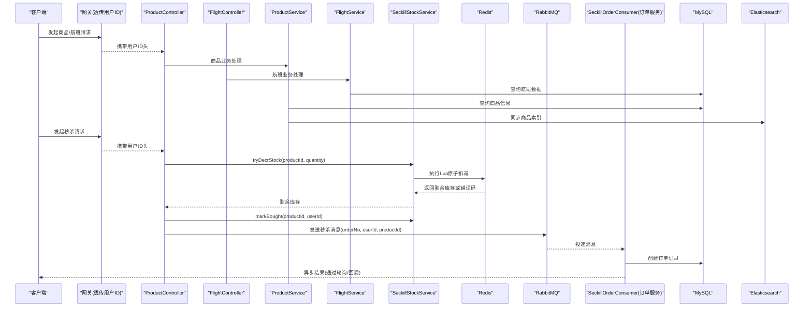

**图表来源**
- [ProductController.java:26-96](file://backend/ecommerce-product/src/main/java/com/ecommerce/product/controller/ProductController.java#L26-L96)
- [FlightController.java:26-79](file://backend/ecommerce-product/src/main/java/com/ecommerce/product/controller/FlightController.java#L26-L79)
- [SeckillController.java:61-122](file://backend/ecommerce-product/src/main/java/com/ecommerce/product/controller/SeckillController.java#L61-L122)

## 详细组件分析

### 启动类 ProductApplication
- 作用：引导 Spring Boot 应用，扫描 com.ecommerce.product 包，导入全局异常处理器，扫描 MyBatis Mapper。
- 关键点：统一异常处理通过 @Import(GlobalExceptionHandler.class) 注入，便于集中处理业务异常。

**章节来源**
- [ProductApplication.java:9-16](file://backend/ecommerce-product/src/main/java/com/ecommerce/product/ProductApplication.java#L9-L16)

### 商品控制器 ProductController
- 提供能力：
  - 查询全部商品、按 ID 查询、按分类查询
  - 多条件搜索（关键词、分类、价格区间）
  - 商品 CRUD（创建、更新、删除）
  - 全量同步商品到 Elasticsearch
  - 普通库存扣减（供订单服务 Feign 调用）
- 设计要点：
  - 使用统一 Result 包装响应
  - 参数校验使用 Jakarta Validation
  - 接口描述使用 OpenAPI 注解

```mermaid
flowchart TD
Start(["请求进入"]) --> Route{"路由匹配"}
Route --> |GET /products| GetAll["getAllProducts()"]
Route --> |GET /products/{id}| GetById["getProductById(id)"]
Route --> |GET /products/category/{category}| ByCategory["getProductsByCategory(category)"]
Route --> |GET /products/search| Search["searchProducts(...)"]
Route --> |POST /products| Create["createProduct(product)"]
Route --> |PUT /products/{id}| Update["updateProduct(id, product)"]
Route --> |DELETE /products/{id}| Delete["deleteProduct(id)"]
Route --> |POST /products/sync-es| SyncAll["syncAllToElasticsearch()"]
Route --> |POST /products/deduct-stock| Deduct["deductStock(productId, quantity)"]
GetAll --> End(["返回Result"])
GetById --> End
ByCategory --> End
Search --> End
Create --> End
Update --> End
Delete --> End
SyncAll --> End
Deduct --> End
```

**图表来源**
- [ProductController.java:26-96](file://backend/ecommerce-product/src/main/java/com/ecommerce/product/controller/ProductController.java#L26-L96)

**章节来源**
- [ProductController.java:15-96](file://backend/ecommerce-product/src/main/java/com/ecommerce/product/controller/ProductController.java#L15-L96)

### 航班控制器 FlightController
- 提供能力：
  - 查询所有航班、根据 ID 查询航班详情
  - 按出发城市/落地城市筛选航班
  - 获取城市间航班频率统计数据（供飞线图使用）
  - 航班 CRUD（创建、更新、删除）
- 设计特点：
  - 统一的 RESTful API 设计风格
  - 支持复杂的航班数据查询和统计分析
  - 与商品系统集成，支持航班关联商品信息

```mermaid
flowchart TD
Start(["航班请求"]) --> Route{"路由匹配"}
Route --> |GET /flights| GetAll["getAllFlights()"]
Route --> |GET /flights/{id}| GetById["getFlightById(id)"]
Route --> |GET /flights/search| Search["searchFlights(departureCity, arrivalCity)"]
Route --> |GET /flights/frequency| Frequency["getFrequencyData()"]
Route --> |POST /flights| Create["createFlight(flight)"]
Route --> |PUT /flights/{id}| Update["updateFlight(id, flight)"]
Route --> |DELETE /flights/{id}| Delete["deleteFlight(id)"]
GetAll --> End(["返回Result"])
GetById --> End
Search --> End
Frequency --> End
Create --> End
Update --> End
Delete --> End
```

**图表来源**
- [FlightController.java:26-79](file://backend/ecommerce-product/src/main/java/com/ecommerce/product/controller/FlightController.java#L26-L79)

**章节来源**
- [FlightController.java:15-79](file://backend/ecommerce-product/src/main/java/com/ecommerce/product/controller/FlightController.java#L15-L79)

### 商品服务 ProductService / ProductServiceImpl
- 职责：
  - 商品基础 CRUD
  - 分类查询与多条件搜索
  - 普通库存扣减（直接写库并同步 ES）
  - 单条/全量同步商品到 Elasticsearch
- 关键实现细节：
  - 新增/更新后自动同步 ES；删除时尝试从 ES 删除，失败仅告警不阻断事务
  - 同步 ES 方法具备空指针保护与异常捕获，保证 ES 不可用时不影响主流程
  - toDocument 将数据库实体映射为 ES 文档字段

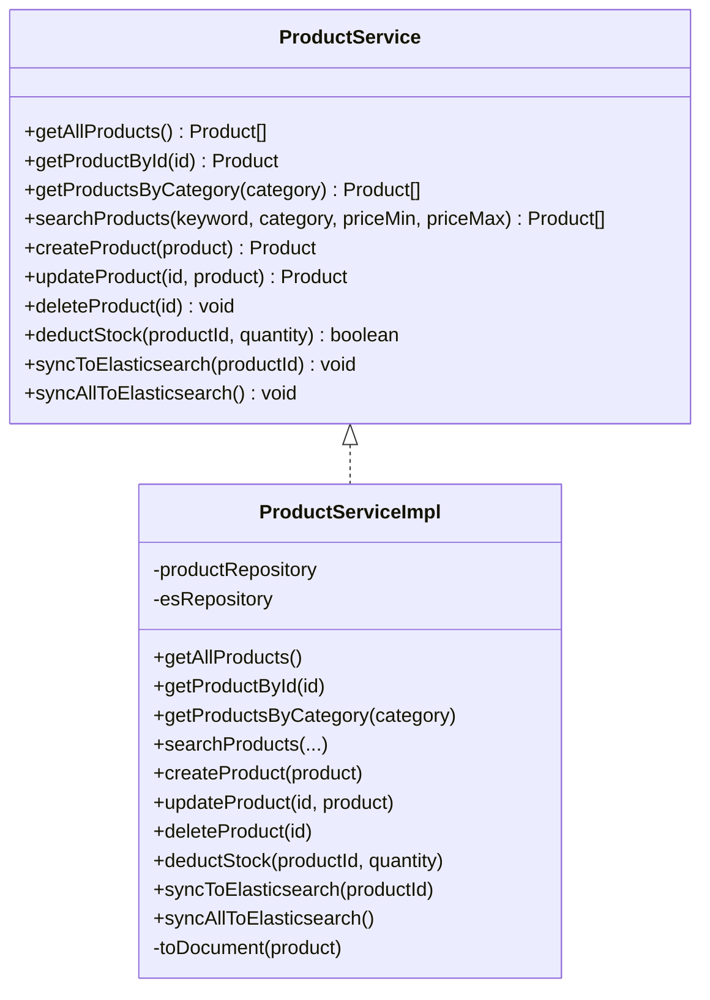

**图表来源**
- [ProductService.java:8-38](file://backend/ecommerce-product/src/main/java/com/ecommerce/product/service/ProductService.java#L8-L38)
- [ProductServiceImpl.java:19-164](file://backend/ecommerce-product/src/main/java/com/ecommerce/product/service/impl/ProductServiceImpl.java#L19-L164)

**章节来源**
- [ProductService.java:8-38](file://backend/ecommerce-product/src/main/java/com/ecommerce/product/service/ProductService.java#L8-L38)
- [ProductServiceImpl.java:19-164](file://backend/ecommerce-product/src/main/java/com/ecommerce/product/service/impl/ProductServiceImpl.java#L19-L164)

### 航班服务 FlightService / FlightServiceImpl
- 职责：
  - 航班基础 CRUD 操作
  - 按城市筛选航班查询
  - 航班频率统计和数据分析
  - 与商品系统集成，支持航班关联商品信息
- 关键实现细节：
  - getFrequencyData 方法专门处理航班频率统计，返回适合前端可视化的数据结构
  - 支持复杂的城市间航线分析和统计
  - 事务管理确保数据一致性

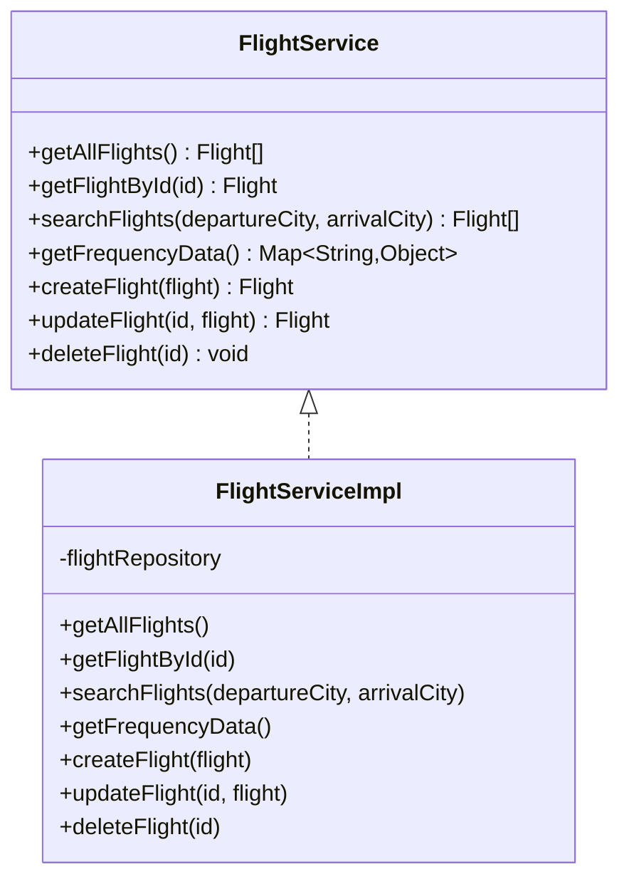

**图表来源**
- [FlightService.java:8-25](file://backend/ecommerce-product/src/main/java/com/ecommerce/product/service/FlightService.java#L8-L25)
- [FlightServiceImpl.java:15-98](file://backend/ecommerce-product/src/main/java/com/ecommerce/product/service/impl/FlightServiceImpl.java#L15-L98)

**章节来源**
- [FlightService.java:8-25](file://backend/ecommerce-product/src/main/java/com/ecommerce/product/service/FlightService.java#L8-L25)
- [FlightServiceImpl.java:15-98](file://backend/ecommerce-product/src/main/java/com/ecommerce/product/service/impl/FlightServiceImpl.java#L15-L98)

### 秒杀库存服务 SeckillStockService
- 目标：在高并发下安全地预扣减库存，并提供幂等与回滚能力。
- 核心机制：
  - 使用 Redis String 存储库存 key: seckill:stock:{productId}
  - 使用 Lua 脚本原子检查与扣减，避免超卖
  - 使用另一个 key 前缀 seckill:bought:{productId}:{userId} 标记用户已购买，设置过期时间防止脏数据
  - 提供 getStock、rollbackStock、clearBought 等辅助方法

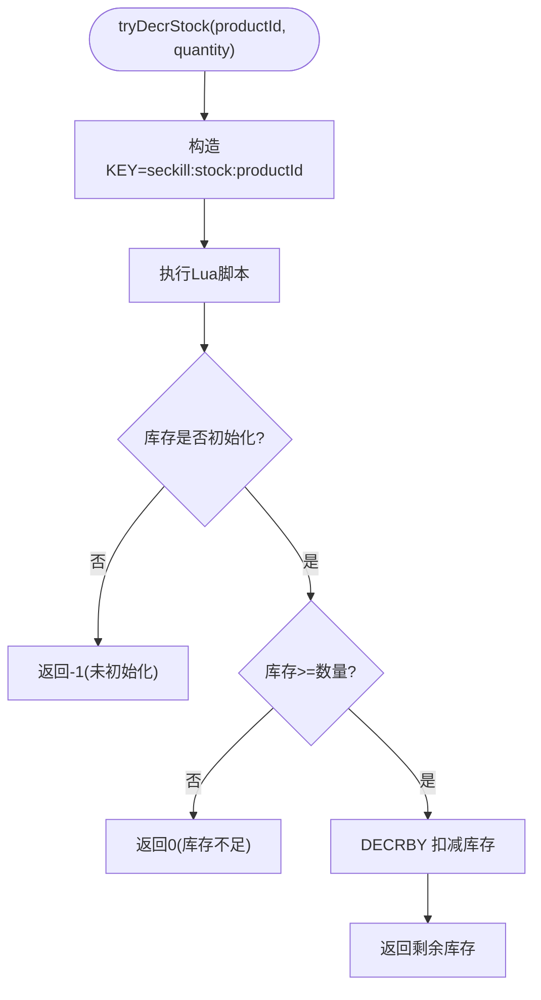

**图表来源**
- [SeckillStockService.java:44-49](file://backend/ecommerce-product/src/main/java/com/ecommerce/product/service/SeckillStockService.java#L44-L49)
- [seckill_stock.lua:1-13](file://backend/ecommerce-product/src/main/resources/lua/seckill_stock.lua#L1-L13)

**章节来源**
- [SeckillStockService.java:15-92](file://backend/ecommerce-product/src/main/java/com/ecommerce/product/service/SeckillStockService.java#L15-L92)
- [seckill_stock.lua:1-13](file://backend/ecommerce-product/src/main/resources/lua/seckill_stock.lua#L1-L13)

### 秒杀控制器 SeckillController
- 能力：
  - 初始化秒杀库存（管理端）
  - 秒杀抢购（限流前置校验 + Lua 预扣减 + 消息异步下单）
  - 查询秒杀剩余库存
- 关键流程：
  - 从请求头获取用户ID（由网关注入）
  - 校验商品存在且为秒杀商品、时间窗口有效
  - 防重复购买（Redis 标记）
  - Lua 预扣减库存，成功则标记已购买并发送 MQ 消息
  - 立即返回排队状态，最终结果由订单服务异步落库

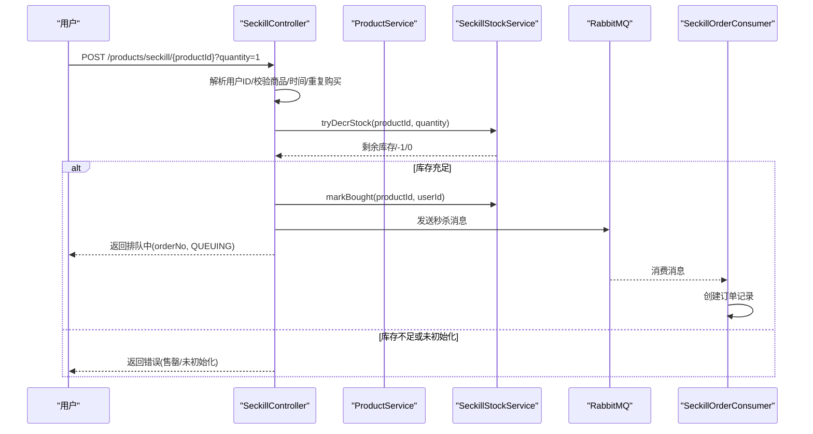

**图表来源**
- [SeckillController.java:61-122](file://backend/ecommerce-product/src/main/java/com/ecommerce/product/controller/SeckillController.java#L61-L122)
- [SeckillStockService.java:44-74](file://backend/ecommerce-product/src/main/java/com/ecommerce/product/service/SeckillStockService.java#L44-L74)
- [SeckillOrderConsumer.java:35-67](file://backend/ecommerce-order/src/main/java/com/ecommerce/order/consumer/SeckillOrderConsumer.java#L35-L67)

**章节来源**
- [SeckillController.java:26-149](file://backend/ecommerce-product/src/main/java/com/ecommerce/product/controller/SeckillController.java#L26-L149)

### 实体模型设计
- Product（数据库实体）：包含商品基本信息、分类、图片、状态、是否秒杀、秒杀价、秒杀时间等。
- Flight（航班实体）：包含航班特有字段如出发/到达城市、经纬度坐标、航班号、飞行时长、每周频率、途经城市坐标等，以及与商品的关联字段。
- ProductDocument（ES 文档）：对应 ES 索引 products，字段类型与分词器明确标注，支持文本检索、数值范围、布尔过滤、日期范围等。

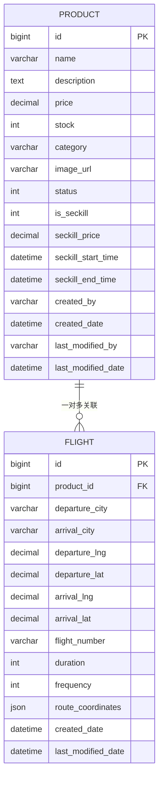

**图表来源**
- [Product.java:10-31](file://backend/ecommerce-product/src/main/java/com/ecommerce/product/entity/Product.java#L10-L31)
- [Flight.java:10-39](file://backend/ecommerce-product/src/main/java/com/ecommerce/product/entity/Flight.java#L10-L39)
- [schema.sql:6-48](file://backend/ecommerce-product/src/main/resources/db/schema.sql#L6-L48)

**章节来源**
- [Product.java:10-31](file://backend/ecommerce-product/src/main/java/com/ecommerce/product/entity/Product.java#L10-L31)
- [Flight.java:10-39](file://backend/ecommerce-product/src/main/java/com/ecommerce/product/entity/Flight.java#L10-L39)
- [ProductDocument.java:16-55](file://backend/ecommerce-product/src/main/java/com/ecommerce/product/elasticsearch/ProductDocument.java#L16-L55)
- [schema.sql:6-48](file://backend/ecommerce-product/src/main/resources/db/schema.sql#L6-L48)

### 商品数据流图（含 ES 同步）
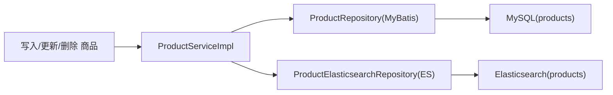

**图表来源**
- [ProductServiceImpl.java:57-98](file://backend/ecommerce-product/src/main/java/com/ecommerce/product/service/impl/ProductServiceImpl.java#L57-L98)
- [ProductServiceImpl.java:112-145](file://backend/ecommerce-product/src/main/java/com/ecommerce/product/service/impl/ProductServiceImpl.java#L112-L145)

**章节来源**
- [ProductServiceImpl.java:57-98](file://backend/ecommerce-product/src/main/java/com/ecommerce/product/service/impl/ProductServiceImpl.java#L57-L98)
- [ProductServiceImpl.java:112-145](file://backend/ecommerce-product/src/main/java/com/ecommerce/product/service/impl/ProductServiceImpl.java#L112-L145)

### 航班数据流图
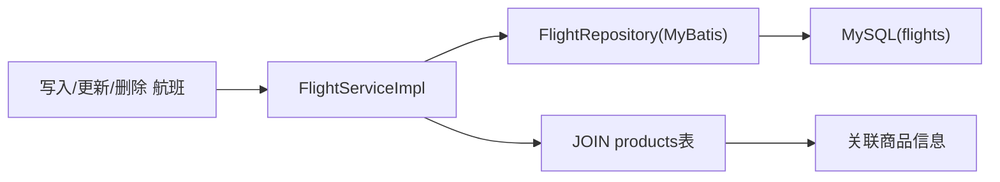

**图表来源**
- [FlightServiceImpl.java:76-98](file://backend/ecommerce-product/src/main/java/com/ecommerce/product/service/impl/FlightServiceImpl.java#L76-L98)
- [FlightMapper.xml:43-101](file://backend/ecommerce-product/src/main/resources/mapper/FlightMapper.xml#L43-L101)

**章节来源**
- [FlightServiceImpl.java:76-98](file://backend/ecommerce-product/src/main/java/com/ecommerce/product/service/impl/FlightServiceImpl.java#L76-L98)
- [FlightMapper.xml:43-101](file://backend/ecommerce-product/src/main/resources/mapper/FlightMapper.xml#L43-L101)

### 秒杀流程图（端到端）
见上文"架构总览"中的序列图。

**章节来源**
- [SeckillController.java:61-122](file://backend/ecommerce-product/src/main/java/com/ecommerce/product/controller/SeckillController.java#L61-L122)
- [SeckillStockService.java:44-74](file://backend/ecommerce-product/src/main/java/com/ecommerce/product/service/SeckillStockService.java#L44-L74)
- [SeckillOrderConsumer.java:35-67](file://backend/ecommerce-order/src/main/java/com/ecommerce/order/consumer/SeckillOrderConsumer.java#L35-L67)

### 缓存策略图（Redis）
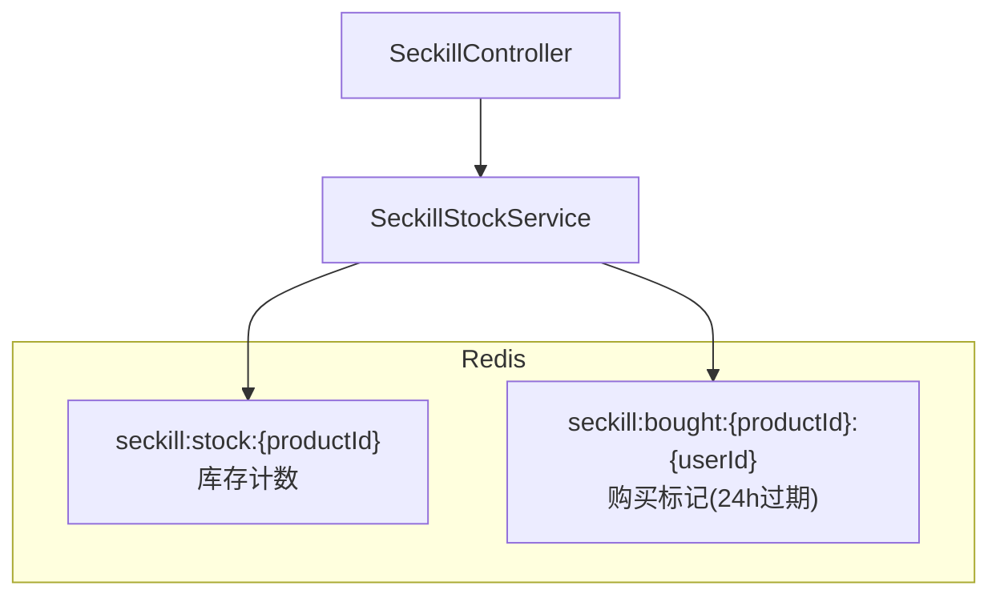

**图表来源**
- [SeckillStockService.java:18-20](file://backend/ecommerce-product/src/main/java/com/ecommerce/product/service/SeckillStockService.java#L18-L20)
- [SeckillStockService.java:35-74](file://backend/ecommerce-product/src/main/java/com/ecommerce/product/service/SeckillStockService.java#L35-L74)

**章节来源**
- [SeckillStockService.java:18-74](file://backend/ecommerce-product/src/main/java/com/ecommerce/product/service/SeckillStockService.java#L18-L74)

### 文件与图片上传（FileController + 存储路由）

图片上传走后端代理：客户端把 multipart 交给商品服务，服务端完成校验与存储后再返回可访问 URL，前端再调用 `PUT /products/{id}/image` 仅回写 `image_url`。

- 接口
  - `POST /files/images`：上传单图，`@PreAuthorize("hasRole('ADMIN')")`；multipart 限制 5MB（请求上限 6MB）
  - `DELETE /files/images?objectKey=...`：删除存储对象（运维/清理用）
  - `PUT /products/{id}/image`：仅更新图片地址（空字符串表示清除），成功后 `syncToElasticsearch`
- 存储路由
  - `FileStorageServiceRouter` 构造时注入 OSS 与本地两个实现，调用时按 `properties.isConfigured() ? oss : local` 分派
  - OSS 实现：写入阿里云 OSS，设置 `Cache-Control: immutable`，URL 优先 `publicUrlPrefix`，否则 `https://{bucket}.{endpoint}`
  - 本地实现：写入 `uploads/` 下的日期目录，通过 `/files/local/**` 静态映射对外，URL 前缀 `/api/product/files/local`
- 校验与安全
  - `ImageUploadSupport` 读取文件头前 12 字节做魔数校验，防止伪造扩展名
  - 仅允许 jpeg/png/gif/webp，objectKey 由服务端生成，不信任客户端文件名
  - `OssClientProvider` 懒加载客户端，未配置时抛业务异常（HTTP 503）
- 部署约束
  - 网关 `spring.codec.max-in-memory-size=16MB`、nginx `client_max_body_size 6m`、本地 `spring.servlet.multipart.max-file-size=5MB/max-request-size=6MB`

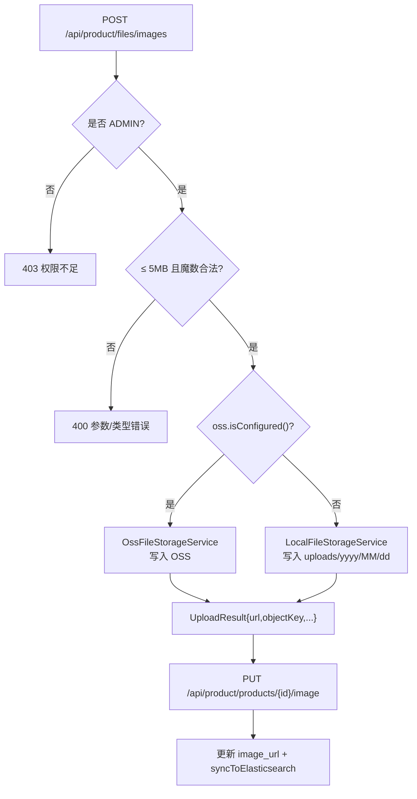

**图表来源**
- [FileController.java](file://backend/ecommerce-product/src/main/java/com/ecommerce/product/controller/FileController.java)
- [FileStorageServiceRouter.java](file://backend/ecommerce-product/src/main/java/com/ecommerce/product/service/impl/FileStorageServiceRouter.java)
- [ImageUploadSupport.java](file://backend/ecommerce-product/src/main/java/com/ecommerce/product/service/support/ImageUploadSupport.java)

**章节来源**
- [FileController.java](file://backend/ecommerce-product/src/main/java/com/ecommerce/product/controller/FileController.java)
- [FileStorageService.java](file://backend/ecommerce-product/src/main/java/com/ecommerce/product/service/FileStorageService.java)
- [LocalFileStorageService.java](file://backend/ecommerce-product/src/main/java/com/ecommerce/product/service/impl/LocalFileStorageService.java)
- [OssFileStorageService.java](file://backend/ecommerce-product/src/main/java/com/ecommerce/product/service/impl/OssFileStorageService.java)
- [OssProperties.java](file://backend/ecommerce-product/src/main/java/com/ecommerce/product/config/properties/OssProperties.java)

## 依赖关系分析
- 外部依赖：
  - MySQL：持久化商品、航班与订单
  - Redis：秒杀库存原子扣减、购买标记
  - Elasticsearch：商品检索与筛选
  - RabbitMQ：秒杀消息异步解耦
  - Nacos：服务发现（配置项中启用）
- 内部耦合：
  - ProductController 依赖 ProductService 与 SeckillStockService
  - FlightController 依赖 FlightService
  - ProductServiceImpl 依赖 ProductRepository 与 ProductElasticsearchRepository
  - FlightServiceImpl 依赖 FlightRepository
  - SeckillController 依赖 ProductService、SeckillStockService、RabbitTemplate
  - FileController 依赖 FileStorageService（实际为 FileStorageServiceRouter）与 OssProperties
  - 订单服务通过 RabbitMQ 与商品服务解耦

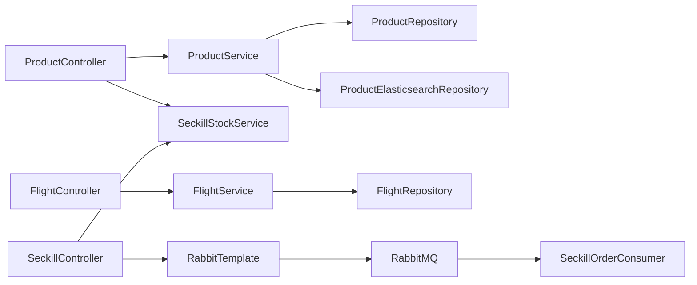

**图表来源**
- [ProductController.java:15-96](file://backend/ecommerce-product/src/main/java/com/ecommerce/product/controller/ProductController.java#L15-L96)
- [FlightController.java:15-79](file://backend/ecommerce-product/src/main/java/com/ecommerce/product/controller/FlightController.java#L15-L79)
- [ProductServiceImpl.java:19-164](file://backend/ecommerce-product/src/main/java/com/ecommerce/product/service/impl/ProductServiceImpl.java#L19-L164)
- [FlightServiceImpl.java:15-98](file://backend/ecommerce-product/src/main/java/com/ecommerce/product/service/impl/FlightServiceImpl.java#L15-L98)
- [SeckillController.java:26-149](file://backend/ecommerce-product/src/main/java/com/ecommerce/product/controller/SeckillController.java#L26-L149)

**章节来源**
- [application.yml:6-48](file://backend/ecommerce-product/src/main/resources/application.yml#L6-L48)

## 性能与高并发优化
- Redis + Lua 原子性：
  - 使用 Lua 脚本在 Redis 内完成"读取-判断-扣减"的原子操作，避免竞争条件与超卖。
  - 库存 key 与购买标记 key 分离，降低热点冲突。
- 预扣减 + 异步下单：
  - 秒杀主链路只进行 Redis 预扣减与消息发送，订单落库由消费者异步处理，削峰填谷。
- ES 同步降级：
  - ES 不可用时跳过同步，不影响主流程；删除 ES 失败仅告警，保障事务一致性。
- 连接池与超时：
  - Redis Lettuce 连接池参数已配置，提升并发吞吐。
- 航班数据优化：
  - 航班查询使用 JOIN 优化，减少数据库往返次数
  - 频率统计数据预计算，提高前端渲染性能
- 建议优化点：
  - 引入分布式锁（如 Redisson）对热点商品初始化与批量同步加锁，避免重复初始化。
  - 秒杀接口增加令牌桶/漏桶限流，进一步保护后端。
  - 图片上传建议前端先压缩，服务端保留魔数校验；OSS 开启 CDN 回源缓存降低带宽。
  - 对 ES 同步改为异步事件驱动（例如基于 MQ），减少同步阻塞。
  - 对 Redis 库存 key 做分片或预热，缓解热点键压力。
  - 航班数据考虑引入缓存层，减少频繁查询。

## 故障恢复与可观测性
- 全局异常处理：
  - 通过 GlobalExceptionHandler 统一捕获业务异常，返回标准 Result。
- 日志与监控：
  - 关键路径（ES 同步、秒杀消息发送、消费者处理）均输出结构化日志，便于定位问题。
- 幂等与回滚：
  - 购买标记带过期时间，避免脏数据；消费者侧抛出异常触发重试，后续可扩展死信队列与人工补偿。
- ES 容错：
  - 同步失败仅记录日志，不中断主流程；全量同步逐条 try-catch，确保部分失败不影响整体。
- 航班数据容错：
  - 航班查询失败时返回空结果而非异常，保证前端页面正常显示。
- 图片上传排错：
  - 403：非 ADMIN 调用上传接口；503：OSS 未配置且本地存储不可写/`OssClientProvider` 初始化失败
  - 图片可上传但商品无图：确认随后调用了 `PUT /products/{id}/image`（只上传不回写不会更新 `image_url`）
  - 本地存储 URL 为 `/api/product/files/local/...`，需网关白名单放行匿名读取

**章节来源**
- [ProductApplication.java:11-11](file://backend/ecommerce-product/src/main/java/com/ecommerce/product/ProductApplication.java#L11-L11)
- [ProductServiceImpl.java:90-97](file://backend/ecommerce-product/src/main/java/com/ecommerce/product/service/impl/ProductServiceImpl.java#L90-L97)
- [ProductServiceImpl.java:118-145](file://backend/ecommerce-product/src/main/java/com/ecommerce/product/service/impl/ProductServiceImpl.java#L118-L145)
- [SeckillOrderConsumer.java:62-67](file://backend/ecommerce-order/src/main/java/com/ecommerce/order/consumer/SeckillOrderConsumer.java#L62-L67)

## 结论
商品服务以清晰的分层架构为基础，结合 Redis + Lua 的原子预扣减、Elasticsearch 的全文检索与 RabbitMQ 的异步解耦，构建了高吞吐、低延迟的商品与秒杀能力。新增的航班产品功能进一步完善了系统的业务能力，支持机票类商品的特殊业务需求；图片上传通过 OSS/本地双存储路由与魔数校验，在未配置 OSS 的开发环境也能直接跑通。通过统一的异常处理与完善的日志埋点，系统在稳定性与可观测性方面具备良好基础。未来可在分布式锁、限流、ES 同步异步化等方面持续优化，进一步提升系统弹性与扩展性。

## 附录：API 参考
- 商品管理
  - GET /products：查询所有商品
  - GET /products/{id}：根据 ID 查询商品
  - GET /products/category/{category}：按分类查询
  - GET /products/search?keyword=&category=&priceMin=&priceMax=：多条件搜索
  - POST /products：创建商品
  - PUT /products/{id}：更新商品
  - DELETE /products/{id}：删除商品
  - POST /products/sync-es：全量同步商品到 ES
  - POST /products/deduct-stock?productId=&quantity=：普通库存扣减（Feign 调用）
- 航班管理
  - GET /flights：查询所有航班
  - GET /flights/{id}：根据 ID 查询航班详情
  - GET /flights/search?departureCity=&arrivalCity=：按城市筛选航班
  - GET /flights/frequency：获取航班频率统计数据
  - POST /flights：创建航班
  - PUT /flights/{id}：更新航班
  - DELETE /flights/{id}：删除航班
- 秒杀管理
  - POST /products/seckill/init/{productId}?stock=：初始化秒杀库存
  - POST /products/seckill/{productId}?quantity=：秒杀抢购
  - GET /products/seckill/stock/{productId}：查询秒杀剩余库存
- 图片与文件（均需 ADMIN）
  - POST /files/images：上传单图（multipart，≤ 5MB）
  - DELETE /files/images?objectKey=：删除存储对象
  - PUT /products/{id}/image：仅回写商品图片地址（空字符串清除）

**章节来源**
- [ProductController.java:26-96](file://backend/ecommerce-product/src/main/java/com/ecommerce/product/controller/ProductController.java#L26-L96)
- [FlightController.java:26-79](file://backend/ecommerce-product/src/main/java/com/ecommerce/product/controller/FlightController.java#L26-L79)
- [SeckillController.java:45-149](file://backend/ecommerce-product/src/main/java/com/ecommerce/product/controller/SeckillController.java#L45-L149)