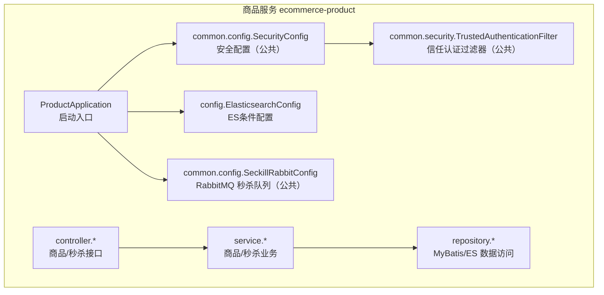
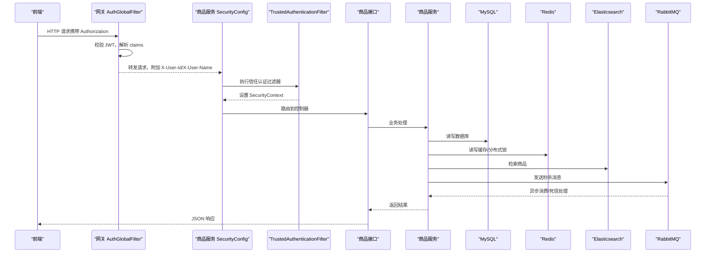
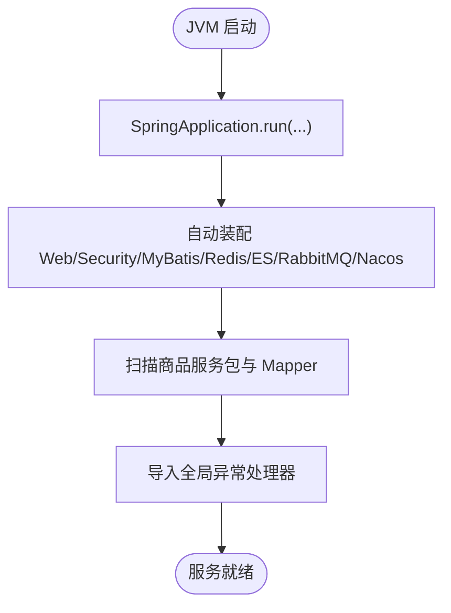
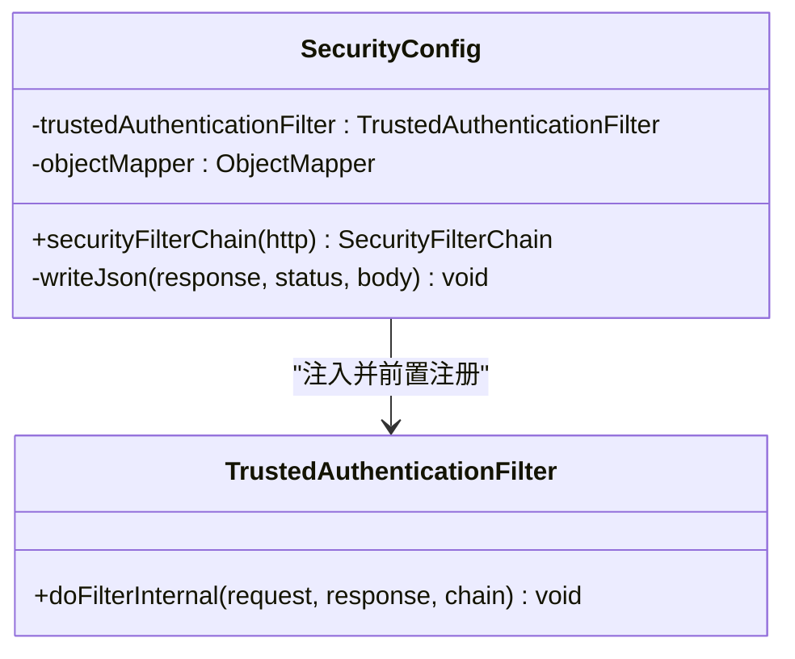
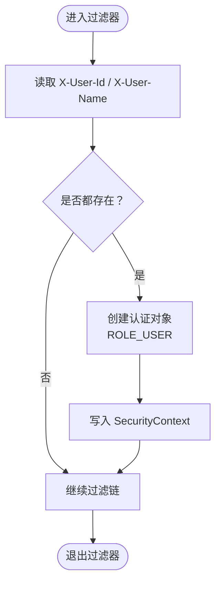
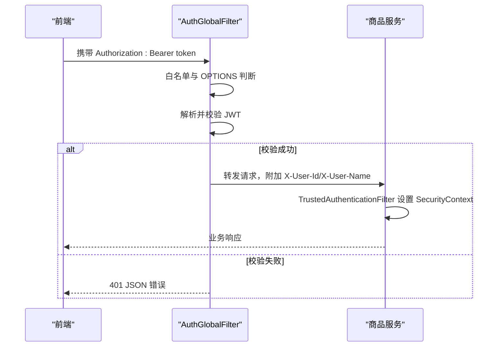
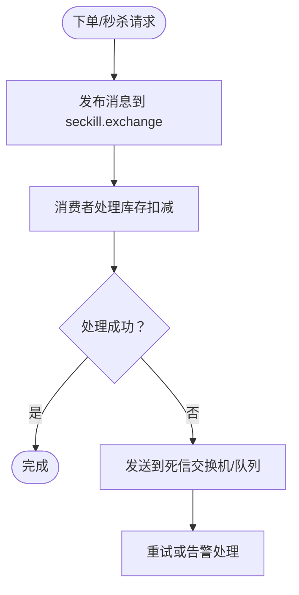
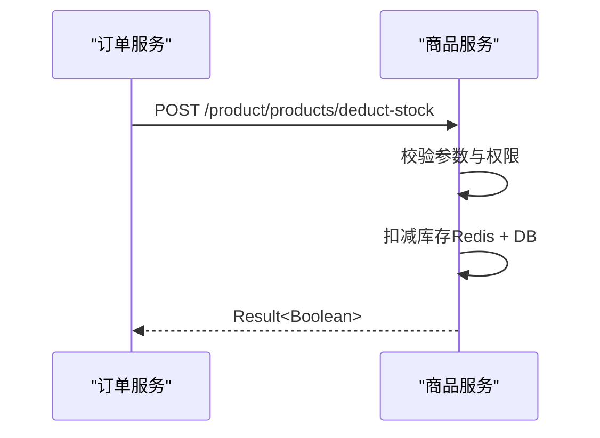
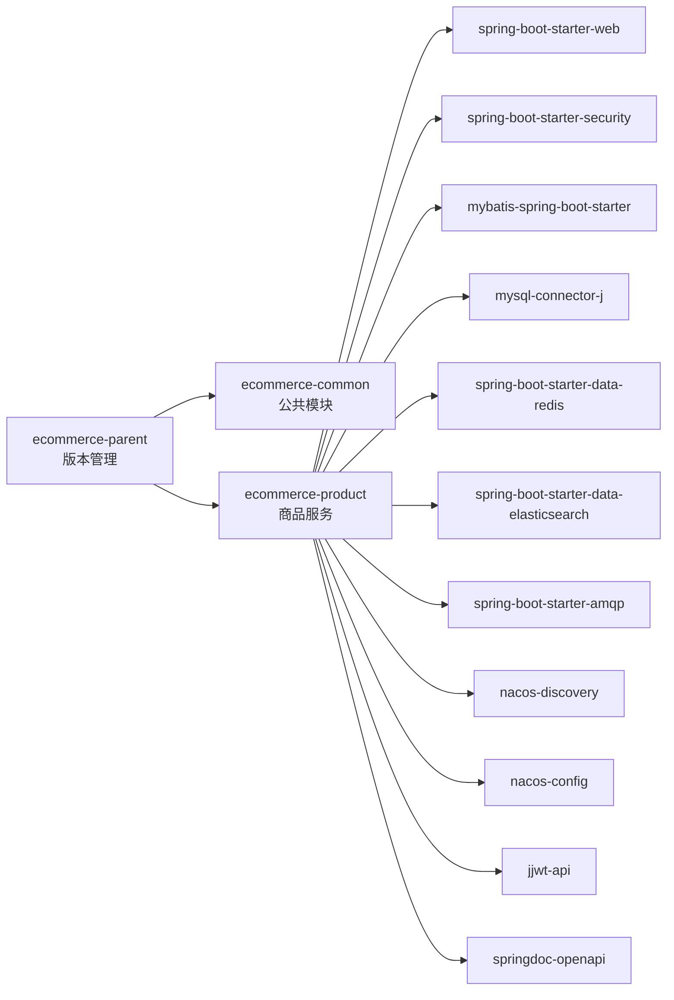

# 商品服务架构设计

<cite>
**本文引用的文件**   
- [ProductApplication.java](file://backend/ecommerce-product/src/main/java/com/ecommerce/product/ProductApplication.java)
- [SecurityConfig.java（公共模块）](file://backend/ecommerce-common/src/main/java/com/ecommerce/common/config/SecurityConfig.java)
- [TrustedAuthenticationFilter.java（公共模块）](file://backend/ecommerce-common/src/main/java/com/ecommerce/common/security/TrustedAuthenticationFilter.java)
- [application.yml（商品服务）](file://backend/ecommerce-product/src/main/resources/application.yml)
- [bootstrap.yml（商品服务）](file://backend/ecommerce-product/src/main/resources/bootstrap.yml)
- [pom.xml（商品服务）](file://backend/ecommerce-product/pom.xml)
- [pom.xml（父工程）](file://backend/pom.xml)
- [pom.xml（公共模块）](file://backend/ecommerce-common/pom.xml)
- [ElasticsearchConfig.java](file://backend/ecommerce-product/src/main/java/com/ecommerce/product/config/ElasticsearchConfig.java)
- [SeckillRabbitConfig.java（公共模块）](file://backend/ecommerce-common/src/main/java/com/ecommerce/common/config/SeckillRabbitConfig.java)
- [AuthGlobalFilter.java（网关）](file://backend/ecommerce-gateway/src/main/java/com/ecommerce/gateway/filter/AuthGlobalFilter.java)
- [ProductClient.java（订单服务调用商品服务）](file://backend/ecommerce-order/src/main/java/com/ecommerce/order/client/ProductClient.java)
</cite>

## 目录
1. [简介](#简介)
2. [项目结构](#项目结构)
3. [核心组件](#核心组件)
4. [架构总览](#架构总览)
5. [详细组件分析](#详细组件分析)
6. [依赖关系分析](#依赖关系分析)
7. [性能与可扩展性](#性能与可扩展性)
8. [故障排查指南](#故障排查指南)
9. [结论](#结论)

## 简介
本文件面向“商品服务”的架构设计与实现细节，重点覆盖以下方面：
- 启动类 ProductApplication 的配置与初始化流程，包括 Spring Boot 自动装配、MyBatis Mapper 扫描、全局异常处理注入。
- 安全配置 SecurityConfig 的设计：无状态会话、跨域开关、统一异常响应、信任认证过滤器接入。
- 信任认证过滤器 TrustedAuthenticationFilter：从网关传入的请求头提取用户信息并写入 Spring Security 上下文。
- POM 依赖管理：Spring Cloud、Nacos、数据库驱动、Redis、Elasticsearch、RabbitMQ、JWT、OpenAPI 等。
- 与其他微服务的交互方式：通过 Feign 客户端由订单服务调用商品服务接口。
- 数据一致性保障思路：基于 Redis + RabbitMQ 的秒杀库存扣减方案及死信队列兜底。
- 监控与日志：应用日志级别、OpenAPI 文档路径、Nacos 配置中心开关。

## 项目结构
商品服务位于 backend/ecommerce-product 模块，采用典型的 Spring Boot 分层结构：
- 启动入口：ProductApplication
- 配置层：ElasticsearchConfig（安全配置与 RabbitMQ 配置已由 common 模块统一提供）
- 控制器层：商品与秒杀相关接口
- 服务层：商品业务逻辑与秒杀库存服务
- 数据访问层：MyBatis Repository/Mapper、Elasticsearch Repository
- 安全层：TrustedAuthenticationFilter（已由 common 模块统一提供，通过 @Import 引入）
- 资源文件：application.yml、bootstrap.yml、Mapper XML、Lua 脚本等

**图表来源**
- [ProductApplication.java:9-15](file://backend/ecommerce-product/src/main/java/com/ecommerce/product/ProductApplication.java#L9-L15)
- [SecurityConfig.java](file://backend/ecommerce-common/src/main/java/com/ecommerce/common/config/SecurityConfig.java)
- [TrustedAuthenticationFilter.java](file://backend/ecommerce-common/src/main/java/com/ecommerce/common/security/TrustedAuthenticationFilter.java)
- [ElasticsearchConfig.java:11-13](file://backend/ecommerce-product/src/main/java/com/ecommerce/product/config/ElasticsearchConfig.java#L11-L13)
- [SeckillRabbitConfig.java:10-57](file://backend/ecommerce-common/src/main/java/com/ecommerce/common/config/SeckillRabbitConfig.java#L10-L57)

**章节来源**
- [ProductApplication.java:9-15](file://backend/ecommerce-product/src/main/java/com/ecommerce/product/ProductApplication.java#L9-L15)
- [application.yml:1-74](file://backend/ecommerce-product/src/main/resources/application.yml#L1-L74)

## 核心组件
- 启动类 ProductApplication：启用 Spring Boot 自动装配、扫描商品服务包、注册 MyBatis Mapper、导入全局异常处理器。
- 安全配置 SecurityConfig（位于 common 模块）：禁用 CSRF、开启 CORS、无状态会话、放行所有请求、统一异常返回 JSON、前置信任认证过滤器。
- 信任认证过滤器 TrustedAuthenticationFilter（位于 common 模块）：从网关透传的 X-User-Id 和 X-User-Name 读取用户信息，构造认证对象并写入 SecurityContext。
- ES 条件配置 ElasticsearchConfig：仅在 spring.elasticsearch.enabled=true 时生效，仓库启用由 Spring Boot 自动配置处理。
- 秒杀消息队列 SeckillRabbitConfig：定义秒杀交换机、队列、死信交换机与死信队列，支持失败重试与兜底处理。

**章节来源**
- [ProductApplication.java:9-15](file://backend/ecommerce-product/src/main/java/com/ecommerce/product/ProductApplication.java#L9-L15)
- [SecurityConfig.java:24-63](file://backend/ecommerce-common/src/main/java/com/ecommerce/common/config/SecurityConfig.java#L24-L63)
- [TrustedAuthenticationFilter.java:23-48](file://backend/ecommerce-common/src/main/java/com/ecommerce/common/security/TrustedAuthenticationFilter.java#L23-L48)
- [ElasticsearchConfig.java:11-13](file://backend/ecommerce-product/src/main/java/com/ecommerce/product/config/ElasticsearchConfig.java#L11-L13)
- [SeckillRabbitConfig.java:10-57](file://backend/ecommerce-common/src/main/java/com/ecommerce/common/config/SeckillRabbitConfig.java#L10-L57)

## 架构总览
商品服务作为后端微服务之一，整体交互如下：
- 前端通过网关进入系统，网关完成 JWT 校验并将用户信息以请求头形式透传给下游服务。
- 商品服务信任网关透传的用户头，无需再次校验 JWT，简化内部服务鉴权。
- 商品服务提供商品 CRUD、ES 搜索、秒杀库存扣减等能力；订单服务通过 Feign 调用商品服务进行库存扣减。
- 数据持久化使用 MySQL，缓存与分布式锁使用 Redis，搜索使用 Elasticsearch，异步削峰与可靠性使用 RabbitMQ。

**图表来源**
- [AuthGlobalFilter.java:80-140](file://backend/ecommerce-gateway/src/main/java/com/ecommerce/gateway/filter/AuthGlobalFilter.java#L80-L140)
- [SecurityConfig.java:37-55](file://backend/ecommerce-common/src/main/java/com/ecommerce/common/config/SecurityConfig.java#L37-L55)
- [TrustedAuthenticationFilter.java:31-48](file://backend/ecommerce-common/src/main/java/com/ecommerce/common/security/TrustedAuthenticationFilter.java#L31-L48)
- [application.yml:9-42](file://backend/ecommerce-product/src/main/resources/application.yml#L9-L42)

## 详细组件分析

### 启动类 ProductApplication 配置与初始化
- 启用 Spring Boot 自动装配，扫描 com.ecommerce.product 包。
- 通过 @MapperScan 指定 MyBatis Mapper 扫描路径。
- 通过 @Import 引入全局异常处理器，统一异常响应格式。
- main 方法启动 Spring Application。

**图表来源**
- [ProductApplication.java:9-15](file://backend/ecommerce-product/src/main/java/com/ecommerce/product/ProductApplication.java#L9-L15)

**章节来源**
- [ProductApplication.java:9-15](file://backend/ecommerce-product/src/main/java/com/ecommerce/product/ProductApplication.java#L9-L15)

### 安全配置 SecurityConfig
- 禁用 CSRF，避免前后端分离场景下的重复校验。
- 开启 CORS（空配置表示允许默认策略）。
- 会话策略设置为 STATELESS，适合无状态微服务。
- 授权策略为 anyRequest().permitAll，实际鉴权由网关与信任过滤器完成。
- 统一异常处理：未认证返回 401，拒绝访问返回 403，并以 Result 结构返回 JSON。
- 在 UsernamePasswordAuthenticationFilter 之前插入 TrustedAuthenticationFilter。

**图表来源**
- [SecurityConfig.java:24-63](file://backend/ecommerce-common/src/main/java/com/ecommerce/common/config/SecurityConfig.java#L24-L63)
- [TrustedAuthenticationFilter.java:23-48](file://backend/ecommerce-common/src/main/java/com/ecommerce/common/security/TrustedAuthenticationFilter.java#L23-L48)

**章节来源**
- [SecurityConfig.java:24-63](file://backend/ecommerce-common/src/main/java/com/ecommerce/common/config/SecurityConfig.java#L24-L63)

### 信任认证过滤器 TrustedAuthenticationFilter
- 从请求头中读取 X-User-Id 与 X-User-Name。
- 若两者均存在，则构造 UsernamePasswordAuthenticationToken，赋予 ROLE_USER 权限。
- 将认证对象写入 SecurityContextHolder，供后续 @PreAuthorize 或权限控制使用。
- 记录调试日志，便于问题追踪。

**图表来源**
- [TrustedAuthenticationFilter.java:31-48](file://backend/ecommerce-common/src/main/java/com/ecommerce/common/security/TrustedAuthenticationFilter.java#L31-L48)

**章节来源**
- [TrustedAuthenticationFilter.java:23-48](file://backend/ecommerce-common/src/main/java/com/ecommerce/common/security/TrustedAuthenticationFilter.java#L23-L48)

### 网关信任头传递与认证流程
- 网关全局过滤器 AuthGlobalFilter 对请求进行白名单判断与 OPTIONS 预检放行。
- 从 Authorization 头提取 JWT，使用 HMAC-SHA 密钥校验签名与有效期。
- 校验通过后，将 userId 与 username 写入 X-User-Id 与 X-User-Name 请求头，转发给下游服务。
- 校验失败直接返回 401 JSON 错误响应。

**图表来源**
- [AuthGlobalFilter.java:80-140](file://backend/ecommerce-gateway/src/main/java/com/ecommerce/gateway/filter/AuthGlobalFilter.java#L80-L140)
- [TrustedAuthenticationFilter.java:31-48](file://backend/ecommerce-common/src/main/java/com/ecommerce/common/security/TrustedAuthenticationFilter.java#L31-L48)

**章节来源**
- [AuthGlobalFilter.java:80-140](file://backend/ecommerce-gateway/src/main/java/com/ecommerce/gateway/filter/AuthGlobalFilter.java#L80-L140)

### 秒杀库存与消息队列设计
- 使用 RabbitMQ Direct Exchange 与 Queue 承载秒杀订单消息。
- 主队列绑定死信交换机与死信队列，用于处理失败或超时消息。
- 生产者确认与返回机制已开启，提升消息可靠性。

**图表来源**
- [SeckillRabbitConfig.java:10-57](file://backend/ecommerce-common/src/main/java/com/ecommerce/common/config/SeckillRabbitConfig.java#L10-L57)
- [application.yml:34-42](file://backend/ecommerce-product/src/main/resources/application.yml#L34-L42)

**章节来源**
- [SeckillRabbitConfig.java:10-57](file://backend/ecommerce-common/src/main/java/com/ecommerce/common/config/SeckillRabbitConfig.java#L10-L57)
- [application.yml:34-42](file://backend/ecommerce-product/src/main/resources/application.yml#L34-L42)

### 与其他微服务的交互方式
- 订单服务通过 Feign 客户端 ProductClient 调用商品服务接口，例如扣减库存。
- 调用路径为 /product/products/deduct-stock，参数包含 productId 与 quantity。
- 商品服务需保证幂等性与库存一致性，结合 Redis 与 RabbitMQ 实现高可靠扣减。

**图表来源**
- [ProductClient.java:11-19](file://backend/ecommerce-order/src/main/java/com/ecommerce/order/client/ProductClient.java#L11-L19)

**章节来源**
- [ProductClient.java:11-19](file://backend/ecommerce-order/src/main/java/com/ecommerce/order/client/ProductClient.java#L11-L19)

## 依赖关系分析

### POM 依赖管理
- 父工程 ecommerce-parent 统一管理 Spring Boot、Spring Cloud、Spring Cloud Alibaba 版本。
- 商品服务依赖：
  - Spring Boot Starter Web、Validation、Security
  - MyBatis Spring Boot Starter、MySQL Connector/J
  - Spring Data Redis、Spring Data Elasticsearch
  - Spring AMQP（RabbitMQ）
  - Nacos Discovery 与 Config
  - JWT API（jjwt-api）、OpenAPI（springdoc-openapi）
  - Lombok、Test Starter

**图表来源**
- [pom.xml（父工程）:29-63](file://backend/pom.xml#L29-L63)
- [pom.xml（商品服务）:17-96](file://backend/ecommerce-product/pom.xml#L17-L96)
- [pom.xml（公共模块）:17-40](file://backend/ecommerce-common/pom.xml#L17-L40)

**章节来源**
- [pom.xml（父工程）:29-63](file://backend/pom.xml#L29-L63)
- [pom.xml（商品服务）:17-96](file://backend/ecommerce-product/pom.xml#L17-L96)
- [pom.xml（公共模块）:17-40](file://backend/ecommerce-common/pom.xml#L17-L40)

### 配置与环境
- application.yml 配置了服务端口、上下文路径、数据源、Redis、Elasticsearch、RabbitMQ、Nacos 发现、MyBatis、JWT 密钥、日志级别、OpenAPI 路径。
- bootstrap.yml 配置 Nacos 配置中心地址与本地开发开关（默认关闭）。

**章节来源**
- [application.yml:1-74](file://backend/ecommerce-product/src/main/resources/application.yml#L1-L74)
- [bootstrap.yml:1-10](file://backend/ecommerce-product/src/main/resources/bootstrap.yml#L1-L10)

## 性能与可扩展性
- 无状态会话与网关集中鉴权降低服务侧鉴权开销。
- Redis 用于缓存热点数据与分布式锁，提升并发处理能力。
- Elasticsearch 提供高性能商品检索能力。
- RabbitMQ 异步削峰与死信队列增强可靠性与可观测性。
- Nacos 提供服务注册发现与动态配置能力，便于横向扩展。

[本节为通用指导，不直接分析具体文件]

## 故障排查指南
- 网关鉴权失败：检查 Authorization 头是否正确、JWT 密钥是否一致、白名单路径是否匹配。
- 商品服务未获取到用户信息：确认网关是否成功注入 X-User-Id 与 X-User-Name，过滤器是否被正确注册。
- 数据库连接失败：核对 application.yml 中的 JDBC URL、用户名、密码、时区与 SSL 参数。
- Redis 连接失败：核对 host、port、password、timeout 与连接池参数。
- Elasticsearch 不可用：确认 spring.elasticsearch.enabled 与 uris 配置，以及网络连通性。
- RabbitMQ 消息丢失：检查 publisher-confirm-type 与 publisher-returns，确认死信队列是否接收失败消息。
- 日志定位：查看 com.ecommerce.product 包的 DEBUG 日志，关注过滤器与安全相关输出。

**章节来源**
- [application.yml:9-42](file://backend/ecommerce-product/src/main/resources/application.yml#L9-L42)
- [application.yml:60-62](file://backend/ecommerce-product/src/main/resources/application.yml#L60-L62)
- [AuthGlobalFilter.java:128-140](file://backend/ecommerce-gateway/src/main/java/com/ecommerce/gateway/filter/AuthGlobalFilter.java#L128-L140)
- [TrustedAuthenticationFilter.java:31-48](file://backend/ecommerce-common/src/main/java/com/ecommerce/common/security/TrustedAuthenticationFilter.java#L31-L48)

## 结论
商品服务采用网关集中鉴权与服务信任头的模式，简化了内部服务的安全复杂度，同时通过 Redis、Elasticsearch、RabbitMQ 与 Nacos 构建了高可用、可扩展的微服务架构。配合统一的异常处理与日志配置，便于开发与运维阶段的排障与优化。未来可在权限细化、限流熔断、链路追踪等方面进一步增强系统的健壮性与可观测性。