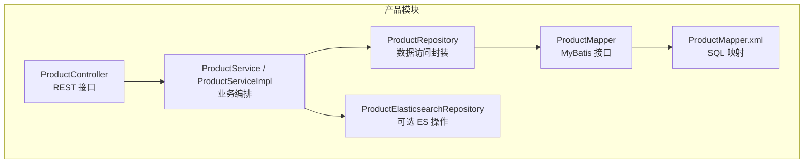
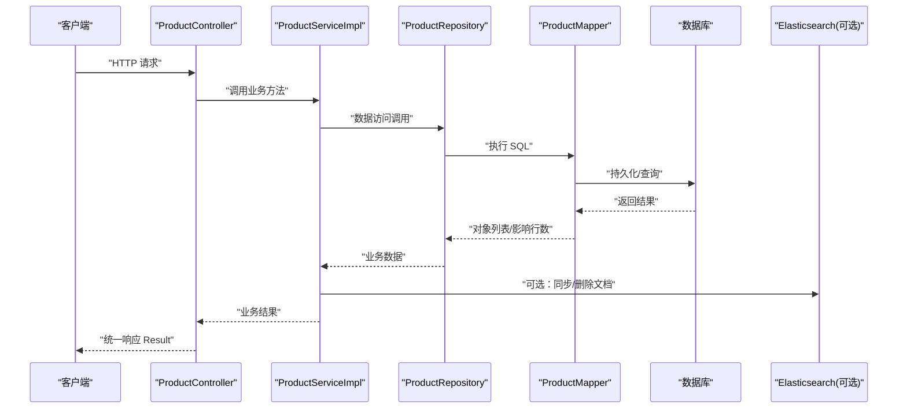
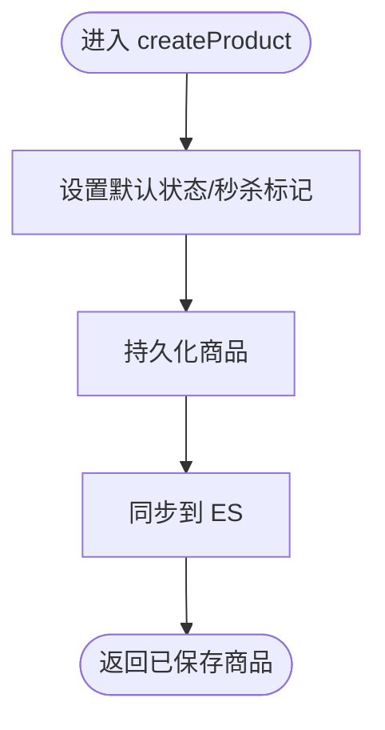
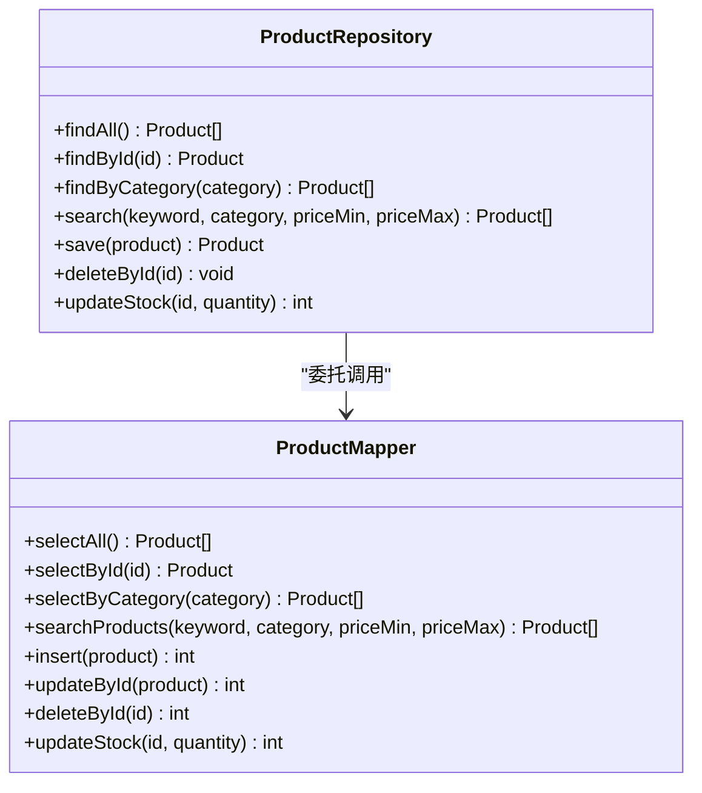
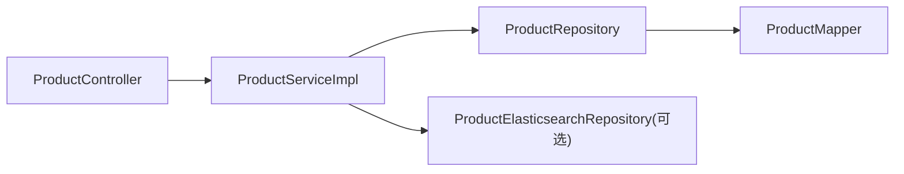

# 商品管理功能

<cite>
**本文引用的文件**   
- [ProductController.java](file://backend/ecommerce-product/src/main/java/com/ecommerce/product/controller/ProductController.java)
- [ProductService.java](file://backend/ecommerce-product/src/main/java/com/ecommerce/product/service/ProductService.java)
- [ProductServiceImpl.java](file://backend/ecommerce-product/src/main/java/com/ecommerce/product/service/impl/ProductServiceImpl.java)
- [ProductRepository.java](file://backend/ecommerce-product/src/main/java/com/ecommerce/product/repository/ProductRepository.java)
- [ProductMapper.java](file://backend/ecommerce-product/src/main/java/com/ecommerce/product/repository/mapper/ProductMapper.java)
- [ProductMapper.xml](file://backend/ecommerce-product/src/main/resources/mapper/ProductMapper.xml)
- [Product.java](file://backend/ecommerce-product/src/main/java/com/ecommerce/product/entity/Product.java)
- [Result.java](file://backend/ecommerce-common/src/main/java/com/ecommerce/common/Result.java)
- [BusinessException.java](file://backend/ecommerce-common/src/main/java/com/ecommerce/common/BusinessException.java)
- [GlobalExceptionHandler.java](file://backend/ecommerce-common/src/main/java/com/ecommerce/common/GlobalExceptionHandler.java)
</cite>

## 目录
1. [简介](#简介)
2. [项目结构](#项目结构)
3. [核心组件](#核心组件)
4. [架构总览](#架构总览)
5. [详细组件分析](#详细组件分析)
6. [依赖关系分析](#依赖关系分析)
7. [性能与优化](#性能与优化)
8. [API 接口示例](#api-接口示例)
9. [错误处理策略](#错误处理策略)
10. [故障排查指南](#故障排查指南)
11. [结论](#结论)

## 简介
本文面向后端开发者与集成方，系统化梳理“商品管理”功能的实现。内容覆盖：
- ProductController 的 CRUD 与搜索、库存扣减、ES 同步等接口设计
- Product 实体模型字段、校验与业务约束
- ProductService 服务层的数据访问调用、业务逻辑与异常处理
- ProductRepository 数据访问层与 MyBatis 映射配置、SQL 优化与事务管理
- API 请求响应格式与错误处理策略

## 项目结构
商品模块位于 ecommerce-product 子模块中，采用典型的 Controller-Service-Repository-Mapper 分层架构，并可选集成 Elasticsearch 用于检索与展示。

图表来源
- [ProductController.java:15-96](file://backend/ecommerce-product/src/main/java/com/ecommerce/product/controller/ProductController.java#L15-L96)
- [ProductServiceImpl.java:19-162](file://backend/ecommerce-product/src/main/java/com/ecommerce/product/service/impl/ProductServiceImpl.java#L19-L162)
- [ProductRepository.java:10-50](file://backend/ecommerce-product/src/main/java/com/ecommerce/product/repository/ProductRepository.java#L10-L50)
- [ProductMapper.java:9-30](file://backend/ecommerce-product/src/main/java/com/ecommerce/product/repository/mapper/ProductMapper.java#L9-L30)
- [ProductMapper.xml:3-87](file://backend/ecommerce-product/src/main/resources/mapper/ProductMapper.xml#L3-L87)

章节来源
- [ProductController.java:15-96](file://backend/ecommerce-product/src/main/java/com/ecommerce/product/controller/ProductController.java#L15-L96)
- [ProductServiceImpl.java:19-162](file://backend/ecommerce-product/src/main/java/com/ecommerce/product/service/impl/ProductServiceImpl.java#L19-L162)
- [ProductRepository.java:10-50](file://backend/ecommerce-product/src/main/java/com/ecommerce/product/repository/ProductRepository.java#L10-L50)
- [ProductMapper.java:9-30](file://backend/ecommerce-product/src/main/java/com/ecommerce/product/repository/mapper/ProductMapper.java#L9-L30)
- [ProductMapper.xml:3-87](file://backend/ecommerce-product/src/main/resources/mapper/ProductMapper.xml#L3-L87)

## 核心组件
- ProductController：暴露 REST 接口，负责参数接收、统一结果包装与基础校验（@Valid）。
- ProductService/ProductServiceImpl：业务编排，包含默认值填充、状态校验、ES 同步、事务控制与异常抛出。
- ProductRepository：对 MyBatis Mapper 的封装，提供统一的仓储式方法。
- ProductMapper/ProductMapper.xml：定义 SQL 查询、插入、更新、删除与库存扣减语句。
- Product：领域实体，承载商品主数据与秒杀相关字段。

章节来源
- [ProductController.java:15-96](file://backend/ecommerce-product/src/main/java/com/ecommerce/product/controller/ProductController.java#L15-L96)
- [ProductService.java:8-38](file://backend/ecommerce-product/src/main/java/com/ecommerce/product/service/ProductService.java#L8-L38)
- [ProductServiceImpl.java:19-162](file://backend/ecommerce-product/src/main/java/com/ecommerce/product/service/impl/ProductServiceImpl.java#L19-L162)
- [ProductRepository.java:10-50](file://backend/ecommerce-product/src/main/java/com/ecommerce/product/repository/ProductRepository.java#L10-L50)
- [ProductMapper.java:9-30](file://backend/ecommerce-product/src/main/java/com/ecommerce/product/repository/mapper/ProductMapper.java#L9-L30)
- [ProductMapper.xml:3-87](file://backend/ecommerce-product/src/main/resources/mapper/ProductMapper.xml#L3-L87)
- [Product.java:10-31](file://backend/ecommerce-product/src/main/java/com/ecommerce/product/entity/Product.java#L10-L31)

## 架构总览
商品管理的端到端调用链如下：

图表来源
- [ProductController.java:26-95](file://backend/ecommerce-product/src/main/java/com/ecommerce/product/controller/ProductController.java#L26-L95)
- [ProductServiceImpl.java:33-145](file://backend/ecommerce-product/src/main/java/com/ecommerce/product/service/impl/ProductServiceImpl.java#L33-L145)
- [ProductRepository.java:19-50](file://backend/ecommerce-product/src/main/java/com/ecommerce/product/repository/ProductRepository.java#L19-L50)
- [ProductMapper.java:12-29](file://backend/ecommerce-product/src/main/java/com/ecommerce/product/repository/mapper/ProductMapper.java#L12-L29)
- [ProductMapper.xml:30-86](file://backend/ecommerce-product/src/main/resources/mapper/ProductMapper.xml#L30-L86)

## 详细组件分析

### ProductController 接口设计
- 查询所有商品：GET /products
- 根据 ID 查询商品：GET /products/{id}
- 按分类查询商品：GET /products/category/{category}
- 搜索商品：GET /products/search?keyword=&category=&priceMin=&priceMax=
- 创建商品：POST /products
- 更新商品：PUT /products/{id}
- 删除商品：DELETE /products/{id}
- 全量同步到 ES：POST /products/sync-es
- 扣减库存：POST /products/deduct-stock?productId=&quantity=

要点
- 使用 @Valid 对创建/更新入参进行 Bean Validation。
- 所有接口返回统一 Result<T> 包装。
- 通过 @Operation/@Parameter/@Tag 生成 OpenAPI 文档。

章节来源
- [ProductController.java:26-95](file://backend/ecommerce-product/src/main/java/com/ecommerce/product/controller/ProductController.java#L26-L95)

### Product 实体模型
字段说明
- id：主键
- name：商品名称
- description：描述
- price：价格（金额）
- stock：库存数量
- category：分类
- imageUrl：图片地址
- status：状态（0 下架，1 上架）
- isSeckill：是否秒杀商品（0/1）
- seckillPrice：秒杀价
- seckillStartTime/seckillEndTime：秒杀时间区间
- createdBy/createdDate：创建人与创建时间
- lastModifiedBy/lastModifiedDate：最后修改人与修改时间

业务约束
- 查询类接口通常只返回上架商品（status=1），如分类查询与搜索。
- 创建时若未设置 status/isSeckill，服务层会赋予默认值。
- 库存扣减需保证库存充足，底层 SQL 有原子性保护。

章节来源
- [Product.java:10-31](file://backend/ecommerce-product/src/main/java/com/ecommerce/product/entity/Product.java#L10-L31)
- [ProductMapper.xml:38-57](file://backend/ecommerce-product/src/main/resources/mapper/ProductMapper.xml#L38-L57)
- [ProductServiceImpl.java:57-71](file://backend/ecommerce-product/src/main/java/com/ecommerce/product/service/impl/ProductServiceImpl.java#L57-L71)

### ProductService 与 ProductServiceImpl
职责
- 对外暴露商品查询、创建、更新、删除、搜索、库存扣减与 ES 同步能力。
- 在创建/更新时填充审计字段与默认值。
- 在写操作后触发 ES 同步；删除时尝试从 ES 移除文档。
- 对不存在资源抛出 BusinessException，由全局异常处理器统一处理。
- 关键写操作加 @Transactional 保证一致性。

关键流程
- 创建商品：设置默认值 -> 持久化 -> 同步 ES
- 更新商品：校验存在 -> 合并 ID 与审计字段 -> 持久化 -> 同步 ES
- 删除商品：校验存在 -> 删除 DB -> 尝试删除 ES 文档
- 扣减库存：原子扣减 -> 成功则同步 ES

图表来源
- [ProductServiceImpl.java:57-71](file://backend/ecommerce-product/src/main/java/com/ecommerce/product/service/impl/ProductServiceImpl.java#L57-L71)

章节来源
- [ProductService.java:8-38](file://backend/ecommerce-product/src/main/java/com/ecommerce/product/service/ProductService.java#L8-L38)
- [ProductServiceImpl.java:33-145](file://backend/ecommerce-product/src/main/java/com/ecommerce/product/service/impl/ProductServiceImpl.java#L33-L145)

### ProductRepository 与 MyBatis 映射
职责
- 封装 ProductMapper 的增删改查与库存扣减。
- save 方法根据是否存在 id 决定 insert 或 updateById。
- search 方法透传多条件查询参数。

MyBatis 映射要点
- 使用 resultMap 映射下划线列名到驼峰属性。
- BaseColumns 复用公共字段集合。
- 分类查询与搜索默认过滤 status=1。
- 搜索支持关键词模糊匹配、分类精确匹配、价格区间范围查询。
- 库存扣减 SQL 具备原子性与库存充足校验。

图表来源
- [ProductRepository.java:10-50](file://backend/ecommerce-product/src/main/java/com/ecommerce/product/repository/ProductRepository.java#L10-L50)
- [ProductMapper.java:9-30](file://backend/ecommerce-product/src/main/java/com/ecommerce/product/repository/mapper/ProductMapper.java#L9-L30)

章节来源
- [ProductRepository.java:10-50](file://backend/ecommerce-product/src/main/java/com/ecommerce/product/repository/ProductRepository.java#L10-L50)
- [ProductMapper.java:9-30](file://backend/ecommerce-product/src/main/java/com/ecommerce/product/repository/mapper/ProductMapper.java#L9-L30)
- [ProductMapper.xml:3-87](file://backend/ecommerce-product/src/main/resources/mapper/ProductMapper.xml#L3-L87)

## 依赖关系分析
- Controller 依赖 Service，Service 依赖 Repository，Repository 依赖 Mapper。
- Service 可选依赖 ES 仓库，未启用时跳过同步。
- 全局异常处理器捕获业务异常并转换为统一响应。

图表来源
- [ProductController.java:15-96](file://backend/ecommerce-product/src/main/java/com/ecommerce/product/controller/ProductController.java#L15-L96)
- [ProductServiceImpl.java:19-31](file://backend/ecommerce-product/src/main/java/com/ecommerce/product/service/impl/ProductServiceImpl.java#L19-L31)
- [ProductRepository.java:10-17](file://backend/ecommerce-product/src/main/java/com/ecommerce/product/repository/ProductRepository.java#L10-L17)
- [ProductMapper.java:9-10](file://backend/ecommerce-product/src/main/java/com/ecommerce/product/repository/mapper/ProductMapper.java#L9-L10)

章节来源
- [ProductController.java:15-96](file://backend/ecommerce-product/src/main/java/com/ecommerce/product/controller/ProductController.java#L15-L96)
- [ProductServiceImpl.java:19-31](file://backend/ecommerce-product/src/main/java/com/ecommerce/product/service/impl/ProductServiceImpl.java#L19-L31)
- [ProductRepository.java:10-17](file://backend/ecommerce-product/src/main/java/com/ecommerce/product/repository/ProductRepository.java#L10-L17)
- [ProductMapper.java:9-10](file://backend/ecommerce-product/src/main/java/com/ecommerce/product/repository/mapper/ProductMapper.java#L9-L10)

## 性能与优化
- 查询过滤：分类查询与搜索均限定 status=1，减少无效数据。
- 动态 SQL：搜索接口使用条件拼接，避免全表扫描。
- 库存扣减：SQL 层面保证原子扣减与库存充足校验，防止超卖。
- ES 同步：异步失败不影响主流程，仅记录日志，提升可用性。
- 建议索引：建议在 (category, status)、(name)、(description) 上建立合适索引以优化搜索与筛选。

[本节为通用性能建议，不直接分析具体文件]

## API 接口示例
以下示例基于统一响应体 Result<T>，其中 data 为业务数据，code/msg 表示状态码与消息。

- 查询所有商品
  - 请求：GET /products
  - 响应：{ code, msg, data: [Product, ...] }

- 根据 ID 查询商品
  - 请求：GET /products/{id}
  - 响应：{ code, msg, data: Product }

- 按分类查询商品
  - 请求：GET /products/category/{category}
  - 响应：{ code, msg, data: [Product, ...] }

- 搜索商品
  - 请求：GET /products/search?keyword=&category=&priceMin=&priceMax=
  - 响应：{ code, msg, data: [Product, ...] }

- 创建商品
  - 请求：POST /products，Body: Product
  - 响应：{ code, msg, data: Product }

- 更新商品
  - 请求：PUT /products/{id}，Body: Product
  - 响应：{ code, msg, data: Product }

- 删除商品
  - 请求：DELETE /products/{id}
  - 响应：{ code, msg, data: null }

- 全量同步到 ES
  - 请求：POST /products/sync-es
  - 响应：{ code, msg, data: null }

- 扣减库存
  - 请求：POST /products/deduct-stock?productId=&quantity=
  - 响应：{ code, msg, data: boolean }

章节来源
- [ProductController.java:26-95](file://backend/ecommerce-product/src/main/java/com/ecommerce/product/controller/ProductController.java#L26-L95)
- [Result.java](file://backend/ecommerce-common/src/main/java/com/ecommerce/common/Result.java)

## 错误处理策略
- 业务异常：当查询不到商品时抛出 BusinessException，携带错误码与消息。
- 全局异常处理：由 GlobalExceptionHandler 捕获并转换为统一 Result 响应。
- ES 异常：同步/删除 ES 失败仅记录日志，不中断主流程。

章节来源
- [ProductServiceImpl.java:38-45](file://backend/ecommerce-product/src/main/java/com/ecommerce/product/service/impl/ProductServiceImpl.java#L38-L45)
- [ProductServiceImpl.java:85-98](file://backend/ecommerce-product/src/main/java/com/ecommerce/product/service/impl/ProductServiceImpl.java#L85-L98)
- [BusinessException.java](file://backend/ecommerce-common/src/main/java/com/ecommerce/common/BusinessException.java)
- [GlobalExceptionHandler.java](file://backend/ecommerce-common/src/main/java/com/ecommerce/common/GlobalExceptionHandler.java)

## 故障排查指南
- 查询不到商品
  - 检查传入 id 是否正确
  - 确认商品状态是否为上架（status=1）
  - 参考：[ProductServiceImpl.java:38-45](file://backend/ecommerce-product/src/main/java/com/ecommerce/product/service/impl/ProductServiceImpl.java#L38-L45)

- 分类/搜索无结果
  - 检查分类名称是否一致
  - 检查价格区间边界是否合理
  - 参考：[ProductMapper.xml:38-57](file://backend/ecommerce-product/src/main/resources/mapper/ProductMapper.xml#L38-L57)

- 库存扣减失败
  - 检查库存是否充足
  - 检查并发场景下的库存竞争
  - 参考：[ProductMapper.xml:84-86](file://backend/ecommerce-product/src/main/resources/mapper/ProductMapper.xml#L84-L86)

- ES 同步失败
  - 检查 ES 连接与权限
  - 查看日志中的警告/错误信息
  - 参考：[ProductServiceImpl.java:112-145](file://backend/ecommerce-product/src/main/java/com/ecommerce/product/service/impl/ProductServiceImpl.java#L112-L145)

## 结论
本商品管理功能采用清晰的分层架构，结合 MyBatis 的动态 SQL 与 ES 可选检索能力，提供了完整的 CRUD、搜索与库存扣减能力。通过统一响应体与全局异常处理，保证了接口的稳定性与可观测性。建议在大数据量场景下完善索引设计与分页策略，并对 ES 同步引入重试与补偿机制以提升可靠性。