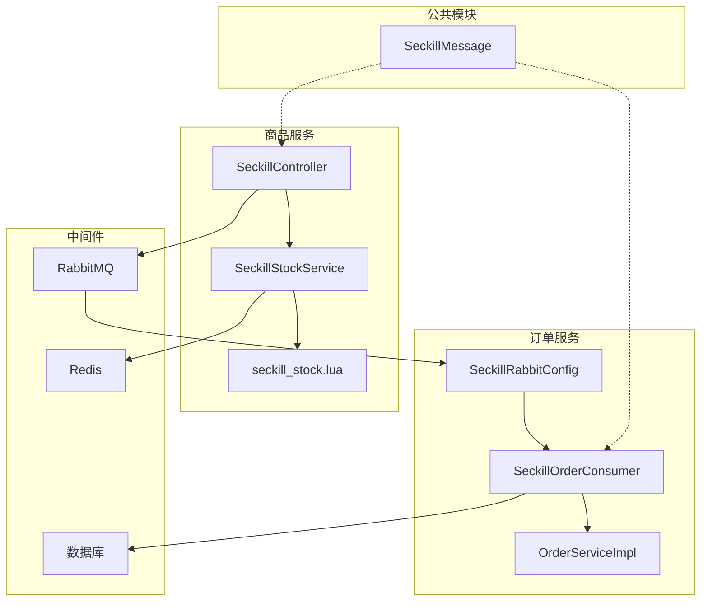
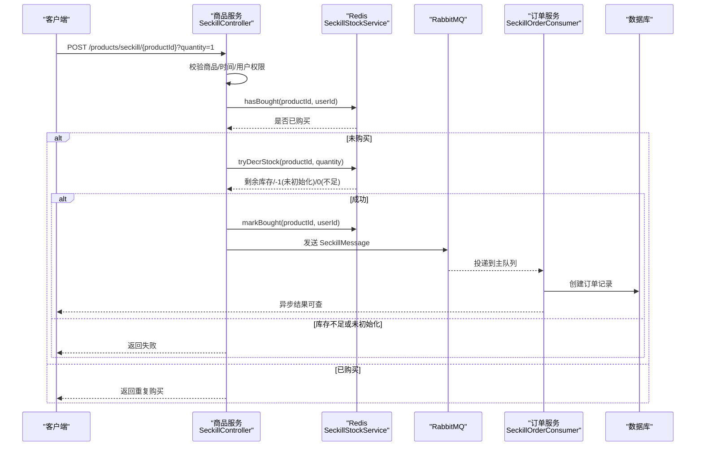
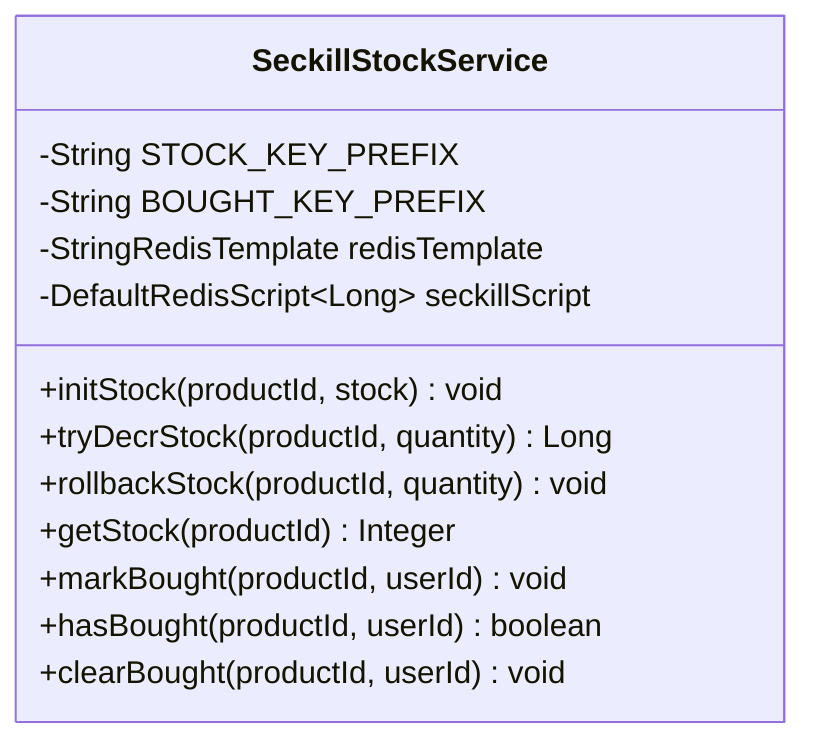
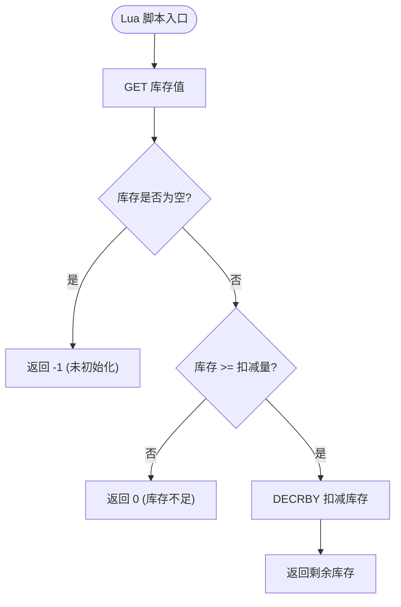
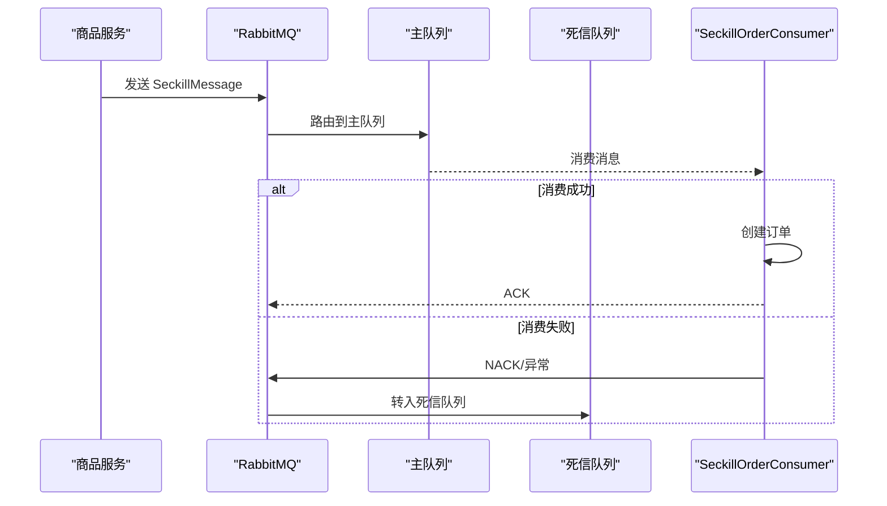
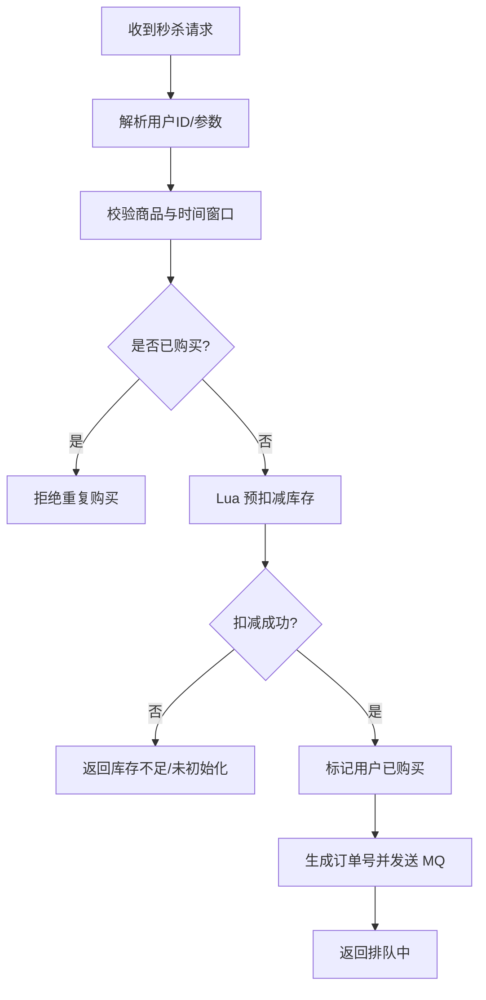
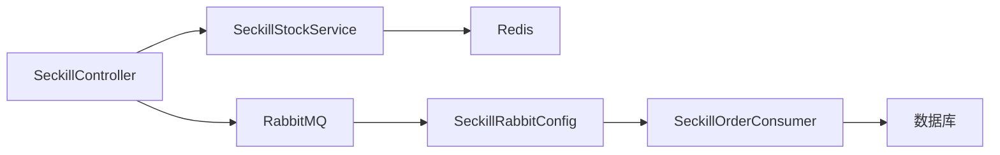
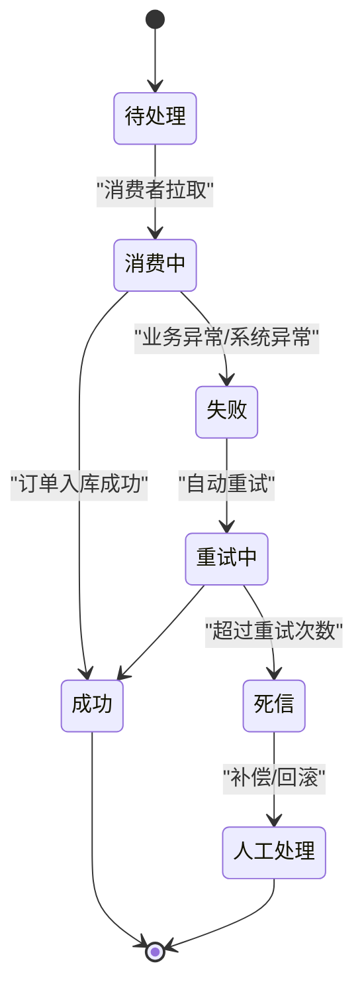

# 秒杀库存管理

<cite>
**本文引用的文件**   
- [SeckillStockService.java](file://backend/ecommerce-product/src/main/java/com/ecommerce/product/service/SeckillStockService.java)
- [seckill_stock.lua](file://backend/ecommerce-product/src/main/resources/lua/seckill_stock.lua)
- [SeckillController.java](file://backend/ecommerce-product/src/main/java/com/ecommerce/product/controller/SeckillController.java)
- [SeckillRabbitConfig.java（公共模块）](file://backend/ecommerce-common/src/main/java/com/ecommerce/common/config/SeckillRabbitConfig.java)
- [SeckillMessage.java](file://backend/ecommerce-common/src/main/java/com/ecommerce/common/SeckillMessage.java)
- [SeckillOrderConsumer.java](file://backend/ecommerce-order/src/main/java/com/ecommerce/order/consumer/SeckillOrderConsumer.java)
- [OrderServiceImpl.java](file://backend/ecommerce-order/src/main/java/com/ecommerce/order/service/impl/OrderServiceImpl.java)
</cite>

## 目录
1. [简介](#简介)
2. [项目结构](#项目结构)
3. [核心组件](#核心组件)
4. [架构总览](#架构总览)
5. [详细组件分析](#详细组件分析)
6. [依赖关系分析](#依赖关系分析)
7. [性能与高并发优化](#性能与高并发优化)
8. [故障恢复与重试策略](#故障恢复与重试策略)
9. [常见问题与防护](#常见问题与防护)
10. [结论](#结论)

## 简介
本文件围绕“秒杀库存管理”展开，系统性梳理基于 Redis + Lua 的原子性预扣减、用户防重购买标记、以及 RabbitMQ 异步落库的整体方案。重点解释 SeckillStockService 的核心实现、Lua 脚本的原子性保证、RabbitMQ 消息模型与消费流程，并给出防止超卖、重复购买等问题的实践建议与可视化图示。

## 项目结构
本项目采用微服务拆分：商品服务负责秒杀库存与抢购入口；订单服务负责异步创建订单；公共模块提供通用消息体与异常封装。

**图表来源**
- [SeckillController.java:45-122](file://backend/ecommerce-product/src/main/java/com/ecommerce/product/controller/SeckillController.java#L45-L122)
- [SeckillStockService.java:15-90](file://backend/ecommerce-product/src/main/java/com/ecommerce/product/service/SeckillStockService.java#L15-L90)
- [seckill_stock.lua:1-13](file://backend/ecommerce-product/src/main/resources/lua/seckill_stock.lua#L1-L13)
- [SeckillRabbitConfig.java:10-51](file://backend/ecommerce-common/src/main/java/com/ecommerce/common/config/SeckillRabbitConfig.java#L10-L51)
- [SeckillOrderConsumer.java:21-68](file://backend/ecommerce-order/src/main/java/com/ecommerce/order/consumer/SeckillOrderConsumer.java#L21-L68)
- [OrderServiceImpl.java:32-60](file://backend/ecommerce-order/src/main/java/com/ecommerce/order/service/impl/OrderServiceImpl.java#L32-L60)

**章节来源**
- [SeckillController.java:45-122](file://backend/ecommerce-product/src/main/java/com/ecommerce/product/controller/SeckillController.java#L45-L122)
- [SeckillStockService.java:15-90](file://backend/ecommerce-product/src/main/java/com/ecommerce/product/service/SeckillStockService.java#L15-L90)
- [seckill_stock.lua:1-13](file://backend/ecommerce-product/src/main/resources/lua/seckill_stock.lua#L1-L13)
- [SeckillRabbitConfig.java:10-51](file://backend/ecommerce-common/src/main/java/com/ecommerce/common/config/SeckillRabbitConfig.java#L10-L51)
- [SeckillOrderConsumer.java:21-68](file://backend/ecommerce-order/src/main/java/com/ecommerce/order/consumer/SeckillOrderConsumer.java#L21-L68)
- [OrderServiceImpl.java:32-60](file://backend/ecommerce-order/src/main/java/com/ecommerce/order/service/impl/OrderServiceImpl.java#L32-L60)

## 核心组件
- SeckillStockService：封装 Redis 操作与 Lua 脚本执行，提供初始化库存、原子预扣减、回滚、查询库存、用户购买标记与去重检查能力。
- seckill_stock.lua：在 Redis 侧完成库存检查与扣减的原子性逻辑，返回剩余库存或错误码。
- SeckillController：秒杀入口，校验商品与时间、防重、调用库存服务、发送 MQ 消息并返回排队状态。
- SeckillRabbitConfig：定义直连交换机、主队列、死信交换机与死信队列，保障消息持久化与失败重试。
- SeckillMessage：跨服务传递的秒杀消息体，包含用户ID、商品ID、数量、订单号与时间戳。
- SeckillOrderConsumer：监听主队列，异步创建订单；失败时进入死信队列，便于后续处理。
- OrderServiceImpl：常规订单服务实现，展示正常下单流程（非秒杀路径），用于对比与扩展。

**章节来源**
- [SeckillStockService.java:15-90](file://backend/ecommerce-product/src/main/java/com/ecommerce/product/service/SeckillStockService.java#L15-L90)
- [seckill_stock.lua:1-13](file://backend/ecommerce-product/src/main/resources/lua/seckill_stock.lua#L1-L13)
- [SeckillController.java:45-122](file://backend/ecommerce-product/src/main/java/com/ecommerce/product/controller/SeckillController.java#L45-L122)
- [SeckillRabbitConfig.java:10-51](file://backend/ecommerce-common/src/main/java/com/ecommerce/common/config/SeckillRabbitConfig.java#L10-L51)
- [SeckillMessage.java:1-26](file://backend/ecommerce-common/src/main/java/com/ecommerce/common/SeckillMessage.java#L1-L26)
- [SeckillOrderConsumer.java:21-68](file://backend/ecommerce-order/src/main/java/com/ecommerce/order/consumer/SeckillOrderConsumer.java#L21-L68)
- [OrderServiceImpl.java:32-60](file://backend/ecommerce-order/src/main/java/com/ecommerce/order/service/impl/OrderServiceImpl.java#L32-L60)

## 架构总览
秒杀整体流程以“Redis 预扣减 + 用户去重 + MQ 异步落库”为核心，将热点写压力从数据库转移至 Redis，并通过消息队列削峰填谷，确保最终一致性。

**图表来源**
- [SeckillController.java:61-122](file://backend/ecommerce-product/src/main/java/com/ecommerce/product/controller/SeckillController.java#L61-L122)
- [SeckillStockService.java:44-82](file://backend/ecommerce-product/src/main/java/com/ecommerce/product/service/SeckillStockService.java#L44-L82)
- [SeckillOrderConsumer.java:35-68](file://backend/ecommerce-order/src/main/java/com/ecommerce/order/consumer/SeckillOrderConsumer.java#L35-L68)

## 详细组件分析

### SeckillStockService 与 Lua 脚本
- 库存键与购买标记键：
  - 库存键：seckill:stock:{productId}
  - 购买标记键：seckill:bought:{productId}:{userId}
- 关键方法：
  - initStock：预热库存到 Redis
  - tryDecrStock：通过 Lua 脚本原子扣减，返回剩余库存或错误码
  - rollbackStock：消费失败时恢复库存
  - getStock：读取当前库存
  - markBought/hasBought/clearBought：用户维度防重标记与清理

**图表来源**
- [SeckillStockService.java:15-90](file://backend/ecommerce-product/src/main/java/com/ecommerce/product/service/SeckillStockService.java#L15-L90)

#### Lua 脚本原理
- 输入：KEYS[1] 为库存键，ARGV[1] 为扣减数量
- 逻辑：
  - 若库存未初始化，返回 -1
  - 若库存不足，返回 0
  - 否则 DECRBY 扣减并返回剩余库存
- 特性：
  - 单条命令在 Redis 内原子执行，避免并发超卖
  - 无分布式锁需求，天然串行化

**图表来源**
- [seckill_stock.lua:1-13](file://backend/ecommerce-product/src/main/resources/lua/seckill_stock.lua#L1-L13)

**章节来源**
- [SeckillStockService.java:15-90](file://backend/ecommerce-product/src/main/java/com/ecommerce/product/service/SeckillStockService.java#L15-L90)
- [seckill_stock.lua:1-13](file://backend/ecommerce-product/src/main/resources/lua/seckill_stock.lua#L1-L13)

### RabbitMQ 配置与消费者
- 交换器与队列：
  - 直连交换器：seckill.exchange
  - 主队列：seckill.order.queue（持久化）
  - 路由键：seckill.order
  - 死信交换器：seckill.dlx.exchange
  - 死信队列：seckill.dlx.queue
  - 死信路由键：seckill.dlx
- 消费者：
  - 监听主队列，接收 SeckillMessage
  - 调用商品服务校验商品存在性（实际库存已在 Redis 预扣减）
  - 写入订单表，失败抛出异常触发重试/死信

**图表来源**
- [SeckillRabbitConfig.java:20-51](file://backend/ecommerce-common/src/main/java/com/ecommerce/common/config/SeckillRabbitConfig.java#L20-L51)
- [SeckillOrderConsumer.java:35-68](file://backend/ecommerce-order/src/main/java/com/ecommerce/order/consumer/SeckillOrderConsumer.java#L35-L68)

**章节来源**
- [SeckillRabbitConfig.java:10-51](file://backend/ecommerce-common/src/main/java/com/ecommerce/common/config/SeckillRabbitConfig.java#L10-L51)
- [SeckillOrderConsumer.java:21-68](file://backend/ecommerce-order/src/main/java/com/ecommerce/order/consumer/SeckillOrderConsumer.java#L21-L68)

### SeckillMessage 消息模型
- 字段：
  - userId：用户标识
  - productId：商品标识
  - quantity：购买数量
  - orderNo：预生成订单号
  - createTime：消息创建时间
- 用途：跨服务传递秒杀请求上下文，支撑异步落库与对账。

**章节来源**
- [SeckillMessage.java:1-26](file://backend/ecommerce-common/src/main/java/com/ecommerce/common/SeckillMessage.java#L1-L26)

### 秒杀控制器流程
- 前置校验：
  - 从请求头获取用户ID
  - 校验商品是否为秒杀商品且处于活动时间内
  - 检查用户是否已购买（防重）
- 核心流程：
  - 调用 Lua 脚本预扣减库存
  - 标记用户已购买
  - 生成订单号并发送 MQ 消息
  - 返回排队中状态

**图表来源**
- [SeckillController.java:61-122](file://backend/ecommerce-product/src/main/java/com/ecommerce/product/controller/SeckillController.java#L61-L122)

**章节来源**
- [SeckillController.java:45-122](file://backend/ecommerce-product/src/main/java/com/ecommerce/product/controller/SeckillController.java#L45-L122)

## 依赖关系分析
- 商品服务依赖：
  - Redis：存储库存与购买标记
  - RabbitMQ：发送秒杀消息
- 订单服务依赖：
  - RabbitMQ：消费秒杀消息
  - 数据库：持久化订单
- 公共模块：
  - SeckillMessage：跨服务数据契约

**图表来源**
- [SeckillController.java:33-43](file://backend/ecommerce-product/src/main/java/com/ecommerce/product/controller/SeckillController.java#L33-L43)
- [SeckillStockService.java:21-30](file://backend/ecommerce-product/src/main/java/com/ecommerce/product/service/SeckillStockService.java#L21-L30)
- [SeckillRabbitConfig.java:20-51](file://backend/ecommerce-common/src/main/java/com/ecommerce/common/config/SeckillRabbitConfig.java#L20-L51)
- [SeckillOrderConsumer.java:26-33](file://backend/ecommerce-order/src/main/java/com/ecommerce/order/consumer/SeckillOrderConsumer.java#L26-L33)

**章节来源**
- [SeckillController.java:33-43](file://backend/ecommerce-product/src/main/java/com/ecommerce/product/controller/SeckillController.java#L33-L43)
- [SeckillStockService.java:21-30](file://backend/ecommerce-product/src/main/java/com/ecommerce/product/service/SeckillStockService.java#L21-L30)
- [SeckillRabbitConfig.java:20-51](file://backend/ecommerce-common/src/main/java/com/ecommerce/common/config/SeckillRabbitConfig.java#L20-L51)
- [SeckillOrderConsumer.java:26-33](file://backend/ecommerce-order/src/main/java/com/ecommerce/order/consumer/SeckillOrderConsumer.java#L26-L33)

## 性能与高并发优化
- 原子性预扣减：
  - 使用 Redis Lua 脚本，避免多次网络往返与竞态条件，从根本上防止超卖。
- 缓存架构：
  - 库存与购买标记均位于 Redis，读多写少场景下具备极高吞吐。
- 削峰填谷：
  - 秒杀成功后仅发送 MQ 消息，立即返回排队状态，订单落库由消费者异步完成。
- 幂等与去重：
  - 用户维度购买标记（带过期时间）防止同一用户重复购买。
- 可扩展点：
  - 可按商品维度分片 Redis Key，降低热点 Key 竞争。
  - 消费者侧增加批量写入与限流，提升吞吐。

[本节为通用性能讨论，不直接分析具体文件]

## 故障恢复与重试策略
- 消息持久化：
  - 主队列与死信队列均为持久化队列，确保服务重启后消息不丢失。
- 失败重试：
  - 消费者抛异常会触发重试机制，最终进入死信队列，便于人工介入或定时补偿。
- 库存回滚：
  - 提供 rollbackStock 接口，可在消费失败时恢复 Redis 库存。
  - 提供 clearBought 接口，可在消费失败时清除用户购买标记。
- 对账与补偿：
  - 结合死信队列与离线对账任务，修复不一致订单与库存。

**图表来源**
- [SeckillRabbitConfig.java:25-51](file://backend/ecommerce-common/src/main/java/com/ecommerce/common/config/SeckillRabbitConfig.java#L25-L51)
- [SeckillOrderConsumer.java:62-67](file://backend/ecommerce-order/src/main/java/com/ecommerce/order/consumer/SeckillOrderConsumer.java#L62-L67)
- [SeckillStockService.java:54-57](file://backend/ecommerce-product/src/main/java/com/ecommerce/product/service/SeckillStockService.java#L54-L57)
- [SeckillStockService.java:87-90](file://backend/ecommerce-product/src/main/java/com/ecommerce/product/service/SeckillStockService.java#L87-L90)

**章节来源**
- [SeckillRabbitConfig.java:25-51](file://backend/ecommerce-common/src/main/java/com/ecommerce/common/config/SeckillRabbitConfig.java#L25-L51)
- [SeckillOrderConsumer.java:62-67](file://backend/ecommerce-order/src/main/java/com/ecommerce/order/consumer/SeckillOrderConsumer.java#L62-L67)
- [SeckillStockService.java:54-57](file://backend/ecommerce-product/src/main/java/com/ecommerce/product/service/SeckillStockService.java#L54-L57)
- [SeckillStockService.java:87-90](file://backend/ecommerce-product/src/main/java/com/ecommerce/product/service/SeckillStockService.java#L87-L90)

## 常见问题与防护
- 超卖防护：
  - 通过 Lua 脚本原子扣减，严格保证库存不会负数。
- 重复购买防护：
  - 用户维度购买标记（带过期时间），在秒杀期间有效。
- 库存未初始化：
  - Lua 返回 -1，控制器统一抛出业务异常提示。
- 库存不足：
  - Lua 返回 0，控制器返回售罄提示。
- 消费者失败：
  - 自动重试并最终进入死信队列，支持人工补偿与库存回滚。

**章节来源**
- [seckill_stock.lua:1-13](file://backend/ecommerce-product/src/main/resources/lua/seckill_stock.lua#L1-L13)
- [SeckillController.java:87-99](file://backend/ecommerce-product/src/main/java/com/ecommerce/product/controller/SeckillController.java#L87-L99)
- [SeckillOrderConsumer.java:62-67](file://backend/ecommerce-order/src/main/java/com/ecommerce/order/consumer/SeckillOrderConsumer.java#L62-L67)

## 结论
该方案通过 Redis + Lua 实现高并发下的原子性库存扣减，结合用户购买标记防止重复购买；通过 RabbitMQ 将订单落库异步化，达到削峰填谷与最终一致性的目标。配合死信队列与回滚接口，形成完整的容错与补偿闭环，适用于大规模秒杀场景。

[本节为总结性内容，不直接分析具体文件]