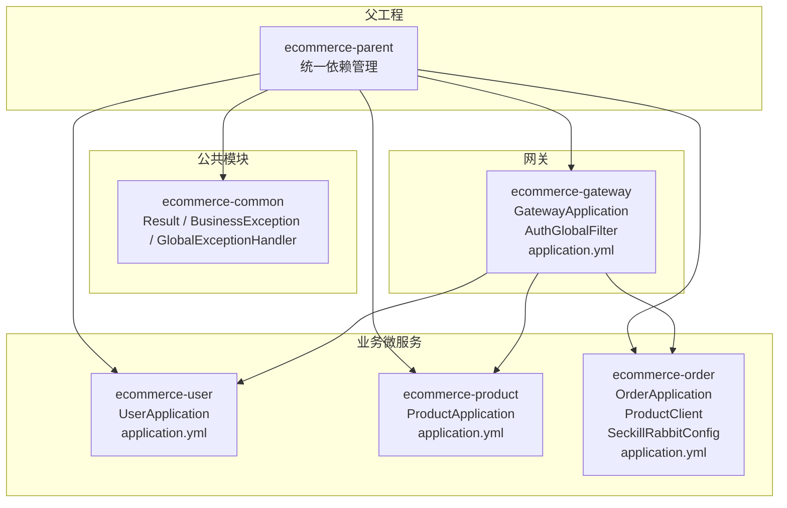
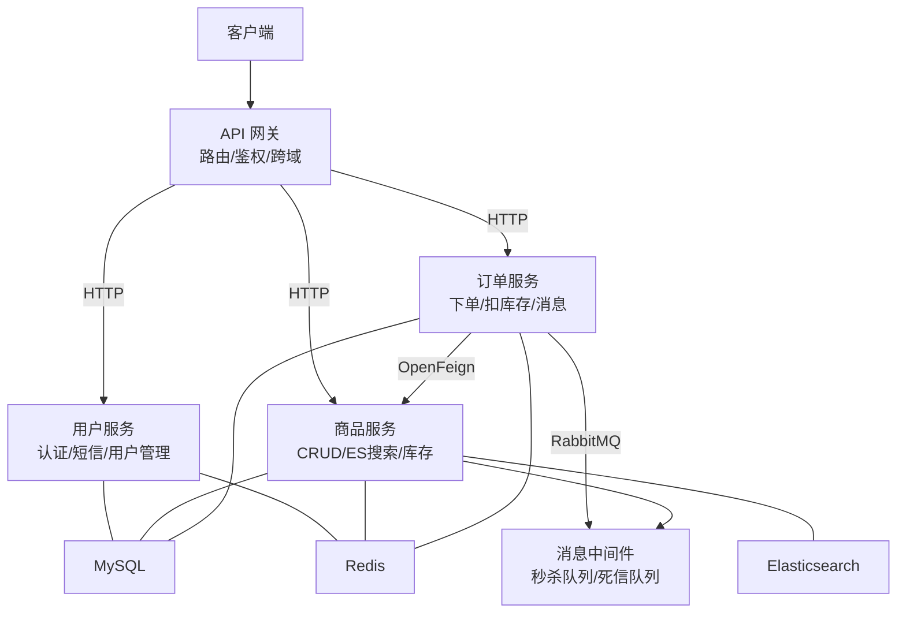
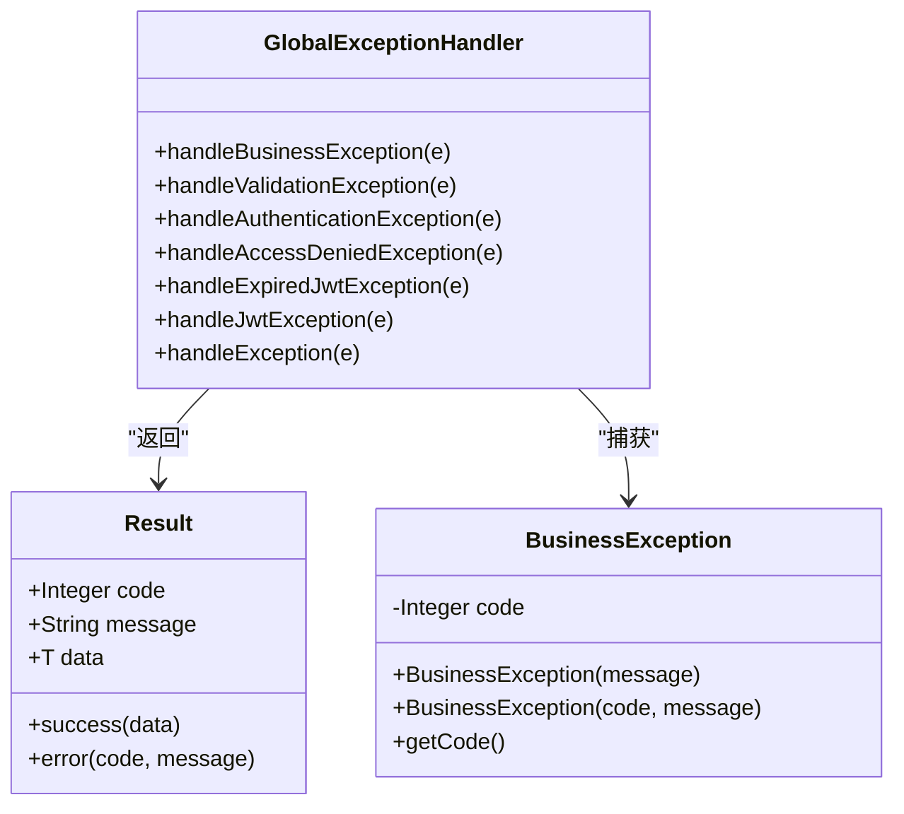
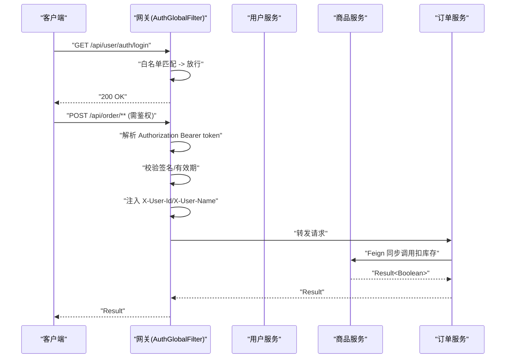
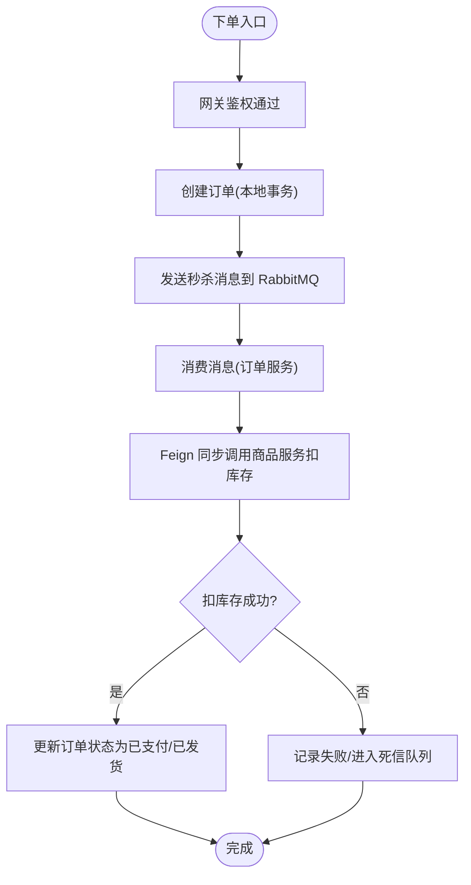
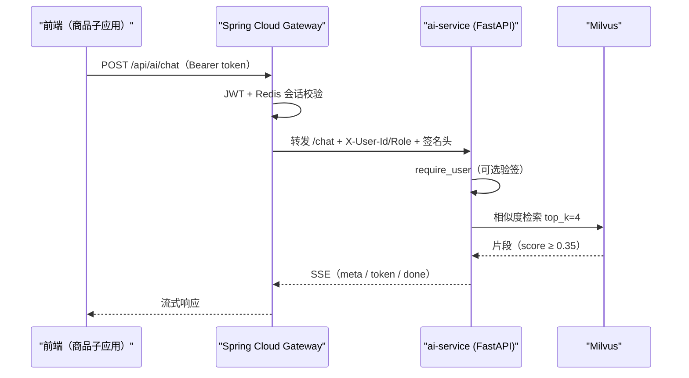
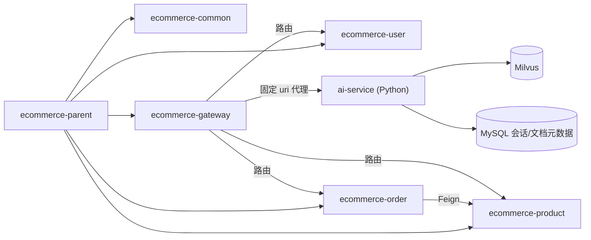

# 微服务架构设计

<cite>
**本文引用的文件**   
- [backend/pom.xml](file://backend/pom.xml)
- [ecommerce-common/Result.java](file://backend/ecommerce-common/src/main/java/com/ecommerce/common/Result.java)
- [ecommerce-common/BusinessException.java](file://backend/ecommerce-common/src/main/java/com/ecommerce/common/BusinessException.java)
- [ecommerce-common/GlobalExceptionHandler.java](file://backend/ecommerce-common/src/main/java/com/ecommerce/common/GlobalExceptionHandler.java)
- [ecommerce-gateway/GatewayApplication.java](file://backend/ecommerce-gateway/src/main/java/com/ecommerce/gateway/GatewayApplication.java)
- [ecommerce-gateway/application.yml](file://backend/ecommerce-gateway/src/main/resources/application.yml)
- [ecommerce-gateway/bootstrap.yml](file://backend/ecommerce-gateway/src/main/resources/bootstrap.yml)
- [ecommerce-gateway/AuthGlobalFilter.java](file://backend/ecommerce-gateway/src/main/java/com/ecommerce/gateway/filter/AuthGlobalFilter.java)
- [ecommerce-user/UserApplication.java](file://backend/ecommerce-user/src/main/java/com/ecommerce/user/UserApplication.java)
- [ecommerce-user/application.yml](file://backend/ecommerce-user/src/main/resources/application.yml)
- [ecommerce-product/ProductApplication.java](file://backend/ecommerce-product/src/main/java/com/ecommerce/product/ProductApplication.java)
- [ecommerce-product/application.yml](file://backend/ecommerce-product/src/main/resources/application.yml)
- [ecommerce-order/OrderApplication.java](file://backend/ecommerce-order/src/main/java/com/ecommerce/order/OrderApplication.java)
- [ecommerce-order/application.yml](file://backend/ecommerce-order/src/main/resources/application.yml)
- [ecommerce-order/ProductClient.java](file://backend/ecommerce-order/src/main/java/com/ecommerce/order/client/ProductClient.java)
- [ecommerce-order/SeckillRabbitConfig.java](file://backend/ecommerce-order/src/main/java/com/ecommerce/order/config/SeckillRabbitConfig.java)
- [ecommerce-product/SeckillRabbitConfig.java](file://backend/ecommerce-product/src/main/java/com/ecommerce/product/config/SeckillRabbitConfig.java)
- [ai-service/app/main.py](file://ai-service/app/main.py)
- [ai-service/app/deps.py](file://ai-service/app/deps.py)
- [ai-service/app/config.py](file://ai-service/app/config.py)
- [ai-service/app/api/chat.py](file://ai-service/app/api/chat.py)
- [ai-service/app/api/documents.py](file://ai-service/app/api/documents.py)
- [ai-service/app/api/sessions.py](file://ai-service/app/api/sessions.py)
</cite>

## 目录
1. [简介](#简介)
2. [项目结构](#项目结构)
3. [核心组件](#核心组件)
4. [架构总览](#架构总览)
5. [详细组件分析](#详细组件分析)
6. [非 JVM 服务：Python ai-service](#非-jvm-服务python-ai-service)
7. [依赖关系分析](#依赖关系分析)
8. [性能与扩展性](#性能与扩展性)
9. [故障排查指南](#故障排查指南)
10. [结论](#结论)
11. [附录：新增微服务规范](#附录新增微服务规范)

## 简介
本仓库实现了一个基于 Spring Cloud 的电商微服务系统，包含用户、商品、订单三个业务微服务，以及统一的 API 网关。系统采用 Nacos 作为服务发现与配置中心，使用 OpenFeign 进行同步服务调用，通过 RabbitMQ 实现异步消息（秒杀场景），并通过公共模块 ecommerce-common 统一响应体、业务异常与全局异常处理。网关层提供统一鉴权、跨域与路由转发能力，各微服务通过 Nacos 注册与发现，配合 MyBatis、Redis、Elasticsearch 等基础设施完成数据访问与检索。

除 Java 微服务外，仓库还包含一个 Python 的保险咨询服务 `ai-service`：它不在 Nacos 注册，而是由网关以固定 `uri` 反向代理 `/api/ai/**`，用于展示异构技术栈服务如何复用同一套认证边界。

## 项目结构
后端采用多模块 Maven 工程，父工程统一管理版本与依赖，子模块按“网关 + 业务微服务 + 公共库”划分：
- 父工程：统一 Spring Boot/Spring Cloud/Alibaba 版本与内部公共模块依赖
- 公共模块：ecommerce-common（统一响应 Result、业务异常 BusinessException、全局异常处理器 GlobalExceptionHandler）
- 网关：ecommerce-gateway（路由、鉴权、跨域、Swagger 聚合）
- 业务微服务：ecommerce-user、ecommerce-product、ecommerce-order（各自独立端口、上下文路径、数据库与中间件配置）

**图表来源**
- [backend/pom.xml:21-27](file://backend/pom.xml#L21-L27)
- [ecommerce-gateway/GatewayApplication.java:1-16](file://backend/ecommerce-gateway/src/main/java/com/ecommerce/gateway/GatewayApplication.java#L1-L16)
- [ecommerce-user/UserApplication.java:1-21](file://backend/ecommerce-user/src/main/java/com/ecommerce/user/UserApplication.java#L1-L21)
- [ecommerce-product/ProductApplication.java:1-18](file://backend/ecommerce-product/src/main/java/com/ecommerce/product/ProductApplication.java#L1-L18)
- [ecommerce-order/OrderApplication.java:1-20](file://backend/ecommerce-order/src/main/java/com/ecommerce/order/OrderApplication.java#L1-L20)

**章节来源**
- [backend/pom.xml:1-65](file://backend/pom.xml#L1-L65)

## 核心组件
- 统一响应 Result：所有接口返回统一结构，便于前端一致化处理与错误码标准化
- 业务异常 BusinessException：业务层抛出的可携带错误码的异常
- 全局异常处理器 GlobalExceptionHandler：将各类异常统一转换为 Result 返回，覆盖参数校验、认证授权、JWT 异常与兜底异常
- 网关 AuthGlobalFilter：在网关层解析 JWT，白名单放行，校验通过后注入用户信息到下游请求头
- Feign 客户端 ProductClient：订单服务对商品服务的同步调用契约
- RabbitMQ 配置：订单与商品服务分别声明秒杀相关交换机、队列与死信队列，支撑异步削峰与失败重试

**章节来源**
- [ecommerce-common/Result.java:1-64](file://backend/ecommerce-common/src/main/java/com/ecommerce/common/Result.java#L1-L64)
- [ecommerce-common/BusinessException.java:1-23](file://backend/ecommerce-common/src/main/java/com/ecommerce/common/BusinessException.java#L1-L23)
- [ecommerce-common/GlobalExceptionHandler.java:1-74](file://backend/ecommerce-common/src/main/java/com/ecommerce/common/GlobalExceptionHandler.java#L1-L74)
- [ecommerce-gateway/AuthGlobalFilter.java:1-170](file://backend/ecommerce-gateway/src/main/java/com/ecommerce/gateway/filter/AuthGlobalFilter.java#L1-L170)
- [ecommerce-order/ProductClient.java:1-21](file://backend/ecommerce-order/src/main/java/com/ecommerce/order/client/ProductClient.java#L1-L21)
- [ecommerce-order/SeckillRabbitConfig.java:1-53](file://backend/ecommerce-order/src/main/java/com/ecommerce/order/config/SeckillRabbitConfig.java#L1-L53)
- [ecommerce-product/SeckillRabbitConfig.java:1-59](file://backend/ecommerce-product/src/main/java/com/ecommerce/product/config/SeckillRabbitConfig.java#L1-L59)

## 架构总览
系统采用“网关入口 + 微服务拆分 + 公共基础 + 中间件协同”的分层架构：
- 网关层：统一路由、鉴权、跨域、文档聚合
- 业务层：用户、商品、订单服务职责清晰，通过 Feign 同步调用与 RabbitMQ 异步解耦
- 数据层：MySQL 持久化，Redis 缓存与会话，Elasticsearch 搜索
- 治理层：Nacos 服务注册与发现，Springdoc/OpenAPI 文档

**图表来源**
- [ecommerce-gateway/application.yml:22-67](file://backend/ecommerce-gateway/src/main/resources/application.yml#L22-L67)
- [ecommerce-gateway/AuthGlobalFilter.java:80-140](file://backend/ecommerce-gateway/src/main/java/com/ecommerce/gateway/filter/AuthGlobalFilter.java#L80-L140)
- [ecommerce-order/ProductClient.java:11-19](file://backend/ecommerce-order/src/main/java/com/ecommerce/order/client/ProductClient.java#L11-L19)
- [ecommerce-order/SeckillRabbitConfig.java:20-51](file://backend/ecommerce-order/src/main/java/com/ecommerce/order/config/SeckillRabbitConfig.java#L20-L51)
- [ecommerce-product/SeckillRabbitConfig.java:38-57](file://backend/ecommerce-product/src/main/java/com/ecommerce/product/config/SeckillRabbitConfig.java#L38-L57)
- [ecommerce-user/application.yml:10-28](file://backend/ecommerce-user/src/main/resources/application.yml#L10-L28)
- [ecommerce-product/application.yml:9-31](file://backend/ecommerce-product/src/main/resources/application.yml#L9-L31)
- [ecommerce-order/application.yml:9-24](file://backend/ecommerce-order/src/main/resources/application.yml#L9-L24)

## 详细组件分析

### 公共模块（ecommerce-common）
- Result：统一响应封装，包含状态码、提示信息与业务数据；提供 success/error 静态方法简化构造
- BusinessException：业务异常，支持自定义错误码与消息
- GlobalExceptionHandler：基于 @RestControllerAdvice 的全局异常处理，覆盖业务异常、参数校验、认证/授权、JWT 过期/无效与兜底异常，统一返回 Result

**图表来源**
- [ecommerce-common/Result.java:8-38](file://backend/ecommerce-common/src/main/java/com/ecommerce/common/Result.java#L8-L38)
- [ecommerce-common/BusinessException.java:6-21](file://backend/ecommerce-common/src/main/java/com/ecommerce/common/BusinessException.java#L6-L21)
- [ecommerce-common/GlobalExceptionHandler.java:17-72](file://backend/ecommerce-common/src/main/java/com/ecommerce/common/GlobalExceptionHandler.java#L17-L72)

**章节来源**
- [ecommerce-common/Result.java:1-64](file://backend/ecommerce-common/src/main/java/com/ecommerce/common/Result.java#L1-L64)
- [ecommerce-common/BusinessException.java:1-23](file://backend/ecommerce-common/src/main/java/com/ecommerce/common/BusinessException.java#L1-L23)
- [ecommerce-common/GlobalExceptionHandler.java:1-74](file://backend/ecommerce-common/src/main/java/com/ecommerce/common/GlobalExceptionHandler.java#L1-L74)

### 网关（ecommerce-gateway）
- GatewayApplication：网关启动类
- application.yml：定义路由规则（按前缀分发至 user/product/order）、全局 CORS、Swagger UI 聚合、JWT secret
- bootstrap.yml：Nacos 配置中心开关（开发默认关闭）
- AuthGlobalFilter：全局鉴权过滤器，白名单放行、OPTIONS 预检放行、JWT 解析与签名校验、失败返回统一 JSON、成功则注入 X-User-Id/X-User-Name 到下游请求头

**图表来源**
- [ecommerce-gateway/application.yml:22-67](file://backend/ecommerce-gateway/src/main/resources/application.yml#L22-L67)
- [ecommerce-gateway/AuthGlobalFilter.java:80-140](file://backend/ecommerce-gateway/src/main/java/com/ecommerce/gateway/filter/AuthGlobalFilter.java#L80-L140)
- [ecommerce-order/ProductClient.java:11-19](file://backend/ecommerce-order/src/main/java/com/ecommerce/order/client/ProductClient.java#L11-L19)

**章节来源**
- [ecommerce-gateway/GatewayApplication.java:1-16](file://backend/ecommerce-gateway/src/main/java/com/ecommerce/gateway/GatewayApplication.java#L1-L16)
- [ecommerce-gateway/application.yml:1-131](file://backend/ecommerce-gateway/src/main/resources/application.yml#L1-L131)
- [ecommerce-gateway/bootstrap.yml:1-10](file://backend/ecommerce-gateway/src/main/resources/bootstrap.yml#L1-L10)
- [ecommerce-gateway/AuthGlobalFilter.java:1-170](file://backend/ecommerce-gateway/src/main/java/com/ecommerce/gateway/filter/AuthGlobalFilter.java#L1-L170)

### 用户服务（ecommerce-user）
- UserApplication：启用 MapperScan，引入全局异常处理器
- application.yml：端口 8081，上下文 /user，MySQL/Redis/Nacos 配置，JWT 与验证码、短信等特性开关

**章节来源**
- [ecommerce-user/UserApplication.java:1-21](file://backend/ecommerce-user/src/main/java/com/ecommerce/user/UserApplication.java#L1-L21)
- [ecommerce-user/application.yml:1-97](file://backend/ecommerce-user/src/main/resources/application.yml#L1-L97)

### 商品服务（ecommerce-product）
- ProductApplication：启用 MapperScan，引入全局异常处理器
- application.yml：端口 8082，上下文 /product，MySQL/Redis/Elasticsearch/RabbitMQ/Nacos 配置
- SeckillRabbitConfig：声明秒杀 Direct 交换机会、队列与死信队列，用于接收订单侧的扣库存消息与失败重试

**章节来源**
- [ecommerce-product/ProductApplication.java:1-18](file://backend/ecommerce-product/src/main/java/com/ecommerce/product/ProductApplication.java#L1-L18)
- [ecommerce-product/application.yml:1-74](file://backend/ecommerce-product/src/main/resources/application.yml#L1-L74)
- [ecommerce-product/SeckillRabbitConfig.java:1-59](file://backend/ecommerce-product/src/main/java/com/ecommerce/product/config/SeckillRabbitConfig.java#L1-L59)

### 订单服务（ecommerce-order）
- OrderApplication：启用 MapperScan、FeignClients，引入全局异常处理器
- application.yml：端口 8083，上下文 /order，MySQL/Redis/RabbitMQ/Nacos 配置，OpenFeign 针对 ecommerce-product 的连接/读取超时
- ProductClient：Feign 客户端，声明对商品服务 /product/products/deduct-stock 的同步调用
- SeckillRabbitConfig：声明秒杀交换机、队列与死信队列，用于异步处理下单与失败重试

**图表来源**
- [ecommerce-order/OrderApplication.java:10-13](file://backend/ecommerce-order/src/main/java/com/ecommerce/order/OrderApplication.java#L10-L13)
- [ecommerce-order/application.yml:57-64](file://backend/ecommerce-order/src/main/resources/application.yml#L57-L64)
- [ecommerce-order/ProductClient.java:11-19](file://backend/ecommerce-order/src/main/java/com/ecommerce/order/client/ProductClient.java#L11-L19)
- [ecommerce-order/SeckillRabbitConfig.java:20-51](file://backend/ecommerce-order/src/main/java/com/ecommerce/order/config/SeckillRabbitConfig.java#L20-L51)

**章节来源**
- [ecommerce-order/OrderApplication.java:1-20](file://backend/ecommerce-order/src/main/java/com/ecommerce/order/OrderApplication.java#L1-L20)
- [ecommerce-order/application.yml:1-79](file://backend/ecommerce-order/src/main/resources/application.yml#L1-L79)
- [ecommerce-order/ProductClient.java:1-21](file://backend/ecommerce-order/src/main/java/com/ecommerce/order/client/ProductClient.java#L1-L21)
- [ecommerce-order/SeckillRabbitConfig.java:1-53](file://backend/ecommerce-order/src/main/java/com/ecommerce/order/config/SeckillRabbitConfig.java#L1-L53)

## 非 JVM 服务：Python ai-service
并非所有服务都适合用 Spring Cloud 实现。保险咨询的 RAG 链路依赖 LangGraph、向量库与 PDF 解析生态，因此以独立 Python 服务落地（FastAPI + LangGraph + Milvus），并通过网关接入现有边界。

- **进程与端口**：服务名为 `insurance-agent`，本地监听 `8084`（见 [config.py](file://ai-service/app/config.py) 与网关路由），启动时初始化数据库并尝试 `ensure_collection`；Milvus 不可用只记录警告，不阻塞启动。
- **路由暴露**：网关新增 `id: ai-service` 路由，`Path=/api/ai/**` + `StripPrefix=2`，故 `/api/ai/chat` 落到服务内的 `/chat`；`uri` 为固定地址而非 `lb://`，因此**不参与 Nacos 负载均衡**。
- **认证方式**：网关先校验 JWT 与会话，再注入 `X-User-Id/X-User-Name/X-User-Role` 与 HMAC 签名头；[deps.py](file://ai-service/app/deps.py) 的 `require_user` 只信任这些头，`verify_gateway_signature=true` 时用与 Java 侧完全相同的算法（`userId|username|role|timestamp` + HMAC-SHA256）验签，`admin_only` 依赖用于知识库写操作。
- **对外接口**：
  - `POST /chat`：SSE 流式问答，按 `session_id` 隔离上下文。
  - `/sessions`：会话的创建、列表、删除。
  - `/documents`：知识库文档上传、列表、删除（仅 ADMIN），写入 Milvus。
  - `GET /health`：返回状态、模型名与 Milvus 地址，供探活使用。
- **统一错误体差异**：FastAPI 默认返回 `{ detail }`，而 Java 侧是 `{ code, message }`；前端因此需要兼容两种结构（见 `insuranceAgent.ts`）。

**图表来源**
- [ai-service/app/main.py:27-79](file://ai-service/app/main.py#L27-L79)
- [ai-service/app/deps.py:55-91](file://ai-service/app/deps.py#L55-L91)
- [ecommerce-gateway/application.yml:83-91](file://backend/ecommerce-gateway/src/main/resources/application.yml#L83-L91)

**章节来源**
- [ai-service/app/config.py:20-109](file://ai-service/app/config.py#L20-L109)
- [ai-service/app/api/chat.py](file://ai-service/app/api/chat.py)
- [ai-service/app/api/documents.py](file://ai-service/app/api/documents.py)
- [ai-service/app/api/sessions.py](file://ai-service/app/api/sessions.py)

## 依赖关系分析
- 父工程通过 dependencyManagement 统一管理 Spring Cloud、Spring Cloud Alibaba、JWT、Springdoc 等依赖版本，并声明内部公共模块依赖
- 各业务微服务均通过 @Import(GlobalExceptionHandler.class) 复用公共异常处理逻辑
- 订单服务通过 @EnableFeignClients 启用 Feign，并以 name=ecommerce-product 指向商品服务，结合 application.yml 中 spring.cloud.openfeign.client.config.ecommerce-product 的超时配置
- 网关通过 application.yml 的路由规则将 /api/user/**、/api/product/**、/api/order/** 转发至对应微服务

**图表来源**
- [backend/pom.xml:38-62](file://backend/pom.xml#L38-L62)
- [ecommerce-order/OrderApplication.java:10-13](file://backend/ecommerce-order/src/main/java/com/ecommerce/order/OrderApplication.java#L10-L13)
- [ecommerce-gateway/application.yml:22-67](file://backend/ecommerce-gateway/src/main/resources/application.yml#L22-L67)

**章节来源**
- [backend/pom.xml:1-65](file://backend/pom.xml#L1-L65)

## 性能与扩展性
- 网关层
  - 全局 CORS 与路由 StripPrefix 减少重复配置
  - JWT 在网关层统一校验，降低下游服务鉴权开销
- 同步调用（OpenFeign）
  - 订单服务对商品服务设置 connect-timeout/read-timeout，避免长尾请求阻塞
  - 建议开启连接池与重试策略（当前未显式配置，可按需扩展）
- 异步消息（RabbitMQ）
  - 秒杀场景使用 Direct Exchange + 死信队列，保证失败消息可追踪与重试
  - 消费者 prefetch=1 控制并发消费速率，避免瞬时压力
- 数据访问
  - Redis 连接池参数（max-active/max-idle/min-idle）限制连接数，防止资源耗尽
  - Elasticsearch 按需启用，避免不必要的索引写入开销
- 扩展性
  - 公共模块集中异常与响应结构，新增服务只需 @Import(GlobalExceptionHandler.class)
  - 网关路由按前缀划分，新增服务仅需添加路由规则
  - Nacos 服务发现使服务实例动态扩缩容无需修改路由
  - 非 JVM 服务可先用固定 uri 接入验证，待稳定后再改为 `lb://` 并注册到 Nacos

[本节为通用指导，不直接分析具体文件]

## 故障排查指南
- 鉴权失败
  - 现象：网关返回 401，提示“未授权访问/Token 已过期/Token 无效”
  - 排查：检查 Authorization 头格式、jwt.secret 是否一致、Token 是否过期
  - 参考：[ecommerce-gateway/AuthGlobalFilter.java:104-140](file://backend/ecommerce-gateway/src/main/java/com/ecommerce/gateway/filter/AuthGlobalFilter.java#L104-L140)
- 业务异常
  - 现象：接口返回统一 Result，code 非 200，message 描述错误原因
  - 排查：在服务端日志中查看业务异常堆栈，确认业务逻辑抛出 BusinessException 的位置
  - 参考：[ecommerce-common/GlobalExceptionHandler.java:22-27](file://backend/ecommerce-common/src/main/java/com/ecommerce/common/GlobalExceptionHandler.java#L22-L27)
- 参数校验失败
  - 现象：返回 400，message 为字段校验失败信息
  - 排查：检查 DTO 上的注解（如 @NotNull/@Size）及前端传参
  - 参考：[ecommerce-common/GlobalExceptionHandler.java:29-37](file://backend/ecommerce-common/src/main/java/com/ecommerce/common/GlobalExceptionHandler.java#L29-L37)
- 服务不可用
  - 现象：Feign 调用超时或连接失败
  - 排查：检查 Nacos 服务注册、目标服务端口与 context-path、OpenFeign 超时配置
  - 参考：[ecommerce-order/application.yml:57-64](file://backend/ecommerce-order/src/main/resources/application.yml#L57-L64)
- 消息处理失败
  - 现象：消息进入死信队列
  - 排查：检查消费者处理逻辑、RabbitMQ 连接与队列绑定是否正确
  - 参考：[ecommerce-order/SeckillRabbitConfig.java:20-51](file://backend/ecommerce-order/src/main/java/com/ecommerce/order/config/SeckillRabbitConfig.java#L20-L51), [ecommerce-product/SeckillRabbitConfig.java:38-57](file://backend/ecommerce-product/src/main/java/com/ecommerce/product/config/SeckillRabbitConfig.java#L38-L57)
- ai-service 调用异常
  - 现象：`/api/ai/**` 返回 502/504，或 401"缺少网关身份信息"。
  - 排查：确认 8084 进程存活与 `GET /health`；确认请求经网关（而非直连）以获得 `X-User-*` 头；开启了 `VERIFY_GATEWAY_SIGNATURE` 时核对 `GATEWAY_JWT_SECRET` 与 Java 侧 `jwt.secret` 是否一致。

**章节来源**
- [ecommerce-gateway/AuthGlobalFilter.java:104-140](file://backend/ecommerce-gateway/src/main/java/com/ecommerce/gateway/filter/AuthGlobalFilter.java#L104-L140)
- [ecommerce-common/GlobalExceptionHandler.java:22-72](file://backend/ecommerce-common/src/main/java/com/ecommerce/common/GlobalExceptionHandler.java#L22-L72)
- [ecommerce-order/application.yml:57-64](file://backend/ecommerce-order/src/main/resources/application.yml#L57-L64)
- [ecommerce-order/SeckillRabbitConfig.java:20-51](file://backend/ecommerce-order/src/main/java/com/ecommerce/order/config/SeckillRabbitConfig.java#L20-L51)
- [ecommerce-product/SeckillRabbitConfig.java:38-57](file://backend/ecommerce-product/src/main/java/com/ecommerce/product/config/SeckillRabbitConfig.java#L38-L57)

## 结论
该微服务架构以公共模块为基础，通过网关统一入口与鉴权，结合 Nacos 服务治理、OpenFeign 同步调用与 RabbitMQ 异步消息，实现了用户、商品、订单三大业务的解耦与可扩展。统一响应与全局异常处理提升了接口一致性与可维护性；RabbitMQ 的死信队列机制保障了高并发场景下的可靠性。Python 的 `ai-service` 以"固定 uri + StripPrefix + 信任头"的最小侵入方式接入，证明了网关边界可以容纳异构技术栈。整体设计兼顾了性能与扩展性，适合持续迭代与横向扩容。

[本节为总结性内容，不直接分析具体文件]

## 附录：新增微服务规范
- 模块命名与结构
  - 新增模块遵循 ecommerce-xxx 命名，包含 Application 启动类、controller/service/repository/entity/dto 分层
  - 在父工程中声明新模块，并在 dependencyManagement 中引用 ecommerce-common
- 接入公共模块
  - 在启动类上 @Import(GlobalExceptionHandler.class)，复用统一异常处理
  - 所有接口返回 Result<T>，业务异常使用 BusinessException
- 服务注册与发现
  - 在 application.yml 中配置 spring.application.name 与 spring.cloud.nacos.discovery.server-addr
- 网关路由
  - 在 gateway 的 application.yml 中添加路由规则，按 /api/{service}/** 前缀分发，必要时使用 StripPrefix
- 同步调用
  - 如需调用其他服务，新增 FeignClient 接口，并在 application.yml 中配置对应服务的 connect-timeout/read-timeout
- 异步消息
  - 如需使用 RabbitMQ，新增 SeckillRabbitConfig 或类似配置类，声明 Exchange/Queue/Binding，确保死信队列可用
- 配置与密钥
  - jwt.secret 等敏感配置应通过 Nacos 配置中心管理，避免硬编码
- 异构服务接入（非 JVM）
  - 若服务不以 Spring Cloud 实现，可先在网关添加固定 `uri` 路由 + `StripPrefix`，并要求其调用方能力（认证、限流）复用网关
  - 若需与 Java 侧共享身份，沿用 `X-User-*` + HMAC 签名头协议，避免另建一套鉴权；新服务应实现 `/health` 供网关探活
  - 注意错误体差异（Python/FastAPI 为 `{ detail }`），在 BFF 或前端做结构兼容
- 文档与测试
  - 启用 Springdoc/OpenAPI，并在网关聚合文档
  - 编写单元测试与集成测试，覆盖异常分支与边界条件

[本节为通用指导，不直接分析具体文件]