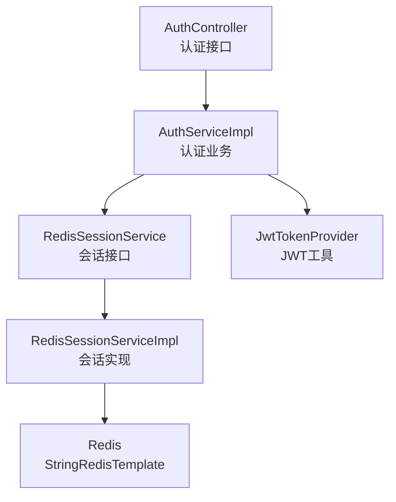
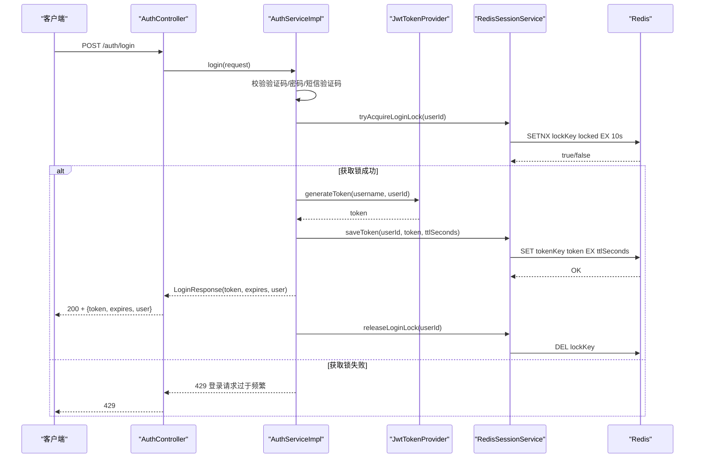
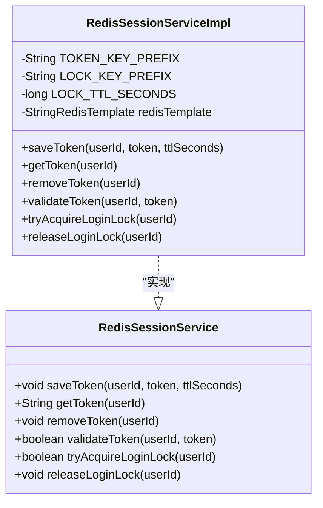
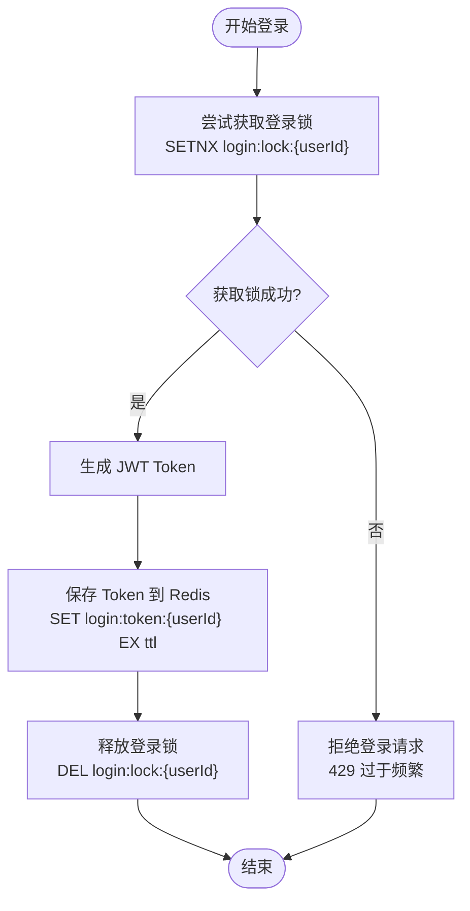
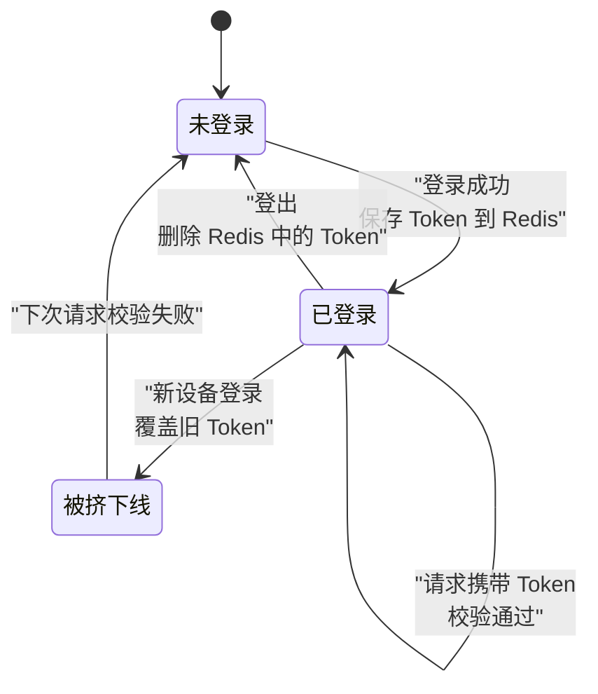
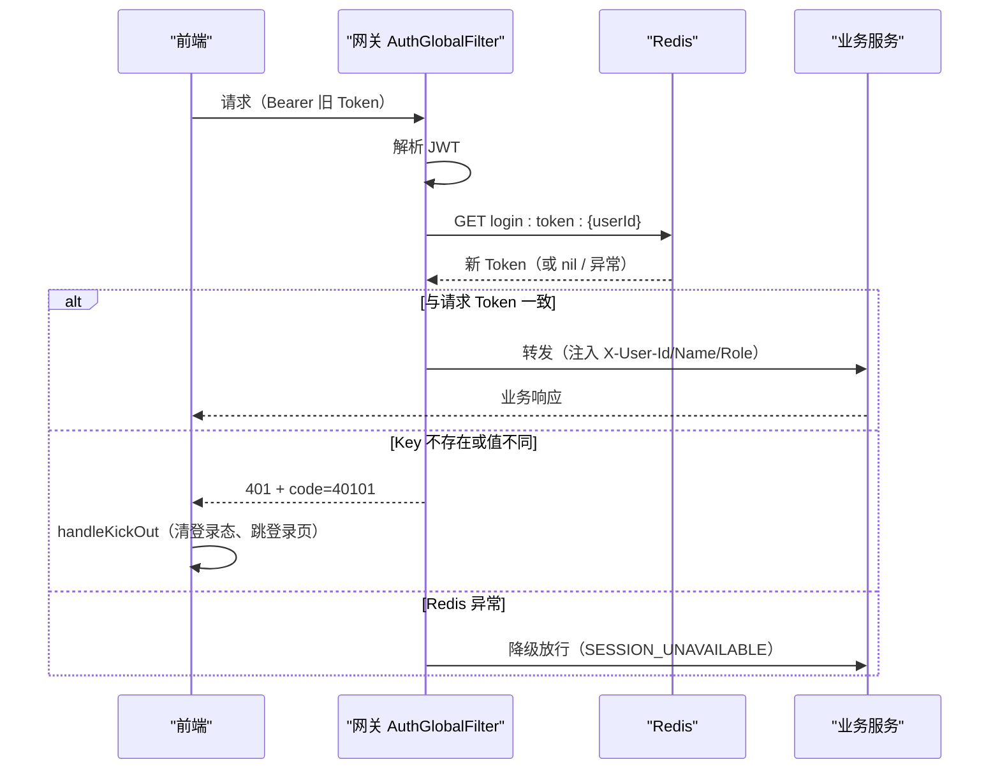
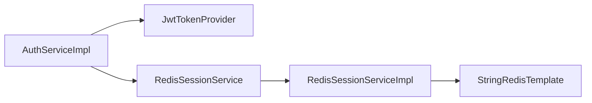

# 会话管理

<cite>
**本文引用的文件**   
- [RedisSessionService.java](file://backend/ecommerce-user/src/main/java/com/ecommerce/user/service/RedisSessionService.java)
- [RedisSessionServiceImpl.java](file://backend/ecommerce-user/src/main/java/com/ecommerce/user/service/impl/RedisSessionServiceImpl.java)
- [AuthServiceImpl.java](file://backend/ecommerce-user/src/main/java/com/ecommerce/user/service/impl/AuthServiceImpl.java)
- [JwtTokenProvider.java](file://backend/ecommerce-user/src/main/java/com/ecommerce/user/security/JwtTokenProvider.java)
- [AuthController.java](file://backend/ecommerce-user/src/main/java/com/ecommerce/user/controller/AuthController.java)
- [AuthGlobalFilter.java（网关会话比对）](file://backend/ecommerce-gateway/src/main/java/com/ecommerce/gateway/filter/AuthGlobalFilter.java)
- [ecommerce-gateway/application.yml](file://backend/ecommerce-gateway/src/main/resources/application.yml)
- [request.ts（前端 40101 拦截）](file://frontend/base-app/src/api/request.ts)
- [App.vue（会话心跳）](file://frontend/base-app/src/App.vue)
</cite>

## 目录
1. [引言](#引言)
2. [项目结构](#项目结构)
3. [核心组件](#核心组件)
4. [架构总览](#架构总览)
5. [详细组件分析](#详细组件分析)
6. [依赖关系分析](#依赖关系分析)
7. [性能与优化](#性能与优化)
8. [故障排查指南](#故障排查指南)
9. [结论](#结论)
10. [附录](#附录)

## 引言
本文件围绕“基于 Redis 的分布式会话管理”展开，重点说明 RedisSessionServiceImpl 的实现原理、接口设计、数据结构、键值命名规范、序列化策略、安全机制、并发控制、内存优化、生命周期、与 JWT 的结合方式、跨域共享与故障恢复。该方案通过 Redis 存储用户最新有效 Token，实现单设备登录（互踢/挤下线）与分布式锁保护登录流程，避免同一账号并发登录导致的状态错乱。

## 项目结构
会话相关代码位于 user 服务中，主要涉及：
- 接口定义：RedisSessionService
- 实现类：RedisSessionServiceImpl
- 认证流程集成：AuthServiceImpl
- Token 生成与校验：JwtTokenProvider
- 控制器入口：AuthController

图表来源
- [AuthController.java:31-60](file://backend/ecommerce-user/src/main/java/com/ecommerce/user/controller/AuthController.java#L31-L60)
- [AuthServiceImpl.java:33-124](file://backend/ecommerce-user/src/main/java/com/ecommerce/user/service/impl/AuthServiceImpl.java#L33-L124)
- [RedisSessionService.java:21-75](file://backend/ecommerce-user/src/main/java/com/ecommerce/user/service/RedisSessionService.java#L21-L75)
- [RedisSessionServiceImpl.java:27-107](file://backend/ecommerce-user/src/main/java/com/ecommerce/user/service/impl/RedisSessionServiceImpl.java#L27-L107)
- [JwtTokenProvider.java:18-75](file://backend/ecommerce-user/src/main/java/com/ecommerce/user/security/JwtTokenProvider.java#L18-L75)

章节来源
- [AuthController.java:31-60](file://backend/ecommerce-user/src/main/java/com/ecommerce/user/controller/AuthController.java#L31-L60)
- [AuthServiceImpl.java:33-124](file://backend/ecommerce-user/src/main/java/com/ecommerce/user/service/impl/AuthServiceImpl.java#L33-L124)
- [RedisSessionService.java:21-75](file://backend/ecommerce-user/src/main/java/com/ecommerce/user/service/RedisSessionService.java#L21-L75)
- [RedisSessionServiceImpl.java:27-107](file://backend/ecommerce-user/src/main/java/com/ecommerce/user/service/impl/RedisSessionServiceImpl.java#L27-L107)
- [JwtTokenProvider.java:18-75](file://backend/ecommerce-user/src/main/java/com/ecommerce/user/security/JwtTokenProvider.java#L18-L75)

## 核心组件
- RedisSessionService：定义会话管理的标准操作，包括保存 Token、获取 Token、删除 Token、校验 Token、获取/释放登录分布式锁。
- RedisSessionServiceImpl：基于 StringRedisTemplate 的 Redis 字符串类型 Key-Value 存储，使用原子性 SET+EX 设置 Token 与 TTL；使用 SETNX 实现分布式锁。
- AuthServiceImpl：在登录流程中调用 JwtTokenProvider 生成 Token，并通过 RedisSessionService 将 Token 写入 Redis，同时使用分布式锁保护登录过程。
- JwtTokenProvider：负责 JWT 的生成、解析与有效性校验，提供过期时间（秒）。
- AuthController：暴露注册、登录等认证接口，并注入 RedisSessionService 以支持登出时清理会话。

章节来源
- [RedisSessionService.java:21-75](file://backend/ecommerce-user/src/main/java/com/ecommerce/user/service/RedisSessionService.java#L21-L75)
- [RedisSessionServiceImpl.java:27-107](file://backend/ecommerce-user/src/main/java/com/ecommerce/user/service/impl/RedisSessionServiceImpl.java#L27-L107)
- [AuthServiceImpl.java:87-124](file://backend/ecommerce-user/src/main/java/com/ecommerce/user/service/impl/AuthServiceImpl.java#L87-L124)
- [JwtTokenProvider.java:18-75](file://backend/ecommerce-user/src/main/java/com/ecommerce/user/security/JwtTokenProvider.java#L18-L75)
- [AuthController.java:31-60](file://backend/ecommerce-user/src/main/java/com/ecommerce/user/controller/AuthController.java#L31-L60)

## 架构总览
下图展示登录流程中各组件的交互顺序，以及 Redis 在其中的作用。

图表来源
- [AuthController.java:54-60](file://backend/ecommerce-user/src/main/java/com/ecommerce/user/controller/AuthController.java#L54-L60)
- [AuthServiceImpl.java:87-124](file://backend/ecommerce-user/src/main/java/com/ecommerce/user/service/impl/AuthServiceImpl.java#L87-L124)
- [RedisSessionServiceImpl.java:85-106](file://backend/ecommerce-user/src/main/java/com/ecommerce/user/service/impl/RedisSessionServiceImpl.java#L85-L106)
- [JwtTokenProvider.java:34-46](file://backend/ecommerce-user/src/main/java/com/ecommerce/user/security/JwtTokenProvider.java#L34-L46)

## 详细组件分析

### RedisSessionService 接口设计
- 保存 Token：saveToken(userId, token, ttlSeconds)
  - 用于登录成功后覆盖旧 Token，使旧设备下次请求被挤下线。
- 获取 Token：getToken(userId)
  - 返回当前最新有效 Token，未登录或已过期返回 null。
- 删除 Token：removeToken(userId)
  - 用于登出，清除 Redis 中的 Token，所有设备需重新登录。
- 校验 Token：validateToken(userId, token)
  - 鉴权阶段判断请求是否来自已被挤下线的旧设备。
- 分布式锁：tryAcquireLoginLock(userId)、releaseLoginLock(userId)
  - 防止同一账号并发登录导致状态错乱。

章节来源
- [RedisSessionService.java:21-75](file://backend/ecommerce-user/src/main/java/com/ecommerce/user/service/RedisSessionService.java#L21-L75)

### RedisSessionServiceImpl 实现原理
- 数据存储
  - 使用 StringRedisTemplate 的 Value 操作，存储类型为字符串。
  - Token 存储 key 前缀为 login:token:，值为 JWT Token 字符串，TTL 与 JWT 有效期一致。
  - 使用 set(key, value, ttl, TimeUnit.SECONDS) 原子性地设置值和过期时间。
- 分布式锁
  - 使用 setIfAbsent(lockKey, "locked", LOCK_TTL_SECONDS, TimeUnit.SECONDS) 实现 SETNX。
  - 锁 TTL 固定为 10 秒，防止异常情况下锁无法释放。
- 日志记录
  - 关键操作均输出 debug/info 日志，便于追踪与排障。

图表来源
- [RedisSessionService.java:21-75](file://backend/ecommerce-user/src/main/java/com/ecommerce/user/service/RedisSessionService.java#L21-L75)
- [RedisSessionServiceImpl.java:27-107](file://backend/ecommerce-user/src/main/java/com/ecommerce/user/service/impl/RedisSessionServiceImpl.java#L27-L107)

章节来源
- [RedisSessionServiceImpl.java:27-107](file://backend/ecommerce-user/src/main/java/com/ecommerce/user/service/impl/RedisSessionServiceImpl.java#L27-L107)

### 会话数据结构与键值命名规范
- Key 命名
  - 会话 Token：login:token:{userId}
  - 登录分布式锁：login:lock:{userId}
- 数据类型
  - 均为字符串类型（String），Token 直接存储 JWT 字符串。
- TTL 策略
  - Token 的 TTL 与 JWT 有效期保持一致（由 JwtTokenProvider.getExpiresInSeconds() 提供）。
  - 锁的 TTL 固定为 10 秒，避免死锁。

章节来源
- [RedisSessionService.java:15-19](file://backend/ecommerce-user/src/main/java/com/ecommerce/user/service/RedisSessionService.java#L15-L19)
- [RedisSessionServiceImpl.java:32-39](file://backend/ecommerce-user/src/main/java/com/ecommerce/user/service/impl/RedisSessionServiceImpl.java#L32-L39)
- [JwtTokenProvider.java:71-74](file://backend/ecommerce-user/src/main/java/com/ecommerce/user/security/JwtTokenProvider.java#L71-L74)

### 序列化策略
- 采用 StringRedisTemplate，默认使用 StringSerializer 进行序列化。
- Token 本身是字符串，无需额外对象序列化，减少 CPU 与内存开销。
- 键名与值均为纯文本，便于调试与运维观察。

章节来源
- [RedisSessionServiceImpl.java:41-45](file://backend/ecommerce-user/src/main/java/com/ecommerce/user/service/impl/RedisSessionServiceImpl.java#L41-L45)

### 安全机制
- Token 校验
  - 鉴权阶段通过 validateToken 比对请求 Token 与 Redis 中最新 Token，不一致则视为被挤下线。
- 分布式锁
  - 登录流程通过 tryAcquireLoginLock 保证同一账号不会在短时间内重复登录造成状态错乱。
- JWT 签名与过期
  - JwtTokenProvider 使用 HS256 签名，过期时间由配置决定，并提供 getExpiresInSeconds() 供会话 TTL 对齐。

章节来源
- [RedisSessionServiceImpl.java:69-83](file://backend/ecommerce-user/src/main/java/com/ecommerce/user/service/impl/RedisSessionServiceImpl.java#L69-L83)
- [RedisSessionServiceImpl.java:85-99](file://backend/ecommerce-user/src/main/java/com/ecommerce/user/service/impl/RedisSessionServiceImpl.java#L85-L99)
- [JwtTokenProvider.java:27-32](file://backend/ecommerce-user/src/main/java/com/ecommerce/user/security/JwtTokenProvider.java#L27-L32)
- [JwtTokenProvider.java:62-69](file://backend/ecommerce-user/src/main/java/com/ecommerce/user/security/JwtTokenProvider.java#L62-L69)

### 并发控制
- 登录分布式锁
  - 使用 SETNX 实现互斥，确保同一账号在同一时刻只有一个登录流程执行。
  - 锁 TTL 设置为 10 秒，即使出现异常也能自动释放。
- 登录流程保护
  - AuthServiceImpl 在登录流程中使用 try-finally 确保无论成功或失败都会释放锁。

图表来源
- [AuthServiceImpl.java:106-123](file://backend/ecommerce-user/src/main/java/com/ecommerce/user/service/impl/AuthServiceImpl.java#L106-L123)
- [RedisSessionServiceImpl.java:85-106](file://backend/ecommerce-user/src/main/java/com/ecommerce/user/service/impl/RedisSessionServiceImpl.java#L85-L106)

章节来源
- [AuthServiceImpl.java:106-123](file://backend/ecommerce-user/src/main/java/com/ecommerce/user/service/impl/AuthServiceImpl.java#L106-L123)
- [RedisSessionServiceImpl.java:85-106](file://backend/ecommerce-user/src/main/java/com/ecommerce/user/service/impl/RedisSessionServiceImpl.java#L85-L106)

### 内存优化
- 使用字符串类型存储 Token，避免复杂对象序列化带来的内存占用。
- 通过 TTL 自动过期，避免长期驻留无效会话。
- 仅维护每个用户的最新 Token，降低冗余数据量。

章节来源
- [RedisSessionServiceImpl.java:47-54](file://backend/ecommerce-user/src/main/java/com/ecommerce/user/service/impl/RedisSessionServiceImpl.java#L47-L54)
- [RedisSessionServiceImpl.java:56-60](file://backend/ecommerce-user/src/main/java/com/ecommerce/user/service/impl/RedisSessionServiceImpl.java#L56-L60)

### 会话生命周期图

图表来源
- [RedisSessionServiceImpl.java:47-67](file://backend/ecommerce-user/src/main/java/com/ecommerce/user/service/impl/RedisSessionServiceImpl.java#L47-L67)
- [RedisSessionServiceImpl.java:69-83](file://backend/ecommerce-user/src/main/java/com/ecommerce/user/service/impl/RedisSessionServiceImpl.java#L69-L83)

### Redis 存储结构
- Key 空间
  - login:token:{userId}：存储用户最新有效 Token，TTL 与 JWT 有效期一致。
  - login:lock:{userId}：登录并发锁，TTL 10 秒。
- 值内容
  - Token 为 JWT 字符串。
  - 锁值为固定字符串 "locked"。

章节来源
- [RedisSessionService.java:15-19](file://backend/ecommerce-user/src/main/java/com/ecommerce/user/service/RedisSessionService.java#L15-L19)
- [RedisSessionServiceImpl.java:32-39](file://backend/ecommerce-user/src/main/java/com/ecommerce/user/service/impl/RedisSessionServiceImpl.java#L32-L39)

### 与 JWT 的结合使用
- 生成 Token
  - JwtTokenProvider.generateToken(username, userId) 生成带 uid claim 的 JWT。
- 过期时间对齐
  - 登录时将 JWT 过期时间（秒）作为 Redis Token 的 TTL，确保两者一致性。
- 校验流程
  - 鉴权时先校验 JWT 签名与过期，再通过 RedisSessionService.validateToken 判断是否为最新 Token。

章节来源
- [JwtTokenProvider.java:34-46](file://backend/ecommerce-user/src/main/java/com/ecommerce/user/security/JwtTokenProvider.java#L34-L46)
- [JwtTokenProvider.java:71-74](file://backend/ecommerce-user/src/main/java/com/ecommerce/user/security/JwtTokenProvider.java#L71-L74)
- [AuthServiceImpl.java:111-116](file://backend/ecommerce-user/src/main/java/com/ecommerce/user/service/impl/AuthServiceImpl.java#L111-L116)

### 跨域会话共享
- 由于 Token 存储在 Redis，多个微服务实例可共享同一 Redis 实例或集群，从而实现跨节点、跨域的会话共享。
- 前端可在不同子应用之间传递相同 Token，后端通过 Redis 校验是否为最新 Token。

[本节为概念性说明，不直接分析具体文件]

### 故障恢复机制
- 锁异常恢复
  - 分布式锁设置 TTL，即使进程异常退出也会自动释放，避免永久阻塞。
- Token 过期恢复
  - Redis 中 Token 过期后，validateToken 返回 false，客户端需重新登录。
- 登出清理
  - 登出时删除 Redis 中的 Token，确保所有设备立即失效。

章节来源
- [RedisSessionServiceImpl.java:85-106](file://backend/ecommerce-user/src/main/java/com/ecommerce/user/service/impl/RedisSessionServiceImpl.java#L85-L106)
- [RedisSessionServiceImpl.java:69-83](file://backend/ecommerce-user/src/main/java/com/ecommerce/user/service/impl/RedisSessionServiceImpl.java#L69-L83)
- [RedisSessionServiceImpl.java:62-67](file://backend/ecommerce-user/src/main/java/com/ecommerce/user/service/impl/RedisSessionServiceImpl.java#L62-L67)

### 网关侧会话比对（互踢真正生效的环节）
用户服务写入的 Token 需要一个“读方”才能产生互踢效果，这个读方是网关而不是业务服务。

- 写入与覆盖：登录成功后 `saveToken` 执行 `SET login:token:{userId} <token> EX <ttl>`，新值直接覆盖旧值，于是一个账号只保留最新一次登录。
- 比对位置：`AuthGlobalFilter`（order = -100）在 JWT 解析通过后 `GET login:token:{userId}`，与请求携带的 Token 逐字比较，不一致即判定旧会话失效。
- 三种结果：一致则注入 `X-User-Id` / `X-User-Name` / `X-User-Role` 并转发；Key 不存在（已登出）与值不同（已被新设备覆盖）均返回 HTTP 401 + 业务码 `40101`；只有 Redis 异常时降级放行（否则一次 Redis 抖动会把全站用户踢下线）。
- 前端行为：`request.ts` 只对 `40101` 做“清登录态 + 提示 + `router.replace('/login')`”；`App.vue` 以 30s 心跳 + `visibilitychange` 补检主动发现失效，避免闲置页面长期停在旧登录态。
- 开关：`gateway.session-check.enabled`（默认 true）；临时绕过会话比对（如批量压测）时才关闭。

**图表来源**
- [AuthGlobalFilter.java](file://backend/ecommerce-gateway/src/main/java/com/ecommerce/gateway/filter/AuthGlobalFilter.java)
- [ecommerce-gateway/application.yml](file://backend/ecommerce-gateway/src/main/resources/application.yml)
- [RedisSessionServiceImpl.java:85-106](file://backend/ecommerce-user/src/main/java/com/ecommerce/user/service/impl/RedisSessionServiceImpl.java#L85-L106)
- [request.ts（前端请求封装）](file://frontend/base-app/src/api/request.ts)
- [App.vue（主应用）](file://frontend/base-app/src/App.vue)

## 依赖关系分析
- 组件耦合
  - AuthServiceImpl 依赖 JwtTokenProvider 与 RedisSessionService。
  - RedisSessionServiceImpl 依赖 Spring Data Redis 的 StringRedisTemplate。
- 外部依赖
  - Redis：提供高性能 Key-Value 存储与原子命令（SET+EX、SETNX、DEL）。
  - JWT：提供无状态令牌生成与校验。

图表来源
- [AuthServiceImpl.java:41-59](file://backend/ecommerce-user/src/main/java/com/ecommerce/user/service/impl/AuthServiceImpl.java#L41-L59)
- [RedisSessionServiceImpl.java:41-45](file://backend/ecommerce-user/src/main/java/com/ecommerce/user/service/impl/RedisSessionServiceImpl.java#L41-L45)

章节来源
- [AuthServiceImpl.java:41-59](file://backend/ecommerce-user/src/main/java/com/ecommerce/user/service/impl/AuthServiceImpl.java#L41-L59)
- [RedisSessionServiceImpl.java:41-45](file://backend/ecommerce-user/src/main/java/com/ecommerce/user/service/impl/RedisSessionServiceImpl.java#L41-L45)

## 性能与优化
- 原子性操作
  - 使用 SET+EX 原子设置 Token 与 TTL，避免竞态条件。
  - 使用 SETNX 实现分布式锁，减少锁竞争与误判。
- 低延迟访问
  - Redis 高吞吐、低延迟，适合高频鉴权场景。
- 内存占用优化
  - 仅存储字符串 Token，避免复杂对象序列化。
  - 通过 TTL 自动清理过期数据，降低内存压力。
- 可扩展性
  - 多实例共享 Redis，天然支持水平扩展与跨域共享。

[本节为通用性能讨论，不直接分析具体文件]

## 故障排查指南
- 登录频繁报错
  - 检查分布式锁是否被其他线程持有，确认 tryAcquireLoginLock 返回值。
  - 查看 Redis 中是否存在 login:lock:{userId} 且未过期。
- Token 校验失败
  - 检查 Redis 中 login:token:{userId} 是否存在且未过期。
  - 确认请求 Token 与 Redis 中最新 Token 是否一致。
- 登出后仍可使用
  - 确认登出流程是否调用了 removeToken 删除 Redis 中的 Token。
- 未做任何操作却提示“已被其他设备登录”（40101）
  - 先查 `login:token:{userId}` 是否被另一个环境/实例覆盖（多套前端指向同一个 Redis 时必现）；再确认网关 `gateway.session-check.enabled` 是否被误关。
  - 若现象是“全部用户同时被踢”，多为 Redis 异常而非会话覆盖；网关对 Redis 不可用走降级放行（`SESSION_UNAVAILABLE`），请查 Redis 连通性与 Sentinel/集群地址。
  - 前端无业务请求的页面依靠 30s 心跳发现失效，若心跳未启动（Token 不在 `tokenRef`）则只能等下一次请求。
- 日志定位
  - 关注 RedisSessionServiceImpl 的 debug/info 日志，定位保存、删除、校验与锁操作结果。

章节来源
- [RedisSessionServiceImpl.java:47-67](file://backend/ecommerce-user/src/main/java/com/ecommerce/user/service/impl/RedisSessionServiceImpl.java#L47-L67)
- [RedisSessionServiceImpl.java:69-83](file://backend/ecommerce-user/src/main/java/com/ecommerce/user/service/impl/RedisSessionServiceImpl.java#L69-L83)
- [RedisSessionServiceImpl.java:85-106](file://backend/ecommerce-user/src/main/java/com/ecommerce/user/service/impl/RedisSessionServiceImpl.java#L85-L106)

## 结论
该会话管理方案通过 Redis 存储用户最新有效 Token，结合 JWT 的无状态特性，实现了分布式环境下的单设备登录与互踢机制。接口设计清晰，实现简洁可靠，具备高可用与易扩展能力。通过分布式锁保护登录流程，避免了并发问题；通过 TTL 自动过期与登出清理，保障了安全性与资源利用率。整体方案在生产环境中具备良好的稳定性与可维护性。

[本节为总结性内容，不直接分析具体文件]

## 附录
- 关键方法路径参考
  - 保存 Token：[RedisSessionServiceImpl.saveToken:47-54](file://backend/ecommerce-user/src/main/java/com/ecommerce/user/service/impl/RedisSessionServiceImpl.java#L47-L54)
  - 获取 Token：[RedisSessionServiceImpl.getToken:56-60](file://backend/ecommerce-user/src/main/java/com/ecommerce/user/service/impl/RedisSessionServiceImpl.java#L56-L60)
  - 删除 Token：[RedisSessionServiceImpl.removeToken:62-67](file://backend/ecommerce-user/src/main/java/com/ecommerce/user/service/impl/RedisSessionServiceImpl.java#L62-L67)
  - 校验 Token：[RedisSessionServiceImpl.validateToken:69-83](file://backend/ecommerce-user/src/main/java/com/ecommerce/user/service/impl/RedisSessionServiceImpl.java#L69-L83)
  - 获取登录锁：[RedisSessionServiceImpl.tryAcquireLoginLock:85-99](file://backend/ecommerce-user/src/main/java/com/ecommerce/user/service/impl/RedisSessionServiceImpl.java#L85-L99)
  - 释放登录锁：[RedisSessionServiceImpl.releaseLoginLock:101-106](file://backend/ecommerce-user/src/main/java/com/ecommerce/user/service/impl/RedisSessionServiceImpl.java#L101-L106)
  - 登录流程集成：[AuthServiceImpl.login:87-124](file://backend/ecommerce-user/src/main/java/com/ecommerce/user/service/impl/AuthServiceImpl.java#L87-L124)
  - JWT 生成与过期：[JwtTokenProvider:34-46](file://backend/ecommerce-user/src/main/java/com/ecommerce/user/security/JwtTokenProvider.java#L34-L46)