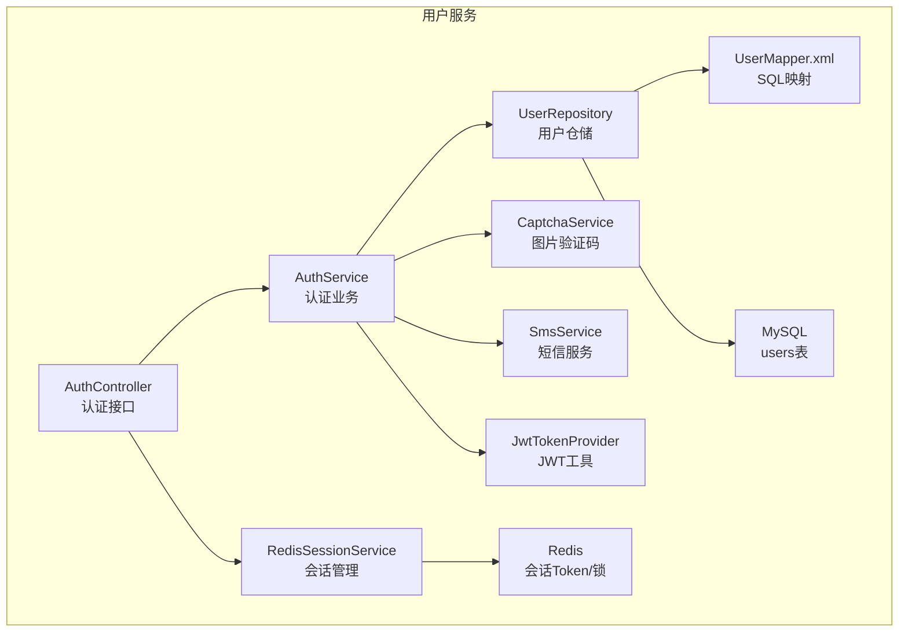
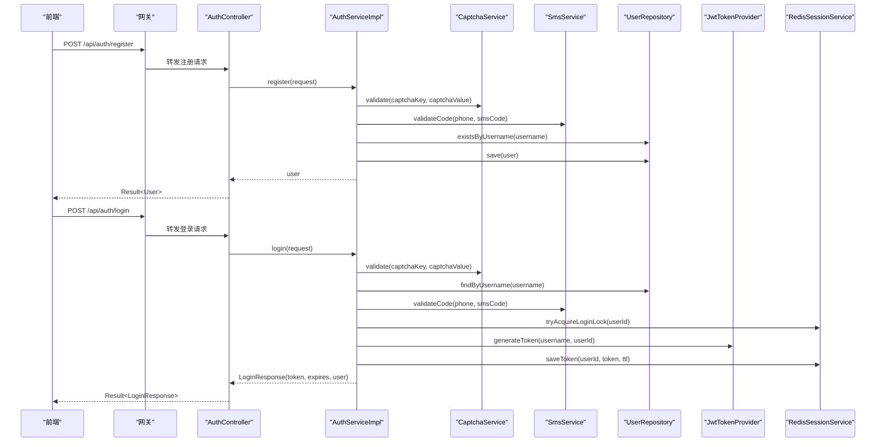
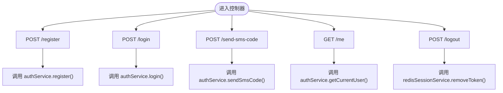
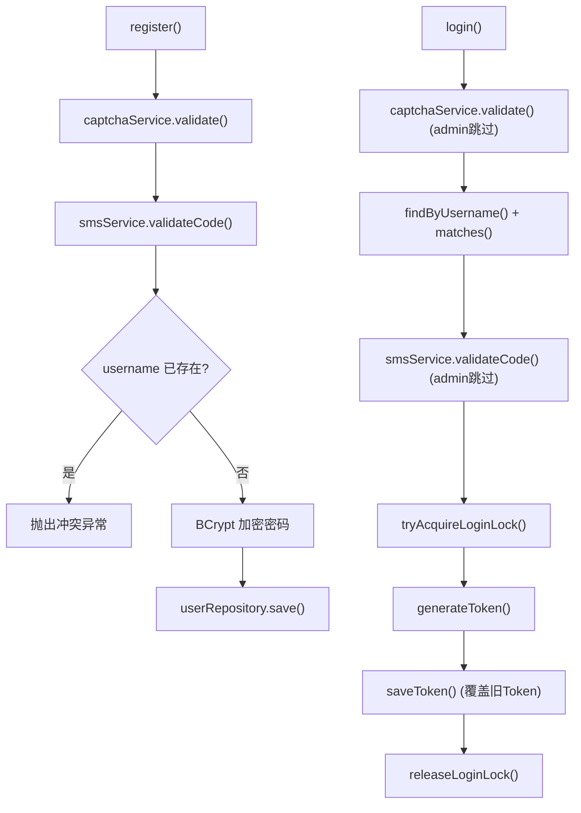
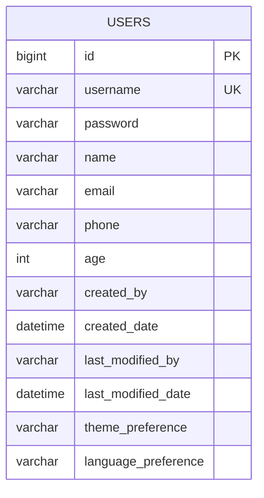
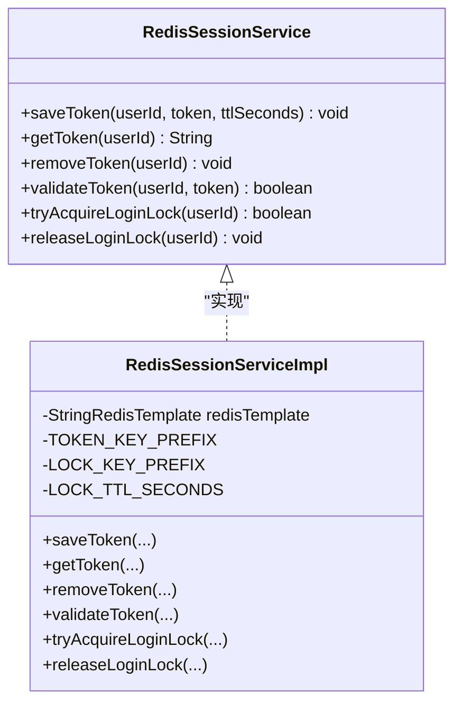
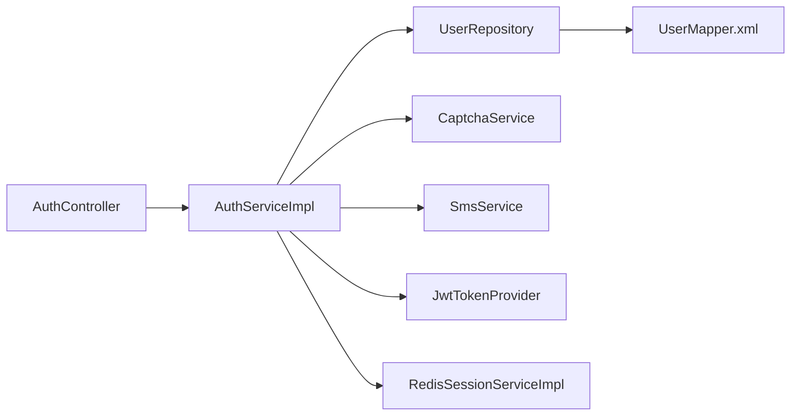

# 用户服务

<cite>
**本文引用的文件**   
- [UserApplication.java](file://backend/ecommerce-user/src/main/java/com/ecommerce/user/UserApplication.java)
- [AuthController.java](file://backend/ecommerce-user/src/main/java/com/ecommerce/user/controller/AuthController.java)
- [AuthService.java](file://backend/ecommerce-user/src/main/java/com/ecommerce/user/service/AuthService.java)
- [AuthServiceImpl.java](file://backend/ecommerce-user/src/main/java/com/ecommerce/user/service/impl/AuthServiceImpl.java)
- [UserService.java](file://backend/ecommerce-user/src/main/java/com/ecommerce/user/service/UserService.java)
- [UserRepository.java](file://backend/ecommerce-user/src/main/java/com/ecommerce/user/repository/UserRepository.java)
- [UserMapper.xml](file://backend/ecommerce-user/src/main/resources/mapper/UserMapper.xml)
- [schema.sql](file://backend/ecommerce-user/src/main/resources/db/schema.sql)
- [User.java](file://backend/ecommerce-user/src/main/java/com/ecommerce/user/entity/User.java)
- [RedisSessionService.java](file://backend/ecommerce-user/src/main/java/com/ecommerce/user/service/RedisSessionService.java)
- [RedisSessionServiceImpl.java](file://backend/ecommerce-user/src/main/java/com/ecommerce/user/service/impl/RedisSessionServiceImpl.java)
- [CaptchaService.java](file://backend/ecommerce-user/src/main/java/com/ecommerce/user/service/CaptchaService.java)
- [SmsService.java](file://backend/ecommerce-user/src/main/java/com/ecommerce/user/service/SmsService.java)
- [JwtTokenProvider.java](file://backend/ecommerce-user/src/main/java/com/ecommerce/user/security/JwtTokenProvider.java)
- [application.yml](file://backend/ecommerce-user/src/main/resources/application.yml)
</cite>

## 目录
1. [简介](#简介)
2. [项目结构](#项目结构)
3. [核心组件](#核心组件)
4. [架构总览](#架构总览)
5. [详细组件分析](#详细组件分析)
6. [依赖关系分析](#依赖关系分析)
7. [性能与扩展性](#性能与扩展性)
8. [故障排查指南](#故障排查指南)
9. [结论](#结论)
10. [附录：接口与配置速查](#附录接口与配置速查)

## 简介
本文件为用户服务的权威技术文档，聚焦以下目标：
- 说明 UserApplication 启动类职责与关键注解。
- 深入解析 AuthController 认证控制器：注册、登录、JWT 令牌生成、验证码管理、短信验证码流程。
- 阐述 UserService 业务层设计（用户信息管理）与密码加密、会话管理机制。
- 解释 User 实体模型、数据库表结构与 MyBatis 映射配置。
- 说明 RedisSessionServiceImpl 的会话管理、CaptchaService 图片验证码、SmsService 短信服务实现。
- 提供用户认证流程图、数据模型图、接口调用关系图，并给出安全机制、性能优化与扩展开发指南。

## 项目结构
用户服务模块 ecommerce-user 采用典型分层架构：
- 控制层：AuthController、UserController、CaptchaController、SmsController、HealthController
- 服务层：AuthService、UserService、CaptchaService、SmsService、RedisSessionService
- 仓储层：UserRepository（基于 MyBatis）
- 安全层：JwtTokenProvider、过滤器等
- 配置层：application.yml、SecurityConfig、CorsConfig、RestTemplateConfig 等
- 数据层：MySQL schema.sql、MyBatis XML 映射

图表来源
- [AuthController.java:31-95](file://backend/ecommerce-user/src/main/java/com/ecommerce/user/controller/AuthController.java#L31-L95)
- [AuthServiceImpl.java:33-164](file://backend/ecommerce-user/src/main/java/com/ecommerce/user/service/impl/AuthServiceImpl.java#L33-L164)
- [UserRepository.java:25-108](file://backend/ecommerce-user/src/main/java/com/ecommerce/user/repository/UserRepository.java#L25-L108)
- [UserMapper.xml:8-104](file://backend/ecommerce-user/src/main/resources/mapper/UserMapper.xml#L8-L104)
- [RedisSessionServiceImpl.java:27-108](file://backend/ecommerce-user/src/main/java/com/ecommerce/user/service/impl/RedisSessionServiceImpl.java#L27-L108)
- [CaptchaService.java:32-136](file://backend/ecommerce-user/src/main/java/com/ecommerce/user/service/CaptchaService.java#L32-L136)
- [SmsService.java:41-218](file://backend/ecommerce-user/src/main/java/com/ecommerce/user/service/SmsService.java#L41-L218)
- [JwtTokenProvider.java:18-76](file://backend/ecommerce-user/src/main/java/com/ecommerce/user/security/JwtTokenProvider.java#L18-L76)

章节来源
- [UserApplication.java:12-19](file://backend/ecommerce-user/src/main/java/com/ecommerce/user/UserApplication.java#L12-L19)
- [application.yml:1-97](file://backend/ecommerce-user/src/main/resources/application.yml#L1-L97)

## 核心组件
- UserApplication：Spring Boot 启动入口，启用 MapperScan 扫描 MyBatis 映射，导入全局异常处理器。
- AuthController：对外暴露认证相关 REST 接口，包括注册、登录、发送短信验证码、获取当前用户、登出。
- AuthService / AuthServiceImpl：认证业务编排，串联图片验证码、短信验证码、用户持久化、JWT 签发与 Redis 会话管理。
- UserService / UserServiceImpl：用户信息 CRUD 业务封装（与仓储层解耦）。
- UserRepository：基于 MyBatis 的用户数据访问，统一填充审计字段。
- RedisSessionService / RedisSessionServiceImpl：基于 Redis 的 Token 存储与会话校验、登录并发锁。
- CaptchaService：内存型图片验证码生成与一次性校验。
- SmsService：短信验证码生成、频率限制、重试策略、发送记录。
- JwtTokenProvider：HS256 JWT 生成、解析与有效性校验。

章节来源
- [UserApplication.java:12-19](file://backend/ecommerce-user/src/main/java/com/ecommerce/user/UserApplication.java#L12-L19)
- [AuthController.java:31-95](file://backend/ecommerce-user/src/main/java/com/ecommerce/user/controller/AuthController.java#L31-L95)
- [AuthService.java:12-29](file://backend/ecommerce-user/src/main/java/com/ecommerce/user/service/AuthService.java#L12-L29)
- [AuthServiceImpl.java:33-164](file://backend/ecommerce-user/src/main/java/com/ecommerce/user/service/impl/AuthServiceImpl.java#L33-L164)
- [UserService.java:10-22](file://backend/ecommerce-user/src/main/java/com/ecommerce/user/service/UserService.java#L10-L22)
- [UserRepository.java:25-108](file://backend/ecommerce-user/src/main/java/com/ecommerce/user/repository/UserRepository.java#L25-L108)
- [RedisSessionService.java:21-76](file://backend/ecommerce-user/src/main/java/com/ecommerce/user/service/RedisSessionService.java#L21-L76)
- [RedisSessionServiceImpl.java:27-108](file://backend/ecommerce-user/src/main/java/com/ecommerce/user/service/impl/RedisSessionServiceImpl.java#L27-L108)
- [CaptchaService.java:32-136](file://backend/ecommerce-user/src/main/java/com/ecommerce/user/service/CaptchaService.java#L32-L136)
- [SmsService.java:41-218](file://backend/ecommerce-user/src/main/java/com/ecommerce/user/service/SmsService.java#L41-L218)
- [JwtTokenProvider.java:18-76](file://backend/ecommerce-user/src/main/java/com/ecommerce/user/security/JwtTokenProvider.java#L18-L76)

## 架构总览
用户服务整体通过网关路由到 /user 上下文路径，认证接口在 /auth 下暴露。认证流程结合图片验证码与短信验证码双重校验，登录成功后签发 JWT，并将最新 Token 写入 Redis 实现单设备互踢；鉴权时比对请求 Token 与 Redis 中最新 Token。

图表来源
- [AuthController.java:47-94](file://backend/ecommerce-user/src/main/java/com/ecommerce/user/controller/AuthController.java#L47-L94)
- [AuthServiceImpl.java:62-124](file://backend/ecommerce-user/src/main/java/com/ecommerce/user/service/impl/AuthServiceImpl.java#L62-L124)
- [CaptchaService.java:46-71](file://backend/ecommerce-user/src/main/java/com/ecommerce/user/service/CaptchaService.java#L46-L71)
- [SmsService.java:76-153](file://backend/ecommerce-user/src/main/java/com/ecommerce/user/service/SmsService.java#L76-L153)
- [UserRepository.java:44-76](file://backend/ecommerce-user/src/main/java/com/ecommerce/user/repository/UserRepository.java#L44-L76)
- [JwtTokenProvider.java:34-46](file://backend/ecommerce-user/src/main/java/com/ecommerce/user/security/JwtTokenProvider.java#L34-L46)
- [RedisSessionServiceImpl.java:47-99](file://backend/ecommerce-user/src/main/java/com/ecommerce/user/service/impl/RedisSessionServiceImpl.java#L47-L99)

## 详细组件分析

### 启动类 UserApplication
- 使用 @SpringBootApplication 启动应用。
- @MapperScan 指定 MyBatis 映射包路径。
- @Import(GlobalExceptionHandler.class) 引入全局异常处理。

章节来源
- [UserApplication.java:12-19](file://backend/ecommerce-user/src/main/java/com/ecommerce/user/UserApplication.java#L12-L19)

### 认证控制器 AuthController
- 暴露 /auth/register、/auth/login、/auth/send-sms-code、/auth/me、/auth/logout。
- 注册与登录需携带图片验证码与短信验证码；/me 与 /logout 需要有效 JWT。
- 登出时清除 Redis 中的会话 Token，使当前设备立即失效。

图表来源
- [AuthController.java:47-94](file://backend/ecommerce-user/src/main/java/com/ecommerce/user/controller/AuthController.java#L47-L94)

章节来源
- [AuthController.java:31-95](file://backend/ecommerce-user/src/main/java/com/ecommerce/user/controller/AuthController.java#L31-L95)

### 认证服务 AuthService / AuthServiceImpl
- 注册流程：图片验证码 → 短信验证码 → 用户名唯一性检查 → 密码 BCrypt 加密 → 保存用户。
- 登录流程：图片验证码 → 查询用户 → 密码校验 → 短信验证码 → 分布式锁 → 签发 JWT → 写入 Redis 会话 → 释放锁。
- 发送短信验证码：先校验图片验证码，再根据场景解析手机号并调用短信服务。
- 管理员账号 admin 可跳过图片与短信验证码校验，便于演示。

图表来源
- [AuthServiceImpl.java:62-124](file://backend/ecommerce-user/src/main/java/com/ecommerce/user/service/impl/AuthServiceImpl.java#L62-L124)
- [CaptchaService.java:46-71](file://backend/ecommerce-user/src/main/java/com/ecommerce/user/service/CaptchaService.java#L46-L71)
- [SmsService.java:76-153](file://backend/ecommerce-user/src/main/java/com/ecommerce/user/service/SmsService.java#L76-L153)
- [UserRepository.java:44-76](file://backend/ecommerce-user/src/main/java/com/ecommerce/user/repository/UserRepository.java#L44-L76)
- [JwtTokenProvider.java:34-46](file://backend/ecommerce-user/src/main/java/com/ecommerce/user/security/JwtTokenProvider.java#L34-L46)
- [RedisSessionServiceImpl.java:47-99](file://backend/ecommerce-user/src/main/java/com/ecommerce/user/service/impl/RedisSessionServiceImpl.java#L47-L99)

章节来源
- [AuthService.java:12-29](file://backend/ecommerce-user/src/main/java/com/ecommerce/user/service/AuthService.java#L12-L29)
- [AuthServiceImpl.java:33-164](file://backend/ecommerce-user/src/main/java/com/ecommerce/user/service/impl/AuthServiceImpl.java#L33-L164)

### 用户服务 UserService
- 定义用户信息查询、新增、更新、删除等接口，供上层调用。
- 具体实现通常委托 UserRepository 完成持久化操作。

章节来源
- [UserService.java:10-22](file://backend/ecommerce-user/src/main/java/com/ecommerce/user/service/UserService.java#L10-L22)

### 用户仓储 UserRepository
- 基于 MyBatis 的 UserMapper 访问 MySQL。
- save() 自动填充审计字段：createdBy/createdDate 首次写入后不再变化，lastModifiedBy/lastModifiedDate 每次更新刷新。
- 未认证或系统内部操作默认记录为 "system"。

章节来源
- [UserRepository.java:25-108](file://backend/ecommerce-user/src/main/java/com/ecommerce/user/repository/UserRepository.java#L25-L108)

### 用户实体 User 与数据库表结构
- User 实体包含用户名、加密密码、姓名、邮箱、手机号、年龄、审计字段、主题与语言偏好等。
- password 使用 @JsonIgnore 避免响应泄露。
- users 表采用下划线命名，通过 UserMapper.xml 的 resultMap 映射为驼峰字段。

图表来源
- [schema.sql:15-29](file://backend/ecommerce-user/src/main/resources/db/schema.sql#L15-L29)
- [UserMapper.xml:10-24](file://backend/ecommerce-user/src/main/resources/mapper/UserMapper.xml#L10-L24)
- [User.java:20-64](file://backend/ecommerce-user/src/main/java/com/ecommerce/user/entity/User.java#L20-L64)

章节来源
- [User.java:20-64](file://backend/ecommerce-user/src/main/java/com/ecommerce/user/entity/User.java#L20-L64)
- [schema.sql:15-29](file://backend/ecommerce-user/src/main/resources/db/schema.sql#L15-L29)
- [UserMapper.xml:10-24](file://backend/ecommerce-user/src/main/resources/mapper/UserMapper.xml#L10-L24)

### MyBatis 映射配置 UserMapper.xml
- 定义 UserResultMap 将数据库下划线字段映射为实体驼峰字段。
- 提供 selectAll/selectById/selectByUsername/count* 查询与 insert/update/delete 更新语句。
- updateById 不覆盖创建审计字段，仅刷新最后修改审计字段。
- 支持主题与语言偏好单独更新。

章节来源
- [UserMapper.xml:8-104](file://backend/ecommerce-user/src/main/resources/mapper/UserMapper.xml#L8-L104)

### Redis 会话管理 RedisSessionService / RedisSessionServiceImpl
- Key 前缀：login:token:{userId} 存储最新有效 Token；login:lock:{userId} 用于登录并发锁。
- saveToken 使用 SET+EX 原子设置 TTL，覆盖旧 Token 实现挤下线。
- validateToken 比对请求 Token 与 Redis 中最新 Token。
- tryAcquireLoginLock/releaseLoginLock 使用 SETNX 实现分布式锁，TTL=10秒防止死锁。

图表来源
- [RedisSessionService.java:21-76](file://backend/ecommerce-user/src/main/java/com/ecommerce/user/service/RedisSessionService.java#L21-L76)
- [RedisSessionServiceImpl.java:27-108](file://backend/ecommerce-user/src/main/java/com/ecommerce/user/service/impl/RedisSessionServiceImpl.java#L27-L108)

章节来源
- [RedisSessionService.java:21-76](file://backend/ecommerce-user/src/main/java/com/ecommerce/user/service/RedisSessionService.java#L21-L76)
- [RedisSessionServiceImpl.java:27-108](file://backend/ecommerce-user/src/main/java/com/ecommerce/user/service/impl/RedisSessionServiceImpl.java#L27-L108)

### 图片验证码服务 CaptchaService
- 使用纯 JDK AWT 绘制随机字符图片，输出 Base64 PNG Data URL。
- 验证码 key/value 保存在进程内 ConcurrentHashMap，支持过期清理与一次性使用。
- 可通过配置关闭验证码功能以方便本地调试。

章节来源
- [CaptchaService.java:32-136](file://backend/ecommerce-user/src/main/java/com/ecommerce/user/service/CaptchaService.java#L32-L136)

### 短信服务 SmsService
- 生成 6 位数字验证码，支持同一手机号频率限制（rateLimitSeconds）。
- 内置验证码存储与一次性校验逻辑，有效期独立于图片验证码。
- 支持云片网接口调用失败的重试（线性或指数退避），失败统一转换为业务异常。
- 发送成功/失败均记录到进程内队列，容量上限保护内存。

章节来源
- [SmsService.java:41-218](file://backend/ecommerce-user/src/main/java/com/ecommerce/user/service/SmsService.java#L41-L218)

### JWT 令牌生成 JwtTokenProvider
- HS256 签名，subject 存放用户名，附加 uid claim。
- 提供生成、解析、有效性校验方法，以及返回有效期秒数。

章节来源
- [JwtTokenProvider.java:18-76](file://backend/ecommerce-user/src/main/java/com/ecommerce/user/security/JwtTokenProvider.java#L18-L76)

## 依赖关系分析
- 控制层依赖服务层：AuthController 依赖 AuthService 与 RedisSessionService。
- 服务层依赖仓储与安全组件：AuthServiceImpl 依赖 UserRepository、CaptchaService、SmsService、JwtTokenProvider、RedisSessionService。
- 仓储层依赖 MyBatis：UserRepository 依赖 UserMapper。
- 外部依赖：MySQL、Redis、云片网短信 API。

图表来源
- [AuthController.java:31-95](file://backend/ecommerce-user/src/main/java/com/ecommerce/user/controller/AuthController.java#L31-L95)
- [AuthServiceImpl.java:33-164](file://backend/ecommerce-user/src/main/java/com/ecommerce/user/service/impl/AuthServiceImpl.java#L33-L164)
- [UserRepository.java:25-108](file://backend/ecommerce-user/src/main/java/com/ecommerce/user/repository/UserRepository.java#L25-L108)
- [UserMapper.xml:8-104](file://backend/ecommerce-user/src/main/resources/mapper/UserMapper.xml#L8-L104)
- [RedisSessionServiceImpl.java:27-108](file://backend/ecommerce-user/src/main/java/com/ecommerce/user/service/impl/RedisSessionServiceImpl.java#L27-L108)

章节来源
- [AuthController.java:31-95](file://backend/ecommerce-user/src/main/java/com/ecommerce/user/controller/AuthController.java#L31-L95)
- [AuthServiceImpl.java:33-164](file://backend/ecommerce-user/src/main/java/com/ecommerce/user/service/impl/AuthServiceImpl.java#L33-L164)
- [UserRepository.java:25-108](file://backend/ecommerce-user/src/main/java/com/ecommerce/user/repository/UserRepository.java#L25-L108)
- [UserMapper.xml:8-104](file://backend/ecommerce-user/src/main/resources/mapper/UserMapper.xml#L8-L104)
- [RedisSessionServiceImpl.java:27-108](file://backend/ecommerce-user/src/main/java/com/ecommerce/user/service/impl/RedisSessionServiceImpl.java#L27-L108)

## 性能与扩展性
- 验证码与短信验证码均为短时状态，使用进程内 Map/Deque，避免落库开销；注意多实例部署时需考虑共享存储方案（如 Redis）。
- Redis 会话管理使用原子命令 SET+EX 与 SETNX，减少竞争条件；登录锁 TTL=10s 防止死锁。
- 短信发送具备重试与退避策略，降低瞬时网络抖动影响；频率限制防止滥发。
- MyBatis 显式 resultMap 保证字段映射稳定，updateById 不覆盖审计字段，减少不必要更新。
- 建议：
  - 生产环境开启验证码与短信开关，合理配置 TTL 与频率限制。
  - 对高频接口增加缓存与限流。
  - 将进程内验证码/短信记录迁移至 Redis 以支持水平扩展。
  - 对敏感配置（JWT secret、短信 apiKey）使用环境变量或密钥管理服务。

[本节为通用指导，不直接分析具体文件]

## 故障排查指南
- 注册失败：
  - 用户名冲突：检查是否存在同名用户。
  - 密码不一致：确认两次输入一致。
  - 验证码错误：检查图片验证码是否过期或被复用。
- 登录失败：
  - 用户名不存在或密码错误：核对凭据。
  - 短信验证码错误或过期：重新获取验证码。
  - 登录频繁：检查 Redis 登录锁是否被占用。
- 登出无效：
  - 确认 Redis 中 Token 是否被删除。
  - 前端是否同步清除本地 Token。
- 短信发送失败：
  - 检查短信开关与配置（apiKey、templateId）。
  - 查看重试日志与频率限制提示。
- 鉴权失败：
  - 检查 JWT 是否过期或签名不合法。
  - 检查 Redis 中最新 Token 是否与请求一致（可能被挤下线）。

章节来源
- [AuthServiceImpl.java:62-124](file://backend/ecommerce-user/src/main/java/com/ecommerce/user/service/impl/AuthServiceImpl.java#L62-L124)
- [SmsService.java:87-153](file://backend/ecommerce-user/src/main/java/com/ecommerce/user/service/SmsService.java#L87-L153)
- [RedisSessionServiceImpl.java:47-99](file://backend/ecommerce-user/src/main/java/com/ecommerce/user/service/impl/RedisSessionServiceImpl.java#L47-L99)

## 结论
用户服务通过严格的验证码与短信双重校验、BCrypt 密码加密、JWT 无状态令牌与 Redis 会话管理，实现了安全的注册登录与单设备互踢能力。仓储层与 MyBatis 映射保证了数据一致性，服务层清晰划分了认证与用户管理职责。配合合理的配置与扩展策略，可在生产环境中稳定运行并平滑扩展。

[本节为总结，不直接分析具体文件]

## 附录：接口与配置速查
- 认证接口
  - POST /auth/register：注册新用户
  - POST /auth/login：登录返回 JWT
  - POST /auth/send-sms-code：发送短信验证码
  - GET /auth/me：获取当前用户
  - POST /auth/logout：退出登录并清除 Redis 会话
- 关键配置（application.yml）
  - server.servlet.context-path=/user
  - jwt.secret、jwt.expiration-minutes
  - captcha.enabled、captcha.expire-seconds、captcha.width/height/code-length/line-count
  - sms.enabled、sms.api-url、sms.api-key、sms.max-retry、sms.retry-interval-ms、sms.retry-backoff、sms.rate-limit-seconds、sms.code-expire-seconds

章节来源
- [AuthController.java:47-94](file://backend/ecommerce-user/src/main/java/com/ecommerce/user/controller/AuthController.java#L47-L94)
- [application.yml:1-97](file://backend/ecommerce-user/src/main/resources/application.yml#L1-L97)