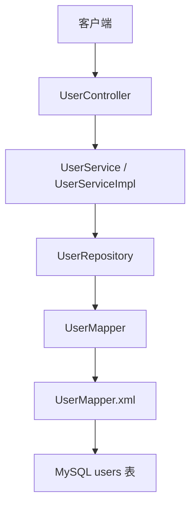
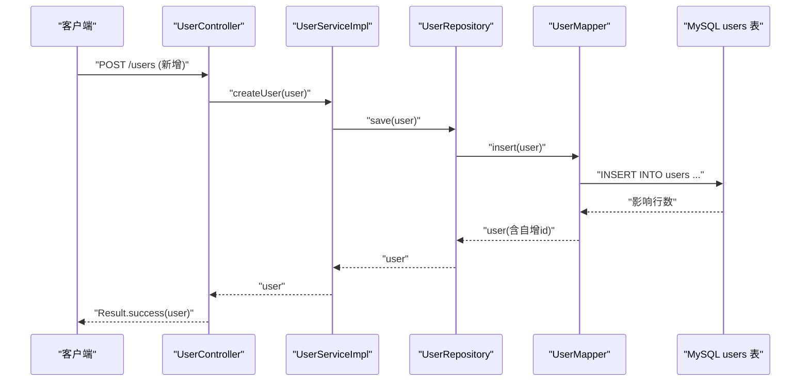
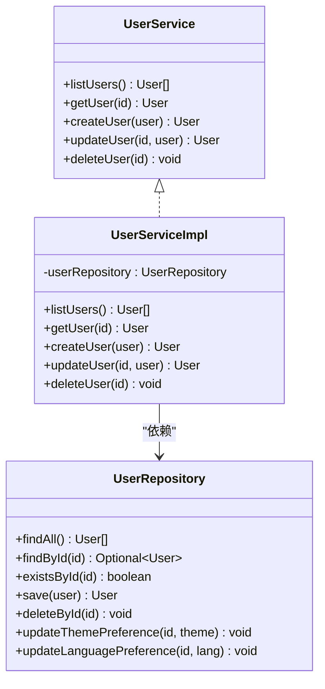
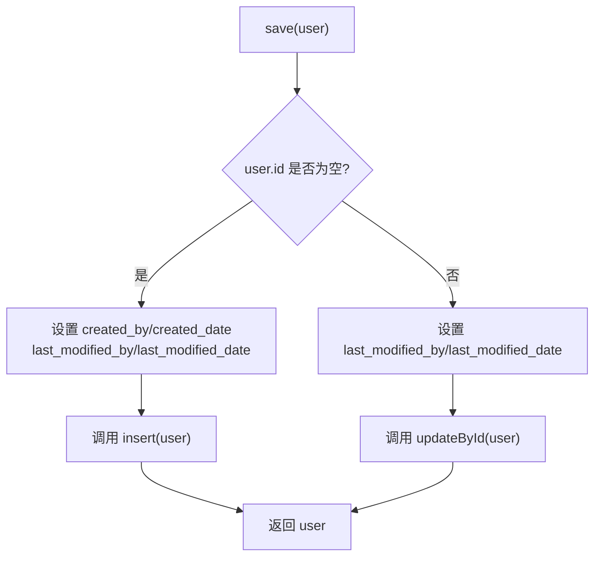
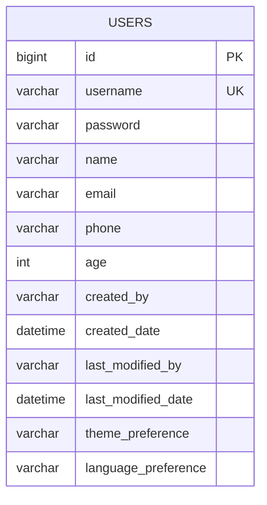
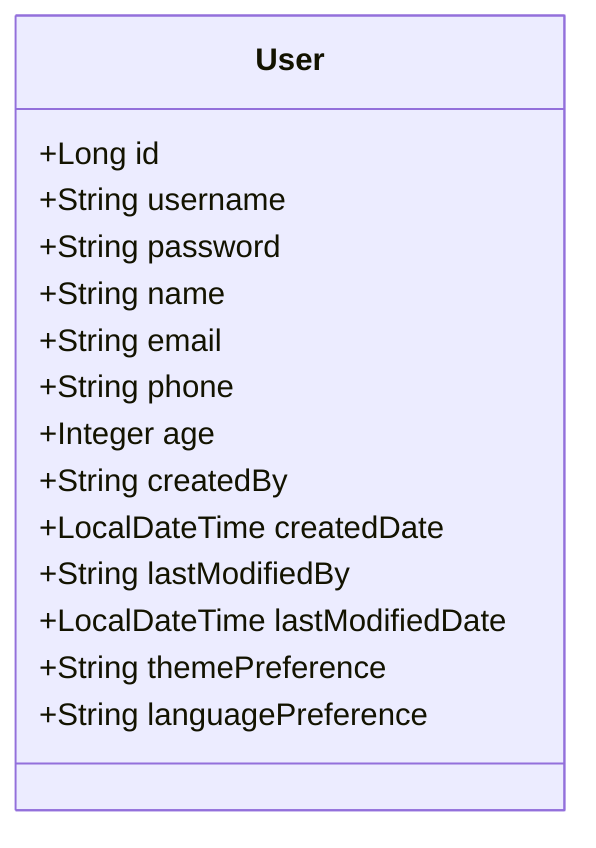
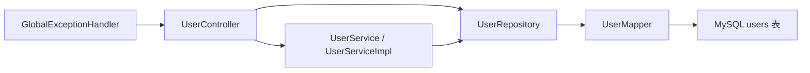
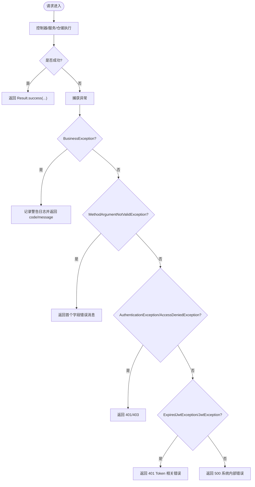

# 用户管理功能

<cite>
**本文引用的文件**   
- [UserController.java](file://backend/ecommerce-user/src/main/java/com/ecommerce/user/controller/UserController.java)
- [UserService.java](file://backend/ecommerce-user/src/main/java/com/ecommerce/user/service/UserService.java)
- [UserServiceImpl.java](file://backend/ecommerce-user/src/main/java/com/ecommerce/user/service/impl/UserServiceImpl.java)
- [UserRepository.java](file://backend/ecommerce-user/src/main/java/com/ecommerce/user/repository/UserRepository.java)
- [UserMapper.java](file://backend/ecommerce-user/src/main/java/com/ecommerce/user/repository/mapper/UserMapper.java)
- [UserMapper.xml](file://backend/ecommerce-user/src/main/resources/mapper/UserMapper.xml)
- [User.java](file://backend/ecommerce-user/src/main/java/com/ecommerce/user/entity/User.java)
- [schema.sql](file://backend/ecommerce-user/src/main/resources/db/schema.sql)
- [BusinessException.java](file://backend/ecommerce-common/src/main/java/com/ecommerce/common/BusinessException.java)
- [GlobalExceptionHandler.java](file://backend/ecommerce-common/src/main/java/com/ecommerce/common/GlobalExceptionHandler.java)
- [Result.java](file://backend/ecommerce-common/src/main/java/com/ecommerce/common/Result.java)
</cite>

## 目录
1. [简介](#简介)
2. [项目结构](#项目结构)
3. [核心组件](#核心组件)
4. [架构总览](#架构总览)
5. [详细组件分析](#详细组件分析)
6. [依赖关系分析](#依赖关系分析)
7. [性能与优化](#性能与优化)
8. [异常处理机制](#异常处理机制)
9. [故障排查指南](#故障排查指南)
10. [结论](#结论)

## 简介
本文件面向“用户管理”子系统的后端实现，聚焦以下目标：
- 说明 UserController 控制器的 CRUD 接口设计、参数校验与统一响应。
- 阐述 UserService 业务层的数据验证、业务规则与事务边界。
- 解释 User 实体模型字段定义、数据约束与审计字段策略。
- 梳理 MyBatis 映射配置、数据库表结构与持久化流程。
- 提供用户信息结构图、关键操作流程与异常处理机制。
- 给出持久化策略、缓存现状与可扩展的性能优化方案。

## 项目结构
用户管理功能位于 ecommerce-user 模块中，采用典型的分层架构：
- 控制器层：UserController 暴露 REST 接口。
- 服务层：UserService 接口与 UserServiceImpl 实现业务逻辑。
- 仓储层：UserRepository 封装持久化细节，调用 MyBatis Mapper。
- 数据访问层：UserMapper 接口 + UserMapper.xml SQL 映射。
- 领域模型：User 实体对应 users 表。
- 通用能力：Result 统一响应、BusinessException 业务异常、GlobalExceptionHandler 全局异常处理。



图表来源
- [UserController.java:29-83](file://backend/ecommerce-user/src/main/java/com/ecommerce/user/controller/UserController.java#L29-L83)
- [UserServiceImpl.java:14-63](file://backend/ecommerce-user/src/main/java/com/ecommerce/user/service/impl/UserServiceImpl.java#L14-L63)
- [UserRepository.java:25-90](file://backend/ecommerce-user/src/main/java/com/ecommerce/user/repository/UserRepository.java#L25-L90)
- [UserMapper.java:14-46](file://backend/ecommerce-user/src/main/java/com/ecommerce/user/repository/mapper/UserMapper.java#L14-L46)
- [UserMapper.xml:8-101](file://backend/ecommerce-user/src/main/resources/mapper/UserMapper.xml#L8-L101)
- [schema.sql:15-29](file://backend/ecommerce-user/src/main/resources/db/schema.sql#L15-L29)

章节来源
- [UserController.java:29-83](file://backend/ecommerce-user/src/main/java/com/ecommerce/user/controller/UserController.java#L29-L83)
- [UserServiceImpl.java:14-63](file://backend/ecommerce-user/src/main/java/com/ecommerce/user/service/impl/UserServiceImpl.java#L14-L63)
- [UserRepository.java:25-90](file://backend/ecommerce-user/src/main/java/com/ecommerce/user/repository/UserRepository.java#L25-L90)
- [UserMapper.java:14-46](file://backend/ecommerce-user/src/main/java/com/ecommerce/user/repository/mapper/UserMapper.java#L14-L46)
- [UserMapper.xml:8-101](file://backend/ecommerce-user/src/main/resources/mapper/UserMapper.xml#L8-L101)
- [schema.sql:15-29](file://backend/ecommerce-user/src/main/resources/db/schema.sql#L15-L29)

## 核心组件
- 控制器层（UserController）
  - 提供用户列表查询、按 ID 查询、新增、更新、删除等标准 CRUD 接口。
  - 额外提供主题偏好与语言偏好的读取与更新接口，基于请求头中的用户标识进行权限判断。
  - 所有接口返回统一的 Result 包装对象。
- 服务层（UserService / UserServiceImpl）
  - 封装用户数据的查询、创建、更新、删除等业务逻辑。
  - 在更新时保留未传入的用户名和密码，避免覆盖已有值。
  - 对不存在用户抛出业务异常。
- 仓储层（UserRepository）
  - 封装 MyBatis 的 UserMapper 调用。
  - 自动填充审计字段（createdBy/createdDate/lastModifiedBy/lastModifiedDate）。
  - 提供存在性检查、主题与语言偏好更新方法。
- 数据访问层（UserMapper + UserMapper.xml）
  - 通过 XML 方式声明 SQL，包含增删改查与偏好字段更新。
  - 使用 resultMap 将数据库下划线字段映射为 Java 驼峰字段。
- 领域模型（User）
  - 定义用户基本信息、审计字段与偏好字段。
  - 使用 Jakarta Validation 注解进行输入校验。
  - 密码字段忽略序列化输出。
- 通用能力
  - Result 统一响应体。
  - BusinessException 业务异常。
  - GlobalExceptionHandler 全局异常处理，统一转换为 Result。

章节来源
- [UserController.java:29-140](file://backend/ecommerce-user/src/main/java/com/ecommerce/user/controller/UserController.java#L29-L140)
- [UserService.java:10-21](file://backend/ecommerce-user/src/main/java/com/ecommerce/user/service/UserService.java#L10-L21)
- [UserServiceImpl.java:14-63](file://backend/ecommerce-user/src/main/java/com/ecommerce/user/service/impl/UserServiceImpl.java#L14-L63)
- [UserRepository.java:25-107](file://backend/ecommerce-user/src/main/java/com/ecommerce/user/repository/UserRepository.java#L25-L107)
- [UserMapper.java:14-46](file://backend/ecommerce-user/src/main/java/com/ecommerce/user/repository/mapper/UserMapper.java#L14-L46)
- [UserMapper.xml:8-101](file://backend/ecommerce-user/src/main/resources/mapper/UserMapper.xml#L8-L101)
- [User.java:20-64](file://backend/ecommerce-user/src/main/java/com/ecommerce/user/entity/User.java#L20-L64)
- [Result.java:8-63](file://backend/ecommerce-common/src/main/java/com/ecommerce/common/Result.java#L8-L63)
- [BusinessException.java:6-22](file://backend/ecommerce-common/src/main/java/com/ecommerce/common/BusinessException.java#L6-L22)
- [GlobalExceptionHandler.java:17-73](file://backend/ecommerce-common/src/main/java/com/ecommerce/common/GlobalExceptionHandler.java#L17-L73)

## 架构总览
用户管理的整体调用链如下：
- 客户端发起 HTTP 请求到 UserController。
- 控制器调用 UserService 执行业务逻辑。
- 服务层调用 UserRepository 完成数据访问。
- 仓储层通过 UserMapper 执行 MyBatis SQL，操作 MySQL users 表。
- 异常由 GlobalExceptionHandler 统一捕获并返回 Result。



图表来源
- [UserController.java:63-68](file://backend/ecommerce-user/src/main/java/com/ecommerce/user/controller/UserController.java#L63-L68)
- [UserServiceImpl.java:34-39](file://backend/ecommerce-user/src/main/java/com/ecommerce/user/service/impl/UserServiceImpl.java#L34-L39)
- [UserRepository.java:59-76](file://backend/ecommerce-user/src/main/java/com/ecommerce/user/repository/UserRepository.java#L59-L76)
- [UserMapper.java:32-33](file://backend/ecommerce-user/src/main/java/com/ecommerce/user/repository/mapper/UserMapper.java#L32-L33)
- [UserMapper.xml:63-71](file://backend/ecommerce-user/src/main/resources/mapper/UserMapper.xml#L63-L71)
- [schema.sql:15-29](file://backend/ecommerce-user/src/main/resources/db/schema.sql#L15-L29)

## 详细组件分析

### 控制器层：UserController
职责与行为：
- 暴露用户资源接口，路径以 /users 为前缀。
- 提供基础 CRUD：
  - GET /users：查询全部用户。
  - GET /users/{id}：根据 ID 查询单个用户。
  - POST /users：新增用户，入参使用 @Valid 校验。
  - PUT /users/{id}：更新用户，入参使用 @Valid 校验。
  - DELETE /users/{id}：删除用户。
- 提供偏好设置接口：
  - GET /users/theme、PUT /users/theme：主题偏好 dark/light。
  - GET /users/language、PUT /users/language：语言偏好 zh/en。
- 从请求头 TrustedAuthenticationFilter.HEADER_USER_ID 获取当前登录用户 ID，未携带则抛业务异常。

接口与返回值：
- 所有接口返回 Result<T>，成功状态码 200，失败由全局异常处理器转换。

```mermaid
flowchart TD
Start(["进入 UserController"]) --> CheckAuth{"是否携带用户ID头?"}
CheckAuth --> |否| Throw401["抛出未授权业务异常"]
CheckAuth --> |是| Route{"路由匹配"}
Route --> |GET /users| ListUsers["list() -> userService.listUsers()"]
Route --> |GET /users/{id}| GetById["get(id) -> userService.getUser(id)"]
Route --> |POST /users| Create["create(@Valid user) -> userService.createUser(user)"]
Route --> |PUT /users/{id}| Update["update(id, @Valid user) -> userService.updateUser(id, user)"]
Route --> |DELETE /users/{id}| Delete["delete(id) -> userService.deleteUser(id)"]
Route --> |GET /users/theme| GetTheme["getTheme() -> 读取并返回主题偏好"]
Route --> |PUT /users/theme| UpdateTheme["updateTheme() -> 校验并更新主题偏好"]
Route --> |GET /users/language| GetLanguage["getLanguage() -> 读取并返回语言偏好"]
Route --> |PUT /users/language| UpdateLanguage["updateLanguage() -> 校验并更新语言偏好"]
ListUsers --> End(["返回 Result"])
GetById --> End
Create --> End
Update --> End
Delete --> End
GetTheme --> End
UpdateTheme --> End
GetLanguage --> End
UpdateLanguage --> End
```

图表来源
- [UserController.java:49-131](file://backend/ecommerce-user/src/main/java/com/ecommerce/user/controller/UserController.java#L49-L131)

章节来源
- [UserController.java:29-140](file://backend/ecommerce-user/src/main/java/com/ecommerce/user/controller/UserController.java#L29-L140)

### 服务层：UserService 与 UserServiceImpl
职责与行为：
- listUsers：返回全部用户列表。
- getUser：根据 ID 查询用户，不存在抛业务异常。
- createUser：新建用户时清空客户端传入的 id，交由仓储层生成；保存后返回用户对象。
- updateUser：先查询现有用户，若前端未传用户名或密码则保留原值，再保存更新。
- deleteUser：先检查是否存在，不存在抛业务异常；存在则删除。

业务规则要点：
- 更新时保护 username/password 不被意外清空。
- 统一通过 Repository 访问数据，保持服务层无直接 SQL 依赖。



图表来源
- [UserService.java:10-21](file://backend/ecommerce-user/src/main/java/com/ecommerce/user/service/UserService.java#L10-L21)
- [UserServiceImpl.java:14-63](file://backend/ecommerce-user/src/main/java/com/ecommerce/user/service/impl/UserServiceImpl.java#L14-L63)
- [UserRepository.java:25-107](file://backend/ecommerce-user/src/main/java/com/ecommerce/user/repository/UserRepository.java#L25-L107)

章节来源
- [UserService.java:10-21](file://backend/ecommerce-user/src/main/java/com/ecommerce/user/service/UserService.java#L10-L21)
- [UserServiceImpl.java:14-63](file://backend/ecommerce-user/src/main/java/com/ecommerce/user/service/impl/UserServiceImpl.java#L14-L63)

### 仓储层：UserRepository
职责与行为：
- 封装 UserMapper 调用，对外提供 findAll、findById、findByUsername、existsByUsername、existsById、save、deleteById 等方法。
- save 方法自动填充审计字段：
  - 新增：写入 createdBy、createdDate、lastModifiedBy、lastModifiedDate。
  - 更新：仅刷新 lastModifiedBy、lastModifiedDate。
- 提供 updateThemePreference 与 updateLanguagePreference 偏好更新方法。
- currentUserOrSystem 从 SecurityContext 获取当前认证用户，匿名或未认证时使用 "system"。



图表来源
- [UserRepository.java:59-76](file://backend/ecommerce-user/src/main/java/com/ecommerce/user/repository/UserRepository.java#L59-L76)
- [UserMapper.xml:63-85](file://backend/ecommerce-user/src/main/resources/mapper/UserMapper.xml#L63-L85)

章节来源
- [UserRepository.java:25-107](file://backend/ecommerce-user/src/main/java/com/ecommerce/user/repository/UserRepository.java#L25-L107)

### 数据访问层：UserMapper 与 UserMapper.xml
职责与行为：
- UserMapper 接口声明 selectAll、selectById、selectByUsername、countByUsername、countById、insert、updateById、deleteById、updateThemePreference、updateLanguagePreference 等方法。
- UserMapper.xml 定义 SQL：
  - resultMap 将数据库下划线字段映射为 Java 驼峰字段。
  - BaseColumns 复用列集合。
  - insert 使用 useGeneratedKeys 回填主键。
  - updateById 不覆盖 created_by/created_date，仅刷新 last_modified_*。
  - 偏好字段更新单独提供 updateThemePreference 与 updateLanguagePreference。



图表来源
- [schema.sql:15-29](file://backend/ecommerce-user/src/main/resources/db/schema.sql#L15-L29)
- [UserMapper.xml:10-24](file://backend/ecommerce-user/src/main/resources/mapper/UserMapper.xml#L10-L24)

章节来源
- [UserMapper.java:14-46](file://backend/ecommerce-user/src/main/java/com/ecommerce/user/repository/mapper/UserMapper.java#L14-L46)
- [UserMapper.xml:8-101](file://backend/ecommerce-user/src/main/resources/mapper/UserMapper.xml#L8-L101)
- [schema.sql:15-29](file://backend/ecommerce-user/src/main/resources/db/schema.sql#L15-L29)

### 领域模型：User
字段与约束：
- id：主键，自增。
- username：登录认证标识，注册必填，旧数据可为空。
- password：BCrypt 密文，@JsonIgnore 确保不返回给前端。
- name：姓名，NotBlank。
- email：邮箱，NotBlank 且 Email 格式校验。
- phone：手机号，NotBlank 且正则校验中国大陆手机号格式。
- age：年龄，Min(0)。
- createdBy/createdDate/lastModifiedBy/lastModifiedDate：审计字段，由 Repository.save 自动填充。
- themePreference/languagePreference：偏好字段，默认值在插入时通过 COALESCE 设置。



图表来源
- [User.java:20-64](file://backend/ecommerce-user/src/main/java/com/ecommerce/user/entity/User.java#L20-L64)

章节来源
- [User.java:20-64](file://backend/ecommerce-user/src/main/java/com/ecommerce/user/entity/User.java#L20-L64)

## 依赖关系分析
组件耦合与协作：
- UserController 依赖 UserService 与 UserRepository（用于偏好设置直读）。
- UserServiceImpl 依赖 UserRepository。
- UserRepository 依赖 UserMapper。
- UserMapper 通过 XML 与数据库交互。
- 全局异常处理器拦截业务异常、参数校验异常、认证/授权异常、JWT 异常与兜底异常。



图表来源
- [UserController.java:29-140](file://backend/ecommerce-user/src/main/java/com/ecommerce/user/controller/UserController.java#L29-L140)
- [UserServiceImpl.java:14-63](file://backend/ecommerce-user/src/main/java/com/ecommerce/user/service/impl/UserServiceImpl.java#L14-L63)
- [UserRepository.java:25-107](file://backend/ecommerce-user/src/main/java/com/ecommerce/user/repository/UserRepository.java#L25-L107)
- [UserMapper.java:14-46](file://backend/ecommerce-user/src/main/java/com/ecommerce/user/repository/mapper/UserMapper.java#L14-L46)
- [GlobalExceptionHandler.java:17-73](file://backend/ecommerce-common/src/main/java/com/ecommerce/common/GlobalExceptionHandler.java#L17-L73)

章节来源
- [UserController.java:29-140](file://backend/ecommerce-user/src/main/java/com/ecommerce/user/controller/UserController.java#L29-L140)
- [UserServiceImpl.java:14-63](file://backend/ecommerce-user/src/main/java/com/ecommerce/user/service/impl/UserServiceImpl.java#L14-L63)
- [UserRepository.java:25-107](file://backend/ecommerce-user/src/main/java/com/ecommerce/user/repository/UserRepository.java#L25-L107)
- [UserMapper.java:14-46](file://backend/ecommerce-user/src/main/java/com/ecommerce/user/repository/mapper/UserMapper.java#L14-L46)
- [GlobalExceptionHandler.java:17-73](file://backend/ecommerce-common/src/main/java/com/ecommerce/common/GlobalExceptionHandler.java#L17-L73)

## 性能与优化
当前实现特点：
- 数据访问通过 MyBatis XML 显式 SQL，便于优化与扩展。
- 审计字段在 Repository.save 中集中处理，减少重复代码。
- 偏好字段更新使用独立 SQL，避免全量更新。

可优化的方向：
- 分页与排序
  - 当前 listUsers 返回全部用户，建议引入分页参数与排序字段，降低大表查询压力。
- 索引优化
  - 针对高频查询条件（如 email、phone、username）建立合适索引，提升查询性能。
- 缓存策略
  - 对热点用户信息（如主题、语言偏好）引入 Redis 缓存，降低数据库压力。
  - 注意缓存一致性：更新偏好后同步失效或更新缓存。
- 批量操作
  - 批量导入或批量更新场景可使用 MyBatis 批处理或分批提交，减少连接开销。
- 连接池与慢查询
  - 合理配置 HikariCP 连接池参数，监控慢查询日志，及时优化 SQL。

[本节为通用性能建议，不直接分析具体文件]

## 异常处理机制
统一异常处理流程：
- 业务异常：BusinessException 被 GlobalExceptionHandler 捕获，返回 Result.error(code, message)。
- 参数校验异常：MethodArgumentNotValidException 被捕获，返回第一个字段错误消息。
- 认证/授权异常：AuthenticationException、AccessDeniedException 分别返回 401/403。
- JWT 异常：ExpiredJwtException、JwtException 返回 401 提示。
- 兜底异常：Exception 返回 500 系统内部错误。



图表来源
- [GlobalExceptionHandler.java:22-72](file://backend/ecommerce-common/src/main/java/com/ecommerce/common/GlobalExceptionHandler.java#L22-L72)
- [BusinessException.java:6-22](file://backend/ecommerce-common/src/main/java/com/ecommerce/common/BusinessException.java#L6-L22)
- [Result.java:28-37](file://backend/ecommerce-common/src/main/java/com/ecommerce/common/Result.java#L28-L37)

章节来源
- [GlobalExceptionHandler.java:17-73](file://backend/ecommerce-common/src/main/java/com/ecommerce/common/GlobalExceptionHandler.java#L17-L73)
- [BusinessException.java:6-22](file://backend/ecommerce-common/src/main/java/com/ecommerce/common/BusinessException.java#L6-L22)
- [Result.java:8-63](file://backend/ecommerce-common/src/main/java/com/ecommerce/common/Result.java#L8-L63)

## 故障排查指南
常见问题与定位思路：
- 用户不存在
  - 现象：查询或更新/删除时报 404。
  - 定位：检查 UserServiceImpl 中 getUser/updateUser/deleteUser 的异常抛出逻辑。
  - 参考：[UserServiceImpl.java:28-32](file://backend/ecommerce-user/src/main/java/com/ecommerce/user/service/impl/UserServiceImpl.java#L28-L32)、[UserServiceImpl.java:41-53](file://backend/ecommerce-user/src/main/java/com/ecommerce/user/service/impl/UserServiceImpl.java#L41-L53)、[UserServiceImpl.java:56-62](file://backend/ecommerce-user/src/main/java/com/ecommerce/user/service/impl/UserServiceImpl.java#L56-L62)
- 参数校验失败
  - 现象：新增/更新接口返回 400，提示字段校验错误。
  - 定位：检查 User 实体的校验注解与前端传参。
  - 参考：[User.java:32-45](file://backend/ecommerce-user/src/main/java/com/ecommerce/user/entity/User.java#L32-L45)
- 未授权访问
  - 现象：偏好设置接口返回 401。
  - 定位：检查请求头是否携带 TrustedAuthenticationFilter.HEADER_USER_ID。
  - 参考：[UserController.java:133-139](file://backend/ecommerce-user/src/main/java/com/ecommerce/user/controller/UserController.java#L133-L139)
- 审计字段未生效
  - 现象：created_by/created_date 或 last_modified_by/last_modified_date 为空。
  - 定位：确认是否通过 UserRepository.save 保存，而非直接调用 Mapper。
  - 参考：[UserRepository.java:59-76](file://backend/ecommerce-user/src/main/java/com/ecommerce/user/repository/UserRepository.java#L59-L76)
- 偏好字段未更新
  - 现象：主题或语言偏好未变化。
  - 定位：检查控制器参数校验与 Repository 的 updateThemePreference/updateLanguagePreference 调用。
  - 参考：[UserController.java:96-131](file://backend/ecommerce-user/src/main/java/com/ecommerce/user/controller/UserController.java#L96-L131)、[UserRepository.java:82-90](file://backend/ecommerce-user/src/main/java/com/ecommerce/user/repository/UserRepository.java#L82-L90)

章节来源
- [UserServiceImpl.java:28-62](file://backend/ecommerce-user/src/main/java/com/ecommerce/user/service/impl/UserServiceImpl.java#L28-L62)
- [User.java:32-45](file://backend/ecommerce-user/src/main/java/com/ecommerce/user/entity/User.java#L32-L45)
- [UserController.java:96-139](file://backend/ecommerce-user/src/main/java/com/ecommerce/user/controller/UserController.java#L96-L139)
- [UserRepository.java:59-90](file://backend/ecommerce-user/src/main/java/com/ecommerce/user/repository/UserRepository.java#L59-L90)

## 结论
用户管理功能采用清晰的分层架构，控制器负责接口暴露与参数校验，服务层封装业务规则，仓储层统一持久化细节与审计字段填充，MyBatis XML 提供灵活的 SQL 映射。全局异常处理器保证一致的响应格式与错误语义。当前实现已具备完整的 CRUD 能力与偏好设置功能，后续可在分页、索引、缓存与批量操作等方面进一步优化，以提升性能与可维护性。