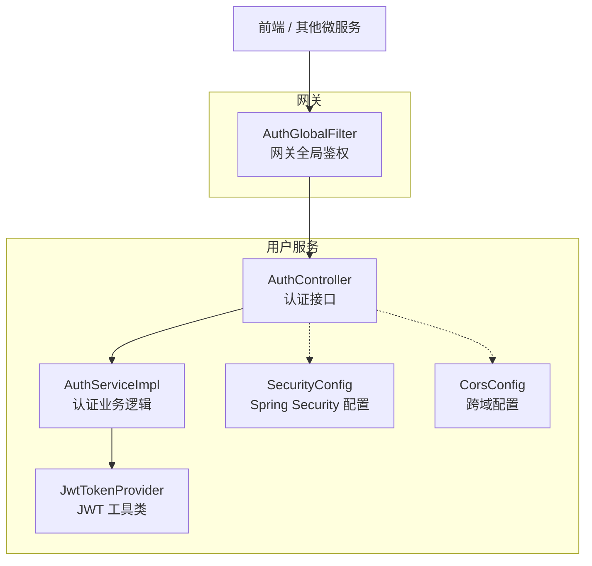
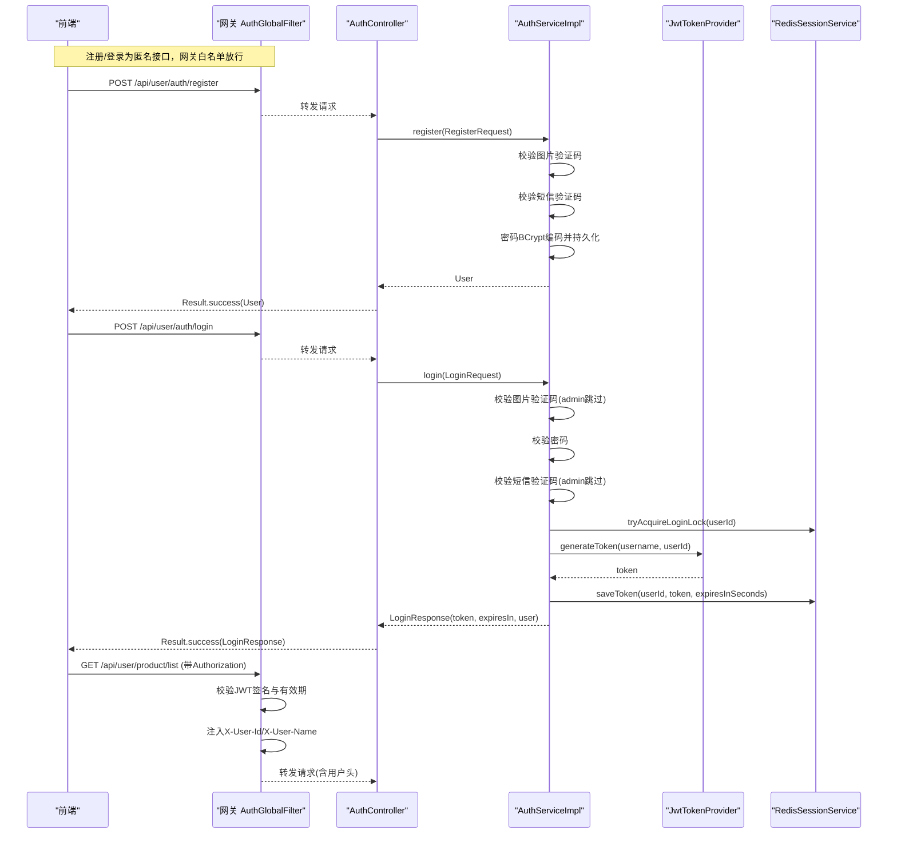
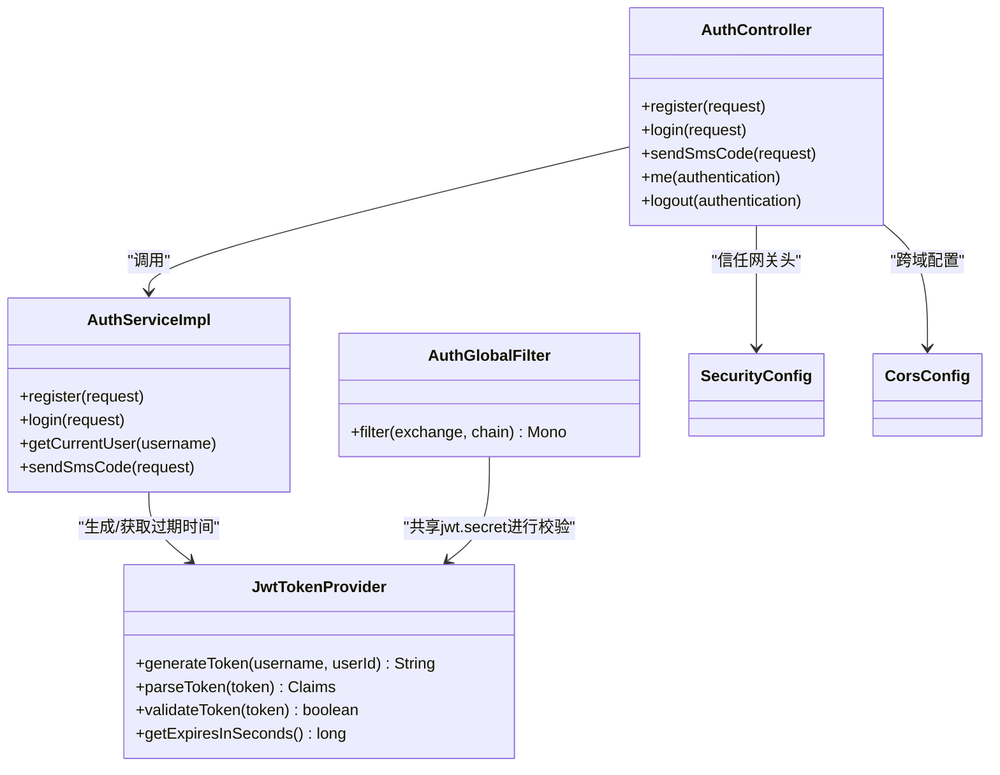

# 用户认证系统

<cite>
**本文引用的文件**   
- [AuthController.java](file://backend/ecommerce-user/src/main/java/com/ecommerce/user/controller/AuthController.java)
- [JwtTokenProvider.java](file://backend/ecommerce-user/src/main/java/com/ecommerce/user/security/JwtTokenProvider.java)
- [AuthServiceImpl.java](file://backend/ecommerce-user/src/main/java/com/ecommerce/user/service/impl/AuthServiceImpl.java)
- [AuthGlobalFilter.java](file://backend/ecommerce-gateway/src/main/java/com/ecommerce/gateway/filter/AuthGlobalFilter.java)
- [SecurityConfig.java](file://backend/ecommerce-common/src/main/java/com/ecommerce/common/config/SecurityConfig.java)
- [CorsConfig.java](file://backend/ecommerce-user/src/main/java/com/ecommerce/user/config/CorsConfig.java)
- [LoginRequest.java](file://backend/ecommerce-user/src/main/java/com/ecommerce/user/dto/LoginRequest.java)
- [LoginResponse.java](file://backend/ecommerce-user/src/main/java/com/ecommerce/user/dto/LoginResponse.java)
- [RegisterRequest.java](file://backend/ecommerce-user/src/main/java/com/ecommerce/user/dto/RegisterRequest.java)
- [SendSmsCodeRequest.java](file://backend/ecommerce-user/src/main/java/com/ecommerce/user/dto/SendSmsCodeRequest.java)
- [Result.java](file://backend/ecommerce-common/src/main/java/com/ecommerce/common/Result.java)
- [BusinessException.java](file://backend/ecommerce-common/src/main/java/com/ecommerce/common/BusinessException.java)
</cite>

## 目录
1. [简介](#简介)
2. [项目结构](#项目结构)
3. [核心组件](#核心组件)
4. [架构总览](#架构总览)
5. [详细组件分析](#详细组件分析)
6. [依赖关系分析](#依赖关系分析)
7. [性能与可扩展性](#性能与可扩展性)
8. [故障排查指南](#故障排查指南)
9. [结论](#结论)
10. [附录：API 参考](#附录api-参考)

## 简介
本文件面向用户认证子系统，围绕以下目标展开：
- 深入解释 AuthController 控制器的实现，包括用户注册、登录、JWT 令牌生成与验证流程。
- 详细说明 JwtTokenProvider 的令牌管理机制，包括令牌生成、解析、过期处理。
- 阐述 AuthServiceImpl 的业务逻辑，包括密码加密存储、用户状态管理、会话管理（基于 Redis）。
- 说明认证流程图、安全机制设计、错误处理策略。
- 提供具体的 API 调用示例、参数说明、返回值格式。
- 解释与网关鉴权的集成方式、跨域配置、安全防护措施。

该认证方案采用“网关统一鉴权 + 微服务信任头”的模式：网关负责 JWT 校验并注入用户信息到请求头；User 微服务通过自定义过滤器信任网关注入的头，从而避免重复鉴权。

## 项目结构
认证相关代码主要分布在两个模块：
- ecommerce-user：用户业务服务，包含控制器、服务、DTO、实体、安全配置等。
- ecommerce-gateway：网关服务，包含全局鉴权过滤器。

**图表来源**
- [AuthGlobalFilter.java:31-78](file://backend/ecommerce-gateway/src/main/java/com/ecommerce/gateway/filter/AuthGlobalFilter.java#L31-L78)
- [AuthController.java:31-45](file://backend/ecommerce-user/src/main/java/com/ecommerce/user/controller/AuthController.java#L31-L45)
- [AuthServiceImpl.java:33-60](file://backend/ecommerce-user/src/main/java/com/ecommerce/user/service/impl/AuthServiceImpl.java#L33-L60)
- [JwtTokenProvider.java:18-32](file://backend/ecommerce-user/src/main/java/com/ecommerce/user/security/JwtTokenProvider.java#L18-L32)
- [SecurityConfig.java:26-63](file://backend/ecommerce-common/src/main/java/com/ecommerce/common/config/SecurityConfig.java#L26-L63)
- [CorsConfig.java:19-35](file://backend/ecommerce-user/src/main/java/com/ecommerce/user/config/CorsConfig.java#L19-L35)

**章节来源**
- [AuthController.java:1-96](file://backend/ecommerce-user/src/main/java/com/ecommerce/user/controller/AuthController.java#L1-L96)
- [AuthGlobalFilter.java:1-170](file://backend/ecommerce-gateway/src/main/java/com/ecommerce/gateway/filter/AuthGlobalFilter.java#L1-L170)

## 核心组件
- AuthController：对外暴露认证相关 REST 接口，封装注册、登录、发送短信验证码、获取当前用户、退出登录等能力。
- AuthServiceImpl：认证核心业务实现，负责验证码校验、密码加密、用户查询、JWT 生成与写入 Redis 会话、单设备登录互踢。
- JwtTokenProvider：JWT 生成、解析、有效性校验的工具类，使用 HS256 签名。
- AuthGlobalFilter：网关层全局鉴权过滤器，校验 JWT、白名单放行、将用户信息注入下游请求头。
- SecurityConfig：User 微服务的 Spring Security 配置，启用无状态会话、信任网关注入的用户头。
- CorsConfig：全局跨域配置，允许开发环境直连场景下的跨域访问。

**章节来源**
- [AuthController.java:31-94](file://backend/ecommerce-user/src/main/java/com/ecommerce/user/controller/AuthController.java#L31-L94)
- [AuthServiceImpl.java:33-164](file://backend/ecommerce-user/src/main/java/com/ecommerce/user/service/impl/AuthServiceImpl.java#L33-L164)
- [JwtTokenProvider.java:18-75](file://backend/ecommerce-user/src/main/java/com/ecommerce/user/security/JwtTokenProvider.java#L18-L75)
- [AuthGlobalFilter.java:41-146](file://backend/ecommerce-gateway/src/main/java/com/ecommerce/gateway/filter/AuthGlobalFilter.java#L41-L146)
- [SecurityConfig.java:26-63](file://backend/ecommerce-common/src/main/java/com/ecommerce/common/config/SecurityConfig.java#L26-L63)
- [CorsConfig.java:19-35](file://backend/ecommerce-user/src/main/java/com/ecommerce/user/config/CorsConfig.java#L19-L35)

## 架构总览
认证流程的关键路径如下：
- 注册：前端提交注册请求 → 网关放行 → User 服务校验图片验证码与短信验证码 → 密码 BCrypt 加密存储 → 返回成功。
- 登录：前端提交登录请求 → 网关放行 → User 服务校验图片验证码与短信验证码（admin 可跳过）→ 校验密码 → 生成 JWT → 写入 Redis 会话（覆盖旧 Token，实现互踢）→ 返回 JWT 和用户信息。
- 受保护接口：前端携带 Authorization: Bearer token → 网关校验 JWT → 注入 X-User-Id/X-User-Name → 下游服务信任该头。

**图表来源**
- [AuthGlobalFilter.java:80-141](file://backend/ecommerce-gateway/src/main/java/com/ecommerce/gateway/filter/AuthGlobalFilter.java#L80-L141)
- [AuthController.java:47-94](file://backend/ecommerce-user/src/main/java/com/ecommerce/user/controller/AuthController.java#L47-L94)
- [AuthServiceImpl.java:62-124](file://backend/ecommerce-user/src/main/java/com/ecommerce/user/service/impl/AuthServiceImpl.java#L62-L124)
- [JwtTokenProvider.java:34-74](file://backend/ecommerce-user/src/main/java/com/ecommerce/user/security/JwtTokenProvider.java#L34-L74)

## 详细组件分析

### AuthController 控制器
职责与行为：
- 注册接口：接收 RegisterRequest，委托 AuthService.register，返回统一 Result<User>。
- 登录接口：接收 LoginRequest，委托 AuthService.login，返回统一 Result<LoginResponse>。
- 发送短信验证码：接收 SendSmsCodeRequest，委托 AuthService.sendSmsCode，返回统一 Result<Void>。
- 获取当前用户：从 Spring Security Authentication 中取用户名，委托 AuthService.getCurrentUser，返回统一 Result<User>。
- 退出登录：从 Authentication 取用户名，查询用户，调用 RedisSessionService.removeToken 清除会话，记录日志并返回成功。

关键点：
- 所有接口均返回统一 Result 包装体，便于前端统一处理。
- 登出时主动清理 Redis 中的会话 Token，确保设备立即失效。

**章节来源**
- [AuthController.java:31-94](file://backend/ecommerce-user/src/main/java/com/ecommerce/user/controller/AuthController.java#L31-L94)
- [Result.java:8-63](file://backend/ecommerce-common/src/main/java/com/ecommerce/common/Result.java#L8-L63)

### JwtTokenProvider 令牌管理
职责与行为：
- 构造阶段：读取 jwt.secret 与 jwt.expiration-minutes，构建 HS256 密钥和过期时间。
- 生成令牌：generateToken(username, userId)，设置 subject、uid claim、签发时间与过期时间，并进行 HS256 签名。
- 解析令牌：parseToken(token)，返回 Claims。
- 校验令牌：validateToken(token)，捕获异常判断是否有效。
- 获取过期秒数：getExpiresInSeconds()，用于返回给前端展示或倒计时。

安全性与复杂度：
- 使用 HS256 对称签名，要求密钥长度至少 32 字节。
- 解析与校验的时间复杂度近似 O(n)（n 为令牌字符串长度），空间复杂度 O(n)。

优化建议：
- 可将 SecretKey 缓存复用，避免每次解析都重新计算密钥。
- 对频繁解析的场景考虑本地缓存已解析的 Claims（注意过期时间）。

**章节来源**
- [JwtTokenProvider.java:18-75](file://backend/ecommerce-user/src/main/java/com/ecommerce/user/security/JwtTokenProvider.java#L18-L75)

### AuthServiceImpl 业务逻辑
职责与行为：
- 注册流程：
  - 先校验图片验证码，再校验短信验证码。
  - 检查用户名唯一性、确认密码一致性。
  - 使用 PasswordEncoder（BCrypt）加密密码后保存用户。
- 登录流程：
  - admin 用户跳过图片验证码与短信验证码校验。
  - 校验用户名是否存在、密码是否正确。
  - 非 admin 用户需校验短信验证码。
  - 尝试获取分布式锁防止并发登录导致会话错乱。
  - 生成新 JWT，写入 Redis 会话（覆盖旧 Token，实现单设备互踢）。
  - 释放分布式锁。
- 获取当前用户：根据 username 查询用户，不存在抛业务异常。
- 发送短信验证码：
  - 先校验图片验证码，再根据 phone 或 username 解析目标手机号。
  - 调用 SmsService 发送验证码（内部包含频控与存储）。

安全与健壮性：
- 密码使用 BCryptPasswordEncoder 加密存储，密文不随响应泄露。
- 使用 BusinessException 统一业务异常，配合全局异常处理器转换为 Result。
- 登录流程引入分布式锁，避免同一账号并发登录造成会话不一致。

**章节来源**
- [AuthServiceImpl.java:33-164](file://backend/ecommerce-user/src/main/java/com/ecommerce/user/service/impl/AuthServiceImpl.java#L33-L164)
- [BusinessException.java:6-22](file://backend/ecommerce-common/src/main/java/com/ecommerce/common/BusinessException.java#L6-L22)

### 网关鉴权集成（AuthGlobalFilter）
职责与行为：
- 白名单放行：登录、注册、验证码、健康检查以及 Swagger/OpenAPI 文档路径直接放行。
- OPTIONS 预检请求放行，支持跨域。
- 提取 Authorization: Bearer token，校验签名与有效期。
- 校验通过后，将 userId 与 username 注入请求头 X-User-Id、X-User-Name，传递给下游微服务。
- 失败时返回 401 JSON 响应，消息区分“未授权访问”“Token 已过期”“Token 无效”。

集成要点：
- 使用与 JwtTokenProvider 相同的 jwt.secret 进行签名校验。
- 下游服务通过 SecurityConfig 信任网关注入的头，不再重复鉴权。

**章节来源**
- [AuthGlobalFilter.java:41-146](file://backend/ecommerce-gateway/src/main/java/com/ecommerce/gateway/filter/AuthGlobalFilter.java#L41-L146)

### 安全与跨域配置（SecurityConfig 与 CorsConfig）
- SecurityConfig：
  - 禁用 CSRF，启用无状态会话。
  - 允许所有请求（由网关统一鉴权），并添加 TrustedAuthenticationFilter 在 UsernamePasswordAuthenticationFilter 之前执行。
  - 配置统一异常处理，返回 JSON 格式的 401/403。
- CorsConfig：
  - 允许所有来源、方法、头部，开启凭据，设置预检缓存时间。
  - 与 SecurityConfig 的 cors 配置结合，避免重复响应头。

**章节来源**
- [SecurityConfig.java:26-63](file://backend/ecommerce-common/src/main/java/com/ecommerce/common/config/SecurityConfig.java#L26-L63)
- [CorsConfig.java:19-35](file://backend/ecommerce-user/src/main/java/com/ecommerce/user/config/CorsConfig.java#L19-L35)

## 依赖关系分析
组件之间的依赖关系如下：

**图表来源**
- [AuthController.java:31-94](file://backend/ecommerce-user/src/main/java/com/ecommerce/user/controller/AuthController.java#L31-L94)
- [AuthServiceImpl.java:33-164](file://backend/ecommerce-user/src/main/java/com/ecommerce/user/service/impl/AuthServiceImpl.java#L33-L164)
- [JwtTokenProvider.java:18-75](file://backend/ecommerce-user/src/main/java/com/ecommerce/user/security/JwtTokenProvider.java#L18-L75)
- [AuthGlobalFilter.java:41-146](file://backend/ecommerce-gateway/src/main/java/com/ecommerce/gateway/filter/AuthGlobalFilter.java#L41-L146)
- [SecurityConfig.java:26-63](file://backend/ecommerce-common/src/main/java/com/ecommerce/common/config/SecurityConfig.java#L26-L63)
- [CorsConfig.java:19-35](file://backend/ecommerce-user/src/main/java/com/ecommerce/user/config/CorsConfig.java#L19-L35)

**章节来源**
- [AuthController.java:31-94](file://backend/ecommerce-user/src/main/java/com/ecommerce/user/controller/AuthController.java#L31-L94)
- [AuthServiceImpl.java:33-164](file://backend/ecommerce-user/src/main/java/com/ecommerce/user/service/impl/AuthServiceImpl.java#L33-L164)
- [JwtTokenProvider.java:18-75](file://backend/ecommerce-user/src/main/java/com/ecommerce/user/security/JwtTokenProvider.java#L18-L75)
- [AuthGlobalFilter.java:41-146](file://backend/ecommerce-gateway/src/main/java/com/ecommerce/gateway/filter/AuthGlobalFilter.java#L41-L146)

## 性能与可扩展性
- 令牌解析与校验：
  - 网关与用户服务均进行 JWT 解析，建议在高频场景下缓存 SecretKey 与已解析 Claims（注意过期时间）。
- 登录互踢与会话管理：
  - 使用 Redis 存储 Token，覆盖旧 Token 实现单设备登录；注意 Redis 高可用与容量规划。
- 验证码与短信频控：
  - 图片验证码与短信验证码组合防滥发；短信频控在 SmsService 内部实现，建议结合限流与风控策略。
- 分布式锁：
  - 登录流程使用分布式锁防止并发登录导致会话错乱；需保证锁的原子性与超时释放。

[本节为通用指导，不直接分析具体文件]

## 故障排查指南
常见问题与定位思路：
- 401 未授权：
  - 检查 Authorization 头是否携带正确的 Bearer token。
  - 检查 jwt.secret 是否与用户服务一致。
  - 查看网关日志中“Token 已过期”“Token 无效”提示。
- 登录失败：
  - 检查图片验证码与短信验证码是否通过。
  - 检查用户名与密码是否正确。
  - 检查 Redis 是否可写，分布式锁是否获取成功。
- 跨域问题：
  - 检查 CorsConfig 是否生效，浏览器控制台是否有 Access-Control-Allow-Origin 多值报错。
- 统一响应码：
  - 关注 Result.code 与 message，结合全局异常处理器输出定位业务异常。

**章节来源**
- [AuthGlobalFilter.java:128-140](file://backend/ecommerce-gateway/src/main/java/com/ecommerce/gateway/filter/AuthGlobalFilter.java#L128-L140)
- [AuthServiceImpl.java:62-124](file://backend/ecommerce-user/src/main/java/com/ecommerce/user/service/impl/AuthServiceImpl.java#L62-L124)
- [CorsConfig.java:19-35](file://backend/ecommerce-user/src/main/java/com/ecommerce/user/config/CorsConfig.java#L19-L35)
- [Result.java:8-63](file://backend/ecommerce-common/src/main/java/com/ecommerce/common/Result.java#L8-L63)

## 结论
该认证系统通过网关统一鉴权与微服务信任头的模式，实现了清晰的职责分离与安全边界。JwtTokenProvider 提供稳定的令牌管理能力，AuthServiceImpl 整合验证码、密码加密、Redis 会话与分布式锁，保障登录安全与一致性。配合统一的 Result 与 BusinessExc eption，系统具备一致的响应格式与完善的错误处理。

[本节为总结性内容，不直接分析具体文件]

## 附录：API 参考

### 注册接口
- 方法与路径：POST /api/user/auth/register
- 请求体：RegisterRequest
- 响应体：Result<User>
- 说明：
  - 需要图片验证码与短信验证码。
  - 密码经 BCrypt 加密存储。
  - 用户名唯一性校验。

**章节来源**
- [AuthController.java:47-52](file://backend/ecommerce-user/src/main/java/com/ecommerce/user/controller/AuthController.java#L47-L52)
- [RegisterRequest.java:13-49](file://backend/ecommerce-user/src/main/java/com/ecommerce/user/dto/RegisterRequest.java#L13-L49)
- [AuthServiceImpl.java:62-85](file://backend/ecommerce-user/src/main/java/com/ecommerce/user/service/impl/AuthServiceImpl.java#L62-L85)

### 登录接口
- 方法与路径：POST /api/user/auth/login
- 请求体：LoginRequest
- 响应体：Result<LoginResponse>
- 说明：
  - 非 admin 用户需图片验证码与短信验证码。
  - 成功后返回 JWT、有效期（秒）、用户基本信息。
  - 登录成功后将 Token 写入 Redis，实现单设备互踢。

**章节来源**
- [AuthController.java:54-59](file://backend/ecommerce-user/src/main/java/com/ecommerce/user/controller/AuthController.java#L54-L59)
- [LoginRequest.java:12-29](file://backend/ecommerce-user/src/main/java/com/ecommerce/user/dto/LoginRequest.java#L12-L29)
- [LoginResponse.java:9-24](file://backend/ecommerce-user/src/main/java/com/ecommerce/user/dto/LoginResponse.java#L9-L24)
- [AuthServiceImpl.java:87-124](file://backend/ecommerce-user/src/main/java/com/ecommerce/user/service/impl/AuthServiceImpl.java#L87-L124)

### 发送短信验证码接口
- 方法与路径：POST /api/user/auth/send-sms-code
- 请求体：SendSmsCodeRequest
- 响应体：Result<Void>
- 说明：
  - 需要图片验证码。
  - 注册场景传 phone，登录场景传 username（后端解析手机号）。
  - 短信频控与验证码存储在 SmsService 内部实现。

**章节来源**
- [AuthController.java:61-71](file://backend/ecommerce-user/src/main/java/com/ecommerce/user/controller/AuthController.java#L61-L71)
- [SendSmsCodeRequest.java:15-29](file://backend/ecommerce-user/src/main/java/com/ecommerce/user/dto/SendSmsCodeRequest.java#L15-L29)
- [AuthServiceImpl.java:132-162](file://backend/ecommerce-user/src/main/java/com/ecommerce/user/service/impl/AuthServiceImpl.java#L132-L162)

### 获取当前用户接口
- 方法与路径：GET /api/user/auth/me
- 响应体：Result<User>
- 说明：
  - 需要携带有效 JWT。
  - 返回当前登录用户的详细信息。

**章节来源**
- [AuthController.java:73-78](file://backend/ecommerce-user/src/main/java/com/ecommerce/user/controller/AuthController.java#L73-L78)
- [AuthServiceImpl.java:126-130](file://backend/ecommerce-user/src/main/java/com/ecommerce/user/service/impl/AuthServiceImpl.java#L126-L130)

### 退出登录接口
- 方法与路径：POST /api/user/auth/logout
- 响应体：Result<Void>
- 说明：
  - 需要携带有效 JWT。
  - 清除 Redis 中的会话 Token，使当前设备立即失效。

**章节来源**
- [AuthController.java:80-94](file://backend/ecommerce-user/src/main/java/com/ecommerce/user/controller/AuthController.java#L80-L94)