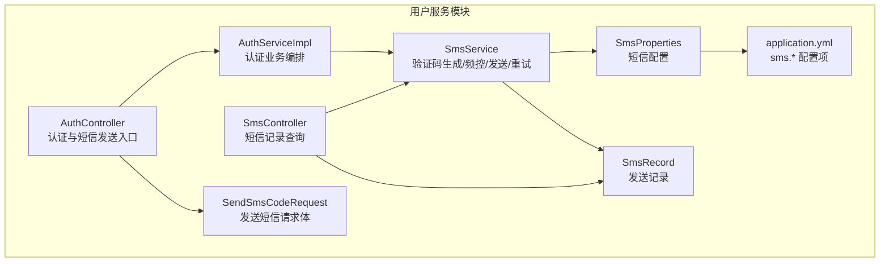
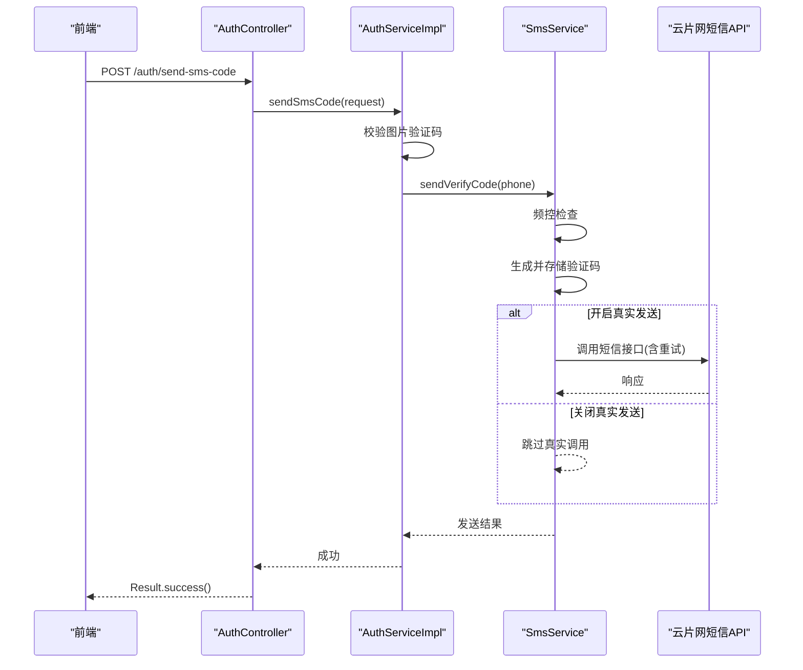
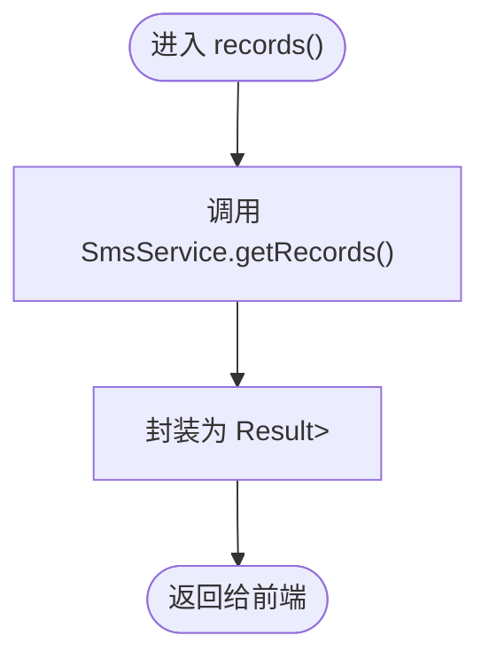
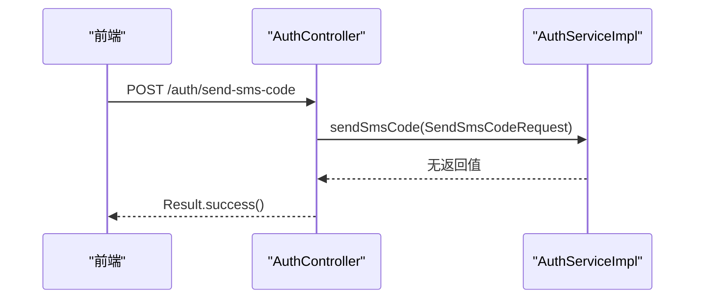
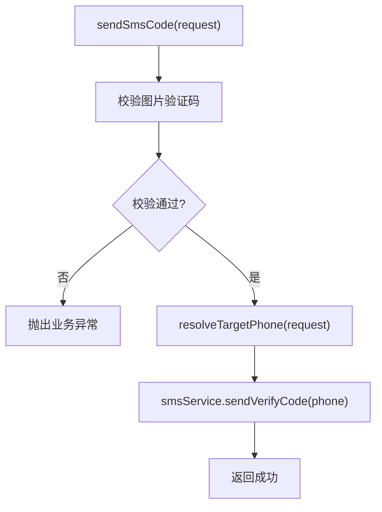
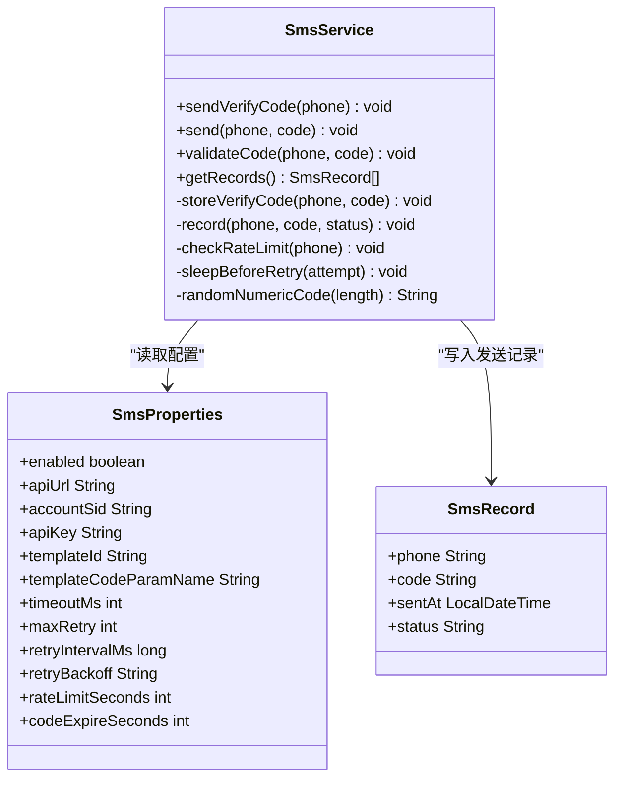
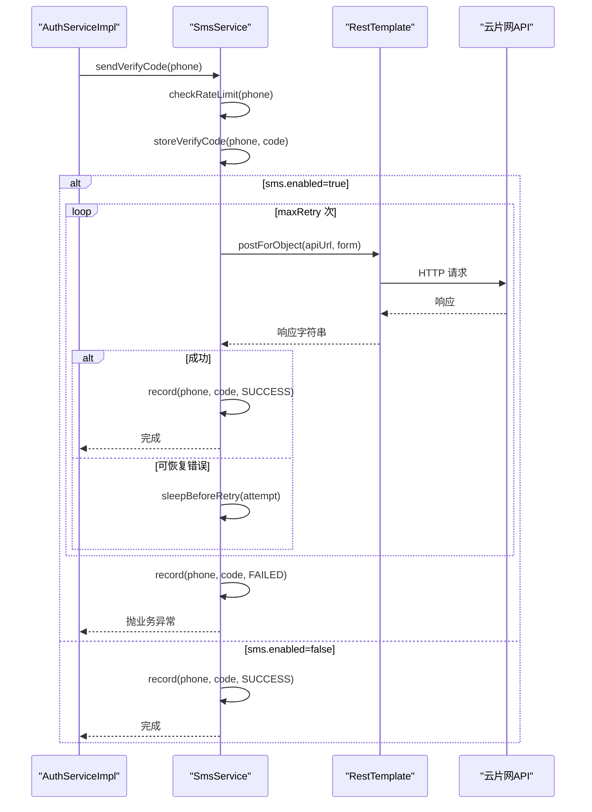
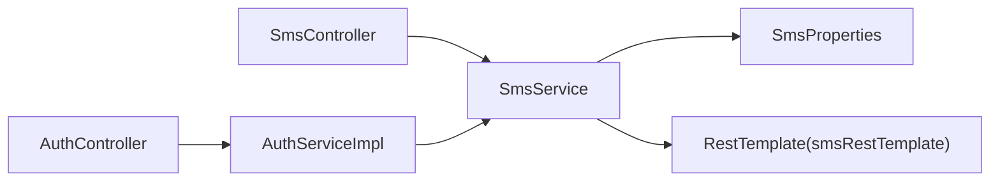
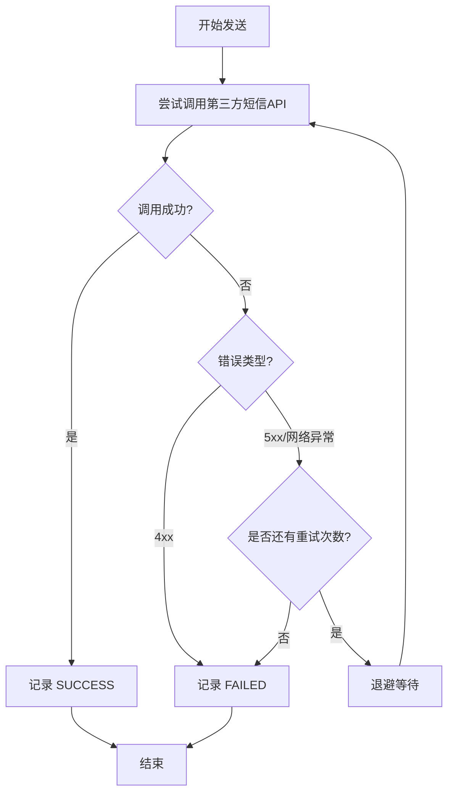

# 短信验证码服务

<cite>
**本文引用的文件**   
- [SmsController.java](file://backend/ecommerce-user/src/main/java/com/ecommerce/user/controller/SmsController.java)
- [AuthController.java](file://backend/ecommerce-user/src/main/java/com/ecommerce/user/controller/AuthController.java)
- [AuthServiceImpl.java](file://backend/ecommerce-user/src/main/java/com/ecommerce/user/service/impl/AuthServiceImpl.java)
- [SmsService.java](file://backend/ecommerce-user/src/main/java/com/ecommerce/user/service/SmsService.java)
- [SmsProperties.java](file://backend/ecommerce-user/src/main/java/com/ecommerce/user/config/properties/SmsProperties.java)
- [SendSmsCodeRequest.java](file://backend/ecommerce-user/src/main/java/com/ecommerce/user/dto/SendSmsCodeRequest.java)
- [SmsRecord.java](file://backend/ecommerce-user/src/main/java/com/ecommerce/user/dto/SmsRecord.java)
- [application.yml](file://backend/ecommerce-user/src/main/resources/application.yml)
</cite>

## 目录
1. [简介](#简介)
2. [项目结构](#项目结构)
3. [核心组件](#核心组件)
4. [架构总览](#架构总览)
5. [详细组件分析](#详细组件分析)
6. [依赖关系分析](#依赖关系分析)
7. [性能与扩展性](#性能与扩展性)
8. [安全机制与防刷策略](#安全机制与防刷策略)
9. [错误处理与重试机制](#错误处理与重试机制)
10. [监控与告警建议](#监控与告警建议)
11. [故障排查指南](#故障排查指南)
12. [结论](#结论)

## 简介
本文件面向“短信验证码服务”，聚焦以下目标：
- 说明 SmsController 的短信发送接口实现，包括验证码发送、记录查询、状态管理。
- 阐述 SmsService 的业务逻辑，包括验证码生成、第三方短信服务集成、发送频率限制。
- 解释 SmsProperties 配置类的设计，包括短信服务商配置、模板设置、超时配置。
- 说明短信验证码的安全机制、防刷策略、重试机制。
- 包含短信发送流程图、消息队列处理、错误处理策略。
- 说明短信服务的扩展性设计、多服务商支持、监控告警机制。

当前仓库中，短信验证码能力集中在用户服务模块（ecommerce-user），对外暴露两类接口：
- 匿名可访问的「发送短信验证码」接口：POST /api/auth/send-sms-code，由 AuthController 接收请求，委托 AuthServiceImpl 调用 SmsService 完成验证码生成、频控、第三方短信发送。
- 需登录的「短信发送记录查询」接口：GET /api/sms/records，由 SmsController 提供，返回进程内内存中的发送记录。

## 项目结构
短信相关代码位于 backend/ecommerce-user 模块，关键路径如下：
- 控制器层：controller/AuthController.java、controller/SmsController.java
- 服务层：service/SmsService.java、service/impl/AuthServiceImpl.java
- 配置属性：config/properties/SmsProperties.java
- DTO：dto/SendSmsCodeRequest.java、dto/SmsRecord.java
- 应用配置：resources/application.yml

图示来源
- [AuthController.java:61-71](file://backend/ecommerce-user/src/main/java/com/ecommerce/user/controller/AuthController.java#L61-L71)
- [SmsController.java:22-38](file://backend/ecommerce-user/src/main/java/com/ecommerce/user/controller/SmsController.java#L22-L38)
- [AuthServiceImpl.java:132-140](file://backend/ecommerce-user/src/main/java/com/ecommerce/user/service/impl/AuthServiceImpl.java#L132-L140)
- [SmsService.java:41-74](file://backend/ecommerce-user/src/main/java/com/ecommerce/user/service/SmsService.java#L41-L74)
- [SmsProperties.java:11-50](file://backend/ecommerce-user/src/main/java/com/ecommerce/user/config/properties/SmsProperties.java#L11-L50)
- [application.yml:75-86](file://backend/ecommerce-user/src/main/resources/application.yml#L75-L86)

章节来源
- [AuthController.java:61-71](file://backend/ecommerce-user/src/main/java/com/ecommerce/user/controller/AuthController.java#L61-L71)
- [SmsController.java:22-38](file://backend/ecommerce-user/src/main/java/com/ecommerce/user/controller/SmsController.java#L22-L38)
- [application.yml:75-86](file://backend/ecommerce-user/src/main/resources/application.yml#L75-L86)

## 核心组件
- SmsController：仅负责短信发送记录的查询，返回按时间倒序的全部记录；该接口受安全配置保护，需登录访问。
- AuthController：提供匿名可访问的「发送短信验证码」接口，先校验图片验证码，再调用 AuthServiceImpl 发送短信。
- AuthServiceImpl：认证业务编排，负责解析手机号（注册传 phone，登录传 username）、校验图片验证码、调用 SmsService 发送验证码。
- SmsService：短信核心服务，负责验证码生成、存储与一次性校验、同一手机号发送频率限制、第三方短信接口调用、重试与退避、发送记录落盘（进程内）。
- SmsProperties：短信相关配置，包括开关、API 地址、账号信息、模板 ID、超时、重试次数与间隔、退避策略、频控窗口、验证码有效期等。
- SendSmsCodeRequest：发送短信的请求体，包含图片验证码 key/value 以及 phone 或 username。
- SmsRecord：短信发送记录，包含手机号、验证码、发送时间、状态。

章节来源
- [SmsController.java:14-38](file://backend/ecommerce-user/src/main/java/com/ecommerce/user/controller/SmsController.java#L14-L38)
- [AuthController.java:61-71](file://backend/ecommerce-user/src/main/java/com/ecommerce/user/controller/AuthController.java#L61-L71)
- [AuthServiceImpl.java:132-162](file://backend/ecommerce-user/src/main/java/com/ecommerce/user/service/impl/AuthServiceImpl.java#L132-L162)
- [SmsService.java:26-74](file://backend/ecommerce-user/src/main/java/com/ecommerce/user/service/SmsService.java#L26-L74)
- [SmsProperties.java:7-50](file://backend/ecommerce-user/src/main/java/com/ecommerce/user/config/properties/SmsProperties.java#L7-L50)
- [SendSmsCodeRequest.java:6-29](file://backend/ecommerce-user/src/main/java/com/ecommerce/user/dto/SendSmsCodeRequest.java#L6-L29)
- [SmsRecord.java:7-32](file://backend/ecommerce-user/src/main/java/com/ecommerce/user/dto/SmsRecord.java#L7-L32)

## 架构总览
短信验证码的整体流程分为两条主线：
- 发送主线：前端 → AuthController → AuthServiceImpl → SmsService → 第三方短信 API（云片网）
- 查询主线：前端 → SmsController → SmsService（读取进程内记录）

图示来源
- [AuthController.java:61-71](file://backend/ecommerce-user/src/main/java/com/ecommerce/user/controller/AuthController.java#L61-L71)
- [AuthServiceImpl.java:132-140](file://backend/ecommerce-user/src/main/java/com/ecommerce/user/service/impl/AuthServiceImpl.java#L132-L140)
- [SmsService.java:76-138](file://backend/ecommerce-user/src/main/java/com/ecommerce/user/service/SmsService.java#L76-L138)

## 详细组件分析

### SmsController：短信发送记录查询
- 职责：提供 GET /sms/records 接口，返回全部短信发送记录（按发送时间倒序）。
- 安全：默认走 SecurityConfig 的 authenticated 规则，需登录访问。
- 数据源：SmsService.getRecords()，从进程内 ConcurrentLinkedDeque 读取。

图示来源
- [SmsController.java:33-38](file://backend/ecommerce-user/src/main/java/com/ecommerce/user/controller/SmsController.java#L33-L38)
- [SmsService.java:155-158](file://backend/ecommerce-user/src/main/java/com/ecommerce/user/service/SmsService.java#L155-L158)

章节来源
- [SmsController.java:14-38](file://backend/ecommerce-user/src/main/java/com/ecommerce/user/controller/SmsController.java#L14-L38)
- [SmsService.java:155-158](file://backend/ecommerce-user/src/main/java/com/ecommerce/user/service/SmsService.java#L155-L158)

### AuthController：短信发送入口
- 职责：暴露匿名可访问的 POST /auth/send-sms-code，接收 SendSmsCodeRequest，委托 AuthServiceImpl 发送短信。
- 前置校验：依赖图片验证码防止滥发。

图示来源
- [AuthController.java:61-71](file://backend/ecommerce-user/src/main/java/com/ecommerce/user/controller/AuthController.java#L61-L71)
- [AuthServiceImpl.java:132-140](file://backend/ecommerce-user/src/main/java/com/ecommerce/user/service/impl/AuthServiceImpl.java#L132-L140)

章节来源
- [AuthController.java:61-71](file://backend/ecommerce-user/src/main/java/com/ecommerce/user/controller/AuthController.java#L61-L71)
- [SendSmsCodeRequest.java:6-29](file://backend/ecommerce-user/src/main/java/com/ecommerce/user/dto/SendSmsCodeRequest.java#L6-L29)

### AuthServiceImpl：认证业务编排
- 职责：
  - 解析发送目标手机号：注册场景使用 request.phone，登录场景通过 username 查询用户手机号。
  - 先校验图片验证码，通过后调用 SmsService.sendVerifyCode(phone)。
- 关键点：图片验证码作为第一道防刷防线；短信频控在 SmsService 内部实现。

图示来源
- [AuthServiceImpl.java:132-162](file://backend/ecommerce-user/src/main/java/com/ecommerce/user/service/impl/AuthServiceImpl.java#L132-L162)

章节来源
- [AuthServiceImpl.java:132-162](file://backend/ecommerce-user/src/main/java/com/ecommerce/user/service/impl/AuthServiceImpl.java#L132-L162)

### SmsService：短信核心服务
- 职责：
  - 验证码生成：SecureRandom 生成 6 位数字码。
  - 验证码存储与一次性校验：ConcurrentHashMap 存储手机号到验证码条目（含过期时间戳），校验时立即移除。
  - 发送频率限制：同一手机号 rateLimitSeconds 秒内不允许重复发送。
  - 第三方短信集成：RestTemplate 调用云片网接口，表单参数包含 mobile、tpl_id、tpl_value、apikey。
  - 重试与退避：对网络异常、超时、5xx 可恢复错误进行重试，支持线性或指数退避。
  - 发送记录：每次实际发送（成功或失败）记录一条 SmsRecord，进程内保存，容量上限 MAX_RECORDS。
  - 开关模式：sms.enabled=false 时不调用真实接口，仍生成验证码并记为成功，便于本地联调。

图示来源
- [SmsService.java:41-217](file://backend/ecommerce-user/src/main/java/com/ecommerce/user/service/SmsService.java#L41-L217)
- [SmsProperties.java:11-50](file://backend/ecommerce-user/src/main/java/com/ecommerce/user/config/properties/SmsProperties.java#L11-L50)
- [SmsRecord.java:7-32](file://backend/ecommerce-user/src/main/java/com/ecommerce/user/dto/SmsRecord.java#L7-L32)

#### 发送主流程时序图

图示来源
- [SmsService.java:76-138](file://backend/ecommerce-user/src/main/java/com/ecommerce/user/service/SmsService.java#L76-L138)
- [SmsService.java:170-175](file://backend/ecommerce-user/src/main/java/com/ecommerce/user/service/SmsService.java#L170-L175)
- [SmsService.java:189-210](file://backend/ecommerce-user/src/main/java/com/ecommerce/user/service/SmsService.java#L189-L210)

章节来源
- [SmsService.java:76-138](file://backend/ecommerce-user/src/main/java/com/ecommerce/user/service/SmsService.java#L76-L138)
- [SmsService.java:145-158](file://backend/ecommerce-user/src/main/java/com/ecommerce/user/service/SmsService.java#L145-L158)
- [SmsService.java:165-183](file://backend/ecommerce-user/src/main/java/com/ecommerce/user/service/SmsService.java#L165-L183)
- [SmsService.java:189-210](file://backend/ecommerce-user/src/main/java/com/ecommerce/user/service/SmsService.java#L189-L210)

### SmsProperties：短信配置
- 关键字段：
  - enabled：是否启用真实短信发送（默认 false，避免误发短信）。
  - apiUrl：云片网短信接口地址。
  - accountSid/apiKey：云片网账号与密钥（敏感配置，占位符）。
  - templateId/templateCodeParamName：短信模板 ID 与变量名（如 #code#）。
  - timeoutMs：连接/读取超时毫秒数。
  - maxRetry/retryIntervalMs/retryBackoff：最大重试次数、基础间隔、退避策略（linear/exponential）。
  - rateLimitSeconds：同一手机号发送频率限制窗口（秒）。
  - codeExpireSeconds：短信验证码有效期（秒）。

章节来源
- [SmsProperties.java:7-50](file://backend/ecommerce-user/src/main/java/com/ecommerce/user/config/properties/SmsProperties.java#L7-L50)
- [application.yml:75-86](file://backend/ecommerce-user/src/main/resources/application.yml#L75-L86)

## 依赖关系分析
- 控制器依赖服务：
  - AuthController 依赖 AuthServiceImpl。
  - SmsController 依赖 SmsService。
- 服务依赖：
  - AuthServiceImpl 依赖 CaptchaService、SmsService、RedisSessionService、UserRepository、JwtTokenProvider、PasswordEncoder。
  - SmsService 依赖 SmsProperties、RestTemplate（smsRestTemplate）。
- 配置依赖：
  - SmsProperties 被 Spring 容器加载，映射 application.yml 的 sms.* 配置。

图示来源
- [AuthController.java:38-45](file://backend/ecommerce-user/src/main/java/com/ecommerce/user/controller/AuthController.java#L38-L45)
- [AuthServiceImpl.java:41-60](file://backend/ecommerce-user/src/main/java/com/ecommerce/user/service/impl/AuthServiceImpl.java#L41-L60)
- [SmsController.java:27-31](file://backend/ecommerce-user/src/main/java/com/ecommerce/user/controller/SmsController.java#L27-L31)
- [SmsService.java:58-74](file://backend/ecommerce-user/src/main/java/com/ecommerce/user/service/SmsService.java#L58-L74)

章节来源
- [AuthController.java:38-45](file://backend/ecommerce-user/src/main/java/com/ecommerce/user/controller/AuthController.java#L38-L45)
- [AuthServiceImpl.java:41-60](file://backend/ecommerce-user/src/main/java/com/ecommerce/user/service/impl/AuthServiceImpl.java#L41-L60)
- [SmsController.java:27-31](file://backend/ecommerce-user/src/main/java/com/ecommerce/user/controller/SmsController.java#L27-L31)
- [SmsService.java:58-74](file://backend/ecommerce-user/src/main/java/com/ecommerce/user/service/SmsService.java#L58-L74)

## 性能与扩展性

### 性能特性
- 验证码生成：SecureRandom 生成 6 位数字码，时间复杂度 O(n)，n=6，开销极低。
- 频控检查：ConcurrentHashMap.compute 原子操作，O(1) 时间复杂度。
- 验证码存储与校验：ConcurrentHashMap 存取 O(1)，一次性使用（remove 后失效）。
- 发送记录：ConcurrentLinkedDeque 队首插入、尾部淘汰，容量上限 MAX_RECORDS=500，避免无限增长。
- 重试退避：线性或指数退避，避免雪崩式重试。

### 扩展性设计
- 多服务商支持：当前以云片网为例，通过 RestTemplate 调用外部 API。若需接入其他服务商，可在 SmsService 中抽象出短信网关接口，并通过配置切换实现多后端。
- 配置驱动：所有行为（开关、超时、重试、频控、验证码有效期）均通过 SmsProperties 控制，便于灰度与实验。
- 进程内状态：验证码、频控、发送记录均为进程内短时状态，适合演示与轻量部署；生产环境可扩展至 Redis 等分布式缓存。

[本节为通用性能与扩展性讨论，不直接分析具体文件]

## 安全机制与防刷策略
- 图片验证码前置校验：AuthController 在发送短信前强制校验图片验证码，未通过则不触发短信发送，有效降低自动化脚本滥用风险。
- 手机号级频控：SmsService.checkRateLimit 基于 lastSendTimeStore 维护同一手机号的最近发送时间，rateLimitSeconds 秒内禁止重复发送，超频返回 429。
- 验证码一次性使用：SmsService.validateCode 在校验后立即 remove 对应 key，无论成功或失败都消费一次，防止重放攻击。
- 验证码有效期：SmsCodeEntry 携带 expireAt，校验时判断是否过期，过期视为无效。
- 敏感配置隔离：apiKey/accountSid 仅在 SmsService 内部使用，不随接口响应或异常信息泄露。

章节来源
- [AuthController.java:61-71](file://backend/ecommerce-user/src/main/java/com/ecommerce/user/controller/AuthController.java#L61-L71)
- [AuthServiceImpl.java:132-140](file://backend/ecommerce-user/src/main/java/com/ecommerce/user/service/impl/AuthServiceImpl.java#L132-L140)
- [SmsService.java:189-198](file://backend/ecommerce-user/src/main/java/com/ecommerce/user/service/SmsService.java#L189-L198)
- [SmsService.java:145-153](file://backend/ecommerce-user/src/main/java/com/ecommerce/user/service/SmsService.java#L145-L153)
- [SmsService.java:212-216](file://backend/ecommerce-user/src/main/java/com/ecommerce/user/service/SmsService.java#L212-L216)

## 错误处理与重试机制
- 统一业务异常：SmsService 将发送失败转换为 BusinessException(code=502)，对外返回清晰但不泄露敏感信息的错误提示。
- 客户端错误不重试：4xx（如 apiKey 错误、参数非法）直接失败，不进行重试。
- 可恢复错误重试：ResourceAccessException、HttpServerErrorException（网络异常、超时、5xx）触发重试，最多 maxRetry 次。
- 退避策略：支持 linear 与 exponential 两种退避方式，通过 retryBackoff 配置控制。
- 发送记录：无论成功或失败，都会记录一条 SmsRecord，便于审计与排查。

图示来源
- [SmsService.java:110-138](file://backend/ecommerce-user/src/main/java/com/ecommerce/user/service/SmsService.java#L110-L138)
- [SmsService.java:170-175](file://backend/ecommerce-user/src/main/java/com/ecommerce/user/service/SmsService.java#L170-L175)
- [SmsService.java:200-210](file://backend/ecommerce-user/src/main/java/com/ecommerce/user/service/SmsService.java#L200-L210)

章节来源
- [SmsService.java:110-138](file://backend/ecommerce-user/src/main/java/com/ecommerce/user/service/SmsService.java#L110-L138)
- [SmsService.java:170-175](file://backend/ecommerce-user/src/main/java/com/ecommerce/user/service/SmsService.java#L170-L175)
- [SmsService.java:200-210](file://backend/ecommerce-user/src/main/java/com/ecommerce/user/service/SmsService.java#L200-L210)

## 监控与告警建议
- 指标采集：
  - 发送成功率/失败率（按手机号、状态统计）。
  - 频控拦截次数（429 计数）。
  - 重试次数与平均退避时长。
  - 第三方 API 延迟与错误码分布。
- 日志规范：
  - 关键节点打点：生成验证码、频控拦截、调用第三方 API、重试、记录发送结果。
  - 脱敏：避免在日志中输出 apiKey、完整手机号等敏感信息。
- 告警策略：
  - 发送失败率突增。
  - 第三方 API 持续 5xx。
  - 频控拦截异常激增（可能遭遇恶意攻击）。
  - 重试次数超过阈值。

[本节为通用监控建议，不直接分析具体文件]

## 故障排查指南
- 现象：频繁收到“验证码发送过于频繁”
  - 原因：触达 SmsService.checkRateLimit，同一手机号在 rateLimitSeconds 内重复发送。
  - 处理：调整 rateLimitSeconds 或前端增加倒计时与禁用按钮。
- 现象：短信发送失败且不再重试
  - 原因：4xx 客户端错误（如 apiKey 错误、参数非法），SmsService 不重试直接失败。
  - 处理：检查 SmsProperties.apiKey、templateId、templateCodeParamName 配置是否正确。
- 现象：本地联调无法查看明文验证码
  - 原因：sms.enabled=false 时仍会生成验证码并记录为成功，但不会调用真实接口。
  - 处理：通过 GET /api/sms/records 查看最新记录中的 code 字段。
- 现象：验证码校验失败
  - 原因：验证码不存在、已过期、已被使用或不匹配。
  - 处理：确认验证码是否在有效期内，且未被重复使用；必要时重新获取。

章节来源
- [SmsService.java:189-198](file://backend/ecommerce-user/src/main/java/com/ecommerce/user/service/SmsService.java#L189-L198)
- [SmsService.java:110-138](file://backend/ecommerce-user/src/main/java/com/ecommerce/user/service/SmsService.java#L110-L138)
- [SmsService.java:145-153](file://backend/ecommerce-user/src/main/java/com/ecommerce/user/service/SmsService.java#L145-L153)
- [SmsController.java:33-38](file://backend/ecommerce-user/src/main/java/com/ecommerce/user/controller/SmsController.java#L33-L38)

## 结论
本短信验证码服务以 AuthController 为入口、AuthServiceImpl 为编排中心、SmsService 为核心实现，结合 SmsProperties 配置化控制，实现了验证码生成、频控、第三方短信集成、重试与退避、发送记录等关键能力。安全方面通过图片验证码前置校验与手机号级频控双重防护，配合一次性验证码与有效期控制，有效抵御滥用与重放攻击。扩展性上，可通过抽象短信网关接口与配置驱动实现多服务商接入；在生产环境中，可将进程内状态迁移至 Redis 以提升可用性与一致性，并结合指标与日志完善监控告警体系。

[本节为总结性内容，不直接分析具体文件]