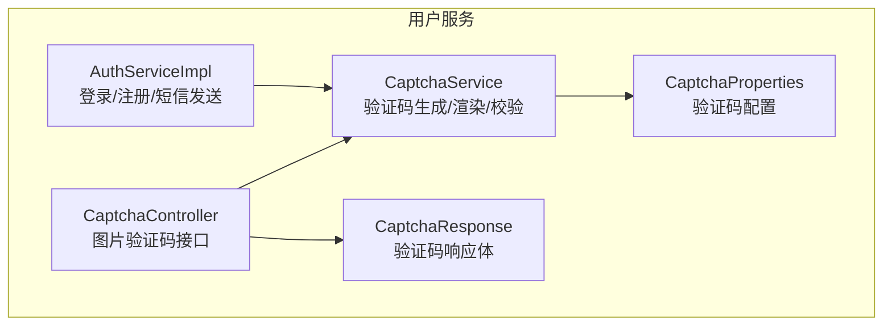
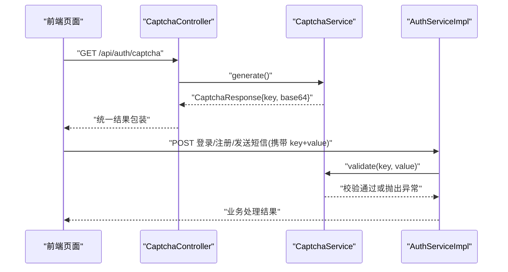
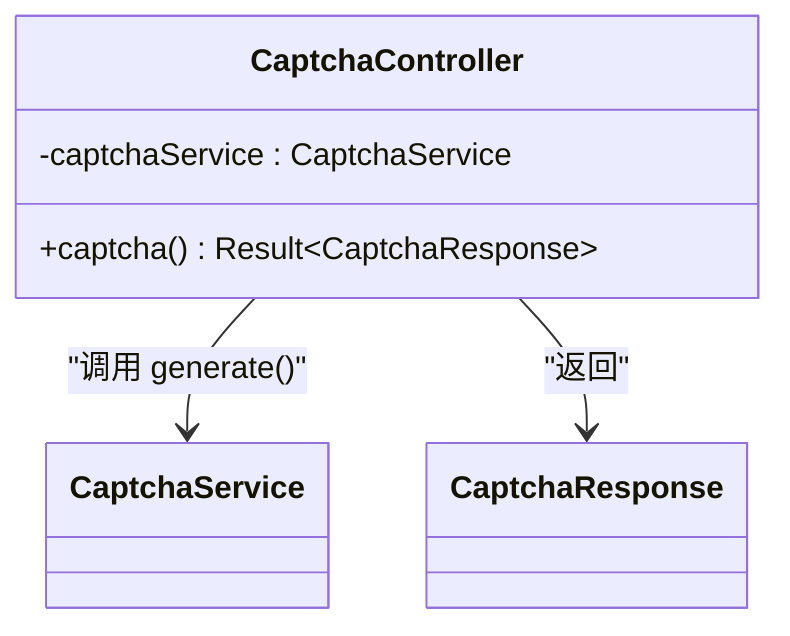
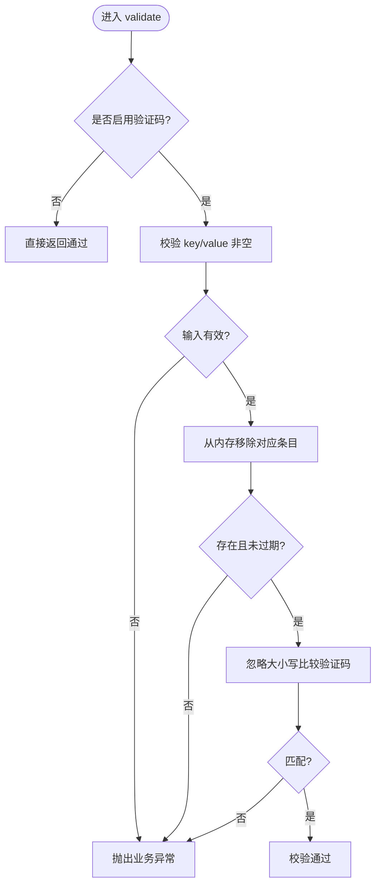
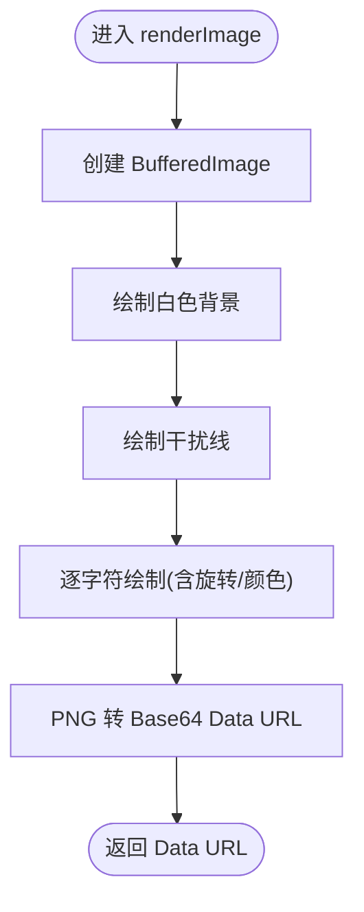
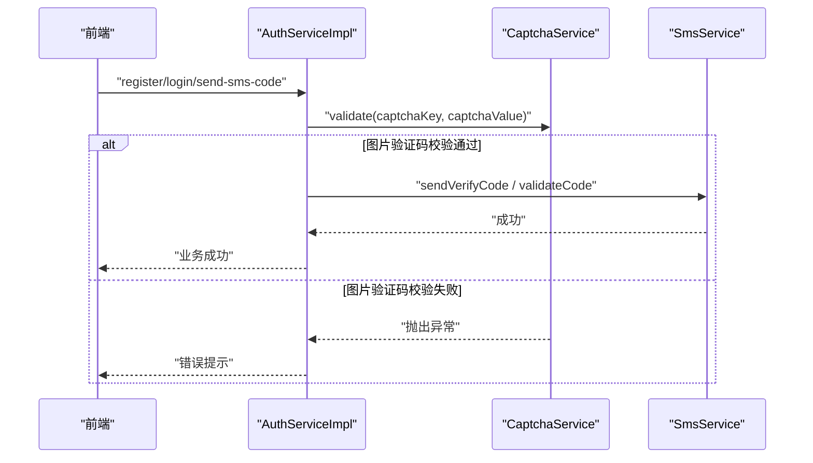
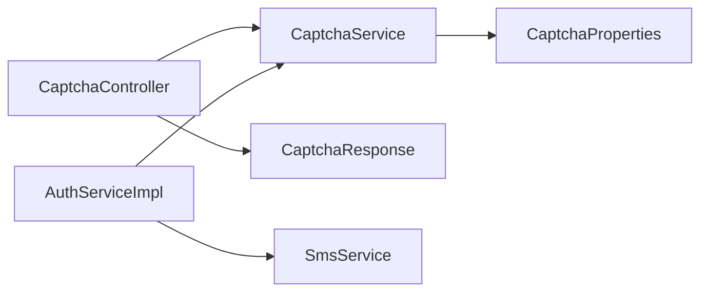

# 验证码服务

<cite>
**本文引用的文件**   
- [CaptchaController.java](file://backend/ecommerce-user/src/main/java/com/ecommerce/user/controller/CaptchaController.java)
- [CaptchaService.java](file://backend/ecommerce-user/src/main/java/com/ecommerce/user/service/CaptchaService.java)
- [CaptchaProperties.java](file://backend/ecommerce-user/src/main/java/com/ecommerce/user/config/properties/CaptchaProperties.java)
- [CaptchaResponse.java](file://backend/ecommerce-user/src/main/java/com/ecommerce/user/dto/CaptchaResponse.java)
- [AuthServiceImpl.java](file://backend/ecommerce-user/src/main/java/com/ecommerce/user/service/impl/AuthServiceImpl.java)
- [README.md](file://README.md)
</cite>

## 目录
1. [简介](#简介)
2. [项目结构定位](#项目结构定位)
3. [核心组件总览](#核心组件总览)
4. [架构与调用流程](#架构与调用流程)
5. [详细组件分析](#详细组件分析)
6. [依赖关系分析](#依赖关系分析)
7. [安全机制与防刷策略](#安全机制与防刷策略)
8. [性能与扩展性设计](#性能与扩展性设计)
9. [故障排查指南](#故障排查指南)
10. [结论](#结论)

## 简介
本文件面向验证码服务的实现与使用，重点说明图片验证码的生成、获取、验证全流程；阐述 CaptchaService 的核心逻辑（随机字符生成、图片绘制、验证码存储）；解释 CaptchaProperties 配置项的设计；总结当前内存存储方案的安全性与局限性，并给出 Redis 化改造建议。文档同时包含流程图、类图、时序图等可视化内容，帮助不同技术背景的读者快速理解。

## 项目结构定位
验证码能力位于用户微服务 ecommerce-user 中，主要涉及控制器、服务、配置与响应模型：
- 控制器层：暴露图片验证码获取接口。
- 服务层：封装验证码生成、渲染、校验等核心逻辑。
- 配置层：集中管理验证码开关、有效期、图片尺寸、字符数量、干扰线数量等参数。
- 数据模型：定义验证码返回结构。

**图表来源**
- [CaptchaController.java:17-33](file://backend/ecommerce-user/src/main/java/com/ecommerce/user/controller/CaptchaController.java#L17-L33)
- [CaptchaService.java:22-33](file://backend/ecommerce-user/src/main/java/com/ecommerce/user/service/CaptchaService.java#L22-L33)
- [CaptchaProperties.java:7-13](file://backend/ecommerce-user/src/main/java/com/ecommerce/user/config/properties/CaptchaProperties.java#L7-L13)
- [CaptchaResponse.java:5-10](file://backend/ecommerce-user/src/main/java/com/ecommerce/user/dto/CaptchaResponse.java#L5-L10)
- [AuthServiceImpl.java:20-32](file://backend/ecommerce-user/src/main/java/com/ecommerce/user/service/impl/AuthServiceImpl.java#L20-L32)

**章节来源**
- [CaptchaController.java:17-33](file://backend/ecommerce-user/src/main/java/com/ecommerce/user/controller/CaptchaController.java#L17-L33)
- [CaptchaService.java:22-33](file://backend/ecommerce-user/src/main/java/com/ecommerce/user/service/CaptchaService.java#L22-L33)
- [CaptchaProperties.java:7-13](file://backend/ecommerce-user/src/main/java/com/ecommerce/user/config/properties/CaptchaProperties.java#L7-L13)
- [CaptchaResponse.java:5-10](file://backend/ecommerce-user/src/main/java/com/ecommerce/user/dto/CaptchaResponse.java#L5-L10)
- [AuthServiceImpl.java:20-32](file://backend/ecommerce-user/src/main/java/com/ecommerce/user/service/impl/AuthServiceImpl.java#L20-L32)

## 核心组件总览
- CaptchaController：提供 GET /auth/captcha 接口，返回一次性 captchaKey 与 Base64 PNG 图片 Data URL。
- CaptchaService：负责验证码字符串生成、AWT 图片绘制、Base64 编码、内存存储与一次性校验。
- CaptchaProperties：集中管理验证码开关、过期时间、图片宽高、字符个数、干扰线数量。
- CaptchaResponse：封装 captchaKey 与 captchaImage。
- AuthServiceImpl：在登录、注册、发送短信验证码前调用 CaptchaService.validate 进行前置校验。

**章节来源**
- [CaptchaController.java:17-33](file://backend/ecommerce-user/src/main/java/com/ecommerce/user/controller/CaptchaController.java#L17-L33)
- [CaptchaService.java:22-33](file://backend/ecommerce-user/src/main/java/com/ecommerce/user/service/CaptchaService.java#L22-L33)
- [CaptchaProperties.java:7-13](file://backend/ecommerce-user/src/main/java/com/ecommerce/user/config/properties/CaptchaProperties.java#L7-L13)
- [CaptchaResponse.java:5-10](file://backend/ecommerce-user/src/main/java/com/ecommerce/user/dto/CaptchaResponse.java#L5-L10)
- [AuthServiceImpl.java:62-139](file://backend/ecommerce-user/src/main/java/com/ecommerce/user/service/impl/AuthServiceImpl.java#L62-L139)

## 架构与调用流程
### 整体调用链
前端通过 GET /api/auth/captcha 获取验证码图片与 key，随后在登录、注册或发送短信验证码时携带该 key 与用户输入值进行校验。

**图表来源**
- [CaptchaController.java:28-33](file://backend/ecommerce-user/src/main/java/com/ecommerce/user/controller/CaptchaController.java#L28-L33)
- [CaptchaService.java:46-71](file://backend/ecommerce-user/src/main/java/com/ecommerce/user/service/CaptchaService.java#L46-L71)
- [AuthServiceImpl.java:62-139](file://backend/ecommerce-user/src/main/java/com/ecommerce/user/service/impl/AuthServiceImpl.java#L62-L139)

**章节来源**
- [README.md:344-348](file://README.md#L344-L348)
- [CaptchaController.java:28-33](file://backend/ecommerce-user/src/main/java/com/ecommerce/user/controller/CaptchaController.java#L28-L33)
- [AuthServiceImpl.java:62-139](file://backend/ecommerce-user/src/main/java/com/ecommerce/user/service/impl/AuthServiceImpl.java#L62-L139)

## 详细组件分析

### CaptchaController：图片验证码接口
- 职责：对外暴露获取图片验证码的接口，委托 CaptchaService.generate() 完成生成与返回。
- 路径：GET /auth/captcha（实际访问路径受全局 context-path 影响）。
- 安全：已在认证配置中放行匿名访问，供未登录用户获取验证码。
- 返回：统一 Result 包装的 CaptchaResponse，包含一次性 key 与 Base64 PNG Data URL。

**图表来源**
- [CaptchaController.java:17-33](file://backend/ecommerce-user/src/main/java/com/ecommerce/user/controller/CaptchaController.java#L17-L33)
- [CaptchaResponse.java:5-10](file://backend/ecommerce-user/src/main/java/com/ecommerce/user/dto/CaptchaResponse.java#L5-L10)

**章节来源**
- [CaptchaController.java:17-33](file://backend/ecommerce-user/src/main/java/com/ecommerce/user/controller/CaptchaController.java#L17-L33)
- [CaptchaResponse.java:5-10](file://backend/ecommerce-user/src/main/java/com/ecommerce/user/dto/CaptchaResponse.java#L5-L10)

### CaptchaService：核心逻辑
- 随机字符生成：从排除易混淆字符的集合中随机抽取指定长度的字符。
- 图片绘制：基于 JDK AWT 绘制背景、干扰线、逐字符倾斜与颜色变化，输出 PNG 的 Base64 Data URL。
- 验证码存储：使用进程内 ConcurrentHashMap 保存 key 到验证码原文与过期时间的映射，并在每次生成前清理过期条目。
- 校验逻辑：支持关闭开关；空值检查；一次性使用（无论成功失败均移除 key）；忽略大小写比对；过期判定。

**图表来源**
- [CaptchaService.java:56-71](file://backend/ecommerce-user/src/main/java/com/ecommerce/user/service/CaptchaService.java#L56-L71)

#### 图片渲染过程
- 创建 BufferedImage，设置抗锯齿。
- 填充白色背景。
- 绘制若干条灰色干扰线。
- 按字符逐个绘制，带随机角度旋转与随机颜色。
- 将图像写入 ByteArrayOutputStream，转为 Base64 Data URL。

**图表来源**
- [CaptchaService.java:87-124](file://backend/ecommerce-user/src/main/java/com/ecommerce/user/service/CaptchaService.java#L87-L124)

**章节来源**
- [CaptchaService.java:22-33](file://backend/ecommerce-user/src/main/java/com/ecommerce/user/service/CaptchaService.java#L22-L33)
- [CaptchaService.java:46-71](file://backend/ecommerce-user/src/main/java/com/ecommerce/user/service/CaptchaService.java#L46-L71)
- [CaptchaService.java:78-124](file://backend/ecommerce-user/src/main/java/com/ecommerce/user/service/CaptchaService.java#L78-L124)

### CaptchaProperties：配置类设计
- enabled：是否启用验证码生成与校验，便于本地调试或自动化测试关闭。
- expireSeconds：验证码有效期（秒），过期后需重新获取。
- width/height：验证码图片宽高（像素）。
- codeLength：验证码字符个数。
- lineCount：干扰线数量。

这些属性通过 @ConfigurationProperties(prefix = "captcha") 绑定 application.yml 中的 captcha.* 配置项。

**章节来源**
- [CaptchaProperties.java:7-32](file://backend/ecommerce-user/src/main/java/com/ecommerce/user/config/properties/CaptchaProperties.java#L7-L32)

### CaptchaResponse：响应模型
- captchaKey：客户端提交登录/注册时原样回传，用于服务端定位本次生成的验证码。
- captchaImage：Base64 PNG Data URL，可直接在 img 标签展示。

**章节来源**
- [CaptchaResponse.java:5-21](file://backend/ecommerce-user/src/main/java/com/ecommerce/user/dto/CaptchaResponse.java#L5-L21)

### 与认证流程的集成
- 注册：先校验图片验证码，再校验短信验证码，最后执行业务逻辑。
- 登录：对普通用户先校验图片验证码，再校验短信验证码；管理员账号跳过验证码校验以简化演示。
- 发送短信验证码：先校验图片验证码，通过后才真正发送短信，防止滥发。

**图表来源**
- [AuthServiceImpl.java:62-139](file://backend/ecommerce-user/src/main/java/com/ecommerce/user/service/impl/AuthServiceImpl.java#L62-L139)

**章节来源**
- [AuthServiceImpl.java:62-139](file://backend/ecommerce-user/src/main/java/com/ecommerce/user/service/impl/AuthServiceImpl.java#L62-L139)

## 依赖关系分析
- CaptchaController 依赖 CaptchaService 与 CaptchaResponse。
- CaptchaService 依赖 CaptchaProperties 与统一业务异常 BusinessException。
- AuthServiceImpl 依赖 CaptchaService 与 SmsService，作为验证码校验的调用方。

**图表来源**
- [CaptchaController.java:17-33](file://backend/ecommerce-user/src/main/java/com/ecommerce/user/controller/CaptchaController.java#L17-L33)
- [CaptchaService.java:22-33](file://backend/ecommerce-user/src/main/java/com/ecommerce/user/service/CaptchaService.java#L22-L33)
- [AuthServiceImpl.java:20-32](file://backend/ecommerce-user/src/main/java/com/ecommerce/user/service/impl/AuthServiceImpl.java#L20-L32)

**章节来源**
- [CaptchaController.java:17-33](file://backend/ecommerce-user/src/main/java/com/ecommerce/user/controller/CaptchaController.java#L17-L33)
- [CaptchaService.java:22-33](file://backend/ecommerce-user/src/main/java/com/ecommerce/user/service/CaptchaService.java#L22-L33)
- [AuthServiceImpl.java:20-32](file://backend/ecommerce-user/src/main/java/com/ecommerce/user/service/impl/AuthServiceImpl.java#L20-L32)

## 安全机制与防刷策略
- 一次性使用：无论校验成功与否，都会移除对应的 key，避免重复利用。
- 过期控制：每个验证码条目带有过期时间戳，生成新验证码前会清理已过期条目。
- 忽略大小写：降低用户输入成本的同时保持基本安全性。
- 可关闭开关：captcha.enabled=false 时跳过校验，便于本地调试或自动化测试。
- 防刷策略：
  - 图片验证码作为发送短信验证码的前置条件，未通过则不发送短信。
  - 结合业务层的短信频控（由 SmsService 内部实现）进一步限制滥用。
- 当前存储方案：
  - 使用进程内 ConcurrentHashMap 存储验证码，简单高效但存在多实例不一致、重启丢失等问题。
  - 生产环境建议迁移至 Redis，以实现分布式一致性、过期自动清理与更好的可扩展性。

**章节来源**
- [CaptchaService.java:22-33](file://backend/ecommerce-user/src/main/java/com/ecommerce/user/service/CaptchaService.java#L22-L33)
- [CaptchaService.java:46-71](file://backend/ecommerce-user/src/main/java/com/ecommerce/user/service/CaptchaService.java#L46-L71)
- [CaptchaService.java:126-128](file://backend/ecommerce-user/src/main/java/com/ecommerce/user/service/CaptchaService.java#L126-L128)
- [AuthServiceImpl.java:132-139](file://backend/ecommerce-user/src/main/java/com/ecommerce/user/service/impl/AuthServiceImpl.java#L132-L139)

## 性能与扩展性设计
- 性能特性：
  - 内存存储无网络开销，适合单机部署与低并发场景。
  - 图片渲染使用 JDK AWT，轻量但 CPU 密集，高并发下可能成为瓶颈。
  - 生成新验证码前清理过期条目，避免内存无限增长。
- 扩展性设计：
  - 通过 CaptchaProperties 集中管理样式与行为参数，便于动态调整。
  - 可替换图片渲染实现（如引入第三方库或 GPU 加速）。
  - 可将验证码存储迁移至 Redis，支持分布式部署与过期自动清理。
- 优化建议：
  - 缓存常用字体资源，减少字体初始化开销。
  - 对图片生成进行限流与降级，保护后端资源。
  - 引入异步任务预热字体或预分配缓冲区，降低峰值延迟。

[本节为通用指导，不直接分析具体文件]

## 故障排查指南
- 常见问题与定位：
  - 验证码始终失败：检查 captcha.enabled 是否为 true；确认前端正确传递 captchaKey 与 captchaValue。
  - 验证码频繁过期：检查 expireSeconds 配置是否过短；关注前端刷新频率。
  - 图片模糊或难以识别：调整 codeLength、lineCount、width、height 等参数。
  - 多实例环境下验证码不一致：当前内存存储无法跨实例共享，需迁移至 Redis。
- 日志与异常：
  - 验证码校验失败会抛出统一业务异常，错误码与消息可用于前端提示。
  - 图片生成失败会抛出 IO 相关异常，需检查运行环境与 ImageIO 支持。

**章节来源**
- [CaptchaService.java:56-71](file://backend/ecommerce-user/src/main/java/com/ecommerce/user/service/CaptchaService.java#L56-L71)
- [CaptchaService.java:118-124](file://backend/ecommerce-user/src/main/java/com/ecommerce/user/service/CaptchaService.java#L118-L124)

## 结论
当前验证码服务通过简洁的 Controller-Service-Properties 分层实现了图片验证码的生成、渲染与一次性校验，并与登录、注册、短信发送流程紧密集成。其优势在于实现简单、易于调试；不足在于内存存储不具备分布式一致性，且在高频图片渲染场景下存在性能压力。建议在生产环境中将验证码存储迁移至 Redis，并结合业务层限流与缓存优化，进一步提升安全性与可扩展性。