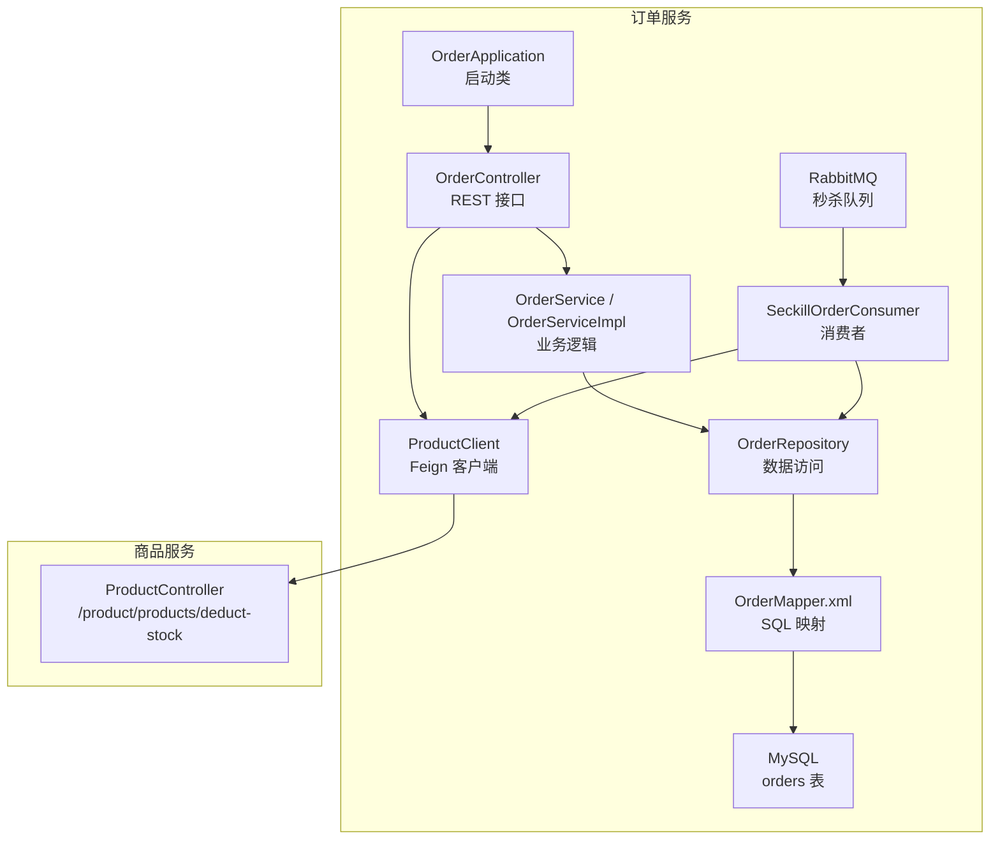
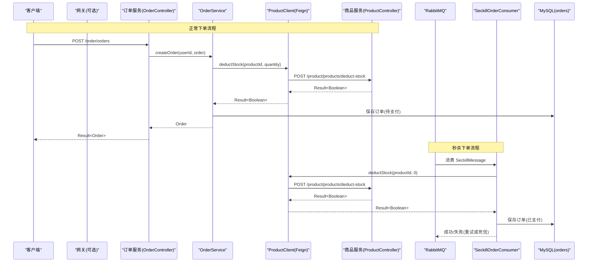
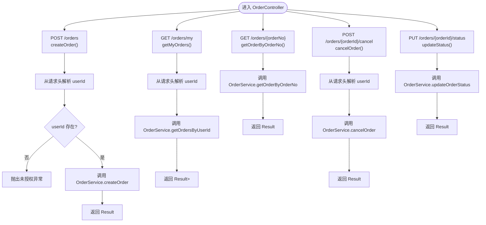
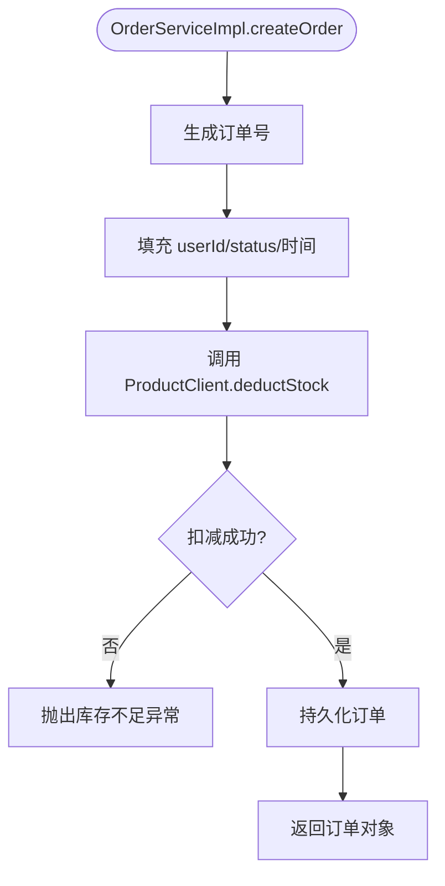
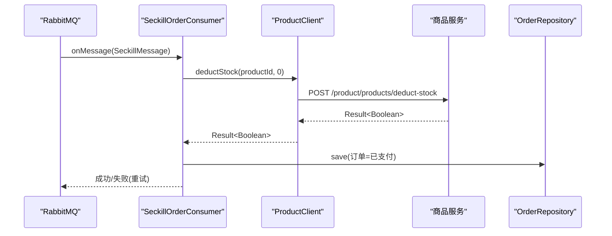
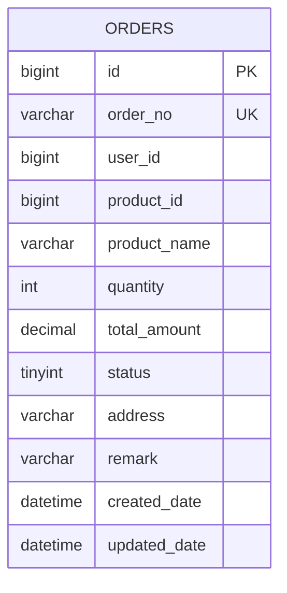
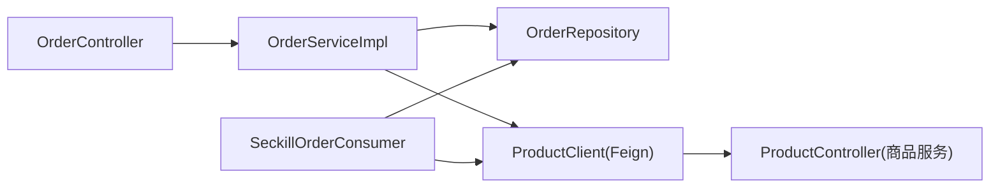

# 订单服务

<cite>
**本文引用的文件**   
- [OrderApplication.java](file://backend/ecommerce-order/src/main/java/com/ecommerce/order/OrderApplication.java)
- [OrderController.java](file://backend/ecommerce-order/src/main/java/com/ecommerce/order/controller/OrderController.java)
- [OrderService.java](file://backend/ecommerce-order/src/main/java/com/ecommerce/order/service/OrderService.java)
- [OrderServiceImpl.java](file://backend/ecommerce-order/src/main/java/com/ecommerce/order/service/impl/OrderServiceImpl.java)
- [ProductClient.java](file://backend/ecommerce-order/src/main/java/com/ecommerce/order/client/ProductClient.java)
- [SeckillOrderConsumer.java](file://backend/ecommerce-order/src/main/java/com/ecommerce/order/consumer/SeckillOrderConsumer.java)
- [Order.java](file://backend/ecommerce-order/src/main/java/com/ecommerce/order/entity/Order.java)
- [schema.sql](file://backend/ecommerce-order/src/main/resources/db/schema.sql)
- [application.yml](file://backend/ecommerce-order/src/main/resources/application.yml)
- [SeckillMessage.java](file://backend/ecommerce-common/src/main/java/com/ecommerce/common/SeckillMessage.java)
- [ProductController.java](file://backend/ecommerce-product/src/main/java/com/ecommerce/product/controller/ProductController.java)
</cite>

## 目录
1. [简介](#简介)
2. [项目结构](#项目结构)
3. [核心组件](#核心组件)
4. [架构总览](#架构总览)
5. [详细组件分析](#详细组件分析)
6. [依赖关系分析](#依赖关系分析)
7. [性能与可靠性](#性能与可靠性)
8. [故障排查指南](#故障排查指南)
9. [结论](#结论)

## 简介
本文件面向订单服务的开发者与运维人员，系统性说明订单服务的启动类、控制器、服务层、秒杀消费者、远程调用客户端、实体模型与数据库设计，并给出业务流程图、消息处理流程图与服务调用关系图。文档同时覆盖分布式事务、消息可靠性与性能优化策略，帮助读者快速理解并高效维护该服务。

## 项目结构
订单服务位于后端模块 ecommerce-order，采用 Spring Boot + MyBatis + OpenFeign + RabbitMQ 的典型分层架构：
- 启动类负责扫描包、启用 Feign 客户端、注册全局异常处理器
- Controller 暴露 REST API，负责参数校验与用户身份解析
- Service 封装业务逻辑，包含订单创建、查询、取消与状态更新
- Consumer 监听 RabbitMQ 队列，异步处理秒杀订单
- Client 通过 OpenFeign 调用商品服务扣减库存
- Entity 与 SQL 定义订单数据模型与索引

图表来源
- [OrderApplication.java:10-18](file://backend/ecommerce-order/src/main/java/com/ecommerce/order/OrderApplication.java#L10-L18)
- [OrderController.java:16-80](file://backend/ecommerce-order/src/main/java/com/ecommerce/order/controller/OrderController.java#L16-L80)
- [OrderServiceImpl.java:18-116](file://backend/ecommerce-order/src/main/java/com/ecommerce/order/service/impl/OrderServiceImpl.java#L18-L116)
- [ProductClient.java:11-19](file://backend/ecommerce-order/src/main/java/com/ecommerce/order/client/ProductClient.java#L11-L19)
- [ProductController.java:88-95](file://backend/ecommerce-product/src/main/java/com/ecommerce/product/controller/ProductController.java#L88-L95)
- [SeckillOrderConsumer.java:21-68](file://backend/ecommerce-order/src/main/java/com/ecommerce/order/consumer/SeckillOrderConsumer.java#L21-L68)
- [schema.sql:6-23](file://backend/ecommerce-order/src/main/resources/db/schema.sql#L6-L23)

章节来源
- [OrderApplication.java:10-18](file://backend/ecommerce-order/src/main/java/com/ecommerce/order/OrderApplication.java#L10-L18)
- [application.yml:1-79](file://backend/ecommerce-order/src/main/resources/application.yml#L1-L79)

## 核心组件
- 启动类 OrderApplication：启用 Spring Boot、MyBatis Mapper 扫描、OpenFeign 客户端扫描，并导入全局异常处理器。
- 控制器 OrderController：提供订单创建、查询（按用户、按单号、全部）、取消、状态更新等接口；从请求头解析用户 ID，未授权时抛出业务异常。
- 服务层 OrderService/OrderServiceImpl：实现订单创建（含生成订单号、调用商品服务扣库存、持久化）、查询、取消（权限与状态校验）、状态更新；使用 @Transactional 保证本地事务一致性。
- 消费者 SeckillOrderConsumer：监听 RabbitMQ 秒杀队列，验证商品后创建订单记录，失败抛异常触发重试。
- 远程调用 ProductClient：基于 OpenFeign 声明式调用商品服务 /product/products/deduct-stock。
- 实体与数据模型 Order 与 orders 表：定义订单字段、状态枚举含义及数据库索引。

章节来源
- [OrderApplication.java:10-18](file://backend/ecommerce-order/src/main/java/com/ecommerce/order/OrderApplication.java#L10-L18)
- [OrderController.java:16-80](file://backend/ecommerce-order/src/main/java/com/ecommerce/order/controller/OrderController.java#L16-L80)
- [OrderService.java:7-29](file://backend/ecommerce-order/src/main/java/com/ecommerce/order/service/OrderService.java#L7-L29)
- [OrderServiceImpl.java:18-116](file://backend/ecommerce-order/src/main/java/com/ecommerce/order/service/impl/OrderServiceImpl.java#L18-L116)
- [SeckillOrderConsumer.java:21-68](file://backend/ecommerce-order/src/main/java/com/ecommerce/order/consumer/SeckillOrderConsumer.java#L21-L68)
- [ProductClient.java:11-19](file://backend/ecommerce-order/src/main/java/com/ecommerce/order/client/ProductClient.java#L11-L19)
- [Order.java:10-41](file://backend/ecommerce-order/src/main/java/com/ecommerce/order/entity/Order.java#L10-L41)
- [schema.sql:6-23](file://backend/ecommerce-order/src/main/resources/db/schema.sql#L6-L23)

## 架构总览
订单服务作为微服务之一，通过 Nacos 进行服务发现，通过 OpenFeign 调用商品服务，通过 RabbitMQ 接收秒杀消息，最终将订单落库到 MySQL。

图表来源
- [OrderController.java:27-33](file://backend/ecommerce-order/src/main/java/com/ecommerce/order/controller/OrderController.java#L27-L33)
- [OrderServiceImpl.java:32-60](file://backend/ecommerce-order/src/main/java/com/ecommerce/order/service/impl/OrderServiceImpl.java#L32-L60)
- [ProductClient.java:11-19](file://backend/ecommerce-order/src/main/java/com/ecommerce/order/client/ProductClient.java#L11-L19)
- [ProductController.java:88-95](file://backend/ecommerce-product/src/main/java/com/ecommerce/product/controller/ProductController.java#L88-L95)
- [SeckillOrderConsumer.java:35-68](file://backend/ecommerce-order/src/main/java/com/ecommerce/order/consumer/SeckillOrderConsumer.java#L35-L68)

## 详细组件分析

### 启动类 OrderApplication
- 功能要点
  - 启用 Spring Boot 应用，扫描 com.ecommerce.order 包
  - 扫描 MyBatis Mapper 包
  - 启用 OpenFeign 客户端，扫描 com.ecommerce.order.client
  - 导入全局异常处理器 GlobalExceptionHandler
- 关键配置位置
  - 注解与 main 方法入口

章节来源
- [OrderApplication.java:10-18](file://backend/ecommerce-order/src/main/java/com/ecommerce/order/OrderApplication.java#L10-L18)

### 控制器 OrderController
- 接口能力
  - 创建订单：POST /orders，从请求头获取 userId，委托 OrderService.createOrder
  - 查询我的订单：GET /orders/my，按 userId 查询
  - 查询订单详情：GET /orders/{orderNo}
  - 查询所有订单：GET /orders（管理用）
  - 取消订单：POST /orders/{orderId}/cancel，仅待支付可取消
  - 更新订单状态：PUT /orders/{orderId}/status
- 安全与鉴权
  - 从请求头 TrustedAuthenticationFilter.HEADER_USER_ID 解析 userId，缺失则抛出未授权业务异常
- 返回统一结果
  - 使用 Result 包装响应

图表来源
- [OrderController.java:27-72](file://backend/ecommerce-order/src/main/java/com/ecommerce/order/controller/OrderController.java#L27-L72)

章节来源
- [OrderController.java:16-80](file://backend/ecommerce-order/src/main/java/com/ecommerce/order/controller/OrderController.java#L16-L80)

### 服务层 OrderService / OrderServiceImpl
- 主要职责
  - 创建订单：生成订单号、设置初始状态为“待支付”，调用商品服务扣库存，成功后落库
  - 查询：按用户、按单号、按 ID、全部
  - 取消订单：校验归属与状态，更新为“已取消”
  - 更新状态：根据传入状态码更新
- 事务与异常
  - createOrder 与 cancelOrder 使用 @Transactional
  - 库存不足或商品不存在抛出业务异常
  - 调用商品服务失败抛出业务异常，便于上层统一处理
- 订单号生成
  - 时间戳 + UUID 片段组合，保证唯一性

图表来源
- [OrderServiceImpl.java:32-60](file://backend/ecommerce-order/src/main/java/com/ecommerce/order/service/impl/OrderServiceImpl.java#L32-L60)

章节来源
- [OrderService.java:7-29](file://backend/ecommerce-order/src/main/java/com/ecommerce/order/service/OrderService.java#L7-L29)
- [OrderServiceImpl.java:18-116](file://backend/ecommerce-order/src/main/java/com/ecommerce/order/service/impl/OrderServiceImpl.java#L18-L116)

### 秒杀消费者 SeckillOrderConsumer
- 消息监听
  - 使用 @RabbitListener 监听 SECKILL_QUEUE
- 处理流程
  - 解析 SeckillMessage（userId、productId、quantity、orderNo）
  - 通过 ProductClient 调用商品服务校验/预扣库存（数量传 0，仅作存在性校验）
  - 构造订单对象并直接标记为“已支付”，落库
  - 失败抛异常触发重试机制
- 幂等性与一致性
  - 当前实现依赖 orderNo 唯一索引避免重复入库
  - 注释提示需结合 Redis 购买标记与库存回滚，完善幂等与补偿

图表来源
- [SeckillOrderConsumer.java:35-68](file://backend/ecommerce-order/src/main/java/com/ecommerce/order/consumer/SeckillOrderConsumer.java#L35-L68)
- [ProductClient.java:11-19](file://backend/ecommerce-order/src/main/java/com/ecommerce/order/client/ProductClient.java#L11-L19)
- [ProductController.java:88-95](file://backend/ecommerce-product/src/main/java/com/ecommerce/product/controller/ProductController.java#L88-L95)

章节来源
- [SeckillOrderConsumer.java:21-68](file://backend/ecommerce-order/src/main/java/com/ecommerce/order/consumer/SeckillOrderConsumer.java#L21-L68)
- [SeckillMessage.java:10-25](file://backend/ecommerce-common/src/main/java/com/ecommerce/common/SeckillMessage.java#L10-L25)

### 远程调用 ProductClient（OpenFeign）
- 客户端定义
  - @FeignClient(name = "ecommerce-product", path = "/product/products")
  - 方法 deductStock(productId, quantity) -> Result<Boolean>
- 通信协议
  - HTTP + JSON，路径与方法由注解声明
- 超时配置
  - application.yml 中针对 ecommerce-product 设置 connect-timeout 与 read-timeout

章节来源
- [ProductClient.java:11-19](file://backend/ecommerce-order/src/main/java/com/ecommerce/order/client/ProductClient.java#L11-L19)
- [application.yml:57-63](file://backend/ecommerce-order/src/main/resources/application.yml#L57-L63)

### 实体模型与数据库设计
- 实体 Order
  - 关键字段：id、orderNo、userId、productId、productName、quantity、totalAmount、status、address、remark、createdDate、updatedDate
  - 状态含义：0 待支付、1 已支付、2 已发货、3 已完成、4 已取消
- 数据库表 orders
  - 唯一索引 uk_order_no 保障订单号唯一
  - 普通索引 idx_user_id、idx_product_id、idx_status 提升查询性能
  - 默认字符集 utf8mb4

图表来源
- [Order.java:10-41](file://backend/ecommerce-order/src/main/java/com/ecommerce/order/entity/Order.java#L10-L41)
- [schema.sql:6-23](file://backend/ecommerce-order/src/main/resources/db/schema.sql#L6-L23)

章节来源
- [Order.java:10-41](file://backend/ecommerce-order/src/main/java/com/ecommerce/order/entity/Order.java#L10-L41)
- [schema.sql:6-23](file://backend/ecommerce-order/src/main/resources/db/schema.sql#L6-L23)

## 依赖关系分析
- 组件耦合
  - OrderController 依赖 OrderService
  - OrderServiceImpl 依赖 OrderRepository 与 ProductClient
  - SeckillOrderConsumer 依赖 ProductClient 与 OrderRepository
  - ProductClient 通过 OpenFeign 依赖商品服务 ProductController
- 外部依赖
  - MySQL（订单持久化）
  - RabbitMQ（秒杀消息）
  - Redis（应用配置中存在，但订单服务当前未直接使用）
  - Nacos（服务发现）

图表来源
- [OrderController.java:16-80](file://backend/ecommerce-order/src/main/java/com/ecommerce/order/controller/OrderController.java#L16-L80)
- [OrderServiceImpl.java:18-116](file://backend/ecommerce-order/src/main/java/com/ecommerce/order/service/impl/OrderServiceImpl.java#L18-L116)
- [SeckillOrderConsumer.java:21-68](file://backend/ecommerce-order/src/main/java/com/ecommerce/order/consumer/SeckillOrderConsumer.java#L21-L68)
- [ProductClient.java:11-19](file://backend/ecommerce-order/src/main/java/com/ecommerce/order/client/ProductClient.java#L11-L19)
- [ProductController.java:88-95](file://backend/ecommerce-product/src/main/java/com/ecommerce/product/controller/ProductController.java#L88-L95)

章节来源
- [application.yml:1-79](file://backend/ecommerce-order/src/main/resources/application.yml#L1-L79)

## 性能与可靠性

### 分布式事务处理
- 现状
  - 订单创建在本地事务内完成，跨服务库存扣减通过同步 HTTP 调用（Feign）
  - 若商品服务不可用或扣减失败，会抛出业务异常，事务回滚
- 建议
  - 引入 Saga/TCC 或基于消息的最终一致性方案，确保跨服务数据一致
  - 对幂等性做增强：以 orderNo 为主键去重，结合分布式锁或幂等表

### 消息可靠性保证
- 现状
  - RabbitMQ 监听器使用手动确认模式，prefetch=1，开启重试（最多 3 次，间隔 3s）
  - 消费者失败抛异常，触发重试；未消费消息进入死信队列（需配合交换机/队列配置）
- 建议
  - 增加消息去重键（如 orderNo），消费者侧先查幂等表再处理
  - 对失败消息进行告警与人工干预通道

### 性能优化策略
- 数据库
  - 利用现有索引（user_id、product_id、status）优化查询
  - 批量写入与分页查询，避免全表扫描
- 缓存
  - 热点商品库存读取走 Redis，减少数据库压力
- 连接池与超时
  - 合理配置 Redis Lettuce 连接池大小
  - Feign 超时时间按网络环境调优
- 限流与降级
  - 秒杀场景增加限流与熔断，保护下游服务

[本节为通用指导，不直接分析具体文件]

## 故障排查指南
- 常见错误
  - 未授权访问：请求头缺少 USER_ID，控制器抛出未授权异常
  - 库存不足：商品服务返回扣减失败，服务层抛出业务异常
  - 订单不存在：查询接口找不到记录，抛出 404 业务异常
  - 状态非法：非待支付订单被取消，抛出业务异常
- 排查步骤
  - 检查日志级别（com.ecommerce.order: DEBUG）
  - 查看 RabbitMQ 消费者日志与重试次数
  - 核对 Feign 调用超时与商品服务可用性
  - 检查数据库唯一索引冲突（orderNo）

章节来源
- [OrderController.java:74-80](file://backend/ecommerce-order/src/main/java/com/ecommerce/order/controller/OrderController.java#L74-L80)
- [OrderServiceImpl.java:42-55](file://backend/ecommerce-order/src/main/java/com/ecommerce/order/service/impl/OrderServiceImpl.java#L42-L55)
- [OrderServiceImpl.java:67-83](file://backend/ecommerce-order/src/main/java/com/ecommerce/order/service/impl/OrderServiceImpl.java#L67-L83)
- [OrderServiceImpl.java:85-98](file://backend/ecommerce-order/src/main/java/com/ecommerce/order/service/impl/OrderServiceImpl.java#L85-L98)
- [application.yml:65-67](file://backend/ecommerce-order/src/main/resources/application.yml#L65-L67)

## 结论
订单服务通过清晰的层次划分与明确的职责边界，实现了常规订单的创建、查询、取消与状态管理，并通过 RabbitMQ 与 OpenFeign 支撑了秒杀场景下的异步处理与跨服务调用。为保障高可用与一致性，建议在现有基础上完善分布式事务、消息幂等与补偿机制，并结合缓存与限流进一步提升系统吞吐与稳定性。