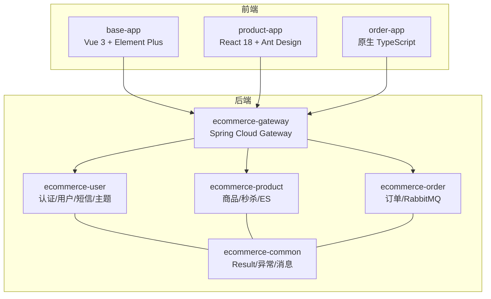
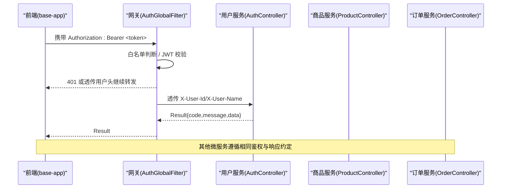
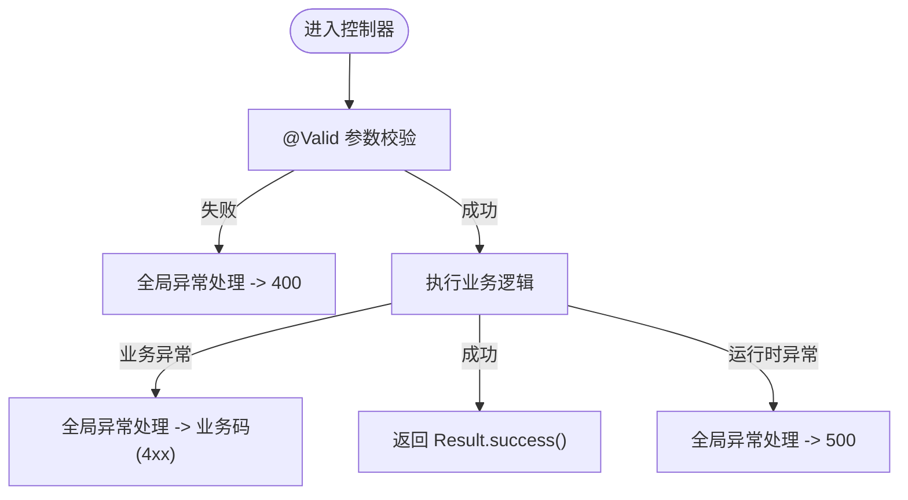
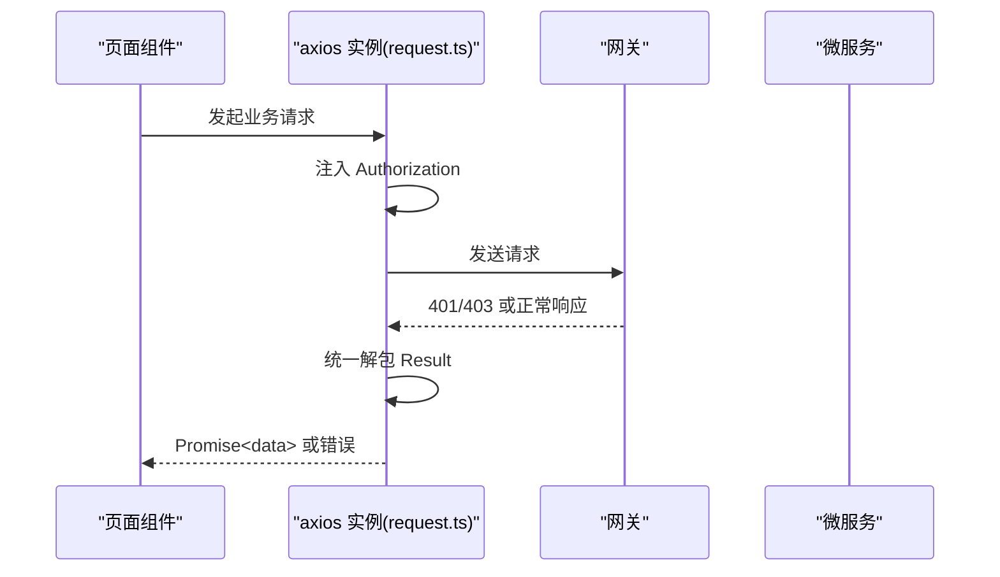
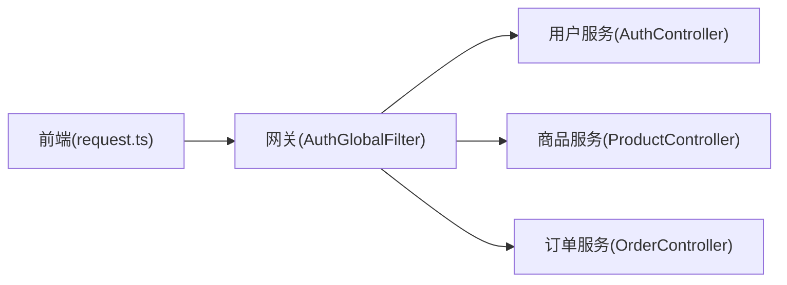

# 代码规范与最佳实践

<cite>
**本文引用的文件**   
- [README.md](file://README.md)
- [BusinessException.java](file://backend/ecommerce-common/src/main/java/com/ecommerce/common/BusinessException.java)
- [GlobalExceptionHandler.java](file://backend/ecommerce-common/src/main/java/com/ecommerce/common/GlobalExceptionHandler.java)
- [Result.java](file://backend/ecommerce-common/src/main/java/com/ecommerce/common/Result.java)
- [AuthGlobalFilter.java](file://backend/ecommerce-gateway/src/main/java/com/ecommerce/gateway/filter/AuthGlobalFilter.java)
- [AuthController.java](file://backend/ecommerce-user/src/main/java/com/ecommerce/user/controller/AuthController.java)
- [ProductController.java](file://backend/ecommerce-product/src/main/java/com/ecommerce/product/controller/ProductController.java)
- [OrderController.java](file://backend/ecommerce-order/src/main/java/com/ecommerce/order/controller/OrderController.java)
- [request.ts](file://frontend/base-app/src/api/request.ts)
- [theme.ts](file://frontend/base-app/src/utils/theme.ts)
- [Login.vue](file://frontend/base-app/src/views/Login.vue)
- [App.tsx](file://frontend/product-app/src/App.tsx)
- [app.ts](file://frontend/order-app/src/app.ts)
</cite>

## 目录
1. [引言](#引言)
2. [项目结构](#项目结构)
3. [核心组件](#核心组件)
4. [架构总览](#架构总览)
5. [详细组件分析](#详细组件分析)
6. [依赖关系分析](#依赖关系分析)
7. [性能与可扩展性](#性能与可扩展性)
8. [故障排查指南](#故障排查指南)
9. [结论](#结论)
10. [附录：工具链与规范清单](#附录工具链与规范清单)

## 引言
本指南面向后端 Java（Spring Boot + Spring Cloud）与前端 TypeScript/Vue/React 团队，结合仓库现有实现，沉淀统一的代码规范、异常处理模式、API 封装策略、微前端协作方式以及可落地的质量检查建议。文档以“从现状到规范”的方式展开，既解释当前实现，也给出可执行的改进建议，帮助团队在保持演进速度的同时提升一致性与可维护性。

## 项目结构
本项目采用前后端分离的微服务架构：
- 后端：Spring Cloud 微服务拆分用户、商品、订单与网关；公共模块统一响应体、业务异常与全局异常处理。
- 前端：qiankun 微前端主应用（Vue 3 + Element Plus）+ 商品子应用（React 18 + Ant Design）+ 订单子应用（原生 TS）。

图示来源
- [README.md:16-47](file://README.md#L16-L47)

章节来源
- [README.md:1-150](file://README.md#L1-L150)

## 核心组件
- 统一响应 Result：所有接口返回统一结构，便于前端解包与错误码处理。
- 业务异常 BusinessException：用于业务校验失败场景，携带业务错误码。
- 全局异常处理器 GlobalExceptionHandler：集中捕获并转换为 Result，保证对外一致性。
- 网关鉴权 AuthGlobalFilter：JWT 校验、白名单放行、用户信息透传。
- 前端请求封装 request.ts：自动注入 Token、统一解包 Result、处理 401/403 与踢下线。
- 主题管理 theme.ts：本地缓存 + 后端持久化 + 跨应用同步。

章节来源
- [Result.java:1-64](file://backend/ecommerce-common/src/main/java/com/ecommerce/common/Result.java#L1-L64)
- [BusinessException.java:1-23](file://backend/ecommerce-common/src/main/java/com/ecommerce/common/BusinessException.java#L1-L23)
- [GlobalExceptionHandler.java:1-74](file://backend/ecommerce-common/src/main/java/com/ecommerce/common/GlobalExceptionHandler.java#L1-L74)
- [AuthGlobalFilter.java:1-170](file://backend/ecommerce-gateway/src/main/java/com/ecommerce/gateway/filter/AuthGlobalFilter.java#L1-L170)
- [request.ts:1-110](file://frontend/base-app/src/api/request.ts#L1-L110)
- [theme.ts:1-88](file://frontend/base-app/src/utils/theme.ts#L1-L88)

## 架构总览
后端通过网关统一鉴权与路由，下游微服务信任网关注入的用户头；前端通过 qiankun 加载子应用，并通过 localStorage 与 MutationObserver/storage 事件同步主题与语言偏好。

图示来源
- [AuthGlobalFilter.java:41-140](file://backend/ecommerce-gateway/src/main/java/com/ecommerce/gateway/filter/AuthGlobalFilter.java#L41-L140)
- [AuthController.java:31-95](file://backend/ecommerce-user/src/main/java/com/ecommerce/user/controller/AuthController.java#L31-L95)
- [ProductController.java:15-96](file://backend/ecommerce-product/src/main/java/com/ecommerce/product/controller/ProductController.java#L15-L96)
- [OrderController.java:16-81](file://backend/ecommerce-order/src/main/java/com/ecommerce/order/controller/OrderController.java#L16-L81)

## 详细组件分析

### 后端 Java 代码规范与最佳实践

#### 包结构与分层
- 控制器层 controller：仅做参数接收与结果包装，不写业务逻辑。
- 服务层 service：业务编排与事务边界。
- 数据访问层 repository/mapper：数据库与外部系统访问。
- 配置 config：安全、缓存、消息队列等配置。
- 安全 security：过滤器、令牌工具等。
- DTO/Entity：DTO 用于接口传输，Entity 用于持久化。

建议
- 严格遵循 Controller → Service → Repository/Mapper 的分层调用，禁止跨层调用。
- 新增能力优先扩展 service 接口，再实现类，保持开闭原则。

章节来源
- [AuthController.java:31-95](file://backend/ecommerce-user/src/main/java/com/ecommerce/user/controller/AuthController.java#L31-L95)
- [ProductController.java:15-96](file://backend/ecommerce-product/src/main/java/com/ecommerce/product/controller/ProductController.java#L15-L96)
- [OrderController.java:16-81](file://backend/ecommerce-order/src/main/java/com/ecommerce/order/controller/OrderController.java#L16-L81)

#### 命名约定
- 类名使用大驼峰，方法/变量小驼峰。
- 常量全大写加下划线。
- 包名小写，按功能域划分（如 com.ecommerce.user.controller）。
- 配置文件 key 使用 kebab-case（YAML），Java 属性使用 camelCase。

章节来源
- [AuthGlobalFilter.java:46-72](file://backend/ecommerce-gateway/src/main/java/com/ecommerce/gateway/filter/AuthGlobalFilter.java#L46-L72)

#### 注释规范
- 类级 Javadoc 说明职责与使用范围。
- 方法级 Javadoc 描述输入输出、异常与副作用。
- 关键分支与复杂逻辑行内注释解释“为什么”，而非“做了什么”。

章节来源
- [GlobalExceptionHandler.java:13-18](file://backend/ecommerce-common/src/main/java/com/ecommerce/common/GlobalExceptionHandler.java#L13-L18)
- [AuthController.java:23-30](file://backend/ecommerce-user/src/main/java/com/ecommerce/user/controller/AuthController.java#L23-L30)

#### 异常处理模式
- 业务异常：抛出 BusinessException，携带业务错误码。
- 参数校验：使用 @Valid，由全局异常处理器统一转换。
- 认证/授权：AuthenticationException/AccessDeniedException 统一处理。
- 兜底异常：Exception 捕获并记录日志，返回 500。

图示来源
- [GlobalExceptionHandler.java:22-72](file://backend/ecommerce-common/src/main/java/com/ecommerce/common/GlobalExceptionHandler.java#L22-L72)
- [BusinessException.java:6-21](file://backend/ecommerce-common/src/main/java/com/ecommerce/common/BusinessException.java#L6-L21)

章节来源
- [GlobalExceptionHandler.java:1-74](file://backend/ecommerce-common/src/main/java/com/ecommerce/common/GlobalExceptionHandler.java#L1-L74)
- [BusinessException.java:1-23](file://backend/ecommerce-common/src/main/java/com/ecommerce/common/BusinessException.java#L1-L23)

#### API 设计
- 路径前缀：各微服务通过 context-path 区分（/user、/product、/order）。
- 统一响应：Result<T> 包含 code/message/data。
- 文档注解：使用 OpenAPI 注解标注接口摘要与参数。
- 鉴权：网关统一校验 JWT，下游信任 X-User-Id/X-User-Name。

章节来源
- [Result.java:1-64](file://backend/ecommerce-common/src/main/java/com/ecommerce/common/Result.java#L1-L64)
- [AuthController.java:47-95](file://backend/ecommerce-user/src/main/java/com/ecommerce/user/controller/AuthController.java#L47-L95)
- [ProductController.java:26-96](file://backend/ecommerce-product/src/main/java/com/ecommerce/product/controller/ProductController.java#L26-L96)
- [OrderController.java:27-81](file://backend/ecommerce-order/src/main/java/com/ecommerce/order/controller/OrderController.java#L27-L81)

### 前端 TypeScript/Vue/React 代码规范与最佳实践

#### 组件设计
- Vue 组件：单文件组件，职责单一，props 明确，避免深层嵌套。
- React 组件：函数组件优先，状态尽量下沉至 hooks，避免过度耦合。
- 样式：优先使用框架主题变量，暗黑模式通过 class 或 ConfigProvider 切换。

章节来源
- [Login.vue:1-172](file://frontend/base-app/src/views/Login.vue#L1-L172)
- [App.tsx:13-70](file://frontend/product-app/src/App.tsx#L13-L70)

#### 状态管理
- 主题与语言：localStorage 本地缓存 + 后端持久化 + 跨应用同步（MutationObserver/storage 事件）。
- 登录态：Token 存储于 localStorage，请求拦截器自动注入 Authorization。

章节来源
- [theme.ts:1-88](file://frontend/base-app/src/utils/theme.ts#L1-L88)
- [request.ts:20-27](file://frontend/base-app/src/api/request.ts#L20-L27)

#### API 调用封装
- Axios 实例：统一 baseURL、超时、拦截器。
- 请求拦截：自动注入 Token。
- 响应拦截：统一解包 Result，处理 401/403，支持被挤下线逻辑。
- 类型增强：为 axios 方法声明泛型返回 data。

图示来源
- [request.ts:14-81](file://frontend/base-app/src/api/request.ts#L14-L81)

章节来源
- [request.ts:1-110](file://frontend/base-app/src/api/request.ts#L1-L110)

#### 微前端协作
- 主应用注册子应用，路由匹配后动态加载。
- 子应用独立开发、独立部署，通过 qiankun 生命周期导出。
- 主题与语言通过 localStorage 与 MutationObserver/storage 事件同步。

章节来源
- [App.tsx:20-50](file://frontend/product-app/src/App.tsx#L20-L50)
- [app.ts:297-304](file://frontend/order-app/src/app.ts#L297-L304)

### Git 工作流规范（建议）
- 分支策略
  - main：生产分支，受保护，仅允许合并。
  - develop：集成分支，日常开发合并目标。
  - feature/*：功能分支，从 develop 切出，完成后 PR 合并回 develop。
  - hotfix/*：紧急修复分支，从 main 切出，完成后合并回 main 与 develop。
- 提交信息格式
  - 类型：feat/fix/docs/style/refactor/perf/test/build/ci/chore/revert
  - 格式：<type>(scope): <subject>
  - 示例：feat(user): 增加短信验证码两步验证
- 代码审查流程
  - 所有变更需通过 Pull Request，至少 1 人 Review。
  - CI 必须通过（构建、测试、静态检查）。
  - 合并前更新分支并解决冲突。

[本节为通用流程建议，未直接分析具体源码文件]

### 配置文件管理规范
- 环境隔离：开发/测试/生产使用不同配置文件或环境变量。
- 敏感信息：密钥、密码等通过环境变量或密钥管理服务注入，禁止硬编码。
- 配置项命名：YAML 使用 kebab-case，Java 属性使用 camelCase。
- 版本控制：配置文件模板入库，真实值不入仓。

[本节为通用规范建议，未直接分析具体源码文件]

### 日志记录标准
- 级别使用：debug/info/warn/error 合理分级，避免滥用 info。
- 结构化日志：包含请求 ID、用户 ID、耗时等上下文。
- 敏感信息脱敏：日志中不得出现密码、Token、手机号等明文。
- 异常堆栈：error 级别记录完整堆栈，便于定位问题。

章节来源
- [GlobalExceptionHandler.java:22-72](file://backend/ecommerce-common/src/main/java/com/ecommerce/common/GlobalExceptionHandler.java#L22-L72)
- [AuthGlobalFilter.java:128-140](file://backend/ecommerce-gateway/src/main/java/com/ecommerce/gateway/filter/AuthGlobalFilter.java#L128-L140)

### 错误处理最佳实践
- 后端
  - 业务异常使用 BusinessException，携带业务码。
  - 参数校验失败由全局异常处理器统一返回 400。
  - 认证/授权失败返回 401/403。
  - 兜底异常记录日志并返回 500。
- 前端
  - 统一拦截 401/403，清理本地状态并跳转登录。
  - 被挤下线（特定业务码）强制跳转且不保留 redirect。
  - 网络错误提示用户并重试或降级。

章节来源
- [GlobalExceptionHandler.java:22-72](file://backend/ecommerce-common/src/main/java/com/ecommerce/common/GlobalExceptionHandler.java#L22-L72)
- [request.ts:50-81](file://frontend/base-app/src/api/request.ts#L50-L81)

## 依赖关系分析
- 网关依赖 JWT 库进行签名校验，并将用户信息写入请求头。
- 下游微服务信任网关注入的 X-User-Id/X-User-Name，无需重复校验。
- 前端通过 axios 拦截器注入 Token，统一处理响应。

图示来源
- [request.ts:20-27](file://frontend/base-app/src/api/request.ts#L20-L27)
- [AuthGlobalFilter.java:95-126](file://backend/ecommerce-gateway/src/main/java/com/ecommerce/gateway/filter/AuthGlobalFilter.java#L95-L126)
- [AuthController.java:73-95](file://backend/ecommerce-user/src/main/java/com/ecommerce/user/controller/AuthController.java#L73-L95)
- [ProductController.java:26-96](file://backend/ecommerce-product/src/main/java/com/ecommerce/product/controller/ProductController.java#L26-L96)
- [OrderController.java:27-81](file://backend/ecommerce-order/src/main/java/com/ecommerce/order/controller/OrderController.java#L27-L81)

章节来源
- [AuthGlobalFilter.java:41-140](file://backend/ecommerce-gateway/src/main/java/com/ecommerce/gateway/filter/AuthGlobalFilter.java#L41-L140)
- [request.ts:14-81](file://frontend/base-app/src/api/request.ts#L14-L81)

## 性能与可扩展性
- 网关鉴权：JWT 解析与白名单判断应在高性能路径上优化，避免频繁对象创建。
- 前端请求：合理使用缓存与去重，避免重复请求。
- 主题同步：MutationObserver 与 storage 事件监听应防抖与最小化 DOM 操作。
- 微服务：热点数据走缓存（Redis），异步任务用 MQ 解耦（如秒杀下单）。

[本节为通用性能建议，未直接分析具体源码文件]

## 故障排查指南
- 401/403 问题
  - 检查前端是否携带 Authorization。
  - 检查网关白名单与 JWT 配置。
  - 检查下游是否信任 X-User-Id/X-User-Name。
- 业务异常
  - 查看 GlobalExceptionHandler 日志与返回码。
  - 确认业务逻辑抛出的 BusinessException 是否正确。
- 主题不同步
  - 检查 localStorage 与后端主题接口。
  - 检查 MutationObserver 与 storage 事件监听是否正常。

章节来源
- [AuthGlobalFilter.java:95-140](file://backend/ecommerce-gateway/src/main/java/com/ecommerce/gateway/filter/AuthGlobalFilter.java#L95-L140)
- [GlobalExceptionHandler.java:22-72](file://backend/ecommerce-common/src/main/java/com/ecommerce/common/GlobalExceptionHandler.java#L22-L72)
- [theme.ts:69-88](file://frontend/base-app/src/utils/theme.ts#L69-L88)

## 结论
本项目在后端统一响应与异常处理、网关统一鉴权、前端统一请求封装与主题同步方面已有良好基础。建议在团队层面固化上述规范，配合自动化质量检查与持续集成，持续提升代码一致性与交付质量。

## 附录：工具链与规范清单
- Checkstyle（Java）
  - 目的：统一 Java 代码风格、命名、注释与复杂度限制。
  - 集成：Maven 插件，CI 阶段执行。
  - 规则建议：Google Java Style、Javadoc 必填、圈复杂度上限、禁止魔法数字。
- ESLint（TypeScript/JS）
  - 目的：静态检查语法、潜在错误与风格问题。
  - 集成：Vite 项目 npm script 与 IDE 插件。
  - 规则建议：strict、no-unused-vars、import 排序、react-hooks 规则。
- Prettier（格式化）
  - 目的：统一代码格式，减少无意义 diff。
  - 集成：VS Code 保存时格式化，pre-commit hook。
  - 规则建议：单引号、尾逗号、换行长度 120。
- SonarQube（可选）
  - 目的：代码质量门禁（重复率、漏洞、技术债）。
  - 集成：CI 流水线，阻断不合格构建。
- 提交钩子
  - pre-commit：运行 Prettier + ESLint + Checkstyle。
  - commit-msg：校验提交信息格式（commitlint）。

[本节为通用工具链建议，未直接分析具体源码文件]