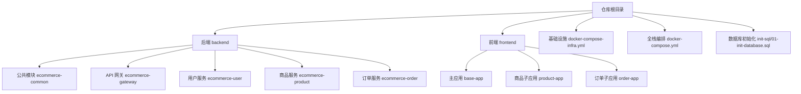
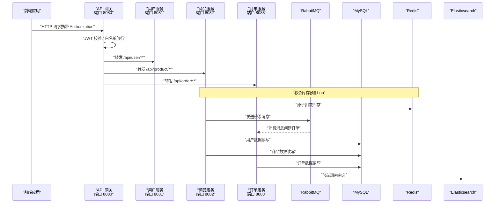
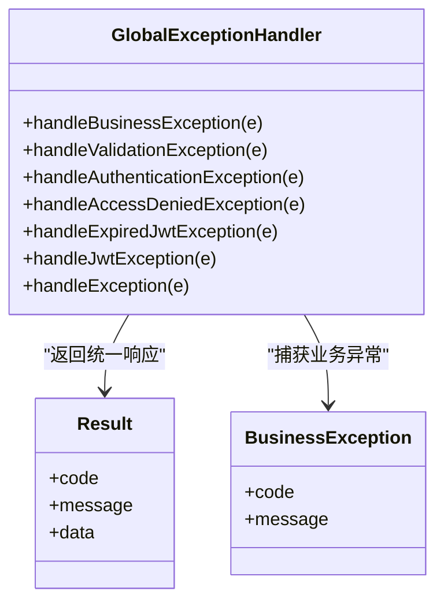
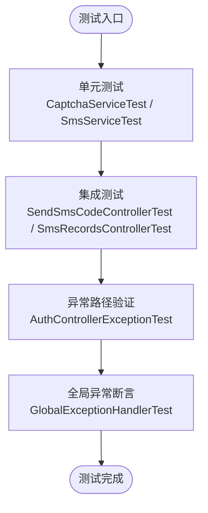
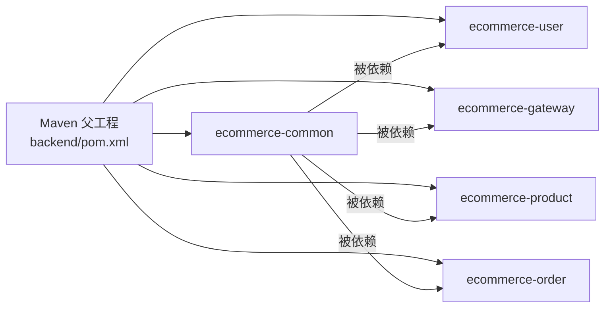

# 开发指南

<cite>
**本文引用的文件**   
- [README.md](file://README.md)
- [backend/pom.xml](file://backend/pom.xml)
- [docker-compose.yml](file://docker-compose.yml)
- [frontend/base-app/package.json](file://frontend/base-app/package.json)
- [ecommerce-common/GlobalExceptionHandler.java](file://backend/ecommerce-common/src/main/java/com/ecommerce/common/GlobalExceptionHandler.java)
- [ecommerce-user/GlobalExceptionHandlerTest.java](file://backend/ecommerce-user/src/test/java/com/ecommerce/user/common/GlobalExceptionHandlerTest.java)
- [ecommerce-user/AuthControllerExceptionTest.java](file://backend/ecommerce-user/src/test/java/com/ecommerce/user/controller/AuthControllerExceptionTest.java)
- [ecommerce-user/SendSmsCodeControllerTest.java](file://backend/ecommerce-user/src/test/java/com/ecommerce/user/controller/SendSmsCodeControllerTest.java)
- [ecommerce-user/SmsRecordsControllerTest.java](file://backend/ecommerce-user/src/test/java/com/ecommerce/user/controller/SmsRecordsControllerTest.java)
- [ecommerce-user/CaptchaServiceTest.java](file://backend/ecommerce-user/src/test/java/com/ecommerce/user/service/CaptchaServiceTest.java)
- [ecommerce-user/SmsServiceTest.java](file://backend/ecommerce-user/src/test/java/com/ecommerce/user/service/SmsServiceTest.java)
</cite>

## 目录
1. [简介](#简介)
2. [项目结构](#项目结构)
3. [核心组件](#核心组件)
4. [架构总览](#架构总览)
5. [详细组件分析](#详细组件分析)
6. [依赖关系分析](#依赖关系分析)
7. [性能与优化](#性能与优化)
8. [测试策略与实践](#测试策略与实践)
9. [安全编码规范](#安全编码规范)
10. [代码重构方法](#代码重构方法)
11. [开发工具与常用命令](#开发工具与常用命令)
12. [故障排除](#故障排除)
13. [结论](#结论)

## 简介
本开发指南面向新加入的开发者，覆盖从环境搭建、IDE 配置、调试技巧到热重载设置；从代码规范、命名约定、提交规范、分支管理策略，到单元测试、集成测试、端到端测试策略；并包含重构方法、性能优化、安全编码、常用命令与故障排除。目标是帮助团队在前后端分离的微服务电商系统中高效协作、稳定交付。

本项目采用 Spring Cloud 微服务后端与 qiankun 微前端架构：
- 后端：Spring Boot 3.3.x + Java 17 + Maven + Spring Cloud + Spring Cloud Alibaba，拆分为公共模块、网关、用户、商品、订单五个微服务。
- 前端：qiankun 主应用（Vue 3）+ React 子应用（商品）+ TypeScript 子应用（订单），统一通过网关访问后端 API。

## 项目结构
仓库根目录包含后端、前端、基础设施编排脚本与数据库初始化脚本。后端使用 Maven 多模块工程，前端每个子应用独立维护依赖与构建脚本。

**图表来源**
- [README.md:49-149](file://README.md#L49-L149)
- [docker-compose.yml:1-185](file://docker-compose.yml#L1-L185)

**章节来源**
- [README.md:49-149](file://README.md#L49-L149)

## 核心组件
- 公共模块 ecommerce-common：提供统一响应 Result、业务异常 BusinessException、全局异常处理器 GlobalExceptionHandler、秒杀消息体 SeckillMessage。
- API 网关 ecommerce-gateway：JWT 鉴权、路径路由、Swagger 文档聚合。
- 用户服务 ecommerce-user：认证、短信验证码、图片验证码、用户 CRUD、主题偏好、会话管理。
- 商品服务 ecommerce-product：商品 CRUD、Elasticsearch 搜索、秒杀库存预扣（Redis Lua）、RabbitMQ 异步下单。
- 订单服务 ecommerce-order：订单 CRUD、OpenFeign 调用商品服务、RabbitMQ 消费者处理秒杀订单。

这些组件共同构成“网关统一入口 → 下游微服务”的请求链路，并通过中间件（MySQL、Redis、Nacos、RabbitMQ、Elasticsearch）支撑数据与能力。

**章节来源**
- [README.md:5-15](file://README.md#L5-L15)
- [README.md:183-240](file://README.md#L183-L240)

## 架构总览
下图展示请求从前端到网关再到各微服务的整体流程，以及中间件的作用点。

**图表来源**
- [README.md:16-47](file://README.md#L16-L47)
- [README.md:366-380](file://README.md#L366-L380)

## 详细组件分析

### 后端公共异常处理组件
公共模块中的全局异常处理器将各类异常统一包装为 Result 结构返回，保证接口响应一致性。

**图表来源**
- [ecommerce-common/GlobalExceptionHandler.java:1-33](file://backend/ecommerce-common/src/main/java/com/ecommerce/common/GlobalExceptionHandler.java#L1-L33)

**章节来源**
- [ecommerce-common/GlobalExceptionHandler.java:1-33](file://backend/ecommerce-common/src/main/java/com/ecommerce/common/GlobalExceptionHandler.java#L1-L33)

### 用户服务测试用例体系
用户服务提供了较完整的测试样例，包括控制器层、服务层与全局异常处理的单测与集成测试，覆盖了参数校验、业务异常、认证授权、短信验证码等关键路径。

**图表来源**
- [ecommerce-user/CaptchaServiceTest.java:1-111](file://backend/ecommerce-user/src/test/java/com/ecommerce/user/service/CaptchaServiceTest.java#L1-L111)
- [ecommerce-user/SmsServiceTest.java:1-29](file://backend/ecommerce-user/src/test/java/com/ecommerce/user/service/SmsServiceTest.java#L1-L29)
- [ecommerce-user/SendSmsCodeControllerTest.java:1-28](file://backend/ecommerce-user/src/test/java/com/ecommerce/user/controller/SendSmsCodeControllerTest.java#L1-L28)
- [ecommerce-user/SmsRecordsControllerTest.java:1-31](file://backend/ecommerce-user/src/test/java/com/ecommerce/user/controller/SmsRecordsControllerTest.java#L1-L31)
- [ecommerce-user/AuthControllerExceptionTest.java:1-251](file://backend/ecommerce-user/src/test/java/com/ecommerce/user/controller/AuthControllerExceptionTest.java#L1-L251)
- [ecommerce-user/GlobalExceptionHandlerTest.java:1-140](file://backend/ecommerce-user/src/test/java/com/ecommerce/user/common/GlobalExceptionHandlerTest.java#L1-L140)

**章节来源**
- [ecommerce-user/CaptchaServiceTest.java:1-111](file://backend/ecommerce-user/src/test/java/com/ecommerce/user/service/CaptchaServiceTest.java#L1-L111)
- [ecommerce-user/SmsServiceTest.java:1-29](file://backend/ecommerce-user/src/test/java/com/ecommerce/user/service/SmsServiceTest.java#L1-L29)
- [ecommerce-user/SendSmsCodeControllerTest.java:1-28](file://backend/ecommerce-user/src/test/java/com/ecommerce/user/controller/SendSmsCodeControllerTest.java#L1-L28)
- [ecommerce-user/SmsRecordsControllerTest.java:1-31](file://backend/ecommerce-user/src/test/java/com/ecommerce/user/controller/SmsRecordsControllerTest.java#L1-L31)
- [ecommerce-user/AuthControllerExceptionTest.java:1-251](file://backend/ecommerce-user/src/test/java/com/ecommerce/user/controller/AuthControllerExceptionTest.java#L1-L251)
- [ecommerce-user/GlobalExceptionHandlerTest.java:1-140](file://backend/ecommerce-user/src/test/java/com/ecommerce/user/common/GlobalExceptionHandlerTest.java#L1-L140)

## 依赖关系分析
后端使用 Maven 父 POM 统一管理版本与依赖 BOM，子模块继承父工程，确保 Spring Boot、Spring Cloud、Spring Cloud Alibaba、springdoc-openapi 等依赖版本一致。

**图表来源**
- [backend/pom.xml:1-65](file://backend/pom.xml#L1-L65)

**章节来源**
- [backend/pom.xml:1-65](file://backend/pom.xml#L1-L65)

## 性能与优化
- 秒杀库存预扣：通过 Redis Lua 脚本原子扣减库存，避免超卖；结合 RabbitMQ 异步下单，解耦高并发写入。
- 搜索引擎：Elasticsearch 用于商品搜索，提升查询性能。
- 缓存与会话：Redis 存储会话 Token、秒杀库存、验证码等热点数据。
- 前端微前端：主应用与子应用独立构建与运行，减少不必要的全量打包。

建议：
- 对热点接口增加缓存层（如本地缓存 + Redis 二级缓存）。
- 对批量操作使用分页与流式处理，避免大对象内存压力。
- 对 ES 查询进行字段投影与过滤条件优化，减少无效数据传输。
- 对前端按需引入 UI 库组件，减小包体积。

[本节为通用指导，不直接分析具体文件]

## 测试策略与实践
- 单元测试：针对无外部依赖的服务类（如 CaptchaService、SmsService）编写 JUnit 5 + Mockito 单测，覆盖正常路径、边界条件与异常分支。
- 集成测试：使用 MockMvc 模拟 HTTP 请求，验证控制器层与全局异常处理器的行为，关注 HTTP 状态码与统一响应结构。
- 端到端测试：建议在 CI 中启动 Docker 基础设施与微服务，通过网关聚合 Swagger 或 Postman/Newman 执行关键业务流程（注册、登录、下单、取消订单）。

推荐实践：
- 使用 @MockBean 隔离外部依赖（短信服务、Redis、数据库）。
- 对异常路径集中断言 Result.code 与 message，确保全局异常处理一致性。
- 对验证码与短信频控逻辑设计可注入的配置属性，便于开关与超时控制。

**章节来源**
- [ecommerce-user/CaptchaServiceTest.java:1-111](file://backend/ecommerce-user/src/test/java/com/ecommerce/user/service/CaptchaServiceTest.java#L1-L111)
- [ecommerce-user/SmsServiceTest.java:1-29](file://backend/ecommerce-user/src/test/java/com/ecommerce/user/service/SmsServiceTest.java#L1-L29)
- [ecommerce-user/AuthControllerExceptionTest.java:1-251](file://backend/ecommerce-user/src/test/java/com/ecommerce/user/controller/AuthControllerExceptionTest.java#L1-L251)
- [ecommerce-user/GlobalExceptionHandlerTest.java:1-140](file://backend/ecommerce-user/src/test/java/com/ecommerce/user/common/GlobalExceptionHandlerTest.java#L1-L140)

## 安全编码规范
- 认证与授权：网关 JWT 校验后透传用户信息，下游服务信任网关注入的请求头，避免重复校验。
- 输入校验：使用 Bean Validation（@Valid）与自定义校验规则，防止非法输入进入业务层。
- 敏感信息：不在日志中输出密码、Token、手机号等敏感数据；配置文件中的密码应通过环境变量或密钥管理服务注入。
- 权限控制：对管理接口进行角色或权限校验，最小权限原则。
- 安全依赖：定期更新第三方依赖，扫描漏洞；禁用不必要的功能（如未使用的 Web 端点）。

**章节来源**
- [README.md:406-414](file://README.md#L406-L414)
- [ecommerce-user/AuthControllerExceptionTest.java:1-251](file://backend/ecommerce-user/src/test/java/com/ecommerce/user/controller/AuthControllerExceptionTest.java#L1-L251)

## 代码重构方法
- 提取公共逻辑：将重复的参数校验、异常转换、响应封装抽取到公共模块或工具类。
- 拆分职责：控制器仅负责参数绑定与响应构造，业务逻辑下沉至 Service 层。
- 引入配置化：将硬编码阈值（验证码有效期、短信频控间隔）抽离为配置属性，便于环境与场景切换。
- 增强可测试性：对外部依赖（短信服务、Redis、数据库）使用接口抽象与 Mock，提高单测覆盖率。
- 渐进式重构：优先对高频变更与高风险区域进行小步重构，配合测试保障回归。

[本节为通用指导，不直接分析具体文件]

## 开发工具与常用命令
- 环境要求：JDK 17+、Maven 3.6+、Node.js 18+（推荐 20 LTS）、MySQL 8.x、Redis 7.x、Nacos v2.3.0、RabbitMQ 3.x、Elasticsearch 8.11.0。
- 数据库初始化：使用 init-sql/01-init-database.sql 建库建表与演示数据。
- 后端启动：依次启动用户、商品、订单、网关服务；或使用 Docker 一键部署。
- 前端启动：先启动子应用，再启动主应用；开发代理将 /api 转发到网关。
- Docker 编排：使用 docker-compose.yml 全栈部署，或 docker-compose-infra.yml 仅部署基础设施。

常用命令参考：
- 后端构建：`cd backend; ./mvnw clean package -DskipTests`
- 后端运行：`cd backend/ecommerce-user; mvn spring-boot:run`（其他服务同理）
- 前端安装依赖：`cd frontend/base-app && npm install`（其他子应用同理）
- 前端开发：`cd frontend/product-app && npm run dev`（其他子应用同理）
- 全栈部署：`docker compose up -d`
- 仅基础设施：`docker compose -f docker-compose-infra.yml up -d`

**章节来源**
- [README.md:152-181](file://README.md#L152-L181)
- [README.md:183-279](file://README.md#L183-L279)
- [README.md:430-502](file://README.md#L430-L502)
- [frontend/base-app/package.json:1-28](file://frontend/base-app/package.json#L1-L28)
- [docker-compose.yml:1-185](file://docker-compose.yml#L1-L185)

## 故障排除
- 中文乱码：MySQL 客户端默认字符集问题，手动执行 SQL 时需指定 `--default-character-set=utf8mb4`；Docker 镜像已设置 LANG/LC_ALL 以避免二次编码。
- 服务无法连接中间件：检查 application.yml 或 Docker 环境变量中的 MySQL、Redis、Nacos、RabbitMQ、Elasticsearch 地址与端口。
- 鉴权失败：确认网关白名单配置是否正确，JWT 是否过期或签名非法；下游服务需信任网关注入的请求头。
- 秒杀异常：检查 Redis Lua 脚本是否可用、RabbitMQ 队列是否就绪、订单消费者是否正常消费。
- 前端代理错误：确认 Vite 配置中将 `/api` 代理到网关 8080，且网关服务已启动。

**章节来源**
- [README.md:163-181](file://README.md#L163-L181)
- [README.md:406-429](file://README.md#L406-L429)
- [README.md:478-502](file://README.md#L478-L502)

## 结论
本指南基于仓库现有结构与实现，系统梳理了开发环境、架构、组件、测试与安全规范，并提供常用命令与故障排除建议。建议团队在遵循统一异常处理、输入校验与鉴权机制的前提下，持续完善测试覆盖与性能优化，逐步推进代码重构与最佳实践落地，以提升交付质量与团队协作效率。

[本节为总结性内容，不直接分析具体文件]