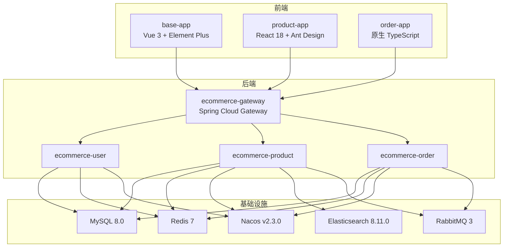
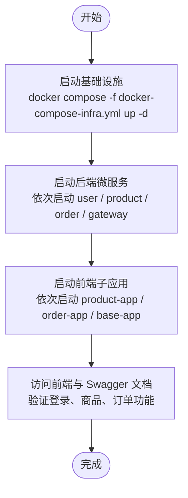

# 开发环境搭建

<cite>
**本文引用的文件**   
- [README.md](file://README.md)
- [docker-compose.yml](file://docker-compose.yml)
- [docker-compose-infra.yml](file://docker-compose-infra.yml)
- [backend/pom.xml](file://backend/pom.xml)
- [frontend/base-app/package.json](file://frontend/base-app/package.json)
- [init-sql/01-init-database.sql](file://init-sql/01-init-database.sql)
</cite>

## 目录
1. [简介](#简介)
2. [项目结构与环境总览](#项目结构与环境总览)
3. [依赖环境与安装要求](#依赖环境与安装要求)
4. [IDE 与编辑器配置](#ide-与编辑器配置)
5. [Maven 与 Node.js 初始化](#maven-与-nodejs-初始化)
6. [Docker Compose 环境编排](#docker-compose-环境编排)
7. [完整启动流程](#完整启动流程)
8. [验证步骤](#验证步骤)
9. [常见问题排查](#常见问题排查)
10. [性能与稳定性建议](#性能与稳定性建议)
11. [结论](#结论)

## 简介
本指南面向首次参与该前后端分离微服务电商项目的开发者，目标是帮助你在本地快速搭建可运行的开发环境。项目后端基于 Spring Boot 3.3.x + Java 17 + Maven + Spring Cloud + Spring Cloud Alibaba，前端基于 qiankun 微前端架构，基础设施通过 Docker Compose 统一编排。

## 项目结构与环境总览
该项目采用“后端微服务 + 前端微前端”的双层架构：
- 后端包含网关、用户、商品、订单等微服务模块，并通过 Nacos 进行服务注册与发现。
- 前端包含主应用与多个子应用，通过 qiankun 在主应用中加载和切换。
- 中间件包括 MySQL、Redis、Nacos、RabbitMQ、Elasticsearch，可通过 Docker Compose 一键拉起。

图表来源
- [README.md:16-47](file://README.md#L16-L47)
- [docker-compose.yml:4-179](file://docker-compose.yml#L4-L179)

章节来源
- [README.md:1-150](file://README.md#L1-L150)

## 依赖环境与安装要求
你需要在本地准备以下基础环境：
- Java 17+
- Maven 3.6+（推荐使用项目自带的 Maven Wrapper）
- Node.js 18+（推荐 20 LTS）
- MySQL 8.x
- Redis 7.x
- Nacos v2.3.0
- RabbitMQ 3.x（含 Management 插件）
- Elasticsearch 8.11.0

说明：
- 如果你使用 Docker Compose 方式，可以跳过手动安装 MySQL、Redis、Nacos、RabbitMQ、Elasticsearch，直接通过编排文件拉起。
- 如果选择本地安装这些中间件，请确保端口未被占用，并保证连接地址与配置文件一致。

章节来源
- [README.md:152-161](file://README.md#L152-L161)

## IDE 与编辑器配置
### IntelliJ IDEA
- JDK 版本：设置为 Java 17，与后端工程保持一致。
- Maven：
  - 使用项目根目录的 Maven Wrapper，避免不同机器上 Maven 版本不一致。
  - 在 Settings 中启用自动导入与离线模式按需关闭，提高构建体验。
- Spring Boot：
  - 为每个微服务创建独立运行配置，分别指向 ecommerce-user、ecommerce-product、ecommerce-order、ecommerce-gateway。
  - 开启热部署或 DevTools（如已集成），提升调试效率。
- 数据库：
  - 配置 Data Source 指向本地或 Docker 中的 MySQL，用户名 root，密码根据 docker-compose 配置确认。
- Redis / RabbitMQ / Elasticsearch：
  - 可在 IDE 中安装对应插件，便于查看键值、队列、索引状态。

### VS Code
- 推荐插件：
  - Java Extension Pack
  - Spring Boot Extension Pack
  - Vue Language Features
  - ESLint / Prettier
  - Docker
  - REST Client
- 调试器设置：
  - 为每个后端微服务添加 launch 配置，指定工作目录与 main class。
  - 前端子应用可使用 Chrome 或 Edge 调试器，配合 Vite 开发服务器。
- 代码格式化：
  - 后端建议启用 Google Java Format 或项目约定的 Formatter。
  - 前端建议启用 Prettier，并在保存时自动格式化。

注意：
- 本项目未提供统一的 .editorconfig 或 .prettierrc，建议在团队内约定一致的格式规则，避免提交差异过大。
- 若遇到中文注释乱码，请确保 IDE 编码设置为 UTF-8。

## Maven 与 Node.js 初始化
### Maven 初始化
- 后端父工程位于 backend 目录，使用 Spring Boot 3.3.5 与 Java 17。
- 建议使用项目自带的 Maven Wrapper 执行构建，命令示例：
  - 在项目根目录进入 backend 后执行清理与打包。
- 各微服务均可单独运行，也可通过父 POM 统一构建。

章节来源
- [backend/pom.xml:1-65](file://backend/pom.xml#L1-L65)

### Node.js 初始化
- 前端包含三个子应用：base-app、product-app、order-app。
- 每个子应用都有独立的 package.json 与依赖，需要分别安装依赖并启动。
- 常用命令：
  - 安装依赖：在各子应用目录下执行包管理器安装命令。
  - 开发模式：在各子应用目录下执行开发脚本。
  - 构建产物：执行构建脚本生成静态资源。

章节来源
- [frontend/base-app/package.json:1-28](file://frontend/base-app/package.json#L1-L28)
- [README.md:242-279](file://README.md#L242-L279)

## Docker Compose 环境编排
项目提供两套编排文件：
- docker-compose-infra.yml：仅启动基础设施（MySQL、Redis、Nacos、RabbitMQ、Elasticsearch）。
- docker-compose.yml：全栈编排，包含基础设施、后端微服务、前端子应用。

关键服务与端口：
- MySQL：3306
- Redis：6379
- Nacos：8848、9848、9849
- RabbitMQ：5672、15672
- Elasticsearch：9200、9300
- API 网关：8080
- 用户服务：8081
- 商品服务：8082
- 订单服务：8083
- 前端主应用：80
- 商品子应用：7100
- 订单子应用：7200

图表来源
- [README.md:183-279](file://README.md#L183-L279)
- [docker-compose.yml:4-179](file://docker-compose.yml#L4-L179)

章节来源
- [docker-compose.yml:1-185](file://docker-compose.yml#L1-L185)
- [docker-compose-infra.yml:1-125](file://docker-compose-infra.yml#L1-L125)
- [README.md:183-279](file://README.md#L183-L279)

## 完整启动流程
### 方式一：使用 Docker Compose 全栈启动
1. 确保本机已安装 Docker 与 Docker Compose。
2. 在项目根目录执行全栈启动命令。
3. 等待所有服务健康检查通过。
4. 访问前端主应用地址与网关 Swagger 文档。

说明：
- 全栈编排会构建后端镜像与前端静态资源，首次启动可能较慢。
- 如需仅启动基础设施，请使用 docker-compose-infra.yml。

### 方式二：本地开发模式
1. 启动基础设施（本地安装或使用 Docker Compose 仅基础设施）。
2. 初始化数据库：
   - 使用 init-sql/01-init-database.sql 创建数据库、表与演示数据。
   - 如果使用 Docker 方式，挂载该目录到 MySQL 容器的初始化目录即可自动执行。
3. 修改各微服务的 application.yml 中的数据库密码等敏感信息（仅限本地开发）。
4. 按顺序启动后端微服务：
   - 先启动用户服务、商品服务、订单服务。
   - 最后启动 API 网关。
5. 启动前端子应用：
   - 先启动 product-app 与 order-app。
   - 再启动 base-app。

章节来源
- [README.md:163-279](file://README.md#L163-L279)
- [init-sql/01-init-database.sql:1-91](file://init-sql/01-init-database.sql#L1-L91)

## 验证步骤
### 后端验证
- 访问网关 Swagger 聚合页面，确认各微服务文档可加载。
- 调用用户服务接口，尝试注册、登录、获取当前用户信息。
- 调用商品服务接口，查询商品列表与详情。
- 调用订单服务接口，创建订单并查询订单列表。

### 前端验证
- 打开前端主应用地址，尝试登录与主题切换。
- 切换到商品子应用，查看商品列表与详情。
- 切换到订单子应用，查看我的订单与全部订单。
- 确认前端请求路径以 /api 开头，并由网关转发到后端。

### 基础设施验证
- MySQL：确认 demo_fullstack 数据库存在，users、products、orders 表有演示数据。
- Redis：确认 key 可正常读写（如会话 Token、验证码、秒杀库存）。
- Nacos：确认微服务已注册成功。
- RabbitMQ：确认队列存在且消息可消费。
- Elasticsearch：确认商品索引可写入与查询。

章节来源
- [README.md:218-279](file://README.md#L218-L279)
- [init-sql/01-init-database.sql:1-91](file://init-sql/01-init-database.sql#L1-L91)

## 常见问题排查
### 端口冲突
- 现象：启动时报端口已被占用。
- 处理：
  - 检查本机是否已有 MySQL、Redis、Nacos、RabbitMQ、Elasticsearch 占用默认端口。
  - 修改 docker-compose 或本地服务的端口映射。
  - 前端开发端口也可能冲突，需调整 vite.config.ts 中的端口配置。

### 权限问题
- 现象：Docker 无法写入卷目录，或 MySQL 初始化失败。
- 处理：
  - 确保 Docker 所在目录具有读写权限。
  - 检查 MySQL 初始化脚本字符集配置，避免中文乱码。
  - 如果是 Linux 系统，注意 SELinux 或 AppArmor 限制。

### 网络配置
- 现象：微服务无法连接 MySQL、Redis、Nacos、RabbitMQ、Elasticsearch。
- 处理：
  - 如果使用 Docker Compose，确保服务名与容器网络正确。
  - 如果本地安装中间件，确保 application.yml 中的 host 与端口正确。
  - 防火墙或安全组策略可能阻止端口访问，需放行相关端口。

### 数据库字符集乱码
- 现象：中文注释或数据出现乱码。
- 处理：
  - 确保 MySQL 服务端与客户端均使用 utf8mb4。
  - 使用 init-sql/01-init-database.sql 时，手动执行需指定字符集参数。
  - Docker 方式下，镜像已设置 LANG 与 LC_ALL，避免 latin1 回退。

章节来源
- [README.md:163-181](file://README.md#L163-L181)
- [docker-compose.yml:4-27](file://docker-compose.yml#L4-L27)
- [docker-compose-infra.yml:4-33](file://docker-compose-infra.yml#L4-L33)
- [init-sql/01-init-database.sql:1-12](file://init-sql/01-init-database.sql#L1-L12)

## 性能与稳定性建议
- 合理分配 JVM 内存：Nacos、Elasticsearch 在开发环境可适当降低堆内存，避免占用过多资源。
- 控制并发：本地开发时不建议同时启动过多实例，优先保证核心服务可用。
- 缓存与索引：
  - Redis 用于热点数据与会话，注意键过期策略。
  - Elasticsearch 用于商品搜索，注意索引重建与同步频率。
- 日志级别：
  - 开发阶段可开启 DEBUG 日志，生产环境调整为 INFO 或 WARN。
- 前端代理：
  - 开发模式下将 /api 请求代理到网关，避免跨域问题。

## 结论
通过本指南，你可以完成从依赖环境安装、IDE 配置、Maven 与 Node.js 初始化，到 Docker Compose 编排与完整启动流程的全部准备工作。建议在本地先使用 Docker Compose 快速拉起基础设施，再逐步切换到本地开发模式，以便更高效地调试后端与前端。遇到问题时，优先检查端口、权限、网络与字符集配置，并结合 README 中的服务地址与 API 文档进行验证。