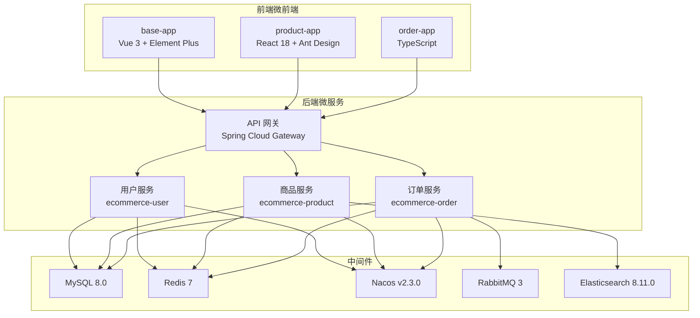
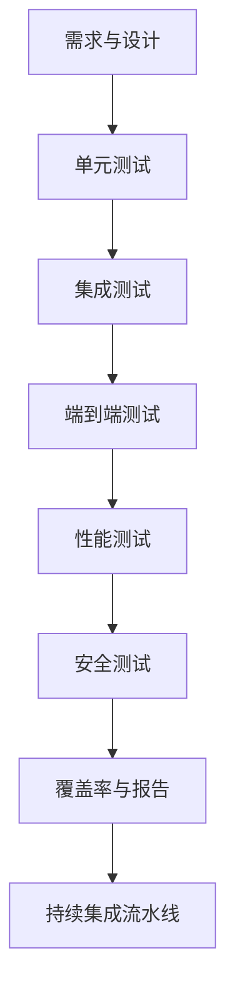
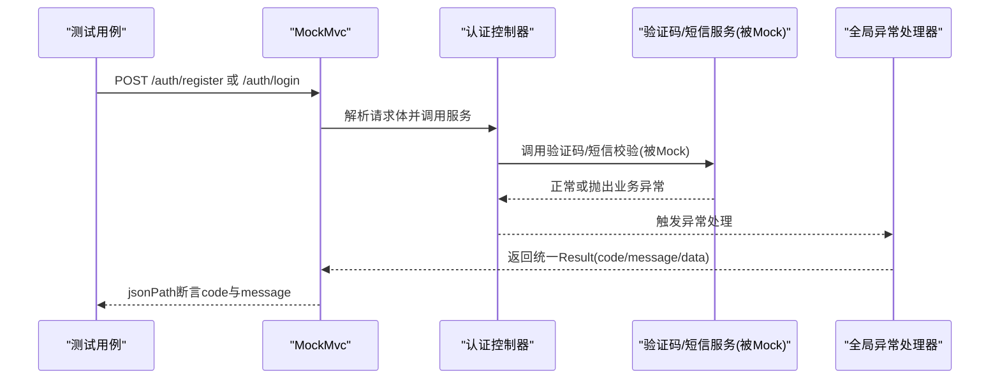
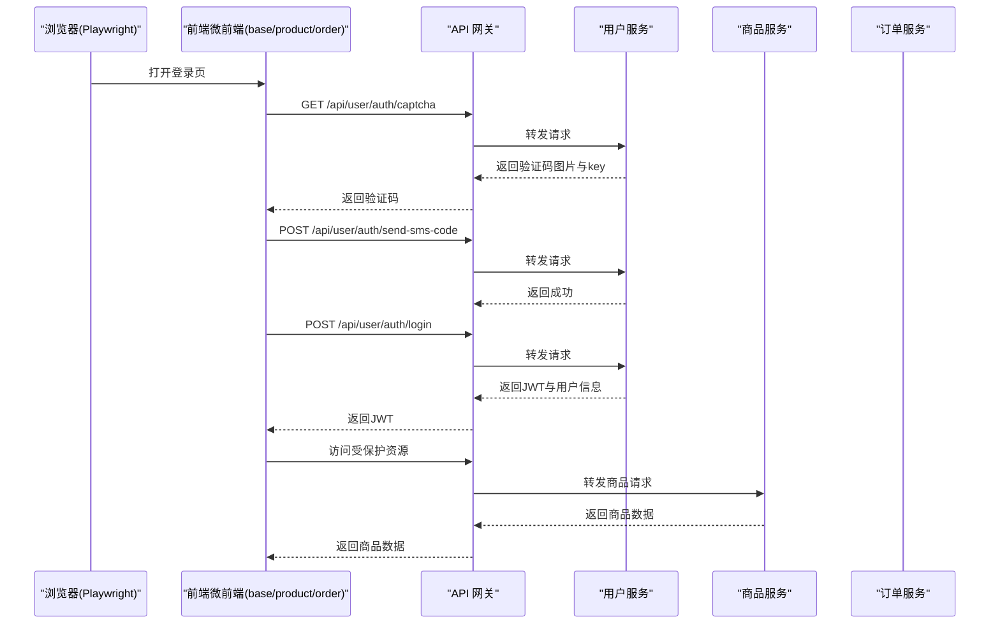
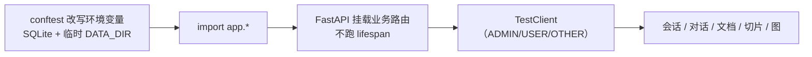
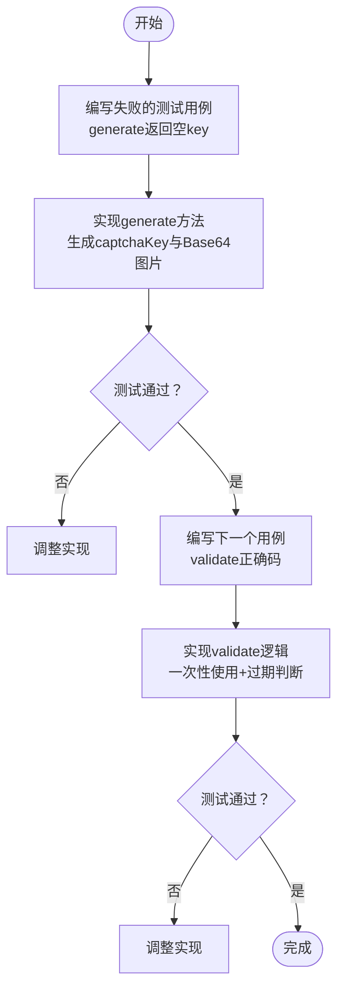

# 测试策略与实践

<cite>
**本文引用的文件**   
- [README.md](file://README.md)
- [backend/pom.xml](file://backend/pom.xml)
- [backend/ecommerce-user/pom.xml](file://backend/ecommerce-user/pom.xml)
- [GlobalExceptionHandlerTest.java](file://backend/ecommerce-user/src/test/java/com/ecommerce/user/common/GlobalExceptionHandlerTest.java)
- [AuthControllerExceptionTest.java](file://backend/ecommerce-user/src/test/java/com/ecommerce/user/controller/AuthControllerExceptionTest.java)
- [CaptchaServiceTest.java](file://backend/ecommerce-user/src/test/java/com/ecommerce/user/service/CaptchaServiceTest.java)
- [SmsServiceTest.java](file://backend/ecommerce-user/src/test/java/com/ecommerce/user/service/SmsServiceTest.java)
- [OrderControllerTest.java](file://backend/ecommerce-order/src/test/java/com/ecommerce/order/controller/OrderControllerTest.java)
- [ProductServiceImplTest.java](file://backend/ecommerce-product/src/test/java/com/ecommerce/product/service/ProductServiceImplTest.java)
- [OrderServiceImplTest.java](file://backend/ecommerce-order/src/test/java/com/ecommerce/order/service/OrderServiceImplTest.java)
- [UserControllerTest.java](file://backend/ecommerce-user/src/test/java/com/ecommerce/user/controller/UserControllerTest.java)
- [vitest.config.ts](file://frontend/base-app/vitest.config.ts)
- [playwright.config.ts](file://frontend/e2e/playwright.config.ts)
- [login.spec.ts](file://frontend/e2e/login.spec.ts)
- [micro-frontend.spec.ts](file://frontend/e2e/micro-frontend.spec.ts)
- [order-flow.spec.ts](file://frontend/e2e/order-flow.spec.ts)
- [auth.spec.ts](file://frontend/base-app/src/__tests__/unit/utils/auth.spec.ts)
- [tracker.spec.ts](file://frontend/product-app/src/__tests__/unit/utils/tracker.spec.ts)
- [docker-compose-infra.yml](file://docker-compose-infra.yml)
- [frontend/base-app/package.json](file://frontend/base-app/package.json)
- [request.spec.ts](file://frontend/base-app/src/__tests__/unit/api/request.spec.ts)
- [guard.spec.ts](file://frontend/base-app/src/__tests__/unit/router/guard.spec.ts)
- [ImageUploader.spec.ts](file://frontend/base-app/src/__tests__/unit/components/ImageUploader.spec.ts)
- [ProductImageManage.spec.ts](file://frontend/base-app/src/__tests__/unit/views/ProductImageManage.spec.ts)
- [payment.spec.ts](file://frontend/order-app/src/__tests__/unit/payment.spec.ts)
- [payment-flow.spec.ts](file://frontend/e2e/payment-flow.spec.ts)
- [loading.spec.ts](file://frontend/e2e/loading.spec.ts)
- [micro-frontend.spec.ts](file://frontend/e2e/micro-frontend.spec.ts)
- [conftest.py](file://ai-service/tests/conftest.py)
- [test_chat_api.py](file://ai-service/tests/test_chat_api.py)
- [test_documents_api.py](file://ai-service/tests/test_documents_api.py)
- [test_sessions_api.py](file://ai-service/tests/test_sessions_api.py)
- [test_graph.py](file://ai-service/tests/test_graph.py)
- [test_splitter.py](file://ai-service/tests/test_splitter.py)
- [pytest.ini](file://ai-service/pytest.ini)
</cite>

## 更新摘要
**变更内容**   
- 新增前端 Vitest 单元测试基础设施，覆盖 base-app、product-app、order-app 三个微应用
- 新增 Playwright E2E 测试框架，包含 5 个核心场景：登录、微前端架构、订单流程、商品搜索、主题同步
- 完善后端 JUnit 5 测试覆盖，扩展至用户、商品、订单三个服务的完整测试套件
- 更新测试工具链配置与最佳实践指南
- 新增 ai-service 的 pytest 用例集（会话/对话/文档/图/切片），用 SQLite 临时库隔离 MySQL 与 Milvus
- 新增前端支付、路由守卫、图片上传相关单测，E2E 补充支付与加载态场景

## 目录
1. [引言](#引言)
2. [项目结构与测试现状](#项目结构与测试现状)
3. [核心测试分层与职责](#核心测试分层与职责)
4. [单元测试编写规范](#单元测试编写规范)
5. [集成测试方案](#集成测试方案)
6. [端到端测试策略](#端到端测试策略)
7. [AI 服务测试（pytest）](#ai-服务测试pytest)
8. [覆盖率、报告与持续集成](#覆盖率报告与持续集成)
9. [性能测试与安全测试](#性能测试与安全测试)
10. [测试驱动开发实践](#测试驱动开发实践)
11. [常见问题与排错指南](#常见问题与排错指南)
12. [结论](#结论)

## 引言
本项目已建立完整的测试基础设施，涵盖后端微服务、前端微前端以及 Python AI 服务的测试策略。当前实现包括：基于 JUnit 5 的后端单元/集成测试（用户、商品、订单服务），基于 Vitest 的前端单元测试（base-app、product-app、order-app），基于 Playwright 的端到端测试，以及基于 pytest + FastAPI TestClient 的 ai-service 测试。测试体系支持容器化中间件测试、覆盖率门禁与持续集成流水线，形成完整的测试质量保障体系。

## 项目结构与测试现状
后端采用 Spring Boot 3.3.x + Java 17 + Maven，包含公共模块、网关、用户、商品、订单五个微服务；前端基于 qiankun 微前端，包含主应用 base-app（Vue 3）、商品子应用 product-app（React 18）、订单子应用 order-app（原生 TypeScript）。基础设施通过 Docker Compose 编排 MySQL、Redis、Nacos、RabbitMQ、Elasticsearch。

**图表来源**
- [README.md:16-47](file://README.md#L16-L47)
- [docker-compose-infra.yml:97-124](file://docker-compose-infra.yml#L97-L124)

**章节来源**
- [README.md:16-150](file://README.md#L16-L150)
- [docker-compose-infra.yml:97-124](file://docker-compose-infra.yml#L97-L124)

## 核心测试分层与职责
建议按以下分层组织测试：

- 单元测试：验证业务逻辑、工具类、异常处理、参数校验等，不依赖外部系统。
- 集成测试：验证控制器接口、数据库访问、Redis 操作、消息队列消费、ES 搜索等，使用容器化中间件或内存替代。
- 端到端测试：模拟真实用户流程，覆盖登录、注册、秒杀、下单、主题切换等跨服务链路。
- 非功能测试：性能压测、安全扫描、依赖漏洞检测、前端可访问性与兼容性测试。

[无图表来源，因为该图为概念性流程]

## 单元测试编写规范
### 技术栈与依赖
- 后端使用 JUnit 5（由 `spring-boot-starter-test` 引入），断言库为 AssertJ，Mock 框架为 Mockito。
- 前端使用 Vitest 作为测试框架，支持 Vue 3 和 React 组件测试，配合 jsdom 环境。
- 前端重点单测集中在纯函数与拦截器：`payment.spec.ts`（支付状态映射与回跳解析）、`request.spec.ts`（40101 清登录态、403 仅提示）、`auth.spec.ts`/`guard.spec.ts`（角色分流与 adminOnly 守卫）、`ImageUploader.spec.ts` 与 `ProductImageManage.spec.ts`（上传与写库链路）。
- 父 POM 定义 Spring Boot 3.3.5、Java 17、Spring Cloud 2023.0.3；用户服务 POM 显式引入 `spring-boot-starter-test`。

**章节来源**
- [backend/pom.xml:1-65](file://backend/pom.xml#L1-L65)
- [backend/ecommerce-user/pom.xml:97-101](file://backend/ecommerce-user/pom.xml#L97-L101)
- [vitest.config.ts:1-22](file://frontend/base-app/vitest.config.ts#L1-L22)

### 命名与结构
- 测试类名以被测类名加 `Test` 后缀，如 `GlobalExceptionHandlerTest`、`CaptchaServiceTest`、`SmsServiceTest`。
- 测试方法使用 `@DisplayName` 描述行为，便于报告可读性。
- 每个测试只验证一个明确的行为分支，避免"巨型测试"。

### Mock 与 Stub
- 对服务层依赖使用 `mock()` 或 `@MockBean`，对不需要启动容器的纯逻辑使用直接实例化。
- 对 HTTP 客户端（如 `RestTemplate`）进行 mock，避免真实网络调用。
- 对验证码、短信发送等易变外部依赖，提供开关或测试专用写入方法（例如 `saveForTest`）。

### 数据准备
- 使用构造对象、工厂方法或测试夹具准备输入数据。
- 对一次性验证码 key、过期时间等状态，使用测试辅助方法设置已知值。
- 避免测试间共享可变状态，必要时在每个测试前重置。

### 断言风格
- 优先使用 AssertJ 链式断言，如 `assertThat(...).isEqualTo(...)`、`assertThatThrownBy(...).hasMessage(...)`。
- 对控制器响应使用 `jsonPath` 断言统一响应体字段 `code`、`message`、`data`。

**章节来源**
- [GlobalExceptionHandlerTest.java:1-140](file://backend/ecommerce-user/src/test/java/com/ecommerce/user/common/GlobalExceptionHandlerTest.java#L1-L140)
- [CaptchaServiceTest.java:1-111](file://backend/ecommerce-user/src/test/java/com/ecommerce/user/service/CaptchaServiceTest.java#L1-L111)
- [SmsServiceTest.java:29-63](file://backend/ecommerce-user/src/test/java/com/ecommerce/user/service/SmsServiceTest.java#L29-L63)
- [auth.spec.ts:1-103](file://frontend/base-app/src/__tests__/unit/utils/auth.spec.ts#L1-L103)

## 集成测试方案
### 控制器与异常处理集成测试
用户服务已提供基于 `@SpringBootTest` + `@AutoConfigureMockMvc` 的控制器异常测试，覆盖注册、登录的参数校验与业务异常，并通过 `@MockBean` 屏蔽验证码与短信校验细节，聚焦异常映射到统一响应结构。

**图表来源**
- [AuthControllerExceptionTest.java:23-55](file://backend/ecommerce-user/src/test/java/com/ecommerce/user/controller/AuthControllerExceptionTest.java#L23-L55)
- [AuthControllerExceptionTest.java:86-250](file://backend/ecommerce-user/src/test/java/com/ecommerce/user/controller/AuthControllerExceptionTest.java#L86-L250)

**章节来源**
- [AuthControllerExceptionTest.java:23-55](file://backend/ecommerce-user/src/test/java/com/ecommerce/user/controller/AuthControllerExceptionTest.java#L23-L55)
- [AuthControllerExceptionTest.java:86-250](file://backend/ecommerce-user/src/test/java/com/ecommerce/user/controller/AuthControllerExceptionTest.java#L86-L250)

### 数据库测试
- 使用 Docker Compose 启动 MySQL，并在测试环境注入连接信息。
- 使用 Flyway/Liquibase 或脚本初始化表结构与演示数据。
- 使用 `@DataJpaTest` 或 MyBatis 对应的测试注解隔离数据库访问层。
- 对写操作使用事务回滚，避免污染测试数据。

### Redis 测试
- 使用 Testcontainers 或嵌入式 Redis 运行 Redis 实例。
- 对会话 Token、验证码、秒杀库存预扣等热点数据进行键空间隔离（如使用前缀 `test:`）。
- 对 Lua 脚本进行独立测试，确保原子性与幂等性。

### 消息队列测试
- 使用 RabbitMQ Test 或 Testcontainers 启动 RabbitMQ。
- 对生产者发送消息后断言队列中存在预期消息；对消费者监听队列后断言业务结果。
- 对重试、死信队列、限流策略进行专项测试。

### Elasticsearch 测试
- 使用 Testcontainers 启动 ES，或使用 `@DataElasticsearchTest`。
- 对商品索引创建、文档同步、关键词搜索进行断言。
- 对聚合查询、分页、排序进行边界条件测试。

**章节来源**
- [README.md:163-179](file://README.md#L163-L179)
- [docker-compose-infra.yml:97-124](file://docker-compose-infra.yml#L97-L124)

## 端到端测试策略
### 前端测试框架选择
- 使用 Playwright 作为端到端测试框架，支持浏览器自动化、截图、视频录制、并行执行。
- 针对 Vue 3 与 React 子应用，分别编写页面级场景，覆盖登录、注册、主题切换、商品列表、秒杀入口、订单管理。

### 测试环境与数据
- 使用 Docker Compose 启动全栈环境（基础设施 + 后端 + 前端）。
- 通过 API 前置步骤创建测试用户、初始化秒杀库存、预热缓存。
- 使用固定账号密码（如 README 中的演示用户）简化登录流程。

### 关键场景
- 登录流程：图片验证码 → 短信验证码 → JWT 获取 → 主题偏好加载。
- 注册流程：图片验证码 → 短信验证码 → 用户创建 → 自动登录。
- 商品浏览与搜索：列表分页、分类筛选、价格区间、ES 搜索。
- 秒杀流程：库存初始化 → Lua 预扣 → MQ 异步下单 → 订单查询。
- 主题切换：暗黑/亮色模式持久化与跨应用同步。
- 支付流程：下单 → 发起支付 → 模拟回跳 `/pay-result` → 轮询至终态（`payment-flow.spec.ts`）。
- 加载体验：子应用切换的遮罩/骨架屏出现与消失、不闪烁（`loading.spec.ts`）。
- 角色与会话：普通用户落地 `/product`、管理员落地 `/users`；双上下文登录验证被挤下线。

**图表来源**
- [README.md:280-331](file://README.md#L280-L331)
- [README.md:344-379](file://README.md#L344-L379)

**章节来源**
- [README.md:280-331](file://README.md#L280-L331)
- [README.md:344-379](file://README.md#L344-L379)

## AI 服务测试（pytest）
ai-service 不依赖 Java 体系，用 pytest + FastAPI `TestClient` 覆盖。难点在于隔离外部依赖，处理方式是"在导入 `app.*` 之前就把环境变量指向临时资源"。

### 隔离策略（conftest.py）
- 先建临时目录，将 `AI_MYSQL_URL` 改写为 `sqlite:///.../test.db`，`DATA_DIR` 指向临时上传目录，避开真实 MySQL 与 Milvus。
- 关闭网关验签（`VERIFY_GATEWAY_SIGNATURE=false`）并注入假的 `ZHIPU_API_KEY`，使用例可离线运行。
- `TestClient` 只挂载 `chat/sessions/documents` 三个路由，**不触发 main.py 的 lifespan**，因此不会在启动时 `ensure_collection` 连 Milvus。
- 会话级 `init_db()` 建表 + 用例级清空 `ChatMessage/ChatSession/InsuranceDocument`，保证用例互不影响。
- 预置三套身份头：ADMIN / USER / OTHER，用于验证知识库写权限与跨用户隔离。

### 用例分布
- `test_sessions_api.py`：会话创建/列表/删除与跨用户不可见。
- `test_chat_api.py`：流式对话事件序列、缺失身份头返回 401。
- `test_documents_api.py`：仅 ADMIN 可上传/删除，非管理员 403。
- `test_splitter.py`：按 800/120 切片、空文本与超长段落。
- `test_graph.py`：检索命中与拒答分支（低于 `RAG_MIN_SCORE` 时返回拒答文案）。

**图表来源**
- [conftest.py:18-85](file://ai-service/tests/conftest.py#L18-L85)
- [pytest.ini:1-5](file://ai-service/pytest.ini#L1-L5)

**章节来源**
- [ai-service README](file://ai-service/README.md)

## 覆盖率、报告与持续集成
### 后端覆盖率
- 引入 JaCoCo 插件，统计行覆盖率、分支覆盖率、类覆盖率。
- 设定阈值：行覆盖率 ≥ 80%，分支覆盖率 ≥ 70%。
- 生成 HTML 报告，便于本地查看与 CI 归档。

### 前端覆盖率
- 为 base-app、product-app、order-app 分别配置 Vitest + Istanbul 覆盖率。
- 组件覆盖率 ≥ 70%，关键业务逻辑覆盖率 ≥ 80%。

### 报告生成
- 后端：`mvn test jacoco:report` 生成 `target/site/jacoco/index.html`。
- 前端：`npm run test -- --coverage` 生成 `coverage/index.html`。
- 将报告上传至 CI 工件，并提供链接供评审。

### 持续集成
- 使用 GitHub Actions、GitLab CI 或 Jenkins 构建流水线。
- 阶段：依赖安装 → 编译 → 单元测试 → 集成测试 → 端到端测试 → 覆盖率检查 → 构建镜像 → 部署预览环境。
- 失败策略：单元测试失败阻断合并；覆盖率低于阈值警告或阻断；端到端失败需人工确认。

**章节来源**
- [backend/ecommerce-user/pom.xml:97-101](file://backend/ecommerce-user/pom.xml#L97-L101)
- [frontend/base-app/package.json:1-28](file://frontend/base-app/package.json#L1-L28)

## 性能测试与安全测试
### 性能测试
- 使用 JMeter、k6 或 Gatling 对网关与微服务接口进行压测。
- 重点场景：登录并发、秒杀高并发、ES 搜索吞吐、订单创建延迟。
- 指标：QPS、P95/P99 延迟、错误率、CPU/内存占用、数据库连接池利用率。

### 安全测试
- 使用 OWASP ZAP 或 Burp Suite 进行 Web 应用扫描，识别常见漏洞（XSS、CSRF、SQL 注入、越权）。
- 使用 Dependabot 或 Snyk 检测依赖漏洞。
- 对 JWT 密钥、配置文件敏感信息进行审计，禁止提交到仓库。

**章节来源**
- [README.md:406-428](file://README.md#L406-L428)

## 测试驱动开发实践
### TDD 工作流
- 先写失败的单元测试，再实现最小可用代码，最后重构优化。
- 对控制器、服务、仓储、工具类均遵循 TDD。
- 对复杂算法（如秒杀 Lua 脚本、频控逻辑）先写用例再实现。

### 示例：验证码服务 TDD

**图表来源**
- [CaptchaServiceTest.java:37-109](file://backend/ecommerce-user/src/test/java/com/ecommerce/user/service/CaptchaServiceTest.java#L37-L109)

**章节来源**
- [CaptchaServiceTest.java:37-109](file://backend/ecommerce-user/src/test/java/com/ecommerce/user/service/CaptchaServiceTest.java#L37-L109)

## 常见问题与排错指南
### 后端测试常见问题
- **Mock 未生效**：检查是否使用 `@MockBean` 或 `mock()`，并确保依赖注入路径正确。
- **数据库连接失败**：确认 Docker Compose 已启动 MySQL，且测试配置指向正确主机与端口。
- **Redis 键冲突**：测试前清理或使用前缀隔离，避免与其他测试或进程共享状态。
- **MQ 消息未消费**：检查消费者监听器是否启用，队列名称与路由键是否正确。

### 前端测试常见问题
- **Vitest 无法启动**：检查 Node.js 版本与依赖安装，确保 jsdom 环境配置正确。
- **Playwright 无法启动浏览器**：检查 Node.js 版本与依赖安装，确保有图形界面或无头模式配置。
- **跨域问题**：确保前端代理到网关，或在测试环境关闭 CORS。
- **主题切换不同步**：检查 qiankun 全局状态与 `storage` 事件监听。

### 覆盖率与报告
- **JaCoCo 报告为空**：确认 `spring-boot-starter-test` 已引入，且执行了 `mvn test`。
- **前端覆盖率缺失**：确认测试框架配置了 coverage reporter，并执行了带 `--coverage` 的命令。

**章节来源**
- [AuthControllerExceptionTest.java:23-55](file://backend/ecommerce-user/src/test/java/com/ecommerce/user/controller/AuthControllerExceptionTest.java#L23-L55)
- [CaptchaServiceTest.java:1-111](file://backend/ecommerce-user/src/test/java/com/ecommerce/user/service/CaptchaServiceTest.java#L1-L111)

## 结论
本项目已建立完整的测试基础设施，包括后端 JUnit 5 单元测试（用户、商品、订单服务）、前端 Vitest 单元测试（base-app、product-app、order-app）以及 Playwright 端到端测试（5个核心场景）。测试体系支持容器化中间件测试、覆盖率门禁与持续集成流水线，形成完整的测试质量保障体系。通过 TDD 实践与性能、安全测试，进一步提升代码质量与系统稳定性。

**新增测试覆盖**
- 后端服务：用户服务、商品服务、订单服务的完整 JUnit 5 测试套件
- 前端应用：base-app、product-app、order-app 的 Vitest 单元测试
- 端到端场景：登录、微前端架构、订单流程、商品搜索、主题同步的 Playwright 测试
- 工具函数：认证工具、埋点工具的详细单元测试

**章节来源**
- [OrderControllerTest.java:1-306](file://backend/ecommerce-order/src/test/java/com/ecommerce/order/controller/OrderControllerTest.java#L1-L306)
- [ProductServiceImplTest.java:1-475](file://backend/ecommerce-product/src/test/java/com/ecommerce/product/service/ProductServiceImplTest.java#L1-L475)
- [OrderServiceImplTest.java:1-394](file://backend/ecommerce-order/src/test/java/com/ecommerce/order/service/OrderServiceImplTest.java#L1-L394)
- [UserControllerTest.java:1-424](file://backend/ecommerce-user/src/test/java/com/ecommerce/user/controller/UserControllerTest.java#L1-L424)
- [login.spec.ts:1-96](file://frontend/e2e/login.spec.ts#L1-L96)
- [micro-frontend.spec.ts:1-152](file://frontend/e2e/micro-frontend.spec.ts#L1-L152)
- [order-flow.spec.ts:1-144](file://frontend/e2e/order-flow.spec.ts#L1-L144)
- [tracker.spec.ts:1-196](file://frontend/product-app/src/__tests__/unit/utils/tracker.spec.ts#L1-L196)