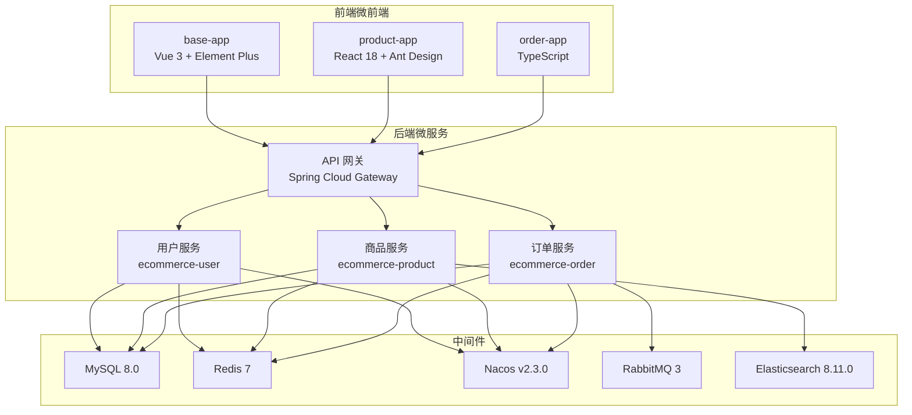
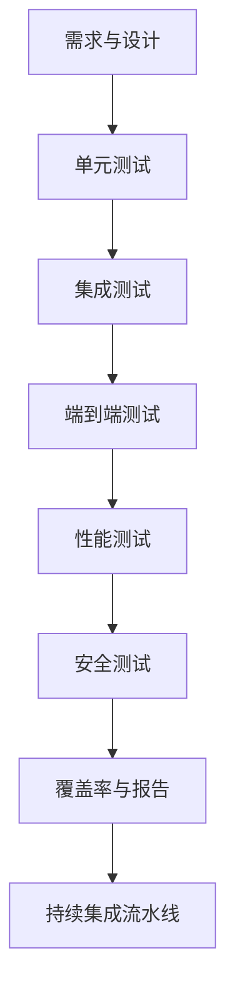
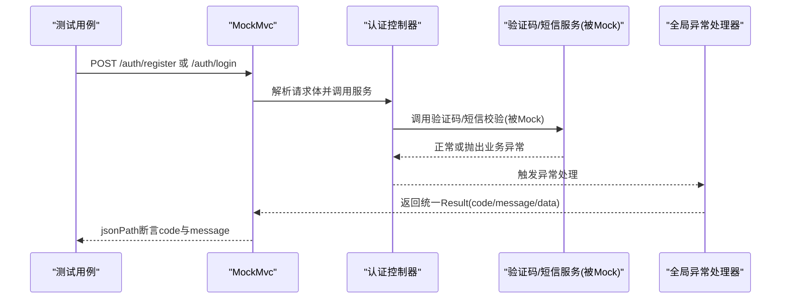
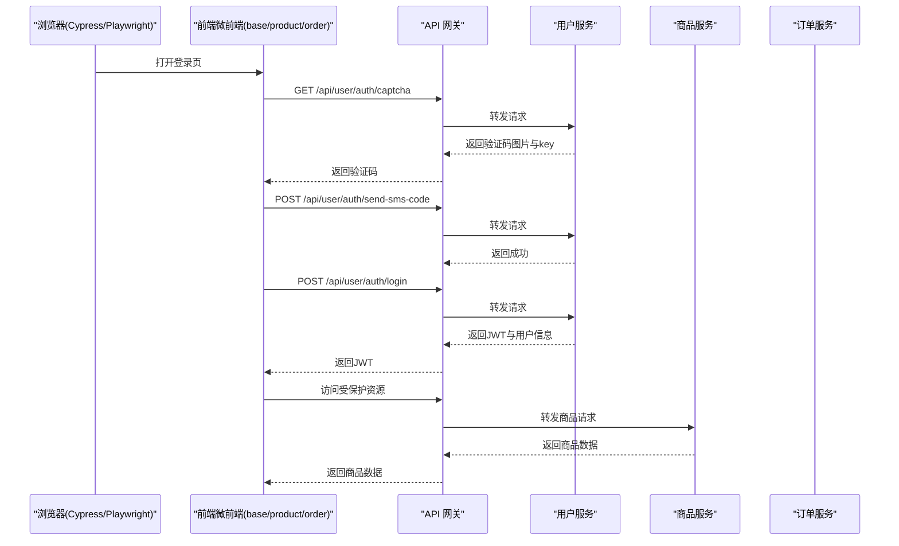

# 测试策略与实践

<cite>
**本文引用的文件**   
- [README.md](file://README.md)
- [backend/pom.xml](file://backend/pom.xml)
- [backend/ecommerce-user/pom.xml](file://backend/ecommerce-user/pom.xml)
- [GlobalExceptionHandlerTest.java](file://backend/ecommerce-user/src/test/java/com/ecommerce/user/common/GlobalExceptionHandlerTest.java)
- [AuthControllerExceptionTest.java](file://backend/ecommerce-user/src/test/java/com/ecommerce/user/controller/AuthControllerExceptionTest.java)
- [CaptchaServiceTest.java](file://backend/ecommerce-user/src/test/java/com/ecommerce/user/service/CaptchaServiceTest.java)
- [SmsServiceTest.java](file://backend/ecommerce-user/src/test/java/com/ecommerce/user/service/SmsServiceTest.java)
- [docker-compose-infra.yml](file://docker-compose-infra.yml)
- [frontend/base-app/package.json](file://frontend/base-app/package.json)
</cite>

## 目录
1. [引言](#引言)
2. [项目结构与测试现状](#项目结构与测试现状)
3. [核心测试分层与职责](#核心测试分层与职责)
4. [单元测试编写规范](#单元测试编写规范)
5. [集成测试方案](#集成测试方案)
6. [端到端测试策略](#端到端测试策略)
7. [覆盖率、报告与持续集成](#覆盖率报告与持续集成)
8. [性能测试与安全测试](#性能测试与安全测试)
9. [测试驱动开发实践](#测试驱动开发实践)
10. [常见问题与排错指南](#常见问题与排错指南)
11. [结论](#结论)

## 引言
本项目已建立覆盖前后端的完整测试体系。后端采用 JUnit 5 + Mockito 对三个业务微服务（user/product/order）进行单元测试，覆盖 controller、service、repository、entity 各层；前端三个子应用均集成 Vitest + jsdom 进行单元测试，base-app 额外使用 @vue/test-utils，product-app 额外使用 @testing-library/react；E2E 测试采用 Playwright 覆盖登录、商品搜索、订单流程、微前端加载、主题同步等核心场景。根 package.json 提供统一测试脚本，方便 CI/CD 集成。

## 项目结构与测试现状
后端采用 Spring Boot 3.3.x + Java 17 + Maven，包含公共模块、网关、用户、商品、订单五个微服务；前端基于 qiankun 微前端，包含主应用 base-app（Vue 3）、商品子应用 product-app（React 18）、订单子应用 order-app（原生 TypeScript）。基础设施通过 Docker Compose 编排 MySQL、Redis、Nacos、RabbitMQ、Elasticsearch。

**已实现的测试覆盖：**

| 层 | 框架 | 测试位置 | 测试类/文件数量 |
|----|------|---------|----------------|
| ecommerce-user | JUnit 5 + Mockito | `backend/ecommerce-user/src/test/` | 9 个测试类 |
| ecommerce-product | JUnit 5 + Mockito | `backend/ecommerce-product/src/test/` | 4 个测试类 |
| ecommerce-order | JUnit 5 + Mockito | `backend/ecommerce-order/src/test/` | 5 个测试类 |
| base-app | Vitest + @vue/test-utils | `frontend/base-app/src/__tests__/` | 6 个测试文件 |
| product-app | Vitest + @testing-library/react | `frontend/product-app/src/__tests__/` | 3 个测试文件 |
| order-app | Vitest + jsdom | `frontend/order-app/src/__tests__/` | 3 个测试文件 |
| E2E 测试 | Playwright | `frontend/e2e/` | 5 个 spec 文件 |

**图表来源**
- [README.md:16-47](file://README.md#L16-L47)
- [docker-compose-infra.yml:97-124](file://docker-compose-infra.yml#L97-L124)

**章节来源**
- [README.md:16-150](file://README.md#L16-L150)
- [docker-compose-infra.yml:97-124](file://docker-compose-infra.yml#L97-L124)

## 核心测试分层与职责
建议按以下分层组织测试：

- 单元测试：验证业务逻辑、工具类、异常处理、参数校验等，不依赖外部系统。
- 集成测试：验证控制器接口、数据库访问、Redis 操作、消息队列消费、ES 搜索等，使用容器化中间件或内存替代。
- 端到端测试：模拟真实用户流程，覆盖登录、注册、秒杀、下单、主题切换等跨服务链路。
- 非功能测试：性能压测、安全扫描、依赖漏洞检测、前端可访问性与兼容性测试。

[无图表来源，因为该图为概念性流程]

## 单元测试编写规范
### 技术栈与依赖
- 后端使用 JUnit 5（由 `spring-boot-starter-test` 引入），断言库为 AssertJ，Mock 框架为 Mockito。
- 前端 base-app 使用 Vitest + @vue/test-utils + jsdom；product-app 使用 Vitest + @testing-library/react + @testing-library/user-event + jsdom；order-app 使用 Vitest + jsdom。
- 父 POM 定义 Spring Boot 3.3.5、Java 17、Spring Cloud 2023.0.3；各前端子应用 package.json 均声明 vitest ^2.1.9 与 jsdom ^31.0.0。

**章节来源**
- [backend/pom.xml:1-65](file://backend/pom.xml#L1-L65)
- [backend/ecommerce-user/pom.xml:97-101](file://backend/ecommerce-user/pom.xml#L97-L101)

### 命名与结构
- 后端测试类名以被测类名加 `Test` 后缀，如 `UserControllerTest`、`ProductControllerTest`、`OrderServiceImplTest`、`OrderStatusTest`。
- 前端测试文件统一放在 `src/__tests__/` 目录，以 `.spec.ts` 后缀命名，如 `auth.spec.ts`、`theme.spec.ts`、`tracker.spec.ts`。
- 测试方法使用 `@DisplayName` 描述行为（后端）或 `describe/it` 块描述（前端），便于报告可读性。
- 每个测试只验证一个明确的行为分支，避免“巨型测试”。

### Mock 与 Stub
- 对服务层依赖使用 `mock()` 或 `@MockBean`，对不需要启动容器的纯逻辑使用直接实例化。
- 对 HTTP 客户端（如 `RestTemplate`）进行 mock，避免真实网络调用。
- 对验证码、短信发送等易变外部依赖，提供开关或测试专用写入方法（例如 `saveForTest`）。

### 数据准备
- 使用构造对象、工厂方法或测试夹具准备输入数据。
- 对一次性验证码 key、过期时间等状态，使用测试辅助方法设置已知值。
- 避免测试间共享可变状态，必要时在每个测试前重置。

### 断言风格
- 优先使用 AssertJ 链式断言，如 `assertThat(...).isEqualTo(...)`、`assertThatThrownBy(...).hasMessage(...)`。
- 对控制器响应使用 `jsonPath` 断言统一响应体字段 `code`、`message`、`data`。

**章节来源**
- [GlobalExceptionHandlerTest.java:1-140](file://backend/ecommerce-user/src/test/java/com/ecommerce/user/common/GlobalExceptionHandlerTest.java#L1-L140)
- [CaptchaServiceTest.java:1-111](file://backend/ecommerce-user/src/test/java/com/ecommerce/user/service/CaptchaServiceTest.java#L1-L111)
- [SmsServiceTest.java:29-63](file://backend/ecommerce-user/src/test/java/com/ecommerce/user/service/SmsServiceTest.java#L29-L63)

## 集成测试方案
### 控制器与异常处理集成测试
用户服务已提供基于 `@SpringBootTest` + `@AutoConfigureMockMvc` 的控制器异常测试，覆盖注册、登录的参数校验与业务异常，并通过 `@MockBean` 屏蔽验证码与短信校验细节，聚焦异常映射到统一响应结构。

**图表来源**
- [AuthControllerExceptionTest.java:23-55](file://backend/ecommerce-user/src/test/java/com/ecommerce/user/controller/AuthControllerExceptionTest.java#L23-L55)
- [AuthControllerExceptionTest.java:86-250](file://backend/ecommerce-user/src/test/java/com/ecommerce/user/controller/AuthControllerExceptionTest.java#L86-L250)

**章节来源**
- [AuthControllerExceptionTest.java:23-55](file://backend/ecommerce-user/src/test/java/com/ecommerce/user/controller/AuthControllerExceptionTest.java#L23-L55)
- [AuthControllerExceptionTest.java:86-250](file://backend/ecommerce-user/src/test/java/com/ecommerce/user/controller/AuthControllerExceptionTest.java#L86-L250)

### 数据库测试
- 使用 Docker Compose 启动 MySQL，并在测试环境注入连接信息。
- 使用 Flyway/Liquibase 或脚本初始化表结构与演示数据。
- 使用 `@DataJpaTest` 或 MyBatis 对应的测试注解隔离数据库访问层。
- 对写操作使用事务回滚，避免污染测试数据。

### Redis 测试
- 使用 Testcontainers 或嵌入式 Redis 运行 Redis 实例。
- 对会话 Token、验证码、秒杀库存预扣等热点数据进行键空间隔离（如使用前缀 `test:`）。
- 对 Lua 脚本进行独立测试，确保原子性与幂等性。

### 消息队列测试
- 使用 RabbitMQ Test 或 Testcontainers 启动 RabbitMQ。
- 对生产者发送消息后断言队列中存在预期消息；对消费者监听队列后断言业务结果。
- 对重试、死信队列、限流策略进行专项测试。

### Elasticsearch 测试
- 使用 Testcontainers 启动 ES，或使用 `@DataElasticsearchTest`。
- 对商品索引创建、文档同步、关键词搜索进行断言。
- 对聚合查询、分页、排序进行边界条件测试。

**章节来源**
- [README.md:163-179](file://README.md#L163-L179)
- [docker-compose-infra.yml:97-124](file://docker-compose-infra.yml#L97-L124)

## 端到端测试策略
### 前端测试框架选择
项目已采用 Playwright 作为 E2E 测试框架，测试代码位于 `frontend/e2e/`，配置自动启动三个子应用 dev server（base-app:5173、product-app:7100、order-app:7200），默认使用 Chromium 浏览器，失败时保留截图与视频。

### 已实现的 E2E 测试场景
| 测试文件 | 覆盖场景 |
|---------|----------|
| `login.spec.ts` | 登录流程：图片验证码 → 短信验证码 → JWT 获取 → 主题偏好加载 |
| `product-search.spec.ts` | 商品搜索与列表展示：关键词搜索、分类筛选、结果渲染 |
| `order-flow.spec.ts` | 订单流程：创建订单、查询订单列表、订单状态流转 |
| `micro-frontend.spec.ts` | 微前端加载：qiankun 子应用注册、路由切换、容器渲染 |
| `theme-sync.spec.ts` | 主题同步：暗黑/亮色切换、跨应用同步、持久化验证 |

### 测试数据与 Mock
- `frontend/e2e/fixtures/test-data.ts` 提供统一测试数据夹具，包含测试用户、商品、订单等数据。
- `frontend/e2e/mocks/` 目录提供基于 MSW（Mock Service Worker）的接口 Mock，覆盖 auth、product、order、user 四个服务。
- 测试使用固定账号密码（admin / 123456）简化登录流程。

**图表来源**
- [README.md:280-331](file://README.md#L280-L331)
- [README.md:344-379](file://README.md#L344-L379)

**章节来源**
- [README.md:280-331](file://README.md#L280-L331)
- [README.md:344-379](file://README.md#L344-L379)

## 覆盖率、报告与持续集成
### 后端覆盖率
- 引入 JaCoCo 插件，统计行覆盖率、分支覆盖率、类覆盖率。
- 设定阈值：行覆盖率 ≥ 80%，分支覆盖率 ≥ 70%。
- 生成 HTML 报告，便于本地查看与 CI 归档。

### 前端覆盖率
- 三个子应用均配置 Vitest 覆盖率报告，运行 `npm run test:coverage` 生成 `coverage/` 目录。
- 组件覆盖率 ≥ 70%，关键业务逻辑覆盖率 ≥ 80%。

### 报告生成
- 后端：`mvn test jacoco:report` 生成 `target/site/jacoco/index.html`。
- 前端：`npm run test:coverage` 生成 `coverage/index.html`。
- E2E：Playwright 生成 HTML 报告，位于 `frontend/e2e/test-results/report/`。
- 将报告上传至 CI 工件，并提供链接供评审。

### 持续集成
- 使用 GitHub Actions、GitLab CI 或 Jenkins 构建流水线。
- 阶段：依赖安装 → 编译 → 单元测试 → 集成测试 → 端到端测试 → 覆盖率检查 → 构建镜像 → 部署预览环境。
- 失败策略：单元测试失败阻断合并；覆盖率低于阈值警告或阻断；端到端失败需人工确认。

### 统一测试脚本
根 package.json 提供以下测试命令：
- `npm run test:unit`：运行三个前端子应用的 Vitest 单元测试
- `npm run test:e2e`：运行 Playwright E2E 测试（自动启动 dev server）
- `npm run test:e2e:ui`：以 Playwright UI 模式运行（可视化调试）
- `npm run test:all`：运行全部前端测试（单元 + E2E）

**章节来源**
- [backend/ecommerce-user/pom.xml:97-101](file://backend/ecommerce-user/pom.xml#L97-L101)
- [frontend/base-app/package.json:1-28](file://frontend/base-app/package.json#L1-L28)

## 性能测试与安全测试
### 性能测试
- 使用 JMeter、k6 或 Gatling 对网关与微服务接口进行压测。
- 重点场景：登录并发、秒杀高并发、ES 搜索吞吐、订单创建延迟。
- 指标：QPS、P95/P99 延迟、错误率、CPU/内存占用、数据库连接池利用率。

### 安全测试
- 使用 OWASP ZAP 或 Burp Suite 进行 Web 应用扫描，识别常见漏洞（XSS、CSRF、SQL 注入、越权）。
- 使用 Dependabot 或 Snyk 检测依赖漏洞。
- 对 JWT 密钥、配置文件敏感信息进行审计，禁止提交到仓库。

**章节来源**
- [README.md:406-428](file://README.md#L406-L428)

## 测试驱动开发实践
### TDD 工作流
- 先写失败的单元测试，再实现最小可用代码，最后重构优化。
- 对控制器、服务、仓储、工具类均遵循 TDD。
- 对复杂算法（如秒杀 Lua 脚本、频控逻辑）先写用例再实现。

### 示例：验证码服务 TDD

**图表来源**
- [CaptchaServiceTest.java:37-109](file://backend/ecommerce-user/src/test/java/com/ecommerce/user/service/CaptchaServiceTest.java#L37-L109)

**章节来源**
- [CaptchaServiceTest.java:37-109](file://backend/ecommerce-user/src/test/java/com/ecommerce/user/service/CaptchaServiceTest.java#L37-L109)

## 常见问题与排错指南
### 后端测试常见问题
- **Mock 未生效**：检查是否使用 `@MockBean` 或 `mock()`，并确保依赖注入路径正确。
- **数据库连接失败**：确认 Docker Compose 已启动 MySQL，且测试配置指向正确主机与端口。
- **Redis 键冲突**：测试前清理或使用前缀隔离，避免与其他测试或进程共享状态。
- **MQ 消息未消费**：检查消费者监听器是否启用，队列名称与路由键是否正确。

### 前端测试常见问题
- **Playwright 无法启动浏览器**：检查 Node.js 版本与依赖安装，确保已运行 `npx playwright install` 安装浏览器驱动。
- ** Vitest 测试找不到模块**：确认各子应用 `vitest.config.ts` 中的 `alias` 配置与 `tsconfig.json` 一致。
- **跨域问题**：确保前端代理到网关，或在测试环境关闭 CORS。
- **主题切换不同步**：检查 qiankun 全局状态与 `storage` 事件监听。

### 覆盖率与报告
- **JaCoCo 报告为空**：确认 `spring-boot-starter-test` 已引入，且执行了 `mvn test`。
- **前端覆盖率缺失**：确认测试框架配置了 coverage reporter，并执行了带 `--coverage` 的命令。

**章节来源**
- [AuthControllerExceptionTest.java:23-55](file://backend/ecommerce-user/src/test/java/com/ecommerce/user/controller/AuthControllerExceptionTest.java#L23-L55)
- [CaptchaServiceTest.java:1-111](file://backend/ecommerce-user/src/test/java/com/ecommerce/user/service/CaptchaServiceTest.java#L1-L111)

## 结论
本项目已建立覆盖前后端的完整测试体系。后端三个业务微服务均提供 JUnit 5 单元测试，覆盖 controller/service/repository/entity 各层；前端三个子应用均集成 Vitest 单元测试，并采用 Playwright 实现 E2E 测试覆盖核心业务流程。根 package.json 提供统一测试脚本，便于 CI/CD 集成。建议后续引入覆盖率门禁、Testcontainers 集成测试与持续集成流水线，进一步完善测试质量保障体系。