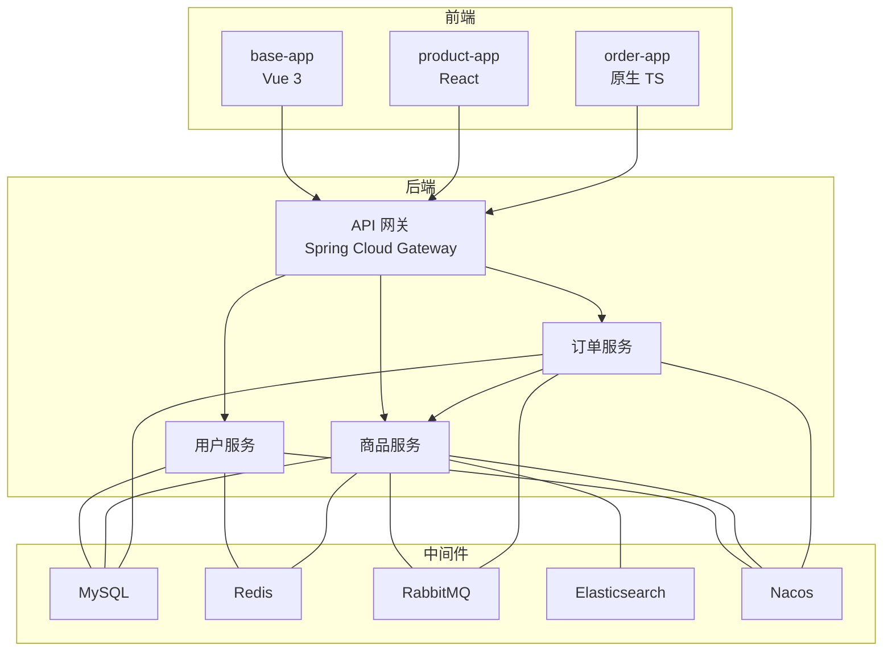
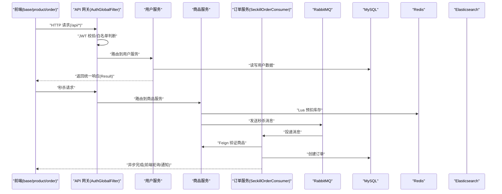
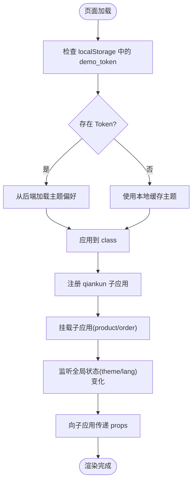
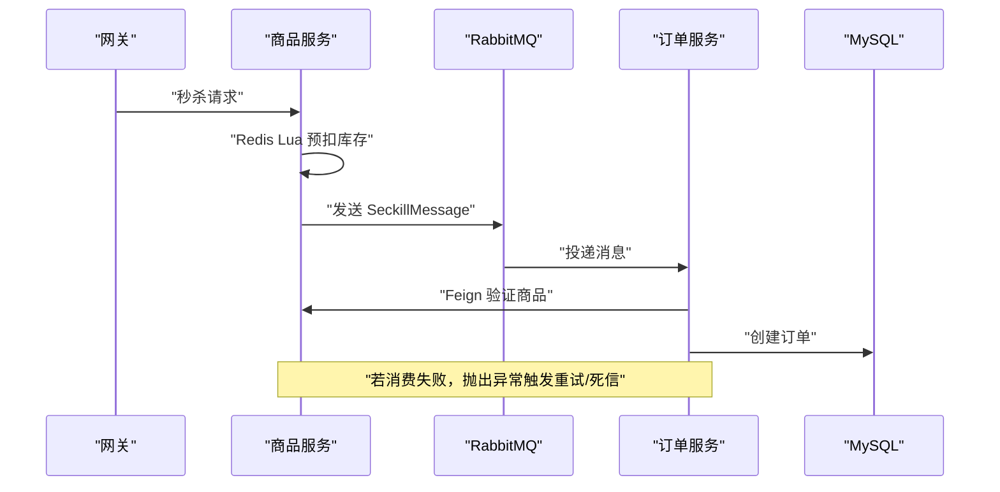
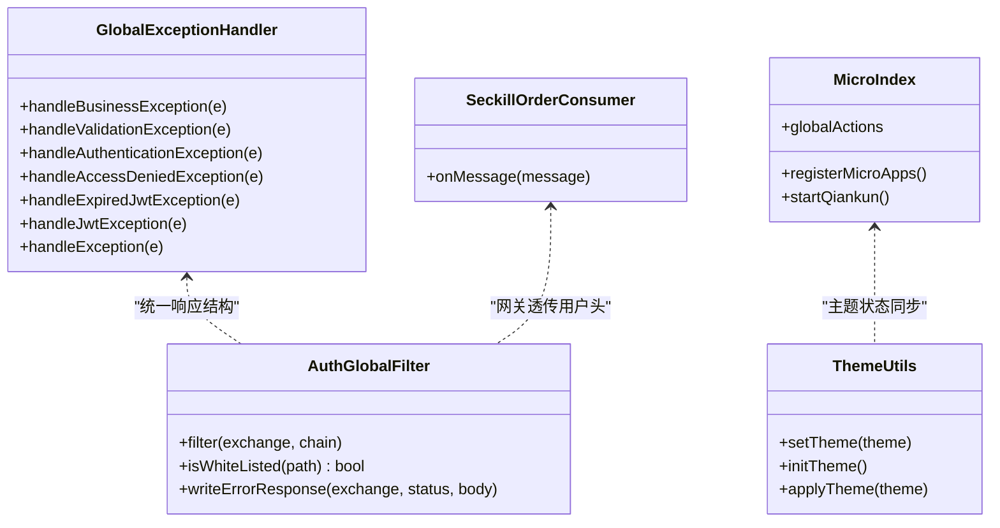

# 调试与故障排除

<cite>
**本文引用的文件**   
- [README.md](file://README.md)
- [GlobalExceptionHandler.java](file://backend/ecommerce-common/src/main/java/com/ecommerce/common/GlobalExceptionHandler.java)
- [AuthGlobalFilter.java](file://backend/ecommerce-gateway/src/main/java/com/ecommerce/gateway/filter/AuthGlobalFilter.java)
- [SeckillOrderConsumer.java](file://backend/ecommerce-order/src/main/java/com/ecommerce/order/consumer/SeckillOrderConsumer.java)
- [micro/index.ts](file://frontend/base-app/src/micro/index.ts)
- [theme.ts](file://frontend/base-app/src/utils/theme.ts)
- [order-app main.ts](file://frontend/order-app/src/main.ts)
</cite>

## 目录
1. [简介](#简介)
2. [项目结构](#项目结构)
3. [核心组件](#核心组件)
4. [架构总览](#架构总览)
5. [详细组件分析](#详细组件分析)
6. [依赖关系分析](#依赖关系分析)
7. [性能考虑](#性能考虑)
8. [故障排除指南](#故障排除指南)
9. [结论](#结论)
10. [附录](#附录)

## 简介
本指南面向前后端分离的微服务电商系统，聚焦于后端 Spring Boot 调试、前端浏览器调试、微服务间调用问题定位、常见问题诊断与解决方案、生产环境排查与监控告警配置，以及调试工具与链路最佳实践。文档结合仓库中的网关鉴权、全局异常处理、秒杀消息消费、qiankun 微前端状态同步等关键实现，给出可操作的排障步骤与可视化流程图。

## 项目结构
本项目采用 Spring Cloud 微服务 + qiankun 微前端的组合架构：
- 后端包含 API 网关、用户服务、商品服务、订单服务与公共模块；中间件包括 MySQL、Redis、Nacos、RabbitMQ、Elasticsearch。
- 前端主应用（base-app）通过 qiankun 加载商品子应用（product-app）与订单子应用（order-app），统一经网关访问后端接口。

**图示来源**
- [README.md:16-47](file://README.md#L16-L47)

**章节来源**
- [README.md:1-150](file://README.md#L1-L150)

## 核心组件
- 全局异常处理器：统一将业务异常、参数校验异常、认证授权异常、JWT 异常与兜底异常包装为统一响应结构，并输出日志，便于快速定位问题。
- 网关全局鉴权过滤器：对请求进行白名单放行、OPTIONS 预检放行、JWT 解析与透传用户信息到下游服务，失败时直接返回 401。
- 秒杀订单消费者：监听 RabbitMQ 队列，异步创建订单，记录消费日志并在异常时抛出以触发重试机制。
- 微前端状态管理：主应用通过 qiankun 注册子应用，维护全局状态（token、用户、主题、语言），并通过生命周期钩子打印调试日志。
- 主题切换与持久化：前端在本地缓存与后端数据库之间同步主题偏好，提供初始化、切换与应用主题的函数。

**章节来源**
- [GlobalExceptionHandler.java:13-73](file://backend/ecommerce-common/src/main/java/com/ecommerce/common/GlobalExceptionHandler.java#L13-L73)
- [AuthGlobalFilter.java:31-170](file://backend/ecommerce-gateway/src/main/java/com/ecommerce/gateway/filter/AuthGlobalFilter.java#L31-L170)
- [SeckillOrderConsumer.java:18-69](file://backend/ecommerce-order/src/main/java/com/ecommerce/order/consumer/SeckillOrderConsumer.java#L18-L69)
- [micro/index.ts:1-89](file://frontend/base-app/src/micro/index.ts#L1-L89)
- [theme.ts:1-88](file://frontend/base-app/src/utils/theme.ts#L1-L88)

## 架构总览
从请求入口到数据落库的完整链路如下：
- 前端发起 HTTP 请求，经 Vite 开发代理转发至网关。
- 网关执行 JWT 鉴权，通过后注入用户头并路由到对应微服务。
- 业务服务处理请求，可能访问 MySQL、Redis、Elasticsearch，或通过 OpenFeign 调用其他服务。
- 秒杀场景通过 Redis Lua 原子扣减库存后发送消息到 RabbitMQ，订单服务异步消费创建订单。

**图示来源**
- [AuthGlobalFilter.java:80-141](file://backend/ecommerce-gateway/src/main/java/com/ecommerce/gateway/filter/AuthGlobalFilter.java#L80-L141)
- [SeckillOrderConsumer.java:35-67](file://backend/ecommerce-order/src/main/java/com/ecommerce/order/consumer/SeckillOrderConsumer.java#L35-L67)
- [README.md:366-379](file://README.md#L366-L379)

## 详细组件分析

### 后端调试方法
- Spring Boot 调试
  - 使用 IDE 断点调试各 Controller/Service/Mapper 层，结合全局异常处理器输出的 warn/error 日志快速定位业务异常与系统异常。
  - 通过 Swagger UI 或 Postman 直接调用接口，观察统一响应结构与 HTTP 状态码。
- 断点调试
  - 在网关鉴权过滤器中设置断点，检查 Authorization 头、JWT 解析结果与透传的用户头是否正确。
  - 在秒杀订单消费者中设置断点，确认消息体字段、Feign 调用结果与订单落库流程。
- 日志分析
  - 关注全局异常处理器的日志输出，区分业务异常与系统异常，结合堆栈信息定位根因。
  - 关注网关鉴权过滤器的 Token 过期、无效与鉴权异常日志，排查签名密钥、Token 有效期与白名单配置。
- 性能监控
  - 针对 Redis Lua 预扣库存、ES 搜索、RabbitMQ 消费耗时进行埋点或接入 APM（如 SkyWalking/Pinpoint）。
  - 监控数据库连接池、线程池与 GC 指标，识别慢查询与资源瓶颈。

**章节来源**
- [GlobalExceptionHandler.java:22-72](file://backend/ecommerce-common/src/main/java/com/ecommerce/common/GlobalExceptionHandler.java#L22-L72)
- [AuthGlobalFilter.java:104-140](file://backend/ecommerce-gateway/src/main/java/com/ecommerce/gateway/filter/AuthGlobalFilter.java#L104-L140)
- [SeckillOrderConsumer.java:37-67](file://backend/ecommerce-order/src/main/java/com/ecommerce/order/consumer/SeckillOrderConsumer.java#L37-L67)

### 前端调试技巧
- 浏览器开发者工具
  - 使用 Network 面板查看请求 URL、请求头（Authorization）、响应体与耗时，确认是否走网关与路由是否正确。
  - 使用 Console 面板查看 qiankun 生命周期日志（beforeLoad/beforeMount/afterUnmount）与主题/语言同步日志。
- 网络请求调试
  - 检查 Vite 开发代理是否将 /api 转发到网关 8080，跨域与 CORS 配置是否正确。
  - 对于登录/注册两步验证码流程，核对图片验证码与短信验证码的频控与一次性规则。
- 状态管理调试
  - 在主应用的 micro/index.ts 中观察全局状态变化与子应用生命周期日志，确认 token、主题、语言是否同步。
  - 在 order-app 的 main.ts 中观察 bootstrap/mount/unmount/update 日志，确认子应用渲染与主题/语言更新逻辑。

**图示来源**
- [micro/index.ts:1-89](file://frontend/base-app/src/micro/index.ts#L1-L89)
- [theme.ts:69-87](file://frontend/base-app/src/utils/theme.ts#L69-L87)
- [order-app main.ts:16-50](file://frontend/order-app/src/main.ts#L16-L50)

**章节来源**
- [micro/index.ts:17-89](file://frontend/base-app/src/micro/index.ts#L17-L89)
- [theme.ts:32-87](file://frontend/base-app/src/utils/theme.ts#L32-L87)
- [order-app main.ts:16-50](file://frontend/order-app/src/main.ts#L16-L50)

### 微服务间调用的问题定位
- 链路追踪
  - 在网关处记录请求 ID 并透传到下游服务，结合日志聚合平台（ELK/Loki）进行全链路追踪。
  - 在 Feign 调用处增加超时与重试策略，记录调用耗时与错误码。
- 分布式事务调试
  - 秒杀场景下，Redis 预扣库存与 RabbitMQ 异步下单需保证一致性；若消费失败，应设计补偿与回滚策略（当前代码注释提示 TODO）。
  - 通过 RabbitMQ 管理界面查看队列堆积、死信队列与消费失败重试情况。

**图示来源**
- [SeckillOrderConsumer.java:35-67](file://backend/ecommerce-order/src/main/java/com/ecommerce/order/consumer/SeckillOrderConsumer.java#L35-L67)
- [README.md:366-379](file://README.md#L366-L379)

**章节来源**
- [SeckillOrderConsumer.java:35-67](file://backend/ecommerce-order/src/main/java/com/ecommerce/order/consumer/SeckillOrderConsumer.java#L35-L67)
- [README.md:366-379](file://README.md#L366-L379)

## 依赖关系分析
- 网关依赖 JWT 解析与 ObjectMapper 序列化，负责鉴权与响应写入。
- 全局异常处理器依赖 SLF4J 日志与 Spring Security 异常类型，统一包装响应。
- 订单消费者依赖 RabbitMQ 注解与 MyBatis Repository，通过 Feign 调用商品服务。
- 前端主应用依赖 qiankun 与 Vue 响应式状态，子应用通过 vite-plugin-qiankun 导出生命周期。

**图示来源**
- [GlobalExceptionHandler.java:17-73](file://backend/ecommerce-common/src/main/java/com/ecommerce/common/GlobalExceptionHandler.java#L17-L73)
- [AuthGlobalFilter.java:41-170](file://backend/ecommerce-gateway/src/main/java/com/ecommerce/gateway/filter/AuthGlobalFilter.java#L41-L170)
- [SeckillOrderConsumer.java:21-69](file://backend/ecommerce-order/src/main/java/com/ecommerce/order/consumer/SeckillOrderConsumer.java#L21-L69)
- [micro/index.ts:1-89](file://frontend/base-app/src/micro/index.ts#L1-L89)
- [theme.ts:1-88](file://frontend/base-app/src/utils/theme.ts#L1-L88)

**章节来源**
- [GlobalExceptionHandler.java:17-73](file://backend/ecommerce-common/src/main/java/com/ecommerce/common/GlobalExceptionHandler.java#L17-L73)
- [AuthGlobalFilter.java:41-170](file://backend/ecommerce-gateway/src/main/java/com/ecommerce/gateway/filter/AuthGlobalFilter.java#L41-L170)
- [SeckillOrderConsumer.java:21-69](file://backend/ecommerce-order/src/main/java/com/ecommerce/order/consumer/SeckillOrderConsumer.java#L21-L69)
- [micro/index.ts:1-89](file://frontend/base-app/src/micro/index.ts#L1-L89)
- [theme.ts:1-88](file://frontend/base-app/src/utils/theme.ts#L1-L88)

## 性能考虑
- 网关鉴权开销：JWT 解析与签名校验应在高并发场景下进行优化，必要时引入缓存或前置校验。
- Redis Lua 脚本：确保原子性与幂等性，避免重复扣减与超卖。
- RabbitMQ 消费能力：根据峰值流量调整消费者并发数与队列大小，监控堆积与延迟。
- ES 搜索性能：合理设计索引映射与查询语句，避免深分页与大结果集。
- 前端包体积：按需引入 Element Plus/Ant Design 组件，减少首屏加载时间。

[本节为通用指导，不直接分析具体文件]

## 故障排除指南
- 连接超时
  - 检查 MySQL/Redis/RabbitMQ/Elasticsearch/Nacos 的连接地址与端口是否正确，Docker 部署时需指向宿主机 IP。
  - 在网关与服务启动日志中查找连接拒绝或超时错误，确认防火墙与安全组策略。
- 内存泄漏
  - 使用 JFR/JMC 或 Arthas 分析堆转储，定位未释放对象与线程泄漏。
  - 前端使用 Chrome DevTools Memory 面板检测闭包引用与事件监听器未清理。
- 死锁检测
  - 数据库层面启用死锁日志与分析慢查询；应用层避免长时间持有锁与嵌套事务。
  - 监控线程池与数据库连接池，避免线程饥饿。
- 鉴权失败
  - 检查 Authorization 头格式与 JWT 密钥配置，确认白名单路径与 Swagger 路径放行。
  - 关注网关鉴权过滤器的 Token 过期与无效日志。
- 秒杀订单消费失败
  - 查看 RabbitMQ 管理界面的队列堆积与死信队列，确认消费者异常堆栈。
  - 补充补偿与回滚逻辑，确保 Redis 库存与订单数据一致性。

**章节来源**
- [AuthGlobalFilter.java:128-140](file://backend/ecommerce-gateway/src/main/java/com/ecommerce/gateway/filter/AuthGlobalFilter.java#L128-L140)
- [SeckillOrderConsumer.java:62-67](file://backend/ecommerce-order/src/main/java/com/ecommerce/order/consumer/SeckillOrderConsumer.java#L62-L67)
- [README.md:478-502](file://README.md#L478-L502)

## 结论
通过统一的异常处理、网关鉴权与微前端状态同步，本项目提供了清晰的调试切入点与日志观测点。结合链路追踪、分布式事务补偿与性能监控，可有效定位与解决连接超时、内存泄漏、死锁等常见问题。在生产环境中，建议完善监控告警与自动化运维流程，提升系统的可观测性与稳定性。

[本节为总结性内容，不直接分析具体文件]

## 附录
- 常用命令
  - 仅基础设施：docker compose -f docker-compose-infra.yml up -d
  - 全栈部署：docker compose up -d
  - 后端启动顺序：user → product → order → gateway
  - 前端启动顺序：product-app → order-app → base-app
- 访问地址
  - 前端主应用：http://localhost:5173
  - 网关聚合 Swagger：http://localhost:8080/swagger-ui/index.html
  - Nacos 控制台：http://localhost:8848/nacos/
  - RabbitMQ 管理界面：http://localhost:15672/

**章节来源**
- [README.md:183-240](file://README.md#L183-L240)
- [README.md:430-477](file://README.md#L430-L477)