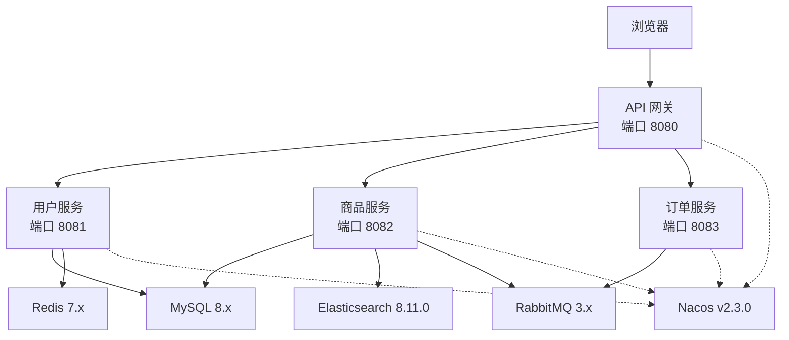
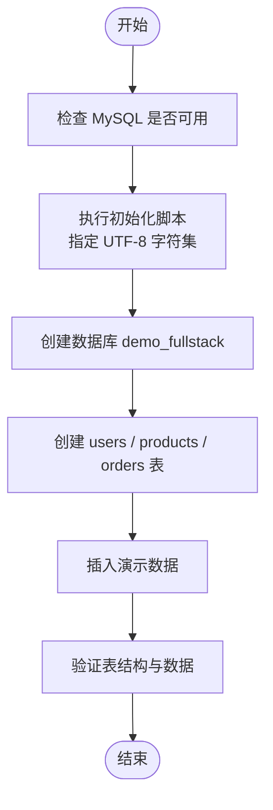

# 快速开始

<cite>
**本文引用的文件**   
- [README.md](file://README.md)
- [docker-compose.yml](file://docker-compose.yml)
- [docker-compose-infra.yml](file://docker-compose-infra.yml)
- [01-init-database.sql](file://init-sql/01-init-database.sql)
- [base-app vite.config.ts](file://frontend/base-app/vite.config.ts)
- [product-app vite.config.ts](file://frontend/product-app/vite.config.ts)
- [order-app vite.config.ts](file://frontend/order-app/vite.config.ts)
</cite>

## 目录
1. [简介](#简介)
2. [环境要求](#环境要求)
3. [一键部署（Docker）](#一键部署docker)
4. [手动启动流程](#手动启动流程)
5. [数据库初始化脚本](#数据库初始化脚本)
6. [服务与前端访问地址](#服务与前端访问地址)
7. [Swagger API 文档入口](#swagger-api-文档入口)
8. [常见问题与排错](#常见问题与排错)
9. [本地开发建议](#本地开发建议)
10. [总结](#总结)

## 简介
本项目是一个前后端分离的微服务电商示例，后端基于 Spring Cloud 微服务架构，前端基于 qiankun 微前端架构。通过 Docker Compose 可一键拉起基础设施、后端微服务与前端子应用；也可按步骤在本地手动启动，适合新手在最短时间内完成运行与联调。

**图示来源**
- [README.md:16-47](file://README.md#L16-L47)
- [docker-compose.yml:4-179](file://docker-compose.yml#L4-L179)

**章节来源**
- [README.md:1-15](file://README.md#L1-L15)

## 环境要求
- JDK 17+
- Maven 3.6+（推荐使用项目自带的 Maven Wrapper）
- Node.js 18+（推荐 20 LTS）
- MySQL 8.x
- Redis 7.x
- Nacos v2.3.0
- RabbitMQ 3.x（含 Management 插件）
- Elasticsearch 8.11.0

**章节来源**
- [README.md:152-161](file://README.md#L152-L161)

## 一键部署（Docker）
使用 Docker Compose 一键拉起全部服务（基础设施 + 后端微服务 + 前端子应用）。

- 仅启动基础设施：
  - `docker compose -f docker-compose-infra.yml up -d`
- 全栈一键部署：
  - `docker compose up -d`

说明：
- 基础设施包含 MySQL、Redis、Nacos、RabbitMQ、Elasticsearch。
- 后端微服务包括 API 网关、用户服务、商品服务、订单服务。
- 前端主应用与两个子应用分别由 Nginx 托管并映射到不同端口。

依赖关系与端口：
- MySQL 3306
- Redis 6379
- Nacos 8848/9848/9849
- RabbitMQ 5672/15672
- Elasticsearch 9200/9300
- API 网关 8080
- 用户服务 8081
- 商品服务 8082
- 订单服务 8083
- 前端主应用 80
- 商品子应用 7100
- 订单子应用 7200

**章节来源**
- [README.md:430-476](file://README.md#L430-L476)
- [docker-compose.yml:4-179](file://docker-compose.yml#L4-L179)
- [docker-compose-infra.yml:4-125](file://docker-compose-infra.yml#L4-L125)

## 手动启动流程
### 1. 启动基础设施
确保以下中间件已启动：
- MySQL 8.x
- Redis 7.x
- Nacos v2.3.0
- RabbitMQ 3.x（Management 插件）
- Elasticsearch 8.11.0

可使用 Docker 一键启动基础设施：
- `docker compose -f docker-compose-infra.yml up -d`

**章节来源**
- [README.md:183-192](file://README.md#L183-L192)
- [docker-compose-infra.yml:4-125](file://docker-compose-infra.yml#L4-L125)

### 2. 初始化数据库
后端启动前需创建数据库与表。推荐使用根目录的初始化脚本，包含建库、建表与演示数据。

- 自动执行：Docker 部署时会自动挂载 `init-sql` 目录到 MySQL 初始化目录。
- 手动执行：必须指定 UTF-8 字符集，避免中文乱码。

命令参考：
- `mysql -u root -p --default-character-set=utf8mb4 < init-sql/01-init-database.sql`

注意：
- 各微服务的 `application.yml` 中数据库密码需替换为真实值（仅供本地开发）。

**章节来源**
- [README.md:163-181](file://README.md#L163-L181)
- [01-init-database.sql:1-91](file://init-sql/01-init-database.sql#L1-L91)

### 3. 启动微服务
按顺序依次启动（网关最后启动）：
- 用户服务（端口 8081）
- 商品服务（端口 8082）
- 订单服务（端口 8083）
- API 网关（端口 8080）

统一构建方式（可选）：
- `cd backend; ./mvnw clean package -DskipTests`

**章节来源**
- [README.md:194-217](file://README.md#L194-L217)

### 4. 启动前端子应用
先安装依赖，再启动子应用，最后启动主应用：
- 安装依赖：
  - `cd frontend/base-app && npm install`
  - `cd frontend/product-app && npm install`
  - `cd frontend/order-app && npm install`
- 启动子应用（先子应用，后主应用）：
  - 商品子应用（端口 7100）：`cd frontend/product-app && npm run dev`
  - 订单子应用（端口 7200）：`cd frontend/order-app && npm run dev`
  - 主应用（端口 5173）：`cd frontend/base-app && npm run dev`

开发代理：
- 所有子应用均将 `/api` 请求转发到 `http://localhost:8080`（API 网关）。

**章节来源**
- [README.md:242-278](file://README.md#L242-L278)
- [base-app vite.config.ts:14-24](file://frontend/base-app/vite.config.ts#L14-L24)
- [product-app vite.config.ts:37-47](file://frontend/product-app/vite.config.ts#L37-L47)
- [order-app vite.config.ts:14-23](file://frontend/order-app/vite.config.ts#L14-L23)

## 数据库初始化脚本
脚本路径：`init-sql/01-init-database.sql`

功能要点：
- 设置会话字符集为 utf8mb4，避免容器内 latin1 导致的二次编码问题。
- 创建数据库 `demo_fullstack`（utf8mb4）。
- 创建三张核心表：
  - users：用户信息、主题偏好、语言偏好、审计字段。
  - products：商品信息、秒杀字段、分类、状态等。
  - orders：订单号、用户、商品、数量、金额、状态、地址、备注、时间戳。
- 插入演示数据：
  - 3 个用户（admin / zhangsan / lisi，密码均为 123456）。
  - 6 个商品（其中 3 个为秒杀商品）。

执行方式：
- Docker 自动执行：挂载 `init-sql` 到 MySQL 初始化目录。
- 手动执行：务必带 `--default-character-set=utf8mb4`。

**图示来源**
- [01-init-database.sql:1-91](file://init-sql/01-init-database.sql#L1-L91)

**章节来源**
- [README.md:163-181](file://README.md#L163-L181)
- [01-init-database.sql:1-91](file://init-sql/01-init-database.sql#L1-L91)

## 服务与前端访问地址
后端服务：
- API 网关：`http://localhost:8080`
- 用户服务：`http://localhost:8081`
- 商品服务：`http://localhost:8082`
- 订单服务：`http://localhost:8083`

前端应用：
- 主应用 base-app：`http://localhost:5173`
- 商品子应用 product-app：`http://localhost:7100`
- 订单子应用 order-app：`http://localhost:7200`

中间件控制台（Docker 部署）：
- Nacos 控制台：`http://localhost:8848/nacos/`（用户名 nacos / 密码 nacos）
- RabbitMQ 管理界面：`http://localhost:15672/`（用户名 guest / 密码 guest）
- Elasticsearch：`http://localhost:9200/`

**章节来源**
- [README.md:218-227](file://README.md#L218-L227)
- [README.md:268-278](file://README.md#L268-L278)
- [README.md:465-476](file://README.md#L465-L476)

## Swagger API 文档入口
可通过网关聚合页面或各服务独立访问：
- 网关聚合（推荐）：`http://localhost:8080/swagger-ui/index.html`
- 用户服务：`http://localhost:8081/user/swagger-ui/index.html`
- 商品服务：`http://localhost:8082/product/swagger-ui/index.html`
- 订单服务：`http://localhost:8083/order/swagger-ui/index.html`

网关聚合页提供下拉选择各微服务文档，且 Swagger 路径已加入鉴权白名单，无需 Token 即可访问。

**章节来源**
- [README.md:229-240](file://README.md#L229-L240)

## 常见问题与排错
- 中文乱码
  - 现象：数据库中的中文注释或数据出现“双重编码”乱码。
  - 原因：容器内 mysql 客户端默认字符集为 latin1。
  - 解决：手动执行脚本时必须加 `--default-character-set=utf8mb4`；或使用 Docker 自动初始化（已挂载 `init-sql`）。

- 无法连接中间件
  - 现象：微服务启动时报 MySQL/Redis/Nacos/RabbitMQ/Elasticsearch 连接失败。
  - 排查：确认中间件已启动且端口可达；检查各服务环境变量与配置文件中的主机名/IP 与端口是否正确。

- 前端请求 401 或跨域
  - 现象：前端调用接口返回未认证或跨域错误。
  - 排查：确认已登录并获取 JWT；确认前端代理目标为网关 `http://localhost:8080`；确认网关白名单与下游服务信任头配置正确。

- 秒杀相关异常
  - 现象：秒杀库存预扣失败或消息消费异常。
  - 排查：确认 Redis Lua 脚本可用；确认 RabbitMQ 队列正常；确认商品服务与订单服务均已启动。

- 服务启动顺序
  - 现象：网关路由不到下游服务。
  - 排查：确保先启动业务微服务，最后启动网关；确认 Nacos 注册成功。

**章节来源**
- [README.md:163-181](file://README.md#L163-L181)
- [README.md:406-428](file://README.md#L406-L428)
- [README.md:366-379](file://README.md#L366-L379)

## 本地开发建议
- 优先使用 Docker 启动基础设施，减少环境差异。
- 使用 Maven Wrapper 统一构建，避免版本不一致。
- 前端开发时先启动子应用，再启动主应用，便于 qiankun 热更新与调试。
- 使用网关聚合 Swagger 文档进行接口联调，减少多服务切换成本。
- 如需修改中间件连接地址（非 Docker），请同步更新各微服务的 `application.yml` 与网关的 `bootstrap.yml`。

**章节来源**
- [README.md:183-217](file://README.md#L183-L217)
- [README.md:242-278](file://README.md#L242-L278)
- [README.md:478-502](file://README.md#L478-L502)

## 总结
通过本指南，你可以：
- 准备必要的环境与中间件。
- 使用 Docker Compose 一键部署全栈服务。
- 手动启动基础设施、数据库、微服务与前端子应用。
- 正确使用数据库初始化脚本。
- 访问各服务与 Swagger 文档。
- 快速定位常见问题并完成本地开发。