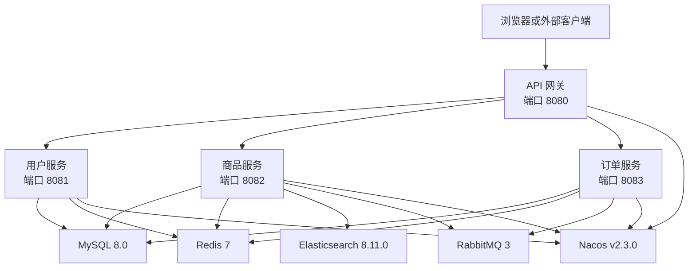
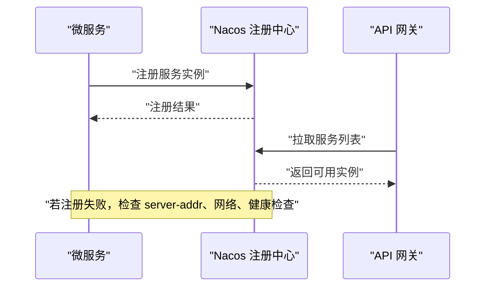
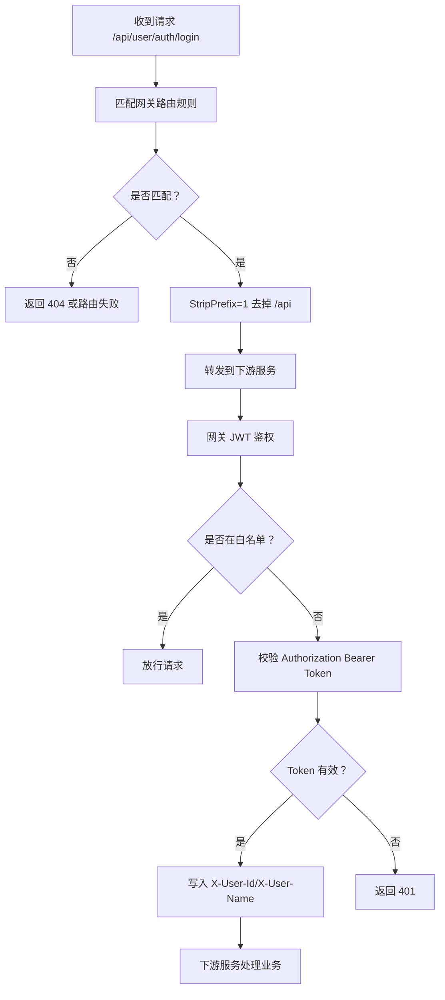
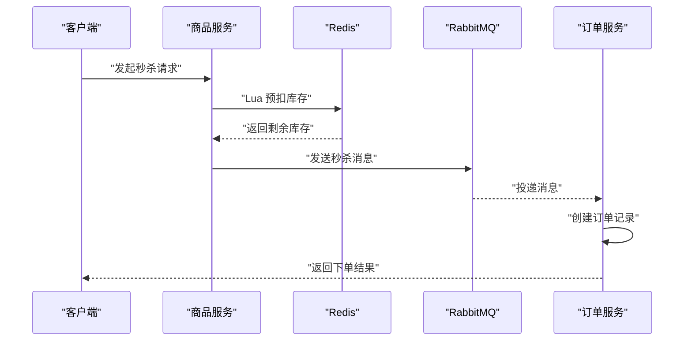

# 故障排除

<cite>
**本文引用的文件**   
- [README.md](file://README.md)
- [docker-compose.yml](file://docker-compose.yml)
- [docker-compose-infra.yml](file://docker-compose-infra.yml)
- [ecommerce-gateway application.yml](file://backend/ecommerce-gateway/src/main/resources/application.yml)
- [ecommerce-user application.yml](file://backend/ecommerce-user/src/main/resources/application.yml)
- [ecommerce-product application.yml](file://backend/ecommerce-product/src/main/resources/application.yml)
- [ecommerce-order application.yml](file://backend/ecommerce-order/src/main/resources/application.yml)
- [AuthGlobalFilter.java](file://backend/ecommerce-gateway/src/main/java/com/ecommerce/gateway/filter/AuthGlobalFilter.java)
- [JwtTokenProvider.java](file://backend/ecommerce-user/src/main/java/com/ecommerce/user/security/JwtTokenProvider.java)
- [GlobalExceptionHandler.java](file://backend/ecommerce-common/src/main/java/com/ecommerce/common/GlobalExceptionHandler.java)
- [SeckillStockService.java](file://backend/ecommerce-product/src/main/java/com/ecommerce/product/service/SeckillStockService.java)
- [SeckillOrderConsumer.java](file://backend/ecommerce-order/src/main/java/com/ecommerce/order/consumer/SeckillOrderConsumer.java)
- [ProductClient.java](file://backend/ecommerce-order/src/main/java/com/ecommerce/order/client/ProductClient.java)
</cite>

## 目录
1. [引言](#引言)
2. [项目结构与故障域划分](#项目结构与故障域划分)
3. [常见启动问题与解决方案](#常见启动问题与解决方案)
4. [连接问题诊断指南](#连接问题诊断指南)
5. [微服务注册失败排查](#微服务注册失败排查)
6. [网关路由异常排查](#网关路由异常排查)
7. [中间件连接超时排查](#中间件连接超时排查)
8. [性能问题定位与优化](#性能问题定位与优化)
9. [日志分析方法](#日志分析方法)
10. [内存泄漏检测与调试技巧](#内存泄漏检测与调试技巧)
11. [数据库连接池调优](#数据库连接池调优)
12. [典型故障诊断步骤](#典型故障诊断步骤)
13. [应急预案与稳定性保障](#应急预案与稳定性保障)
14. [结论](#结论)

## 引言
本故障排除指南面向基于 Spring Cloud 微服务架构的电商系统，覆盖后端微服务、API 网关、中间件以及前端微前端的常见问题。重点包括：
- 启动失败、端口冲突、依赖中间件不可用
- Nacos 注册失败、网关路由错误、JWT 鉴权失败
- Redis、MySQL、RabbitMQ、Elasticsearch 连接异常与超时
- 秒杀链路中的库存预扣、消息消费、Feign 调用异常
- 日志分析、性能监控、内存泄漏检测、连接池调优
- 问题定位工具、调试技巧与生产应急预案

## 项目结构与故障域划分
该系统包含以下关键组件：
- API 网关：统一入口、JWT 鉴权、路径路由、Swagger 文档聚合
- 用户服务：认证、短信验证码、图片验证码、用户管理、主题偏好
- 商品服务：商品 CRUD、Elasticsearch 搜索、Redis Lua 秒杀库存预扣、RabbitMQ 生产者
- 订单服务：订单管理、RabbitMQ 消费者、OpenFeign 调用商品服务
- 基础设施：MySQL、Redis、Nacos、RabbitMQ、Elasticsearch
- 前端：qiankun 主应用与子应用，通过开发代理访问网关

**图表来源**
- [README.md:16-47](file://README.md#L16-L47)
- [docker-compose.yml:4-185](file://docker-compose.yml#L4-L185)

**章节来源**
- [README.md:1-150](file://README.md#L1-L150)
- [docker-compose.yml:4-185](file://docker-compose.yml#L4-L185)

## 常见启动问题与解决方案
### 端口冲突或服务未启动
- 现象：访问网关或微服务返回连接拒绝、端口占用报错。
- 原因：本地已存在占用 8080/8081/8082/8083 的服务；Docker 容器端口映射冲突。
- 解决：
  - 检查并释放冲突端口。
  - 使用 `docker compose ps` 查看容器状态，必要时重启对应服务。
  - 确认各服务的 `application.yml` 中端口配置与期望一致。

**章节来源**
- [ecommerce-gateway application.yml:1-3](file://backend/ecommerce-gateway/src/main/resources/application.yml#L1-L3)
- [ecommerce-user application.yml:1-6](file://backend/ecommerce-user/src/main/resources/application.yml#L1-L6)
- [ecommerce-product application.yml:1-5](file://backend/ecommerce-product/src/main/resources/application.yml#L1-L5)
- [ecommerce-order application.yml:1-5](file://backend/ecommerce-order/src/main/resources/application.yml#L1-L5)

### 数据库初始化失败或字符集乱码
- 现象：启动后查询中文数据乱码，或表不存在。
- 原因：未执行初始化脚本；MySQL 客户端默认字符集不是 utf8mb4；容器 locale 导致二次编码。
- 解决：
  - 执行根目录初始化脚本，确保创建 `qoder_fullstack` 库及 users/products/orders 表。
  - Docker 部署时已设置 LANG/LC_ALL 为 C.UTF-8，避免 latin1 导致的乱码。
  - 手动执行 SQL 时指定 `--default-character-set=utf8mb4`。

**章节来源**
- [README.md:163-179](file://README.md#L163-L179)
- [docker-compose-infra.yml:10-26](file://docker-compose-infra.yml#L10-L26)

### 中间件未就绪导致服务启动失败
- 现象：用户/商品/订单服务启动时报 MySQL/Redis/Nacos/RabbitMQ/Elasticsearch 连接失败。
- 原因：基础设施未启动或健康检查未通过；环境变量未正确注入。
- 解决：
  - 先启动基础设施：`docker compose -f docker-compose-infra.yml up -d`。
  - 全栈部署：`docker compose up -d`，注意 depends_on 与健康检查。
  - 检查容器日志，确认 MySQL healthcheck、Redis ping、Nacos curl、RabbitMQ diagnostics、ES cluster health。

**章节来源**
- [README.md:183-214](file://README.md#L183-L214)
- [docker-compose.yml:22-68](file://docker-compose.yml#L22-L68)
- [docker-compose-infra.yml:27-112](file://docker-compose-infra.yml#L27-L112)

## 连接问题诊断指南
### MySQL 连接失败
- 检查项：
  - URL、用户名、密码是否正确。
  - 服务器 IP 与端口是否可达。
  - 数据库是否存在且已初始化。
- 常见错误：
  - 连接被拒绝（防火墙或端口未开放）。
  - 认证失败（密码错误或账号权限不足）。
  - 字符集问题（utf8mb4 未启用）。
- 处理建议：
  - 核对各服务 `application.yml` 的 datasource.url、username、password。
  - 在 Docker 环境中确认环境变量 SPRING_DATASOURCE_URL/USERNAME/PASSWORD 已注入。
  - 使用 mysql 客户端直连测试连通性。

**章节来源**
- [ecommerce-user application.yml:10-16](file://backend/ecommerce-user/src/main/resources/application.yml#L10-L16)
- [ecommerce-product application.yml:9-13](file://backend/ecommerce-product/src/main/resources/application.yml#L9-L13)
- [ecommerce-order application.yml:9-13](file://backend/ecommerce-order/src/main/resources/application.yml#L9-L13)
- [docker-compose.yml:103-107](file://docker-compose.yml#L103-L107)
- [docker-compose.yml:127-133](file://docker-compose.yml#L127-L133)
- [docker-compose.yml:153-158](file://docker-compose.yml#L153-L158)

### Redis 连接失败或超时
- 检查项：
  - host/port/password 配置。
  - timeout 与 lettuce pool 参数。
  - Redis 服务是否运行。
- 常见错误：
  - 连接超时（timeout 过短或网络不通）。
  - 连接池耗尽（max-active 过小）。
- 处理建议：
  - 调整 `spring.data.redis.timeout` 与 `lettuce.pool.max-active`。
  - 使用 redis-cli ping 验证连通性。
  - 观察 Redis 日志与慢查询。

**章节来源**
- [ecommerce-user application.yml:18-28](file://backend/ecommerce-user/src/main/resources/application.yml#L18-L28)
- [ecommerce-product application.yml:14-24](file://backend/ecommerce-product/src/main/resources/application.yml#L14-L24)
- [ecommerce-order application.yml:14-24](file://backend/ecommerce-order/src/main/resources/application.yml#L14-L24)

### RabbitMQ 连接失败或消息丢失
- 检查项：
  - host/port/username/password/virtual-host。
  - listener.simple.prefetch、retry 配置。
  - Management 插件是否启用。
- 常见错误：
  - 认证失败（guest 账户受限）。
  - 队列未创建或消费者未监听。
  - 消息重复消费或积压。
- 处理建议：
  - 登录 RabbitMQ 管理界面检查队列、交换机、绑定关系。
  - 确认消费者监听队列名称与生产者一致。
  - 调整 prefetch 与重试策略，避免消费者过载。

**章节来源**
- [ecommerce-product application.yml:34-42](file://backend/ecommerce-product/src/main/resources/application.yml#L34-L42)
- [ecommerce-order application.yml:25-39](file://backend/ecommerce-order/src/main/resources/application.yml#L25-L39)
- [docker-compose.yml:59-67](file://docker-compose.yml#L59-L67)

### Elasticsearch 连接失败
- 检查项：
  - uris、enabled、username/password。
  - ES 集群健康状态。
- 常见错误：
  - 安全认证开启但配置为空。
  - 节点未单节点模式或端口不通。
- 处理建议：
  - 确认 ES_JAVA_OPTS 与 xpack.security.enabled=false。
  - 使用 curl 访问 http://host:9200/_cluster/health。

**章节来源**
- [ecommerce-product application.yml:25-33](file://backend/ecommerce-product/src/main/resources/application.yml#L25-L33)
- [docker-compose.yml:47-57](file://docker-compose.yml#L47-L57)

## 微服务注册失败排查
### 症状
- 网关无法路由到下游服务。
- Nacos 控制台无服务实例。
- Feign 调用报找不到服务。

### 可能原因
- Nacos 地址配置错误。
- 服务未成功注册（启动失败或健康检查不通过）。
- 网络隔离或 DNS 解析失败（Docker 环境）。

### 排查步骤
1. 检查各服务 `application.yml` 中 `spring.cloud.nacos.discovery.server-addr`。
2. 登录 Nacos 控制台查看服务列表与实例状态。
3. 检查 Docker 环境变量 `SPRING_CLOUD_NACOS_DISCOVERY_SERVER_ADDR`。
4. 确认 Nacos 容器健康检查通过。
5. 若使用 Docker Compose，确认服务间网络互通。

**图表来源**
- [ecommerce-gateway application.yml:7-11](file://backend/ecommerce-gateway/src/main/resources/application.yml#L7-L11)
- [ecommerce-user application.yml:36-40](file://backend/ecommerce-user/src/main/resources/application.yml#L36-L40)
- [ecommerce-product application.yml:43-47](file://backend/ecommerce-product/src/main/resources/application.yml#L43-L47)
- [ecommerce-order application.yml:40-44](file://backend/ecommerce-order/src/main/resources/application.yml#L40-L44)
- [docker-compose.yml:36-46](file://docker-compose.yml#L36-L46)

**章节来源**
- [ecommerce-gateway application.yml:7-11](file://backend/ecommerce-gateway/src/main/resources/application.yml#L7-L11)
- [ecommerce-user application.yml:36-40](file://backend/ecommerce-user/src/main/resources/application.yml#L36-L40)
- [ecommerce-product application.yml:43-47](file://backend/ecommerce-product/src/main/resources/application.yml#L43-L47)
- [ecommerce-order application.yml:40-44](file://backend/ecommerce-order/src/main/resources/application.yml#L40-L44)
- [docker-compose.yml:36-46](file://docker-compose.yml#L36-L46)

## 网关路由异常排查
### 症状
- 请求到达网关后返回 404 或 502。
- Swagger UI 无法加载。
- 跨域请求被拦截。

### 可能原因
- 路由规则 Path 与 StripPrefix 配置不正确。
- 下游服务 context-path 与网关路由不一致。
- JWT 鉴权失败（白名单未放行）。
- CORS 配置缺失或限制过严。

### 排查步骤
1. 检查网关 `routes` 配置，确认 Path 与下游 context-path 匹配。
2. 确认 StripPrefix=1 会去掉 /api 前缀，下游服务应接收去除后的路径。
3. 检查白名单路径是否包含当前请求路径。
4. 检查 CORS 配置是否允许前端域名与方法头。
5. 访问各服务独立 Swagger UI 验证服务本身是否正常。

**图表来源**
- [ecommerce-gateway application.yml:22-67](file://backend/ecommerce-gateway/src/main/resources/application.yml#L22-L67)
- [AuthGlobalFilter.java:50-69](file://backend/ecommerce-gateway/src/main/java/com/ecommerce/gateway/filter/AuthGlobalFilter.java#L50-L69)
- [AuthGlobalFilter.java:80-140](file://backend/ecommerce-gateway/src/main/java/com/ecommerce/gateway/filter/AuthGlobalFilter.java#L80-L140)

**章节来源**
- [ecommerce-gateway application.yml:12-67](file://backend/ecommerce-gateway/src/main/resources/application.yml#L12-L67)
- [AuthGlobalFilter.java:50-140](file://backend/ecommerce-gateway/src/main/java/com/ecommerce/gateway/filter/AuthGlobalFilter.java#L50-L140)

## 中间件连接超时排查
### 症状
- 接口响应缓慢或频繁超时。
- Redis 操作抛出连接超时异常。
- RabbitMQ 消费者处理延迟。
- ES 查询耗时过长。

### 可能原因
- 中间件资源不足（CPU/内存/磁盘 IO）。
- 连接池配置过小。
- 网络延迟或带宽瓶颈。
- 慢查询或热点 Key。

### 排查步骤
1. 检查各中间件健康状态与资源使用率。
2. 调整 Redis timeout 与 lettuce pool 参数。
3. 调整 RabbitMQ prefetch 与重试策略。
4. 检查 ES 索引与查询语句，避免全表扫描。
5. 使用 APM 或日志追踪请求链路。

**章节来源**
- [ecommerce-user application.yml:18-28](file://backend/ecommerce-user/src/main/resources/application.yml#L18-L28)
- [ecommerce-product application.yml:14-33](file://backend/ecommerce-product/src/main/resources/application.yml#L14-L33)
- [ecommerce-order application.yml:14-39](file://backend/ecommerce-order/src/main/resources/application.yml#L14-L39)

## 性能问题定位与优化
### 秒杀链路性能瓶颈
- 库存预扣：Redis Lua 原子操作，需关注 Redis 热点 Key 与连接池。
- 消息异步：RabbitMQ 消费者处理能力，prefetch 与重试策略。
- Feign 调用：OpenFeign 超时配置与下游服务负载。

**图表来源**
- [SeckillStockService.java:32-49](file://backend/ecommerce-product/src/main/java/com/ecommerce/product/service/SeckillStockService.java#L32-L49)
- [SeckillOrderConsumer.java:35-67](file://backend/ecommerce-order/src/main/java/com/ecommerce/order/consumer/SeckillOrderConsumer.java#L35-L67)
- [ProductClient.java:11-19](file://backend/ecommerce-order/src/main/java/com/ecommerce/order/client/ProductClient.java#L11-L19)

### 优化建议
- Redis：
  - 预热秒杀库存，避免冷启动压力。
  - 合理设置 key 过期时间，防止内存膨胀。
  - 监控连接池使用率，必要时扩容。
- RabbitMQ：
  - 调整 prefetch 与并发消费者数量。
  - 死信队列与重试机制完善。
- OpenFeign：
  - 调整 connect-timeout 与 read-timeout。
  - 增加熔断与降级策略。

**章节来源**
- [ecommerce-order application.yml:57-64](file://backend/ecommerce-order/src/main/resources/application.yml#L57-L64)
- [SeckillStockService.java:32-90](file://backend/ecommerce-product/src/main/java/com/ecommerce/product/service/SeckillStockService.java#L32-L90)
- [SeckillOrderConsumer.java:35-67](file://backend/ecommerce-order/src/main/java/com/ecommerce/order/consumer/SeckillOrderConsumer.java#L35-L67)

## 日志分析方法
### 全局异常日志
- 所有业务异常、参数校验异常、认证授权异常、Token 异常均通过全局异常处理器统一包装并记录日志。
- 重点关注 WARN 与 ERROR 级别日志，结合 Result.code 判断业务错误。

### 网关鉴权日志
- 网关过滤器记录 Token 过期、无效、认证失败的警告日志。
- 若出现大量 401，检查前端是否携带正确 Authorization 头。

### 业务链路日志
- 秒杀消息消费日志包含 orderNo、userId、productId。
- 订单创建失败日志包含异常堆栈，便于定位数据库或 Feign 调用问题。

**章节来源**
- [GlobalExceptionHandler.java:22-72](file://backend/ecommerce-common/src/main/java/com/ecommerce/common/GlobalExceptionHandler.java#L22-L72)
- [AuthGlobalFilter.java:128-140](file://backend/ecommerce-gateway/src/main/java/com/ecommerce/gateway/filter/AuthGlobalFilter.java#L128-L140)
- [SeckillOrderConsumer.java:37-67](file://backend/ecommerce-order/src/main/java/com/ecommerce/order/consumer/SeckillOrderConsumer.java#L37-L67)

## 内存泄漏检测与调试技巧
### 常见内存泄漏场景
- 进程内缓存未清理（如图片验证码、短信验证码、短信发送记录）。
- Redis 连接池未正确关闭。
- 大对象长期驻留（如未设置过期时间的 Key）。

### 调试技巧
- 使用 JMX 或 Arthas 监控 JVM 内存与线程。
- 导出 heap dump 分析大对象。
- 检查 Redis Key 过期策略与删除逻辑。
- 观察 GC 日志与 Full GC 频率。

**章节来源**
- [ecommerce-user application.yml:55-86](file://backend/ecommerce-user/src/main/resources/application.yml#L55-L86)
- [SeckillStockService.java:68-90](file://backend/ecommerce-product/src/main/java/com/ecommerce/product/service/SeckillStockService.java#L68-L90)

## 数据库连接池调优
### 现状分析
- 项目未显式配置 HikariCP 连接池参数，使用 Spring Boot 默认值。
- 高并发下可能出现连接等待或耗尽。

### 调优建议
- 根据并发量调整最大连接数、最小空闲连接数。
- 设置连接超时与空闲超时，避免连接泄露。
- 监控连接池使用率与等待时间。

**章节来源**
- [ecommerce-user application.yml:10-16](file://backend/ecommerce-user/src/main/resources/application.yml#L10-L16)
- [ecommerce-product application.yml:9-13](file://backend/ecommerce-product/src/main/resources/application.yml#L9-L13)
- [ecommerce-order application.yml:9-13](file://backend/ecommerce-order/src/main/resources/application.yml#L9-L13)

## 典型故障诊断步骤
### 微服务注册失败
1. 检查 Nacos 控制台服务列表。
2. 核对各服务 nacos discovery server-addr。
3. 检查 Docker 环境变量与服务网络。
4. 查看服务启动日志，确认注册成功。

**章节来源**
- [ecommerce-gateway application.yml:7-11](file://backend/ecommerce-gateway/src/main/resources/application.yml#L7-L11)
- [ecommerce-user application.yml:36-40](file://backend/ecommerce-user/src/main/resources/application.yml#L36-L40)
- [ecommerce-product application.yml:43-47](file://backend/ecommerce-product/src/main/resources/application.yml#L43-L47)
- [ecommerce-order application.yml:40-44](file://backend/ecommerce-order/src/main/resources/application.yml#L40-L44)

### 网关路由异常
1. 检查网关 routes 配置与 StripPrefix。
2. 确认下游服务 context-path。
3. 检查白名单与 CORS 配置。
4. 访问下游服务独立 Swagger UI 验证。

**章节来源**
- [ecommerce-gateway application.yml:12-67](file://backend/ecommerce-gateway/src/main/resources/application.yml#L12-L67)

### 中间件连接超时
1. 检查中间件健康状态与资源使用。
2. 调整连接池与超时参数。
3. 使用命令行工具直连测试。
4. 观察慢查询与热点 Key。

**章节来源**
- [ecommerce-user application.yml:18-28](file://backend/ecommerce-user/src/main/resources/application.yml#L18-L28)
- [ecommerce-product application.yml:14-33](file://backend/ecommerce-product/src/main/resources/application.yml#L14-L33)
- [ecommerce-order application.yml:14-39](file://backend/ecommerce-order/src/main/resources/application.yml#L14-L39)

## 应急预案与稳定性保障
### 应急措施
- 快速回滚版本，恢复稳定版本。
- 临时关闭非核心功能（如短信发送、ES 同步）。
- 限流与降级，保护核心链路。
- 扩容中间件与微服务实例。

### 稳定性保障
- 完善健康检查与自动重启。
- 配置熔断与重试策略。
- 监控告警与日志聚合。
- 定期压测与容量规划。

**章节来源**
- [docker-compose.yml:22-68](file://docker-compose.yml#L22-L68)
- [docker-compose-infra.yml:27-112](file://docker-compose-infra.yml#L27-L112)

## 结论
本指南围绕启动、连接、注册、路由、中间件、性能、日志、内存、连接池等维度提供了系统化故障排除方法。通过明确配置项、可视化流程图与具体文件引用，帮助读者快速定位问题并采取有效措施，保障系统稳定运行。