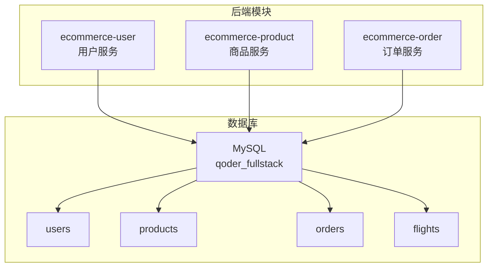
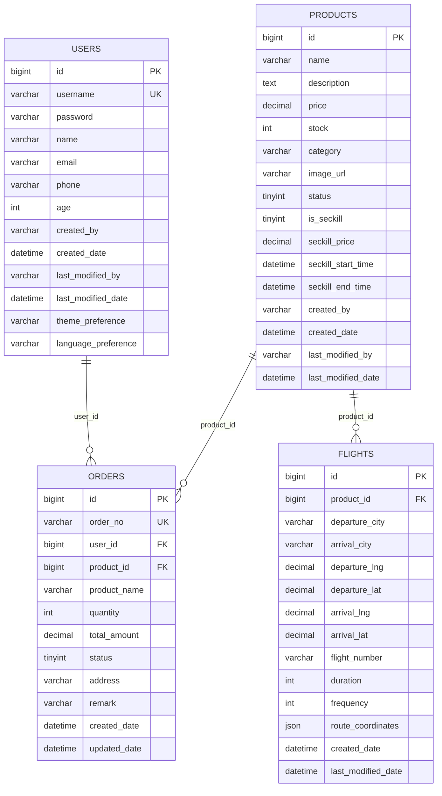
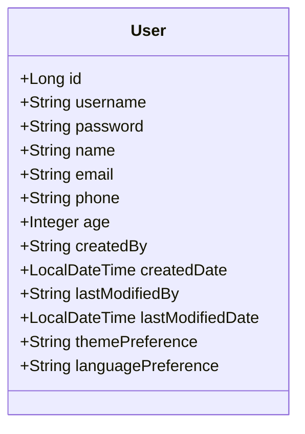
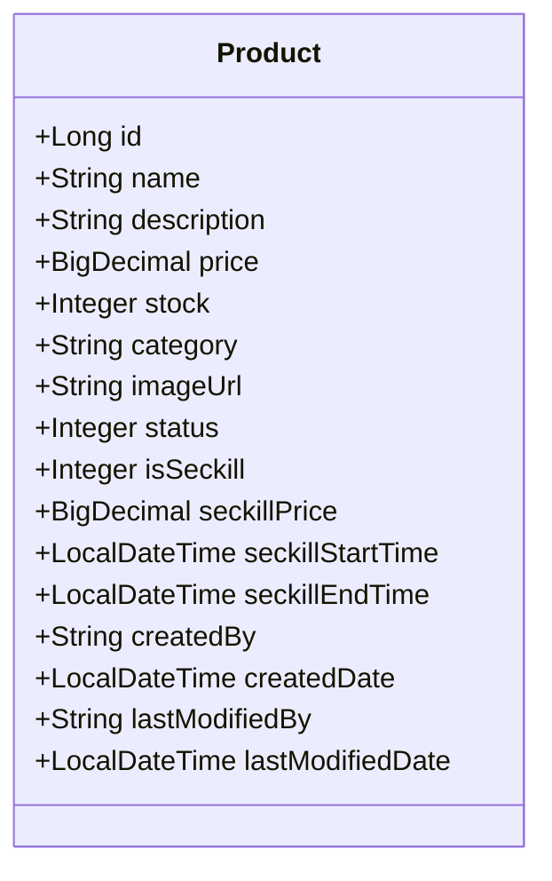
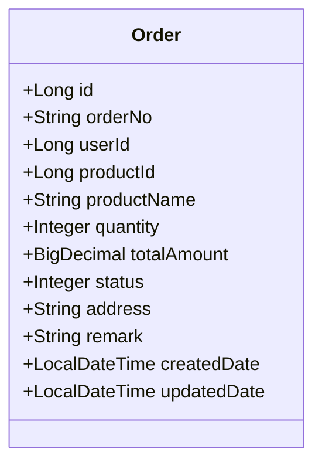
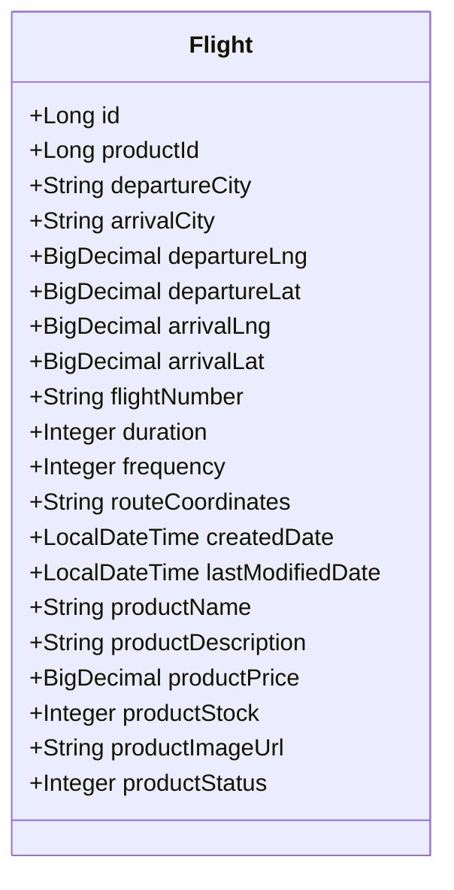
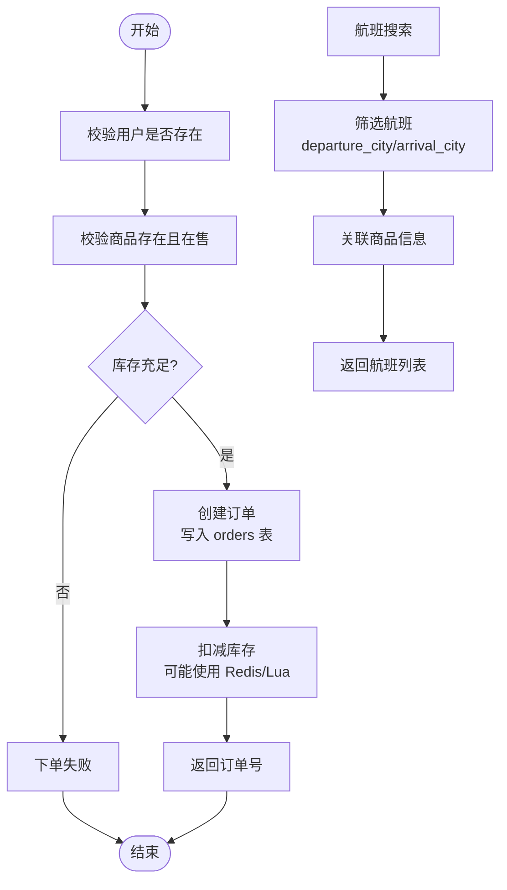
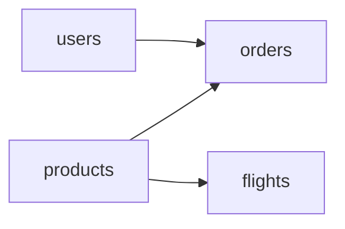
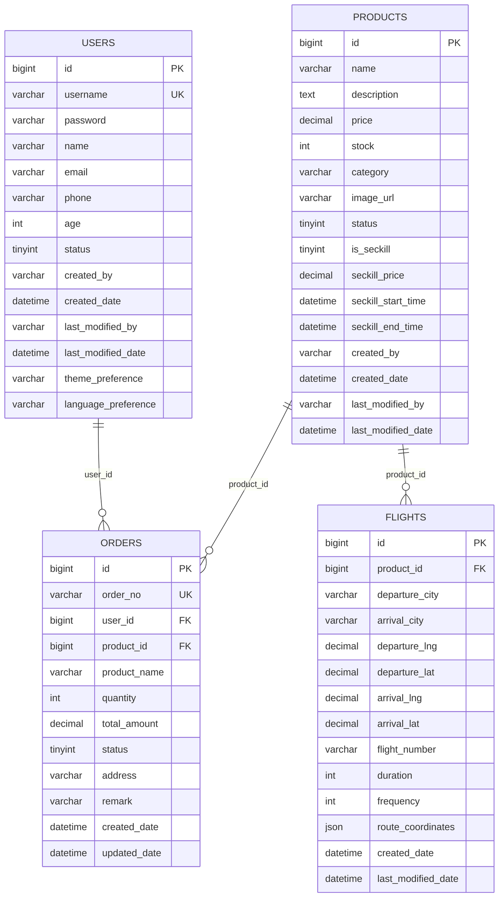

现在我已经收集了足够的信息来更新数据库设计文档。基于分析，我发现新增了flights表，它与products表建立了关联关系，并且包含了中国主要城市的示例数据。让我更新文档：

# 数据库设计

<cite>
**本文引用的文件**   
- [backend/ecommerce-user/src/main/resources/db/schema.sql](file://backend/ecommerce-user/src/main/resources/db/schema.sql)
- [backend/ecommerce-product/src/main/resources/db/schema.sql](file://backend/ecommerce-product/src/main/resources/db/schema.sql)
- [backend/ecommerce-order/src/main/resources/db/schema.sql](file://backend/ecommerce-order/src/main/resources/db/schema.sql)
- [init-sql/01-init-database.sql](file://init-sql/01-init-database.sql)
- [backend/ecommerce-user/src/main/java/com/ecommerce/user/entity/User.java](file://backend/ecommerce-user/src/main/java/com/ecommerce/user/entity/User.java)
- [backend/ecommerce-product/src/main/java/com/ecommerce/product/entity/Product.java](file://backend/ecommerce-product/src/main/java/com/ecommerce/product/entity/Product.java)
- [backend/ecommerce-product/src/main/java/com/ecommerce/product/entity/Flight.java](file://backend/ecommerce-product/src/main/java/com/ecommerce/product/entity/Flight.java)
- [backend/ecommerce-order/src/main/java/com/ecommerce/order/entity/Order.java](file://backend/ecommerce-order/src/main/java/com/ecommerce/order/entity/Order.java)
- [backend/ecommerce-product/src/main/java/com/ecommerce/product/repository/mapper/FlightMapper.java](file://backend/ecommerce-product/src/main/java/com/ecommerce/product/repository/mapper/FlightMapper.java)
- [backend/ecommerce-product/src/main/resources/mapper/FlightMapper.xml](file://backend/ecommerce-product/src/main/resources/mapper/FlightMapper.xml)
</cite>

## 更新摘要
**变更内容**   
- 新增 flights 表（航班表）及其与 products 表的关联关系
- 添加中国主要城市（北京、上海、广州、深圳、成都等）的示例数据
- 完善索引设计以优化航班查询性能
- 扩展 ER 图以包含新的航班实体关系

## 目录
1. [引言](#引言)
2. [项目结构](#项目结构)
3. [核心组件](#核心组件)
4. [架构总览](#架构总览)
5. [详细组件分析](#详细组件分析)
6. [依赖关系分析](#依赖关系分析)
7. [性能与优化](#性能与优化)
8. [故障排查指南](#故障排查指南)
9. [结论](#结论)
10. [附录](#附录)

## 引言
本数据库设计文档围绕电商系统的核心数据模型展开，覆盖用户、商品、订单以及新增的航班四张关键表。文档从 ER 图、字段类型选择、约束与索引、关联关系、迁移与版本管理、演示数据初始化、SQL 优化与备份恢复等维度进行系统化说明，帮助开发者快速理解并正确维护数据库结构与数据流。

## 项目结构
本项目采用多模块后端架构，每个业务域（用户、商品、订单）各自维护独立的数据库脚本与实体类；同时提供统一的初始化 SQL，用于一次性创建数据库及基础演示数据。新增的航班功能作为商品服务的扩展，专门处理机票商品的特殊需求。

图表来源
- [backend/ecommerce-user/src/main/resources/db/schema.sql:15-29](file://backend/ecommerce-user/src/main/resources/db/schema.sql#L15-L29)
- [backend/ecommerce-product/src/main/resources/db/schema.sql:6-47](file://backend/ecommerce-product/src/main/resources/db/schema.sql#L6-L47)
- [backend/ecommerce-order/src/main/resources/db/schema.sql:6-23](file://backend/ecommerce-order/src/main/resources/db/schema.sql#L6-L23)
- [init-sql/01-init-database.sql:15-97](file://init-sql/01-init-database.sql#L15-L97)

章节来源
- [backend/ecommerce-user/src/main/resources/db/schema.sql:1-30](file://backend/ecommerce-user/src/main/resources/db/schema.sql#L1-L30)
- [backend/ecommerce-product/src/main/resources/db/schema.sql:1-48](file://backend/ecommerce-product/src/main/resources/db/schema.sql#L1-L48)
- [backend/ecommerce-order/src/main/resources/db/schema.sql:1-24](file://backend/ecommerce-order/src/main/resources/db/schema.sql#L1-L24)
- [init-sql/01-init-database.sql:1-134](file://init-sql/01-init-database.sql#L1-L134)

## 核心组件
- users：用户信息、认证信息、主题与语言偏好、审计字段。
- products：商品信息、秒杀配置、库存与状态、分类与图片地址、审计字段。
- orders：订单信息、状态流转、购买记录、冗余商品名称、审计时间戳。
- **flights**：航班信息、航线坐标、飞行时长、频率统计、关联商品信息。

章节来源
- [backend/ecommerce-user/src/main/resources/db/schema.sql:15-29](file://backend/ecommerce-user/src/main/resources/db/schema.sql#L15-L29)
- [backend/ecommerce-product/src/main/resources/db/schema.sql:6-47](file://backend/ecommerce-product/src/main/resources/db/schema.sql#L6-L47)
- [backend/ecommerce-order/src/main/resources/db/schema.sql:6-23](file://backend/ecommerce-order/src/main/resources/db/schema.sql#L6-L23)

## 架构总览
下图展示数据库层面的 ER 关系与主要索引设计，包含新增的航班表及其与商品表的关联关系。

图表来源
- [init-sql/01-init-database.sql:15-97](file://init-sql/01-init-database.sql#L15-L97)

## 详细组件分析

### 用户表 users
- 职责
  - 承载注册、登录、用户基本信息与审计字段。
  - 支持主题与语言偏好（在统一初始化脚本中定义）。
- 关键字段与类型
  - id：BIGINT 自增主键。
  - username：VARCHAR(100)，唯一，作为登录标识。
  - password：VARCHAR(255)，BCrypt 加密存储。
  - name/email/phone：VARCHAR，非空，用于身份与联系。
  - age：INT，可选。
  - status：TINYINT，默认启用。
  - created_by/created_date/last_modified_by/last_modified_date：审计字段。
  - theme_preference/language_preference：VARCHAR(10)，默认值分别为 dark/zh。
- 约束与索引
  - 主键：id。
  - 唯一索引：username。
  - 普通索引：username、email、phone（提升按用户名、邮箱、手机号查询性能）。
- 实体映射
  - Java 实体 User 包含 themePreference、languagePreference 等字段，对应数据库列。
- 设计要点
  - 密码不返回给前端，通过序列化注解屏蔽。
  - 审计字段由持久层或应用逻辑统一填充。

图表来源
- [backend/ecommerce-user/src/main/java/com/ecommerce/user/entity/User.java:20-64](file://backend/ecommerce-user/src/main/java/com/ecommerce/user/entity/User.java#L20-L64)

章节来源
- [backend/ecommerce-user/src/main/resources/db/schema.sql:15-29](file://backend/ecommerce-user/src/main/resources/db/schema.sql#L15-L29)
- [init-sql/01-init-database.sql:15-33](file://init-sql/01-init-database.sql#L15-L33)
- [backend/ecommerce-user/src/main/java/com/ecommerce/user/entity/User.java:20-64](file://backend/ecommerce-user/src/main/java/com/ecommerce/user/entity/User.java#L20-L64)

### 商品表 products
- 职责
  - 承载商品基础信息、价格、库存、分类、图片地址、上下架状态。
  - 支持秒杀相关配置：是否秒杀、秒杀价、开始与结束时间。
  - 作为航班商品的父实体，通过 category='flight' 标识机票商品。
- 关键字段与类型
  - id：BIGINT 自增主键。
  - name/description/price/stock/category/image_url：基础信息。
  - status：TINYINT，默认上架。
  - is_seckill/seckill_price/seckill_start_time/seckill_end_time：秒杀配置。
  - created_by/created_date/last_modified_by/last_modified_date：审计字段。
- 约束与索引
  - 主键：id。
  - 普通索引：category、status、is_seckill（加速按分类、状态、是否秒杀的筛选）。
- 实体映射
  - Java 实体 Product 完整映射上述字段，包括秒杀时间与价格。

图表来源
- [backend/ecommerce-product/src/main/java/com/ecommerce/product/entity/Product.java:10-31](file://backend/ecommerce-product/src/main/java/com/ecommerce/product/entity/Product.java#L10-L31)

章节来源
- [backend/ecommerce-product/src/main/resources/db/schema.sql:6-26](file://backend/ecommerce-product/src/main/resources/db/schema.sql#L6-L26)
- [init-sql/01-init-database.sql:35-56](file://init-sql/01-init-database.sql#L35-L56)
- [backend/ecommerce-product/src/main/java/com/ecommerce/product/entity/Product.java:10-31](file://backend/ecommerce-product/src/main/java/com/ecommerce/product/entity/Product.java#L10-L31)

### 订单表 orders
- 职责
  - 承载订单号、用户与商品关联、购买数量、总金额、收货信息与备注。
  - 支持订单状态流转：待支付、已支付、已发货、已完成、已取消。
- 关键字段与类型
  - id：BIGINT 自增主键。
  - order_no：VARCHAR(50)，唯一，业务主键。
  - user_id/product_id：BIGINT，外键语义（逻辑关联）。
  - product_name：VARCHAR(255)，冗余字段，便于报表与历史快照。
  - quantity/total_amount/address/remark：订单明细与配送信息。
  - status：TINYINT，默认待支付。
  - created_date/updated_date：审计时间戳。
- 约束与索引
  - 主键：id。
  - 唯一索引：order_no。
  - 普通索引：user_id、product_id、status（加速按用户、商品、状态的查询）。
- 实体映射
  - Java 实体 Order 包含状态枚举注释，便于业务层状态机处理。

图表来源
- [backend/ecommerce-order/src/main/java/com/ecommerce/order/entity/Order.java:10-41](file://backend/ecommerce-order/src/main/java/com/ecommerce/order/entity/Order.java#L10-L41)

章节来源
- [backend/ecommerce-order/src/main/resources/db/schema.sql:6-23](file://backend/ecommerce-order/src/main/resources/db/schema.sql#L6-L23)
- [init-sql/01-init-database.sql:58-76](file://init-sql/01-init-database.sql#L58-L76)
- [backend/ecommerce-order/src/main/java/com/ecommerce/order/entity/Order.java:10-41](file://backend/ecommerce-order/src/main/java/com/ecommerce/order/entity/Order.java#L10-L41)

### 航班表 flights（新增）
- 职责
  - 承载航班详细信息，包括出发地、目的地、地理坐标、航班号、飞行时长等。
  - 与 products 表建立关联关系，通过 product_id 关联机票商品。
  - 支持航线坐标存储和航班频率统计，为可视化展示提供数据支持。
- 关键字段与类型
  - id：BIGINT 自增主键。
  - product_id：BIGINT，关联商品ID，逻辑外键。
  - departure_city/arrival_city：VARCHAR(100)，出发城市和落地城市。
  - departure_lng/departure_lat/arrival_lng/arrival_lat：DECIMAL(10,4)，地理坐标。
  - flight_number：VARCHAR(50)，航班号。
  - duration：INT，飞行时长（分钟）。
  - frequency：INT，每周航班频率。
  - route_coordinates：JSON，途经城市坐标数组。
  - created_date/last_modified_date：审计时间戳。
- 约束与索引
  - 主键：id。
  - 普通索引：product_id、departure_city、arrival_city（优化关联查询和城市筛选）。
- 实体映射
  - Java 实体 Flight 包含航班特有字段，并通过 JOIN 查询填充关联商品信息。

图表来源
- [backend/ecommerce-product/src/main/java/com/ecommerce/product/entity/Flight.java:10-38](file://backend/ecommerce-product/src/main/java/com/ecommerce/product/entity/Flight.java#L10-L38)

章节来源
- [backend/ecommerce-product/src/main/resources/db/schema.sql:28-47](file://backend/ecommerce-product/src/main/resources/db/schema.sql#L28-L47)
- [init-sql/01-init-database.sql:78-97](file://init-sql/01-init-database.sql#L78-L97)
- [backend/ecommerce-product/src/main/java/com/ecommerce/product/entity/Flight.java:10-38](file://backend/ecommerce-product/src/main/java/com/ecommerce/product/entity/Flight.java#L10-L38)

### 数据流向与状态流转
- 下单流程（简化）
  - 用户发起下单 → 校验用户与商品 → 扣减库存（可能走 Redis/Lua）→ 创建订单（写入 orders）→ 返回订单号。
- 订单状态流转
  - 待支付 → 已支付 → 已发货 → 已完成；任一阶段可取消至已取消。
- 航班查询流程
  - 用户搜索航班 → 根据出发地和目的地筛选 → 关联商品信息 → 返回航班详情。

图表来源
- [backend/ecommerce-order/src/main/resources/db/schema.sql:6-23](file://backend/ecommerce-order/src/main/resources/db/schema.sql#L6-L23)
- [backend/ecommerce-product/src/main/resources/db/schema.sql:6-47](file://backend/ecommerce-product/src/main/resources/db/schema.sql#L6-L47)
- [backend/ecommerce-product/src/main/resources/mapper/FlightMapper.xml:57-69](file://backend/ecommerce-product/src/main/resources/mapper/FlightMapper.xml#L57-L69)

## 依赖关系分析
- 逻辑外键
  - orders.user_id → users.id
  - orders.product_id → products.id
  - **flights.product_id → products.id**（新增）
- 耦合与内聚
  - 用户、商品、订单三表解耦清晰，订单通过外键语义关联用户与商品。
  - 商品表独立承载秒杀配置，避免订单表膨胀。
  - **航班表作为商品表的扩展，专门处理机票商品的特殊需求**。
- 潜在循环依赖
  - 无直接循环依赖；订单为消费方，用户与商品为被消费方。
  - **航班表依赖于商品表，但不反向依赖其他表**。

图表来源
- [init-sql/01-init-database.sql:15-97](file://init-sql/01-init-database.sql#L15-L97)

章节来源
- [init-sql/01-init-database.sql:15-97](file://init-sql/01-init-database.sql#L15-L97)

## 性能与优化
- 索引策略
  - users：对 username、email、phone 建立索引，提升登录与检索效率。
  - products：对 category、status、is_seckill 建立索引，支撑列表筛选与秒杀活动查询。
  - orders：对 user_id、product_id、status 建立索引，支撑按用户、商品、状态的多维查询。
  - **flights：对 product_id、departure_city、arrival_city 建立索引，优化关联查询和城市筛选**。
- 字段类型
  - 金额统一使用 DECIMAL(10,2)，避免浮点精度问题。
  - 时间使用 DATETIME，便于排序与范围查询。
  - 状态使用 TINYINT，节省空间且易于扩展。
  - **地理坐标使用 DECIMAL(10,4)，确保经纬度精度**。
- 查询优化建议
  - 优先使用覆盖索引减少回表。
  - 分页查询结合状态与时间范围，避免全表扫描。
  - 对高频查询（如按分类+状态）考虑复合索引。
  - **航班查询利用联合索引优化城市筛选性能**。
- 事务与一致性
  - 下单涉及库存扣减与订单创建，建议使用事务保证一致性。
  - 秒杀场景下，建议引入 Redis 预扣库存与 Lua 原子操作，降低数据库压力。
- 备份与恢复
  - 定期全量备份（mysqldump），增量备份（binlog）。
  - 恢复前校验字符集与 collation，确保中文显示正常。
  - 演练恢复流程，验证 RPO/RTO 指标。

[本节为通用指导，不直接分析具体文件]

## 故障排查指南
- 中文乱码
  - 确保客户端与服务端均使用 utf8mb4，初始化脚本开头设置 SET NAMES utf8mb4。
- 唯一冲突
  - 插入重复 username 或 order_no 会触发唯一索引冲突，需检查业务生成逻辑。
- 状态不一致
  - 订单状态变更需配合幂等控制与重试机制，避免重复更新。
- 库存超卖
  - 秒杀场景务必使用分布式锁或 Redis 原子扣减，并在数据库层做最终校验。
- **航班关联异常**
  - 检查 flights.product_id 是否正确关联到有效的 products.id。
  - 验证 JSON 格式的 route_coordinates 数据完整性。

章节来源
- [init-sql/01-init-database.sql:1-12](file://init-sql/01-init-database.sql#L1-L12)
- [init-sql/01-init-database.sql:15-97](file://init-sql/01-init-database.sql#L15-L97)

## 结论
本设计以 users、products、orders、flights 四张核心表为基础，明确了字段类型、约束与索引策略，并通过逻辑外键实现清晰的关联关系。新增的航班表专门处理机票商品的特殊需求，提供了完整的航线信息和地理坐标支持。结合统一初始化脚本与演示数据，能够快速搭建开发环境。后续可在秒杀场景引入缓存与消息队列，进一步提升高并发下的性能与稳定性。

[本节为总结性内容，不直接分析具体文件]

## 附录

### ER 图与表关系图

图表来源
- [init-sql/01-init-database.sql:15-97](file://init-sql/01-init-database.sql#L15-L97)

### 数据迁移与版本管理
- 初始化脚本
  - init-sql/01-init-database.sql：创建数据库 qoder_fullstack，建表并插入演示数据。
- 模块级脚本
  - ecommerce-user、ecommerce-product、ecommerce-order 各自维护 schema.sql，便于模块独立演进。
- 版本管理建议
  - 使用 Flyway/Liquibase 管理 DDL 变更，按版本号命名迁移脚本。
  - 所有变更需具备回滚脚本，确保可逆。
  - 发布前在测试库执行迁移脚本，验证兼容性与数据完整性。

章节来源
- [init-sql/01-init-database.sql:9-134](file://init-sql/01-init-database.sql#L9-L134)
- [backend/ecommerce-user/src/main/resources/db/schema.sql:1-30](file://backend/ecommerce-user/src/main/resources/db/schema.sql#L1-L30)
- [backend/ecommerce-product/src/main/resources/db/schema.sql:1-48](file://backend/ecommerce-product/src/main/resources/db/schema.sql#L1-L48)
- [backend/ecommerce-order/src/main/resources/db/schema.sql:1-24](file://backend/ecommerce-order/src/main/resources/db/schema.sql#L1-L24)

### 演示数据初始化
- 用户演示数据
  - 包含管理员与普通用户示例，密码为 BCrypt 哈希值。
- 商品演示数据
  - 包含常规商品与秒杀商品，覆盖不同分类与价格区间。
  - **新增机票商品（category = 'flight'），涵盖北京、上海、广州、深圳、成都等主要城市**。
- 航班演示数据
  - **包含8条航班记录，覆盖中国主要城市间的航线**。
  - **提供完整的地理坐标数据和途经城市信息**。
- 执行方式
  - 首次启动数据库容器时自动执行 init-sql/01-init-database.sql。
  - 也可手动连接 MySQL 后执行该脚本。

章节来源
- [init-sql/01-init-database.sql:99-134](file://init-sql/01-init-database.sql#L99-L134)

### 航班数据示例
系统预置了中国主要城市的航班数据，包括：
- 北京 ↔ 上海（CA1234，135分钟）
- 广州 ↔ 成都（CZ3456，150分钟）
- 深圳 ↔ 北京（MU5678，180分钟）
- 上海 ↔ 广州（MU9012，150分钟）
- 成都 ↔ 上海（CA3456，165分钟）
- 北京 ↔ 广州（CZ5678，195分钟）
- 上海 ↔ 成都（MU7890，180分钟）
- 深圳 ↔ 上海（CA9012，150分钟）

每条航班记录都包含完整的地理坐标信息和途经城市数据，支持可视化展示和路线规划功能。