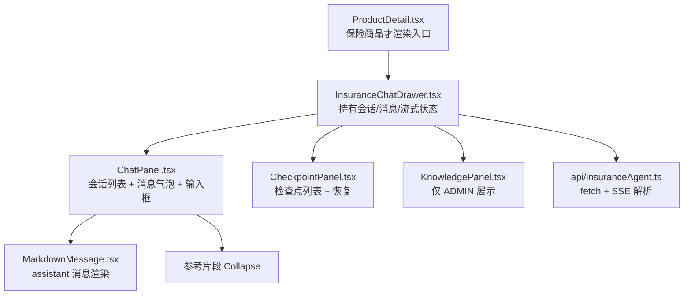
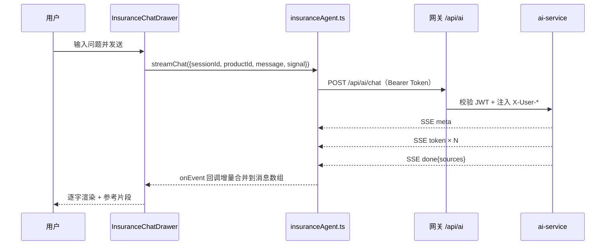

# 保险咨询机器人

<cite>
**本文引用的文件**
- [ProductList.tsx](file://frontend/product-app/src/pages/ProductList.tsx)
- [ProductDetail.tsx](file://frontend/product-app/src/pages/ProductDetail.tsx)
- [InsuranceChatDrawer.tsx](file://frontend/product-app/src/components/insurance/InsuranceChatDrawer.tsx)
- [ChatPanel.tsx](file://frontend/product-app/src/components/insurance/ChatPanel.tsx)
- [KnowledgePanel.tsx](file://frontend/product-app/src/components/insurance/KnowledgePanel.tsx)
- [CheckpointPanel.tsx](file://frontend/product-app/src/components/insurance/CheckpointPanel.tsx)
- [MarkdownMessage.tsx](file://frontend/product-app/src/components/insurance/MarkdownMessage.tsx)
- [insuranceAgent.ts](file://frontend/product-app/src/api/insuranceAgent.ts)
- [zh.ts](file://frontend/product-app/src/i18n/zh.ts)
- [en.ts](file://frontend/product-app/src/i18n/en.ts)
- [init-sql/03-insurance-agent.sql](file://init-sql/03-insurance-agent.sql)
- [AI问答微服务(ai-service).md](file://.qoder/repowiki/zh/content/后端架构设计/AI问答微服务(ai-service).md)
</cite>

## 目录
1. [功能范围](#功能范围)
2. [入口与分类](#入口与分类)
3. [组件结构](#组件结构)
4. [流式问答时序](#流式问答时序)
5. [知识库与回溯](#知识库与回溯)
6. [Markdown 渲染与安全](#markdown-渲染与安全)
7. [权限与多语言](#权限与多语言)
8. [测试与验收](#测试与验收)

## 功能范围

保险咨询机器人是「保险商品」在商品详情页内的 AI 问答能力，覆盖三段闭环：

| 阶段 | 使用者 | 能力 |
| --- | --- | --- |
| 知识入库 | 管理员 | 上传条款 PDF → 后台解析切分入库 → 查看 `processing / ready / failed` 状态、重建、删除 |
| 咨询问答 | 登录用户 | 多会话管理、SSE 逐字回答、Markdown 富文本、参考片段（文件名 + 片段序号 + 相似度） |
| 状态回溯 | 登录用户 | 列出 LangGraph 检查点，一键恢复到历史状态并继续对话 |

设计约束：回答范围严格限定在该商品已上传的条款 PDF，检索不足时输出固定拒答话术；知识库写操作仅管理员；会话按用户隔离。

## 入口与分类

- 商品列表页按分类筛选（分类中含 `insurance`），保险商品使用独立标签与色调。
- 商品详情页在 `category === 'insurance'` 时额外渲染：保险标签、范围提示 `Alert`、以及「保险咨询机器人」按钮；按钮打开 `InsuranceChatDrawer`，传入 `productId` 与商品名。
- 其他分类商品不渲染任何 AI 入口，抽屉组件也不会被打包进首屏交互路径。

```tsx
{product.category === 'insurance' && (
  <InsuranceChatDrawer
    open={botOpen}
    productId={product.id}
    productName={product.name}
    onClose={() => setBotOpen(false)}
  />
)}
```

## 组件结构



**图表来源**
- [InsuranceChatDrawer.tsx](file://frontend/product-app/src/components/insurance/InsuranceChatDrawer.tsx)
- [ChatPanel.tsx](file://frontend/product-app/src/components/insurance/ChatPanel.tsx)

职责划分：

- **抽屉（父组件）**：唯一的状态持有者——会话列表、当前会话、消息数组、`sending`、当前页签、`AbortController`。关闭抽屉、切换会话、删除会话、回溯时都会中断未完成的流。
- **ChatPanel**：纯展示 + 事件回调；打开抽屉时默认选中最近一个会话并回显历史；「新会话」在首条消息发送时若不存在会话也会自动创建。
- **CheckpointPanel**：拉取 `checkpoints`，恢复成功后把返回的消息数组交回父组件并切回「对话」页签。
- **KnowledgePanel**：管理员上传（前端先校验 `.pdf` 与大小）、重建、删除；存在 `processing` 文档时每 4 秒轮询一次列表。

## 流式问答时序



**图表来源**
- [insuranceAgent.ts](file://frontend/product-app/src/api/insuranceAgent.ts)
- [InsuranceChatDrawer.tsx](file://frontend/product-app/src/components/insurance/InsuranceChatDrawer.tsx)

实现细节：

- `fetch` + `ReadableStream` 手写 SSE 解析：按空行分帧，兼容 `\r\n` 与多行 `data`，`TextDecoder` 以 `stream: true` 解码，避免中文被截断。
- 发送时先本地插入「用户消息 + 空的 assistant 消息」，`token` 事件做增量拼接（`streaming: true`），`done` 时写入 `sources` 并置 `streaming: false`，`error` 时把失败信息落到当前气泡并标红。
- 用户可「停止生成」：`AbortController.abort()`，已生成内容保留；`AbortError` 不当成错误提示。
- 首轮问答后后端会更新会话标题，前端在 `done` 后重新拉取会话列表。
- 错误解析兼容两种后端形态：ai-service 返回 `{detail}`、网关返回 `{code, message}`。

## 知识库与回溯

**知识库（仅管理员页签）**

- 上传：`POST /api/ai/documents/upload`，`FormData(productId, file)`；前端预校验 `.pdf` 与 ≤ 20MB，后端再按 `max_pdf_mb` 校验。
- 状态轮询：`processing` 存在时每 4 秒刷新，状态变为 `ready` 后展示片段数；`failed` 可展开看 `errorMessage`。
- 重建：`POST /documents/{id}/reindex`；删除：`DELETE /documents/{id}`（同时清理向量与本地文件）。

**回溯**

- 检查点来自 LangGraph `InMemorySaver`，`thread_id = u{userId}:p{productId}:s{sessionId}`。
- `POST /sessions/{id}/restore` 成功返回恢复后的消息数组，抽屉替换当前消息并切回对话页签。
- 服务重启后检查点丢失，接口返回 409，前端提示「检查点已失效」；已落库的消息仍可正常查看（属预期行为）。

## Markdown 渲染与安全

`assistant` 消息走 `MarkdownMessage`，用户消息与错误消息保持纯文本（`pre-wrap`）——错误信息里常含尖括号，交给 Markdown 解析反而更乱。

- 依赖：`react-markdown@10`、`remark-gfm`（表格/删除线）、`remark-breaks`（换行即 `<br>`）。
- 安全：不注入 `dangerouslySetInnerHTML`，`react-markdown` 默认把原始 HTML 当文本处理；链接与代码块均受控渲染。测试覆盖 `<script>` / `` 等 XSS 载荷只以文本出现。
- 性能：组件内部对渲染结果 `memo`，流式追加时只有最后一条消息重渲染；样式通过 Ant Design `useToken()` 取主题色，自动跟随暗黑/亮色模式。
- 兼容：`react-markdown` v10 无默认导出，需 `import ReactMarkdown from 'react-markdown'`。

## 权限与多语言

- 前端是否展示「知识库」页签由 `localStorage.qoder_user` 中的 `role === 'ADMIN'`（或历史数据 `username === 'admin'`）决定，仅作 UI 收敛；真正的写权限由后端按网关注入的 `X-User-Role` 校验，越权请求返回 403。
- 会话/消息接口按属主隔离，跨用户访问返回 404；前端不需要也不应该传 `userId`。
- 全部文案走 i18n：`insurance.*` 命名空间（抽屉标题、对话/回溯两个固定页签与管理员专属的知识库页签、范围提示、上传/重建/删除、错误与空态），中英文案健同时由 `insuranceKeys.spec.ts` 校验 key 对齐，避免漏翻回退成 key 字面量。

## 测试与验收

| 层 | 用例 | 覆盖点 |
| --- | --- | --- |
| API 客户端 | `api/insuranceAgent.spec.ts` | SSE 分帧（`\r\n`、多行 data、坏 JSON 容错）、错误体解析、鉴权头注入 |
| 组件 | `ChatPanel.spec.tsx` | 空态、发送/停止、流式追加、错误气泡、参考片段展示 |
| 组件 | `MarkdownMessage.spec.tsx` | 标题/列表/表格/代码块渲染、XSS 文本化、流式追加不重建整棵树 |
| 页面 | `ProductDetail.insurance.spec.tsx` | 仅保险商品出现入口、抽屉开关、非保险商品无入口 |
| i18n | `insuranceKeys.spec.ts` | 中英 `insurance.*` key 对齐 |
| 服务端 | `ai-service/tests/*` | 切分、检索门控拒答、上传校验、会话隔离、SSE 帧与落库、回溯 409 |

手工验收（与 `ai-service/README.md` 的「联调验收清单」一致）：

1. 管理员登录 → 商品列表筛选「保险」→ 详情 → 「保险咨询机器人」；
2. 知识库上传示例 PDF，状态 `processing → ready`，片段数 > 0；
3. 就条款内容提问，回答逐字输出且可展开参考片段；问无关问题得到固定拒答话术；
4. 普通用户 A / B 会话互不可见；回溯页签可恢复历史检查点；
5. 服务重启后回溯返回 409，历史消息仍可查看。

**章节来源**
- [ProductDetail.insurance.spec.tsx](file://frontend/product-app/src/__tests__/unit/pages/ProductDetail.insurance.spec.tsx)
- [ai-service/README.md](file://ai-service/README.md)