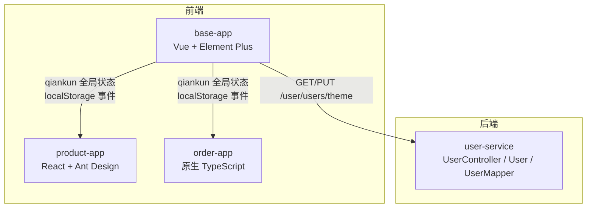
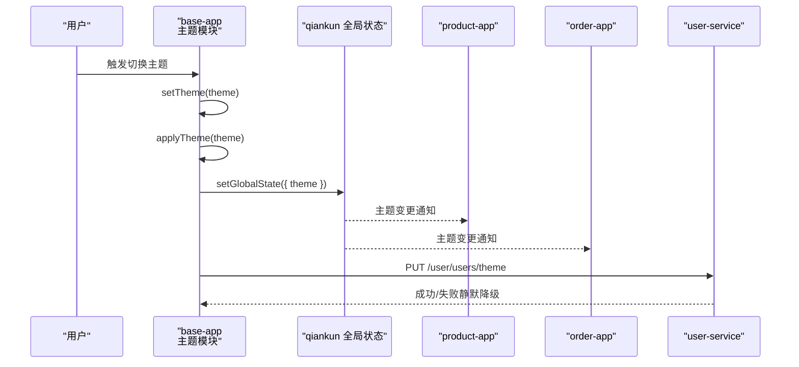
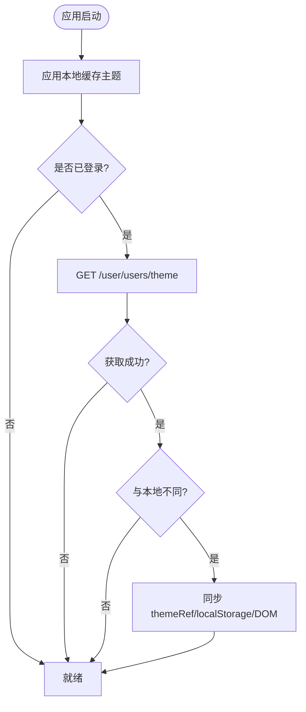
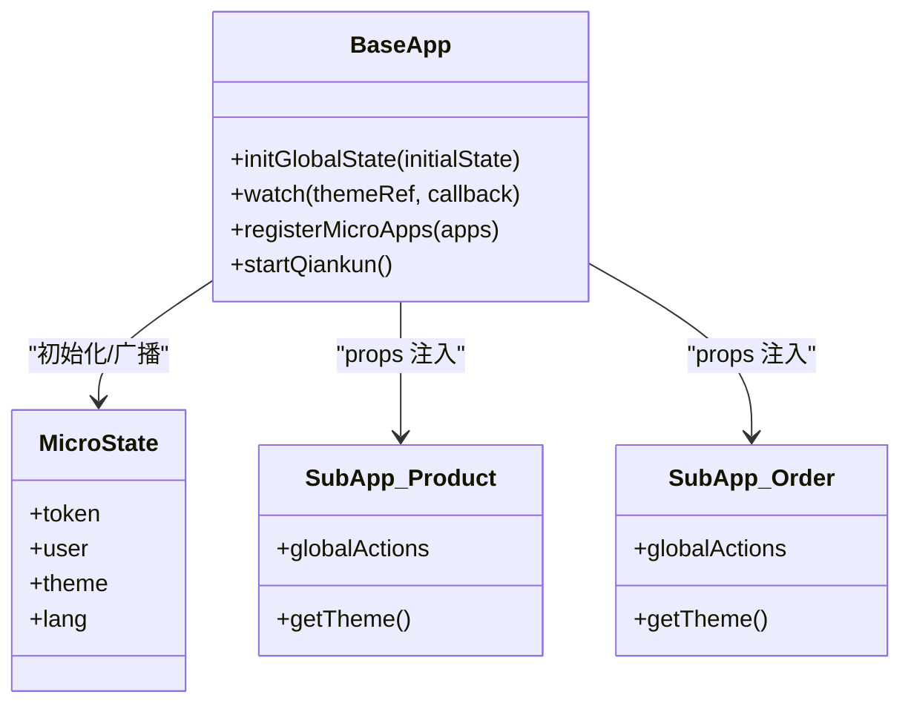
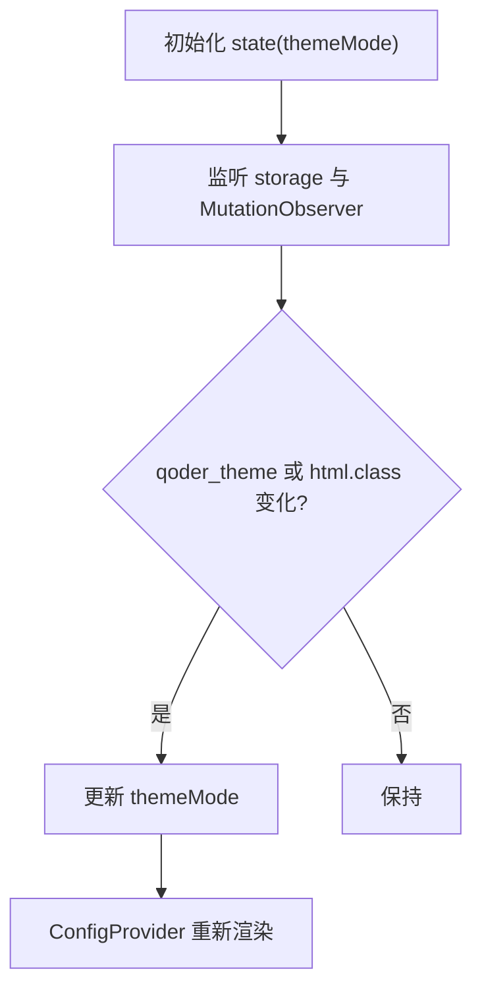
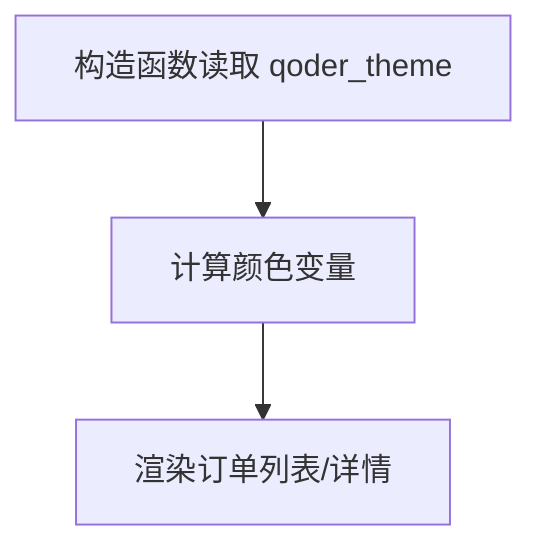
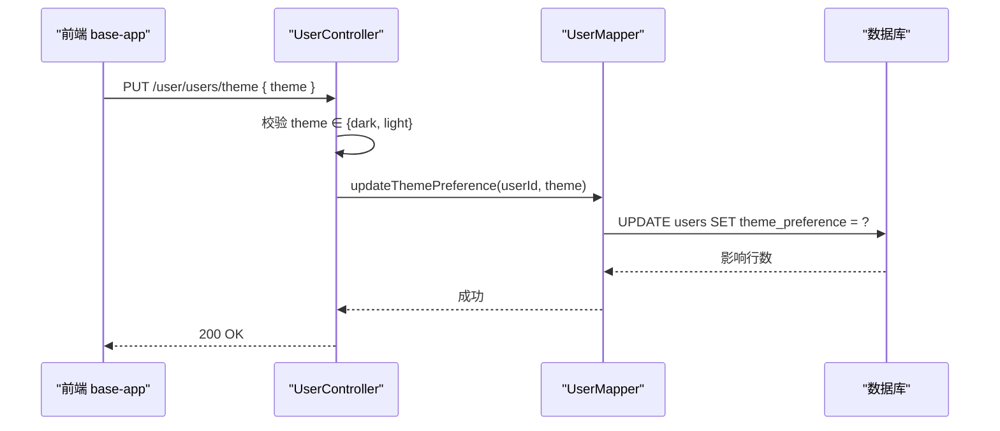
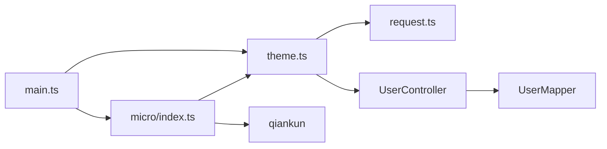

# 全局主题切换系统

<cite>
**本文引用的文件**   
- [frontend/base-app/src/utils/theme.ts](file://frontend/base-app/src/utils/theme.ts)
- [frontend/base-app/src/micro/index.ts](file://frontend/base-app/src/micro/index.ts)
- [frontend/base-app/src/main.ts](file://frontend/base-app/src/main.ts)
- [backend/ecommerce-user/src/main/java/com/ecommerce/user/controller/UserController.java](file://backend/ecommerce-user/src/main/java/com/ecommerce/user/controller/UserController.java)
- [backend/ecommerce-user/src/main/java/com/ecommerce/user/entity/User.java](file://backend/ecommerce-user/src/main/java/com/ecommerce/user/entity/User.java)
- [backend/ecommerce-user/src/main/java/com/ecommerce/user/repository/mapper/UserMapper.java](file://backend/ecommerce-user/src/main/java/com/ecommerce/user/repository/mapper/UserMapper.java)
- [frontend/product-app/src/App.tsx](file://frontend/product-app/src/App.tsx)
- [frontend/order-app/src/app.ts](file://frontend/order-app/src/app.ts)
- [README.md](file://README.md)
</cite>

## 目录
1. [引言](#引言)
2. [项目结构](#项目结构)
3. [核心组件](#核心组件)
4. [架构总览](#架构总览)
5. [详细组件分析](#详细组件分析)
6. [依赖关系分析](#依赖关系分析)
7. [性能与一致性](#性能与一致性)
8. [故障排查指南](#故障排查指南)
9. [结论](#结论)
10. [附录：扩展与定制指南](#附录扩展与定制指南)

## 引言
本文件面向“全局主题切换系统”的实现与使用，覆盖前后端主题同步、状态管理、API 设计、数据持久化、跨应用（微前端）主题共享、配置管理与兼容性处理。该系统以主应用 base-app 为权威源，通过 qiankun 全局状态与浏览器事件机制，将主题状态实时同步到 product-app 与 order-app；后端用户服务提供主题偏好接口，实现登录态下的跨设备一致性与刷新后恢复。

## 项目结构
围绕主题切换的相关代码主要分布在以下位置：
- 前端主应用：主题状态与初始化逻辑、微前端集成与全局状态广播
- 前端子应用：各自框架的主题适配方式（Ant Design、原生 CSS 变量）
- 后端用户服务：主题偏好 API、实体字段与 Mapper 更新方法

图表来源
- [frontend/base-app/src/micro/index.ts:1-89](file://frontend/base-app/src/micro/index.ts#L1-L89)
- [frontend/base-app/src/utils/theme.ts:1-88](file://frontend/base-app/src/utils/theme.ts#L1-L88)
- [backend/ecommerce-user/src/main/java/com/ecommerce/user/controller/UserController.java:92-107](file://backend/ecommerce-user/src/main/java/com/ecommerce/user/controller/UserController.java#L92-L107)

章节来源
- [README.md:49-150](file://README.md#L49-L150)

## 核心组件
- 主题状态模块（base-app）
  - 定义主题类型 ThemeMode（dark/light）
  - 维护响应式 themeRef，默认从 localStorage 读取
  - 提供 getTheme/setTheme/toggleTheme/applyTheme/initTheme
  - setTheme 同时更新本地缓存、DOM class 并异步持久化到后端
  - initTheme 在启动时优先应用本地缓存，若已登录则拉取后端最新偏好并同步
- 微前端集成（base-app）
  - 使用 qiankun 的 initGlobalState 创建全局状态
  - 监听 themeRef 变化，通过 globalActions.setGlobalState 广播主题
  - 向子应用 props 暴露 getTheme/getLang/globalActions
- 子应用主题适配
  - product-app：基于 Ant Design ConfigProvider 与算法切换，同时监听 storage/MutationObserver 同步主题
  - order-app：基于 CSS 变量与 JS 计算颜色，读取 qoder_theme 进行渲染
- 后端主题 API（user-service）
  - GET /theme：返回当前用户的主题偏好
  - PUT /theme：校验并更新主题偏好
  - 实体 User 包含 themePreference 字段
  - MyBatis Mapper 提供 updateThemePreference 方法

章节来源
- [frontend/base-app/src/utils/theme.ts:1-88](file://frontend/base-app/src/utils/theme.ts#L1-L88)
- [frontend/base-app/src/micro/index.ts:1-89](file://frontend/base-app/src/micro/index.ts#L1-L89)
- [frontend/product-app/src/App.tsx:1-40](file://frontend/product-app/src/App.tsx#L1-L40)
- [frontend/order-app/src/app.ts:18-45](file://frontend/order-app/src/app.ts#L18-L45)
- [backend/ecommerce-user/src/main/java/com/ecommerce/user/controller/UserController.java:92-107](file://backend/ecommerce-user/src/main/java/com/ecommerce/user/controller/UserController.java#L92-L107)
- [backend/ecommerce-user/src/main/java/com/ecommerce/user/entity/User.java:59-63](file://backend/ecommerce-user/src/main/java/com/ecommerce/user/entity/User.java#L59-L63)
- [backend/ecommerce-user/src/main/java/com/ecommerce/user/repository/mapper/UserMapper.java:41-45](file://backend/ecommerce-user/src/main/java/com/ecommerce/user/repository/mapper/UserMapper.java#L41-L45)

## 架构总览
主题切换的整体流程如下：用户在任意应用中触发主题切换，主应用更新本地状态与 DOM，并通过 qiankun 全局状态与浏览器事件通知子应用；同时异步将主题偏好保存到后端数据库，以便下次登录或跨设备同步。

图表来源
- [frontend/base-app/src/utils/theme.ts:32-44](file://frontend/base-app/src/utils/theme.ts#L32-L44)
- [frontend/base-app/src/micro/index.ts:22-25](file://frontend/base-app/src/micro/index.ts#L22-L25)
- [backend/ecommerce-user/src/main/java/com/ecommerce/user/controller/UserController.java:96-107](file://backend/ecommerce-user/src/main/java/com/ecommerce/user/controller/UserController.java#L96-L107)

## 详细组件分析

### 主题状态与生命周期（base-app）
- 状态模型
  - ThemeMode：'dark' | 'light'
  - themeRef：响应式主题状态，初始值来自 readTheme()
- 关键函数
  - readTheme：从 localStorage 读取 qoder_theme，非法值回退到 dark
  - getTheme：读取当前主题
  - setTheme：立即更新 themeRef、localStorage、DOM class，并异步调用后端保存
  - toggleTheme：在 dark/light 之间切换
  - applyTheme：给 <html> 添加或移除 class="dark"
  - initTheme：启动时先应用本地缓存，若检测到登录态则拉取后端主题并同步
- 错误处理
  - 后端保存失败时静默降级，不影响 UI 即时体验

图表来源
- [frontend/base-app/src/utils/theme.ts:69-87](file://frontend/base-app/src/utils/theme.ts#L69-L87)

章节来源
- [frontend/base-app/src/utils/theme.ts:1-88](file://frontend/base-app/src/utils/theme.ts#L1-L88)
- [frontend/base-app/src/main.ts:40-41](file://frontend/base-app/src/main.ts#L40-L41)

### 微前端主题同步（base-app + qiankun）
- 全局状态
  - 使用 initGlobalState 初始化 token/user/theme/lang
  - 监听 themeRef 变化，通过 globalActions.setGlobalState 广播
- 子应用接入
  - 注册 product-app 与 order-app，props 中注入 getTheme/getLang/globalActions
  - 子应用可通过 window 事件或 props 订阅主题变化
- 样式隔离
  - qiankun 开启 experimentalStyleIsolation，避免主题类名污染

图表来源
- [frontend/base-app/src/micro/index.ts:1-89](file://frontend/base-app/src/micro/index.ts#L1-L89)

章节来源
- [frontend/base-app/src/micro/index.ts:1-89](file://frontend/base-app/src/micro/index.ts#L1-L89)

### 子应用主题适配

#### product-app（React + Ant Design）
- 主题来源
  - 从 localStorage 读取 qoder_theme，作为初始主题
  - 监听 storage 事件与 MutationObserver，检测 <html> class 变化
- 主题应用
  - 使用 Ant Design ConfigProvider 与 theme.darkAlgorithm/defaultAlgorithm 切换
- 页面级颜色
  - 根据 isDark 动态计算背景色等样式

图表来源
- [frontend/product-app/src/App.tsx:1-40](file://frontend/product-app/src/App.tsx#L1-L40)

章节来源
- [frontend/product-app/src/App.tsx:1-40](file://frontend/product-app/src/App.tsx#L1-L40)

#### order-app（原生 TypeScript）
- 主题来源
  - 构造时从 localStorage 读取 qoder_theme
- 主题应用
  - 根据 theme 计算页面背景、文本、边框等颜色变量
- 渲染
  - 使用纯 JS/CSS 变量完成暗黑/亮色适配

图表来源
- [frontend/order-app/src/app.ts:18-45](file://frontend/order-app/src/app.ts#L18-L45)

章节来源
- [frontend/order-app/src/app.ts:18-45](file://frontend/order-app/src/app.ts#L18-L45)

### 后端主题 API 与持久化（user-service）
- 接口设计
  - GET /user/users/theme：返回当前用户的 theme
  - PUT /user/users/theme：接收 { theme }，校验并更新
- 数据模型
  - User.themePreference：存储 dark/light
- 访问层
  - UserMapper.updateThemePreference：按 id 更新主题偏好

图表来源
- [backend/ecommerce-user/src/main/java/com/ecommerce/user/controller/UserController.java:96-107](file://backend/ecommerce-user/src/main/java/com/ecommerce/user/controller/UserController.java#L96-L107)
- [backend/ecommerce-user/src/main/java/com/ecommerce/user/repository/mapper/UserMapper.java:41-45](file://backend/ecommerce-user/src/main/java/com/ecommerce/user/repository/mapper/UserMapper.java#L41-L45)

章节来源
- [backend/ecommerce-user/src/main/java/com/ecommerce/user/controller/UserController.java:92-107](file://backend/ecommerce-user/src/main/java/com/ecommerce/user/controller/UserController.java#L92-L107)
- [backend/ecommerce-user/src/main/java/com/ecommerce/user/entity/User.java:59-63](file://backend/ecommerce-user/src/main/java/com/ecommerce/user/entity/User.java#L59-L63)
- [backend/ecommerce-user/src/main/java/com/ecommerce/user/repository/mapper/UserMapper.java:41-45](file://backend/ecommerce-user/src/main/java/com/ecommerce/user/repository/mapper/UserMapper.java#L41-L45)

## 依赖关系分析
- 前端内部依赖
  - base-app 主题模块依赖 Vue ref 与 axios 封装 request
  - base-app 微前端模块依赖 qiankun 与主题模块
- 前后端依赖
  - base-app 通过网关代理访问 user-service 的主题接口
  - user-service 依赖 MyBatis 与 MySQL 持久化主题偏好

图表来源
- [frontend/base-app/src/utils/theme.ts:1-88](file://frontend/base-app/src/utils/theme.ts#L1-L88)
- [frontend/base-app/src/micro/index.ts:1-89](file://frontend/base-app/src/micro/index.ts#L1-L89)
- [frontend/base-app/src/main.ts:17-47](file://frontend/base-app/src/main.ts#L17-L47)
- [backend/ecommerce-user/src/main/java/com/ecommerce/user/controller/UserController.java:92-107](file://backend/ecommerce-user/src/main/java/com/ecommerce/user/controller/UserController.java#L92-L107)
- [backend/ecommerce-user/src/main/java/com/ecommerce/user/repository/mapper/UserMapper.java:41-45](file://backend/ecommerce-user/src/main/java/com/ecommerce/user/repository/mapper/UserMapper.java#L41-L45)

章节来源
- [frontend/base-app/src/utils/theme.ts:1-88](file://frontend/base-app/src/utils/theme.ts#L1-L88)
- [frontend/base-app/src/micro/index.ts:1-89](file://frontend/base-app/src/micro/index.ts#L1-L89)
- [frontend/base-app/src/main.ts:17-47](file://frontend/base-app/src/main.ts#L17-L47)
- [backend/ecommerce-user/src/main/java/com/ecommerce/user/controller/UserController.java:92-107](file://backend/ecommerce-user/src/main/java/com/ecommerce/user/controller/UserController.java#L92-L107)
- [backend/ecommerce-user/src/main/java/com/ecommerce/user/repository/mapper/UserMapper.java:41-45](file://backend/ecommerce-user/src/main/java/com/ecommerce/user/repository/mapper/UserMapper.java#L41-L45)

## 性能与一致性
- 本地优先策略
  - 切换主题时立即更新 localStorage 与 DOM，保证 UI 零延迟
  - 后端保存采用异步请求，不阻塞界面
- 启动同步策略
  - 启动时先应用本地缓存，再尝试拉取后端主题，避免白屏闪烁
- 跨应用一致性
  - 通过 qiankun 全局状态与 storage 事件、MutationObserver 多通道保障子应用及时感知
- 容错与降级
  - 后端保存失败静默降级，不影响本地体验
  - 后端获取失败回退到本地缓存

[本节为通用指导，不直接分析具体文件]

## 故障排查指南
- 主题未生效
  - 检查 <html> 是否包含/移除 class="dark"
  - 确认 base-app 的 initTheme 是否被调用
- 子应用不同步
  - 检查 qiankun 全局状态是否正确广播
  - 检查子应用是否监听 storage 或 MutationObserver
- 登录后主题不一致
  - 检查 GET /user/users/theme 是否返回预期值
  - 检查 PUT /user/users/theme 是否成功写入数据库
- 网络异常
  - 确认网关路由与 CORS 配置正确
  - 查看控制台是否有静默失败的警告日志

章节来源
- [frontend/base-app/src/utils/theme.ts:32-44](file://frontend/base-app/src/utils/theme.ts#L32-L44)
- [frontend/base-app/src/utils/theme.ts:69-87](file://frontend/base-app/src/utils/theme.ts#L69-L87)
- [frontend/base-app/src/micro/index.ts:22-25](file://frontend/base-app/src/micro/index.ts#L22-L25)
- [backend/ecommerce-user/src/main/java/com/ecommerce/user/controller/UserController.java:96-107](file://backend/ecommerce-user/src/main/java/com/ecommerce/user/controller/UserController.java#L96-L107)

## 结论
该全局主题切换系统以 base-app 为主题权威源，结合本地缓存、DOM class 控制、qiankun 全局状态与浏览器事件，实现了主应用与子应用的实时同步；后端 user-service 提供主题偏好接口，确保登录态下的跨设备一致性与持久化。整体方案具备低耦合、高内聚、易扩展的特点，适用于多技术栈的微前端架构。

[本节为总结性内容，不直接分析具体文件]

## 附录：扩展与定制指南

### 主题扩展开发指南
- 新增主题模式
  - 扩展 ThemeMode 类型（例如增加 system/auto）
  - 在 readTheme 中增加合法值判断
  - 在 applyTheme 中增加对应 class 或 CSS 变量映射
- 新增预设主题
  - 在 base-app 中维护主题配置表（名称、CSS 变量、品牌色等）
  - 在 setTheme 中支持按名称加载预设主题
- 自定义主题
  - 允许用户上传主题包（JSON 描述），运行时注入 CSS 变量
  - 提供预览与一键应用能力

[本节为概念性指导，不直接分析具体文件]

### 样式定制方法
- Element Plus（base-app）
  - 通过 <html class="dark"> 启用内置暗黑 CSS 变量
- Ant Design（product-app）
  - 使用 ConfigProvider 与 theme.darkAlgorithm/defaultAlgorithm 切换
- 原生样式（order-app）
  - 使用 CSS 变量与 JS 计算颜色，统一在主题模块中维护变量映射

[本节为概念性指导，不直接分析具体文件]

### 兼容性处理方案
- 旧版本浏览器
  - 对 MutationObserver 做兼容降级（如仅监听 storage 事件）
- 第三方库冲突
  - 使用 qiankun 样式隔离，避免 class 污染
- 服务端不可用
  - 前端静默降级，优先保证本地体验

[本节为概念性指导，不直接分析具体文件]