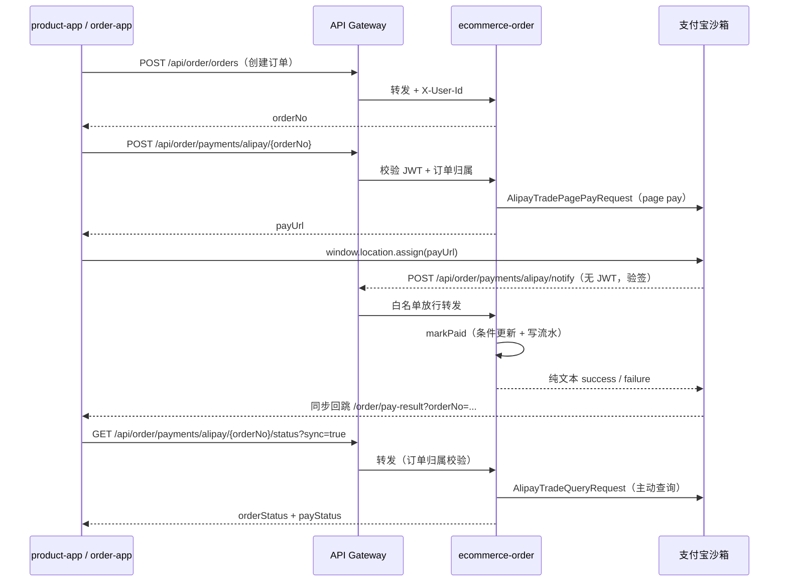

# 支付宝沙箱支付

<cite>
**本文引用的文件**
- [PaymentController.java](file://backend/ecommerce-order/src/main/java/com/ecommerce/order/controller/PaymentController.java)
- [AlipayPaymentServiceImpl.java](file://backend/ecommerce-order/src/main/java/com/ecommerce/order/service/impl/AlipayPaymentServiceImpl.java)
- [PaymentStateManager.java](file://backend/ecommerce-order/src/main/java/com/ecommerce/order/service/PaymentStateManager.java)
- [AlipayProperties.java](file://backend/ecommerce-order/src/main/java/com/ecommerce/order/config/AlipayProperties.java)
- [AlipayKeyUtils.java](file://backend/ecommerce-order/src/main/java/com/ecommerce/order/service/alipay/AlipayKeyUtils.java)
- [PaymentRecord.java](file://backend/ecommerce-order/src/main/java/com/ecommerce/order/entity/PaymentRecord.java)
- [init-sql/02-alipay-payment.sql](file://init-sql/02-alipay-payment.sql)
- [application.yml（订单服务）](file://backend/ecommerce-order/src/main/resources/application.yml)
- [AuthGlobalFilter.java](file://backend/ecommerce-gateway/src/main/java/com/ecommerce/gateway/filter/AuthGlobalFilter.java)
- [payment.ts](file://frontend/order-app/src/payment.ts)
- [route.ts](file://frontend/order-app/src/route.ts)
- [app.ts](file://frontend/order-app/src/app.ts)
- [payment-flow.spec.ts](file://frontend/e2e/payment-flow.spec.ts)
- [.env.example](file://.env.example)
</cite>

## 目录
1. [功能概览](#功能概览)
2. [端到端链路](#端到端链路)
3. [接口说明](#接口说明)
4. [幂等与安全校验](#幂等与安全校验)
5. [支付流水表](#支付流水表)
6. [前端结果页轮询](#前端结果页轮询)
7. [配置与验收](#配置与验收)

## 功能概览

订单服务接入支付宝「电脑网站支付（page pay）」沙箱：商品详情页「立即购买」与订单列表「去支付」都走同一条链路——创建订单 → 创建支付拿到收银台 `payUrl` → 整页跳转支付宝 → 异步通知 / 同步回跳 → 结果页轮询直到终态。

三个设计点决定了实现方式：

1. **支付结果以异步通知或主动查询为准**，同步回跳（`return_url`）只代表用户回到了本站。
2. **回调必须验签，且 `app_id` / 订单号 / 金额全部匹配**才允许把订单从「待支付」改为「已支付」。
3. **幂等靠条件更新**：只有 `WHERE status = PENDING_PAYMENT` 更新成功才写流水，重复通知不会二次变更。

## 端到端链路



**图表来源**
- [AlipayPaymentServiceImpl.java](file://backend/ecommerce-order/src/main/java/com/ecommerce/order/service/impl/AlipayPaymentServiceImpl.java)
- [PaymentController.java](file://backend/ecommerce-order/src/main/java/com/ecommerce/order/controller/PaymentController.java)
- [payment.ts](file://frontend/order-app/src/payment.ts)

## 接口说明

| 方法 | 路径 | 鉴权 | 说明 |
| --- | --- | --- | --- |
| POST | `/api/order/payments/alipay/{orderNo}` | JWT + 订单归属 | 创建支付：仅 `待支付(0)` 可创建；未配置参数返回业务码 `503`；返回 `payUrl` |
| GET | `/api/order/payments/alipay/{orderNo}/status` | JWT + 订单归属 | 查询支付状态；`sync=true`（默认）时先向支付宝主动查询并同步本地状态 |
| POST | `/api/order/payments/alipay/notify` | 支付宝验签（网关白名单） | 异步通知，校验通过返回纯文本 `success`，否则 `failure` |

要点：

- 网关白名单放行 `/api/order/payments/alipay/notify`（支付宝回调不带 JWT），安全性完全由回调验签保证；创建支付与查询仍要求 JWT。
- 回调接口 `produces = text/plain`，内部吞掉所有异常——否则全局异常处理会返回 `Result` JSON，支付宝读不到 `success` 会持续重试。
- 归属校验：普通用户只能操作自己的订单（`order.userId == X-User-Id`），`ADMIN` 放行；越权返回 403。

## 幂等与安全校验

**创建支付**

- `properties.isConfigured()` 为 false → `BusinessException(503, "支付宝支付未配置，请联系管理员")`；
- 订单状态不是 `PENDING_PAYMENT` → 400「当前订单状态不可支付」；
- `bizContent`：`out_trade_no`、`product_code=FAST_INSTANT_TRADE_PAY`、`total_amount`（两位小数）、`subject`（截断 128 字符）、`timeout_express`；
- `return_url` 自动追加 `orderNo`，用于结果页在支付宝未回传 `out_trade_no` 时兜底；
- 创建时写一条 `payment_record`（`INSERT IGNORE`，唯一键冲突静默忽略），写失败不阻断跳转。

**异步通知校验顺序**

```text
参数未配置 → failure
验签 rsaCheckV1(支付宝公钥) 失败 → failure（[ALIPAY-ALARM] 验签失败）
app_id 不匹配 → failure
out_trade_no 为空 → failure
trade_status 非 TRADE_SUCCESS / TRADE_FINISHED → success（不改订单状态）
total_amount 缺失或非法 → failure
markPaid() → CONFLICT 返回 failure，APPLIED / ALREADY_PAID 返回 success
```

**状态流转幂等（PaymentStateManager）**

- `@Transactional` 放在独立 Bean 中，避免同类自调用导致事务不生效；
- 订单已处于 `PAID / SHIPPED / COMPLETED` → `ALREADY_PAID`，仅尝试补齐流水 `trade_no`；
- 否则执行 `updateStatusIfCurrent(id, PENDING_PAYMENT, PAID)`；受影响行数为 0 时重新读取，若已被并发回调改为已支付则返回 `ALREADY_PAID`，否则 `CONFLICT`；
- 金额不一致直接 `CONFLICT` 并输出 `[ALIPAY-ALARM] 支付金额与订单金额不一致`；
- 交易关闭（`TRADE_CLOSED` / 查询返回关闭）只更新流水为 `CLOSED`，不回滚订单。

## 支付流水表

`init-sql/02-alipay-payment.sql`（幂等，已存在则跳过）：

| 字段 | 说明 |
| --- | --- |
| `order_no` | 订单号 |
| `channel` | 渠道，固定 `ALIPAY` |
| `trade_no` | 支付宝交易号（支付成功后回填） |
| `amount` | 支付金额（`DECIMAL(10,2)`） |
| `status` | `CREATED / PAID / FAILED / CLOSED` |
| `notify_payload` | 最近一次回调原文（截断到 2000 字符，便于排查） |
| `paid_time` | 支付成功时间 |

约束：`UNIQUE KEY uk_channel_order (channel, order_no)` 保证同一订单同一渠道只有一条流水（重复创建支付不会重复插入），`UNIQUE KEY uk_trade_no (trade_no)` 保证同一支付宝交易号不会关联到多个订单，`idx_status` 支撑按状态查询。

**章节来源**
- [init-sql/02-alipay-payment.sql](file://init-sql/02-alipay-payment.sql)
- [PaymentRecord.java](file://backend/ecommerce-order/src/main/java/com/ecommerce/order/entity/PaymentRecord.java)

## 前端结果页轮询

`order-app` 是原生 TypeScript 应用，支付相关逻辑被抽成三块便于单测：

- `route.ts`：`/order/pay-result?orderNo=...`（兼容支付宝回传的 `out_trade_no`）→ 支付结果页；`/order/detail/{orderNo}` → 订单详情；其余 → 订单列表；缺少订单号时退回列表。
- `payment.ts`：`isPayResultPath()`、订单号解析、状态映射（`PAID / PENDING / CLOSED / CANCELLED / FAILED`）、`createAlipayPayment()` 与 `queryPaymentStatus(sync)`；轮询参数 `PAY_POLL_INTERVAL = 2000`、`MAX_PAY_POLLS = 10`。
- `app.ts`：结果页每 2 秒调用一次 `status?sync=true`，命中终态即停止；约 20 秒（10 次）未命中则停止自动轮询，转为「手动刷新」，避免无限请求。

交互约束：

- 「立即购买」在商品详情页创建订单后跳 `/order/detail/{orderNo}`，由详情页发起支付；订单列表「去支付」直接调用创建支付；
- 创建支付返回 `503` 时前端提示「支付宝支付未配置」，不影响下单与秒杀等其它链路；
- 整页跳转收银台（`window.location.assign`）而非新窗口，回跳后由结果页接管状态确认。

## 配置与验收

| 变量 | 必填 | 说明 |
| --- | --- | --- |
| `ALIPAY_APP_ID` | 是 | 沙箱应用 APPID |
| `ALIPAY_PRIVATE_KEY` | 是 | 应用私钥（PKCS8），支持单行 Base64、含字面量 `\n`、带 PEM 头尾（`AlipayKeyUtils.normalize` 统一处理） |
| `ALIPAY_PUBLIC_KEY` | 是 | 支付宝公钥（沙箱控制台「支付宝公钥」，不是应用公钥） |
| `ALIPAY_GATEWAY_URL` | 否 | 默认 `https://openapi-sandbox.dl.alipaydev.com/gateway.do` |
| `ALIPAY_NOTIFY_URL` | 建议 | 必须是支付宝服务器可达的公网地址；为空时仅依赖结果页主动查询 |
| `ALIPAY_RETURN_URL` | 否 | 默认 `http://localhost:5173/order/pay-result`（创建支付时自动追加 `orderNo`） |
| `ALIPAY_SIGN_TYPE` | 否 | 默认 `RSA2` |
| `ALIPAY_TIMEOUT_EXPRESS` | 否 | 默认 `30m` |

启动日志可判断配置状态：`支付宝沙箱支付已启用` / `支付宝支付未配置`（后者仅告警，服务照常启动）。

验证步骤：

1. 执行 `init-sql/02-alipay-payment.sql`，配置环境变量后启动订单服务；
2. 登录 → 商品详情「立即购买」→ 跳转沙箱收银台 → 用沙箱买家账号付款；
3. 回到 `/order/pay-result?orderNo=...` 展示支付成功，订单状态「待支付 → 已支付」；
4. 负向：改错 `ALIPAY_PUBLIC_KEY` → 回调返回 `failure` 且日志出现 `[ALIPAY-ALARM] 验签失败`，订单状态不变；清空全部 `ALIPAY_*` → 创建支付返回 `code=503`；
5. 重复回调 / 重复查询：状态与流水均不二次变更。

E2E 用例 `payment-flow.spec.ts` 用 Mock 覆盖「立即购买 → 去支付 → 503 降级 → 秒杀不受影响」四条路径，不依赖真实收银台。