# 核心功能实现

<cite>
**本文引用的文件**   
- [README.md](file://README.md)
- [JwtTokenProvider.java](file://backend/ecommerce-user/src/main/java/com/ecommerce/user/security/JwtTokenProvider.java)
- [AuthGlobalFilter.java](file://backend/ecommerce-gateway/src/main/java/com/ecommerce/gateway/filter/AuthGlobalFilter.java)
- [TrustedAuthenticationFilter.java（用户服务）](file://backend/ecommerce-user/src/main/java/com/ecommerce/user/security/TrustedAuthenticationFilter.java)
- [TrustedAuthenticationFilter.java（商品服务）](file://backend/ecommerce-product/src/main/java/com/ecommerce/product/security/TrustedAuthenticationFilter.java)
- [TrustedAuthenticationFilter.java（订单服务）](file://backend/ecommerce-order/src/main/java/com/ecommerce/order/security/TrustedAuthenticationFilter.java)
- [SeckillStockService.java](file://backend/ecommerce-product/src/main/java/com/ecommerce/product/service/SeckillStockService.java)
- [seckill_stock.lua](file://backend/ecommerce-product/src/main/resources/lua/seckill_stock.lua)
- [SeckillController.java](file://backend/ecommerce-product/src/main/java/com/ecommerce/product/controller/SeckillController.java)
- [SeckillRabbitConfig.java（商品服务）](file://backend/ecommerce-product/src/main/java/com/ecommerce/product/config/SeckillRabbitConfig.java)
- [SeckillRabbitConfig.java（订单服务）](file://backend/ecommerce-order/src/main/java/com/ecommerce/order/config/SeckillRabbitConfig.java)
- [SeckillOrderConsumer.java](file://backend/ecommerce-order/src/main/java/com/ecommerce/order/consumer/SeckillOrderConsumer.java)
- [theme.ts](file://frontend/base-app/src/utils/theme.ts)
- [PaymentController.java](file://backend/ecommerce-order/src/main/java/com/ecommerce/order/controller/PaymentController.java)
- [AlipayPaymentServiceImpl.java](file://backend/ecommerce-order/src/main/java/com/ecommerce/order/service/impl/AlipayPaymentServiceImpl.java)
- [PaymentStateManager.java](file://backend/ecommerce-order/src/main/java/com/ecommerce/order/service/PaymentStateManager.java)
- [payment.ts（订单子应用）](file://frontend/order-app/src/payment.ts)
- [FileController.java](file://backend/ecommerce-product/src/main/java/com/ecommerce/product/controller/FileController.java)
- [FileStorageServiceRouter.java](file://backend/ecommerce-product/src/main/java/com/ecommerce/product/service/storage/FileStorageServiceRouter.java)
- [ImageUploadSupport.java](file://backend/ecommerce-product/src/main/java/com/ecommerce/product/service/storage/ImageUploadSupport.java)
- [ProductImageManage.vue](file://frontend/base-app/src/views/ProductImageManage.vue)
- [ImageUploader.vue](file://frontend/base-app/src/components/ImageUploader.vue)
- [main.py（ai-service）](file://ai-service/app/main.py)
- [insuranceAgent.ts](file://frontend/product-app/src/api/insuranceAgent.ts)
- [InsuranceChatDrawer.tsx](file://frontend/product-app/src/components/insurance/InsuranceChatDrawer.tsx)
</cite>

## 目录
1. [引言](#引言)
2. [项目结构](#项目结构)
3. [核心组件](#核心组件)
4. [架构总览](#架构总览)
5. [详细组件分析](#详细组件分析)
6. [依赖关系分析](#依赖关系分析)
7. [性能与高并发优化](#性能与高并发优化)
8. [故障排查指南](#故障排查指南)
9. [支付与图片上传](#支付与图片上传)
10. [AI 问答与保险咨询](#ai-问答与保险咨询)
11. [扩展开发指导](#扩展开发指导)
12. [结论](#结论)

## 引言
本文件聚焦于仓库中的核心业务实现，围绕以下目标展开：
- 用户认证与安全机制：JWT 令牌生成与校验、网关统一鉴权、信任头透传。
- 高并发秒杀系统：Redis Lua 原子性库存预扣、RabbitMQ 异步消息处理、防重复购买。
- 全局主题切换系统：前后端主题同步、持久化存储、跨应用状态管理。
- 交易闭环：支付宝沙箱支付，前端结果页轮询 + 后端条件更新保证幂等。
- 商品素材管理：管理员可上传/替换商品主图，OSS 与本地存储双路由。
- 保险咨询机器人：FastAPI + Milvus 的 RAG 问答服务，支持会话、回溯与知识库管理。
- 配套提供流程图、时序图、代码路径引用、性能优化建议、故障排查方法与扩展开发指导。

## 项目结构
后端采用 Spring Cloud 微服务架构，包含网关、用户、商品、订单等模块；前端基于 qiankun 微前端，包含主应用与两个子应用。整体通过网关统一入口进行鉴权与路由分发，下游服务通过信任头获取当前用户上下文。

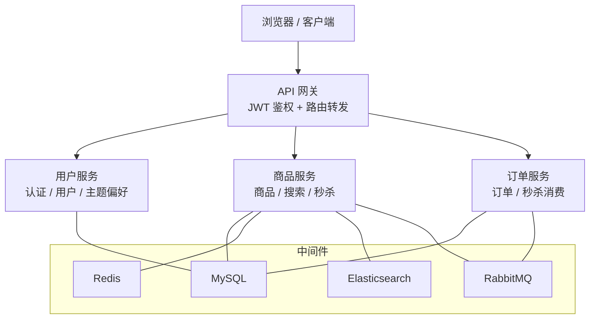

**图示来源**
- [README.md:16-47](file://README.md#L16-L47)

**章节来源**
- [README.md:1-150](file://README.md#L1-L150)

## 核心组件
- 用户认证与安全
  - JWT 工具类：负责生成、解析、校验 Token。
  - 网关全局过滤器：统一鉴权、白名单放行、透传用户信息。
  - 下游服务可信认证过滤器：读取网关注入的用户头并设置安全上下文。
- 高并发秒杀
  - 库存服务：基于 Redis + Lua 脚本的原子预扣减、回滚、购买标记。
  - 秒杀控制器：业务校验、Lua 预扣、防重复购买、发送 MQ 消息。
  - RabbitMQ 配置：交换机、队列、死信队列绑定。
  - 消费者：监听队列、创建订单、异常进入死信队列。
- 全局主题切换
  - 前端主题工具：本地缓存、响应式状态、后端同步、HTML class 控制。
  - 后端主题 API：获取与更新用户主题偏好。

**章节来源**
- [JwtTokenProvider.java:18-75](file://backend/ecommerce-user/src/main/java/com/ecommerce/user/security/JwtTokenProvider.java#L18-L75)
- [AuthGlobalFilter.java:41-170](file://backend/ecommerce-gateway/src/main/java/com/ecommerce/gateway/filter/AuthGlobalFilter.java#L41-L170)
- [TrustedAuthenticationFilter.java（用户服务）:24-50](file://backend/ecommerce-user/src/main/java/com/ecommerce/user/security/TrustedAuthenticationFilter.java#L24-L50)
- [TrustedAuthenticationFilter.java（商品服务）:31-49](file://backend/ecommerce-product/src/main/java/com/ecommerce/product/security/TrustedAuthenticationFilter.java#L31-L49)
- [TrustedAuthenticationFilter.java（订单服务）:30-44](file://backend/ecommerce-order/src/main/java/com/ecommerce/order/security/TrustedAuthenticationFilter.java#L30-L44)
- [SeckillStockService.java:15-92](file://backend/ecommerce-product/src/main/java/com/ecommerce/product/service/SeckillStockService.java#L15-L92)
- [seckill_stock.lua:1-13](file://backend/ecommerce-product/src/main/resources/lua/seckill_stock.lua#L1-L13)
- [SeckillController.java:83-115](file://backend/ecommerce-product/src/main/java/com/ecommerce/product/controller/SeckillController.java#L83-L115)
- [SeckillRabbitConfig.java（商品服务）:10-40](file://backend/ecommerce-product/src/main/java/com/ecommerce/product/config/SeckillRabbitConfig.java#L10-L40)
- [SeckillRabbitConfig.java（订单服务）:10-38](file://backend/ecommerce-order/src/main/java/com/ecommerce/order/config/SeckillRabbitConfig.java#L10-L38)
- [SeckillOrderConsumer.java:21-70](file://backend/ecommerce-order/src/main/java/com/ecommerce/order/consumer/SeckillOrderConsumer.java#L21-L70)
- [theme.ts:1-88](file://frontend/base-app/src/utils/theme.ts#L1-L88)

## 架构总览
下图展示一次受保护请求从网关到下游服务的完整链路，包括 JWT 校验、用户头透传与下游信任认证。

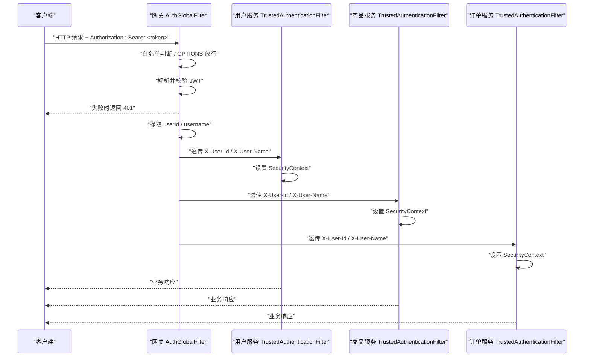

**图示来源**
- [AuthGlobalFilter.java:80-141](file://backend/ecommerce-gateway/src/main/java/com/ecommerce/gateway/filter/AuthGlobalFilter.java#L80-L141)
- [TrustedAuthenticationFilter.java（用户服务）:32-49](file://backend/ecommerce-user/src/main/java/com/ecommerce/user/security/TrustedAuthenticationFilter.java#L32-L49)
- [TrustedAuthenticationFilter.java（商品服务）:31-49](file://backend/ecommerce-product/src/main/java/com/ecommerce/product/security/TrustedAuthenticationFilter.java#L31-L49)
- [TrustedAuthenticationFilter.java（订单服务）:30-44](file://backend/ecommerce-order/src/main/java/com/ecommerce/order/security/TrustedAuthenticationFilter.java#L30-L44)

## 详细组件分析

### 用户认证与安全机制

#### JWT 令牌生成与校验
- 生成：使用 HS256 签名，载荷包含用户名与用户 ID，附带签发时间与过期时间。
- 解析：根据密钥解析 Claims，非法或过期会抛出对应异常。
- 校验：封装为布尔方法，捕获异常后返回无效结果。

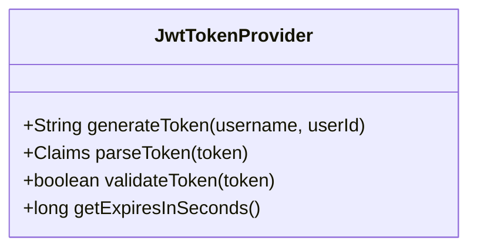

**图示来源**
- [JwtTokenProvider.java:18-75](file://backend/ecommerce-user/src/main/java/com/ecommerce/user/security/JwtTokenProvider.java#L18-L75)

**章节来源**
- [JwtTokenProvider.java:18-75](file://backend/ecommerce-user/src/main/java/com/ecommerce/user/security/JwtTokenProvider.java#L18-L75)

#### 网关统一鉴权与信任头透传
- 白名单放行：登录、注册、验证码、健康检查以及 Swagger 文档路径。
- Token 提取与校验：从 Authorization 头提取 Bearer Token，使用相同密钥校验签名与有效期。
- 用户头透传：将 userId 与 username 写入 X-User-Id 与 X-User-Name 请求头，传递给下游服务。
- 错误处理：未授权、Token 过期、Token 无效直接返回 HTTP 401。

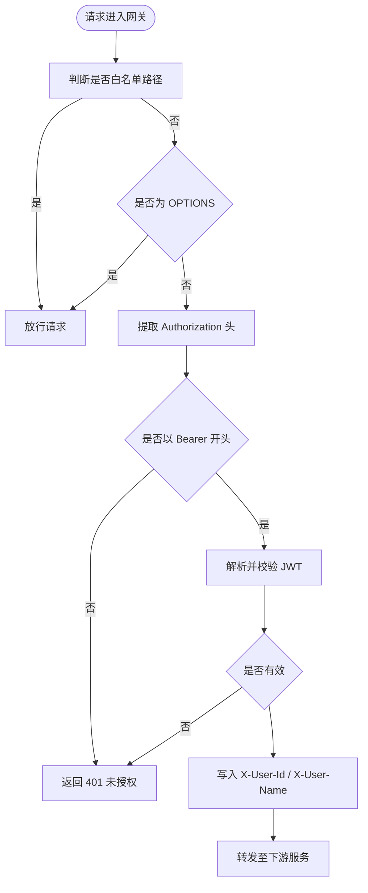

**图示来源**
- [AuthGlobalFilter.java:80-141](file://backend/ecommerce-gateway/src/main/java/com/ecommerce/gateway/filter/AuthGlobalFilter.java#L80-L141)

**章节来源**
- [AuthGlobalFilter.java:41-170](file://backend/ecommerce-gateway/src/main/java/com/ecommerce/gateway/filter/AuthGlobalFilter.java#L41-L170)

#### 下游服务信任认证过滤器
- 用户服务、商品服务、订单服务均实现可信认证过滤器，从请求头中读取 X-User-Id 与 X-User-Name。
- 若存在则构造 UsernamePasswordAuthenticationToken 并设置到 SecurityContext，赋予 ROLE_USER 权限。
- 该设计避免下游服务重复校验 JWT，提升性能并简化鉴权逻辑。

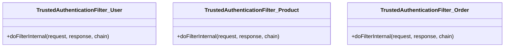

**图示来源**
- [TrustedAuthenticationFilter.java（用户服务）:24-50](file://backend/ecommerce-user/src/main/java/com/ecommerce/user/security/TrustedAuthenticationFilter.java#L24-L50)
- [TrustedAuthenticationFilter.java（商品服务）:31-49](file://backend/ecommerce-product/src/main/java/com/ecommerce/product/security/TrustedAuthenticationFilter.java#L31-L49)
- [TrustedAuthenticationFilter.java（订单服务）:30-44](file://backend/ecommerce-order/src/main/java/com/ecommerce/order/security/TrustedAuthenticationFilter.java#L30-L44)

**章节来源**
- [TrustedAuthenticationFilter.java（用户服务）:24-50](file://backend/ecommerce-user/src/main/java/com/ecommerce/user/security/TrustedAuthenticationFilter.java#L24-L50)
- [TrustedAuthenticationFilter.java（商品服务）:31-49](file://backend/ecommerce-product/src/main/java/com/ecommerce/product/security/TrustedAuthenticationFilter.java#L31-L49)
- [TrustedAuthenticationFilter.java（订单服务）:30-44](file://backend/ecommerce-order/src/main/java/com/ecommerce/order/security/TrustedAuthenticationFilter.java#L30-L44)

### 高并发秒杀系统

#### Redis Lua 脚本原子性库存预扣
- 脚本输入：库存 key 与扣减数量。
- 逻辑：读取库存值，若未初始化返回 -1；若不足返回 0；否则 DECRBY 扣减并返回剩余库存。
- 调用方：SeckillStockService 通过 DefaultRedisScript 执行脚本，封装预扣、回滚、查询等方法。

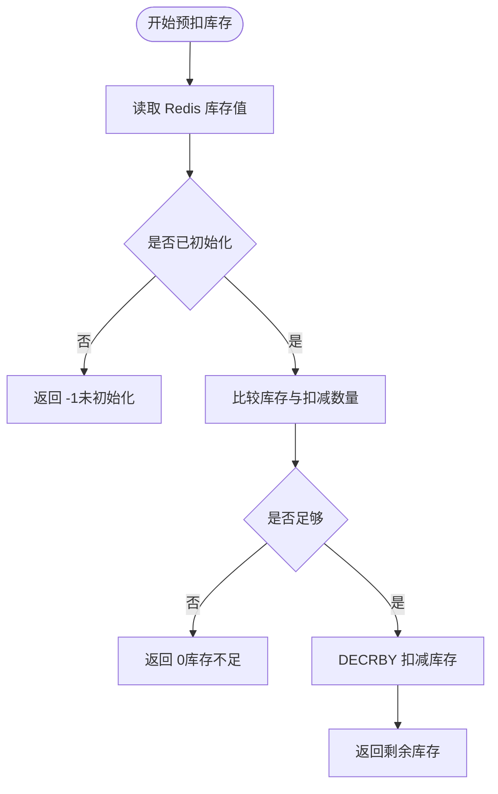

**图示来源**
- [seckill_stock.lua:1-13](file://backend/ecommerce-product/src/main/resources/lua/seckill_stock.lua#L1-L13)
- [SeckillStockService.java:40-49](file://backend/ecommerce-product/src/main/java/com/ecommerce/product/service/SeckillStockService.java#L40-L49)

**章节来源**
- [seckill_stock.lua:1-13](file://backend/ecommerce-product/src/main/resources/lua/seckill_stock.lua#L1-L13)
- [SeckillStockService.java:15-92](file://backend/ecommerce-product/src/main/java/com/ecommerce/product/service/SeckillStockService.java#L15-L92)

#### 防重复购买机制
- 购买标记：使用 Redis Key `seckill:bought:{productId}:{userId}`，设置 24 小时过期。
- 检查逻辑：在发起秒杀前检查是否已购买，若已购买则拒绝请求。
- 清理逻辑：消费失败时可清除购买标记以便重试。

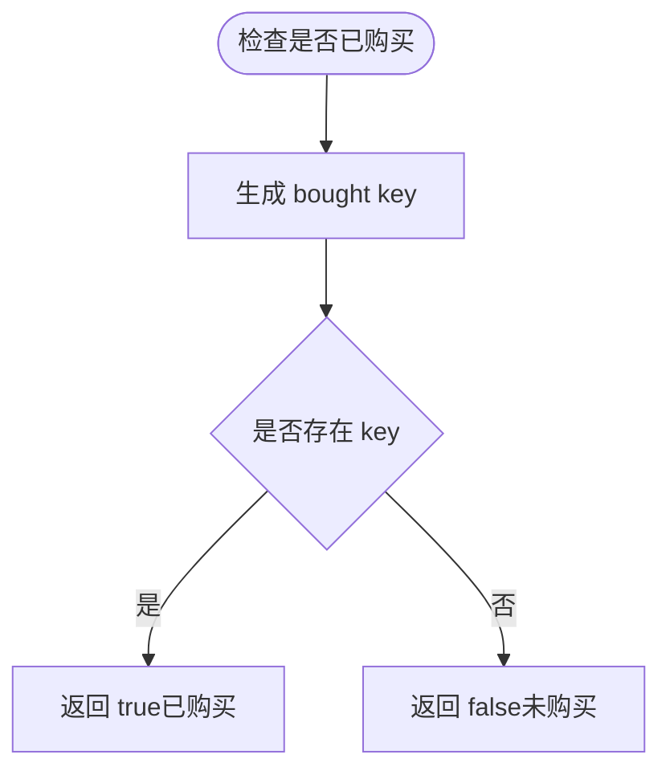

**图示来源**
- [SeckillStockService.java:68-82](file://backend/ecommerce-product/src/main/java/com/ecommerce/product/service/SeckillStockService.java#L68-L82)

**章节来源**
- [SeckillStockService.java:68-82](file://backend/ecommerce-product/src/main/java/com/ecommerce/product/service/SeckillStockService.java#L68-L82)

#### RabbitMQ 异步消息处理
- 生产者（商品服务）：
  - 定义 Direct 交换机与队列，绑定路由键。
  - 发送 SeckillMessage 到 seckill.exchange，路由键 seckill.order。
- 消费者（订单服务）：
  - 监听 seckill.order.queue，消费消息并创建订单。
  - 消费失败抛出异常，消息进入死信队列，便于后续人工处理或定时重试。

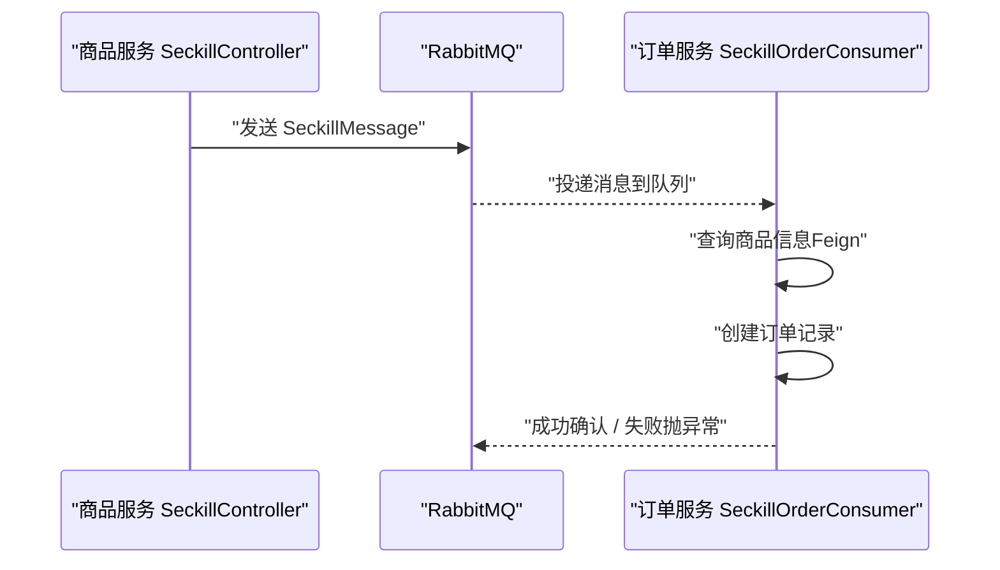

**图示来源**
- [SeckillController.java:101-115](file://backend/ecommerce-product/src/main/java/com/ecommerce/product/controller/SeckillController.java#L101-L115)
- [SeckillRabbitConfig.java（商品服务）:10-40](file://backend/ecommerce-product/src/main/java/com/ecommerce/product/config/SeckillRabbitConfig.java#L10-L40)
- [SeckillRabbitConfig.java（订单服务）:10-38](file://backend/ecommerce-order/src/main/java/com/ecommerce/order/config/SeckillRabbitConfig.java#L10-L38)
- [SeckillOrderConsumer.java:35-67](file://backend/ecommerce-order/src/main/java/com/ecommerce/order/consumer/SeckillOrderConsumer.java#L35-L67)

**章节来源**
- [SeckillController.java:83-115](file://backend/ecommerce-product/src/main/java/com/ecommerce/product/controller/SeckillController.java#L83-L115)
- [SeckillRabbitConfig.java（商品服务）:10-40](file://backend/ecommerce-product/src/main/java/com/ecommerce/product/config/SeckillRabbitConfig.java#L10-L40)
- [SeckillRabbitConfig.java（订单服务）:10-38](file://backend/ecommerce-order/src/main/java/com/ecommerce/order/config/SeckillRabbitConfig.java#L10-L38)
- [SeckillOrderConsumer.java:21-70](file://backend/ecommerce-order/src/main/java/com/ecommerce/order/consumer/SeckillOrderConsumer.java#L21-L70)

### 全局主题切换系统

#### 前后端主题同步与持久化
- 前端主题工具：
  - 本地缓存：localStorage 存储 qoder_theme，默认 dark。
  - 响应式状态：Vue ref 暴露 themeRef，供组件实时读取。
  - HTML class 控制：通过 document.documentElement.classList 添加或移除 dark。
  - 后端同步：setTheme 异步调用 PUT /user/users/theme 保存偏好；initTheme 启动时从后端加载最新偏好。
- 后端主题 API：
  - GET /user/users/theme：返回当前用户主题偏好。
  - PUT /user/users/theme：更新当前用户主题偏好。

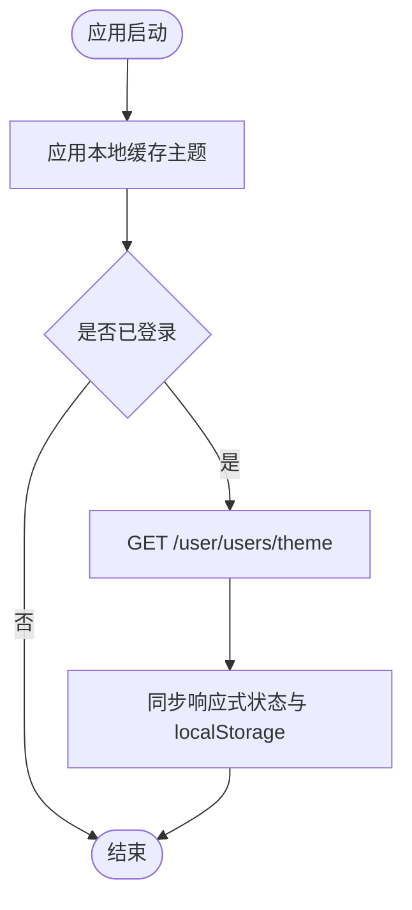

**图示来源**
- [theme.ts:69-87](file://frontend/base-app/src/utils/theme.ts#L69-L87)

**章节来源**
- [theme.ts:1-88](file://frontend/base-app/src/utils/theme.ts#L1-L88)

## 依赖关系分析

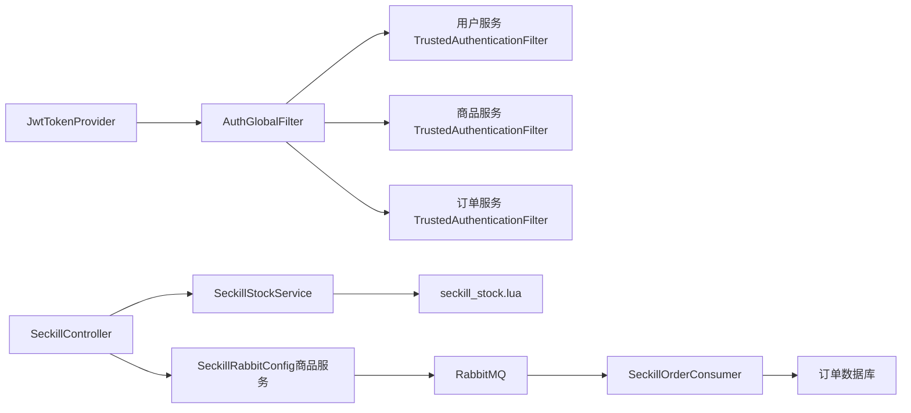

**图示来源**
- [JwtTokenProvider.java:18-75](file://backend/ecommerce-user/src/main/java/com/ecommerce/user/security/JwtTokenProvider.java#L18-L75)
- [AuthGlobalFilter.java:41-170](file://backend/ecommerce-gateway/src/main/java/com/ecommerce/gateway/filter/AuthGlobalFilter.java#L41-L170)
- [TrustedAuthenticationFilter.java（用户服务）:24-50](file://backend/ecommerce-user/src/main/java/com/ecommerce/user/security/TrustedAuthenticationFilter.java#L24-L50)
- [TrustedAuthenticationFilter.java（商品服务）:31-49](file://backend/ecommerce-product/src/main/java/com/ecommerce/product/security/TrustedAuthenticationFilter.java#L31-L49)
- [TrustedAuthenticationFilter.java（订单服务）:30-44](file://backend/ecommerce-order/src/main/java/com/ecommerce/order/security/TrustedAuthenticationFilter.java#L30-L44)
- [SeckillController.java:83-115](file://backend/ecommerce-product/src/main/java/com/ecommerce/product/controller/SeckillController.java#L83-L115)
- [SeckillStockService.java:15-92](file://backend/ecommerce-product/src/main/java/com/ecommerce/product/service/SeckillStockService.java#L15-L92)
- [seckill_stock.lua:1-13](file://backend/ecommerce-product/src/main/resources/lua/seckill_stock.lua#L1-L13)
- [SeckillRabbitConfig.java（商品服务）:10-40](file://backend/ecommerce-product/src/main/java/com/ecommerce/product/config/SeckillRabbitConfig.java#L10-L40)
- [SeckillRabbitConfig.java（订单服务）:10-38](file://backend/ecommerce-order/src/main/java/com/ecommerce/order/config/SeckillRabbitConfig.java#L10-L38)
- [SeckillOrderConsumer.java:21-70](file://backend/ecommerce-order/src/main/java/com/ecommerce/order/consumer/SeckillOrderConsumer.java#L21-L70)

**章节来源**
- [README.md:16-47](file://README.md#L16-L47)

## 性能与高并发优化
- 网关鉴权优化
  - 白名单与 OPTIONS 快速放行，减少不必要的 JWT 解析开销。
  - 使用 Reactor 非阻塞 I/O，提高吞吐能力。
- Redis Lua 原子操作
  - 将读、判空、扣减合并为单次原子执行，避免竞争条件与超卖。
  - 预热库存至 Redis，降低数据库压力。
- RabbitMQ 异步解耦
  - 秒杀下单异步化，削峰填谷，提升用户体验。
  - 死信队列用于失败消息兜底，便于监控与补偿。
- 防重复购买
  - 使用 Redis 键过期策略限制重复购买窗口，减少数据库冲突。
- 前端主题切换
  - 本地缓存优先，后端同步异步化，不阻塞 UI 渲染。

[本节为通用性能建议，不直接分析具体文件]

## 故障排查指南
- 网关鉴权失败
  - 现象：HTTP 401，提示“未授权访问”“Token 已过期”“Token 无效”。
  - 排查点：Authorization 头格式、JWT 密钥一致性、白名单配置。
  - 参考：[AuthGlobalFilter.java:95-141](file://backend/ecommerce-gateway/src/main/java/com/ecommerce/gateway/filter/AuthGlobalFilter.java#L95-L141)
- 下游服务无法识别用户
  - 现象：SecurityContext 为空，权限校验失败。
  - 排查点：X-User-Id / X-User-Name 是否透传，TrustedAuthenticationFilter 是否生效。
  - 参考：
    - [TrustedAuthenticationFilter.java（用户服务）:32-49](file://backend/ecommerce-user/src/main/java/com/ecommerce/user/security/TrustedAuthenticationFilter.java#L32-L49)
    - [TrustedAuthenticationFilter.java（商品服务）:31-49](file://backend/ecommerce-product/src/main/java/com/ecommerce/product/security/TrustedAuthenticationFilter.java#L31-L49)
    - [TrustedAuthenticationFilter.java（订单服务）:30-44](file://backend/ecommerce-order/src/main/java/com/ecommerce/order/security/TrustedAuthenticationFilter.java#L30-L44)
- 秒杀库存异常
  - 现象：返回 -1（未初始化）或 0（库存不足）。
  - 排查点：Redis Key 是否正确、Lua 脚本是否加载、库存初始化接口是否调用。
  - 参考：
    - [SeckillStockService.java:32-49](file://backend/ecommerce-product/src/main/java/com/ecommerce/product/service/SeckillStockService.java#L32-L49)
    - [seckill_stock.lua:1-13](file://backend/ecommerce-product/src/main/resources/lua/seckill_stock.lua#L1-L13)
- 消息消费失败
  - 现象：订单未创建，消息进入死信队列。
  - 排查点：消费者日志、Feign 调用结果、数据库写入异常。
  - 参考：
    - [SeckillOrderConsumer.java:35-67](file://backend/ecommerce-order/src/main/java/com/ecommerce/order/consumer/SeckillOrderConsumer.java#L35-L67)
    - [SeckillRabbitConfig.java（订单服务）:20-38](file://backend/ecommerce-order/src/main/java/com/ecommerce/order/config/SeckillRabbitConfig.java#L20-L38)

**章节来源**
- [AuthGlobalFilter.java:95-141](file://backend/ecommerce-gateway/src/main/java/com/ecommerce/gateway/filter/AuthGlobalFilter.java#L95-L141)
- [TrustedAuthenticationFilter.java（用户服务）:32-49](file://backend/ecommerce-user/src/main/java/com/ecommerce/user/security/TrustedAuthenticationFilter.java#L32-L49)
- [TrustedAuthenticationFilter.java（商品服务）:31-49](file://backend/ecommerce-product/src/main/java/com/ecommerce/product/security/TrustedAuthenticationFilter.java#L31-L49)
- [TrustedAuthenticationFilter.java（订单服务）:30-44](file://backend/ecommerce-order/src/main/java/com/ecommerce/order/security/TrustedAuthenticationFilter.java#L30-L44)
- [SeckillStockService.java:32-49](file://backend/ecommerce-product/src/main/java/com/ecommerce/product/service/SeckillStockService.java#L32-L49)
- [seckill_stock.lua:1-13](file://backend/ecommerce-product/src/main/resources/lua/seckill_stock.lua#L1-L13)
- [SeckillOrderConsumer.java:35-67](file://backend/ecommerce-order/src/main/java/com/ecommerce/order/consumer/SeckillOrderConsumer.java#L35-L67)
- [SeckillRabbitConfig.java（订单服务）:20-38](file://backend/ecommerce-order/src/main/java/com/ecommerce/order/config/SeckillRabbitConfig.java#L20-L38)

## 支付与图片上传
本节补充两条围绕"交易"与"素材"的基础能力链路：前者位于订单服务，后者位于商品服务。

### 支付宝沙箱支付（订单服务）
- 接口入口：[PaymentController.java](file://backend/ecommerce-order/src/main/java/com/ecommerce/order/controller/PaymentController.java)
  - `POST /payments/alipay/{orderNo}`：发起支付，返回收银台 `payUrl` 与超时时间。
  - `GET /payments/alipay/{orderNo}/status?sync=true`：查询支付状态，`sync=true` 时主动向支付宝确认。
  - `POST /payments/alipay/notify`：异步回调，`produces = text/plain` 返回 `success`。
- 回调校验顺序：[AlipayPaymentServiceImpl.java](file://backend/ecommerce-order/src/main/java/com/ecommerce/order/service/impl/AlipayPaymentServiceImpl.java)
  - 参数未配置 → 验签 → `app_id` → `out_trade_no` → `trade_status` → 金额一致性 → 落库。
  - 任一步失败即提前返回，不修改订单状态，避免被伪造通知"洗白"。
- 幂等与并发：[PaymentStateManager.java](file://backend/ecommerce-order/src/main/java/com/ecommerce/order/service/PaymentStateManager.java)
  - 以 `WHERE status = PENDING_PAYMENT` 的条件更新驱动状态流转，命中 0 行时区分 `ALREADY_PAID` 与 `CONFLICT`。
  - `payment_record` 表以 `UNIQUE(channel, order_no)`、`UNIQUE(trade_no)` 双重去重，重复回调不会产生多条流水。
- 前端结果页：[payment.ts](file://frontend/order-app/src/payment.ts)
  - `isPayResultPath` / `getPayResultOrderNo` 解析回跳地址，兼容支付宝携带的 `out_trade_no`。
  - `mapPaymentResult` 将后端状态映射为 `SUCCESS/PENDING/CLOSED/CANCELLED/FAILED` 视图模型。
  - 每 2 秒轮询（`PAY_POLL_INTERVAL`），最多 10 次（`MAX_PAY_POLLS`）后转手动刷新，`isFinalPayState` 判定终态即停止。

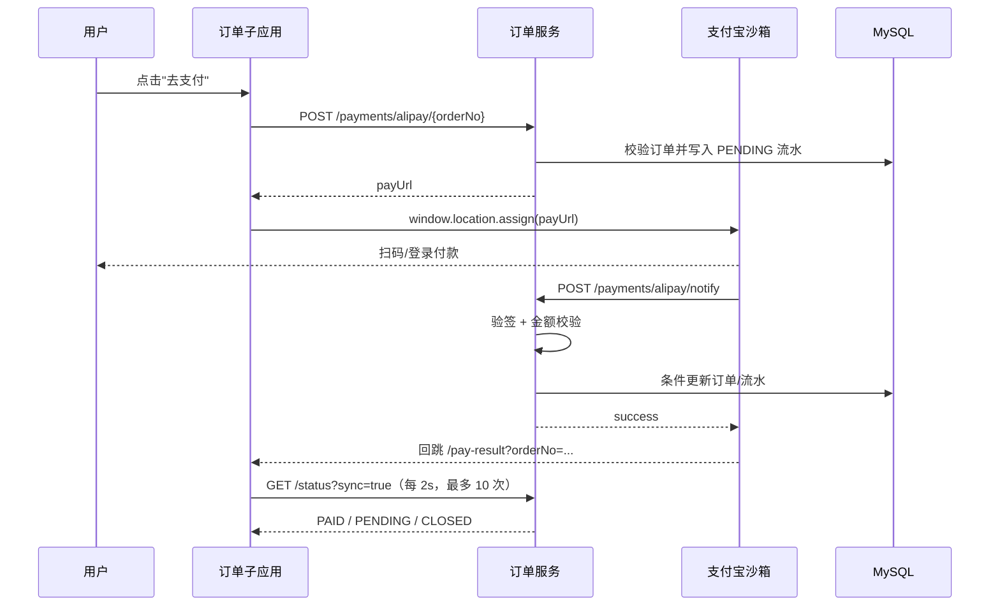

**图表来源**
- [PaymentController.java](file://backend/ecommerce-order/src/main/java/com/ecommerce/order/controller/PaymentController.java)
- [AlipayPaymentServiceImpl.java](file://backend/ecommerce-order/src/main/java/com/ecommerce/order/service/impl/AlipayPaymentServiceImpl.java)
- [payment.ts:41-144](file://frontend/order-app/src/payment.ts#L41-L144)

### 商品图片上传（商品服务）
- 接口入口：[FileController.java](file://backend/ecommerce-product/src/main/java/com/ecommerce/product/controller/FileController.java)
  - `POST /files/images`：管理员上传图片，返回 `url` 与 `objectKey`。
  - `DELETE /files/images?objectKey=`：按对象键删除。
  - `PUT /products/{id}/image`：仅回写 `image_url`，传空串表示清空主图。
- 存储路由：[FileStorageServiceRouter.java](file://backend/ecommerce-product/src/main/java/com/ecommerce/product/service/storage/FileStorageServiceRouter.java)
  - `OssProperties.isConfigured()` 为真走对象存储，否则回落本地磁盘（URL 前缀 `/api/product/files/local`）。
  - `OssClientProvider` 懒加载，未配置时上传接口返回 503 而非启动失败。
- 安全校验：[ImageUploadSupport.java](file://backend/ecommerce-product/src/main/java/com/ecommerce/product/service/storage/ImageUploadSupport.java)
  - 读取前 12 字节比对魔数，拒绝仅改扩展名的伪装文件；同时限制 5MB 大小与 jpeg/png/webp/gif 类型。
- 前端链路：[ProductImageManage.vue](file://frontend/base-app/src/views/ProductImageManage.vue) + [ImageUploader.vue](file://frontend/base-app/src/components/ImageUploader.vue)
  - 选择商品 → 上传拿 `objectKey` → 调用 `PUT /products/{id}/image` 生效；替换/删除时先落库再清旧文件，避免出现悬空引用。

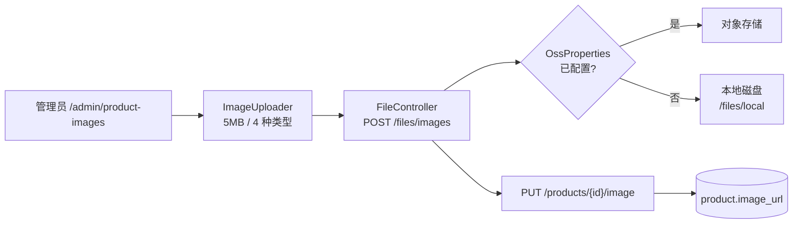

**图表来源**
- [FileController.java](file://backend/ecommerce-product/src/main/java/com/ecommerce/product/controller/FileController.java)
- [FileStorageServiceRouter.java](file://backend/ecommerce-product/src/main/java/com/ecommerce/product/service/storage/FileStorageServiceRouter.java)
- [ProductImageManage.vue](file://frontend/base-app/src/views/ProductImageManage.vue)

## AI 问答与保险咨询
保险商品（`category = insurance`）不参与常规下单流程，而是通过"咨询—推荐—投保"的对话链路完成转化，其能力由仓库内独立的 Python 服务提供。

- 服务进程：`ai-service`（FastAPI），通过网关 `/api/ai/**` 暴露，与 Java 微服务并列部署，不注册到 Nacos 的服务发现中。
- 核心能力：
  - 会话管理：创建/查询/删除会话，按 `session_id` 隔离上下文。
  - 流式问答：`POST /chat` 以 SSE 分帧返回，先推 `meta`/`token` 事件，最后 `done`。
  - 回溯：基于 LangGraph checkpoint 保存每一步状态，可回退到任意节点重答。
  - 知识库：文档上传 → 切分 → 向量化 → 写入 Milvus，供检索增强使用（写操作仅管理员）。
- 检索增强：`app/rag` 中完成 PDF 解析、分块与向量化，`Milvus` 承担相似度检索，召回片段拼入提示词后再交由模型生成。
- 前端接入：[insuranceAgent.ts](file://frontend/product-app/src/api/insuranceAgent.ts) 负责 REST 调用与 SSE 解析（按空行分帧，兼容多行 `data`）；[InsuranceChatDrawer.tsx](file://frontend/product-app/src/components/insurance/InsuranceChatDrawer.tsx) 提供"对话 / 回溯 / 知识库"三个标签页，其中知识库仅对 ADMIN 可见，关闭抽屉或切换会话时统一 `abort` 未完成请求。
- 失败兜底：后端异常同时兼容 `{ detail }` 与 `{ code, message }` 两种错误体；SSE 中断时前端保留已渲染内容并提示重试。

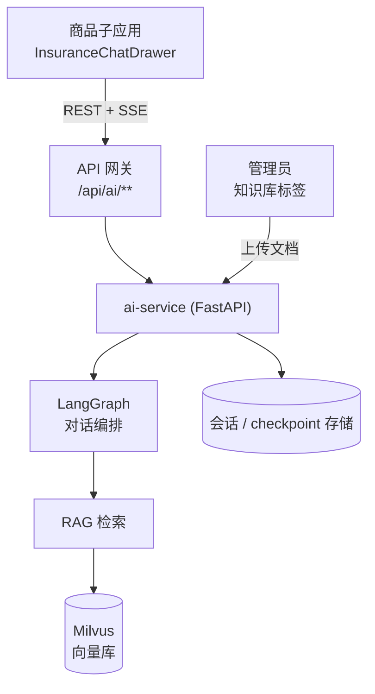

**图表来源**
- [main.py（ai-service）](file://ai-service/app/main.py)
- [insuranceAgent.ts](file://frontend/product-app/src/api/insuranceAgent.ts)
- [InsuranceChatDrawer.tsx](file://frontend/product-app/src/components/insurance/InsuranceChatDrawer.tsx)

## 扩展开发指导
- 新增受保护接口
  - 确保网关白名单不包含该路径，使 JWT 鉴权生效。
  - 下游服务无需额外鉴权，直接使用 SecurityContext 中的用户信息。
- 扩展秒杀流程
  - 在 SeckillController 中增加业务校验与风控逻辑。
  - 在 SeckillStockService 中扩展购买标记策略（如多商品限购、黑名单）。
  - 在消费者中增加补偿逻辑（如超时取消、库存回滚）。
- 扩展主题系统
  - 前端新增主题模式时，更新 theme.ts 的类型与应用逻辑。
  - 后端扩展用户偏好字段，并在主题 API 中支持新值。
  - 子应用接入主题同步，确保暗黑/亮色适配一致。
- 接入新的支付渠道
  - 在订单服务新增渠道实现，复用 `PaymentStateManager` 的条件更新保证幂等，避免各渠道各写一套状态机。
  - `payment_record` 的 `UNIQUE(channel, order_no)` 已按渠道隔离，新增渠道无需改表结构。
- 增加新的文件类型
  - 扩展 `ImageUploadSupport` 的类型白名单与魔数表，同步调整前端 `ImageUploader` 的 `ALLOWED_TYPES` 与 `maxSizeMb`。
  - 若切换存储后端，只需在 `FileStorageServiceRouter` 增加分支，控制器无需改动。
- 扩展 AI 能力
  - 新增检索来源时，在 `ai-service/app/rag` 中实现对应的 loader/splitter，并复用现有向量化与入库流程。
  - 新增前端展示形态时，优先复用 `insuranceAgent.ts` 的 SSE 解析器，避免重复实现流式协议。

[本节为通用扩展指导，不直接分析具体文件]

## 结论
本项目通过网关统一鉴权与信任头透传，构建了清晰的安全边界；借助 Redis Lua 与 RabbitMQ 实现了高并发秒杀场景下的原子预扣与异步解耦；前端主题系统在跨应用中实现了良好的同步与持久化体验。建议在后续迭代中持续完善异常补偿、监控告警与性能压测，以提升系统的稳定性与可观测性。