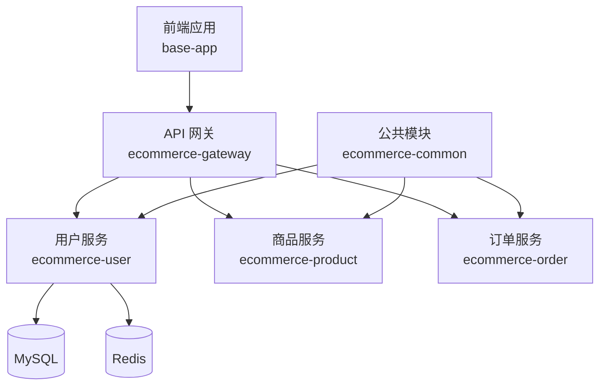
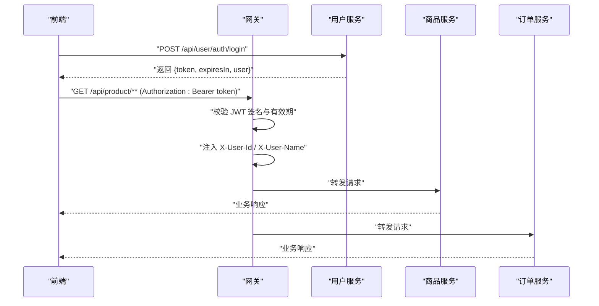
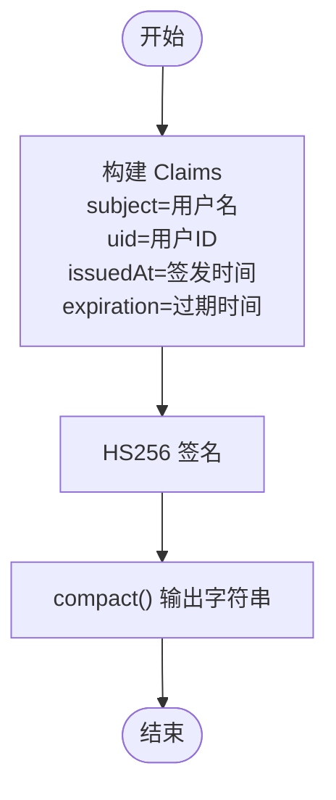
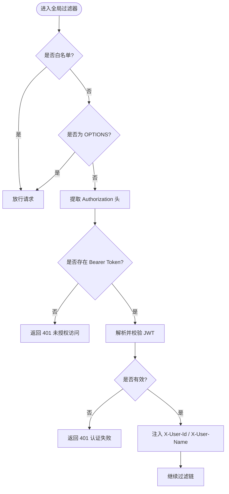
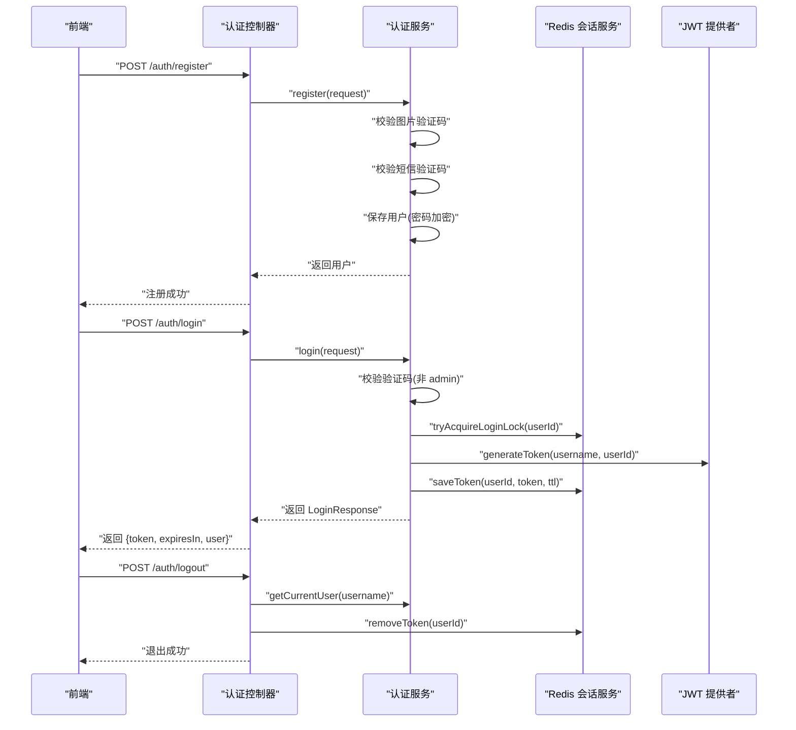
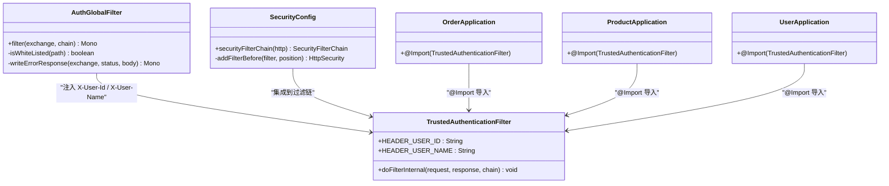
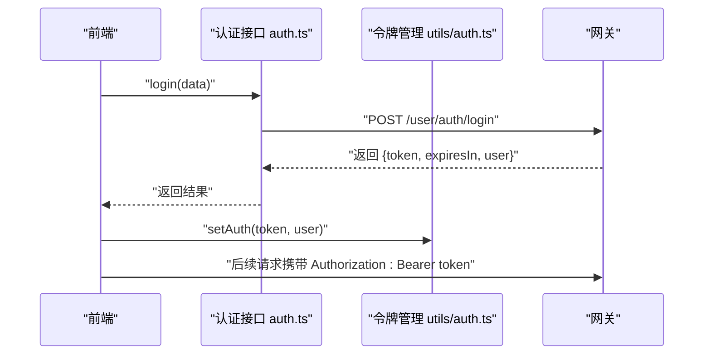
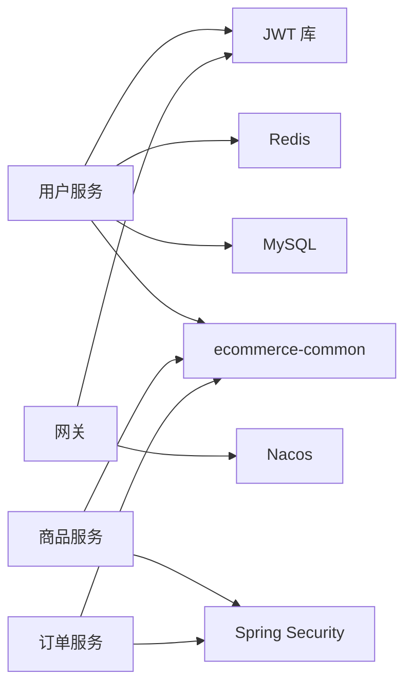

# 认证与安全机制

<cite>
**本文引用的文件**   
- [JwtTokenProvider.java](file://backend/ecommerce-user/src/main/java/com/ecommerce/user/security/JwtTokenProvider.java)
- [AuthGlobalFilter.java](file://backend/ecommerce-gateway/src/main/java/com/ecommerce/gateway/filter/AuthGlobalFilter.java)
- [AuthController.java](file://backend/ecommerce-user/src/main/java/com/ecommerce/user/controller/AuthController.java)
- [AuthServiceImpl.java](file://backend/ecommerce-user/src/main/java/com/ecommerce/user/service/impl/AuthServiceImpl.java)
- [RedisSessionService.java](file://backend/ecommerce-user/src/main/java/com/ecommerce/user/service/RedisSessionService.java)
- [RedisSessionServiceImpl.java](file://backend/ecommerce-user/src/main/java/com/ecommerce/user/service/impl/RedisSessionServiceImpl.java)
- [TrustedAuthenticationFilter.java（公共模块）](file://backend/ecommerce-common/src/main/java/com/ecommerce/common/security/TrustedAuthenticationFilter.java)
- [SecurityConfig.java（公共模块）](file://backend/ecommerce-common/src/main/java/com/ecommerce/common/config/SecurityConfig.java)
- [OrderApplication.java](file://backend/ecommerce-order/src/main/java/com/ecommerce/order/OrderApplication.java)
- [ProductApplication.java](file://backend/ecommerce-product/src/main/java/com/ecommerce/product/ProductApplication.java)
- [UserApplication.java](file://backend/ecommerce-user/src/main/java/com/ecommerce/user/UserApplication.java)
- [application.yml（用户服务）](file://backend/ecommerce-user/src/main/resources/application.yml)
- [application.yml（网关）](file://backend/ecommerce-gateway/src/main/resources/application.yml)
- [auth.ts（前端认证接口）](file://frontend/base-app/src/api/auth.ts)
- [auth.ts（前端令牌管理）](file://frontend/base-app/src/utils/auth.ts)
</cite>

## 更新摘要
**变更内容**   
- 可信认证过滤器已从各微服务中移除重复实现，统一集中到 ecommerce-common 模块
- 所有微服务通过 @Import 注解导入公共的 TrustedAuthenticationFilter
- 更新了信任头透传机制的实现方式，从分散实现改为集中配置
- 增强了架构的可维护性和一致性

## 目录
1. [引言](#引言)
2. [项目结构](#项目结构)
3. [核心组件](#核心组件)
4. [架构总览](#架构总览)
5. [详细组件分析](#详细组件分析)
6. [依赖关系分析](#依赖关系分析)
7. [性能与扩展性](#性能与扩展性)
8. [安全配置最佳实践](#安全配置最佳实践)
9. [常见问题与排错](#常见问题与排错)
10. [结论](#结论)

## 引言
本文面向电商平台微服务中的"认证与安全"实现，围绕以下目标展开：
- JWT 令牌生成与验证流程，包括 HS256 签名、载荷设计、过期时间管理。
- 网关统一鉴权机制：全局过滤器、请求拦截、权限透传。
- 信任头透传机制：下游服务如何信任上游传入的用户信息。
- 提供认证流程图、时序图与关键代码路径说明。
- 给出安全配置建议、常见安全问题防护与性能优化方案。

本仓库采用"网关集中校验 + 下游信任头"的架构模式：用户服务负责签发 JWT，网关在入口处校验并注入可信用户头，下游业务服务不再重复解析 JWT，而是直接信任网关注入的请求头。**最新改进**：可信认证过滤器已统一集中到 ecommerce-common 模块，消除了各微服务的重复实现。

## 项目结构
从认证与安全角度，本项目主要涉及以下模块：
- 用户服务：负责注册、登录、验证码、短信、JWT 签发与会话管理。
- 网关：负责路由转发、跨域、统一鉴权、白名单放行、将用户信息写入请求头。
- 公共模块（ecommerce-common）：包含统一的信任认证过滤器和安全配置。
- 商品服务与订单服务：通过导入公共过滤器读取网关注入的用户头，构建 Spring Security 上下文。
- 前端：调用认证接口，保存 Token，并在后续请求中携带 Authorization 头。

**图示来源**
- [application.yml（网关）:22-67](file://backend/ecommerce-gateway/src/main/resources/application.yml#L22-L67)
- [application.yml（用户服务）:1-6](file://backend/ecommerce-user/src/main/resources/application.yml#L1-L6)

**章节来源**
- [application.yml（网关）:1-131](file://backend/ecommerce-gateway/src/main/resources/application.yml#L1-L131)
- [application.yml（用户服务）:1-97](file://backend/ecommerce-user/src/main/resources/application.yml#L1-L97)

## 核心组件
- JWT 工具类：负责 HS256 签名、令牌生成、解析与有效性校验。
- 网关全局鉴权过滤器：负责白名单放行、Bearer Token 提取、JWT 校验、用户头注入、错误响应。
- 用户认证控制器与服务：负责注册、登录、短信验证码、登出、当前用户查询。
- Redis 会话服务：实现单设备登录（互踢）、分布式登录锁、Token 存储与校验。
- **公共信任过滤器**：统一的可信认证过滤器，从网关注入的请求头构造认证主体，供业务层使用。
- **统一安全配置**：公共的安全配置类，集成信任过滤器到 Spring Security 过滤链。

**章节来源**
- [JwtTokenProvider.java:15-75](file://backend/ecommerce-user/src/main/java/com/ecommerce/user/security/JwtTokenProvider.java#L15-L75)
- [AuthGlobalFilter.java:31-141](file://backend/ecommerce-gateway/src/main/java/com/ecommerce/gateway/filter/AuthGlobalFilter.java#L31-L141)
- [AuthController.java:23-94](file://backend/ecommerce-user/src/main/java/com/ecommerce/user/controller/AuthController.java#L23-L94)
- [AuthServiceImpl.java:20-124](file://backend/ecommerce-user/src/main/java/com/ecommerce/user/service/impl/AuthServiceImpl.java#L20-L124)
- [RedisSessionService.java:3-74](file://backend/ecommerce-user/src/main/java/com/ecommerce/user/service/RedisSessionService.java#L3-L74)
- [RedisSessionServiceImpl.java:11-106](file://backend/ecommerce-user/src/main/java/com/ecommerce/user/service/impl/RedisSessionServiceImpl.java#L11-L106)
- [TrustedAuthenticationFilter.java（公共模块）:18-51](file://backend/ecommerce-common/src/main/java/com/ecommerce/common/security/TrustedAuthenticationFilter.java#L18-L51)
- [SecurityConfig.java（公共模块）:20-67](file://backend/ecommerce-common/src/main/java/com/ecommerce/common/config/SecurityConfig.java#L20-L67)

## 架构总览
整体认证流程如下：
- 前端登录后获得 JWT，并将 Token 保存在本地存储。
- 后续请求通过网关时，网关校验 JWT，通过后把 userId 与 username 写入请求头。
- 下游服务信任网关注入的头，通过公共的信任过滤器构建认证上下文，业务逻辑直接使用。

**图示来源**
- [AuthController.java:54-59](file://backend/ecommerce-user/src/main/java/com/ecommerce/user/controller/AuthController.java#L54-L59)
- [AuthGlobalFilter.java:80-141](file://backend/ecommerce-gateway/src/main/java/com/ecommerce/gateway/filter/AuthGlobalFilter.java#L80-L141)
- [application.yml（网关）:22-67](file://backend/ecommerce-gateway/src/main/resources/application.yml#L22-L67)

## 详细组件分析

### JWT 令牌生成与验证
- 算法与密钥：HS256，密钥来自配置项 jwt.secret，要求长度至少 32 字节。
- 载荷设计：subject 为用户名，附加 uid claim 为用户 ID；包含 issuedAt 与 expiration。
- 过期时间：expiration-minutes 配置为分钟，内部转换为毫秒用于签名；对外暴露秒级过期时间给前端展示。
- 校验方法：提供 parseToken 与 validateToken，捕获 JwtException 与 IllegalArgumentException 表示无效或格式错误。

**图示来源**
- [JwtTokenProvider.java:34-46](file://backend/ecommerce-user/src/main/java/com/ecommerce/user/security/JwtTokenProvider.java#L34-L46)

**章节来源**
- [JwtTokenProvider.java:15-75](file://backend/ecommerce-user/src/main/java/com/ecommerce/user/security/JwtTokenProvider.java#L15-L75)
- [application.yml（用户服务）:50-53](file://backend/ecommerce-user/src/main/resources/application.yml#L50-L53)

### 网关统一鉴权机制
- 白名单策略：登录、注册、验证码、短信发送与健康检查等路径直接放行；Swagger UI 与 API Docs 前缀也放行。
- 预检请求：OPTIONS 请求直接放行，避免 CORS 预检被拦截。
- 认证流程：
  - 从 Authorization 头提取 Bearer Token。
  - 使用与用户服务相同的 jwt.secret 解析并校验 JWT。
  - 校验成功后，将 userId 与 username 写入 X-User-Id 与 X-User-Name 请求头。
  - 失败则返回 401 JSON 响应，区分"未授权访问""Token 已过期""Token 无效""认证失败"。

**图示来源**
- [AuthGlobalFilter.java:46-141](file://backend/ecommerce-gateway/src/main/java/com/ecommerce/gateway/filter/AuthGlobalFilter.java#L46-L141)

**章节来源**
- [AuthGlobalFilter.java:31-141](file://backend/ecommerce-gateway/src/main/java/com/ecommerce/gateway/filter/AuthGlobalFilter.java#L31-L141)
- [application.yml（网关）:112-114](file://backend/ecommerce-gateway/src/main/resources/application.yml#L112-L114)

### 用户认证流程（注册、登录、短信验证码、登出）
- 注册：先校验图片验证码，再校验短信验证码；校验通过后创建用户并加密密码。
- 登录：非管理员用户需图片验证码与短信验证码；管理员可跳过验证码；登录成功后生成 JWT，并写入 Redis 覆盖旧 Token，实现单设备登录。
- 短信验证码：先校验图片验证码，再通过 SmsService 发送验证码，具备同一手机号 60 秒频控。
- 登出：清除 Redis 中的 Token，使该设备立即失效。

**图示来源**
- [AuthController.java:47-94](file://backend/ecommerce-user/src/main/java/com/ecommerce/user/controller/AuthController.java#L47-L94)
- [AuthServiceImpl.java:62-124](file://backend/ecommerce-user/src/main/java/com/ecommerce/user/service/impl/AuthServiceImpl.java#L62-L124)
- [RedisSessionService.java:21-74](file://backend/ecommerce-user/src/main/java/com/ecommerce/user/service/RedisSessionService.java#L21-L74)
- [JwtTokenProvider.java:34-46](file://backend/ecommerce-user/src/main/java/com/ecommerce/user/security/JwtTokenProvider.java#L34-L46)

**章节来源**
- [AuthController.java:23-94](file://backend/ecommerce-user/src/main/java/com/ecommerce/user/controller/AuthController.java#L23-L94)
- [AuthServiceImpl.java:20-124](file://backend/ecommerce-user/src/main/java/com/ecommerce/user/service/impl/AuthServiceImpl.java#L20-L124)
- [RedisSessionService.java:3-74](file://backend/ecommerce-user/src/main/java/com/ecommerce/user/service/RedisSessionService.java#L3-L74)
- [RedisSessionServiceImpl.java:11-106](file://backend/ecommerce-user/src/main/java/com/ecommerce/user/service/impl/RedisSessionServiceImpl.java#L11-L106)

### 信任头透传机制（集中化实现）

**更新** 可信认证过滤器现已统一集中到 ecommerce-common 模块，消除了各微服务的重复实现。

- 网关注入头：X-User-Id 与 X-User-Name。
- **公共信任过滤器**：位于 `com.ecommerce.common.security.TrustedAuthenticationFilter`，从请求头读取这两个字段，构造 UsernamePasswordAuthenticationToken，并设置到 SecurityContextHolder。
- **统一安全配置**：位于 `com.ecommerce.common.config.SecurityConfig`，自动将信任过滤器集成到 Spring Security 过滤链中。
- **微服务集成**：所有微服务通过 `@Import({TrustedAuthenticationFilter.class})` 注解导入公共过滤器。
- 权限角色：下游服务默认赋予 ROLE_USER，便于后续基于角色的访问控制扩展。

**图示来源**
- [AuthGlobalFilter.java:120-126](file://backend/ecommerce-gateway/src/main/java/com/ecommerce/gateway/filter/AuthGlobalFilter.java#L120-L126)
- [TrustedAuthenticationFilter.java（公共模块）:24-51](file://backend/ecommerce-common/src/main/java/com/ecommerce/common/security/TrustedAuthenticationFilter.java#L24-L51)
- [SecurityConfig.java（公共模块）:39-56](file://backend/ecommerce-common/src/main/java/com/ecommerce/common/config/SecurityConfig.java#L39-L56)
- [OrderApplication.java:16](file://backend/ecommerce-order/src/main/java/com/ecommerce/order/OrderApplication.java#L16)
- [ProductApplication.java:14](file://backend/ecommerce-product/src/main/java/com/ecommerce/product/ProductApplication.java#L14)
- [UserApplication.java:16](file://backend/ecommerce-user/src/main/java/com/ecommerce/user/UserApplication.java#L16)

**章节来源**
- [AuthGlobalFilter.java:120-126](file://backend/ecommerce-gateway/src/main/java/com/ecommerce/gateway/filter/AuthGlobalFilter.java#L120-L126)
- [TrustedAuthenticationFilter.java（公共模块）:18-51](file://backend/ecommerce-common/src/main/java/com/ecommerce/common/security/TrustedAuthenticationFilter.java#L18-L51)
- [SecurityConfig.java（公共模块）:20-67](file://backend/ecommerce-common/src/main/java/com/ecommerce/common/config/SecurityConfig.java#L20-L67)
- [OrderApplication.java:16](file://backend/ecommerce-order/src/main/java/com/ecommerce/order/OrderApplication.java#L16)
- [ProductApplication.java:14](file://backend/ecommerce-product/src/main/java/com/ecommerce/product/ProductApplication.java#L14)
- [UserApplication.java:16](file://backend/ecommerce-user/src/main/java/com/ecommerce/user/UserApplication.java#L16)

### 前端认证交互
- 前端调用后端认证接口获取 Token，保存到 localStorage。
- 后续请求通过统一的 request 封装自动携带 Authorization 头。
- 登出时调用后端接口并清理本地存储。

**图示来源**
- [auth.ts（前端认证接口）:68-86](file://frontend/base-app/src/api/auth.ts#L68-L86)
- [auth.ts（前端令牌管理）:47-59](file://frontend/base-app/src/utils/auth.ts#L47-L59)

**章节来源**
- [auth.ts（前端认证接口）:1-87](file://frontend/base-app/src/api/auth.ts#L1-L87)
- [auth.ts（前端令牌管理）:1-60](file://frontend/base-app/src/utils/auth.ts#L1-L60)

## 依赖关系分析
- 用户服务依赖：
  - JWT 库：用于 HS256 签名与解析。
  - Redis：用于会话管理与分布式锁。
  - MySQL：用于用户数据持久化。
  - ecommerce-common：公共模块，包含信任过滤器和安全配置。
- 网关依赖：
  - JWT 库：用于解析与校验 Token。
  - Nacos：服务发现与路由配置。
- 下游服务依赖：
  - Spring Security：用于认证上下文与角色权限。
  - ecommerce-common：公共模块，提供统一的信任认证过滤器。

**图示来源**
- [application.yml（用户服务）:10-28](file://backend/ecommerce-user/src/main/resources/application.yml#L10-L28)
- [application.yml（网关）:7-11](file://backend/ecommerce-gateway/src/main/resources/application.yml#L7-L11)
- [ecommerce-order/pom.xml:18-21](file://backend/ecommerce-order/pom.xml#L18-L21)
- [ecommerce-product/pom.xml:18-21](file://backend/ecommerce-product/pom.xml#L18-L21)

**章节来源**
- [application.yml（用户服务）:1-97](file://backend/ecommerce-user/src/main/resources/application.yml#L1-L97)
- [application.yml（网关）:1-131](file://backend/ecommerce-gateway/src/main/resources/application.yml#L1-L131)
- [ecommerce-order/pom.xml:17-21](file://backend/ecommerce-order/pom.xml#L17-L21)
- [ecommerce-product/pom.xml:17-21](file://backend/ecommerce-product/pom.xml#L17-L21)

## 性能与扩展性
- JWT 校验在网关层进行，避免下游服务重复解析，降低 CPU 开销。
- Redis 会话服务使用原子 SET+EX 命令设置 Token 与 TTL，减少竞争条件。
- 登录分布式锁使用 SETNX，TTL 10 秒，防止并发登录导致状态错乱。
- 白名单与 OPTIONS 放行减少不必要的鉴权开销。
- **集中化过滤器**：公共的信任过滤器减少了代码重复，提高了维护效率。
- 可扩展点：
  - 在下游服务增加更细粒度的权限校验（如按资源或角色）。
  - 引入 Token 黑名单或刷新机制以支持无感续期。
  - 对网关过滤器增加限流与防刷策略。
  - 扩展公共过滤器以支持更多用户属性传递。

## 安全配置最佳实践
- 密钥管理：
  - jwt.secret 必须足够长且复杂，生产环境应从环境变量或密钥管理服务注入，不要硬编码在配置文件。
  - 确保用户服务与网关使用相同密钥。
- 令牌安全：
  - 合理设置过期时间，结合 Redis 会话管理实现单设备登录。
  - 前端仅存储必要信息，避免敏感数据泄露。
- 传输安全：
  - 生产环境启用 HTTPS，避免中间人攻击。
  - 网关开启 CORS 白名单，限制允许的来源与方法。
- 输入校验：
  - 验证码与短信验证码作为二次校验，防止暴力破解与滥发。
  - 对登录接口增加频率限制与 IP 黑名单。
- 日志与审计：
  - 记录认证失败与异常，但避免记录敏感信息（如密码、完整 Token）。
  - 对登出、挤下线等行为进行审计。
- **集中化安全配置**：
  - 使用公共的 SecurityConfig 统一管理安全策略。
  - 通过 @Import 注解简化各微服务的安全配置。
  - 确保所有微服务使用一致的安全策略和过滤器行为。

## 常见问题与排错
- Token 无效：
  - 检查 jwt.secret 是否一致。
  - 确认 Authorization 头格式为 "Bearer <token>"。
- Token 已过期：
  - 检查 expiration-minutes 配置是否合理。
  - 前端应在过期前提示重新登录或刷新 Token。
- 白名单未生效：
  - 检查路径匹配规则是否与网关路由一致。
  - 确认 Swagger UI 与 API Docs 前缀是否正确配置。
- 下游服务无法获取用户信息：
  - 确认网关过滤器已成功注入 X-User-Id 与 X-User-Name。
  - 检查微服务是否正确导入了公共的 TrustedAuthenticationFilter。
  - 确认 SecurityConfig 是否正确集成了信任过滤器。
- **过滤器导入问题**：
  - 确保微服务启动类包含 `@Import({TrustedAuthenticationFilter.class})`。
  - 检查 pom.xml 是否正确依赖了 ecommerce-common 模块。
  - 确认公共模块的包路径正确：`com.ecommerce.common.security.TrustedAuthenticationFilter`。

**章节来源**
- [AuthGlobalFilter.java:128-140](file://backend/ecommerce-gateway/src/main/java/com/ecommerce/gateway/filter/AuthGlobalFilter.java#L128-L140)
- [application.yml（用户服务）:50-53](file://backend/ecommerce-user/src/main/resources/application.yml#L50-L53)
- [application.yml（网关）:112-114](file://backend/ecommerce-gateway/src/main/resources/application.yml#L112-L114)
- [OrderApplication.java:16](file://backend/ecommerce-order/src/main/java/com/ecommerce/order/OrderApplication.java#L16)
- [ProductApplication.java:14](file://backend/ecommerce-product/src/main/java/com/ecommerce/product/ProductApplication.java#L14)
- [UserApplication.java:16](file://backend/ecommerce-user/src/main/java/com/ecommerce/user/UserApplication.java#L16)

## 结论
本项目通过"网关集中鉴权 + 下游信任头"的模式实现了简洁而高效的认证体系：**最新的改进**是将可信认证过滤器统一集中到 ecommerce-common 模块，消除了各微服务的重复实现，提高了代码的可维护性和一致性。

具体实现包括：
- 用户服务负责签发 JWT 与管理会话。
- 网关负责统一校验与用户头注入。
- **公共模块**提供统一的信任认证过滤器和安全配置。
- 下游服务通过 @Import 注解导入公共过滤器，简化了配置复杂度。

配合合理的密钥管理、过期策略、验证码与短信二次校验，以及 Redis 会话管理，系统在安全性与可用性之间取得了良好平衡。未来可进一步引入 Token 刷新、细粒度权限控制与更完善的审计机制。集中化的架构设计也为未来的功能扩展和维护提供了良好的基础。