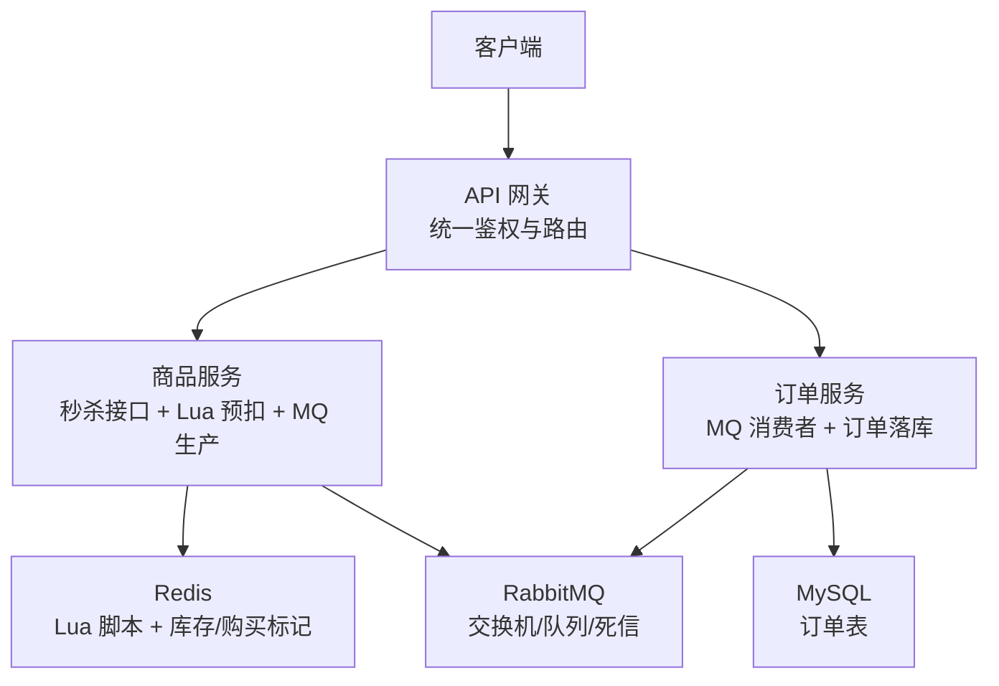
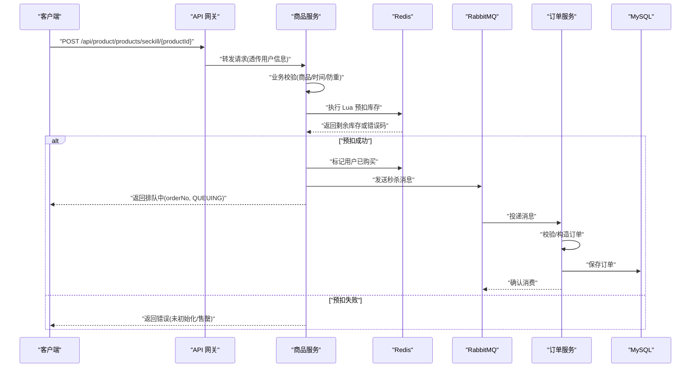
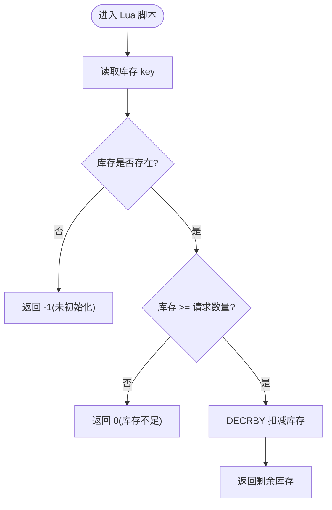
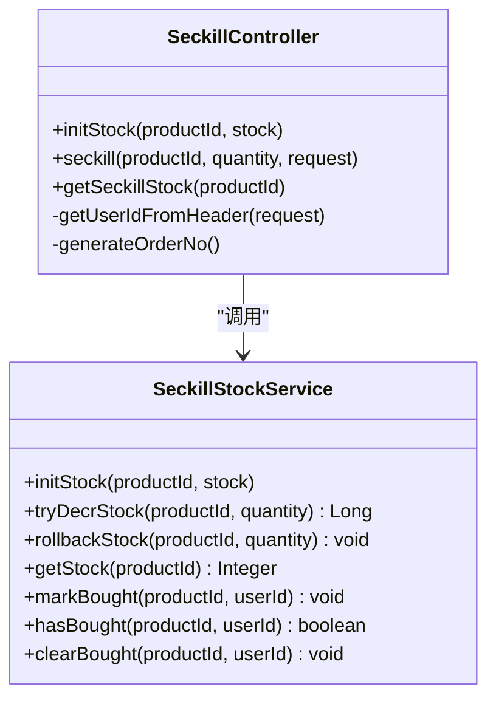
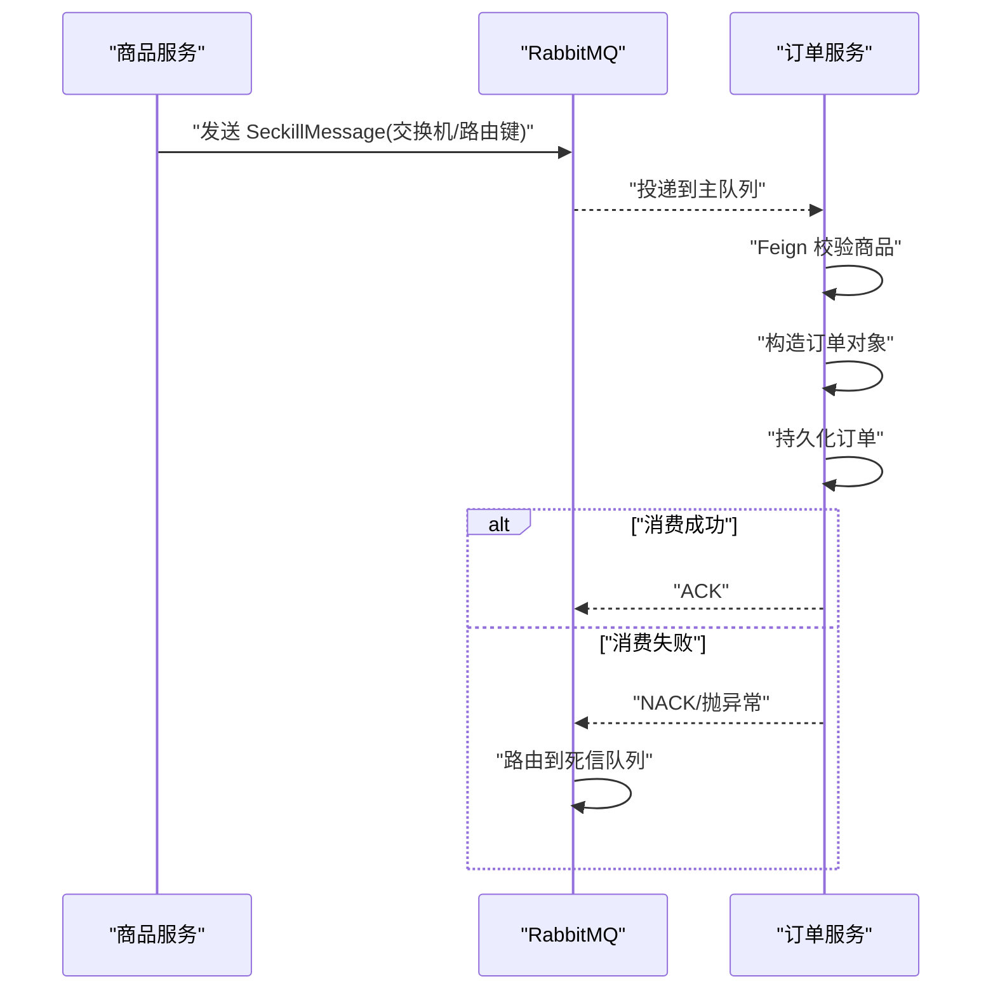
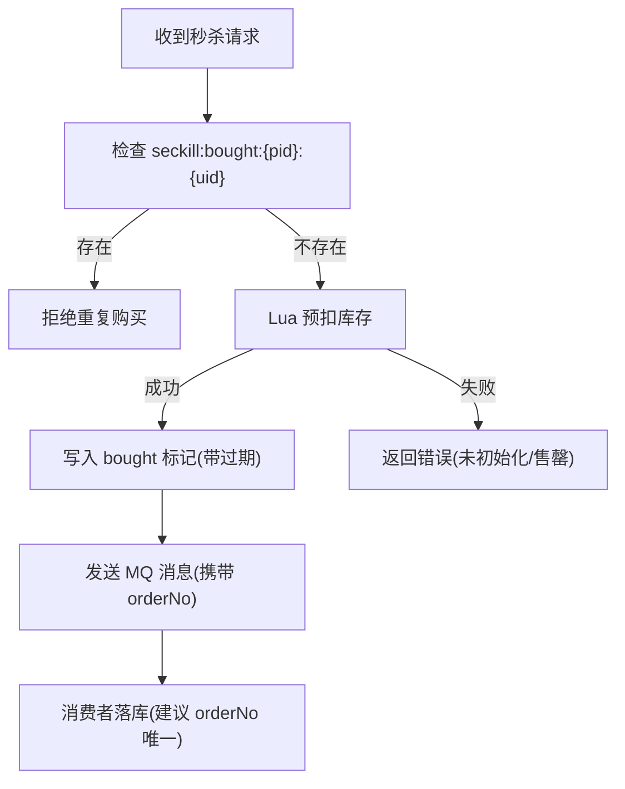
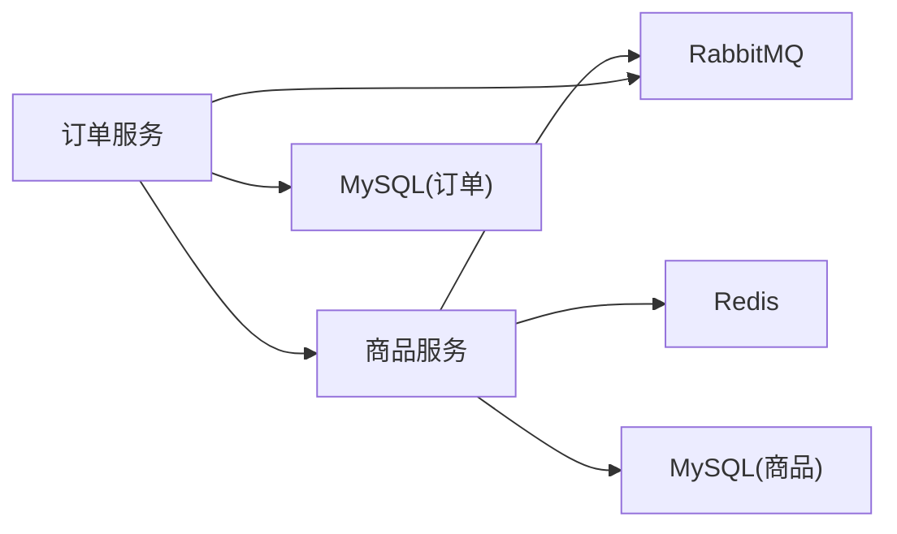

# 高并发秒杀系统

<cite>
**本文引用的文件**   
- [README.md](file://README.md)
- [seckill_stock.lua](file://backend/ecommerce-product/src/main/resources/lua/seckill_stock.lua)
- [SeckillStockService.java](file://backend/ecommerce-product/src/main/java/com/ecommerce/product/service/SeckillStockService.java)
- [SeckillController.java](file://backend/ecommerce-product/src/main/java/com/ecommerce/product/controller/SeckillController.java)
- [product SeckillRabbitConfig.java](file://backend/ecommerce-product/src/main/java/com/ecommerce/product/config/SeckillRabbitConfig.java)
- [order SeckillRabbitConfig.java](file://backend/ecommerce-order/src/main/java/com/ecommerce/order/config/SeckillRabbitConfig.java)
- [SeckillOrderConsumer.java](file://backend/ecommerce-order/src/main/java/com/ecommerce/order/consumer/SeckillOrderConsumer.java)
- [SeckillMessage.java](file://backend/ecommerce-common/src/main/java/com/ecommerce/common/SeckillMessage.java)
</cite>

## 目录
1. [引言](#引言)
2. [项目结构](#项目结构)
3. [核心组件](#核心组件)
4. [架构总览](#架构总览)
5. [详细组件分析](#详细组件分析)
6. [依赖关系分析](#依赖关系分析)
7. [性能与一致性设计](#性能与一致性设计)
8. [故障排查与监控](#故障排查与监控)
9. [扩展开发指导](#扩展开发指导)
10. [结论](#结论)

## 引言
本文件面向高并发秒杀场景，围绕 Redis Lua 原子预扣库存、RabbitMQ 异步下单、防重复购买与幂等性、数据一致性与性能优化进行系统化说明。文档以仓库中的商品服务与订单服务为核心，结合公共消息体与 RabbitMQ 配置，给出从接口到中间件再到数据库的完整链路分析与可操作建议。

## 项目结构
本项目为前后端分离的微服务电商示例，后端采用 Spring Cloud 微服务架构，包含用户、商品、订单、网关与公共模块；前端基于 qiankun 微前端。秒杀能力集中在商品服务的库存预扣与消息发送，以及订单服务的异步消费与订单落库。

图表来源
- [README.md:16-47](file://README.md#L16-L47)
- [SeckillController.java:26-149](file://backend/ecommerce-product/src/main/java/com/ecommerce/product/controller/SeckillController.java#L26-L149)
- [SeckillOrderConsumer.java:18-70](file://backend/ecommerce-order/src/main/java/com/ecommerce/order/consumer/SeckillOrderConsumer.java#L18-L70)

章节来源
- [README.md:1-150](file://README.md#L1-L150)

## 核心组件
- Redis Lua 库存预扣脚本：实现“读库存-判库存-扣库存”的原子操作，避免超卖。
- 商品服务秒杀控制器：负责参数校验、时间窗口校验、防重复购买、调用 Lua 预扣、标记已购、生成订单号并发送 MQ 消息。
- 商品服务库存服务：封装 Redis 操作（初始化库存、预扣、回滚、查询库存、用户购买标记）。
- RabbitMQ 生产者配置（商品服务）：定义交换机、队列、死信交换机与绑定关系。
- RabbitMQ 消费者配置（订单服务）：定义主队列与死信队列，支持失败消息进入死信队列。
- 订单服务消费者：监听秒杀队列，创建订单记录，异常时抛出以触发重试或进入死信队列。
- 公共消息体：跨服务传递秒杀请求上下文。

章节来源
- [seckill_stock.lua:1-13](file://backend/ecommerce-product/src/main/resources/lua/seckill_stock.lua#L1-L13)
- [SeckillStockService.java:12-91](file://backend/ecommerce-product/src/main/java/com/ecommerce/product/service/SeckillStockService.java#L12-L91)
- [SeckillController.java:26-149](file://backend/ecommerce-product/src/main/java/com/ecommerce/product/controller/SeckillController.java#L26-L149)
- [product SeckillRabbitConfig.java:10-59](file://backend/ecommerce-product/src/main/java/com/ecommerce/product/config/SeckillRabbitConfig.java#L10-L59)
- [order SeckillRabbitConfig.java:10-53](file://backend/ecommerce-order/src/main/java/com/ecommerce/order/config/SeckillRabbitConfig.java#L10-L53)
- [SeckillOrderConsumer.java:18-70](file://backend/ecommerce-order/src/main/java/com/ecommerce/order/consumer/SeckillOrderConsumer.java#L18-L70)
- [SeckillMessage.java:7-25](file://backend/ecommerce-common/src/main/java/com/ecommerce/common/SeckillMessage.java#L7-L25)

## 架构总览
秒杀整体流程分为两条主线：
- 同步路径：客户端 → 网关 → 商品服务 → Redis Lua 预扣 → 返回排队中状态。
- 异步路径：商品服务 → RabbitMQ → 订单服务 → 订单落库。

图表来源
- [SeckillController.java:57-122](file://backend/ecommerce-product/src/main/java/com/ecommerce/product/controller/SeckillController.java#L57-L122)
- [seckill_stock.lua:1-13](file://backend/ecommerce-product/src/main/resources/lua/seckill_stock.lua#L1-L13)
- [SeckillOrderConsumer.java:35-67](file://backend/ecommerce-order/src/main/java/com/ecommerce/order/consumer/SeckillOrderConsumer.java#L35-L67)

## 详细组件分析

### Redis Lua 原子预扣库存机制
- 脚本职责：读取库存、判断是否初始化、判断库存是否足够、原子扣减并返回剩余库存。
- 返回值约定：
  - -1：库存未初始化
  - 0：库存不足
  - 正整数：剩余库存
- Java 侧通过 DefaultRedisScript 加载 ClassPath 下的 Lua 脚本，并以 StringRedisTemplate 执行。

图表来源
- [seckill_stock.lua:1-13](file://backend/ecommerce-product/src/main/resources/lua/seckill_stock.lua#L1-L13)

章节来源
- [seckill_stock.lua:1-13](file://backend/ecommerce-product/src/main/resources/lua/seckill_stock.lua#L1-L13)
- [SeckillStockService.java:24-49](file://backend/ecommerce-product/src/main/java/com/ecommerce/product/service/SeckillStockService.java#L24-L49)

### 商品服务秒杀控制器与库存服务
- 控制器职责：
  - 从网关注入的请求头获取用户 ID。
  - 校验商品是否为秒杀商品、秒杀时间窗口是否有效。
  - 检查用户是否已参与该秒杀（防重复）。
  - 调用库存服务执行 Lua 预扣。
  - 预扣成功后标记用户已购买。
  - 生成订单号并发送 MQ 消息，返回排队中状态。
- 库存服务职责：
  - 初始化库存至 Redis。
  - 执行 Lua 预扣。
  - 提供回滚方法（消费失败恢复库存）。
  - 查询当前库存。
  - 管理用户维度购买标记（带过期时间）。

图表来源
- [SeckillController.java:26-149](file://backend/ecommerce-product/src/main/java/com/ecommerce/product/controller/SeckillController.java#L26-L149)
- [SeckillStockService.java:12-91](file://backend/ecommerce-product/src/main/java/com/ecommerce/product/service/SeckillStockService.java#L12-L91)

章节来源
- [SeckillController.java:57-122](file://backend/ecommerce-product/src/main/java/com/ecommerce/product/controller/SeckillController.java#L57-L122)
- [SeckillStockService.java:32-91](file://backend/ecommerce-product/src/main/java/com/ecommerce/product/service/SeckillStockService.java#L32-L91)

### RabbitMQ 异步消息处理流程
- 生产者（商品服务）：
  - 定义 Direct 交换机与主队列，主队列绑定死信交换机与路由键。
  - 在秒杀预扣成功后发送 SeckillMessage。
- 消费者（订单服务）：
  - 监听主队列，收到消息后调用 Feign 校验商品存在性，然后创建订单并落库。
  - 若消费异常，抛出异常使消息进入死信队列，便于后续人工处理或定时重试。

图表来源
- [product SeckillRabbitConfig.java:38-59](file://backend/ecommerce-product/src/main/java/com/ecommerce/product/config/SeckillRabbitConfig.java#L38-L59)
- [order SeckillRabbitConfig.java:20-53](file://backend/ecommerce-order/src/main/java/com/ecommerce/order/config/SeckillRabbitConfig.java#L20-L53)
- [SeckillOrderConsumer.java:35-67](file://backend/ecommerce-order/src/main/java/com/ecommerce/order/consumer/SeckillOrderConsumer.java#L35-L67)

章节来源
- [product SeckillRabbitConfig.java:10-59](file://backend/ecommerce-product/src/main/java/com/ecommerce/product/config/SeckillRabbitConfig.java#L10-L59)
- [order SeckillRabbitConfig.java:10-53](file://backend/ecommerce-order/src/main/java/com/ecommerce/order/config/SeckillRabbitConfig.java#L10-L53)
- [SeckillOrderConsumer.java:35-67](file://backend/ecommerce-order/src/main/java/com/ecommerce/order/consumer/SeckillOrderConsumer.java#L35-L67)

### 防重复购买与幂等性保证
- 用户维度去重：
  - 使用 Redis Key `seckill:bought:{productId}:{userId}`，设置过期时间（默认 24 小时），用于标识用户已参与某次秒杀。
  - 在预扣前检查该 Key 是否存在，存在则拒绝重复购买。
- 幂等性保证：
  - 订单号由商品服务在预扣成功后生成，并通过消息体传递给订单服务，确保同一请求不会重复建单。
  - 消费者侧可在落库前增加唯一索引或幂等键校验（建议在订单表对 orderNo 加唯一约束）。

图表来源
- [SeckillStockService.java:68-91](file://backend/ecommerce-product/src/main/java/com/ecommerce/product/service/SeckillStockService.java#L68-L91)
- [SeckillController.java:87-114](file://backend/ecommerce-product/src/main/java/com/ecommerce/product/controller/SeckillController.java#L87-L114)

章节来源
- [SeckillStockService.java:68-91](file://backend/ecommerce-product/src/main/java/com/ecommerce/product/service/SeckillStockService.java#L68-L91)
- [SeckillController.java:87-114](file://backend/ecommerce-product/src/main/java/com/ecommerce/product/controller/SeckillController.java#L87-L114)

### 事务与一致性保障
- Redis 原子性：Lua 脚本在 Redis 内原子执行，避免并发超卖。
- 异步最终一致性：
  - 预扣成功后立即发送 MQ 消息，订单服务异步落库。
  - 若消费者异常，消息进入死信队列，需补充补偿逻辑：回滚 Redis 库存与清除用户购买标记。
- 建议增强：
  - 在消费者中实现幂等建单（orderNo 唯一）。
  - 引入分布式事务或补偿任务（如定时扫描死信队列，按 orderNo 回滚 Redis 库存与购买标记）。

章节来源
- [seckill_stock.lua:1-13](file://backend/ecommerce-product/src/main/resources/lua/seckill_stock.lua#L1-L13)
- [SeckillOrderConsumer.java:62-67](file://backend/ecommerce-order/src/main/java/com/ecommerce/order/consumer/SeckillOrderConsumer.java#L62-L67)

## 依赖关系分析
- 商品服务依赖：
  - Redis：Lua 脚本执行、库存与购买标记存储。
  - RabbitMQ：发送秒杀消息。
  - 数据库：商品基础信息查询（非秒杀关键路径）。
- 订单服务依赖：
  - RabbitMQ：消费秒杀消息。
  - MySQL：订单持久化。
  - 商品服务（Feign）：校验商品存在性（仅验证，不扣库存）。

图表来源
- [SeckillController.java:26-149](file://backend/ecommerce-product/src/main/java/com/ecommerce/product/controller/SeckillController.java#L26-L149)
- [SeckillOrderConsumer.java:18-70](file://backend/ecommerce-order/src/main/java/com/ecommerce/order/consumer/SeckillOrderConsumer.java#L18-L70)

章节来源
- [SeckillController.java:26-149](file://backend/ecommerce-product/src/main/java/com/ecommerce/product/controller/SeckillController.java#L26-L149)
- [SeckillOrderConsumer.java:18-70](file://backend/ecommerce-order/src/main/java/com/ecommerce/order/consumer/SeckillOrderConsumer.java#L18-L70)

## 性能与一致性设计
- 高性能关键点
  - 热点库存走 Redis，Lua 原子操作避免锁竞争与超卖。
  - 秒杀接口快速返回排队中状态，削峰填谷。
  - 异步下单解耦写库压力，提升吞吐。
- 一致性策略
  - 预扣与购买标记在同一请求中完成，减少不一致窗口。
  - 消费者异常进入死信队列，配合补偿任务回滚 Redis 与清理购买标记。
  - 建议订单号唯一约束，防止重复建单。
- 可扩展性
  - 多实例部署下，Redis 与 RabbitMQ 天然具备横向扩展能力。
  - 可通过分片/分区将不同商品库存分散到多个 Redis Key，降低热点冲突。

[本节为通用性能与一致性讨论，不直接分析具体代码文件]

## 故障排查与监控
- 常见问题定位
  - 库存未初始化：Lua 返回 -1，检查是否在秒杀前调用初始化接口。
  - 库存不足：Lua 返回 0，检查库存量与并发量匹配情况。
  - 重复购买：检查 bought 标记是否被正确写入与过期策略。
  - 消息堆积：观察 RabbitMQ 队列长度与消费者消费速率。
  - 死信队列积压：检查消费者异常日志，定位失败原因并修复。
- 监控指标建议
  - Redis：库存 Key 命中率、Lua 执行耗时、bought 标记 Key 数量与过期分布。
  - RabbitMQ：主队列长度、死信队列长度、消息投递成功率、消费者消费延迟。
  - 应用层：秒杀接口 QPS、成功率、平均响应时间、异常率。
  - 数据库：订单插入 TPS、慢查询、锁等待。
- 日志与追踪
  - 在控制器与消费者中记录关键步骤日志（用户ID、商品ID、订单号、结果码）。
  - 建议接入链路追踪（如 SkyWalking、Zipkin）以便端到端定位问题。

章节来源
- [SeckillController.java:87-122](file://backend/ecommerce-product/src/main/java/com/ecommerce/product/controller/SeckillController.java#L87-L122)
- [SeckillOrderConsumer.java:35-67](file://backend/ecommerce-order/src/main/java/com/ecommerce/order/consumer/SeckillOrderConsumer.java#L35-L67)

## 扩展开发指导
- 增强幂等性
  - 在订单表为 orderNo 添加唯一索引，消费者落库前做幂等判断。
- 完善补偿机制
  - 新增补偿任务：扫描死信队列，根据 orderNo 回滚 Redis 库存与购买标记。
  - 引入重试策略：对瞬时异常进行有限次数重试，超过阈值进入死信队列。
- 优化防重策略
  - 将 bought 标记改为更细粒度（如批次/活动ID），避免长期占用 Key。
  - 考虑使用 Redis Set 或 Bitmap 优化大规模用户去重。
- 扩容与分片
  - 按商品 ID 哈希分片到多个 Redis 节点，降低热点 Key 压力。
  - 消费者多实例并行消费，提升吞吐。
- 监控与告警
  - 对 Redis 内存、连接数、Lua 执行时长设置告警阈值。
  - 对 RabbitMQ 队列积压、消费者失败率设置告警。

[本节为通用扩展建议，不直接分析具体代码文件]

## 结论
本方案通过 Redis Lua 原子预扣与 RabbitMQ 异步下单，实现了高并发秒杀的核心能力：防超卖、削峰填谷、最终一致性。结合用户维度防重与幂等设计，系统在峰值流量下仍能保证稳定与正确性。未来可通过补偿任务、幂等约束、分片与监控告警进一步增强系统的健壮性与可观测性。