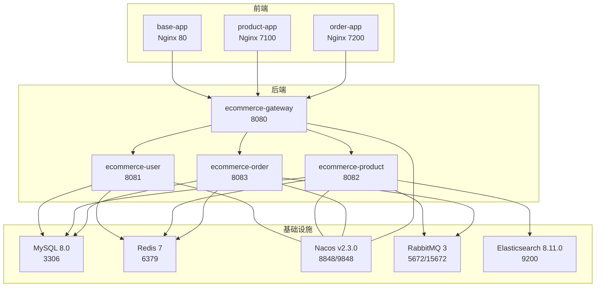
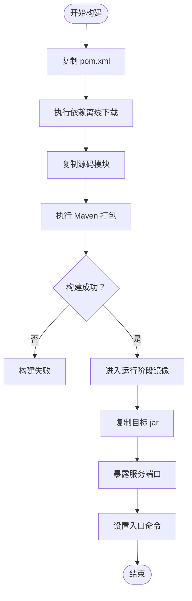
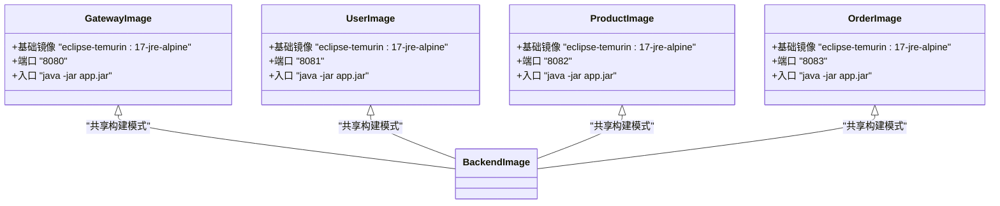
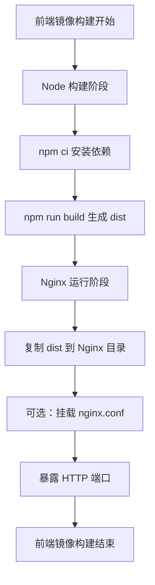
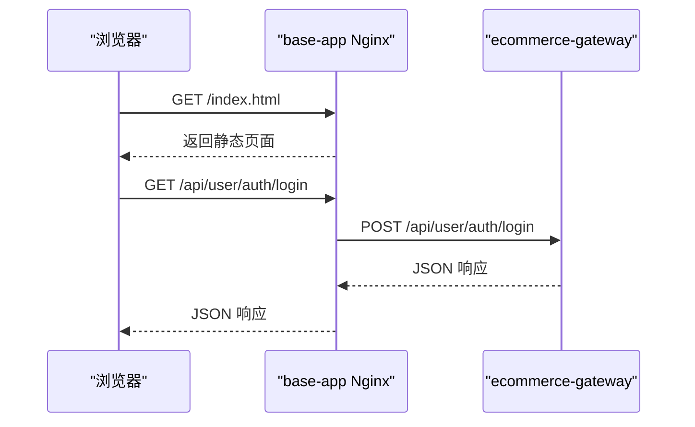
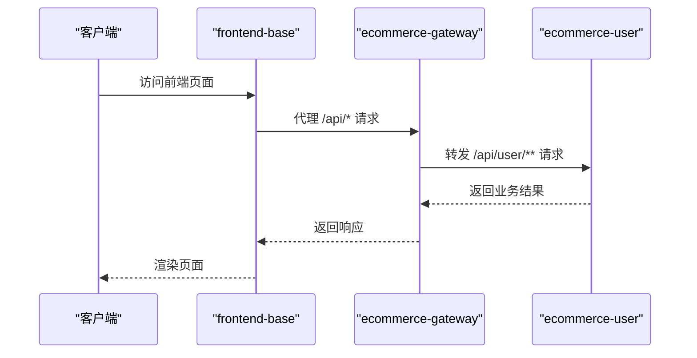
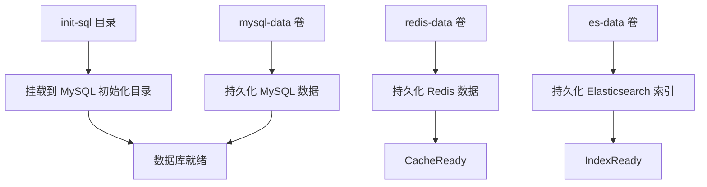
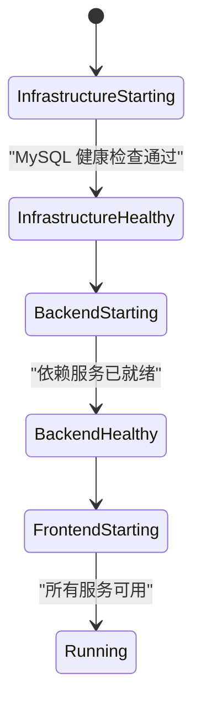
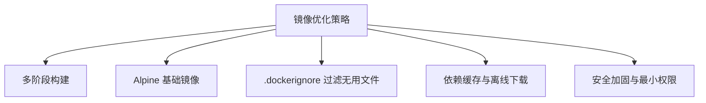
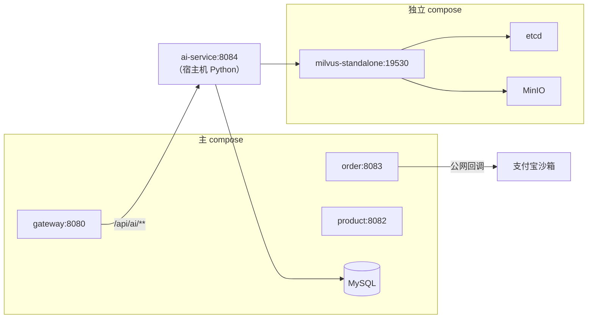

# Docker容器化部署

<cite>
**本文引用的文件**   
- [backend/Dockerfile.gateway](file://backend/Dockerfile.gateway)
- [backend/Dockerfile.user](file://backend/Dockerfile.user)
- [backend/Dockerfile.product](file://backend/Dockerfile.product)
- [backend/Dockerfile.order](file://backend/Dockerfile.order)
- [backend/.dockerignore](file://backend/.dockerignore)
- [frontend/base-app/Dockerfile](file://frontend/base-app/Dockerfile)
- [frontend/product-app/Dockerfile](file://frontend/product-app/Dockerfile)
- [frontend/order-app/Dockerfile](file://frontend/order-app/Dockerfile)
- [frontend/base-app/nginx.conf](file://frontend/base-app/nginx.conf)
- [frontend/base-app/.dockerignore](file://frontend/base-app/.dockerignore)
- [docker-compose.yml](file://docker-compose.yml)
- [docker-compose.milvus.yml](file://docker-compose.milvus.yml)
- [ai-service/run.ps1](file://ai-service/run.ps1)
- [ai-service/README.md](file://ai-service/README.md)
- [README.md](file://README.md)
</cite>

## 目录
1. [引言](#引言)
2. [项目结构与容器边界](#项目结构与容器边界)
3. [后端微服务镜像构建](#后端微服务镜像构建)
4. [前端应用镜像构建](#前端应用镜像构建)
5. [Docker Compose编排与网络通信](#docker-compose编排与网络通信)
6. [环境变量、端口映射与数据持久化](#环境变量端口映射与数据持久化)
7. [健康检查与服务启动顺序](#健康检查与服务启动顺序)
8. [镜像优化与安全加固](#镜像优化与安全加固)
9. [AI 服务与向量库的部署边界](#ai-服务与向量库的部署边界)
10. [常见问题排查](#常见问题排查)
11. [结论](#结论)

## 引言
本文件面向使用 Docker 和 Docker Compose 部署该前后端分离微电商项目的读者，重点说明：
- 每个后端微服务和前端应用的镜像构建过程。
- Dockerfile 关键配置项的含义与扩展方式。
- 容器间通信、网络模式、数据持久化方案。
- 多阶段构建、镜像体积优化、安全加固等最佳实践。
- 基于现有 `docker-compose.yml` 的一键部署流程与访问地址。

该项目采用 Spring Cloud 微服务架构与 qiankun 微前端架构，基础设施包含 MySQL、Redis、Nacos、RabbitMQ、Elasticsearch；后端提供 API 网关与用户、商品、订单三个业务微服务；前端由主应用与两个子应用组成，统一通过 Nginx 托管静态资源并代理后端接口。

需要特别说明两个"不在主 compose 内"的依赖：支付回调必须能从公网到达订单服务；保险咨询的 `ai-service`（Python）与 `Milvus` 需要单独部署（见「AI 服务与向量库的部署边界」）。

**章节来源**
- [README.md:1-15](file://README.md#L1-L15)
- [README.md:16-47](file://README.md#L16-L47)

## 项目结构与容器边界
从容器化视角看，仓库主要划分为三类镜像：
- 后端 Java 微服务镜像：网关、用户、商品、订单。
- 前端静态资源镜像：主应用 base-app、商品子应用 product-app、订单子应用 order-app。
- 基础设施镜像：MySQL、Redis、Nacos、RabbitMQ、Elasticsearch。

**图表来源**
- [docker-compose.yml:5-68](file://docker-compose.yml#L5-L68)
- [docker-compose.yml:70-179](file://docker-compose.yml#L70-L179)

**章节来源**
- [README.md:49-149](file://README.md#L49-L149)
- [docker-compose.yml:1-185](file://docker-compose.yml#L1-L185)

## 后端微服务镜像构建
后端四个模块共用相似的构建思路：使用 Maven 镜像完成依赖下载与打包，再使用精简的 JRE Alpine 镜像运行。

### 通用构建流程
- 构建阶段基础镜像：`maven:3.9-eclipse-temurin-17`。
- 工作目录：`/app`。
- 先复制所有相关 `pom.xml`，执行 `mvn dependency:go-offline` 缓存依赖。
- 再复制源码模块，执行 `mvn package -DskipTests` 生成可执行 jar。
- 运行阶段基础镜像：`eclipse-temurin:17-jre-alpine`。
- 将构建产物复制到运行镜像中，暴露端口并通过 `java -jar` 启动。

**图表来源**
- [backend/Dockerfile.gateway:1-22](file://backend/Dockerfile.gateway#L1-L22)
- [backend/Dockerfile.user:1-22](file://backend/Dockerfile.user#L1-L22)
- [backend/Dockerfile.product:1-22](file://backend/Dockerfile.product#L1-L22)
- [backend/Dockerfile.order:1-22](file://backend/Dockerfile.order#L1-L22)

### 各微服务差异点
- **API 网关**：暴露端口 `8080`，作为外部统一入口。
- **用户服务**：暴露端口 `8081`，连接 MySQL、Redis、Nacos。
- **商品服务**：暴露端口 `8082`，连接 MySQL、Redis、Elasticsearch、RabbitMQ、Nacos。
- **订单服务**：暴露端口 `8083`，连接 MySQL、Redis、RabbitMQ、Nacos。

**图表来源**
- [backend/Dockerfile.gateway:16-22](file://backend/Dockerfile.gateway#L16-L22)
- [backend/Dockerfile.user:16-22](file://backend/Dockerfile.user#L16-L22)
- [backend/Dockerfile.product:16-22](file://backend/Dockerfile.product#L16-L22)
- [backend/Dockerfile.order:16-22](file://backend/Dockerfile.order#L16-L22)

**章节来源**
- [backend/Dockerfile.gateway:1-22](file://backend/Dockerfile.gateway#L1-L22)
- [backend/Dockerfile.user:1-22](file://backend/Dockerfile.user#L1-L22)
- [backend/Dockerfile.product:1-22](file://backend/Dockerfile.product#L1-L22)
- [backend/Dockerfile.order:1-22](file://backend/Dockerfile.order#L1-L22)

## 前端应用镜像构建
前端三个应用均采用 Node 构建 + Nginx 运行的双阶段镜像策略。

### 构建阶段
- 基础镜像：`node:20-alpine`。
- 工作目录：`/app`。
- 优先复制 `package*.json`，执行 `npm ci` 安装依赖。
- 复制完整源码，执行 `npm run build` 生成静态资源。

### 运行阶段
- 基础镜像：`nginx:alpine`。
- 将构建产物复制到 Nginx 默认静态目录。
- 暴露端口：
  - base-app：`80`。
  - product-app：`7100`。
  - order-app：`7200`。
- base-app 额外挂载自定义 `nginx.conf`，实现路由 fallback 与 API 反向代理。

**图表来源**
- [frontend/base-app/Dockerfile:1-12](file://frontend/base-app/Dockerfile#L1-L12)
- [frontend/product-app/Dockerfile:1-12](file://frontend/product-app/Dockerfile#L1-L12)
- [frontend/order-app/Dockerfile:1-12](file://frontend/order-app/Dockerfile#L1-L12)

### base-app 的 Nginx 配置要点
- 静态资源根目录指向构建输出。
- 前端路由 history 模式下，未知路径回退到 `index.html`。
- `/api/` 请求反向代理到网关 `ecommerce-gateway:8080`。
- 静态资源启用长期缓存头。

**图表来源**
- [frontend/base-app/nginx.conf:1-27](file://frontend/base-app/nginx.conf#L1-L27)

**章节来源**
- [frontend/base-app/Dockerfile:1-12](file://frontend/base-app/Dockerfile#L1-L12)
- [frontend/product-app/Dockerfile:1-12](file://frontend/product-app/Dockerfile#L1-L12)
- [frontend/order-app/Dockerfile:1-12](file://frontend/order-app/Dockerfile#L1-L12)
- [frontend/base-app/nginx.conf:1-27](file://frontend/base-app/nginx.conf#L1-L27)

## Docker Compose编排与网络通信
`docker-compose.yml` 定义了基础设施、后端微服务、前端应用的完整编排关系。

### 服务分组
- 基础设施：MySQL、Redis、Nacos、Elasticsearch、RabbitMQ。
- 后端微服务：gateway、user、product、order。
- 前端应用：frontend-base、frontend-product、frontend-order。

### 容器间通信模型
- 同一 Compose 网络下，服务名即主机名。
- 后端服务通过服务名访问中间件，例如 `mysql`、`redis`、`nacos`、`rabbitmq`、`elasticsearch`。
- 前端 base-app 通过 Nginx 反向代理访问网关服务名 `ecommerce-gateway`。
- 微服务之间通过 Nacos 注册发现，网关按路径分发请求。

**图表来源**
- [docker-compose.yml:70-179](file://docker-compose.yml#L70-L179)
- [frontend/base-app/nginx.conf:12-19](file://frontend/base-app/nginx.conf#L12-L19)

**章节来源**
- [docker-compose.yml:1-185](file://docker-compose.yml#L1-L185)
- [README.md:430-476](file://README.md#L430-L476)

## 环境变量、端口映射与数据持久化
### 环境变量
- 后端服务统一通过环境变量注入：
  - `SPRING_PROFILES_ACTIVE=docker`。
  - 数据库连接地址、用户名、密码。
  - Redis 主机名。
  - Nacos 注册中心地址。
  - Elasticsearch 地址（商品服务）。
  - RabbitMQ 主机名（商品服务、订单服务）。
  - 对象存储（商品服务）：`OSS_ENDPOINT`、`OSS_BUCKET`、`OSS_ACCESS_KEY_ID`、`OSS_ACCESS_KEY_SECRET`、`OSS_DIR`；未配置时自动回落本地磁盘。
  - 支付宝沙箱（订单服务）：`ALIPAY_APP_ID`、`ALIPAY_PRIVATE_KEY`、`ALIPAY_PUBLIC_KEY`、`ALIPAY_GATEWAY_URL`、`ALIPAY_NOTIFY_URL`、`ALIPAY_RETURN_URL`、`ALIPAY_TIMEOUT_EXPRESS`；未配置时服务仍可启动，创建支付返回码 503。
- 基础设施服务也通过环境变量控制行为，例如 MySQL 字符集、Nacos 内存参数、Elasticsearch 单节点与安全开关、RabbitMQ 默认账号。

### 端口映射
- 基础设施对外暴露：
  - MySQL：`3306`
  - Redis：`6379`
  - Nacos：`8848`、`9848`
  - RabbitMQ：`5672`、`15672`
  - Elasticsearch：`9200`
- 后端服务对外暴露：
  - 网关：`8080`
  - 用户服务：`8081`
  - 商品服务：`8082`
  - 订单服务：`8083`
- 前端服务对外暴露：
  - base-app：`80`
  - product-app：`7100`
  - order-app：`7200`

### 数据持久化
- MySQL 数据卷：`mysql-data:/var/lib/mysql`。
- Redis 数据卷：`redis-data:/data`。
- Elasticsearch 数据卷：`es-data:/usr/share/elasticsearch/data`。
- 初始化 SQL：`./init-sql` 挂载到 MySQL 初始化目录，首次启动自动建库建表（`02-alipay-payment.sql` 建 `payment_record`，`03-insurance-agent.sql` 建 AI 会话/文档表）。

**图表来源**
- [docker-compose.yml:5-26](file://docker-compose.yml#L5-L26)
- [docker-compose.yml:28-57](file://docker-compose.yml#L28-L57)
- [docker-compose.yml:181-185](file://docker-compose.yml#L181-L185)

**章节来源**
- [docker-compose.yml:5-68](file://docker-compose.yml#L5-L68)
- [docker-compose.yml:101-158](file://docker-compose.yml#L101-L158)
- [docker-compose.yml:181-185](file://docker-compose.yml#L181-L185)

## 健康检查与服务启动顺序
### 健康检查
- MySQL 使用 `mysqladmin ping` 进行健康检查。
- 其他中间件未显式定义健康检查，但可通过端口连通性判断。
- 后端微服务依赖中间件状态，通过 `depends_on` 与条件控制启动顺序。

### 启动顺序
- 基础设施先启动。
- 后端微服务在依赖的基础设施就绪后启动。
- 前端应用在网关就绪后启动。

**图表来源**
- [docker-compose.yml:22-26](file://docker-compose.yml#L22-L26)
- [docker-compose.yml:77-85](file://docker-compose.yml#L77-L85)
- [docker-compose.yml:94-107](file://docker-compose.yml#L94-L107)
- [docker-compose.yml:116-133](file://docker-compose.yml#L116-L133)
- [docker-compose.yml:142-158](file://docker-compose.yml#L142-L158)
- [docker-compose.yml:166-167](file://docker-compose.yml#L166-L167)

**章节来源**
- [docker-compose.yml:22-26](file://docker-compose.yml#L22-L26)
- [docker-compose.yml:70-179](file://docker-compose.yml#L70-L179)

## 镜像优化与安全加固
### 多阶段构建
- 后端使用 Maven 构建阶段与 JRE 运行阶段分离，避免运行镜像中包含完整 JDK 与构建工具。
- 前端使用 Node 构建阶段与 Nginx 运行阶段分离，避免运行镜像中包含 Node 环境与源码。

### 镜像大小优化
- 运行阶段使用 Alpine 基础镜像，减小体积。
- 仅复制必要构建产物到运行镜像。
- 前端使用 `npm ci` 替代 `npm install`，提升依赖安装稳定性与可重复性。
- 后端使用 `dependency:go-offline` 提前拉取依赖，提高后续构建缓存命中率。

### 构建上下文与忽略文件
- 后端 `.dockerignore` 排除 `target`、`node_modules`、`.git`、IDE 配置等无关文件。
- 前端 `.dockerignore` 排除 `node_modules`、`dist`、`.git`、`.vscode` 等无关文件。

### 安全加固建议
- 生产环境建议：
  - 使用非 root 用户运行容器。
  - 最小化基础镜像，移除不必要的系统包。
  - 对敏感配置使用环境变量或密钥管理，不硬编码到镜像中。
  - 定期更新基础镜像以修复已知漏洞。
  - 限制容器资源上限，防止单实例耗尽宿主机资源。
  - 对前端静态资源启用 HTTPS 与严格的安全头。
  - 对后端服务启用 TLS、鉴权白名单与访问审计。

**图表来源**
- [backend/.dockerignore:1-8](file://backend/.dockerignore#L1-L8)
- [frontend/base-app/.dockerignore:1-5](file://frontend/base-app/.dockerignore#L1-L5)
- [backend/Dockerfile.gateway:1-22](file://backend/Dockerfile.gateway#L1-L22)
- [frontend/base-app/Dockerfile:1-12](file://frontend/base-app/Dockerfile#L1-L12)

**章节来源**
- [backend/.dockerignore:1-8](file://backend/.dockerignore#L1-L8)
- [frontend/base-app/.dockerignore:1-5](file://frontend/base-app/.dockerignore#L1-L5)
- [backend/Dockerfile.gateway:1-22](file://backend/Dockerfile.gateway#L1-L22)
- [backend/Dockerfile.user:1-22](file://backend/Dockerfile.user#L1-L22)
- [backend/Dockerfile.product:1-22](file://backend/Dockerfile.product#L1-L22)
- [backend/Dockerfile.order:1-22](file://backend/Dockerfile.order#L1-L22)
- [frontend/base-app/Dockerfile:1-12](file://frontend/base-app/Dockerfile#L1-L12)
- [frontend/product-app/Dockerfile:1-12](file://frontend/product-app/Dockerfile#L1-L12)
- [frontend/order-app/Dockerfile:1-12](file://frontend/order-app/Dockerfile#L1-L12)

## AI 服务与向量库的部署边界
保险咨询不在主 `docker-compose.yml` 里，原因是它与 Java 技术栈的构建/运行方式差异较大，且依赖独立的向量库。当前部署形态如下：

- **ai-service（未容器化）**：以 Python 虚拟环境在本机或 VM 运行（`ai-service/run.ps1` → `uvicorn` 监听 `127.0.0.1:8084`）。网关用固定 `uri: http://localhost:8084` 反向代理 `/api/ai/**`，因此**容器内的网关无法用 `localhost` 找到宿主机服务**，容器化部署时需改为 `host.docker.internal:8084` 或为 ai-service 补 Dockerfile 并入同一网络。
- **Milvus（独立 compose）**：`docker-compose.milvus.yml` 拉起 `milvus-etcd` + `milvus-minio` + `milvus-standalone:2.4.15`，gRPC 端口 `19530`、指标 `9091`，数据挂载 `/opt/milvus`。建议部署在固定主机上，由 ai-service 通过 `MILVUS_URI` 直连。
- **网络与鉴权**：ai-service 不注册 Nacos，不参与网关负载均衡；身份仍由网关注入 `X-User-Id/Name/Role` + HMAC 签名头，ai-service 侧可选验签（`VERIFY_GATEWAY_SIGNATURE` + `GATEWAY_JWT_SECRET`）。
- **开机顺序**：MySQL（业务表）→ Milvus（依赖 etcd/MinIO）→ ai-service → 网关。ai-service 在 Milvus 不可用时仍能启动，只是上传/问答降级。
- **前端上传大小**：Nginx 已设置 `client_max_body_size 6m` 以匹配后端 multipart，商品图片与保险 PDF（上限 20MB）需按实际场景调整；AI 文档上传若超过 6m 会先被 Nginx 拦截。

**图表来源**
- [docker-compose.milvus.yml:1-70](file://docker-compose.milvus.yml#L1-L70)
- [ai-service/run.ps1:1-10](file://ai-service/run.ps1#L1-L10)
- [frontend/base-app/nginx.conf:7-8](file://frontend/base-app/nginx.conf#L7-L8)

**章节来源**
- [ai-service/README.md](file://ai-service/README.md)
- [docker-compose.yml:83-91](file://docker-compose.yml#L83-L91)

## 常见问题排查
### 前端无法访问后端接口
- 确认 base-app 的 Nginx 是否将 `/api/` 正确代理到 `ecommerce-gateway:8080`。
- 确认网关服务是否已启动并可被前端容器解析。
- 检查浏览器控制台网络请求是否返回跨域或网关鉴权错误。

**章节来源**
- [frontend/base-app/nginx.conf:12-19](file://frontend/base-app/nginx.conf#L12-L19)
- [docker-compose.yml:70-85](file://docker-compose.yml#L70-L85)

### 后端无法连接数据库
- 确认 MySQL 容器是否健康且端口 `3306` 已开放。
- 确认后端环境变量中的数据库 URL、用户名、密码是否正确。
- 确认 `init-sql` 是否成功执行，数据库与表是否创建。

**章节来源**
- [docker-compose.yml:5-26](file://docker-compose.yml#L5-L26)
- [docker-compose.yml:101-107](file://docker-compose.yml#L101-L107)
- [docker-compose.yml:125-133](file://docker-compose.yml#L125-L133)
- [docker-compose.yml:151-158](file://docker-compose.yml#L151-L158)

### 秒杀功能异常
- 确认 Redis 是否可连接，Lua 脚本是否能原子扣减库存。
- 确认 RabbitMQ 是否可连接，消息是否能正常消费。
- 确认商品服务与订单服务的队列配置是否一致。

**章节来源**
- [docker-compose.yml:116-133](file://docker-compose.yml#L116-L133)
- [docker-compose.yml:142-158](file://docker-compose.yml#L142-L158)

### 前端页面刷新后路由失效
- 确认 base-app 的 Nginx 配置是否启用 history 模式 fallback。
- 确认访问的是 base-app 的根路径而非直接访问子路径。

**章节来源**
- [frontend/base-app/nginx.conf:7-10](file://frontend/base-app/nginx.conf#L7-L10)

### 支付回调收不到
- 现象：支付后订单一直待支付，只能等前端 `sync=true` 查询。
- 排查：`ALIPAY_NOTIFY_URL` 是否为支付宝可达的公网地址（容器内 `localhost` 不可用）；公网入口是否把 `/api/order/payments/alipay/notify` 放行到网关（该路径在网关白名单中，安全性由验签保证）。

**章节来源**
- [docker-compose.yml:166-173](file://docker-compose.yml#L166-L173)

### 图片上传 413
- 现象：上传返回 413 Request Entity Too Large。
- 排查：Nginx `client_max_body_size`（当前 6m）、后端 multipart 上限、前端 `ImageUploader` 的 `maxSizeMb` 三处需一致；AI 文档上传则需另外调整上限。

**章节来源**
- [frontend/base-app/nginx.conf:7-8](file://frontend/base-app/nginx.conf#L7-L8)

### 容器内网关访问不到 ai-service
- 现象：`/api/ai/**` 返回 502。
- 排查：网关路由为 `http://localhost:8084`，在容器内指向自身；改为 `host.docker.internal:8084`（Windows/Mac）或服务名（若为 ai-service 补了 Dockerfile 并入同一网络）。

## 结论
本项目通过清晰的分层镜像构建与 Docker Compose 编排，实现了前后端微服务的一体化部署。后端采用多阶段构建与 Alpine 运行镜像，前端采用 Node 构建与 Nginx 运行镜像，整体镜像体积小、启动快。通过环境变量、端口映射、数据卷与健康检查，保证了服务可观测性与数据持久化。支付与图片上传把"外部依赖"带进了部署边界（公网回调地址、对象存储/本地盘、Nginx 上传上限），AI 咨询则通过独立 compose + 宿主机进程的方式与主栈解耦。建议在生产环境中进一步引入安全加固、资源限制、日志收集与监控告警，以提升系统的稳定性与可维护性。